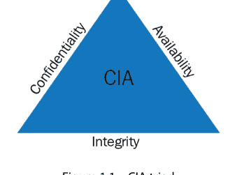

## ISO27001 – 定义与安全概念

我撰写本书的目的是为你提供一种舒适的方式来理解并提升贵机构的网络安全和隐私。当然，本书并非针对 ISO27001 实施的资深专家；而且在规划时，我的目标是几乎对网络安全和隐私一无所知但希望改善公司安全的管理人员，甚至使用第三方咨询（因此希望知道外部服务是否在浪费内部预算），或因某种原因需要顺利处理 IT 安全的新手。

这是一段漫长的旅程，虽然我会尽力帮助你在短小精悍的书中消化大量信息。我希望你觉得它有趣，并原谅那些无论我做多少次校对都会出现的错误。

既然这是一段漫长的旅程，我建议你准备一双舒适的拖鞋，泡一杯大杯咖啡（或茶，随你喜欢），坐下来放松。

在本章中，我们将涵盖以下主题：

- 标准 27k 系列
- 保密性、完整性和可用性
- 信息安全概念与定义
- 治理、政策和事件管理
- NIST 的差异

### 标准 27000 系列

*除了墙壁和围栏，如果有的话，你的公司还有更多需要保护的东西。* 假设你的公司开发了一款新产品。这款产品可以保证未来至少十年九位数收入。那么，你公司最重要的资产是什么？

> *贵公司最重要的资产之一是信息。*

当你继续阅读本书时，这句话很快就会成为你的座右铭。确保信息的保密性、完整性和可用性是信息安全的目标。这些基本的信息安全因素有助于确保实体的數據安全。那么，回到你的产品，你的公司需要抵御什么？

主要痛点如下：

- 敏感或机密信息的泄露或披露，无论是意外还是有意
- 个人身份信息被泄露
- 关键信息在实体不知情的情况下被篡改，无论是失误还是故意
- 关键企业数据无迹可寻或无法恢复地消失
- 需要时关键业务信息不可用

前述陈述引导我们得出关于信息的几个有价值的座右铭：

> *公司内部每个人都应对信息系统负责，并尽最大努力确保其信息安全。*

> *人始终是安全链中最薄弱的环节。*

简单来说：公司内部每个人都需要理解并帮助改善安全态势，而且通常只要遵循公司政策和程序（甚至使用常识）就能极大地改善标准安全。例如，只需采用并遵守清洁桌面政策，就可能防止清洁人员查看未经授权的文件（我们不知道清洁人员是否准备以某种方式出售我们的公司和/或私人信息——内部人员可以戴任何帽子）。

再看另一个例子：你的公司花费数千美元实施隐私屏幕（为计算机用户设计的隐私过滤器，用于保护其私人机密信息）。但如果你把笔记本电脑无人看管，那么它们就完全无用了。

> *信息得到充分维护并免受多种威胁的侵害。*

每个实体都可能通过不同方式面临数据泄露风险，如果一家公司希望改善其安全标准，就会感到需要改进这些方面。绝大多数公司（至少在欧洲）使用所谓的框架（如 ISO 27001/27002、NIST 等），仅仅因为它们准备好应用和使用。更具体地说，关于欧洲实体，通过实施 ISO 27001，你也在实施诸如通用数据保护条例（GDPR，也称为欧洲隐私法）和云安全等内容。基本上，你一石三鸟。

以下 ISO 为我们建立有效的信息管理系统奠定了基础：

- 信息安全管理体系 – ISO/IEC 27001:2017
- 安全方法 – 要求和 ISO/IEC 27002:2022

虽然 ISO 27001 已准备好提供建立、实施、维护和持续改进信息安全管理体系的要求，但 ISO27002 适用于各类规模的组织。它可作为确定和实施信息安全风险处理控制措施的参考，用于基于 ISO/IEC 27001 的 **信息安全管理体系**（ISMS）

作为一个独立的非政府实体诞生的 **国际标准化组织**（ISO）由 165 个成员国组成的国家标准机构组成。ISO 开发了超过 1,500 项自愿性国际标准。

根据维基百科：

> 已建立超过 20,000 项标准，涵盖从制造商品和技术到食品安全、农业和医疗保健服务等各个方面。ISO 是一个自愿性实体，其成员是各国公认的标准权威机构，每个机构代表一个国家。成员每年在大会上会面，讨论 ISO 的战略目标。该实体由设在日内瓦的中央秘书处协调。

> 一个由 20 个成员机构轮换组成的理事会提供指导和治理，包括设定中央秘书处的年度预算。

> 技术管理委员会负责超过 250 个技术委员会，后者制定 ISO 标准。

遵守标准可以生产高质量的产品和服务。利用标准，企业可以在减少浪费和错误的同时提高生产率。将不同市场的产品进行比较，使企业更容易进入新市场，并有助于全球贸易在平等的基础上发展。标准还通过确保认证产品符合国际最低标准来保护消费者和产品与服务的终端用户。

由于我们对 ISO 的信息安全方面感兴趣，让我们把与我们范围无关的内容放在一边。

ISO/IEC 27001 对经批准的第三方 **信息安全管理体系（ISMS）** 认证的要求可应用于 ISMS 的第三方认可。ISMS 审计由认可的认证机构作为认可过程的一部分进行。在 ISO/IEC 27001 的帮助下，他们可以确信其管理体系和程序符合要求。

ISO/IEC 27002 是一份指导文件，提供信息安全最佳实践和实施指导。作为风险管理过程的一部分，符合 ISO/IEC 27001 的实体可以使用这些控制措施来保护其信息资产。

### 保密性、完整性和可用性

ISO 27k 的主要组成部分之一被称为 CIA 三元组（当然，这与黑手党和/或美国中央情报局无关）。

在信息安全中，CIA 三元组被广泛接受为一种模型。它不是单一的教义，也没有单一的作者。相反，该模型似乎随着时间的推移而演变，其根源可以追溯到现代计算。看起来，Dragos 的副总裁 Ben Miller 是唯一研究过该三元组起源的人。十多年前他寻找该模型的起源时，找不到任何东西。概念似乎是从多种来源中提取的，包括 1976 年的一份空军报告和 1980 年代的一篇比较商业和军事计算机系统的论文。

它主要基于保密性、完整性和可用性构成的三角形，它们是 IT 安全的主要支柱。

图 1.1 – CIA 三元组

无论如何，CIA 三元组包括以下三个要素：

- 公司的数据必须保持私密以维护保密性。这通常意味着数据只能由获得许可的流程和用户访问或修改。
- 完整性是可以对数据有信心的质量。准确且真实的记录应保存在安全的地方，不能被更改或篡改。
- 授权用户应能够随时访问数据（可用性），正如首先将未经授权的用户拒之于实体数据之外至关重要一样。维护稳定的计算机、服务器和其他设备网络应被视为可用性的一个组成部分。

让我们通过一个示例来更好地理解这些概念。

你正在给我发送一封电子邮件，因为你希望我澄清一些你不理解的概念（可能是因为我解释得不好——谁知道呢）。在准备邮件时，你还附上了一份文档，其中包含了你不理解的部分。最后，你发送了这封邮件。

在这种情况下，*保密性*意味着你只将这封邮件发送给了我。只要第三方没有参与我们的邮件往来，这封邮件就只发送给了我。

如果你给我发送一条包含几句话的消息，包括*亲爱的先生*、某种正文、结尾的问候语以及一个附件，我将收到完全相同的消息正文和该附件（这就是*完整性*；如果我们愿意，可以测量发送该消息使用的千字节数，你可以肯定正文和附件的大小是相同的）。

最后，我们可以随时 24/7 使用电子邮件客户端登录到电子邮件服务器，并检查是否有新邮件：这就是*可用性*。

但是，当然，这只是采用 CIA 三要素的一个示例。

双因素认证和无密码登录等访问控制方法就是保密性的例子。然而，这不仅仅是允许授权用户访问；还包括防止某些文件被访问。意外泄露和恶意攻击都可以通过使用加密来防止。

访问控制和加密可以帮助维护数据完整性，但保护数据完整性还有很多其他方法，既可抵御攻击也可防止损坏。有时只需将文件设为只读即可。在某些情况下，可以使用哈希或数据校验和来审计数据，以确保数据的完整性。在某些情况下，系统的完整性可以免受外部影响的干扰。

可用性是指系统在遭受攻击时仍能保持运行的能力。例如，**分布式拒绝服务 (DDoS)** 攻击就是基于资源不足。你可以通过在系统中构建冗余来对抗 DDoS 攻击，从而确保正常运行时间。即使没有攻击，系统仍可能出现故障而不可用，因此可以使用负载均衡和容错来防止系统故障。

对于各类安全专业人员来说，理解这些概念非常重要。对于信息安全专业人员而言，这三个概念的三元组使得思考它们之间的相互关系、重叠和冲突变得更容易。安全专业人员可以利用三元组三条腿之间的张力来确定其信息安全优先事项和程序。

## 信息安全概念和定义

其他需要记住的最佳实践如下：

- *了解你的系统。*

了解系统可能是试图防御它时最关键的因素。无论你是在保护一座城堡还是 Linux 服务器，如果你不了解所防御事物的复杂性，都无关紧要。

在信息安全领域，了解系统上运行了哪些软件是这一点的绝佳例证。你运行了哪些守护进程？它们产生了什么样的影响？对于中小型环境中的人员来说，一个不错的自测方法是：从系统列表中随机选择一个 IP 地址，看看你是否能回忆起该计算机上开放的精确端口列表。

“这是一台 Web 服务器，因此所有内容都只运行在 80、443 和 22 端口用于远程管理；就这些，”一位熟练的管理员应该能够这样说——对于生态系统中的每种类型的服务器都应如此。当看到端口扫描结果时，不应有任何意外。

在这种测试中，你不想听到“哇，那是什么端口？”不得不问这个问题表明系统管理员并不完全了解该计算机上运行的所有内容，而这正是我们想要防止的。

- *最小权限*

下一个关键原则是最小权限原则。最小权限简单地指出，人和对象只能做完成其任务所需的事情。我举这些例子是因为管理员经常配置必须能够执行特定活动（如备份）的自动进程。通常发生的情况是，管理员将执行备份的用户添加到域管理员组，即使他们可以通过其他方式使其正常运行。为什么？因为这样更容易。

最后，这是一种旨在直接违背人性——即懒惰——的哲学。授予仅允许执行指定任务的细粒度访问权限，总是比授予涵盖所有需要完成工作的更高级别访问权限更困难。

最小权限规则只是提醒我们不要屈服于这种诱惑。不要退缩。花时间使所有访问权限尽可能细粒化和最小化。

- *纵深防御*

纵深防御可能是四个概念中理解最少的一个。许多人认为它就像堆叠三台防火墙而不是一台，或运行两个防病毒应用程序而不是一个那样简单。这在技术上是正确的，但这并不是纵深防御的本质。

真正概念是在攻击者和资产之间建立各种类型的保护。这些层甚至不必是产品；它们可能是其他概念的应用，例如最小权限。

设想互联网上的攻击者试图入侵 **非军事区 (DMZ)** 中的 Web 服务器；基本上是一个包含并暴露实体面向外部服务的物理或逻辑子网。面对巨大的漏洞，这可能相当简单，但如果基础设施采用纵深防御，则可能困难得多。

我们需要考虑诸如加固（例如路由器、防火墙、IPS/IDS 和目标主机等设备）以及广泛实施防病毒和反恶意软件等活动——任何这些程序都可能防止攻击完全或部分成功。其理念是，与其思考需要部署什么来阻止攻击，不如思考攻击成功需要发生什么。也许一次攻击必须通过网络基础设施到达主机、执行、建立到外部主机的出站连接、下载内容、运行它，等等。

如果其中任何一步失败会怎样？纵深防御的关键是在尽可能多的位置设置障碍。我们的目标是让潜在入侵者难以进入我们的网络。通过这种方法，恶意代码在你的系统上运行、在你的守护进程和/或服务上以最低权限用户身份运行等将变得困难，等等。

优势很直接：你有更多机会阻止攻击成功。有人可能一路深入，直达目标机器，却因恶意代码无法在主机上运行而被阻止。然而，一旦该代码被修改以便可以运行，它可能会被升级的 IPS 或更严格的防火墙 ACL 检测到。目标是在每个阶段尽可能地确保安全。确保一切——文件权限、栈保护、ACL、主机 IPS、限制管理员访问、以受限用户运行；清单不胜枚举。

核心前提也很简单：不要依赖单一解决方案来保护你的资产。将你的防御的每一层都视为唯一的一层。当你遵循这种方法时，你有更好的机会在攻击达到目标之前将其阻止。

此外，在 IT 安全领域（以及 ISO 27001 本身，它是一个不断改进的框架），新概念几乎每年都在出现，其中一个最有趣的概念被称为零信任。

传统的安全模型基于边界安全。实际上，企业生态系统的保护信任边界内流动的所有流量和操作。

另一方面，零信任方法旨在解决甚至所有那些通过网络移动的所谓横向威胁。怎么做？通过利用与微分段相关的方法，以及基于用户、数据及其位置的细粒度边界定义。

- *预防优于一切，但检测是必需的。*

这是一个基本概念，但它极其重要。这个概念是，虽然最好在攻击成功前阻止它，但如果攻击成功了，你必须意识到它发生了才至关重要。例如，你可能已采取保障措施防止系统上执行代码，但如果代码被执行并造成了影响，你必须被通知并能够立即采取行动。

在5或10分钟内得知一次成功攻击与数周后才得知之间的差异是巨大的。及早获得知识往往可以使攻击根本不成功；例如，攻击者可能进入你的系统并添加一个用户账户，但你在他们能够利用它之前就到达机器并将其下线。

无论情况如何，检测都至关重要，因为无法保证你的预防措施会有效。

- *保护与实用性必须平衡。*

工作场所的计算机如果摧毁所有网络并把所有人赶出去就可以完全得到保护——但那样它们对任何人都没有用处。

- *确定你的漏洞并制定计划。*

并非所有资源价值相等。有些数据比其他数据更重要，例如包含客户所有会计信息的数据库，如银行ID、社会安全号码、地址和其他个人信息（我们稍后会谈到隐私）。识别哪些数据更敏感和/或更重要，将有助于你确定保护它的所需保护级别并据此设计你的安全策略。

- *使用不相关防御。*

使用单一强大的保护机制，如身份验证协议，仅在未被攻破前有效。当使用多个独立防御层时，攻击者必须采用多种策略才能突破它们。

因为入侵的原因事后并不总是显而易见，所以拥有可追溯的数据至关重要。即使一开始看起来不合理，入侵数据最终将有助于改进系统并防止未来攻击。

- *定期运行测试。*

黑客不断磨练技能，因此信息安全必须不断发展以跟上。IT专业人员应运行测试、进行风险评估、重新阅读灾难恢复计划、在攻击事件中复核业务连续性计划，然后重复该过程。

其他值得注意的最佳实践如下：

- *底线。*

IT安全是一项困难的工作，需要同时关注细节和高水平的警觉性。然而，与许多看似复杂任务一样，IT安全可以分解为基本步骤，从而简化流程。这并不意味着它很容易，但它能让IT专业人员保持警惕。

所以，虽然我们已经看到了一些改善你安全态势的方法，但我不得不告诉你，我们只触及了庞大冰山的尖端。虽然加固是一个非常重要的话题，所有从事安全工作的人至少应该理解这些基本概念，但一个实体不仅仅是一份包含大量操作指南的文档。

实体是许多元素的总和：核心价值观、社区、尊重等等，但也包括道德、风险管理、合规和行政管理，这些构成了公司的治理。

## Governance, policies, and incident management

我们将讨论是什么构成了一个实体（或公司、协会，或你想称呼它的任何名称）。

### Governance

我们可以将公司治理定义为“一套工具，使管理层和董事会能够更有效地应对经营公司的挑战。公司治理确保企业拥有适当的决策流程和控制措施，以便平衡所有利益相关者的利益。”（此定义取自 https://www.itgovernance.co.uk/.）

强大的公司治理框架可以帮助你满足GDPR等法律法规的要求，即欧洲隐私法。

GDPR例如，要求数据控制者和处理者通过具体的文档（如适用的日志、规则和程序）验证其标准的合规性。

在整本书中，我将使用GDPR的示例，尽管还有其他立法，如LGPD（巴西隐私法）或加州的CCPA，以及即将出台的更多立法。但GDPR连同英国版本，覆盖了28个国家约4亿人口，因此是最受欢迎的。

使用IT治理方面将帮助你创建和维护适当的政策和程序，以帮助满足你的数据隐私义务。

IT治理是公司治理的一个组成部分，旨在改善整体IT管理并从信息和技术投资中获得更多价值。

IT治理框架具有以下功能：

- 帮助实体有效管理其IT风险，并确保信息和技术运营与其整体业务目标保持一致
- 在更广泛的业务计划和目标方面展示可证明的成就
- 遵守适用的法律和监管职责，如GDPR中概述的那些
- 向利益相关者保证你的实体的IT服务是值得信赖的
- 促进更高的IT投资回报
- 遵循任何业务治理或公开上市指南或程序

根据ISACA（https://www.isaca.org），我们可以将IT治理（ISO 38500）分为五个不同的领域：

- Value delivery
- Strategic alignment
- Performance management
- Resource management
- Risk management

请注意，有多个框架和方法可用于遵守IT治理，例如ISO 27001、NIST、ISO 27000（又名ITIL）、COBIT、ISO 31000、ISO 38500和ISO 22301。由于我们处理的是安全合规框架，最好坚持最流行的，即ISO27001和NIST，以及ISO 27701（隐私框架）。

### Policies and procedures

政策和程序是描述信息安全行业中你的业务如何运营的文档。

一个政策是一套规则或指南，你的实体及其员工必须遵循以便合规：

- 政策回答员工做什么以及为什么这样做的问题
- 一个程序是一套实施政策的说明

### So, what exactly is a policy?

政策被定义为一套规则或指南，你的实体和员工必须遵循以实现特定目标（即合规）。

### What is the function of a policy?

有效的政策应概述员工必须做什么和不做什么，以及方向、原则和决策指导。它应回答“什么？”和“为什么？”这两个问题。两者都与政策的含义相关，了解政策是什么以及为什么需要它很重要。

### What exactly is a procedure?

程序是政策的反面；它是实施政策的说明：

- 它是实施前面所述政策的逐步指南
- 一个政策定义规则，一个程序定义谁应做什么以及如何做
- 程序提供诸如如何、何时和何处等问题的答案

### What is the importance of documented policies, procedures, and protocols?

过多企业将政策和程序视为必要的恶，忽视了它们的用途。这不是关于遵循最佳实践或成为没有灵魂的企业实体；政策和程序的目标是解释管理层希望发生什么以及如何发生。

我逐渐相信，小型企业与中型企业的主要区别不在于通过收入或员工数量量化公司的成熟度，而在于管理层是否花时间制定、实施和维护政策和程序。

到目前为止，这个定义没有让我失望；拥有成熟政策、程序和系统的公司更容易审计，对其安全态势和风险有更好的理解，并且看起来比那些没有过多关注治理的公司运营得更可持续。

### Objections about policies and procedures

一旦管理层理解了政策和程序的定义，他们将不再问“什么是政策和程序？”或“政策的目的是什么？”而是继续问“为什么我要编写政策和程序？”

小型企业管理层对编写一套政策和程序通常有相同的一系列反对意见，所有这些都与难度、公司文化和时间限制有关。但请记住，好处超过了政策和程序带来的不便。政策和程序的目标远不止于简单地写下一些规则。

### It's difficult to create policies and procedures.

但它极其困难！是的，但也不完全是。没有成熟政策和程序的大多数企业运作得相当不错；否则它们不会继续经营。从一开始就定义安全当然更容易，但这并不意味着不能从现在正在做的事情开始，然后以后再完善。

有时，真正的反对意见并不是制定政策和程序有多困难，而是大多数人害怕写下自己做事错误的方式。从现状开始，然后对想要达到的目标保持现实。你在某些领域可能未能跟上最佳实践，但如果你让尴尬情绪阻止你将政策书面化，你就错过了重点。清楚地知道你现在在做什么，才能确定明天应该做什么。这就是你能够制定真实预算、识别真正的企业风险，并在出现问题时有效应对的方式。

但不用担心，我们稍后会深入探讨这些问题。

## 事件管理

事件管理程序的目标是在尽可能短的时间内恢复正常服务运行，并在保持商定的服务质量标准的同时，将对业务活动的不利影响降至最低。事件管理流程的目标如下：

-   确保采用标准化流程和程序，以实现有效且及时的事件响应、分析、记录、持续改进和报告
-   提高事件的可见性和向业务及 IT 支持人员传达信息
-   通过以专业方式处理和传达可能出现的问题，提升业务对 IT 的看法
-   使事件管理工作和优先级与业务优先级保持一致
-   保持用户对 IT 服务质量的满意度

因此，我们对治理相关的重要主题进行了快速梳理。让我们转向一个有趣的话题，即 ISO 27001 与 NIST 之间的差异。

## ISO 27001 与 NIST 的区别

由于需要实施的控制措施较少，且对其没有控制（NIST 没有认证体系），NIST 被认为成熟度稍低；此外，由于其由美国政府支持而非国际委员会，因此在美国以外并不被广泛认可。但如果你喜欢直白的指导，并且不想在初期花费太多，使用 NIST 可能是个不错的主意。最后，同时实施两者可以兼得两者的优点。

## 什么是 NIST？

国家标准与技术研究院（NIST）是成立于 1901 年的美国非监管政府机构，负责开发技术、标准和指标，以推动美国科学与技术领域创新。NIST 总部位于马里兰州盖瑟斯堡。

NIST 发布《特别出版物 800 系列》，其中包含指导文件和建议。作为前一序列的一部分，他们发布了《特别出版物 800-53》，其中列出了 20 个安全和隐私控制组。NIST 建议机构将其作为风险管理策略的一部分实施这些安全和隐私控制。这些控制涵盖访问控制、安全意识培训、事件响应计划、风险评估和持续监控。

NIST 合规框架旨在为机构提供可定制的指南，说明如何管理和降低与网络安全相关的风险。在其指南中，NIST 结合了现有的标准、指南和最佳实践。然而，必须认识到，仅仅遵守 NIST 指南并不能使机构 100% 安全，这也是 NIST 指南首先指示机构采用基于价值的方法来保护其资产的原因。

NIST **网络安全框架** (**CSF**) 是一个自愿性的（由商务部推荐）网络安全框架，允许企业制定信息安全、风险管理和控制计划。NIST 标准现已应用于从纳米技术到网络安全等多个领域。通过 2013 年的一项行政命令，NIST 被要求制定网络安全框架，并在 2014 年 2 月发布了《改善关键基础设施网络安全框架》1.0 版。1.1 版于 2018 年 4 月向公众发布。

CSF 是 NIST 的自愿性项目之一，基于现有标准和指南，旨在帮助机构更好地管理和降低网络安全风险。CSF 以一份 48 页的文件呈现，其中详细说明了各种网络安全活动和期望成果，机构可利用这些成果评估其网络安全风险、风险成熟度和信息安全基础设施。

*NIST CSF 的目的是什么？*

CSF 有三个主要组成部分：框架核心、实施层级和概况，它们都旨在帮助你衡量机构的风险成熟度并优先安排改进措施。

在其 *核心* 中，它包含五个职能：识别、保护、检测、响应和恢复。

## NIST 框架

图 1.2 – NIST 的五个职能

虽然 CSF 专注于网络安全问题，但这些活动在大多数风险管理系统中共存。这些职能进一步细分为 23 个类别，涵盖组建网络安全计划的基础。

CSF 具有实施层级。对于这五个职能中的每一个，NIST CSF 都采用 0-4 的评级系统来生成一个最终数字，可用于衡量机构的风险成熟度水平。

基于层级的概况使机构能够确定其当前的风险承受水平，并优先考虑安全控制和风险缓解策略。本部分旨在通过将当前概况与目标概况进行比较来帮助机构成长，从而帮助你确定如何分配预算和人力资源以随着时间的推移改善网络安全实践。

## ISO 与 NIST 之间的相似之处是什么？

在比较 NIST CSF 和 ISO 27001 时，两者都为网络安全风险管理提供了强大的框架。将 ISO 27001 标准和 NIST CSF 整合到希望符合 ISO 27001 的公司中是相对简单的。它们的控制措施具有可比性，其定义和代码在各框架之间也相当通用。两个框架都提供简单的词汇，使跨学科团队以及与外部利益相关者之间能够清晰地沟通网络安全问题。

## ISO 与 NIST 之间的区别是什么？

NIST CSF 与 ISO 27001 之间存在一些关键差异，包括风险成熟度、认证和成本。

### 风险成熟度

对于寻求认证的运营成熟机构而言，ISO 27001 是一个不错的选择，而 NIST CSF 可能更适合处于网络安全风险管理计划开发初期或试图缓解先前故障或数据泄露的机构。

ISO 27001 认证通过第三方审计提供全球认可的认证，虽然成本可能较高，但可以提升机构作为利益相关者可信赖企业的声誉。NIST CSF 不提供此类认证。

### 成本

NIST CSF 可免费使用，而 ISO 27001 需要付费才能访问文档——这也是初创企业可能希望先从 NIST CSF 开始，然后随着规模扩大再在 ISO 27001 上进行更大投资的另一个原因。

## NIST 与 ISO —— 哪一个更适合我的公司？

最后，什么最适合你的公司取决于其成熟度、目标和具体的风险管理要求。ISO 27001 对于面临外部
认证压力的运营成熟机构而言是极佳的选择。然而，你可能还未准备好开始 ISO 27001 认证之旅，或者你的机构可能正处于能够从 NIST CSF 清晰的评估框架中受益的阶段。NIST 审计可以在制定和实施更严格的网络安全措施和控制之前，让你了解机构的现状。

随着机构的成熟，两个框架可以整合——遵循 NIST CSF 可以成为 ISO 27001 认证之旅的有用前奏。NIST CSF 为成长型机构提供了构建其 **信息安全 (IS)** 风险评估的框架。如果你已经建立了这些结构，可能希望追求 ISO 安全和合规认证。无论是从 NIST CSF 开始还是随 ISO 27001 成长，主动高效的 ISMS 都能从合适的软件中受益。

## 总结

在本章中，我们花了一些（希望是有用的）时间了解网络安全的基础。我们对 ISO 27001 和 27002 进行了介绍，然后讨论了 CIA 三元组的定义，以及保密性、完整性和可用性的定义，并通过一些示例更好地理解这些概念。然后，我们查看了信息安全概念和定义。我们简要浏览了治理、政策和事件管理。然后，我们转向 NIST CSF 以及 ISO 27001 和 NIST 如何同时使用。

在下一章中，我们将讨论 ISMS、承诺、项目管理、背景、范围政策和目标。我们将探讨如何识别、保护、检测、响应和恢复，并思考 ISO 27001 和 NIST 能否共存的问题？

