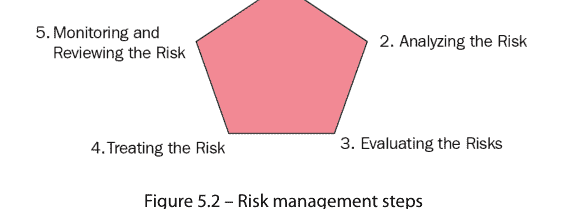
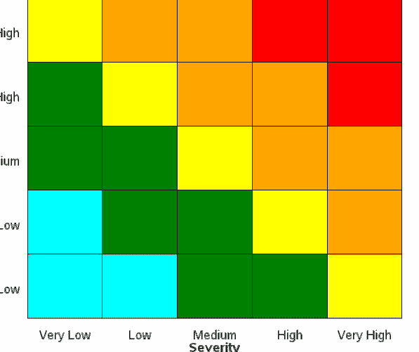

## 安全规划与风险管理

在过去几章中，我们花费了大量时间和精力处理隐私问题，现在是时候回到网络安全了。这次，我们将转向一个叫做**风险管理**的东西。但在进入风险管理之前，我们需要通过学习一些术语以及考虑实体中真正的威胁来了解基础知识。

在接下来的几页中，我们将深入介绍诸如安全威胁、挑战和风险管理等主题。如果你想了解更多关于该主题的信息，我强烈建议你获得一本专门聚焦该主题的书籍。

在本章中，我们将探讨以下主题：

-   安全威胁和挑战
-   实施风险管理计划

### 安全威胁和挑战

信息安全风险管理是识别、解决和预防安全问题的持续过程。风险评估是组织风险管理方法的基本组成部分，旨在确保足够的数据系统和数据安全水平。

我们可以将风险定义为威胁或限制组织履行其目标能力的任何事物。风险管理应是一系列在组织战略中采用的持续演进的程序，并应系统地管理过去、当前和未来努力周围的危害。

企业面临的信息安全威胁将根据所采用的处理特征和所处理数据的敏感性而有所不同。为了快速有效地创建安全的计算环境，有必要理解风险和风险评估技术的软件。

风险评估是识别组织为实现其业务目标而使用的数据资源所面临的漏洞和威胁的过程，并确定应采取何种对策（如果有）将风险降低到可接受水平。数据资源对组织的价值决定了应采取哪些对策。成功的风险管理需要组织管理各层级的共同努力。

### 安全威胁有哪些不同类型？

有几种网络威胁可能导致攻击。恶意软件是最重要的危险向量之一。近年来它发展迅速，危及端点和服务器系统。除了让攻击者完全控制计算机外，勒索软件还可能加密数据，并在支付赎金后才解锁。

恶意软件通常是另一种普遍的安全威胁——黑客攻击的组成部分。黑客获取公司内部系统的访问权限，要么进行一次性攻击，要么进行长期活动，在此期间他们潜伏较长时间并随意收集信息。后者被视为**高级持续性威胁（APT）**。

其他攻击，例如**分布式拒绝服务（DDoS）**，通过破坏其资源来阻碍组织的在线运营。这些攻击通常源自数百万台被黑的机器，形成僵尸网络。

### 什么是风险，什么是威胁？

风险和威胁有什么区别？

风险管理是对风险进行防范的过程。风险和威胁相互交织，但认识它们的主要区别至关重要。

*威胁更容易定义*，因为它涉及可能发生在组织内部的负面事件。*风险*，另一方面，可能是一个难以理解的概念；*它是某事发生的概率*，以及其潜在后果。它并不一定表示该事件会发生。

对于管理员和**托管安全服务提供商（MSSPs）**来说，能够量化公司的风险程度和位置是有利的。了解这种风险程度可以帮助你确定企业内部优先保护的内容以及如何分配安全支出。

一些安全专家利用安全风险计算来帮助得出一个精确的数字：

*风险 = 威胁 x 漏洞 x 后果*

这在数学课上肯定站不住脚，但它为你提供了人们如何评估风险的概率和影响的一般理解。

在这种计算安全风险的方法中，漏洞是指使攻击者能够对公司发起攻击的组织缺陷。例如，公司未能正确安装防火墙，可能会使黑客攻击更容易成功。在不再受支持且因此无法修补的 Windows XP 上运营业务，可能会使对手更容易发动与恶意软件相关的攻击。

某些漏洞比其他漏洞更容易受到攻击。一些漏洞可能比其他漏洞更容易被发现和利用，从而降低了攻击者的门槛。

如果被利用，一些漏洞对公司的危害可能小于其他漏洞。每次利用都可能对数据的可用性、保密性和完整性产生技术影响。这三个要素被称为 CIA 三元组。

例如，DDoS 攻击可能会暂时使数据无法访问，但攻击者可能无法修改或窃取该数据。然而，恶意软件可能会使攻击者能够做到全部三点。

反过来，技术影响会影响公司。根据漏洞和威胁的性质，公司所受影响可能从微不足道到灾难性不等。

例如，暂时阻断系统鲜少使用且隔离部分的服务的攻击可能不会被察觉。相比之下，成功窃取敏感客户数据的攻击可能会对企业造成严重的法律、财务和声誉影响。如果客户的社保号码和健康信息出现在类似 Pastebin 的网站上，监管机构和集体诉讼律师会高度关注。

有时，重大后果并不明显。例如，攻击者通过窃听制造工厂中晦涩的机器人流程数据可能会造成什么损害？如果他们能够修改该数据导致机器人生产出有缺陷的产品，那影响就很大。

确定企业面临的风险程度的过程也可以被自动化；某些软件允许您为此风险分配货币价值。它通过扫描网络中未受保护的数据（包括持久存储），并估算数据泄露情况下组织的潜在财务风险来实现这一点。

企业必须认真对待这些威胁，这就需要完善其 IT 风险管理方法。

在没有任何背景的情况下审视众多的网络安全风险可能会令人困惑且令人望而生畏。相反，企业可以通过对风险进行分类和评估来分析风险概率和影响。这意味着建立 IT 风险管理程序，以帮助您评估整个公司的网络安全威胁。

在进行此类评估时，管理员和 MSSP 应首先关注高影响因素，例如勒索软件。您必须研究如果组织的安全被勒索软件攻破会发生什么；这只是恢复备份时的一点小麻烦，还是巨大的灾难？以这种方式考虑攻击场景提供了有力的参考点，使基于此评估创建风险威胁漏洞矩阵成为可能，并有助于投资优先级的确定。

处理网络安全风险可能很困难，但不必像您想象的那样昂贵。通过仔细考虑各种威胁对您风险的影响，您可以优先保护组织最重要的资产，并始终领先攻击者一步。

这对 MSSP 具有重要意义，因为它通过审视系统宕机或数据被窃的实际业务影响，为其与潜在客户进行安全对话提供了重要起点——甚至还考虑了企业是否可能被用作进入其他合作伙伴系统的通道。

通过以这种方式将对话从安全转向风险，MSSP 可以与潜在客户进行更有用、更有效的对话。

## Implementing a risk management program

有效的风险管理计划帮助企业评估其面临的全部威胁范围。风险管理还确定了风险与它们可能对公司战略目标产生的连锁影响之间的联系。

这种全面的风险管理方法被称为 **enterprise risk management (ERM)**，因为它专注于预测和理解整个企业中的风险。除了关注内部和外部风险外，ERM 还强调管理积极风险的必要性。

积极风险是机会，如果抓住可能增加公司的价值，如果忽视则可能损害它。事实上，风险管理计划的目标不是消除所有风险，而是通过审慎的风险选择来保护和增加企业价值。

以下类别是风险管理的三种形式：

- **Project risks**：多种财务、进度、人力、资源和用户相关问题构成项目风险。进度延误是主要项目风险。由于软件是无形的，监控和控制软件项目很困难。难以管理无法识别的东西。对于某些制造项目，例如汽车生产，工厂主管可以识别产品成形的过程。
- **Technical risks**：这包括可能出现的困难、安装、接口、测试和维护挑战。它还包括模糊的规范、不完整的规范、不断变化的规范、技术模糊性和技术过时。由于开发团队缺乏项目专业知识，存在许多技术风险。
- **Business risks**：这包括创造出无人想要的卓越产品、未能履行财务或人员义务的可能性。

## Why is risk management so important?

也许，风险管理从未像今天这样重要。由于全球化的快速发展，当代企业面临的风险变得越来越复杂。不断出现新的威胁，通常源于数字技术的广泛使用。气候变化被风险专家称为 *danger multiplier.*

新冠疫情作为近期外部风险，在许多公司表现为供应链问题，迅速演变为生存威胁，影响员工的健康与安全、开展业务的方式、与客户互动的能力以及企业声誉。

企业对疫情风险做出了迅速调整。然而，未来他们仍面临额外风险，例如是否让员工重返办公室以及如何使供应网络对灾难的敏感度降低。

随着全球继续应对 COVID-19，企业及其董事会正在重新评估其风险管理系统。他们正在重新评估风险敞口并分析风险管理方法。他们也在重新评估谁应参与风险管理。目前采用被动风险管理方法（即防范过去的危险，并在新风险造成损害时修改流程）的公司正在评估更主动策略的竞争优势。支持可持续性、韧性和企业敏捷性正变得越来越受欢迎。公司也在研究先进的 **governance, risk, and compliance** (GRC) 系统以及人工智能技术如何增强风险管理。

例如，在金融机构中存在 **chief risk officer** (CRO) 的角色，尽管银行和保险公司几十年来一直维持着庞大的风险部门。此外，金融服务组织面临的风险往往以统计数据为基础，因此可以使用既定技术和程序进行量化并成功审查。金融机构的风险状况可以被准确预测。

随着定性风险在其他行业变得更难以管理，对深思熟虑、严格和一致的风险管理方法的需求也在增加。企业风险管理策略旨在帮助企业尽可能明智地管理风险。

当然，这仍然是一个序言。但现在我们可以继续围绕风险管理进行更激动人心的讨论，从传统风险管理与企业风险管理之间的差异开始。

## Traditional risk management versus enterprise risk management

企业风险管理享有优于传统风险管理的声誉。两种技术都旨在减少对公司的潜在威胁。两者都购买保险以防范各种危险，从火灾和盗窃损失到网络责任。最后，两者都符合主要标准组织的建议。专家说传统风险管理

缺乏理解风险作为企业战略和绩效固有组成部分所需的态度和流程。

在传统的风险管理计划中，风险历来由负责承担风险的部门的公司高管负责。例如，CIO 或 CTO 对 IT 风险负责，CFO 对财务风险负责，COO 对运营风险负责，等等。即使业务部门已建立了精细的程序来管理其不同类型的风险，如果组织未能看到风险之间的联系或其对运营的累积影响，仍可能遇到困难。传统风险管理通常是被动的而不是主动的。

大流行病是风险的完美例子，如果你没有对可能损害你公司的风险类型进行全面、长期的战略视角，这种风险很容易被忽视。许多企业回头时会说：“你知道，我们本应该知道这一点，或者至少在事件发生前考虑过此类事件的财务后果。”

企业风险管理中的风险管理是一种协作、跨职能和整体性的工作。一个 ERM 团队，可能仅由五个人组成，与业务部门高管和员工合作，对他们进行简报，帮助他们使用适当的工具评估风险，汇编数据，并将其交付给组织的 senior 领导层和董事会。这类风险领导者必须在整个组织的高管中具有信誉。

日益增长的是，这些专业人士来自咨询经验或具有咨询思维，并对商业机制有深刻的理解。与传统风险管理相比，传统风险管理中风险负责人通常向 CFO 汇报，企业风险管理团队的负责人——无论他们是否担任首席风险官或其他头衔——都向其 CEO 汇报，这表明风险是商业战略不可或缺的组成部分。

传统风险管理组的另一个特征是对风险的厌恶。然而，自认为风险厌恶且风险承受能力低的企业在风险评估方面并不总是准确的。

在下面的图中，你可以看到与风险敞口相关的最重要的因素：

| 问题 | 描述 |
|---|---|
| 什么是风险敞口？ | 风险敞口是当前进行中或计划中的业务活动所产生的量化潜在损失 |
| 如何计算？ | 风险敞口水平通过将风险事件发生的概率乘以其潜在损失金额计算得出：风险敞口 = 风险影响 x 概率 |
| 为什么风险敞口很重要？ | 在业务中，风险敞口用于对不同类型损失的概率进行排序，并确定哪些损失是可以接受或不可接受的 |
| 最常见的风险敞口类型有哪些？ | 品牌损害、合规失败、安全漏洞和责任问题 |

图 5.1 – 与风险敞口相关的因素

到目前为止，我们只探索了该主题的表面。让我们深入分析整个过程。

## 信息安全风险管理涉及哪些步骤？

风险管理是对特定活动或事件相关危害的审查。信息技术、项目、安全问题以及风险可进行定量和定性分析的其他活动都使用风险管理。

风险是任何 IT 项目和企业企业的组成部分。风险管理应经常更新，以便识别新的潜在风险。战略风险管理最大限度地降低未来风险的可能性和影响。

尽管许多知识体系制定了管理风险的框架，但我们将坚持使用 ISO 31000 标准、风险管理 – 指南，由众所周知的 ISO 制定。

ISO 的五步风险管理流程包括以下内容，可由任何类型的实体使用：

- 1. **Identify the risk** – 第一个阶段是识别组织在其运营环境中面临的风险。有几种形式的风险，例如法律风险、环境风险、工业风险和监管风险等。识别尽可能多的潜在风险因素至关重要。

在手动环境中，这些危害可以手动缓解。如果公司使用风险管理解决方案，部分数据会立即输入系统。

这种策略的好处是，这些风险对具有系统访问权限的所有组织利益相关者都是显而易见的。任何需要了解已识别风险的人都可以访问风险管理系统中的数据，而不必像过去那样将此信息锁定在必须通过电子邮件请求的纸质文件中。
- 2. **Analyze the likelihood and impact of each risk** – 一旦风险被计算并识别，风险分析过程应分析每个将出现的风险，并确定与每个风险相关的后果。它还确定它们可能如何影响 IT 项目的目标。

在实施风险管理系统时，将风险映射到众多文档、规则、程序和业务流程是其中最基础的阶段之一。这指定系统将具有映射的风险结构，该结构计算风险并理解每个风险的深远后果。
- 3. **Evaluating the risk** – 在对风险进行分析以支持关于哪些 IT 资产有价值以及哪些威胁可能对其产生负面影响的概念之后，可以制定风险管理计划，该计划生成可用于减轻、转移、接受或防止风险的控制建议。
- 4. **Treating the risk** – 此阶段的目的是实施消除或减少分析中确定的风险所需的步骤。它可以解决或至少减轻每项风险，使其不再构成危险，从优先级最高的风险开始。
- 5. **Monitoring and reviewing the risk** – 此阶段负责定期监控安全风险，以便识别、评估和管理危害，这应是任何风险分析程序不可或缺的一部分。

在下面的图中，你可以看到风险管理步骤：

图 5.2 – 风险管理步骤

在风险识别的最后阶段，公司将其结果记录在风险登记册中。它有助于在风险管理流程的接下来的四个阶段中跟踪风险。

理想状态是以自上而下的方法实施任何框架或计划，当然包括风险管理框架。

## 从自上而下到自下而上

许多风险委员会发现，在考虑可能阻碍或促进组织目标的风险情景时，采用自上而下、自下而上的策略是有利的。在自上而下的努力中，领导层确定组织的关键任务流程，并与内部和外部利益相关者合作，识别可能阻碍这些活动的状况。自下而上的观点评估威胁源（地震、经济衰退、网络攻击等）对重要资产的可能影响。

## 风险管理的益处与挑战

有效地管理可能对资本和盈利能力产生负面或积极影响的风险有几个优势。即使对于具有复杂治理、风险和合规程序的公司而言，它也带来了障碍。

风险管理的优势包括以下几点：

- 公司内部增强风险意识
- 将风险纳入战略后，对企业目标和目标的信心增强
- 合规协调导致对监管和内部合规法规的更大、更高效的合规
- 通过更一致地实施风险协议和控制，增强运营效率
- 提高员工和消费者工作场所的安全性和保障
- 在市场上具有独特的竞争优势

风险管理团队可能面临的障碍如下：

- 最初，成本增加，因为风险管理策略通常需要昂贵的软件和服务
- 为遵守对治理的日益关注，业务部门还必须投入时间和金钱
- 就危险的严重程度和如何应对达成一致可能是一项艰难而有争议的任务，在某些情况下可能导致分析瘫痪
- 在没有具体数据的情况下，很难向高管证明风险管理的益处

## 制定和实施风险管理计划

风险管理策略概述了公司将如何管理风险。它概述了组件，例如组织的风险战略、风险管理团队的角色和职责、其将用于管理风险的资源以及风险管理的规则和程序。

让我们使用 ISO 31000 标准（有很多，从 **Committee of Sponsoring Organization**、**COSO** (https://www.coso.org/) 到 eBIOS (https://www.enisa.europa.eu/topics/threat-risk-management/risk-management/current-risk/risk-management-inventory/rm-ra-methods/m_ebios.html, 一个由欧洲社区赞助的类似框架），但为了简单起见，我们将使用你已经听说过的东西：

- **Consultation and communication** – 由于提高风险意识是风险管理的重要组成部分，风险领导者还必须设计沟通策略，以向员工和其他相关方传达组织的风险政策和程序。此阶段为所有与风险相关的决策定下基调。受众包括任何对公司如何利用有利风险和减轻不利风险感兴趣的人。

- **提供背景** – 此阶段涉及确定组织的特定风险偏好和风险容忍度（即风险可能偏离风险偏好的程度）。这些考虑因素包括公司目标、企业文化、监管法律和政治环境。
- **风险识别** – 此阶段识别可能对组织开展业务能力产生有利或负面影响的风险情景。如前所述，所得列表应录入最新的风险登记册。
- **风险分析** – 对每个风险的概率和严重程度进行审查以对其进行分类。在这种情况下，创建风险热力图是有益的，该热力图直观地展示了公司风险的性质和影响。员工请病假是一种高概率事件，对大多数企业的影响微乎其微或没有影响。取决于其位置，地震是低概率但高影响危险的例子。
- **风险评估** – 在此，企业考虑如何应对所面临的威胁。技术包括以下至少一种：
  - **风险规避** – 风险规避的目标是消除、退出或避免可能发生的危险。
  - **风险缓解** – 组织最小化或优化风险的过程。
  - **风险分担**（或 **风险转移**） – 组织与第三方（如保险公司）签订合同，以承担可能出现或不出现的风险相关的全部或部分费用。
  - **风险接受** – 符合公司风险偏好和容忍度的风险将不采取行动而被接受。
- **风险处理** – 此阶段涉及实施已商定的控制措施和程序，并验证其按预期运行。
- **监控和评估** – 控制措施是否正常运行？能否改进？监控操作应监控 **关键绩效指标 (KPIs)** 并寻找可能促使策略调整的 **关键风险指标 (KRIs)**。

在以下图中，您可以看到风险管理热力图的示例：

图 5.3 – 风险管理热力图

现在我们已经解释了一些与风险管理相关的术语，让我们在其基础上再添加一些内容。

## 定性风险分析

基于个人对其严重程度和概率的感知来分析风险即为定性风险分析。定性风险分析的目标是提供一份必须优先于其他风险的风险清单。

定性风险分析是项目经理抵御风险的第一道防线。它有助于消除项目成功的可能障碍，例如不太可能造成重大损害的风险。通过首先关注最严重的风险，项目经理可以更有效地分配时间和资源。

## 定量风险分析

定量风险分析是基于收集的数据对风险进行计算。定量风险分析的目标是确定风险影响将给公司带来多少成本。这是通过利用现有知识来预测或估计结果来实现的。

要使数据适用于定量风险分析，必须在较长的时间段内进行分析或在许多情况下出现。例如，在之前的五次实验中，A型设备在使用七小时后发生故障。有了这些知识，可以合理预测，如果项目需要员工使用A型设备八小时，那么其发生故障的风险为百分之百。

## 定性与定量风险分析的区别

定性风险分析与定量风险分析之间的根本区别在于评估基础。如前所述，定性风险分析基于个人的印象或判断，而定量风险分析基于已确认和指定的事实。

另一个区别是相应的风险等级。在定性风险分析中，该数字代表风险评级或分数。危险可能被评为低或得分为1，以表示它不需要紧急行动。在定量风险分析中，与风险相关的值通常以百分比表示，表示风险发生的可能性，或风险对项目目标产生特别负面影响的可能性。

## 何时进行定性与定量风险分析

当对风险的感知发生变化并且发现新的危险时，应进行定性风险分析。一般来说，每个项目都应从定性风险评估开始。此外，由于其简单、快速且成本低廉，定性风险分析可在项目全程的任何时间进行，或在项目经理认为需要时进行。

当有关风险及其影响的数据充足，并且需要确认定性风险分析时，应进行定量风险分析。由于定量风险分析可能复杂且耗时，大多数项目经理不会在项目的准确风险估计对项目安全至关重要之前推荐它。在这种情况下，定量风险分析可能由法律或项目利益相关者强制要求。

## 总结

好吧，如果你读到这里，你值得鼓掌。这是一个非常密集的章节，有很多新东西需要解释。只是让你知道，通过谈论风险管理、ISO 31000 以及定量与定性风险分析，我们才刚刚触及冰山一角。但是，考虑到风险管理是一个极其困难的话题，包括数学、统计学等等，我认为给出一个更长的章节是恰当的！

在接下来的章节中，我们的注意力将放在我们钟爱的 ISO 27001 上：我们将深入探讨，这将非常令人兴奋。
