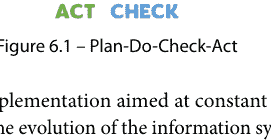

## 定义 ISO 27001 强制性要求

在花了一些时间讨论数据保护后，我们回到了我们钟爱的 ISO 27001。这次，我们将超越冰山一角，看看隐藏的内容，并花一些时间（整个章节）更好地理解 ISO 27001 要求

这里的主要主题将与 iSMS 相关：PDCA 的含义、项目目标和估算、团队建设、项目开发以及要使用的控制措施的选择等等。

我们将在本章中涵盖以下主题：
- ISO 27001 运行
- ISO 27001 支持要求（或第 7 条款）

### ISO 27001 运行

iSMS 构成了企业安全控制框架实施的基准，可以成为在整个实体范围内保证结构化、持续且以风险为导向的方法的基本支柱之一

正确权衡适用范围、必要的资源和技能，以及高级管理层的有力支持，是 iSMS 成功实施的关键要素。

iSMS 模型最明显的好处如下：
- 它使您能够对企业安全有一个整体的视野，超越 IT 安全的范围，还包括人员和流程
- 它是一种自适应模型，能够适应威胁的时间演变，因此适应当今信息系统典型的快速变化

- 它提供了安全状况的正确视图，从而成为优化预算分配的基础工具，将其导向在风险降低方面回报更大的举措
- 实施该控制模型在许多情况下还能让我们应对外部监管约束，而这些约束通常要求一系列措施，而这些措施不过是框架中可能控制措施的一个子集
- 事实上，控制措施的应用为企业安全治理提供了有效工具，而 ISO/IEC 27001 无疑是最完善的标准之一，由无数指示和控制措施组成，必须通过选择与组织相关且可行的措施来仔细挑选或取舍

## ISO 27001 标准 – 它是什么以及建立了哪些要求

ISO/IEC 27001 的附录 A 包含目标和控制措施，或所考虑的主题领域和应应用的控制措施（这 14 个主题领域随后被细分为更低级别的控制措施，其更多细节在 ISO/IEC 27002 中提供）。整个 ISO/IEC 27001 的领域或域被划分为以下 14 项控制措施：

- A.5：信息安全管理方针
- A.6：信息安全组织
- A.7：人力资源安全
- A.8：资产管理
- A.9：访问控制
- A.10：密码学
- A.11：物理和环境安全
- A.12：操作安全
- A.13：通信安全
- A.14：系统获取、开发和维护
- A.15：供应商关系
- A.16：信息安全事件管理
- A.17：业务连续性管理的信息安全方面
- A.18：合规性

这些部分各自包含子领域，提供指导，但并未对特定情况下必须选择和使用的安全措施提供严格规范。

## 如何构建 ISMS

考虑到前文所述，iSMS 的影响遍及整个组织，因此高层管理支持是启动项目的根本前提。

话虽如此，项目可以分解为不同的阶段。让我们详细分析它们。

### 构建 ISMS – 项目目标和估算

这是项目的第一步，需要估算项目范围并计算建设和维护成本。

公司规模和成熟度决定了非常不同的方法：我们可以在实施初期考虑基本范围，从而仅包括与公司相关的网络设备（当然如果有的话，包括远程工作人员使用的设备）、风险最大的系统，并在后续项目波次中逐步扩大范围，包括社交账户、云计算和远程存储库

其他需要考虑的变量是公司其他结构和部门的支持，除安全部门外，还涉及公司许多领域，包括人力资源部门、法务和采购。

来自所有相关参与者和管理层的正确承诺将对项目的成功至关重要。

ISO 27001 依赖于持续改进，即使标准中未直接说明。因此，可以选择计划-执行-检查-行动（PDCA，也称为戴明循环）作为最佳迭代方法。

图 6.1 – 计划-执行-检查-行动

PDCA 包括持续实施，旨在实现持续改进，以便进行有效且适应性的管理，跟随信息系统的演变。PDCA 的四个阶段描述如下：

- **计划：** 通过定义其范围和目标制定 iSMS 计划，进行风险评估，并制定风险管理的计划和程序。
- **执行：** 实施 iSMS 计划。程序变为可操作。
- **检查：** 这是 iSMS 计划的监控和纠正阶段，通过内部审计进行，并将结果报告给高层管理。
- **行动：** 通过纠正措施维护和改进计划。

PDCA 采用上述循环，因为它反映了威胁的演变本质。随着威胁和风险的变化，它们需要持续重新评估和适应，以便达到公司的最终目标：确保总体风险得到充分遏制，低于既定阈值。我们不能设定任意的风险阈值，因为公司风险偏好可能不同。

### 构建 ISMS – 团队建设

这是项目负责管理项目的团队估算必要工作量的阶段。

iSMS 需要对 ISO 27001 有扎实的知识和经验，其实施应由具有此类项目工作背景的专业人员跟进，同时还需要具有足够权威的高级管理人员来协调所有相关资源和结构。

### 构建 ISMS – 项目开发和控制措施选择

首先，有必要识别出已经规范 ISO 27001 实施范围的控制措施、流程和程序，以及所有相关资产和参与者：客户、数据、合作伙伴、办公室等等。

一旦这些实体被识别，就有必要选择要实施的控制措施以及所有必要的指标，这些指标将用于监控目的。

由于 ISO 27001 适用于任何类型的公司，控制措施的选择以及如何解释和实施它们不能是具体的，因为它们取决于公司所在的行业、规模、使用的技术以及公司实施和管理这些控制措施的资源。

事实上，有必要密切关注使用多少控制措施，以确保不会危及用户的心理可接受性，也不会使运营流程超负荷。请记住，实施控制措施可能会影响公司各层级、各部门。因此，必须一次只处理少数几个控制措施。

### 构建 ISMS – 项目开发和文档系统

一旦范围和控制措施确定，iSMS 的管理必须纳入业务流程，然后应相应地定制 PDCA 质量管理流程，通过遵循一个相当精简的文档系统来正式化它，该系统至少包括一项政策、一项标准和一份操作指南。

### 构建 ISMS – 项目开发和风险分析

iSMS 的核心是风险分析和评估流程，它允许评估威胁的风险性，从而确定可能的对策。

在这种情况下，建议采用公司已有的做法，如果存在的话，或者创建一个足够简单的新方法，以免使项目过于复杂。

能够识别相关威胁并准确权衡它们是非常困难的方面，通常需要安全专家之间协调工作。

不过分详细地说，风险分析阶段必须如下：

- **风险识别：** 这是可能的风险必须浮现的阶段，如果这些风险发生，将导致数据完整性、保密性或可用性方面的妥协。
- **风险度量：** 一旦可能的风险被识别，就必须根据它们对组织的影响进行权衡。它们可以是可量化的，例如货币影响（通常在物质损失的情况下），也可以是非物质的，如声誉受损的情况。
- **风险加权：** 在此步骤中，将前一阶段的结果与风险标准进行比较，以确定风险处理的优先顺序和方法。

因此，最终决定遇到风险时如何干预以及如何进行。选项如下：

- 如果认为不会实质性影响总体风险，则接受风险
- 在可能的情况下转移风险，例如，如果比用缓解措施来补偿它更容易
- 取消风险，例如，通过停用服务，如果纠正风险的成本相对于该服务带来的实际收益过高
- 缓解风险或实施一个或多个控制措施，以便将风险降低到被认为可接受的水平

### 构建 ISMS – 评估

定期安排 iSMS 审查和监控阶段以评估其有效性以及相对于可能随时间显著变化的当前威胁背景下的控制措施遵守情况是很重要的。

从这个角度来看，审计的质量和所选指标成为评估项目的关键点。特别是，指标越是所讨论控制措施的客观且有意义的衡量标准，分析就越真实且简单。

ISO 27001 最重要的条款之一是第 7 条，因为它为实施设定了标准（涉及培训、实施团队（如果是内部）等）。让我们详细了解其要求。

## ISO 27001 支持要求（或第 7 条）

在本部分，我们将深入聚焦第 7 条，因为它与培训和资源相关，是基础性的。它适用于人员、基础设施和环境，也适用于物理资源、材料和设备。本条款侧重于获取建立、部署、维护并持续改进 iSMS 所必需的资源、人员和基础设施。它涉及为支持 iSMS 而需要的胜任能力、意识和沟通，例如为员工提供培训和访问权限。本文还规定，所有为公司工作的人员必须了解其信息安全政策、他们如何促成其成功以及不遵守规定的后果。此外，公司必须确保与信息安全和 iSMS 相关的内部和外部沟通得到有效传达。这意味着要确定传达什么内容、传达给谁、何时以及如何传达。

> 提示
>
> 请考虑，一旦实施，ISO 27001 也需要维护。因此，您的组织需要有人能够提升认证的价值。还记得 PDCA 或戴明循环吗？让我们以自行车为例：当你跳上去开始骑行时，即完成第一个 PDCA 循环，很难保持自行车平稳且速度良好。骑行几米后，你会以更快的节奏踩踏，车把会更稳定，在理想世界中，你将永远保持稳定。当然，在现实生活中情况不同：有红绿灯、行人、汽车等阻碍我们的进展，但我们的骑行仍在继续。

组织必须评估为 iSMS 控制所需的记录信息的程度。对记录信息访问的控制也受到强调，反映了信息安全的重要性。在贵公司，知识作为重要资源也受到新的重视。在设计质量目标时，您现有资源的当前能力和能力，以及您可能需要从外部供应商/合作伙伴处获取的能力，将是一个关键问题。标准本节规定了建立和运行 iSMS 的先决条件。第 7 节中包括以下内容：

- 7.1 – 建立和运行 iSMS 所需的资源
- 7.2 – 胜任能力
- 7.3 – 意识
- 7.4 – 沟通
- 7.5 – 文件化信息

### 7.1 – 建立和运行 ISMS 所需的资源

公司必须选择并提供建立、实施、维护并持续改进信息安全管理体系所需的资源。

条款 7.1 包括关于选择和分配资源以建立和管理 iSMS 的信息，以及对在 iSMS 范围内并在组织权限下执行工作的所有人员持续意识的要求。必须为 iSMS 的创建、实施、维护和持续改进分配足够的资源。只要角色、职责和权限得到明确定义并得到承担——假设部署了适当数量的资源——就足够了，但它并不要求 iSMS 由全职人员配备。条款 7.1 作为资源承诺的概述，其后在以下条款中提出了更详细的标准

- 7.2 – ISO 27001 支持资源的胜任能力
- 7.3 – 为满足 ISO 27001 而从事 iSMS 工作的人员的意识
- 7.4 – 沟通（本条款涉及向内部和外部利益相关方传达 iSMS）
- 7.5 – 关于 iSMS 的文件化信息，以证明其符合 ISO 27001 标准

在适当的时间获得必要的资源是 iSMS 部署成功的一个关键因素。请记住，每个 iSMS 岗位持有者在其职能上必须具备胜任能力。因此，回顾您将需要的关键职责和资源至关重要。这与 iSMS 的安装和运营有关。核心角色预计将包括以下内容：

- iSMS 所有者，通常是高级管理人员。
- 治理论坛的成员，无论其名称如何。
- 负责组织内部信息安全管理的个人。
- 对影响信息安全的各种运营操作负责的人员。这包括运营支持专业人员，包括服务器和网络支持团队、服务台工作人员以及人力资源管理人员。
- iSMS 内部审计员。
- 受托确保 iSMS 符合标准的个人。
- 负责向高级管理层报告 iSMS 绩效的人员。

在实施计划期间，必须提出并回答许多问题，例如以下问题：

- 我们需要什么技能？
- 我们是否可以获得这些能力？如果不能，我们能否招聘具备这些能力的人？我们能否以合同形式聘用他们？
- 需要什么样的内部培训和发展才能长期保持所需的胜任能力？

这些问题主要关注验证所需能力的可用性。其中包括关于记录所需能力、确定当前胜任能力集合以及建立解决任何胜任能力差距的潜在方法的询问。通常，差距的补救方法如下：

- 通过招聘——获取具有适当技能的永久资源
- 通过获取临时合同资源
- 通过培训和指导发展内部能力

这些替代方案的决定将取决于技能差距的程度以及这些胜任能力是否对 iSMS 的采用或持续运行是必要的。

### 7.2 – 胜任能力

组织必须确定其控制下从事影响信息安全绩效工作的所有个人的必要胜任能力。它还必须保证这些个人根据其学位、培训或经验具备资格。每当相关时，它必须开展活动以获得所需的胜任能力，评估这些努力的成功情况，并保留必要的证明文件作为胜任能力的证明。适用活动的示例包括培训、指导或重新分配现有人员，以及招聘或聘用胜任的个人。

ISO 27001 的第 7.2 条本质上说明实体将保证其满足以下要求：

- 评估了其工作可能影响其绩效的 iSMS 人员的技能
- 拥有被视为根据其适用教育、培训或经验合格的人员
- 在必要时采取行动获得基本胜任能力并评估其活动的有效性，并为审计保留证明

第 7.2 条规定，所有 iSMS 人员必须在其各自任务中具备胜任能力。培训、教育、经验和技能的提供导致胜任能力。所有这些都必须在管理人力资源时得到解决。为了有效部署和维持 iSMS，必须配备支持资源。

组织必须执行以下操作：

- 决定谁必须具备必要的技能来承担其监督下影响信息安全绩效的任务
- 确认这些个人拥有被视为胜任所需的教育、技能或经验
- 如有必要，采取措施培养必要的技能并评估其有效性
- 保存相关文件作为胜任能力的证明

**提示**
请注意，与敏感和私人信息相关的要求可能会干扰数据保护。

第 7.2 条概述了个人对其 iSMS 职责的意识要求。您员工、供应商和承包商的专业知识和能力对于信息安全规则的成功应用至关重要。为了保证足够的知识和技能基础，您必须执行以下操作：

- 明确所需的知识和能力
- 确定谁必须具备必要的知识和能力
- 明确您将如何评估或确认适当的人员具备必要的知识和能力

除了物理安全、网络安全、计算机安全和其他类型的信息安全知识外，有效部署和持续管理获得 ISO 27001 认证的 iSMS 还需要多种才能和经验。这些包括与业务范围相关的商业、法律、人力资源、IT 以及商品和服务专业知识。开发和维护 iSMS 通常是团队工作。您的审计员将期望您提供概述所需知识和能力的文档。在您认为标准已满足的地方，您必须提供培训证书、课程出勤记录或内部胜任能力评估等文件。目前大多数公司使用培训/技能矩阵、评估或供应商评估等工具的公司可以通过将涵盖的类别扩展到包括信息安全来满足胜任能力记录的需求。

**提示**
当然，如果您使用第三方公司实施 ISO 27001，则需要以不同方式阅读此内容，但您的实体仍应能够维护此认证。

## 培训

iSMS 要求所有个人在其 iSMS 相关职责方面具备胜任能力。任何已识别的胜任能力缺陷必须得到纠正。然而，某些用户群体缺乏专门的 iSMS 培训。下表列出了其中一些类别以及可能必要的培训类型：

| 受众 | 培训类型 |
|---|---|
| 用户 | 用户意识培训 |
| iSMS 治理 | 负责实施的人员 |
| 信息安全管理员 | 监督实施的个人 |
| 服务台 | - 普通用户和访问管理 - 负责事件和事故管理的 IT 安全员工 |
| 人力资源 | 员工招聘、培训和解雇的职责 |
| IT 支持人员 | - 事件响应管理 - 安全运营 |
| 高管 | iSMS 支持 |

制定培训计划时应考虑以下内容：

- 用户意识培训
- 治理文档
- 针对重要 *控制所有者* 组的专门指导：
  - 网络和服务器支持
  - 服务台（用户支持、事件响应）
  - 人力资源
- 对高级管理人员和部门主管的简报

制定培训计划时，必须考虑以下因素：

- 目标受众是谁？
- 需要哪些信息？
- 培训/信息将如何传达——面对面、在线、通过 PowerPoint，或通过团队简报？
- 培训将在何时进行以及需要多频繁进行？
- 谁负责规划培训、维护内容和分发材料？
- 是否需要评估和有效性指标？测验或调查呢？

此类数据可通过差距分析收集。一旦收集此类数据，即可设计培训计划。

培训计划应包括以下内容：

- 目标人群是谁
- 他们需要哪些信息
- 信息或指导将如何传达
- 培训将在何时进行
- 培训必须多频繁进行
- 谁负责组织/交付项目
- 是否需要任何评估方法，如果需要，将包括什么

## 7.3 – 意识

在组织控制下从事工作的人员必须了解其信息安全政策、他们对信息安全管理体系有效性的贡献，包括改进信息安全绩效的好处，以及未能遵守信息安全管理体系要求的后果。

条款 7.3 是胜任能力（条款 7.2）和沟通（条款 7.4）的结合。

以下信息必须为组织中的任何工作人员所知：

- 信息安全政策
- 他们在提高信息安全管理体系效率方面的角色，包括更好的信息安全绩效的优势
- 未遵守信息安全管理体系要求的后果

通常，这将导致针对各个群体的培训和意识计划的设立。对违反 iSMS 规则的不合规的认识也必须得到解决。除了确保关键人员具备专门的信息安全胜任能力外，更广泛的员工、供应商和承包商群体必须了解您 iSMS 的基本组成部分。作为 iSMS 实施的一部分，组织的员工必须合作设计信息安全政策以供高级管理层批准。他们的职责应得到充分理解，因为它已作为条款 7.1 的一部分达成一致并记录在案。这对于在企业内部培养支持性文化至关重要。所有员工、供应商和独立承包商应了解以下内容：

- 您拥有 iSMS 及其原因
- 您拥有信息安全政策以及其中适用于他们的部分
- 他们必须做什么来帮助公司实现信息安全目标，以及他们如何帮助贵公司保护其宝贵信息
- 适用于他们的政策、程序和控制措施以及不合规的后果
- 了解并理解以下条款 6.1 – 风险管理、6.2 – iSMS 目标、9.1 – 更广泛的测量和评估、9.2 – 内部审核、9.3 – 管理评审、10.1 – 不符合项和纠正措施，以及根据 10.2 的持续改进。（持续改进）
- 此类信息通常可使用现有程序和文件进行传达，例如入职培训、劳动合同、工具箱讨论、供应商协议、员工简报和更新

## 7.4 – 沟通

公司必须确定内部和外部信息安全管理体系相关沟通的必要性。在确定沟通系统时，必须确定要沟通的内容、何时沟通、与谁沟通、谁来沟通以及如何进行沟通。

沟通对 iSMS 实施过程至关重要。通过使计划及其好处在公司内部和外部变得明显，它们有助于获得并维持对计划的支持。优秀的沟通计划的好处包括确保信息安全不被视为次要问题，而是处于核心位置。良好的沟通策略超出了部署阶段，延伸到 iSMS 的持续运营。重要的安全仪表板、简报和警告都是健全沟通系统的组成部分。

必须确定对 iSMS 重要的内部和外部沟通，以及进行这些沟通的方法，同时考虑要沟通的内容、由谁、在何时以及对谁进行沟通。为了使您的 iSMS 运营良好，您必须确保您的沟通活动得到良好规划和控制。ISO 27001 通过要求您确定以下内容对其进行了详细规定：

- 必须沟通的内容
- 何时必须沟通
- 对谁必须沟通
- 谁对沟通负责
- 沟通流程是什么

如果您的沟通需求已在组织的政策、规则和程序中明确说明，则无需采取进一步措施来满足此标准。如果没有，您应考虑使用上述标题以表格或方法的形式记录重要的沟通活动。请记住，这些文件的内容也必须传达。与培训领域类似，良好的沟通涉及目标受众的识别、可能采用的方法（现有或新的）、内容和信息的频率。上述要点揭示了这些组成部分并使全面沟通策略的构建成为可能。将企业传播部门的资源纳入其中可为该领域增加显著价值。沟通技巧具有至关重要的作用：

- 保持对实施和运营的承诺以获得对 iSMS 的支持
- 继续将信息安全保持在前沿
- 制定沟通策略有助于信息的传播

沟通计划必须包括以下内容：

- 可利用哪些现有沟通渠道
- 可期望企业传播和其他机构团体提供何种参与
- 机构核心领域目前的协助水平以及如何修改

条款 7.4 要求对一系列安全相关问题作出明确答复：

- 组织应明确表达其优先事项：信息安全的需求以及遵守法律和标准的需求。沟通将处理风险管理问题、新或更改的安全目标以及漏洞、事件或事故，以便从各方（尤其是执行预定响应的受过培训的人员）激活适当的响应。庆祝成就和表彰优秀的安全习惯具有非常积极的影响。将安全条款和要求纳入合同也是向服务和产品供应商传达您需求的一种方式。

- 消息应该是什么样的？为了生成应传达的内容，消息在形式和内容上都应清晰简洁。本节考虑用于传递消息的通信渠道类型。你可以使用叙述、视觉元素、隐喻或卡通。消息必须简洁并聚焦于其真正目标。你可以使用任何媒体或方式进行沟通，但它必须是全面的。
- 谁有权进行沟通？组织应明确谁被允许进行沟通，特别是与外部各方沟通。高层管理、首席信息安全官（CISO）和支持服务台是优秀的内部示例。公关人员受大型企业雇佣以与外部各方联系。沟通者应具备必要的权限，以确保消息得到适当的关注并引发期望的行动或回应。
- 谁是接收者？并非所有接收者都应收到每一次沟通。取决于信息的分类、所需的技术能力以及接收者在公司内的职位，消息应针对特定受众进行定制。沟通计划应有效且仅针对那些将从中受益或必须据此采取行动的人，例如用户、合作伙伴、内部和外部服务提供商、监管机构和股东。
- 沟通过程应如何进行？第一种也是最简单的沟通方法是安全政策以及所有规定为实现政策目标应做什么（以及如何做）的文件。特别是在事故和紧急情况下，面向任何受众（内部或外部）的消息都应经过计划和授权。应使用已定义的渠道（和协议），以确保消息在最佳时间以最大潜在效能到达目标受众。示例包括电子邮件、弹出窗口、屏幕保护程序、海报、音频消息、会议、规章和指令。
- 我们应该在什么时候沟通？需要持续和基于事件的沟通（对事件做出反应）。为了确保任何消息不会被遗忘，你需要确保它定期且反复传递，例如向组织的新员工以及定期向现有员工传递。你还应能够根据情况需要更改消息并添加新的消息、格式和渠道。与事件或危机相比，常规情况下的沟通可能截然不同。

## 内部与外部沟通计划

必须认识到沟通计划包含内部和外部两个组成部分。它们需要对以下问题做出不同的考虑。

内部沟通计划由高层管理用来传达其目标和对信息安全的承诺。信息安全政策、组织内承担与安全相关的基本角色和职责的团队、意识策略以及应对事件的一般和专门要求是沟通的一些示例。然而，内部沟通计划不应是单向的。例如，电话和电子邮件等媒介也应被认可并用于自下而上地沟通安全漏洞或新兴漏洞，即来自一线用户。

前述示例大部分涉及内部沟通计划，尽管它们也适用于外部沟通计划。你可能需要与监管机构、公共机构、股东、客户和合作伙伴沟通，以宣布好的（成功）或坏的（失败）事件（事件、事故和危机）。你还需要一个沟通计划来回答本节前面列出的问题。你必须对此谨慎，因为你不应透露或广播可能使情况恶化的敏感信息。

根据组织规模和安全目标，沟通计划的正式程度会有所不同，要么作为独立文件完全记录，要么仅在其他规则、流程和计划中以几句话表达。因此，只要所需信息传达给正确的人，你的解决方案就适合你的目标和可用资源。

## 7.5 – 文件化信息

条款 7.5 讨论了保存支持 iSMS 活动的相关文件和记录的义务。对何时获得批准的正式文件记录证明了符合本条款的规定。要使用于开发和管理你的 iSMS 的文件化信息有用，它必须满足以下要求：

- 准确
- 对使用者而言易于理解，并帮助你遵守监管义务、管理信息安全风险并实现你的目标

对文件化信息的访问受到控制，以防止其被意外更改、损坏、删除或被不适当的人员访问。信息在需要时以安全的方式删除或归还给其所有者，并且你可以跟踪对信息的更改以确保流程受控。

文档是必要的，以确保程序按照管理系统的目标执行。文档定义了你将完成的工作并提供你已执行意图的证明。ISO 27001 标准并未定义文档的范围，其受多种变量影响。这些包括以下内容：

- 业务流程的复杂性和相互作用
- 控制环境，有时受外部职责影响
- 组织的规模和核心活动
- 人员的资质
- 其他法律或监管要求

始终牢记预期受众来制定文件。文档必须对使用者有益。组织需要根据需要定义并记录其程序。此后，他们必须遵守自己的文件。*说你所做的，做你所说的。*

以下标准适用于未明确记录的程序：

- 流程是有条理的
- 已传达
- 已理解
- 已应用
- 有效

然而，文档确实需要管理。这种管理包括文件批准、可访问性和可读性标准以及标准第 7.5 条中提到的其他规范。

你的文件化信息可能源自内部或外部来源；因此，你的控制程序必须处理来自两个来源的文件化信息。具有有效文件控制的公司通常具备以下一项或多项：

- 一名个人或一个小型团队负责确保新/修改的文件在发布前经过审查、保存在正确位置，并在被取代时撤出流通，并维护变更记录
- 包含在电子文档管理系统中的自动化流程和控制
- 轻松的电子数据备份和纸质文件归档/存储程序
- 员工对文档管理、记录保存以及信息访问/保留法规的强烈理解

正如我们已提供了该条款的摘要，现在我们将详细说明每个子条款。

### 7.5.1 – 总则

术语 *文件化信息*，将在本章中多次使用，现在涵盖了 ISO 27001 标准上一版本中的 *文件* 和 *记录* 定义。

此修改旨在协助管理标准规定的文件和记录，以及组织认为对 iSMS 运行至关重要的文件和记录。还应强调，组织所需的记录信息的数量和范围将根据其规模、活动、产品和服务、其流程的复杂性及其相互关系以及员工的专业知识而有所不同。

### 7.5.2 – 开发和修订

标准规定，在 iSMS 范围内生成或更新的信息必须得到适当识别和表征，同时考虑内容的呈现方式以及所使用的媒介。所有记录信息必须经过适当的评审和批准流程以验证其适用性。

## 7.5.3 – 记录数据的管理

标准规定，信息安全管理体系（ISMS）所需记录的信息以及标准本身必须可访问、可使用，并且无论其来源是内部还是外部，都必须充分保护免受破坏或完整性和身份丢失的威胁。为了正确管理记录信息，组织必须提供分发、保留、访问、使用、检索、保存和存储方法，以及控制和处置程序。

信息安全管理体系和 ISO 27001 文档要求的文件化信息必须经过适当检查以确保（注：源条款在括号中）：

- ISMS 范围（文件）(4.3)
- 高层信息安全政策（文件）(5.2)
- 风险评估方法（文件）(6.1.2)
- 风险评估报告和风险处理（记录）(6.1.2, 6.1.3, 8.2, 8.3)
- 适用性声明（文件）(6.1.3 d)
- 信息安全目标（文件）(6.2)
- 能力证据（记录）(7.2)
- ISMS 要求的文件化信息（文件和记录）(7.5.1 b)
- ISO 27001 要求的文件和记录（文件和记录）(7.5.1 a)
- 监测和测量结果（记录）(9.1)
- 内部审核计划和结果（记录）(9.2)
- 管理评审结果（记录）(9.3)
- 不符合项及结果和纠正措施（记录）(10.1)

> 提示
>
> 粗体中的术语是 ISO 27001 附录 A 的相应条款。关于不符合项，ISO 将其定义为“未能满足强制性条款中规定的一个或多个要求。”

文件与记录的区别在于，记录是带有时间戳的活动证明。文件会定期检查并更新。通常它们会进行版本控制。除前面提到的记录外，其他相关文件可能包括以下内容：

- 风险所有者对指定控制措施或风险接受的同意证据
- 访客记录，包括 CCTV 照片和访问日志
- 安全事件日志和根本原因分析
- 纠正和改进

> **提示**
> 我想你想象需要准备好一大车文件，但我个人评估过的大量公司“只需要”满足第 4 到 10 条标准的文书工作，总共大约 25 到 35 页（不包括标题页和版本控制，我指的是版本号）。其中包括管理评审的结果、内部审核报告、风险评估和绩效评估。第 4 到 10 条的页数通常旨在与组织规模无关；不过，更大的组织会有额外的文书工作，例如与绩效管理和内部审核相关的工作。

第二大类文件是信息安全政策，种类更多。我为较小的组织（可能有几千名用户）实施的 ISO 27001 需要 20 到 40 页的文件。较大的组织需要更多与政策相关的文书工作，但通常不会超过 60 页。

第三类文件是运行控制措施/程序后产生的文档/记录，例如访客记录、变更控制记录和渗透测试报告，所生成的文件类型高度依赖于所实施的内容。

如果你有超出这些内容，可能就把事情复杂化了。或者也许你确实需要所有这些才能有效处理信息安全问题。但我怀疑。

因此，一旦一切就绪（政策、控制措施、程序等等），你就可以进行审核，如果成功，你就可以获得 ISO 27001 认证。但你以后会失去它吗？

是的。审核员会定期返回现场（或远程）并要求提供你继续遵守所有规定的证据。如果无法提供证据，他们将撤销你的 ISO 27001 认证。因此，我们必须确保继续遵守所有 ISO 27001 要求。

你如何确保做到这一点？

- 熟悉信息安全政策的主要原则。
- 熟悉企业内网主要信息安全页面内容的主要概念，并完成信息安全年度培训。
- 知道如何查找组织的规章和程序，特别是与信息安全相关且适用于你的规章和程序。
- 你不需要掌握每一个细节，但应理解基本原理。
- 每年阅读、理解并同意可接受使用政策的条款。
- 理解你在帮助保护组织信息方面的作用以及该信息的重要性。例如，避免泄露密码并极其谨慎地处理敏感信息。

请注意，如果组织有政策或程序规定事情应如何执行，那么该政策或流程的准确性至关重要。例如，如果政策或程序规定 *所有访客必须由相关工作人员陪同*，那么所有访客必须无一例外地遵守。如果政策或程序在实践中未得到一致遵守，则必须修改该政策或程序，或个人必须确保遵守它。

必须记录组织政策/流程与实际状况之间的差异，以便确定是否应修改政策/流程。请记住，政策或实践不需要被记录才能合法并得到遵守。

在采用与组织规章或流程不一致的 *改进、捷径或变更* 时要谨慎。你应获得此行动的正式批准，并在需要时正确修改政策/流程。

你还应报告任何可能使敏感信息暴露给未经授权人员的事项，例如，如果你发现门锁损坏或重要文件整夜留在办公桌上。

请记住安全的基本原则，例如以下内容：

- 对来自组织外部人员邮件中的链接要极其谨慎
- 离开时清理办公桌上含有机密信息的文件
- 离开办公桌前锁定工作站显示屏
- 将所有含有机密信息的文件丢弃在指定的容器中

在前几段中，我翻译了第 7 条的主要要求，以展示如何更轻松地使用它们。当然，正如我们多次所说，ISO 27001 正在不断发展和改进。你可以改进条款中提出的基本要求。例如，你可以要求所有员工每 3 个月进行一次内部培训，并安装文件碎纸机销毁文件。完全由你决定；总有改进的空间。只要记住：不要过度实施官僚化或不可持续的程序；它们可能浪费员工和公司的时间。

## 摘要

好吧，这又是一个充满大量信息的章节，我们已经完成了。你已经了解了满足 ISO 27001 认证所需的各项要求、步骤和文件。同时，你应该意识到，仅因不遵守相关信息就可能失去 ISO 27001 认证公司的地位。

在下一章中，我们将深入探讨风险管理、政策和控制措施。
