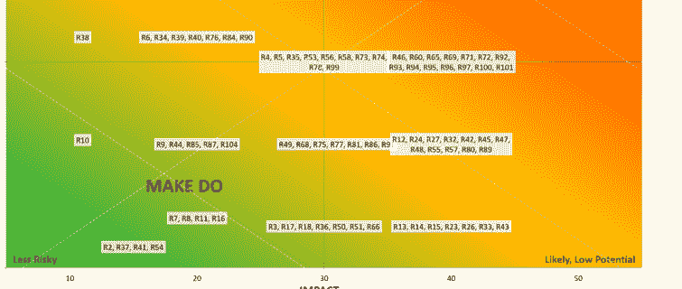

## 风险管理、控制措施和政策

除准备所需的所有文件并确认管理层的支持外，最重要的事情之一是列出实体的所有资产。本章将涵盖风险管理、数据分类以及 ISO 27001 中定义的管理控制措施。

资产是指个人、企业或国家拥有或管理、预期会产生未来利益的具有经济价值的资源。公司的资产负债表列出了其资产。它们是为提高公司价值或促进其运营而获取或建立的。在我们的语境中，资产被定义为被视为实体一部分的任何有形或无形货物或服务。

例如，防火墙就是一种资产；一支笔也是资产；公司本地或在线存储库上的文件也被视为资产，以及那个本应五年前淘汰但由于原因如同百慕大三角般不明而仍在的服务器。

为什么世界上一个文件（MS Word、Excel、PowerPoint，你说吧）会被视为资产？当然不是因为文件本身，而是因为这些文件所代表的价值：假设你是 Reign1 的国王，你入侵 Reign2 从而成为银河皇帝的计划放在保险箱里等待使用——它们值多少钱？或者假设你有 50 公斤的持票人股票？它们的价值是多少？或者你在小学时使用的所有笔记本，按你父母的说法值多少钱？

你明白了：如果水的形状取决于容纳它的容器，文件的价值不取决于物理文件本身，而取决于其包含的信息。

本章将涵盖以下主题：

- 项目风险管理要素
- 数据分类
- ISO 27001 控制措施

## 项目风险管理的要素

项目风险管理是一种必不可少的项目管理策略，旨在最大限度地减少项目执行过程中出现的意外情况数量。尽管无法以绝对确定性预测未来，但一种简单且简化的风险管理方法可用于预测不确定性并减少其发生或影响。这提高了项目成功完成的概率，并降低了这些风险的影响。

因此，项目风险管理的基本流程如下：

- **风险识别**，即风险或其来源的识别。
- **风险评估**，即根据概率和影响对风险进行评估，以确定已识别风险之间的优先顺序。
- **风险处理**，即识别、评估、选择并实施各种补救措施以获得符合项目约束和目标的可接受风险阈值的过程。特别是，它包括必须做什么、何时做、由谁负责，以及相关的成本和进度。
- **风险控制**，即对风险及其管理机制进行持续报告和监控。

风险报告尤其具有双重目的：短期内，它增强了项目内部的沟通；长期来看，它会产生历史先例，可用于在未来项目中做出更准确的风险预测。

## 风险管理计划

在我的职业生涯中，也作为一名风险经理，我学到了一些风险管理的基础知识：

> *风险管理对全球 99% 的人口来说毫无兴趣。他们认为它毫无价值。*

我制定了一项风险登记策略，其简洁程度正是我认为为辅助对话和决策所必需的。它运作良好，在担任通用风险经理几年后，我转入信息安全领域，并将该策略带到了今天。

## 基本概念

*关于风险管理的一些宏观观点*

风险管理是一种管理方法，通过帮助您了解可能阻止您实现目标的一些不良事件，帮助您的组织实现目标。它随后帮助您决定可以采取什么措施来处理这些负面事件，甚至防止其发生。它是一种旨在辅助决策的管理方法；如果它没有帮助决策，那么就是浪费时间。风险管理是管理危害的一种不佳方法，但它是目前可用的最佳方法，并且与其他管理方法一样，有时有效有时无效。同样，像任何管理策略一样，它需要一定的才能才能有效，而且练习越多，越熟练。像最好的管理策略一样，它本质上是简单的。

## 风险评估

为选择最有效的风险降低方法，有必要分析风险。涉及三个阶段：

- **识别**：识别并定义贵公司面临的风险类型是第一步。存在内部和外部威胁。识别风险时，还应考虑风险是否可避免，例如运营风险，或不可避免，例如自然灾害。
- **影响评估**：一旦识别出风险，其影响即可进行评估。这涉及定义风险发生的可能性及其相应的影响或结果。
- **制定策略**：最后，您可以为发生可能性中等或高的风险制定所需的方法。尽管您仍可选择监控次要风险，但在采取下一步并制定策略时，它们的重要性较低。

## 风险特征

这些是应归属于每个风险的 10 个特征：

- **风险 ID** 采用某种形式，例如 R0417。它可以是任何允许您单独区分每个风险的东西。
- **风险描述**：*可能导致您范围内的信息保密性、可用性或完整性丧失的不良事件*是什么？您应努力明确此负面事件的业务影响及其来源或原因。
- **风险所有者**：必须指定一名风险所有者。该个人必须能够做出与风险相关的决策，通常是高级员工。如果发生此不幸事件，谁将不得不处理后果？有时拥有一个*委派风险经理*是有利的，该经理向风险所有者汇报，但可以持续处理风险。尽管如此，风险所有者必须对风险具有一定程度的理解和责任。在我的经验中，认证审核员很少与风险所有者交谈，以询问他们对风险的了解情况以及做出的决策。但他们必须这样做！
- **现有关键控制措施**：您目前已实施哪些有助于风险管理的措施？您无需提及管理风险已实施的每项控制措施，因为标准只要求您描述关键措施。尽量保持此列表中的项目数量适中。如果您认为应实施但尚未实施的控制措施，应在风险改进措施中加以说明。
- **当前可能性：** 在未来 12 个月内发生这种情况的可能性有多大？人们使用多种量表，但我建议的范围为 1（低）到 5（高）。我建议将此概率评估基于您当前对控制措施在今天管理风险方面的有效性的了解，即在目前已知的控制措施缺陷下，它们今天的有效性如何。
- **当前影响：** 受影响信息保密性、可用性和完整性丧失的单一业务影响是什么？通常，这是一个从 1（低）到 5（高）的单一数字。一些人喜欢使用三个不同的数字/评估——分别针对保密性、可用性和完整性——但为了保持简单，我建议使用单一值。该标准不需要三个单独的评估。与概率一样，这应考虑有关管理风险的控制措施当前效能和已知当前缺陷的任何信息。
- **当前风险评级：** 有更复杂的方法，但将概率和影响的数字相乘就足够了。这也被称为风险水平，即 1 到 25 之间的值。
- **当前风险评估：** 这表明该风险是否在您的风险承受范围内，无论其如何定义。通常，这是由风险评分决定的。例如，*所有得分超过 12 的危害都超过了风险承受能力。* 人们通常有两个临界点：一个是远超出风险承受范围的风险（例如，得分高于 20），另一个是超出风险承受范围但没有那么远的风险——例如，在 12 到 21 之间。这用红色、琥珀色和绿色表示。
- *(Optional) 对此结果满意吗？* 是的，如果当前风险评分在风险容忍度范围内。否则，答案是否定的。此特征是可选的，但可能有助于思考。
- **风险处理决定：** 如果风险可接受，应选择*接受*。这意味着我们对该风险感到满意，无需采取进一步行动。根据您的风险评估方法和风险接受标准，如果风险超过您的风险容忍度，也可能选择*接受*。尽管如此，如果超过风险容忍度，最可能的响应是*处理*，即采取行动。您也可以选择*避免*或*转移*作为风险处理选择，但这些选项不太可能被广泛使用，甚至从未使用。
- **风险改进活动：** 如果您选择了*处理*选项，在大多数情况下，您将增加一个或多个新控制措施或增强现有控制措施。预期是在实施这些步骤后，它们会对概率或影响产生一定影响，理想情况下足以将风险降至既定的风险容忍度以下。每项活动都应指定负责人和完成期限。

希望这足够清晰，能让您了解风险应具有的特征列表。下一站，热力图。

## 风险热力图

风险热力图常用于运营风险管理，特别有利于直观展示公司的风险并强调需要更密切监督的风险。通常，在分析运营风险时，风险经理会利用电子表格记录公司的重要危害并估计其影响和可能性（或概率）。

一些机构仍使用电子表格管理更广泛的风险并显示热力图，这些热力图通常包含在为高级管理层和其他高级主管准备的管理信息报告中。尽管许多公司拥有提供此功能的风险管理系统，但一些公司仍依赖电子表格来管理更广泛的风险并显示热力图。

总风险评分是可能性（或概率）和影响评级的乘积。计算风险评分的公式如下：

*风险评分 = 可能性评分 x 影响评分*

当风险清单很广泛时，通常跨越多个部门或业务部门，风险经理将这些风险绘制在热力图上是一项重大困难，确保所有相关危害都能得到适当展示。危害将根据各自的评分显示在热力图上。根据各自的评分，热力图上的危害将被涂成红色、琥珀色或绿色（RAG）。

第一个示例演示了如何以易于理解的方式使用 Excel 显示各种全面的危害（为此图表提供数据的表格包含超过 100 个风险）。

风险评估热力图

图 7.1 – 风险评估热力图

第二个示例以表格格式说明了汇总的热力图。

| 影响 \ 可能性 | 10 低 | 20 中 | 30 高 | 40 非常高 |
|---|---|---|---|---|
| 10 低 | 4 | 1 | 1 | 3 |
| 20 中 | 4 | 5 | 7 | 7 |
| 30 高 | 7 | 7 | 10 | 6 |
| 40 非常高 | 7 | 12 | 14 | 9 |

## 注意

该图显示了按概率和影响评分识别出的风险总数（例如，P=10 且 I=10，P=10 且 I=20，依此类推）

图 7.2 – 表格格式的热力图

好吧，现在我们已经定义了风险有多“热”，我们需要找到一种方法来处理这些风险，或者，用正确的术语来说，就是减轻它们。

## 风险缓解

风险缓解是指减少风险并降低事件发生的几率的方法。风险缓解确保您的组织得到完全保护，这需要持续关注您主要的风险和问题。管理并指导组织的流程有时被称为控制或缓解活动。

为了进一步理解这一点，让我们将其与整体企业风险管理（ERM）流程联系起来考察。您的控制措施的目的是避免某些危害成为现实。这导致制定旨在降低风险成为现实的概率、消除其成为现实的可能性，或提高在风险成为现实时您的流程能够保护您的可能性的政策和程序。

## 最佳风险缓解策略

在任何给定时间，每家公司都面临大量危害。在做新事物（例如项目或计划）或经历任何形式的组织变革时，它们会承担更多风险。这些固有危害通常与实现最终目标所涉及的程序有关。然而，有一些方法可以降低事件发生的可能性（可能性），可用于识别和指导更好的风险缓解计划。

因此，最常见的四种策略如下：

- **风险接受**，这一概念可以简化为 *承担风险*。这意味着接受危险的存在，并且您无能为力减轻或改变它。相反，它涉及理解其发生的可能性并接受潜在的后果。当危险较低或风险不太可能发生时，这是最佳方法。当最小化或避免风险的成本高于接受并任其发展的成本时，接受风险是有意义的。
- **风险规避**：如果启动项目、推出产品、搬迁公司等相关风险太大，放弃可能更明智。在这种情况下，风险规避涉及避免从事导致风险的行为。以这种方式管理风险最接近个人管理个人危害的方式。尽管有些人是风险寻求者，有些人是风险规避者，但每个人都有一个临界点，超过该点事情变得过于危险而无法进行。
- **风险缓解**：在评估风险时，最好不要规避或接受某些危害。在这种情况下，会研究风险最小化。风险缓解是指用于管理和减轻风险的活动和技术。当风险及其可能性被识别后，管理资源可以得到适当分配。
- **风险降低**：企业可以选择可接受的风险程度，称为残余风险水平。风险最小化是最普遍的方法，因为通常有办法降低风险。它涉及采取行动来减轻结果的影响。风险降低的一个例子是风险转移，例如购买保险。
- **风险转移**：如前所述，风险转移包括将风险转移给第三方或机构。如租赁房产的情况，风险转移可以外包、转移给保险公司或提供给新组织。风险转移并不经常导致成本降低。当风险转移可用于减轻未来损害时，风险转移是可取的。因此，保险可能很昂贵，但可能比承担风险并完全承担维修责任更具成本效益。

**提示 – 最有效的风险管理策略是什么？**
显然，最佳技术取决于您想要避免的风险。决定追求哪种策略的一个可靠经验法则是首先进行风险评估。这将使您能够发现政策和活动方面的差距。根据这些输入，您可以有效地对工作进行排序。

*只要记住：* 这里没有 *一刀切* 的公式。我咨询过的 99.9% 的机构会根据其业务需求将上述策略结合使用。

## 如何建立风险缓解策略

所有风险和收益都是根据您公司特定的目标进行不同评估的。为了有效制定风险降低措施，您必须参与以下工作：

- **了解用户需求**：了解您客户的愿望。在评估风险时考虑他们的需求，因为他们是您组织的基础。
- **寻求并使用专家**：风险不必孤立处理。有软件系统和专业领域专家可作为资源。
- **识别出现的风险**：作为公司领导者，您能做的最糟糕的事情就是忽视风险的存在，因为这既不切实际也不有用。当您能够识别、定义和处理风险时，您可以更好地培训您的团队和管理层应对其多种形式。
- **鼓励冒险**：有时，冒险是最好的行动方案。如果您的公司能够处理风险，请鼓励冒险。制定备份计划并解释它们，以便每个人都达成一致，使其不那么令人畏惧。
- **认识可能性**：冒险可能导致发现新的机会。如果您以这种方式构建围绕风险的讨论，您可以培养一种善于管理风险的问题解决思维。
- **促进对缓解策略的考虑**：考虑团队的意见并让每个人参与。每个人可能都有独特的风险缓解策略或方法。您可以使用数据和分析来评估替代方案并选择最佳行动方案。

并非每种风险都需要缓解策略：如前所述，有时冒险更可取。认识到这是个选项，并且有些风险根本不需要战略应对。

我尽力在这里为您提供所有基本（和非基本）的概念，但如果您想继续探索有趣的风险管理世界，您会在您最喜欢的书店找到大量书籍来帮助您深入研究。对于我们来说，是时候转向数据分类了。

## 数据分类

我们本章开始时谈论资产，而数据分类是组织数据资产的过程，因此在这里值得一提。

数据分类涉及构建分类方案并为整个组织定义一个或多个分类法。分类系统有助于有效确定数据行动的优先级和强度。数据分类取决于诸如关键性、安全、访问和使用、隐私、伦理、数据质量和存储需求等特征。

## 为什么数据分类很重要？

数据分类为企业提供在不同数据类型、结构和存储系统之间实施规则和流程的接口。已分类的数据使组织能够为敏感数据在众多系统和数据项中创建并应用单一的处理策略。在数据充裕的当今环境中，为每种数据项定义多条规则是不切实际的。

数据分类为应用程序和流程提供了企业上下文。例如，基于数据分类，组织可以识别处理敏感数据的应用程序，并为此类应用程序指定更严格的安全标准：

- **合规性**：数据分类使遵守 GDPR、CCPA、HIPAA 和 PCI 等监管框架变得更简单，并证明了合规性
- **安全性**：数据分类使组织意识到数据的敏感性，无论是整体还是每次出现新数据时，并使组织能够根据此上下文应用适当的程度的安全控制
- **治理**：数据分类促进数据的映射、监控和管理

## 数据分类的四个级别是什么？

在信息安全领域，数据通常有四个分类级别：

- **公开**：可能存在于公共领域并可自由与组织外部任何人共享的数据，例如介绍公司产品和服务的传单
- **内部**：公司范围内的内部保留数据，不应与组织外部共享，虽然不敏感，例如如何联系公司 IT 支持的说明
- **机密**：这是特定领域的数据，可与特定个人或团队共享，并包含敏感的公司信息；例如某公司产品的价格清单
- **受限**：高度敏感的信息，只能按需知原则访问，例如雇佣协议

## 数据分类的各种类型是什么？

虽然数据分类取决于每个组织的需求，但有几种典型的数据分类方法：

- **基于数据**：解释数据特征的分类。信用卡号码或电子邮件地址是示例。
- **基于上下文**：描述数据业务上下文的分类，例如敏感信息或收益数据。
- **基于来源**：识别数据源的分类，例如通过网络研讨会注册表单收集的消费者信息。

## 数据分类的困难

虽然数据分类对于执行各种操作是必要的，但信息安全主要关注敏感数据。在大多数企业中，敏感数据被分类为不同的敏感级别，然后映射到不同的敏感数据类别（例如个人信息）。

通常，公司在分类数据时面临以下障碍：

- **误报**：相同的数据可能以多种形式和情况出现。忽略输入格式和上下文的分类算法更可能产生错误分类。由于分类工作通常涉及庞大的数据量，即使非常低的误报率也可能阻止组织正确分类。
- **漏报**：根据不同的监管要求，数据在一种情况下可能被视为敏感，在另一种情况下则不然。例如，姓名本身可能被视为不敏感，但与医疗记录配对时则敏感。经常，数据在脱离其使用上下文的情况下进行分类会导致不准确的分类。
- **大数据**：数据湖和数据仓库代表不断扩展的动态数据存储，对非连续的分类方法构成了巨大挑战。
- **成本**：对于大多数分类工具，采用和维护数据分类策略的成本取决于数据量和施加的规则数量。此过程限制了公司使用严格访问规则对海量数据集进行分类的能力。

## 合规标准对数据分类的影响

许多法律和合规要求强制企业对其数据进行分类。根据组织使用、处理、收集、发送和存储的数据类型，每个合规标准可能有不同的要求。

以下是一些常见的合规标准及其数据分类要求：

- **GDPR**：根据 GDPR，处理欧洲数据主体个人数据的组织必须对收集的所有数据类型进行分类。如前几章所述，GDPR 将涉及种族、政治信仰、医疗保健、民族起源和生物识别的 *特殊* 数据分类为。此信息需要更高的安全性。
- **PCI-DSS**：实体根据 PCI DSS 要求 9.6.1 必须 *对数据进行分类，以便可以评估数据的敏感性。*
- **SOC2**：根据 SOC2 标准，信托服务（SOC2）实体必须证明他们定期识别和管理敏感信息，以符合其特定的保密目标。
- **HIPAA**：受保护的健康信息（**PHI**）在 HIPAA 下是高风险资产。HIPAA 安全规则要求企业和相关 **业务伙伴（BA）** 识别 PHI 并采取保护措施以确保其可用性、保密性和完整性。HIPAA 隐私规则限制 **受保护的健康信息（PHI）** 的使用和披露，并要求适用企业和业务合作伙伴实施数据分类方法。

*数据的珍贵程度在很大程度上取决于我们赋予它的价值。*

让我们用一个例子来更好地理解这个概念：假设有一个名为 XYZ 的国家，其国王想要征服邻国 ZYX。他召集所有顾问、部委和顾问，准备了一份战争计划并将其放入保险箱。这个计划，如你所想，具有巨大的价值。但是，出于某种原因，国王从未决定使用该计划，而是与另一个国家达成长期和平协议。当他的继任者（或对手，或革命，你说吧）登上王位并找到攻击计划时，该计划的价值会如何？

答案是我不知道，你可能也不知道。但可以肯定的是，其价值与过去不同，因为和平协议成功了，因为老国王死了，还有许多其他不同的原因。数据分类是对某些信息赋予价值的技术。

## 数据分类级别

数据敏感级别有助于确定如何处理每种分类数据形式。例如，互联网安全中心（CIS）提出三个信息类别：

- 公开
- 商业机密
- 敏感

美国政府有一个更全面的分类系统，包含七个数据敏感类别：

- **受控非密信息（CUI）**
- 公共信任
- 机密
- 秘密
- 绝密
- 代码词分类
- 受限数据/原受限数据

使用超过三层可能会使数据分类复杂化，并使其难以监控和维护。使用少于三层被认为过于基础，可能导致保护和隐私不足。如 CIS 所建议，大多数企业采用三个分类级别。

以下是 CIS 分类定义的简化版本，可用于你的数据分类工作：

- **低敏感度数据：** 这包括不需要访问限制的公开数据，例如网页、博客文章和招聘信息。
- **中敏感度数据：** 这仅用于内部使用，泄露可能会对业务产生重大影响，例如公司战略、客户名单和匿名个人数据。
- **高敏感度数据：** 这包括受规则或合规要求保护的信息，需要严格的访问限制和安全措施。如果数据被泄露，可能会对个人或公司造成严重损害，并导致合规处罚或罚款。

## 开发数据分类策略

数据分类策略概述了企业管理其信息生命周期的方式。目标是确保敏感数据根据其带来的风险程度得到处理。数据分类策略应处理访问和授权，同时考虑数据结构及其典型的业务应用。

以下是策略应解决的众多重要方面：

- **目标：** 应用数据分类的理由和期望结果，以及可量化的 **关键绩效指标（KPI）**。
- **工作流程：** 阐明整个分类过程应如何构建和协调。解释此程序将如何影响所有员工以及他们应如何处理不同程度的敏感信息。
- **位置：** 确定数据存储的位置，例如现场、云端、备份系统、数据库、文件等。
- **模式：** 确定并描述数据分类类别。
- **数据所有者：** 明确参与分类管理流程的所有利益相关者的角色和职责。描述每个职位应如何组织和允许访问数据。

- **合规**：明确识别受合规标准管辖的信息以及实现合规所需的步骤。

## 数据分类程序

以下是一些推荐做法，可帮助您提升组织的数据分类：

- **开展数据风险评估**：可通过数据风险评估获得对所有数据需求的全面了解，包括与公司规章和合规标准相关的内容。您还应识别隐私和保密方面的合同义务。与所有利益相关者（包括 IT、安全和法务团队）协作定义数据分类目标。

- **创建数据清单**：在对数据进行分类之前，必须使用数据发现的方法和工具来识别数据。一旦找到所有敏感数据，就必须对其进行识别和分类，以确保每个数据类别都得到充分保护。为了使流程更快更精确，您可以标记包含敏感数据的任何项目。这可显著增强数据分类规则的执行。您可以手动或自动标记数据。

此流程可通过使用智能分类系统实现自动化。例如，数据分类系统可根据指定标准自动识别和分类数据，然后为其添加相关的分类标签。在整个数据生命周期中，这些系统可持续监控数据，以确保其始终得到适当分类。

- **建立数据安全措施**：每个数据分类级别都需要独特的保护程度。为确保每个级别都得到充分保护，请标准化您安全方法。为每个标签分类定义基于策略的控制措施。

- **维护和监督**：数据是动态的，必须持续监控和维护。它可能会被定期复制、生成、编辑、删除和传输。由于数据在其存在期间会经历多次转换，因此对其进行分类可能是一项耗时的工作。识别真正需要保护的数据并将分类工作集中于此，是减少分类时间的重要步骤。自动化分类系统是减少工作量并加快新产生敏感数据识别和处理速度的额外方法。最后，请验证您的数据分类标准是否足够灵活，能够适应数据结构的变化、新数据类型引入以及数据量的增加。

在我们已全面处理数据及其分类之后，现在是时候转向 ISO 27001 控制措施及其重要原因了。

## ISO 27001 控制措施

ISO 27001 标准由标准本身以及第二部分组成，即附录 A，其中包含所有控制措施（114 项，分为 14 个类别）：

- 信息安全政策
- 信息安全管理组织
- 人力资源安全
- 资产管理
- 访问控制
- 密码学
- 物理和环境安全
- 运行安全
- 通信安全
- 系统获取、开发和维护
- 供应商关系
- 信息安全事件管理
- 业务连续性管理的信息安全方面
- 合规性

每个 14 个类别都为您提供了该类别主要目标的清晰说明。

### 控制类别 A.5 – 信息安全政策（1 个目标和 2 项控制措施）

该类别的目的是根据组织的需求和适用的法律法规，为管理层提供信息安全方面的指导和帮助。这是通过记录一套信息安全规则来实现的，该规则必须获得授权、公布、传达并在特定间隔进行审查。

### 控制类别 A.6 – 信息安全管理组织（2 个目标和 7 项控制措施）

第一个目的是建立一个启动并规范信息安全实施和运行的管理结构。这涉及确保以下内容：

- 信息安全角色和职责得到解释并被理解
- 职责分离得到认可并得以维持
- 与监管机构（包括 ICO）以及特殊利益组织（如 ISACA）建立并维护适当的联系信息

无论项目类型如何，信息安全都在项目管理中开发和处理。第二个目的是保护移动设备和远程工作的安全。

这是通过制定和执行政策以及补充安全措施来实现的，以控制与移动设备使用相关的风险，并保护远程访问、处理或存储的信息。

### 控制类别 A.7 – 人力资源安全（3 个目标和 6 项控制措施）

主要目的是确保员工了解其义务并具备所评估职位的资格。这是通过对所有申请人进行充分的背景调查并在劳动合同中包含信息安全职责来实现的。

第二个目的是确保员工了解并遵守其信息安全职责。为此，他们必须根据组织规则和程序实施信息安全。组织有责任确保人员接受适当的培训和定期更新。

还必须制定结构化且公开的纪律程序，以便对违反信息安全的人员进行惩罚。该类别的最终目的是通过定义、传达和执行限制性契约，在员工换工作或离开组织时保护组织的利益。

### 控制类别 A.8 – 资产管理（3 个目标和 10 项控制措施）

第一个目标要求识别信息资产并分配合适的保护任务。这是通过制定识别资产所有者的资产清单来实现的。记录并执行有关这些资产允许使用的规则。回收后，资产还必须得到保护和维护。后续目的是确保数据得到充分保护。

为此，有必要制定分类系统并正确分类资产。因此，所有电子和物理资产必须按照分类系统进行标记，并且还必须设计和执行资产管理程序。最终目的是防止存储在介质上的信息被未经授权披露、更改、删除或销毁。这可以通过采用可移动介质管理方法来实现。这些流程必须解决持有敏感信息的存储介质的安全处置和运输问题。

### 控制类别 A.9 – 访问控制（4 个目标和 14 项控制措施）

主要目标是限制对信息和数据处理资源的访问：这部分通过制定和执行访问控制政策并将用户访问限制在执行其工作所需的系统和网络区域来实现。

第二个目标是保证授权用户访问并防止未经授权的访问。

为此使用以下控制措施：

- 用户注册和注销的结构化流程
- 用户访问授权的结构化流程
- 特权访问权限分配和使用的限制与管理
- 管理密码、PIN 等分发的结构化方法
- 访问权限的审查
- 用户离开组织或更换职位时撤销其访问权限

第三个目的是让用户对保护其密码、PIN、令牌等负责。因此，有必要遵守用于秘密身份验证信息使用的规定流程。该类别的最终目的是防止对系统和应用程序的未经授权访问。为实现此目的，控制措施必须限制对信息和系统的访问，并在适用时实施安全登录流程。此外，还必须控制对程序源代码的访问，同时限制可能绕过系统和应用程序限制的实用程序。对于此目的，通常使用密码管理解决方案。

### 控制类别 A.10 – 密码学（1 个目标和 2 项控制措施）

该类别的目的是确保密码学得到正确使用，以保护信息的保密性、完整性和有效性。

这是通过创建和实施密码学政策来实现的，该政策包括有关密码密钥的使用、保护和寿命的信息。

### 控制类别 A.11 – 物理和环境安全 (2 个目标和 15 项控制)

主要目的是防止未经授权的物理访问、损坏以及对数据和信息处理基础设施的干扰。

用于实现这些目标的控制措施包括以下内容：

- 定义并利用物理边界安全
- 确保安装并使用物理访问控制
- 保护办公室、房间和基础设施
- 防范外部和环境危险
- 制定并执行在安全环境中工作的协议
- 无论位置如何，均确保交付和装卸地点的安全

第二个目的是避免资产的丢失、被盗、受损或被破坏以及活动的中断。

为实现此目的而采取的控制措施包括以下内容：

- 设备放置和保护，以防止信息被忽视或设备因环境而受损
- 支持性公用设施的管理和保护，包括 **不间断电源 (UPS)**、电力、燃气和水
- 防范对电力和通信连接的非故意或故意损坏
- 定期维护和保养设备，包括 **供暖、通风与空调 (HVAC)**（如适用）
- 以高效的方式管理从组织场所移除资产
- 保护从物业移除的贵重物品
- 安全地重复使用和丢弃设备
- 确保用户妥善保护无人看管的设备
- 实施清洁桌面和屏幕政策

### 控制类别 A.12 – 运行安全 (7 个目标和 14 项控制)

第一个目标是保证信息处理设施得到适当且安全的管理。

为此，操作程序必须被记录并公开获取。

变更管理包含在这些程序中，以规范对业务流程、信息处理设施和系统的修改。

容量管理还必须用于监控和预测容量需求。

此外，应强调开发、测试和运行环境必须隔离，以降低未经授权访问或修改运行环境的风险。

下一个目的是保护信息和信息处理设施免受恶意软件侵害。这是通过实施反恶意软件来识别、防止和从攻击中恢复来实现的。

用户必须了解组织的反恶意软件及其关于允许和不允许使用的指南。

第三个目标是通过确保按照既定的备份策略定期备份信息、软件和系统并进行测试来抵御数据丢失。

后续目标涉及记录事件并提供证据。这是通过生成、存储、评估和保存用户活动日志（包括管理员和普通用户）、异常报告和信息安全事件日志来实现的。

所有相关信息处理系统时钟必须同步到单一参考时间源，例如 **网络时间协议 (NTP)**。

第五个目标是确保操作系统的完整性。

实施并使用控制流程来监督操作系统上的软件安装，可实现此目标。

下一个目的是避免技术缺陷被利用，可通过收集有关技术漏洞的数据、评估其可能造成的风险并实施纠正措施来实现。

此外，必须定义并执行控制软件安装的规章。本类别的最终目的是最大限度地减少审计操作对操作系统的影響。

为了最大限度地减少中断，必须就审计要求和需要验证操作系统的操作达成一致的策略。

### 控制类别 A.13 – 通信安全 (2 个目标和 7 项控制)

第二个目的是保护内部和外部信息传输的安全，这可以通过制定正式的传输规则、流程和控制措施来实现，以确保通过各种通信设施传输的信息安全，包括通过电子邮件、通信平台和社交媒体的电子消息。

因此，信息传输协议必须包括安全共享业务信息的条款。

### 控制类别 A.14 – 系统获取、开发和维护 (3 个目标和 13 项控制)

主要目的是保证信息安全在其整个生命周期内都是信息系统的固有组成部分，包括通过公共网络提供服务的系统对信息系统的要求。这意味着信息安全需求必须纳入任何新系统或升级系统的规范中。

保护涉及穿越公共网络的应用服务的数据是进一步的控制措施，有助于实现此目的。应用服务交易中涉及的信息也必须得到保护，以避免传输不完整、误导、未经授权的消息修改、未经授权的消息披露、未经授权的消息复制和未经授权的消息重放。

后续目的是保证信息安全在开发生命周期中得到建立和执行，这与设计和开发活动密切相关。

以下控制措施可能有助于实现此目标：

- 必须制定并实施软件和系统开发规则
- 开发生命周期中对系统的更改必须由既定的变更控制流程管理
- 当操作系统被修改时，必须检查和验证关键任务应用程序对运营和安全的不利影响
- 应阻止软件包修改
- 如果需要修改，必须限制在必要的范围内并严格管理
- 任何信息系统实施活动必须定义、记录并使用安全系统工程原则
- 建立并充分保护安全的开发环境
- 任何外包开发操作必须得到管理和监控
- 在开发过程中必须评估安全功能
- 必须为新信息系统、升级和新版本创建系统可接受性测试的程序和标准

最终目标是通过仔细选择数据、加密或以其他方式保护数据，并将访问限制为仅授权员工，来确保用于测试的数据安全。

必须创建并应用软件和系统开发的指南。开发生命周期期间对系统的更改必须由定义的变更控制方法管理。

当操作系统更新时，必须分析关键任务应用程序对运营和安全的不良影响。必须阻止软件包更改。如果需要更改，必须限制在最低限度并严格监管。任何涉及信息系统开发的操作必须定义、记录并执行安全系统工程原则。

### 创建并适当保护安全的开发环境

任何外包开发活动都需要管理和监督。安全功能必须在整个开发过程中进行审查。对于新信息系统、更新和新版本，必须制定系统可接受性测试的程序和标准。

最终目标是通过仔细选择数据、加密或以其他方式保护数据，并将访问限制为仅授权人员，来确保用于测试的数据安全。

### 控制类别 A.15 – 供应商关系 (2 个目标和 5 项控制)

本类别的主要目的是保护供应商可访问的资产。为此，必须在供应商管理政策中详尽规定信息安全标准，以限制供应商访问资产相关的风险。

因此，必须与每个供应商谈判并签署书面协议，包括供应商管理政策中概述的所有相关标准。这些正式协议中必须解决与信息和通信技术服务以及供应链相关的信息安全风险。

第二个目标是根据供应商合同维持既定的信息安全和服务交付水平。为此，供应商必须定期进行监控、审查，并在某些情况下进行审计。供应商服务的变更也必须得到处理，同时维护和改进当前的信息安全政策、程序和控制措施；考虑到公司信息、系统、流程的重要性以及风险的重新评估。

### 控制类别 A.16 – 信息安全事件管理 (1 个目标和 7 项控制)

本类别只有一个目标，即建立统一和有效的信息安全事件管理方法，包括有关安全事件和漏洞的沟通。

The following controls may assist in achieving this objective:

以下控制措施可能有助于实现此目标：

- For a prompt, effective, and systematic reaction to information security events, management responsibilities and processes must be developed and executed
- 为了对信息安全事件做出及时、有效和系统的反应，必须制定并执行管理职责和流程
- Information security incidents must be promptly reported via the proper management channels
- 信息安全事件必须通过适当的管理渠道及时报告
- Employees and contractors are required to disclose any identified or suspected information security vulnerabilities
- 员工和承包商必须披露任何已识别或疑似的信息安全漏洞
- Information security incidents must be evaluated carefully to determine their classification as occurrences
- 必须仔细评估信息安全事件，以确定其作为事件的分类
- Deficiencies or occurrences, i.e., missing occurrences
- 缺陷或事件，即缺失的事件
- Information security issues must be addressed in accordance with established processes
- 信息安全问题必须按照既定流程处理
- Utilize the knowledge acquired from analyzing and resolving information security events to lessen the possibility or effect of future occurrences
- 利用从分析和解决信息安全事件中获得的知识，以减少未来事件发生的可能性或影响
- Documented processes must outline the identification, gathering, acquisition, and preservation of information that may be used as evidence
- 文件化的流程必须概述可能用作证据的信息的识别、收集、获取和保存

### Control Category A.17 – Information security aspects of business continuity management (2 objectives and 4 controls)

### 控制类别 A.17 – 业务连续性管理的信息安全方面（2 个目标和 4 项控制）

The initial purpose of this category is to prevent violations of legal, legislative, regulatory, or contractual information security duties and security requirements.

本类别的初始目的是防止违反法律、立法、监管或合同规定的信息安全义务和安全要求。

To achieve this purpose, it is necessary to identify the needs for information security and the continuity of information security management under bad scenarios. Processes, procedures, and controls must then be created, documented, implemented, and maintained. Once in place, these arrangements must be frequently evaluated and validated to guarantee their efficacy.

为实现此目的，有必要在不利情况下识别信息安全和信息安全管理连续性的需求。然后必须创建、记录、实施和维护流程、程序和控制措施。一旦建立，这些安排必须经常进行评估和验证以保证其有效性。

The second purpose is to guarantee that information processing facilities are available. This is performed by establishing redundant information-processing facilities to satisfy availability needs.

第二个目的是保证信息处理设施可用性。这是通过建立冗余信息处理设施来满足可用性需求实现的。

### Control Category A.18 – Compliance (2 objectives and 8 controls)

### 控制类别 A.18 – 合规性（2 个目标和 8 项控制）

The primary purpose of this category is to prevent violations of legal, legislative, regulatory, or contractual information security duties and security standards. Identifying and recording pertinent legal, statutory, regulatory, and contractual requirements, as well as the strategy for satisfying them, are examples of controls that might assist in achieving this purpose:

本类别的主要目的是防止违反法律、立法、监管或合同规定的信息安全义务和安全标准。识别和记录相关的法律、法规、监管和合同要求，以及满足这些要求的方法，是可能有助于实现此目的的控制措施的示例：

- Implementing processes to assure compliance with legal, statutory, regulatory, and contractual obligations for intellectual property rights and the usage of proprietary software products
- 实施流程以确保遵守知识产权和专有软件产品使用的法律、法规、监管和合同义务
- Protecting records against loss, tampering, falsification, unauthorized access, and unauthorized disclosure, in accordance with legal, statutory, regulatory, contractual, and corporate requirements
- 根据法律、法规、监管、合同和公司要求，保护记录免受丢失、篡改、伪造、未经授权访问和未经授权披露
- As required by applicable laws and regulations, ensuring the privacy and security of personally identifiable information
- 根据适用法律和法规的要求，确保个人可识别信息的隐私和安全
- Utilizing cryptographic controls in accordance with all applicable international and national agreements, laws, and regulations
- 根据所有适用的国际和国家协议、法律和法规使用加密控制措施

The second purpose is to guarantee that information security is established and managed in compliance with the rules and procedures of the organization. This is accomplished by conducting independent evaluations of the strategy for managing information security and its execution at predetermined intervals or in response to substantial changes.

第二个目的是保证信息安全按照组织的规定和程序建立和管理。这是通过在预定间隔或对重大变化做出响应时，对信息安全管理策略及其执行进行独立评估来实现的。

The compliance of information processing and processes within their areas of responsibility of given managers must also be routinely reviewed by them; finally, information systems must undergo frequent compliance reviews, which may be accomplished via penetration testing.

指定管理者在其职责范围内的信息处理和流程的合规性也必须由他们定期审查；最后，信息系统必须接受频繁的合规审查，这可以通过渗透测试来实现。

## Who is charged for implementing Annex A controls?

## 谁负责实施附录 A 控制措施？

There are two essential considerations for addressing this question.

回答这个问题有两个关键考虑因素。

Less than forty percent of ISO 27001 Annex A controls are technology-based. Information security vulnerabilities are often caused by human behavior. Therefore, contrary to popular belief, IT cannot and should not be the only answer.

ISO 27001 附录 A 的控制措施中不到四成是技术性的。信息安全漏洞通常由人类行为引起。因此，与普遍看法相反，IT 不能也不应是唯一的答案。

Information security is, in reality, about constructing a system of mature, resilient rules. The present Annex A framework applies the following percentages to control locations inside an organization:

信息安全实际上是关于构建成熟、 resilient 的规则体系。当前的附录 A 框架将控制措施在组织内部的分布按以下百分比划分：

- 37% – Technology
- 37% – 技术
- 36% – Organizational/documentation
- 36% – 组织/文档
- 13% – Physical security
- 13% – 物理安全
- 5% – Supplier and buyers
- 5% – 供应商和买方
- 5% – Human resource management
- 5% – 人力资源管理
- 4% – Legal protection
- 4% – 法律保护

Consequently, applying the controls stated in Annex A is and must always be the responsibility of a number of persons and departments within an organization, the number of which is dependent on the size and complexity of the organization.

因此，应用附录 A 中规定的控制措施始终是组织内多个人和部门的责任，其数量取决于组织的大小和复杂性。

## Using the ISO 27001 controls

## 使用 ISO 27001 控制措施

The controls outlined in Annex A of ISO 27001 are a vital component of risk treatment and must be chosen based on a comprehensive analysis of an organization's information security threats.

ISO 27001 附录 A 中概述的控制措施是风险处理的至关重要组成部分，必须基于对组织信息安全威胁的全面分析来选择。

Typically, chosen controls must be justified by one of the following:

通常，所选控制措施必须由以下其中一项证明其合理性：

- Risk assessment
- 风险评估
- Business need or best method
- 业务需求或最佳方法
- Legal or contractual requirement
- 法律或合同要求

Once controls have been identified, organizations must submit a **Statement of Applicability (SoA)** that must contain, at a minimum, all 114 controls listed in Annex A of ISO 27001, along with reasons for inclusions and, preferably, concise descriptions of how they have been implemented. The SoA acts as a tool for providing senior management with accurate information on the degree of risk to which their organizations are exposed and the status of risk treatment efforts.

一旦确定了控制措施，组织必须提交一份 **适用性声明 (SoA)**，其中至少必须包含 ISO 27001 附录 A 中列出的全部 114 项控制措施，以及纳入理由，并最好简要说明其实施方式。SoA 可作为向高级管理层提供有关其组织所面临风险程度以及风险处理工作状态的准确信息的工具。

## Identification of ISO 27001 controls to implement

## 识别应实施的 ISO 27001 控制措施

Only after a thorough evaluation of an organization's inherent information security threats can it be determined which measures should be adopted. Once the risks are known, the appropriate countermeasures may be determined. Possibly, the greater the number of controls adopted, the greater the likelihood that the organization can minimize or at least mitigate exposure to recognized risks.

只有在对组织固有的信息安全威胁进行彻底评估后，才能确定应采用哪些措施。一旦风险明确，就可确定适当的对策。可能，采用的控制措施越多，组织就越有可能将已识别风险的暴露降至最低或至少减轻。

Nonetheless, Annex A controls may be omitted if deemed irrelevant. An example of this would be a company that does not produce software.

尽管如此，如果认为不相关，附录 A 的控制措施可以省略。一个例子是不生产软件的公司。

Obviously, there would be no need for a strategy of secure growth. If a control is to be omitted, a complete rationale must be included in the SoA.

显然，就不需要安全的开发策略。如果要省略某项控制措施，必须在 SoA 中包含完整的理由。

## Summary

## 摘要

This chapter was very discursive, but we talked about risk management, data classification (still, as part of risk management) and all the controls within Annex A of ISO 27001.

本章内容较为冗长，但我们讨论了风险管理、数据分类（仍作为风险管理的一部分）以及 ISO 27001 附录 A 中的所有控制措施。

In the next chapter, we will discuss preparing foolproof policies and procedures to avoid internal risks. We will examine security systems and devices, cybersecurity vulnerabilities, social engineering, common pain points, and critical success factors.

在下一章中，我们将讨论准备万无一失的政策和程序以避免内部风险。我们将研究安全系统和设备、网络安全漏洞、社会工程、常见痛点和关键成功因素。
