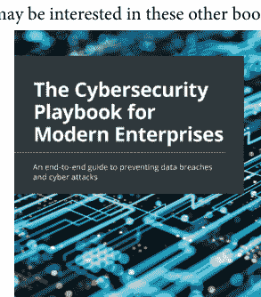
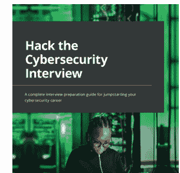
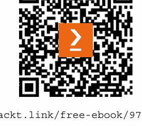

# 索引

### A
- ACME 141
- 行动计划 (AP) 23-25
- 高级持续性威胁 (APT) 70
- 聚合数据 43
- 附件 A 控制
  - 实施注意事项 124
- 匿名化 43
- APIs 198
- 资产管理 117, 118
- 可用性 6

### B
- 约束性公司规则 (BCRs) 63
- 生物识别信息隐私法 (BIPA) 178
- 自带设备 (BYOD) 180
  - 优势 181
  - 标准和建议 182
  - 劣势 181
  - 移动设备管理 181
- BSI - 云计算合规性标准目录 (BSI C5)
  - 参考链接 173
- 业务合作伙伴 (BA) 113

### C
- 加州消费者隐私法案 (CCPA) 177
  - 与 GDPR 对比 42, 43
  - 与 LGPD 对比 42, 43
- 加州隐私权法案 (CPRA) 177
- 互联网安全中心 (CIS) 113
- 首席风险官 (CRO) 73
- 儿童在线隐私保护法 (COPPA) 177, 179
- CI/CD 流水线 198
- 云
  - 关注 168
  - 新兴 163
  - 环境 198
  - 安全关注 169
  - 工作 164
- 云计算 166
  - 云安全的架构缺失 167
  - 云安全策略缺失 167
  - 云服务配置错误 168
  - 合规违规 167
  - 合同违规 168
  - 内部威胁 167
  - 可见性降低 167
  - 未受保护的用户界面 168
- 云计算合规控制目录 (C5) 164
- 云托管策略 141, 142
  - 适用策略 144
  - 数据可用性和记录保留 144
  - 知识产权和版权材料 143
  - 个人身份信息 (PII) 143
  - 目的 141
  - 要求 142, 143
  - 角色和职责 144
  - 范围 141
- 云安全 164
  - 风险衡量 166
- 云安全联盟 (CSA) 164
  - 参考链接 173
- 云服务提供商 (CSPs) 163
  - 在 GDPR 行为准则中使用 172, 173
- 云服务类型 165
  - 基础设施即服务 (IaaS) 165
  - 平台即服务 (PaaS) 165
  - 软件即服务 (SaaS) 165
- 科罗拉多隐私法案 (CPA) 177
- 承诺 25, 26
- 发起组织委员会 (COSO) 77
- 沟通 94
  - 内部沟通与外部沟通对比 96, 97
  - 计划 95, 96
  - 技术 95
- 通信安全 120
- 公司政策 127
  - 确定 128
  - 纪律处分政策 128
  - 文档和记录保留规则 129
  - 付款政策 129
  - 人事政策 128
  - 保密政策 129
  - 员工绩效政策 129
  - 隐私政策 129
  - 安全政策 128
  - 技术政策 128
  - 举报人政策 129
- 公司程序 144
  - 评估设计要素 147
  - 编写指南 147
  - 信息收集 146
  - 必要性 145, 146
  - 编写 146, 147
- 合规 123
  - 违规 167
- 保密性 6
- 保密性、完整性和可用性 (CIA) 6, 7
- 基于上下文 112
- 控制 25
- 公司治理 11, 12
- 欧洲联盟法院 (CJEU) 63, 193
- 密码学 118
- 网络安全框架 (CSF) 15

### D
- 基于数据 111
- 数据分类 110
  - 分类 111
  - 困难 112
  - 合规标准的影响 112, 113
  - 级别 111-114
  - 需求 111
  - 制定政策 114, 115
  - 程序 115
  - 类型 111
- 数据控制者 53, 54, 171
  - 问责制 54
- 数据控制者问责制
  - 培训材料 56
  - 隐私仪表板 55, 56
  - 推荐文档 55
- 数据保管人/数据保护官 142
- 数据处理者 54, 172
  - 强制性文档 56-61
- 数据保护
  - 处理 46-48
  - 警告 61
- 数据保护官 (DPO) 55
- 数据安全与合规
  - 合同要求 171
  - 文档要求 171
  - 安全控制要求 170
- 去标识化 43
- 非军事区 (DMZ) 9
- 戴明循环 85
- 设计要素，公司程序
  - 流程图 147
  - 矩阵 148
  - 剧本 147, 148
  - 问答 148
- 检测功能 28
- 分布式拒绝服务 (DDoS) 攻击 7, 70
- 分发模型 165
- 分发模型方法
  - 混合模型 165
  - 其他模型 165
  - 私有模型 165
  - 公共模型 165
- docker 容器 198
- 影响评估文档 (DPIA) 60
- 文档化信息，ISO 27001 支持要求 97, 98
  - 开发和修订 98
  - 一般 98
  - 记录数据管理 99-101

### E
- 电子通信隐私法 (ECPA) 177
- 电子健康记录 (EHRs) 142
- 嵌入式设备 198
- 员工行为准则 135
  - 示例草案 135
  - 模板 135
- 员工隐私权 186
  - 信息访问 186
  - 个人事务 187
  - 员工监控例外 186
- 企业风险管理 (ERM) 72, 108
  - 与传统风险管理对比 73, 74
- EU-GDPR 142
- 欧洲云用户联盟 (ECUC) 164
- 欧洲数据保护委员会 (EDPB) 62
- 欧洲数据保护监督员 (EDPS) 169
- 欧洲网络和信息安全局 (ENISA) 169
- 欧美隐私盾 61-67

### F
- 公平信用报告法 (FCRA) 176
- 家庭教育权利和隐私法 (FERPA) 142, 176


### G
联邦信息安全办公室 (BSI) 164
联邦贸易委员会法案 (FTC Act) 177
联邦贸易委员会 (FTC) 177, 178
概述 179
FISMA 142
常见问题 (FAQs) 63

GDPR 云服务提供商 (CSPs) 行为准则 172, 173
GDPR 关注 168
云行业影响 169
云服务提供商要求 169
规范性要求 170
通用数据保护条例 (GDPR) 4, 22, 40, 112, 176, 193
聚合信息需求 43
匿名需求 43
数据访问权限 45, 46
去标识化需求 43
罚款 46
数据处理法律依据 44
处罚 46
原则 48-51
隐私盾 61-67
假名化需求 43
地域范围 41, 42
与 CCPA 对比 42, 43
与 LGPD 对比 42, 43
治理、风险和合规 (GRC) 73
格雷姆-里奇-布莱利法案 (GLBA) 176

### H
健康保险流通与责任法案 (HIPAA) 142, 176
供暖、通风与空调 (HVAC) 119
高敏感度数据 114
HITECH 142
人力资源安全 117
混合模式 165

### I
识别功能 26, 27
类别 26
身份和访问管理 (IAM) 166
事件管理程序 14
信息安全概念 8-11
定义 8-11
业务连续性管理的信息安全方面 123
信息安全事件管理 122, 123
信息安全 (IS) 17
信息安全管理体系 (iSMS) 5, 21-23, 193
运行资源要求 89, 90
结构化 85
信息安全政策 116
基础设施即服务 (IaaS) 142
完整性 6
国际标准化组织 (ISO) 5
互联网 151
物联网 (IoT) 198
ISACA 网址 12
iSMS 结构化评估 87
项目开发和文档系统 86

### L
### M
### N
### K
项目开发和风险分析 87
项目开发和控制选择 86
项目目标和估算 85
团队建设 86
ISO 27k
CIA 三元组 6, 7
标准 3-6
ISO 27001
与 NIST SP 800 的映射 29, 34
运营 83, 84
标准 84
支持要求 88
与 NIST 对比 14, 16
ISO 27001 控制措施 116
类别 116-124
为实施而识别 125
使用 125
ISO 27001 支持要求 88
意识 93, 94
沟通 94-96
能力 90-93
文件化信息 97
ISO 27002 189, 190
控制措施 189
控制措施实施 190-192
控制措施版本更新 190
信息安全标准控制集 191
ISO/IEC 27001 142
ISO/IEC 31010 142

关键绩效指标 (KPIs) 78, 114
关键风险指标 (KRIs) 78

个人数据保护通用法 (LGPD)
与 CCPA 对比 42, 43
与 GDPR 对比 42, 43
低敏感度数据 114

托管安全服务提供商 (MSSPs) 70
中等敏感度数据 114
误导盗窃 153
缓解和预防计划 158
实施适用的安全意识计划 162
开展定期真实世界审计 161
制定实用且现实的政策 160
制定现实且可实施的政策 159
识别社会工程攻击 158, 159
去除政策思维 159, 160
移动应用程序 197
移动设备管理 (MDM) 181
功能 182
移动设备 198
多因素身份验证 (MFA) 185

国家标准与技术研究所 (NIST) 14-16, 180
服务模型 169
与 ISO 27001 对比 14, 16

网络 198
网络时间协议 (NTP) 120
NIST 框架
检测功能 28
识别功能 26, 27
保护功能 27, 28
恢复功能 29
响应功能 28
NIST SP 800
与 ISO 27001 的映射 29, 34
保密协议 (NDA) 194
不可识别 43

### O
不透明盒 196
开源情报 (OSINT) 152
操作安全 119, 120
信息安全组织 117

### P
PCI/DSS 112, 142
渗透测试 (PT) 196
优点 196, 199
缺点 199
形式 197, 198
渗透测试人员访问 196, 197
步骤 197
网络钓鱼 153
物理和环境安全 119
PIPEDA 142
计划-执行-检查-行动 (PDCA)
行动阶段 86
检查阶段 86
执行阶段 85
计划阶段 85

平台即服务 (PaaS) 141
政策 12
缺点 130
重要性 130, 131
政策 12
功能 13
政策编写说明
云托管政策 141
发送草案供审阅 134
员工行为准则示例草案 135
获得最终批准和签名 135
一般编写说明 129, 130
为流程管理选择方法 133
编写物理政策 132
优先排序政策清单 133
建立政策管理组 133
创建初步草案 134
验证流程 134
伪装 153
棱镜 62
隐私 193
隐私法 38, 39
隐私管理体系 (PMS) 55
隐私盾 62
私有模式 165
程序 13
程序 12, 130
缺点 130
重要性 130, 131
项目管理 25, 26
项目风险管理
特征 105, 106
要素 104
评估 105
基本概念 104
热力图 107, 108
缓解 108
风险管理计划 104
策略 108, 109
建立策略 110
受保护的健康信息 (PHI) 113
保护功能 27, 28
类别 27
假名化 43
公有模式 165

风险管理 69
益处和挑战 76, 77
类别 72
热力图 79
需求 73
实施计划 72
定性风险分析 79
定量风险分析 79
安全威胁和挑战 69, 70
安全威胁类型 70
信息安全步骤 75, 76
构建策略 77-79
实施策略 77-79
自上而下方法 76
与安全威胁对比 70, 71
风险缓解 108
风险处理计划 (RTP) 23-25

### Q
定性风险分析 79
执行考虑 80
定量风险分析 79
执行考虑 80
与定性风险分析对比 80

### R
恢复功能 29
红、琥珀或绿 (RAG) 107
可见性降低 167
远程工作 182
计算机安全 185
多方面策略 184
安全 183, 184
安全问题 183
威胁 183
协助转型 185
响应功能 28
组件 28
风险分析阶段
风险识别 87
风险度量 87
风险加权 87
风险热力图 107, 108

### S
安全港 62
施雷姆斯 53
施雷姆斯 II 裁决 62
FTC 法案第 5 条
概述 179
安全威胁
与风险管理对比 70, 71
半不透明盒 197
服务等级协议 (SLA) 143
短信钓鱼 156
消息应用程序 157
预防 157
所用策略 157
SOC2 113
社会工程 152
开源情报 (OSINT) 152
社会科学家 152
社会工程攻击方法
误导盗窃 153
网络钓鱼 153
伪装 152
短信钓鱼 156
定向网络钓鱼 153
语音钓鱼 154
软件即服务 (SaaS) 141
基于来源 112
标准合同条款 (SCCs) 62
适用性声明 (SoA) 23-25, 125
供应商关系 122
系统获取、开发和维护 121, 122

### T
定向网络钓鱼 153
诱饵 154
蜜罐 154
互惠 154
rogue 154
尾随 154
水坑攻击 153
模板，员工行为准则
通过社交媒体代表企业 138
手机 136
公司访客 140
竞争利益 138
企业电子邮件 137
与同事约会 139
与经理约会 139
分发 140
着装规范 135
员工互动 138
亲属雇佣 139
同事交往 139
一般期望 137
互联网安全和电子设备 136
互联网使用 136
社交媒体个人使用 137, 138
社交媒体 137
招揽 140
传统风险管理
与企业风险管理对比 73, 74
透明盒 197
双因素身份验证 (2FA) 185

### U
不间断电源 (UPS) 119
美国隐私 175
国家隐私法 176-178

### V
视频隐私保护法 (VPPA) 177
弗吉尼亚州消费者数据保护法 (VCDPA) 177, 178
虚拟专用网络 (VPNs) 184
语音钓鱼 154
运作 155
识别 156
常见方法 155
预防 156
漏洞评估 (VA) 194
评估工具 196
补救 195
风险评估 195
漏洞分析 195
漏洞识别 (测试) 194

### W
Web 应用程序测试人员 197


Packt.com

订阅我们的在线数字图书馆，即可全面访问超过 7,000 本图书和视频，以及业界领先的工具，帮助您规划个人发展并推进职业生涯。如需更多信息，请访问我们的网站。

## 为什么订阅？

- 使用来自 4,000 多名业内专业人士的实用电子书和视频，花更少时间学习，花更多时间编码
- 使用专为你打造的技能计划提升学习效果
- 每月免费获得一本电子书或视频
- 全文可搜索，便于快速获取重要信息
- 复制粘贴、打印和书签收藏内容

您知道 Packt 为每本出版的图书都提供电子书版本，支持 PDF 和 ePub 格式吗？您可以在 packt.com 将图书升级为电子书版本，并且作为印刷图书客户，您有权享受电子书折扣。如需更多详情，请联系我们 customercare@packtpub.com。

在 www.packt.com，您还可以阅读大量免费技术文章，订阅各类免费通讯，并享受 Packt 图书和电子书的独家折扣和优惠。

## 您可能感兴趣的其他书籍

如果您喜欢本书，您可能也会对 Packt 出版的以下其他书籍感兴趣：



### 《现代企业的网络安全手册》

Jeremy Wittkop

ISBN: 9781803248639

- 了解网络攻击的宏观影响
- 识别恶意用户并防止对组织的危害
- 了解勒索软件攻击是如何发生的
- 使用新兴技术提升安全防护水平
- 探索身份和访问管理以及终端安全
- 掌握构建高级自动化模型的方法
- 构建有效的培训计划以防范黑客技术
- 发现最佳实践，帮助您和家人在线上保持安全



### 《攻克网络安全面试》

Ken Underhill, Christophe Foulon, Tia Hopkins

ISBN: 9781801816632

- 了解最常见且重要的网络安全角色
- 专注于关键网络安全领域的面试准备
- 了解如何回答重要的行为面试问题
- 熟悉面试的技术方面
- 掌握关键的基于网络安全角色的问题及其答案
- 培养自信，像专业人士一样应对压力

## Packt 正在寻找像您这样的作者

如果您有兴趣成为 Packt 的作者，请访问 `authors.packtpub.com` 并立即申请。我们已与数千名开发人员和技术专业人士合作，就像您一样，帮助他们与全球技术社区分享见解。您可以提交通用申请、申请我们正在招募作者的特定热门主题，或提交您自己的想法。

## 分享您的想法

现在您已读完 *网络安全与隐私法手册*，我们很想听听您的想法！如果您在 Amazon 购买了本书，请点击此处直接前往本书在 Amazon 的评论页面分享您的反馈，或在您购买的网站上留下评论。

您的评论对我们和技术社区非常重要，将帮助我们确保提供优质内容。

## 下载本书的免费 PDF 副本

感谢您购买本书！

您喜欢随时随地阅读，但无法随身携带印刷书籍吗？您的电子书购买不兼容您选择的设备吗？

不用担心，现在每本 Packt 图书都免费提供无 DRM 的 PDF 版本。

在任何地方、任何地点、使用任何设备阅读。直接从您喜爱的 technical 书籍中搜索、复制和粘贴代码到您的应用程序中。

福利不止于此，您还可以每天通过电子邮件独家获取折扣、通讯和优质免费内容

按照以下简单步骤获取福利：



```
https://packt.link/free-ebook/9781803242415
```

1. 扫描二维码或访问下方链接
2. 提交您的购买证明
3. 就这样！我们会直接将您的免费 PDF 和其他福利发送到您的电子邮件

