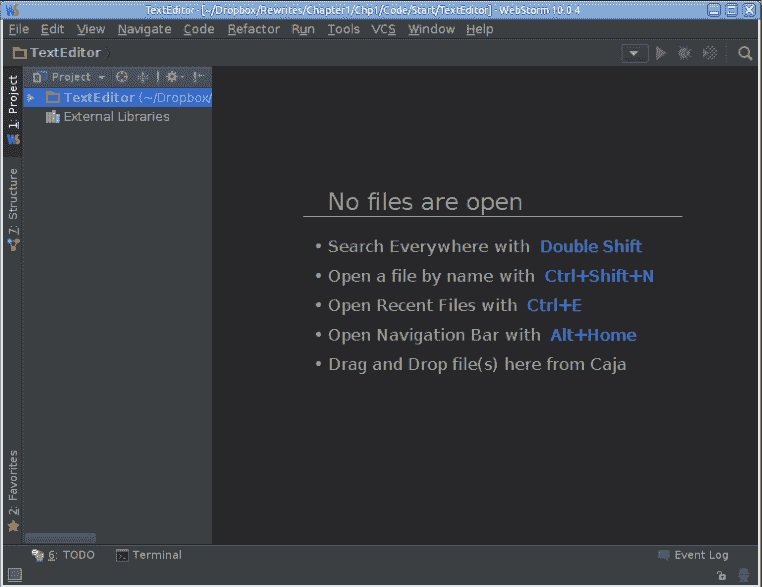
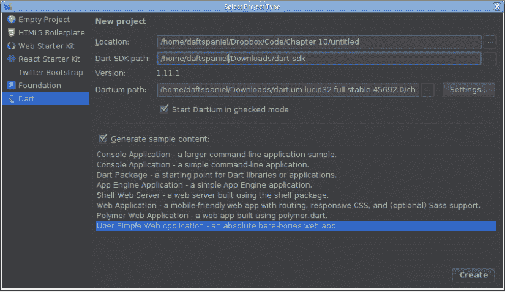
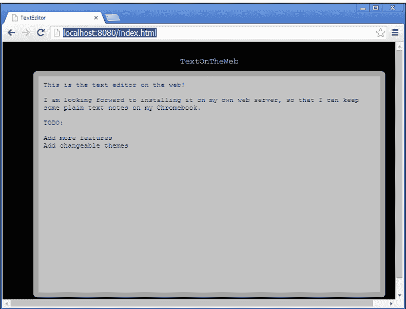
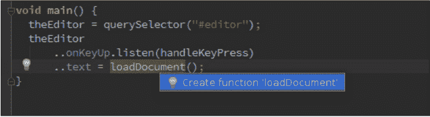
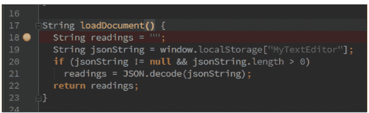

## 前言

Google 的 Dart 专为创建下一代应用而设计，提供了一个更强大的框架，并在多个方面超越了 JavaScript。熟悉却创新，紧凑却可扩展，它打破了 JavaScript 长期积累的局限性。Dart 专为出色的工具支持和开发者生产力而设计，让你能够比以往更快地创建更好的应用。Google 将其用于其价值数十亿美元的广告业务，你也可以将其强大功能用于你的项目。

## 本学习路径涵盖的内容

模块 1，Dart By Example，

本书将从 Dart 的构想到其当前形态，以及它将走向何方，通过引人入胜的实质性实践项目向你介绍 Dart 语言。你将通过构建典型应用并探索 HTML5 的令人兴奋的新技术来学习。

通过诸如实时数据监控和查看系统、博客系统、幻灯片演示应用等示例代码项目，本书将一步步指导你轻松快速地构建数据驱动的 Web 应用。

模块 2，Mastering Dart，

从讨论 Dart 的基本特性开始，我们将深入到更复杂的概念，如泛型、带反射的注解、错误和异常，这将帮助我们改进代码。继续下去，你将学习何时以及如何创建对象，以及执行异步代码的高级技术。你还将学习集合框架以及如何使用 Dart 与用 JavaScript 编写的不同程序进行通信。

本模块将向你展示如何在 Web 应用中添加国际化支持，以及如何将 i18n 和 i10n 访问嵌入到你的代码中，以设计可轻松本地化的应用。你将学习如何组织客户端到服务器的通信，以及如何在 Dart 中使用不同的 HTML5 功能。最后，本书将向你展示如何本地存储数据、突破存储限制并防止 Web 应用中的安全问题。

模块 3，Dart Cookbook，

本模块是一本实用指南，将提高你编写各种应用的专业知识，包括 Web 应用、脚本和服务器端应用。它提供了丰富的信息，说明如何扩展你的 Dart 编程技能。

## 本学习路径所需条件

一台运行 Windows、Linux 或 Mac OS 的现代计算机足以运行本书中的工具和程序。

以下内容的细节以及 WebStorm 的替代方案在模块 1，第 1 章中讨论，

启动文本编辑器：

- Dart SDK 和 Dartium (http://www.dartlang.org)
- WebStorm (https://www.jetbrains.com/webstorm/)
- Java (https://java.com/en/download)
- wrk——一个 HTTP 基准测试工具 (https://github.com/wg/wrk)

对于数据库项目，我们使用 PostgreSQL 和 pgAdmin：

- PostgreSQL (http://www.postgresql.org/)
- pgAdmin (http://www.pgadmin.org/)

要使用本模块 3 的代码，你需要 Dart SDK 和 Dart Editor，可以从 www.dartlang.org 下载。只需解压下载的文件即可开始使用。由于 Dart Editor 基于 Eclipse，你还需要一个 Java 运行时 (http://www.oracle.com/technetwork/java/javase/downloads/jre8-downloads-2133155.html)。选择适合你系统的版本（32 位或 64 位）；下载后，双击 .exe 文件进行安装。

## 本学习路径适合谁

如果你熟悉 Web 开发，并且希望学习或只是评估 Dart 作为多用途语言，本学习路径适合你。不假设对 Dart 语言有任何熟悉。对于初学者，它将作为指南，迅速从初级水平加速到大师水平；对于中级到高级开发者，它将快速填补 Dart 的空白，并可以以实用方式探索各种应用类型和强大的包。

## 读者反馈

我们始终欢迎读者的反馈。请告诉我们你对本课程的看法——你喜欢或不喜欢什么。读者反馈对我们很重要，因为它帮助我们开发出你能真正从中获益的书目。

如需发送一般反馈，只需发送电子邮件至 feedback@packtpub.com，并在邮件主题中提及课程标题即可。

如果你在某个主题方面有专业知识，并且有兴趣撰写或为书籍做出贡献，请参阅我们的作者指南 www.packtpub.com/authors。

## 客户支持

现在你已成为 Packt 课程的自豪拥有者，我们有一系列资源帮助你充分利用你的购买。

## 下载示例代码

你可以从 http://www.packtpub.com 在你的账户中下载本课程的示例代码文件。如果你是在其他地方购买本课程的，可以访问 http://www.packtpub.com/support 并注册以便将文件直接发送到你的电子邮件。

你可以通过以下步骤下载代码文件：

1. 使用你的电子邮件地址和密码登录或注册我们的网站。
2. 将鼠标悬停在顶部的 **SUPPORT** 选项卡上。
3. 点击 **Code Downloads & Errata**。
4. 在 **Search** 框中输入课程名称。
5. 选择你想要下载代码文件的课程。
6. 从下拉菜单中选择你购买本课程的地点。
7. 点击 **Code Download。**

你也可以通过在 Packt Publishing 网站的课程网页上点击 **Code Files** 按钮来下载代码文件。此页面可以通过在 **Search** 框中输入课程名称来访问。请注意，你需要登录你的 Packt 账户。

下载文件后，请确保使用最新版本的以下工具解压或提取文件夹：

- WinRAR / 7-Zip for Windows
- Zipeg / iZip / UnRarX for Mac
- 7-Zip / PeaZip for Linux

本课程的代码包也托管在 GitHub 上，地址为 `https://github.com/PacktPublishing/Dart-Scalable-Application-Development`。我们还在 `https://github.com/PacktPublishing/` 上托管了来自我们丰富的书籍、视频和课程目录的其他代码包。快去看看吧！

## 勘误

尽管我们已尽一切努力确保内容的准确性，但错误难免。如果你发现本课程中的任何错误——可能是文本或代码中的错误——我们将非常感激你向我们报告。通过这样做，你可以为其他读者节省挫败感，并帮助我们改进后续版本的课程。如果你发现任何勘误，请访问 `http://www.packtpub.com/submit-errata`，选择你的课程，点击 **Errata Submission Form** 链接并输入勘误详情。一旦你的勘误得到验证，你的提交将被接受，勘误将被上传到我们的网站或添加到该标题现有勘误列表的 **Errata** 部分。

要查看之前提交的勘误，请访问 `https://www.packtpub.com/books/content/support` 并在搜索字段中输入课程名称。所需信息将出现在 **Errata** 部分下。


## 启动文本编辑器

> 梯子的横档从来不是为了让人休息，而只是让人的脚踩稳片刻，以便他能把另一只脚抬得更高一些。
>
> ——托马斯·赫胥黎

## 定义 Dart

Dart 是一种用于现代 Web 应用的语言和平台，既可以运行在 Web 浏览器中，也可以运行在服务器上。Dart 语言、工具和 API 使创新、高效、开明且才华横溢的开发人员（就是你！）能够编写充分利用现代 Web 的可扩展 Web 应用。

借助 Dart，你可以在 Web 开发和工具方面实现飞跃。它拥有干净、现代而熟悉的语言语法，运行在由世界顶尖虚拟机专家打造的平台之上。

Dart 作为一个开源项目运行，并设有明确的增强提案流程。它拥有灵活的库，支持常见的文档打包、单元测试和依赖解析。该语言于 2014 年 7 月成为 ECMA 标准，由于可编译为 JavaScript，因此最终用户无需任何插件即可运行。

如果这还不够，你还可以将现有的 HTML、CSS、JavaScript 技能甚至代码一并带进来——Dart 与其它技术协作得很好！

## Web 脚本的历史

当前网页高度复杂，具有动画、动态内容、淡入淡出、3D 效果、响应式设计和精巧的导航，这让我们很容易忘记早期 Web 大多是文本页面、简陋表单和常常需要长时间加载的图片。然后，JavaScript 以内置于浏览器的脚本解释器形式出现，提供表单数据验证、新闻滚动条、移动显示、动画和游戏。对于小型项目，它成功地为静态网站增添了生气，而无需服务器端 CGI 脚本。

开发人员享受近乎即时的编辑和刷新循环——修改一行代码，然后在浏览器中按 F5（刷新）即可查看结果。JavaScript 并没有停留在浏览器中，很快出现在 Web 应用的服务器端。它也成为浏览器之外使用的通用脚本。

> 有趣的事实：**JavaScript** 是由 Brendan Eich 在短短十天内为 Netscape 浏览器编写的，最初被称为 **LiveScript**。Dart 也被改名过——最初它被称为 Dash。


考虑到它编写时的时间跨度，JavaScript 是一项伟大的技术成就，但在 20 年里它并没有进步太多，而 Web 应用却在飞速发展。Web 应用可能包含数千行 JavaScript 代码。除了非常简单的页面之外，纯 JavaScript 已经不够用了，大量涌现的辅助开发工具和库就是明证。

这些解决方案中有许多都是为了解决 JavaScript 的问题而创建的，涵盖从语法和特性到设计和生产力各个方面。这种语言当初根本就不是为现代 Web 所需类型的 Web 应用而设计的。

JavaScript 引擎近年来的进步带来了性能上的巨大飞跃。为 Chrome 浏览器和 Node.js 提供动力的 V8 引擎在使新型应用成为可能方面表现出巨大改进。然而，JavaScript 虚拟机优化带来的回报正随着时间的推移而递减。

## Dart 的起源

Google 在大型 Web 应用和编写 Web 浏览器方面都拥有丰富的经验。他们显然对更好的 Web 平台（让人们更多地搜索）和提高开发人员生产力（以保持竞争优势）有着强烈的自身利益。在 Google 的演示中提到，他们的 Gmail Web 应用中的一次代码更改需要大约 20 分钟来重建站点，以供开发人员测试。

这让人回想起几十年前的软件构建时间。为解决此问题而启动的项目开始了，Google 希望以开源项目的形式与开发社区分享和合作。


2011 年，在 GOTO 大会上，Dart 语言和虚拟机向全世界亮相。Dart 被设计成一个“开箱即用”的项目——一个用于编写、编译、测试、文档化和部署 Web 应用的完整技术栈。

该项目由 Chrome 团队开发，由 Lars Bak（Java HotSpot VM 和 JavaScript V8 引擎的开发者）和 Kasper Lund（一位 V8 开发者）创立。其目标既是通过为高性能客户端 Web 应用开辟新途径来改善开放 Web 平台，也是为了提升开发人员的生产力。

这种新兴语言被设计为具有类似 Java、C# 和 JavaScript 的熟悉的“花括号”语法，可在客户端和服务器上运行，并且通过能够编译为常规 JavaScript 来支持所有现代 Web 浏览器。只有能够令人满意地编译为 JavaScript 的新语言特性才会被添加到 Dart 中。

Dart 通常被称为 **DartLang**，以避免与其他“darts”混淆。在网络上搜索以获得更好结果时，请记住这一点。与 JavaScript 一样，Dart 语言不仅用于 Web 浏览器；它也适用于服务器应用和命令行应用。未来的目标是 iOS 和 Android 上的移动应用。

这就是世界上最大的互联网公司的历史、挑战和反应。那么，Dart 到底是什么？本章的其余部分将对 Dart 和 JavaScript 进行比较和对比，并带你构建第一个 Dart 应用，让你亲眼见证。

本书的其余部分将通过一系列有趣的项目带你游历 Dart，探索 Dart 的所有栖息地。我们将立即着手构建有用的应用，并使用越来越强大的功能。

## 下载工具

让我们从在计算机上安装完整的 Dart 开发环境开始。Dart 在互联网上的主页是 https://www.dartlang.org，其中包含软件、大量文档以及在线 Dart 社区的链接。

我强烈建议你注册该网站上的邮件列表以随时了解 Dart，并加入 Dartisans Google+ 社区（http://g.co/dartisans）。每天的邮件数量一开始可能会让人应接不暇，但其中有一些精彩的讨论和信息分享。这也是与 Dart 创作者互动的绝佳机会。

> 建议你使用 Stable（稳定）频道。该版本通过内置的更新工具大约每隔几个月更新一次。此外还有一个 Dev（开发）频道，每周更新一到两次，包含来自 Dart 开发者的最新代码。这非常适合及早了解新功能，但不如 Stable 版本完善或可靠。

所有受支持平台（Linux、Mac 和 Windows）的下载均可从 https://www.dartlang.org/tools/download.html 获取。同一位置还提供从源代码构建的信息。请确保同时下载 SDK 和 Dartium（一种专门的浏览器）。

建议 Mac 用户使用 Homebrew 系统来管理 Dart 的安装和更新。Linux 用户如果其发行版支持 .deb 格式，可以使用 .deb，ZIP 压缩包是替代方案。Windows 版本也以 ZIP 压缩包形式提供。

Windows 用户可以使用基于 NuGet 和 PowerShell 构建的 Chocolatey 安装系统下载、安装和更新 SDK 和 Dartium。

> 更多信息请参阅 `http://chocolatey.org`。

Dart 软件包名为 `dart-sdk` 和 `dartium`。

## WebStorm IDE 简介

WebStorm 是 Dart 的首选开发环境，由 JetBrains 创建，JetBrains 还发布了用于 Java 的 IntelliJ IDEA 和用于 .NET 的 ReSharper。

WebStorm 是一款商业软件包，可在 `https://www.jetbrains.com/` 获取。许多人可以获得免费许可证，个人用户还可享受大幅折扣。它支持多种语言和开发平台，并通过插件提供 Dart 支持。该插件随 IDE 预装。

下载安装文件，然后按照屏幕上的安装步骤操作：




WebStorm 拥有许多强大的功能，可帮助我们编写 Web 应用程序：

-   代码自动补全：在键入时列出属性和方法
-   静态分析器：在键入时扫描可能存在的问题
-   重构工具：帮助重命名实体和提取方法
-   快速修复：轻松纠正常见错误
-   通过代码树导航并查找函数用法
-   代码格式化程序：保持源代码整洁
-   强大的调试器

## 替代开发环境

如果你希望使用其他 IDE，IntelliJ IDEA 和 Eclipse 都有相应插件。如果你更喜欢简单的文本编辑器，Sublime、Emacs 和 Vim 也有插件。这些都可以在 DartLang 下载页面上找到。

如果你是 Visual Studio 的忠实用户，目前有一个社区项目正在将 Dart 引入该环境。DartVS 可以从 Visual Studio Gallery 下载。它直接使用 SDK 中的 DartAnalyzer 在 IDE 内报告错误、警告和提示。IntelliSense 和其他功能的支持也正在进行中。

对于喜欢轻量级编辑器而非完整开发环境的人来说，Atom 编辑器（https://atom.io/）是一个选择。名为 dartlang（https://atom.io/packages/dartlang）的插件提供了代码补全、语法高亮以及访问一些 pub 命令的功能。

## 帮助启动项目

为了帮助你创建新项目，Dart 提供了一个名为 Stagehand 的工具，它可以根据你选择的高质量项目模板创建脚手架。它处理常见任务，如文件夹结构、公共库和样式表。它甚至有自己的网站（http://stagehand.pub/）。

在 WebStorm 中，创建新项目时会提供一系列强大的选项，允许你设置 Dart SDK 的位置，并为示例内容选择项目类型。项目类型提供一系列骨架应用，由 SDK 自带的 Stagehand 应用驱动：



Stagehand 也可以在命令行中运行，第一步是将其安装为命令：

```
pub global activate stagehand
```

此步骤从 stagehand 包中安装 stagehand 命令：

```
mkdir aproject
cd aproject
stagehand web-full
```

这将基于 web-full 模板创建一个包含示例内容的文件夹。

> 有关当前模板的完整详细信息，请参阅
>
> https://pub.dartlang.org/packages/stagehand.

## SDK 中的其他内容

下载内容还包括一组命令行工具，位于 dart-sdk/bin 路径下。

| 工具 | 描述 |
|---|---|
| dart | 独立的 Dart 虚拟机本身。 |
| dart2js | 将 Dart 转换为 JavaScript 以便在任何现代浏览器上运行的工具。 |
| Dartanalyzer | 分析 Dart 源代码中的错误和建议。开发环境也使用它向用户提供反馈。 |
| Dartdocgen | 直接对 Dart 代码工作的文档生成器。 |
| Dartfmt | 智能代码格式化程序，让你的代码整洁一致。 |
| pub | 包管理和应用程序部署工具。 |

> 你可能希望将这些工具添加到系统 PATH 中，以便可以从命令行的任何位置调用它们。这是可选的，因为 WebStorm 为这些工具提供了简单的界面；然而，许多开发者认为这对良好的工作流程至关重要。
>
> 有关 pub 的安装和配置的更多详细信息，请参阅 https://www.dartlang.org/tools/pub/installing.html

此位置还有一个 snapshots 文件夹。大多数工具本身是用 Dart 编写的；当它们启动并初始化时，可以将初始化状态的二进制映像存储起来，用于将来的程序执行。

这些快照是使用 Dart 可执行文件生成的，主要面向部署中经常使用的命令行应用程序。

## 构建你的第一个应用程序

从简单开始是个好主意，但我们也希望从一些有用的东西开始，随着我们探索 Dart 可以扩展。

在日常软件开发中，文本编辑器往往是巨大、改变世界的软件的起点。我们将构建一个基于 Web 的多用途文本编辑器，用作代码片段、待办事项列表或去除复制文本格式的便签——非常方便。为了增加真实感，过程中还会有一个虚构的客户要求新功能。

在下一章中，我们将以此为基础，构建一些更华丽的功能和图形显示。

> **下载示例代码**
>
> 你可以从你的账户下载所有已购买的 Packt 图书的示例代码文件，网址为 `http://www.packtpub.com`。如果你在其他地方购买了这本书，可以访问 `http://www.packtpub.com/support` 并注册，以便将文件直接通过电子邮件发送给你。

### 探索 Web 项目结构

进入 WebStorm 欢迎页面，点击 **打开**。选择你解压示例代码的文件夹，然后选择 `Chapter One` 文件夹，再选择名为 `Start` 的子文件夹。

打开任何 Dart 项目时，一个好的第一步是确保所有依赖项都存在且是最新的。为此，选择 `pubspec.yaml` 并右键单击以显示上下文菜单。点击 `Pub: Get Dependencies` 项。然后，依赖项将被解析并在需要时获取。

| 文件/文件夹 | 描述 |
|---|---|
| `packages` | 指向此项目正在使用的包（或库）的链接。在这种情况下，你会看到“browser”包。 |
| `pubspec.lock` | 控制正在使用的包的特定版本。 |
| `pubspec.yaml` | 我们项目的元信息（名称、描述等）以及正在使用的包列表。 |
| `web/styles/main.css` | 标准级联样式表文件。 |
| `web/index.html` | 我们 Web 应用程序的入口点。 |
| `main.dart` | 最后但同样重要的是，一个 Dart 文件！ |

### 解析包

从前面的列表可以看出，即使是一个简单的 Dart 项目，也有大量的包结构和元文件。该语言的哲学是库小而专注，并且可能来自不同的来源。它们数量众多，并且按不同的时间表更新，因此版本控制很重要——依赖项是贪婪的，必须满足它们。

### 启动文本编辑器

你希望你的团队成员能够毫无依赖噩梦地构建和使用你的新 Uber 包！同样，你希望从互联网上下载的包能够“直接运行”，并减少编写应用程序所需的工作量。

为了管理所有这些包，Dart 有一个名为 pub 的工具。这是一个瑞士军刀式的工具，帮助创建、管理和部署你的程序和包。Dart 包的主要家园是网站 https://pub.dartlang.org，那里发布了许多开源库。

> 💡 如果你好奇这个名字的起源，“pub”是英国俚语，指人们喝酒和玩飞镖游戏的酒吧。

### 了解 Pubspec

`pubspec.yaml` 有一个奇怪的文件扩展名——YAML 代表**另一种标记语言**。

```
name: 'TextEditor'
version: 0.0.1
description: A web based text editor.
environment:
  sdk: '>=1.0.0 <2.0.0'
dependencies:
  browser: any
```

由此可见，pubspec.yaml 相当于 Dart 的项目文件或解决方案文件。它包含典型的依赖项详细信息和元信息。Pubspec 文件的完整详细信息位于 https://www.dartlang.org/tools/pub/pubspec.html。虽然它是一个功能强大且内容丰富的文件，但你与它的主要交互可能只是添加新依赖项。

### 将 Dart 放入网页

文件 `index.html` 是一个普通的网页。文件的其余部分由几个简单的 `<div>` 元素组成，并且正如你可能期望的那样，还有一个 `<textarea>` 标签：

```
<!DOCTYPE html>
<html>
<head>
    <title>TextEditor</title>
    <link rel="stylesheet" href="styles/main.css">
</head>
```


## 编写事件处理器

编辑器的 `TextArea KeyUp` 事件已连接到此简短的处理器函数：

```
void handleKeyPress(KeyboardEvent event) {
  saveDocument();
}
```

与 JavaScript 不同，这里没有 `function` 关键字，我们在函数前使用了 `void`。`void` 关键字只是表示此函数在执行完毕时不返回任何内容；它可以是任何类或类型。由于 Dart 是可选类型的，我们完全可以省略 `void`。

等等一下！我们要把这段文本存储到哪里呢？毕竟，我们只编写了一个单一的 HTML 页面，并没有数据库连接或 Web 服务来处理持久化。幸运的是，HTML5 提供了一个简单基于键/值的内置存储功能，称为 Local Storage，并且得到现代 Web 浏览器的良好支持。它以与字典（有时称为 map）数据结构类似的方式运行。

在接下来的两个函数中，我们将查看如何从 `localStorage` 中加载和保存。

> HTML5 功能 `window.localStorage` 会持久地将数据存储在客户端浏览器中。与存储在 cookie 中的数据不同，它不会基于日期过期。关闭浏览器窗口或关闭计算机时，数据也不会丢失。
>
> 存储量因浏览器和用户设置而异，但典型的默认值是 5 MB。对于我们的文本编辑器和其他许多类型的应用程序来说，这已经足够了。


## 加载已保存的文本

`loadDocument` 函数让世界知道它将返回一个 `String` 对象：

```
String loadDocument() {
  String readings = "";
  String jsonString = window.localStorage["MyTextEditor"];
  if (jsonString != null && jsonString.length > 0)
    readings = JSON.decode(jsonString);
  return readings;
}
```

我们将使用键 MyTextEditor 来存储文本。用户第一次加载此页面时，我们的网页在本地存储中将没有任何内容，因此我们会在将其值放入 readings 字符串变量之前检查它是否为空或 null。

> JSON（JavaScript Object Notation）是一种基于 JavaScript 子集的 ECMA 标准数据格式，是 XML 的替代方案。
> 例如：
> ```
> {
>   "Name": "Davy Mitchell",
>   "LuckyNumber": 123,
>   "CarModel": null,
>   "Language": "English"
> }
> ```

## 保存文本

我们用于保存文本的格式是 JSON — JavaScript Object Notation — 这是网页中的常见标准。包 `dart:convert` 为我们提供了 encode 和 decode 函数：

```
void saveDocument() {
  window.localStorage["MyTextEditor"] = JSON.encode(theEditor.value);
}
```

最后，已保存的文档使用本地存储来安全保存我们的文本。这次，我们将数据编码为 JSON 格式。

## 在浏览器中运行

我们现在终于准备好在目标环境中实际运行文本编辑器了。浏览器将如何执行一个 .dart 文件？Internet Explorer、Chrome 和 Firefox 都不懂 Dart。



Dartium 是 Chromium 浏览器（Google Chrome 浏览器背后的开源项目）的特殊构建，其中包含 Dart 虚拟机。虽然不推荐用于日常浏览，但它是一个功能强大的现代浏览器，可在开发 Dart 应用程序时使用。如截图所示，它看起来就像（一个非常简洁的）Google Chrome。

> 如果你在 Ubuntu 上运行并收到提到 libudev.so.0 的启动错误，请在终端中运行以下命令来解决它：
>
> `sudo ln -s /lib/x86_64-linux-gnu/libudev.so.1 /lib/x86_64-linux-gnu/libudev.so.0`
>
> 有关更多信息，请参阅 https://github.com/dart-lang/sdk/issues/12325

在 WebStorm 中，右键单击 `index.html` 文件以调出上下文菜单并选择 **Run index.html**。这将为你的应用程序启动一个本地 HTTP 服务器。

## 启动文本编辑器

应用程序运行后，在编辑器中输入一些文本，然后关闭浏览器窗口。然后再次运行程序，页面加载后你应该会看到你的文本重新出现。

## 编辑和重新加载

我们的客户提出了新的需求。应用程序的标题“TextOnTheWeb”他们不喜欢，所以我们必须更改它。

到目前为止，如果你编写过 JavaScript，Dart 应该看起来更熟悉了。工作流程也很相似。让我们对正在执行的代码进行更改，以便我们可以看到编辑和重新加载循环的效果。

这将在 main 函数中实现，因此在保持 Dartium 打开的同时，在 WebStorm 中再次打开 `main.dart` 文件，并找到 `main` 函数。

将以下代码片段添加到函数的开头：

```
DivElement apptitle = querySelector("#toolbar");
apptitle.text = "TextEditor";
```

做出更改后，保存文件并切换回 Dartium。刷新页面，新的 main 函数版本将运行，新的标题将被显示。

## 扩展界面

我们的客户要求添加一个按钮来清除编辑区域。这是一个合理的请求，并且借助 Dart 的生产力，实现起来不会太久。

首先，我们将打开 `index.html` 并在 TextArea 控件下方添加一个输入按钮到页面中：

```
<input type="button" id="btnClearText" value="Clear" />
```

打开 `main.dart` 并在 main 函数中连接事件处理器：

```
ButtonInputElement btnClear = querySelector("#btnClearText");
btnClear.onClick.listen(clearEditor);
```

与 JavaScript 一样，将函数作为参数传递非常容易。将光标移到文本 `clearEditor` 上，会出现一个灯泡。这提供了 Alt 和 Enter/Return 键的键盘快捷方式，或者你可以单击灯泡图标。



该函数的实现很简单。请注意，我们收到了一个正确类型的 MouseEvent 对象作为事件的一部分：

```
void clearEditor(MouseEvent event) {
    theEditor.text = "";
    saveDocument();
}
```

刷新页面并单击按钮以清除现有文本。一个满意的客户，而我们几乎没有费力！

WebStorm Dart 插件有许多快速修复功能，可提高你的生产力并帮助首先避免编码错误。它们还鼓励良好的设计并遵守 Dart 惯例。

### 使用 CSS 编辑器

暂时保持文本编辑器运行并切换回 WebStorm。转到 **Project** 选项卡，在 TextEditor 文件夹中打开 `web/styles/main.css` 文件。

这也是你的编辑器，所以它必须是你的最爱颜色——也许你想要更细的边框，或者不喜欢我选择的灰色调。

对颜色类进行一些更改并保存文件。

WebStorm CSS 编辑器功能强大，并显示颜色预览。如果你切换回 Dartium 并单击重新加载，文本编辑器现在应该反映你的色彩偏好。

## 调试 Dart 应用程序

一个好的调试器是高效开发系统的关键部分。让我们逐步执行我们的代码，以便仔细查看正在发生的事情。

要从 WebStorm 调试在 Dartium 中运行的应用程序，我们需要安装一个小型浏览器扩展来充当两个应用程序之间的桥梁。

> 请按照 JetBrains 在以下网页上的指南进行操作：
> https://www.jetbrains.com/webstorm/help/using-jetbrains-chrome-extension.html

需要关注的主要部分是“安装 JetBrains Chrome 扩展”部分。这只需要做一次。

- **1.** 单击 `loadDocument` 函数的第一行。
- **2.** 接下来，打开 **Run** 菜单并选择 **Toggle Line Breakpoint**。该行的右侧会出现一个红色圆圈：

  

- **3.** 在 **Project** 选项卡中选择 `index.html`，然后打开 **Run** 菜单并选择 **Debug index.html**。
- **4.** Dartium 打开后，`loadDocument` 函数应该运行并且断点会被命中。WebStorm 中会出现 **Debugger** 选项卡。
- **5.** **Debugger** 选项卡显示调用堆栈和当前变量的值。在 **Run** 菜单和工具栏上，可以使用通常的调试操作 **Step Into**、**Step Over** 和 **Step Out**。
- **6.** 在我们执行任何步骤之前，将指针悬停在 `return` 语句行上。会出现一个工具提示，显示字符串变量 `readings` 当前设置为 null。


callMethod 方法可用于调用页面作用域内可用的任何 JavaScript 函数——不仅仅是内置对象。在这种情况下，第一个参数是我们希望调用的函数的名称，第二个参数是该方法的参数列表。

### 在代码中添加注释

目前我们的文本编辑器基础看起来已经完整，但 main.dart 文件中还缺少一个重要元素——代码注释。

Dart 使用以下几种常见的注释语法：

| 注释语法 | 描述 |
|---|---|
| `// Your comment here.` | 单行注释 |
| <code>/**<br>Your comment here.<br>*/</code> | 多行注释 |
| `/// Your comment here.` | 文档注释（首选方法，因为它更紧凑） |

当提到标识符时，请在名称周围加上方括号。例如：

```
/// Returns double of [a] input.
int doubleANumber(int a){
    // Assumes parameter valid.
    return a * 2;
}
```

花点时间用上述风格为每个函数添加注释。使用句子格式和标点符号。

> 有关注释风格和其他编码约定的更多信息，请参阅文档注释指南：
> https://www.dartlang.org/articles/doc-comment-guidelines/ 以及 Dart 编码风格指南：https://www.dartlang.org/articles/style-guide/

### 总结

本章的重点是向你介绍 Dart 的背景故事，并让你开始使用 SDK 来构建一个实用的应用程序。

我们已经了解到 JavaScript 语言及其开发限制如何促成了 Dart 开源项目的创建（以 https://www.dartlang.org 网站为中心）。该项目正在作为 ECMA 标准进行开发，可用于编写从客户端到服务器再到命令行的各种应用程序类型。

我们已经看到，Dart 拥有熟悉的语法和一个名为 pub 的强大包管理工具。WebStorm 可用于创建、启动和调试不同类型的应用程序，其他 IDE 和文本编辑器也支持 Dart 语言。

我们完成了 Dart 开发环境的搭建，并使用 HTML5 特性编写了第一个应用程序。我们了解了如何浏览客户端 Web 项目的结构，以及如何进行调试和开发。

我相信，我们创建的简易文本编辑器已经在你的脑海中激发了许多后续想法！在下一章中，我们将继续研究客户端 Dart，并为文本编辑器添加更多功能，其中一些功能将帮助我们编写更多、更好的 Dart 代码。
