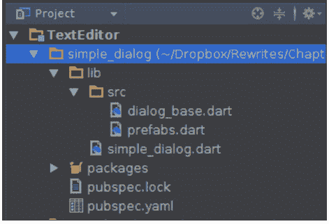
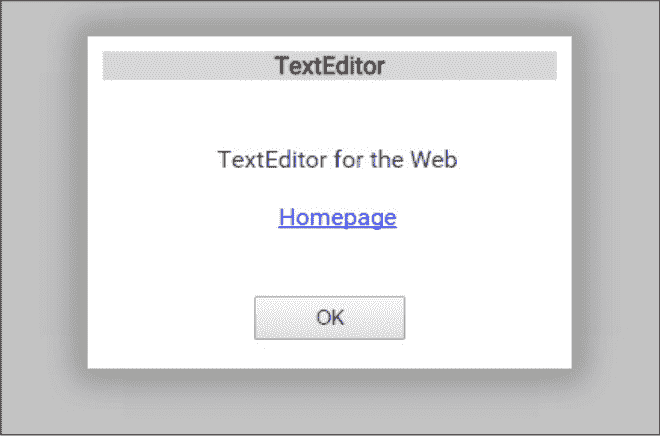
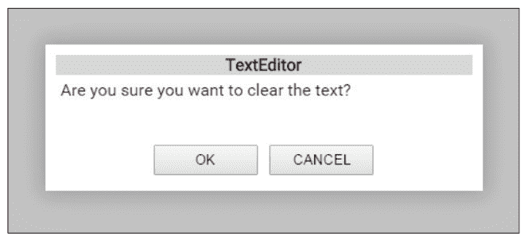
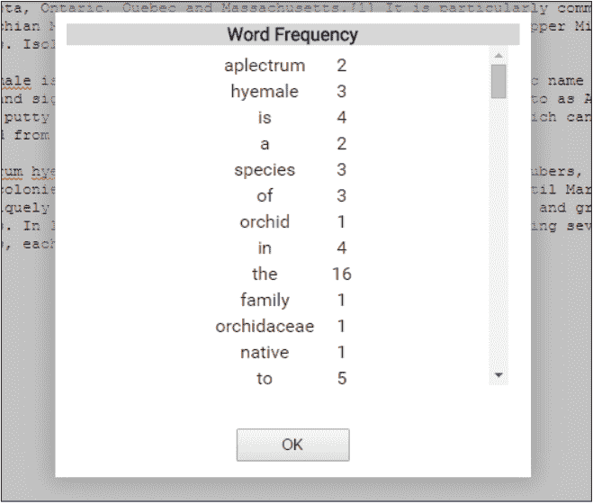
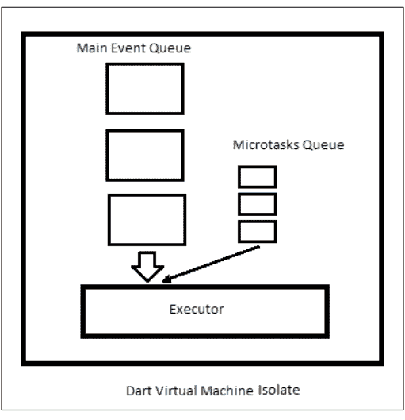
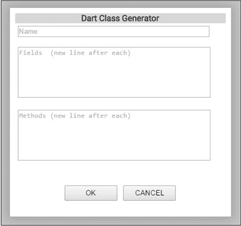
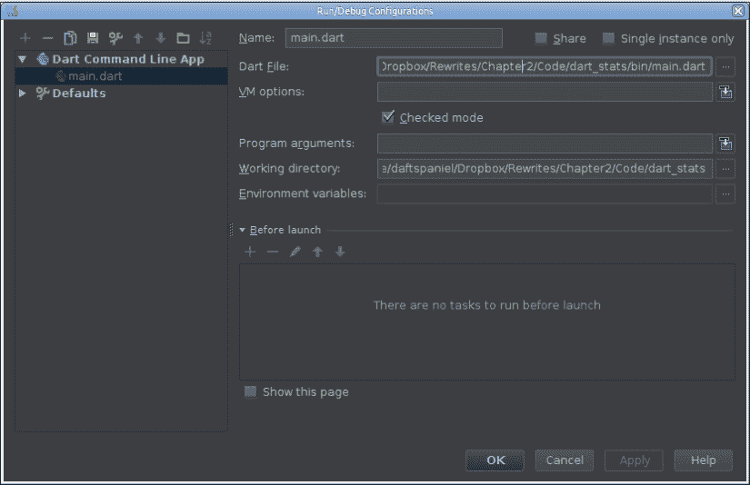
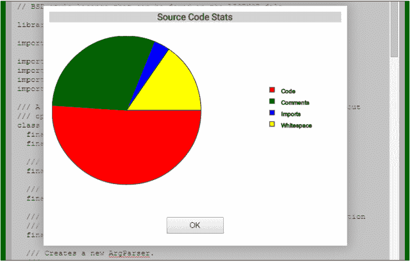
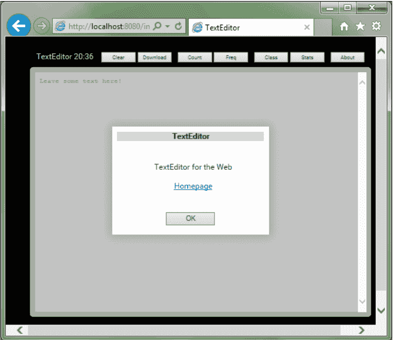

## 推进编辑器

> 我们把屏幕上的按钮做得如此精美，以至于你想去舔它们。
> ——史蒂夫·乔布斯

现代 Web 浏览器能够实现更炫丽的网页设计和更流畅的动画布局，这些技术可能性让 Web 应用开发者在平衡功能与美观呈现方面面临更大的挑战。

功能性和非功能性需求（如界面设计和性能）往往是相互冲突的优先级。任何项目的时间都是有限的。一个好的策略（有时！）是专注于那些能同时满足两者的需求，而且在不断扩展的 HTML 标准中有许多新的可能性。

一旦所有需求都确定下来并完成应用程序的构建，顺利将应用程序部署到生产环境是关键。在我们的目标系统（如各种 Web 浏览器）上进行测试至关重要，这正是本章将要讨论的内容。

### 文本编辑器的后续步骤

到目前为止，我们收到了一些关于文本编辑器的反馈。用户喜欢它，并希望有更多按钮，其中最高优先级是添加一个字数统计功能，能够显示包含当前字数的对话框。客户表示，他们希望在编辑器窗格上方有一个功能强大的工具栏，以支持一系列功能。他们喜欢弹出式对话框的风格，但表示当前的对话框与应用程序的外观不太协调。

构造函数使用与类相同的名称声明，并且我们只有一个参数。Dart 构造函数有一个便捷特性，可以直接从参数声明中设置成员变量。这样就无需单独使用一个仅用于赋值给成员变量的参数。如果不使用这种简写特性，代码将如下所示：

```
class TextEditor {
  final TextAreaElement theEditor;
  ...
  TextEditor(TextAreaElement theEditor) {
    this.theEditor = theEditor;
  }
  ...
}
```

字段 `theEditor` 被声明为 final；这意味着它在应用程序的生命周期中只能被赋值一次。

### 构建项目结构

我们的新需求需要两个弹出式对话框，而且听起来我们可能还需要更多。我们需要构建一个 HTML 界面库来满足这些需求。它是通用型的，因此可以用于多种类型的应用程序。应用程序的其余部分可以放在 `TextEditor` 项目中。

### 构建对话框包

`pub` 打包系统是在线分享已完成包的绝佳资源。如果我们希望将包保持本地和私有，我们可以在本地创建它并以大致相同的方式使用。

### 包项目结构

包项目的结构与 Web 应用项目类似，`pubspec.yaml` 文件是主要的项目文件。项目中没有 web 文件夹，而是有一个 `lib` 文件夹，其中包含 `simple_dialog.dart` 文件，该文件声明了我们的库，并定义了对外暴露的内容：



该文件包含任何类、函数以及对其他文件的引用——在本例中，指的是 `src` 文件夹中的两个文件。`simple_dialog.dart` 中以 `library` 关键字开头的一行说明了名称，并声明这是一个库。请注意，它没有被任何引号包围：

```
library simple_dialog;
import 'dart:html';
part 'src/dialog_base.dart';
part 'src/prefabs.dart';
```

接下来的部分包含了 part 声明中该包声明所暴露的所有文件所需的导入。打开 `src` 文件夹中的任意一个文件，你会看到第一行声明了 `part of simple_dialog`。

### 添加本地包引用

要引用该库，请转到 TextEditor 项目的 pubspec.yaml，并在编辑器中打开它。点击 source 选项卡查看纯 yaml 文本文件。目前没有用于本地引用的图形界面，因此必须手动添加：

```
dependencies:
browser: any
intl: any
simple_dialog:
  path: ..\simple_dialog
```

该路径相对于项目根目录。由于这是本地文件系统引用，路径分隔符必须与操作系统匹配，因此我们在 Windows 上使用 `\`（反斜杠），在 Linux 和 Mac 上使用 `/`（正斜杠）。

然后在 editor.dart 中使用包前缀引用该包：

```
import 'dart:convert';
import 'dart:html';
import 'package:simple_dialog/simple_dialog.dart';
```

它的工作方式与远程安装的包完全相同，额外优势是如果做了更改，它会自动刷新。


> 为了避免相对路径带来的任何问题（这让很多人头疼！），如果可能的话，将项目保存在同一目录中，这样相对路径始终相同。或者，也可以使用完整路径，尽管当代码位于不同计算机上时这可能会引入问题。
> 要验证路径是否正确，请在 Project 选项卡中展开 Packages 文件夹，该包应该会连同其来源一起列出。
> 路径依赖对于本地开发很有用，但在与更广泛的世界共享项目时无法使用。

### 理解包的作用域

Dart 在库作用域系统下运行。包中的所有项目在整个包内都是可用的——在这一级别没有私有或受保护的资产。然而，库内部的项目可以对外部代码保持私有。

要实现等价于私有字段的效果，类的字段如果带有 _（下划线）前缀，则可以标记为私有。引用该库的任何项目都只能使用该包已暴露的资产。

例如，TextEditor 项目可以使用默认公开的 Dialog 类并访问 content 字段，但不能访问 _visible 字段。

### 定义基础对话框

对话框核心定义在 dialog_base.dart 文件中的 Dialog 类中。这将包含所有基础功能，例如对话框框架以及 OK 和 CANCEL 按钮。更专门的对话框将继承（扩展）这个类，并针对其用途进行修改。

该包将包含以下常见对话框：

- 简单的警告对话框
- 应用“关于”对话框
- 用户确认对话框

### 警告对话框

这是所有对话框中最简单的一种。它将显示一行文本，并允许用户按下 OK 按钮以关闭对话框：

```
void alert(String dlgTitle, String prompt, int width, int height) {
  Dialog dlg = new Dialog(dlgTitle, prompt, width, height, true,
  false);
  dlg.show();
}
```

该对话框不返回任何值，为了尽可能方便用户，它只需一次函数调用。这将用于显示字数统计功能的结果。


## 关于对话框

应用程序的标准关于框包含少量信息和一个指向网站的链接。此对话框在视觉上与警报框完全相同，只是增加了超链接，并且由于这涉及更改对话框界面元素，因此将在名为 AboutDialog 的新类中实现：



这是通过 TextEditor 对象的 showAbout 方法创建的：

```dart
void showAbout(MouseEvent event) {
    AboutDialog textEditorAbout = new AboutDialog(AppTitle,
    "TextEditor for the Web", "http://www.packtpub.com", "Homepage",
    300, 200);
    textEditorAbout.show();
}
```

AboutDialog 框继承自 Dialog 类并通过 super 调用 Dialog 类的构造函数，该构造函数调用构造函数以形成对象的[content]

## The About dialog box

The standard About box for an application contains a small amount of information and a link to a website. This dialog is visually identical to the Alert box apart from the addition of the hyperlink, and as this involves changing the dialog interface elements, this will be implemented in a new class called AboutDialog:


This is created from the showAbout method of the TextEditor object:

```dart
void showAbout(MouseEvent event) {
    AboutDialog textEditorAbout = new AboutDialog(AppTitle,
    "TextEditor for the Web", "http://www.packtpub.com", "Homepage",
    300, 200);
    textEditorAbout.show();
}
```

The AboutDialog box inherits from the Dialog class and calls the constructor of the Dialog class via super, which calls the constructor to form the foundation of the object:

```dart
AboutDialog(String titleText, String bodyText, this.linkUrl, this.linkText, int width, int height)
    : super(titleText, bodyText, width, height, true, false) {
```

The elements for the box are created and added to the nodes member of the content DivElement:

```dart
content..nodes.insert(0, new BRElement())
  ..nodes.insert(0, new BRElement())
  ..append(new BRElement())
  ..append(new BRElement())
  ..append(link)
  ..style.textAlign = "center";
```

The cascade operator keeps the code compact and focused on setting up the different components of the dialog.

## Using the confirmation dialog box

This dialog presents OK and CANCEL options, and calls a specified function if the former option is clicked. This is used in the TextEditor class clearEditor method:



This is implemented by using the base Dialog class directly:

```dart
void confirm(String dlgTitle, String prompt, int w, int h, Function action) {
    Dialog dlg = new Dialog(dlgTitle, prompt, w, h);
    dlg.show(action);
}
```

The application can configure and display this dialog with a single line:

```dart
confirm(AppTitle, "Are you sure you want to clear the text?",
400, 120,
performClear);
```

A function is passed to the show method that is performed if the user presses the OK button.

## Counting words using a list

Word count is an important feature for students, technical writers, and competition entrants. Our customers see this as a required feature, too.

In the event handler, we want to calculate the word count and throw the dialog on screen for the user to see. This is a simple, short-running task, so the implementation can exist directly in the event handler. As the output is simple, the alert dialog can be used.

To determine the word count, Dart's List data structure and String classes can be used. The first step is to remove any punctuation characters that may affect our count. This is declared in custom_dialogs.dart as an unmodifiable const string as it can be used for other word-based features:

```dart
const String punctuation = ",.-!\"";
```

This is used in the showWordCount method of the TextEditor class.

Once the punctuation is removed, the string can be split into a List. Dart supports generics, so the types of generic data structure can be optionally specified, in this case with <String>. The list of words is then filtered to clean out any non-word entries remaining.

Once we have obtained the list of words, the final word count can be obtained by using the length property of the list.

## The Word Frequency feature

Our customers would like a feature to help with writing quality. Overuse of particular words can make a text repetitive and hard to read. To determine the frequency of word usage, Dart's Map (sometimes called an associative array or dictionary) data structure class, and String features can be used:



Depending on the number of different words used, the content areas may be allowed to scroll, as the dialog cannot grow to the size of any data.

Generics are used again to specify the types for the key and value; in this case, String for the key and int for the value:

```dart
Map<String, int> wordFreqCounts = {};
String out = "";

for (var character in punctuation.split(''))
    text = text.replaceAll(character, " ");
text = text.toLowerCase();

List<String> words = text.split(" ");
words
  ..removeWhere((word) => word == " ")
  ..removeWhere((word) => word.length == 0)
  ..forEach((word) {
    if (wordFreqCounts.containsKey(word))
      wordFreqCounts[word] = wordFreqCounts[word] + 1;
    else wordFreqCounts[word] = 1;
  });

wordFreqCounts
  .forEach((k, v) => out += ("<tr><td>$k</td><td>$v</td></tr>"));
```

The processing of the text is similar to the word count, where a list of individual words is built up. Once the list is filtered, forEach is used to iterate through the list and count the occurrences of each word. The forEach method is used again to build the output HTML, with the map's key and value parameters being passed to the function.

## Understanding the typing of Dart code

The types used so far for the Map and List help the design-time tools, such as the Dart Analyzer and WebStorm, which allow us to write code by providing the code completion and validating assignments.

When run in Dartium with the checked mode enabled (the default setting), types are checked at runtime. In the final environment, most likely a web browser such as Firefox or Internet Explorer, the typing information is not used and does not affect the execution speed of the application.

Dart coding recommendations advise using types on all public-facing code. For example, a class in a package can use private var variables, but methods require and return typed data. This aids developers calling the code in understanding what is required, and helps create better documentation.

## The file download feature

It can be very useful to have an actual file, so we will add a feature to let the user download and save the contents of the editor to their local device. This is possible with the custom data attributes feature in HTML5, which supports text as one of the formats:

```dart
void downloadFileToClient(String filename, String text) {
  AnchorElement tempLink = document.createElement('a');
  tempLink
    ..attributes['href'] =
    'data:text/plain;charset=utf-8,' + Uri.encodeComponent(text)
    ..attributes['download'] = filename
    ..click();
}
```

The process is straightforward: an anchor element is created and its target is set as the encoded text data. The click event is then fired and the download proceeds as if it were being downloaded from a web server.

## The clock feature

Everyone has deadlines, so keeping an eye on the clock is important. The dart:async package can help with this task by using a Timer class to trigger and update. This can be carried out in one line in main.dart file of the TextEditor project:

```dart
new Timer.periodic(new Duration(seconds: 1),
    (timer) => querySelector("#clock").text =
        (new DateFormat('HH:mm')).format(new DateTime.now())
);
```

The Timer constructor being called here (Timer.periodic) is a specially named constructor; in this case, the periodic version is being used. There are numerous variations of Timer objects. Named constructors allow the classes to have instances easily created for a particular purpose as they do not require additional initialization configuration before they are ready to use.

A periodic Timer will fire an event every duration period; in this case, one second. The remainder of the line declares the function that is called. Dart has a shorthand of => for functions that are a single line (which are named arrow functions), thus avoiding the use of curly brackets. The querySelector function is used to get a reference to the element on the web page with an ID of clock where the time will be displayed.

The current time is obtained and formatted into hours and minutes for display. As the clock will run for the lifetime of the application and does not require any interaction, no variable is required to store a reference to the object.

That was a busy line of code, and very powerful, but we are not finished examining it yet! There has been no extra thread or process created. This is not a user-initiated event. We will take a look at the what and when of the Dart task queue.

## Executing Dart code

The internal architecture of the Dart VM has a single-threaded execution model that is event-driven. In Dart terminology, this is called an isolate. The execution of a Dart program places each event (for example, a function call) into one of two queues. The VM then takes the next event and executes it.

The first queue is the main event queue, and the second is called the microtask queue. This second queue is a higher priority, but is reserved, as the name implies, for short, small tasks, such as creating a new event or setting a value:



This execution detail is hidden from the Dart developer for the most part. However, it is important to understand that execution of Dart code is highly asynchronous. The aim of this is to allow applications to continue to be responsive, while still performing longer tasks such as calculations or accessing remote resources.


这种架构的优势在于程序执行期间完全不需要任何锁定或同步。其他虚拟机必须执行此操作，这极大地影响了复杂性和性能。例如，Python 的 **GIL (Global Interpreter Lock)** 已被争论多年，有许多替代方案被提出并进行了实验性实现。

## 多进程 VM

Dart VM 的设计允许多个 isolate 同时运行，这些 isolate 可以在不同的线程、CPU 核心上运行，在 Web 浏览器中则运行在 web worker 中。它们不共享任何资源，例如内存，它们唯一的通信方式是通过消息系统。

## 类设计器

客户想要一个能吸引程序员的功能。他们希望用户能够快速草拟类的想法，包括类名、字段和方法等细节。

## 构建更复杂的对话框

为处理此功能，需要一个自定义对话框——`GenClassDialog` 在 `custom_dialogs.dart` 中。它将继承（扩展）Dialog 类，并自行处理 OK 按钮点击事件。与应用程序中迄今为止的其他对话框不同，此对话框必须将数据返回给文本编辑器：



输入控件是一个 TextInputElement 和两个 TextAreaElements。占位符属性在现代 Web 浏览器中可用，将用于指导用户输入内容，并且作为奖励，它们是方便的节省空间的方法，因为我们不需要添加额外的元素来标记输入：

```
String className = name.value;
String fieldsSrc = "";
String methodsSrc = "";

List<String> classFields = fields.value.split("\n");
List<String> classMethods = methods.value.split("\n");

classFields.forEach((field) => fieldsSrc += "    var $field;\n");
classMethods.forEach((method) => methodsSrc += "    $method() {};\n");
```

文本从控件中检索并按行拆分为列表。然后使用 forEach 方法遍历列表并构建源代码。

## 构造类

GenClassDialog 的 makeClass 方法中简单类的模板为生成的字段和方法的源代码提供了占位符。此类代码模板被声明为使用三个双引号的多行字符串。Dart 支持字符串插值，这有助于将变量值放入字符串中：

```
result = """  // The $className class.
class $className {

$fieldsSrc

    $className() {}

$methodsSrc
}
""";
```

变量可以嵌入到以 $ 符号为前缀的字符串中。然后在字符串使用时将其替换为变量的实际值。

也可以插入更复杂的代码，例如对象的属性，“The word is ${text.length} characters long”。注意在被求值的表达式周围使用大括号。

## 命令行项目结构

打开 WebStorm，点击 Create New Project，并从 Project Templates 列表中选择 Console application。为你的项目选择一个位置并将其命名为 dart_stats。

应用程序的结构有一个包含 main.dart 的 bin 文件夹，这是应用程序的入口点。main 函数位于此处。项目模板包含其他几项。对于此工具，重点将放在 main 函数上。

> Dart 是跨平台的，并且操作系统平台使用的绝大多数文件系统都是区分大小写的。强烈建议的约定是所有文件名都为小写。

将源代码文件 sourcescan.dart 添加到项目中。它包含用于扫描文本并统计类、代码、注释、导入和空白行的代码。

## 处理源代码

SourceCodeScanner 类包含五个整数字段来存储计数和一个执行分析的单一方法：

```
void scan(List<String> lines) {
    totalLines = lines.length;
    lines.forEach((line) {
        line = line.trim();
        if (line.startsWith("class")) classes++;
        else if (line.startsWith("import")) imports++;
        else if (line.startsWith("//")) comments++;
        else if (line.length == 0) whitespace++;
    });
}
```

遍历行列表并使用 trim 方法删除行中的多余空白，以帮助匹配触发并增加计数的关键字。startsWith 方法确保关键字不会在另一上下文中出现在行中间。

### 使用 dart:io 包进行文件处理

应用程序将接收一个命令行参数，即 Dart 源代码文件的完整文件路径。命令行参数可以从 main.dart 中 main 函数传递的参数中读取。

我们不必在浏览器中处理的一个方面是从文本文件加载源代码。由于安全原因，不可用于 Dart Web 浏览器的一个包是 io 包，它包含直接的文件处理功能：

```dart
import 'sourcescan.dart';
import 'dart:io';

main(List<String> arguments) {
  print(arguments[0]);
  SourceCodeScanner codeScan = new SourceCodeScanner();
  File myFile = new File(arguments[0]);
  myFile.readAsLines().then((List<String> lines) {
    codeScan.scan(lines);
    print("${codeScan.totalLines}");
    print("${codeScan.classes}");
    print("${codeScan.comments}");
    print("${codeScan.imports}");
    print("${codeScan.whitespace}");
  });
}
```

一旦文本文件在字符串中，它就可以像在 Web 文本编辑器中一样进行处理。

程序可以从命令行运行，如下所示在 Linux 上：

```text
$ dart bin/main.dart   lib/dartstats.dart
lib/dartstats.dart
9
0
3
0
2
```

程序可以检查它自己的源代码！

有关更高级的命令行参数处理，请参阅 pub 上的非常强大的 args 包 https://pub.dartlang.org/packages/args。

readAsLines 是一个异步函数，立即返回一个 Future 对象。函数被传递到 future 对象的 then 方法中。此函数的执行时间对开发者来说是未知的。程序的流程会立即继续。当文件读取操作运行并完成后，传递给 then 方法的函数会在 Dart VM 调度时执行。

要亲眼看到这一点，将 print 语句移出 then 函数，如下所示，然后再次运行程序：

```
myFile.readAsLines().then((List<String> lines) {
    codeScan.scan(lines);
});
print("${codeScan.totalLines}");
print("${codeScan.classes}");
print("${codeScan.comments}");
print("${codeScan.imports}");
print("${codeScan.whitespace}");
```

可能的输出全部为零，因为代码行尚未被扫描；这是因为 print 函数被首先调用。

程序也可能像之前一样运行。关键点是整体程序执行会继续前进，即使代码被要求执行可能耗时的任务，也允许其他任务继续并保持应用程序响应。

## 调试命令行程序

如果你在 WebStorm 中使用 Run 启动程序，它将打开调试器并出现 RangeError 异常。这是因为程序假设已传递命令行参数，而程序是在没有任何输入的情况下运行的。

## 推进编辑器

在 WebStorm 中，可以配置程序的调试启动，包括设置命令行参数的功能。在这种情况下，应在 **Program arguments** 字段中输入 Dart 源文件的完整文件路径。请注意，默认情况下不会传递任何命令行参数。也可以设置多个具有不同命令行选项集的启动：



要配置启动，请从 **Run** 菜单中选择 **Edit Configurations** 选项。从列表中选择 `main.dart` 并输入任何 Dart 源代码文件的完整文件路径，例如本书的示例代码或来自 Dart SDK 的代码。

一旦程序运行，结果将使用 `print` 函数打印到标准输出。


## 整合统计信息

可以通过将 `sourcescan.dart` 文件添加到 bin 文件夹，并将其作为直接导入来引用，从而将 `SourceStats` 类添加到文本编辑器项目中。扫描将在 `CodeStatsDialog` 的 `scanCode` 方法中对编辑器内容执行，并提取数据用于绘制饼图。

## HTML5 与 canvas

自苹果在 WebKit 版本中引入 canvas HTML 元素以来，它已经存在了大约 10 年，但它仍被视为一项新功能，这似乎有些奇怪！多年来，主流和小型浏览器都已广泛支持它。

canvas 元素提供了一个高性能的基于 2D 栅格的图形位图，可以动态脚本化。与 SVG 不同，它没有场景图或可选中对象，只有一幅图形图像。它为客户端应用（如图表、动画和游戏）提供了一种简单易用且强大的动态图像显示方式：



每个计数都通过一个正方形 Rect 来显示颜色，并绘制标签，文本则绘制在旁边。

> canvas 是一个多才多艺的功能，但当它上面什么都没有出现时，可能会令人沮丧。这通常发生在使用 beginPath 且路径未曾用 closePath 闭合时。

## 使用 Dart 构建 Web 界面

dart:html 包并不是使用 Dart 构建 Web 界面的唯一选择。主要的竞争者包括 Polymer 和 Angular：

- Polymer (https://www.polymer-project.org/) 是一个用于创建可重用 Web 组件（使用 Web 组件标准）的 JavaScript 框架，这些组件是封装的且可互操作的。它们以自定义 HTML 元素的形式存在。例如，本章中的对话框可以制作成 Web 组件。要在页面中使用它们，我们可以使用 <DialogConfirm> 和 <DialogWordCount> 标签，这样可以避免一组嵌套的 div 元素。Polymer.dart 是该框架的 Dart 版本，可从 pub 获取。
- Angular (https://angularjs.org/) 是一个用于动态数据视图的框架，也是 JavaScript 领域的巨头。同样，也有一个 Dart 版本，名为 Angular.dart。即将推出的 Angular 2 将用 TypeScript 编写，并将同时支持 JavaScript 和 Dart。

无论选择哪个框架或包，它都有可能在某些时候使用 dart:html 类，因此熟悉它们是值得的。并非每个开发人员或应用程序都需要框架，所以要保持务实！

## 编译为 JavaScript

我们的增强型文本编辑器应用能在 Dartium 中运行，这很棒，但大多数 Web 用户安装的并不是 Dartium。如果我想在日常使用的 Web 浏览器（例如 Firefox 或 Internet Explorer）中使用它，该怎么办？

为了能在整个现代 Web 上运行，Dart 代码可以通过一个名为 dart2js（用 Dart 编写）的工具编译成高质量、高性能的 JavaScript。这可以作为 pub 命令运行：

```
pub build --mode=release
```

## 增强编辑器

我们在上一章浏览 SDK 命令行工具时首次遇到了这个工具。为了在开发过程中方便使用，可以从 WebStorm 中访问它。

在 WebStorm 的 **Project** 选项卡中，右键单击 `pubspec.yaml` 文件，然后选择 **Pub: Build ...**。随后会呈现 **mode** 选项，可选择 **Release** 或 **Debug**——对于生产环境，请选择 **Release**。这会在名为 `build` 的文件夹中创建程序的 JavaScript 版本。该版本可以由任何 Web 服务器提供，并可在任何现代浏览器中使用：



令人惊讶的是，如果在 Dartium 版本中输入了文本，从常规浏览器运行时编辑器却是空白的。使用本地存储的一个缺点是，每种 Web 浏览器都有自己的独立存储，即使用户在同一个计算机上，如果切换浏览器，也必须重新输入数据。

### JavaScript 输出的压缩

如果某些高级 Dart 特性参与其中，例如用于反射（有时称为内省）的 mirrors，dart2js 编译器输出的文件可能会变得相当大。

幸运的是，Dart 编辑器的默认设置是生成压缩后的输出。JavaScript 中的 Dart 运行时开销总是存在的，对于小型应用来说，这种开销显得不成比例地大。由于 Dart 在运行时之前拥有所有源代码以及对整个应用的了解，它可以编译所有代码（包括包），确定哪些包不需要，然后在所使用的包中，移除任何未使用的部分。

这种复杂的技术称为树摇（tree shaking）。任何未使用的代码都会被摇掉，不会包含在交付给最终用户的最终应用中，从而使其加载和执行更快。与 JavaScript 相比，如果引用了一个库，那么整个库都会发送到客户端进行解释。

### 小结

文本编辑器应用现在有了更多有用的功能，可以用于多种目的。你可能在想，还可以为它添加更多个性化的小功能，以帮助日常计算。我们想象中的客户此时已经离开，所以现在由你来负责了！我不确定这些按钮是否让我想舔一舔，但我一定会为了有用的功能而去点击它们。

我们开发了一个可重用的库，用于创建适合我们应用的对话框。Dart 的数据结构、泛型以及字符串处理，都从多个角度进行了讨论。

我们还通过 HTML5 canvas 上的可视化实现了数据的有效呈现，使用了异步特性，并深入研究了 Dart 虚拟机的内部机制。最后，我们借助 dart2js 将应用从受控的开发环境中带出来，并使其能够在任何浏览器中使用。

文本非常强大，但有点静态，而且在大会议室中很难看清。在 Dart 之旅中，下一步是探索动画、演示，并制造一些动静。
