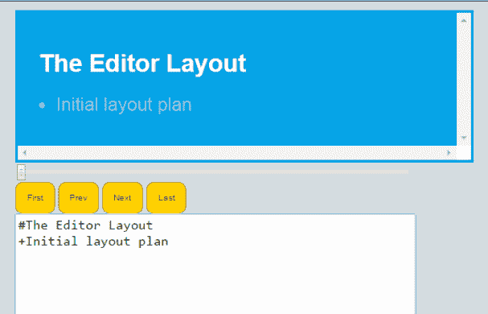
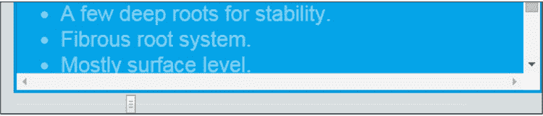
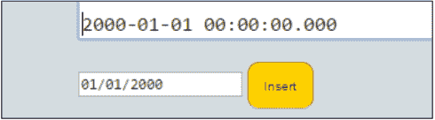
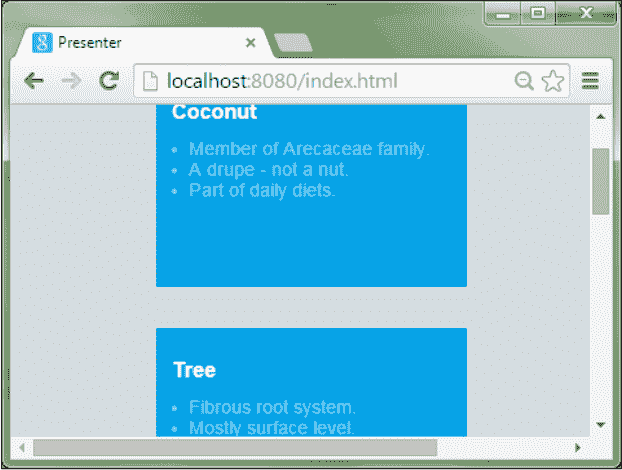
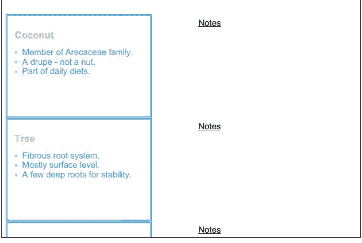

## 3 幻灯片演示

> 准备一次精彩的即兴演讲通常需要我花费三周以上的时间。
> 
> – 马克·吐温

演示让一些人感到恐惧，但若使用得当，它们无疑是信息共享的实用工具。内容必须出色，而一些视觉上的点缀可以使其脱颖而出。

幻灯片太多会让最包容的观众打哈欠，因此让演示者专注于内容，并自动处理视觉效果（让创建者免于摆弄不同的动画和字体大小），有助于改进演示。引人注目的内容仍然需要人的参与。

## 构建演示应用

Web 浏览器本身已是一种多媒体演示应用，因此随着我们更深入地探索 Dart 语言，编写一个高质量的演示程序是可行的。希望它能帮助我们向下一位客户推介另一个 Dart 应用。

基于我们的第一个应用，我们将使用基于文本的编辑器来创建演示内容。我非常惊讶地发现，使用基于文本的编辑器制作演示要快得多，也更有趣。希望您也能体验到这种生产力的提升！

## 布局应用

该应用将有两种模式：编辑模式和演示模式。在编辑模式下，屏幕将分为两个窗格。顶部窗格显示幻灯片，底部窗格包含编辑器和其他界面元素。

本章将重点介绍演示的核心创建方面，下一章将重点介绍演示模式并改进界面。该应用将是一个独立的 Dart 项目。



## 定义演示格式

演示将以 Markdown 格式的一个小子集来编写，Markdown 是一种功能强大且简单易读的基于文本文件的格式（比 HTML 更容易阅读、输入和理解）。

> 2004 年，John Gruber 和已故的 Aaron Swartz 创建了 Markdown 语言，其目标是让人们能够使用一种易读易写的纯文本格式进行书写。
> 
> 它在 GitHub.com 和 StackOverflow.com 等主要网站上使用。作为纯文本，Markdown 文件可以保留在版本控制中并进行比较。
> 
> 有关 Markdown 的更多详细信息和背景，请参阅 https://en.wikipedia.org/wiki/Markdown


一个带标题和项目符号的简单幻灯片可以这样定义：

```text
#Dart Language
+Created By Google
+Modern language with a familiar syntax
+Structured Web Applications
+It is Awesomely productive!
```

我相信你只需读一遍就能理解！它会转换为以下 HTML：

```html
<h1>Dart Language</h1>
<li>Created By Google</li>
<li>Modern language with a familiar syntax</li>
<li>Structured Web Applications</li>
<li>It is Awesomely productive!</li>
```

Markdown 解析起来非常轻松且快速，这或许解释了它在 Web 上日益流行的原因。它可以被转换成许多其他格式。

## 解析演示文稿

`TextAreaHtml` 元素的内容会被拆分为一个由独立行组成的列表，并使用 `forEach` 遍历该列表，其处理方式与文本编辑器应用中的某些功能类似。任何通过 `trim` 方法去除空白后为空的行都会被忽略：

```text
#A New Slide Title
+The first bullet point
+The second bullet point

#The Second Slide Title
+More bullet points
!http://localhost/img/logo.png
#Final Slide
+Any questions?
```

对于以 `#` 符号开头的每一行，都会创建一个新的幻灯片对象。

对于以 `+` 符号开头的每一行，其内容会被添加到该幻灯片的项目符号列表中。

对于检测到以 `!` 符号开头的每一行，会设置该幻灯片的图片（每张幻灯片限一张）。

此过程会一直持续到到达演示文稿源的末尾。

## 示例演示文稿

为了让新用户快速上手，我们会提供一个示例演示文稿，它既可以用来演示，也可以用来测试应用的各个部分。我选择了最近一次在家庭晚餐时聊到的话题——椰子，如下面的代码片段所示：

```text
#Coconut
+Member of Arecaceae family.
+A drupe - not a nut.
+Part of daily diets.
#Tree
+Fibrous root system.
+Mostly surface level.
+A few deep roots for stability.
#Yield
+75 fruits on fertile land
+30 typically
+Fibre has traditional uses
#Finally
!coconut.png
#Any Questions?
```

## 演示程序项目结构

该项目是一个标准的 Dart Web 应用，以 `index.html` 作为入口。应用由 `main.dart` 启动，`main.dart` 在 `index.html` 中被链接，应用功能则存储在 `lib` 文件夹中。

| 源文件 | 说明 |
|---|---|
| `sampleshows.dart` | 幻灯片应用的文本内容 |
| `lifecyclemixin.dart` | mixin 的类 |
| `slideshow.dart` | 用于存储演示文稿的数据结构 |
| `slideshowapp.dart` | 应用对象 |

## 启动应用

`main` 函数的实现非常简短：

```dart
void main() {
  new SlideShowApp();
}
```

### 访问私有字段

在 Dart 中，正如我们在讨论包时所说的，隐私性是在库级别上体现的；不过，即使 Dart 没有 `public`、`protected` 和 `private` 关键字，仍然可以在类中拥有私有字段。可以通过一个单行函数简单地返回私有字段的值：

```dart
String getFirstName() => _name;
```

要获取这个值，需要调用函数，例如 `Person.getFirstName()`；然而，可能更倾向于使用 `Person.firstName` 这样的属性语法。通过 `get` 和 `set` 关键字，可以在拥有私有字段的同时保留这种属性语法。

### 使用真正的 getter 和 setter

Dart 的语法也通过关键字支持 `get` 和 `set`：

```dart
int get score => _score + bonus;
set score(int increase) => _score += increase * level;
```

使用 `get`/`set` 还是简单字段，完全取决于个人偏好。完全可以先使用简单字段，然后在需要更多验证或处理时再升级到 getter 和 setter。

在库中使用 `get` 和 `set` 关键字的好处是，包的消费者能非常清楚地看到预期接口。此外，它还能明确哪些方法会改变对象的状态，哪些只是报告当前值。

### 混入（Mixin）一下

在面向对象语言中，在一个类的基础上构建一个更专业化的相关类是非常有用的。例如，在文本编辑器中，基础对话框类被扩展，以创建警告弹窗和确认弹窗。如果我们想共享一些功能，但不希望类之间发生继承，那该怎么办呢？

聚合可以在一定程度上解决这个问题：

```dart
class A {
  ClassB usefulObject;
}
```

缺点是使用起来需要更长的引用：

```dart
new A().usefulObject.handyMethod();
```

对于 `Slide` 和 `SlideShow` 类，我们将使用来自源文件 `lifecyclemixin.dart` 的 mixin，以记录创建时间戳和编辑时间戳：

```dart
abstract class LifecycleTracker {
  DateTime _created;
  DateTime _edited;
  recordCreateTimestamp() => _created = new DateTime.now();
  updateEditTimestamp() => _edited = new DateTime.now();
  DateTime get created => _created;
  DateTime get lastEdited => _edited;
}
```

要使用该 mixin，可以在构造函数中调用 `recordCreateTimestamp` 方法，在主编辑方法中调用 `updateEditTimestamp` 方法。对于幻灯片，只记录创建时间即可；对于 `SlideShow` 类，创建和更新时间都会被跟踪。

## 定义核心类

`SlideShow` 类主要是一个容器对象，用于存放 `Slide` 对象列表，并使用 `LifecycleTracker` mixin：

```dart
class SlideShow extends Object with LifecycleTracker {
  List<Slide> _slides;
  List<Slide> get slides => _slides;
  ...
```

`Slide` 类存储标题字符串和项目符号字符串列表。任意图片的 URL 也以字符串形式存储：

```dart
class Slide extends Object with LifecycleTracker {
  String titleText = "";
  List<String> bulletPoints;
  String imageUrl = "";
  ...
```

一个简单的构造函数将 `titleText` 作为参数，并初始化 `bulletPoints` 列表。

那么，区别到底是什么呢？`appendHtml` 方法会解析所提供的 HTML，并将生成的对象节点添加到父元素的节点中，随后像往常一样在浏览器中渲染。`appendText` 方法很有用，例如，可以防止用户提供的内容影响页面格式，并防止恶意代码被注入到网页中。

## 编辑演示文稿

当源内容更新时，演示文稿会通过 `onKeyUp` 事件更新。文本编辑器项目中曾使用该事件来触发保存到本地存储。

这一操作在 `SlideShow` 类的 `build` 方法中执行，并遵循我们在解析演示文稿时讨论过的模式：

```dart
build(String src) {
  updateEditTimestamp();
  _slides = new List<Slide>();
  Slide nextSlide;

  src.split("\n").forEach((String line) {
    if (line.trim().length > 0) {

      // Title - also marks start of the next slide.
      if (line.startsWith("#")) {
        nextSlide = new Slide(line.substring(1));
        _slides.add(nextSlide);
      }
      if (nextSlide != null) {
        if (line.startsWith("+")) {
          nextSlide.bulletPoints.add(line.substring(1));
        } else if (line.startsWith("!")) {
          nextSlide.imageUrl = line.substring(1);
        }
      }
    }
  });
}
```

作为 `startsWith` 方法的一种替代方案，可以使用方括号 `[]` 运算符，即 `line[0]`，来获取第一个字符。`startsWith` 方法还可以接受正则表达式或字符串进行匹配，也可以传入起始索引。更多信息请参阅 `dart:core` 文档。就解析演示文稿而言，`startsWith` 方法更具可读性。

## 显示当前幻灯片

幻灯片通过 `slideShowApp.dart` 中的 `showSlide` 方法显示。为了预览当前幻灯片，使用存储在字段 `currentSlideIndex` 中的当前索引来获取所需的幻灯片对象，并调用 `div` 渲染方法：

```dart
showSlide(int slideNumber) {
  if (currentSlideShow.slides.length == 0) return;

  slideScreen.style.visibility = "hidden";
  slideScreen
    ..nodes.clear()
    ..nodes.add(currentSlideShow.slides[slideNumber].getSlideContents());

  rangeSlidePos.value = slideNumber.toString();
  slideScreen.style.visibility = "visible";
}
```

`slideScreen` 是一个 `DivElement`，通过将 `visibility` 样式属性设置为 `hidden`，在屏幕外进行更新。调用 `nodes.clear()` 清空 `DivElement` 的现有内容，再通过 `nodes.add` 添加幻灯片内容。设置范围滑块的位置，最后再将 `DivElement` 设置为 `visible`。

## 浏览演示文稿

一组常见的“第一张、上一张、下一张、最后一张”幻灯片按钮，让用户可以在演示文稿的预览中跳转。这是通过在幻灯片列表中内置一个索引，并将其存储在 `SlideShowApp` 类的 `slide` 字段中来实现的。

## 处理按钮按键事件

在 `SlideShowApp` 对象的构造函数中，需要以相同的模式设置导航按钮。首先，使用 `id`（元素的 `id` 属性）获取对象引用，然后为 `click` 事件附加处理程序。与其重复这段代码，不如用一个简单的函数来处理该过程：

```dart
setButton(String id, Function clickHandler) {
  ButtonElement btn = querySelector(id);
  btn.onClick.listen(clickHandler);
}
```


因为 Function 在 Dart 中是一个类型，所以函数可以很容易地作为参数传递。让我们来看一下带我们进入第一张幻灯片的按钮：

```
setButton("#btnFirst", startSlideShow);

void startSlideShow(MouseEvent event) {
  showFirstSlide();
}

void showFirstSlide() {
  showSlide(0);
}
```

事件处理程序不会直接更改幻灯片；这些操作由其他方法执行，而这些方法也可能由键盘等其他输入触发。

## 使用 Function 类型

SlideShowApp 构造函数使用了此功能：

```
Function qs = querySelector;
var controls = qs("#controls");
```

我觉得 querySelector 方法打起来有点长（尽管它描述了它的作用）。由于 Function 由类型组成，我们可以轻松创建一个简写版本。

构造函数花费了大量时间选择并将 HTML 元素分配给类的成员字段。这种方法的一个优点是，页面的 DOM 只会被查询一次，并且引用会被存储并重复使用。这对应用程序的性能很有好处，因为一旦应用程序运行起来，查询 DOM 可能需要更长的时间。

## 保持在边界内

使用 dart:math 包中的 min 和 max 函数，可以将索引保持在当前列表的范围内：

```
void showLastSlide() {
  currentSlideIndex = max(0, currentSlideShow.slides.length - 1);
  showSlide(currentSlideIndex);
}
void showNextSlide() {
```

```
currentSlideIndex =
min(currentSlideShow.slides.length - 1, ++currentSlideIndex);
showSlide(currentSlideIndex);
}
```

这些方便的函数可以节省大量 if 和 else if 比较，并使代码可读性提高很多。

## 使用滑块控件

滑块控件是 HTML5 标准中的另一个新控件。这将允许用户在演示文稿中滚动浏览幻灯片。



这个控件是我个人最喜欢的控件之一，因为它非常直观，可以为用户提供非常交互式的反馈。在早期一代网络浏览器的原始表单控件中，似乎遗漏了它。即使是清晰且被广泛接受的功能，HTML 规范也可能需要很长时间才能通过委员会并进入日常浏览器！

```
<input type="range" id="rngSlides" value="0"/>
```

该控件有一个 onChange 事件，在 SlideShowApp 构造函数中为其添加了监听器：

```
rangeSlidepos.onChange.listen(moveToSlide);rangeSlidepos.onChange
.listen(moveToSlide);
```

该控件通过简单的字符串值提供其数据，该值可以通过 int.parse 方法转换为整数，以便用作演示文稿幻灯片列表中的索引：

```
void moveToSlide(Event event) {
  currentSlideIndex = int.parse(rangeSlidePos.value);
  showSlide(currentSlideIndex);
}
```

滑块控件必须与幻灯片显示的任何其他更改、导航的使用或幻灯片数量的更改保持同步。例如，用户可以使用滑块到达演示文稿的一般区域，然后使用“上一个”和“下一个”按钮进行调整：

```
void updateRangeControl() {
  rangeSlidepos
  ..min = "0"
  ..max = (currentSlideShow.slides.length - 1).toString();
}
```

此方法在幻灯片数量更改时调用，并且与处理大多数 HTML 元素一样，需要将要设置的值转换为字符串。

## 响应键盘事件

使用键盘，特别是箭头（光标）键，是在预览模式下浏览演示文稿幻灯片的自然方式。这是在 SlideShowApp 构造函数中完成的。

> 在 Dart Web 应用程序中，dart:html 包允许从任何类或函数直接访问全局 window 对象。

用于输入演示文稿源的 Textarea 也会响应箭头键，因此需要检查它当前是否正在使用。document 上的 activeElement 属性将给出具有焦点的控件的引用。此引用可以与存储在 presEditor 字段中的 Textarea 进行比较，以便决定是否对按键做出反应。

| 键 | 事件代码 | 操作 |
|---|---|---|
| 左箭头 | 37 | 后退一页幻灯片 |
| 上箭头 | 38 | 转到第一张幻灯片 |
| 右箭头 | 39 | 转到下一张幻灯片 |
| 下箭头 | 40 | 转到最后一张幻灯片 |

## 两次监听事件流

Dart 中的事件系统实现为流。其优点之一是事件可以很容易地让多个实体监听该类。

例如，在 Web 应用程序中，这很有用，因为某些键盘按下在一种上下文中有效，而在另一种上下文中无效。listen 方法是一个添加操作（累积的），因此帮助的按键可以单独实现。这允许模块化方法，有助于重用，因为处理程序可以专门化并根据需要添加：

```
window.onKeyUp.listen((KeyboardEvent e) {
  print(e);

  //Check the editor does not have focus.
  if (presEditor != document.activeElement) {
    DivElement helpBox = qs("#helpKeyboardShortcuts");
    if (e.keyCode == 191) {
      if (helpBox.style.visibility == "visible") {
        helpBox.style.visibility = "hidden";
      } else {
        helpBox.style.visibility = "visible";
      }
    }
  }
});
```

例如，在游戏中，一组常见的事件处理可能适用于标题和介绍屏幕，而实际游戏屏幕可以包含作为超集的额外事件处理。这可以通过向相关事件流添加和删除处理程序来实现。

## 更改颜色

HTML5 为浏览器提供了功能齐全的颜色选择器（通常，浏览器使用操作系统的本机颜色选择器）。这将用于允许用户设置编辑器应用程序本身的背景颜色：

默认值为 `index.html` 页面中设置如下：



`DateInputElement` 类的 `valueAsDate` 属性提供 `Date` 对象，可以将其添加到文本区域：

```
```javascript
void insertDate(Event event) {
    DateInputElement datePicker = querySelector("#selDate");
    if (datePicker.valueAsDate != null) presEditor.value =
    presEditor.value +
    datePicker.valueAsDate.toLocal().toString();
}
```
```

在这种情况下，使用 `toLocal` 方法来获取格式化为月、日和年格式的字符串。

## 计时演示

演讲者希望遵守其分配的时间段。我们将在编辑器中包含一个计时器以帮助排练。

## 介绍 Stopwatch 类

Stopwatch 类（来自 `dart:core`）提供了此功能所需的大部分功能，如以下小型命令行应用程序所示：

```
```dart
main() {
    Stopwatch sw = new Stopwatch();
    sw.start();
    print(sw.elapsed);
    sw.stop();
    print(sw.elapsed);
}
```
```

elapsed 属性可以在任何时候检查以给出当前持续时间。这是一个非常有用的类，例如，它可用于比较不同的函数以查看哪个最快。

## 实现演示计时器

时钟将通过 `toggleTimer` 方法处理的单个按钮停止和启动。重复计时器将更新屏幕上的持续时间文本，如下所示：


如果计时器正在运行，则更新 `Timer` 和字段 `slidesTime` 中的 `Stopwatch` 将被停止。无需更新显示，因为用户需要看到最终时间：

```
```dart
void toggleTimer(Event event) {
  if (slidesTime.isRunning) {
    slidesTime.stop();
    updateTimer.cancel();
  } else {
    updateTimer = new Timer.periodic(new Duration(seconds: 1),
      (timer) {
        String seconds = (slidesTime.elapsed.inSeconds %
        60).toString();
        seconds = seconds.padLeft(2, "0");
        timerDisplay.text =
          "${slidesTime.elapsed.inMinutes}:$seconds";
      });

    slidesTime
      ..reset()
      ..start();
  }
}
```
```

Stopwatch 类提供了以分钟和秒检索经过时间的属性。为了将其格式化为分钟和秒，秒部分是使用模除运算符 % 确定的，并使用字符串函数 `padLeft` 进行填充。

Dart 的字符串插值功能用于构建最终字符串，并且由于正在访问 elapsed 和 `inMinutes` 属性，因此需要 `{}` 括号，以便返回单个值。


## 幻灯片概览

这为用户提供了幻灯片的视觉概览，如以下截图所示：



演示幻灯片将在新的全屏 Div 元素中重新创建。其样式使用位于 `SlideShowApp` 构造函数中的 CSS 样式表中的 `fullScreen` 类进行设置：

```
overviewScreen = new DivElement();
overviewScreen.classes.toggle("fullScreen");
overviewScreen.onClick.listen((e) => overviewScreen.remove());
```

幻灯片的 HTML 将完全相同。为了缩小幻灯片，需要遍历幻灯片列表，获取 HTML 元素对象，并设置幻灯片的 CSS 类：

```
currentSlideShow.slides.forEach((s) {
  aSlide = s.getSlideContents();
  aSlide.classes.toggle("slideOverview");
  aSlide.classes.toggle("shrink");
  ...
```

当鼠标进入时，CSS 悬停类用于缩放幻灯片，以便可以聚焦查看幻灯片。这些类使用 `toggle` 方法设置，该方法在类不存在时添加，如果存在则移除。该方法有一个可选参数：

```
aSlide.classes.toggle('className', condition);
```

第二个参数名为 `shouldAdd`，如果始终添加类则为 `true`，如果始终移除类则为 `false`。

## 讲义备注

没有什么比给与会者一份实体讲义更好的了。这可以通过概览显示的一种变体来实现：



与其复制概览代码，不如在方法声明中使用可选参数对该函数进行参数化。使用方括号 `[]` 将声明括起来，并指定默认值，如果未指定参数则使用默认值：

```
void buildOverview([bool addNotes = false])
```

演示概览显示调用它时不需要任何参数：

```
buildOverview();
```

讲义显示调用它时不需要任何参数：

```
buildOverview(true);
```

如果设置了此参数，则会为“备注”区域添加一个额外的 Div 元素，并调整 CSS 以利于打印布局。

## 比较可选位置参数和命名参数

`addNotes` 参数声明为可选位置参数，因此无需命名参数即可指定可选值。第一个参数与提供的值匹配。

为了提供更大的灵活性，Dart 允许可选参数被命名。考虑两个函数——第一个使用命名可选参数，第二个使用位置可选参数：

```
getRecords1(String query,{int limit: 25, int timeOut: 30}) {
}
```

```
getRecords2(String query,[int limit = 80, int timeOut = 99]) {
}
```

第一个函数可以通过更多方式调用：

```
getRecords1("");
getRecords1("", limit:50, timeOut:40);
getRecords1("", timeOut:40, limit:65);
getRecords1("", limit:50);
getRecords1("", timeOut:40);
```

```
getRecords2("");
getRecords2("", 90);
getRecords2("", 90, 50);
```

使用命名可选参数时，它们的提供顺序并不重要，并且优点是调用代码更清楚地表明所传递参数的用途。
