## 4
语言、动作与声音

> *电影中 50% 的娱乐效果来自声音和音乐。*
> 
> – 乔治·卢卡斯

用幻灯片演示应用来创作电影并不是一个好选择，但即使面对较少的观众，那些精通银幕的人的经验也值得我们学习。

用户界面中的简单动画赏心悦目，并能增强整体体验。

网络浏览器中的声音已经存在了一段时间，主要依赖插件。大多数用户会庆幸自动播放 MIDI 文件的时代早已过去，大多数开发者也会高兴终于有了播放声音文件的标准方法。

## 进入全屏

到目前为止，幻灯片一直处于小屏幕模式，需要将其切换到 Web 浏览器中的 **IMAX** 等效模式——全屏模式。观众不想看到幻灯片编辑器或桌面——只想看到幻灯片。

要打开本章的示例代码项目，请在 WebStorm 中打开 `Presenter` 文件夹，然后打开 `slideshowapp.dart` 文件。

## 请求全屏

尽管 Web 浏览器的趋势是逐渐缩小屏幕控件的大小——这一趋势因 Chrome 浏览器而加速——但全屏 Web 应用仍被用户接受，并且各浏览器之间已经确定了标准。让我们看看下面的截图：

出于安全考虑，Web 浏览器会提示用户允许网站进入全屏模式，该模式会隐藏屏幕外的工具栏和状态栏。

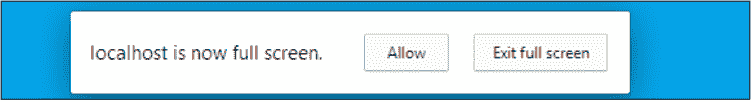

一旦进入全屏模式，用户会收到接管整个屏幕的域名的通知。Web 浏览器还将 Escape (Esc) 键设置为用户退出全屏模式的方式。几秒钟后，该通知会浮动离开屏幕，将指针移回屏幕顶部即可再次显示。

具体行为和位置可能因 Web 浏览器和操作系统而异。例如，Internet Explorer 往往会在页面底部显示通知。

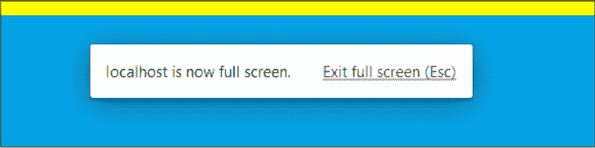

`requestFullscreen` 方法可用于大多数页面元素，但通常使用 div 作为容器。演示应用从 `SlideShowApp` 对象的构造函数中调用 `setupFullScreen` 方法。使用一个布尔标志来跟踪显示模式：

```
qs("#btnStartShow").onClick.listen((e) {
    isFullScreen = true;
    liveFullScreen
        .requestFullscreen()
        .focus()
        .classes.toggle("fullScreenShow")
        .style.visibility = "visible";
});
```

```
liveSlideID = 0;
updateLiveSlide();
}};
```

可以监听 `onFullscreenChange` 事件，以便单个元素能够监听状态变化。例如，当应用处于全屏模式时，工具栏可能不会出现。

当你点击 div 时，`isFullScreen` 标志被设置，请求全屏，并将输入焦点设置到 `liveFullScreen` 对象上。接下来，将 .css 文件设置在 div 上，并使其在屏幕上可见。最后，将 `liveSlideID` 设置为演示文稿的起点，并用幻灯片的内容更新显示。

## 为全屏更新界面

编辑器屏幕需要一个按钮来以全屏模式启动幻灯片。显示将是一个全新的元素，而不仅仅是编辑器预览的放大。

全屏将是一个 div 元素，填满整个窗口，并包含用于背景的子 div 元素，配有背景图像，以及当前正在显示的幻灯片。

## 为全屏更新键盘控制

这里需要一个与上一章为编辑器屏幕实现的事件监听器类似的事件监听器。键盘控制在 `SlideShowApp` 类的 `setupKeyboardNavigation` 方法中设置：

```
void setupKeyboardNavigation() {
    //Keyboard navigation.
    window.onKeyUp.listen((KeyboardEvent e) {
        if (isFullScreen) {
            if (e.keyCode == 39) {
                liveSlideID++;
                updateLiveSlide();
            } else if (e.keyCode == 37) {
                liveSlideID--;
                updateLiveSlide();
            }
        } else {
            //Check the editor does not have focus.
            if (presEditor != document.activeElement) {
                if (e.keyCode == 39) showNextSlide();
                else if (e.keyCode == 37) showPrevSlide();
```

```
else if (e.keyCode == 38) showFirstSlide();
else if (e.keyCode == 40) showLastSlide();
}
}
});
```

`isFullscreen` 标志用于确定演示应用处于哪种模式。在全屏模式下，根据按下的键和当前更新的显示幻灯片，`liveSlideID` 会递增或递减。

## 添加鼠标控制

点击鼠标按钮推进演示是一个相当常见的功能，我们的应用也应该支持这一点。这在 `setupFullscreen` 方法中实现：

```
liveFullscreen = qs("#presentationSlideshow");
liveFullscreen.onClick.listen((e) {
  liveSlideID++;
  updateLiveSlide();
});
```

在 fullscreen div 元素上监听 `onClick` 事件，当收到此请求时，幻灯片前进到下一张。让我们看看下面的截图：

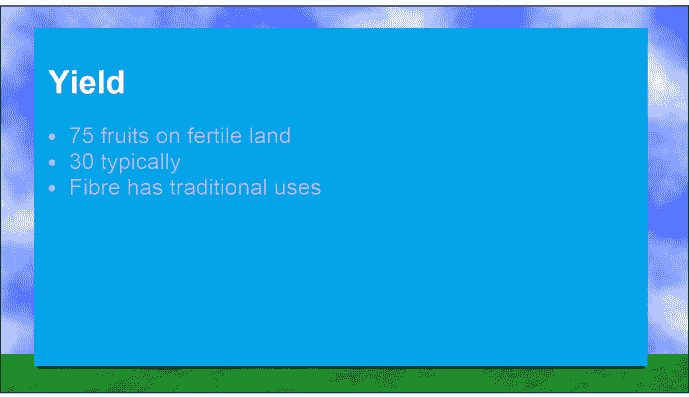


## 添加元数据

在撰写本文时，部分全屏 API 在 Dart API 文档中被标记为实验性，并且文档中也明确说明了这一点。到你阅读本文时，全屏 API 应该已经稳定并完全可用了。

这是新 Web 浏览器功能的标准流程，最终会变得稳定。添加实验性 API 很可能是一个持续的过程——浏览器永远达到 100% 完整似乎非常不可能！`onFullscreenChange` Dart API 文档写道：

```
Experimental
ElementStream<Event> get onFullscreenChange
Stream of fullscreenchange events handled by this Element.
```

dart:html 包此部分的源代码包含多个注解，其中包括 @experimental 标记：

```
/// Stream of `fullscreenchange` events handled by this [Element].
@DomName('Element.onwebkitfullscreenchange')
@DocsEditable()
// https://dvcs.w3.org/hg/fullscreen/raw-file/tip/Overview.html
@Experimental()
ElementStream<Event> get onFullscreenChange =>
  fullscreenChangeEvent.forElement(this);
```

Dart 拥有非常灵活的注解系统，可以创建新系统为 Dart 中的大多数组件添加元数据，例如类、函数和库。模式，如你可能已经注意到的，是以 @ 符号开头，后跟对 const 构造函数的调用或对编译时常量变量的引用。

### 创建自定义注解

让我们创建自己的 Temporary 注解，它将标记类为应用程序设计的临时部分，并允许一个标签记录临时类计划在哪个构建中被移除：

```
import 'dart:mirrors';

class Temporary {
  final String removalBuildLabel;
  const Temporary(this.removalBuildLabel);
}
```

```
```dart
String toString() => removalBuildLabel;
}

@Temporary('Build1')
class TempWidgetTxt {}

@Temporary('Build2')
class TempWidgetWithGFX {}

void main() {
  ClassMirror classMirror1 = reflectClass(TempWidgetTxt);
  ClassMirror classMirror2 = reflectClass(TempWidgetWithGFX);

  List<InstanceMirror> metadata1 = classMirror1.metadata;
  print(metadata1.first.reflectee);

  List<InstanceMirror> metadata2 = classMirror2.metadata;
  print(metadata2.first.reflectee);
}
```
```

Temporary 构造函数允许设置一个标签。如果要将此类用作注解，则该字段必须是 final（单次赋值变量或字段）。main 函数调用 `reflectClass` 来获取类的详细信息，然后访问此元数据并将其存储在列表中。toString 方法允许通过 `print` 输出元数据：

Build1
Build2

注解在核心 Dart API 中被广泛使用，在包中，它们被用作框架的基础，例如 Web 应用程序。它们并不是核心 SDK 的晦涩特性。

## 翻译用户界面文本

我职业生涯中发布的第一个软件并不涉及任何代码创建。它是一个现有包的语言更新发布，将 CD-ROM 寄出（这是很久以前的事了！）和从头编写的东西一样令人满意。值得庆幸的是，这让我在挪威出了名！

软件应用程序的翻译对于其在某些市场的接受度至关重要。在 Web 应用程序的世界中，这一点更为重要。Dart 有一个名为 `intl` 的包，可用于帮助将你的应用程序带给全球受众。

演示者界面需要更新，以便以法语和西班牙语显示编辑器。这将涉及提取我们希望使用的字符串，获取翻译，并将其整合回项目中。

语言将由用户在运行时选择。当前操作系统的界面语言可能不是用户希望使用应用程序的语言。

### 探索 intl 包

intl 包为 Dart 应用程序的国际化和本地化提供功能。这不仅包括将界面文本翻译成其他语言这一重要方面，还包括文本（并非所有语言都是从左到右格式化的）、日期和数字的格式化。

### 定位要翻译的字符串

应用程序的界面主要由按钮组成，还有一些其他标签和控件。可以使用 Intl.message 创建应用程序界面语言的词典，并将其存储为 PhraseBook 类中的静态函数，该类可在 interfacetrans.dart 文件中找到。这将组织所有要在运行时使用 value 或 text 属性设置在界面元素上的字符串：

```
class PhraseBook {
    // Navigation controls.
    static String btnFirstSlide() => Intl.message("First",
        name: "btnFirstSlide", desc: "Button label - go to the first
slide.");

    static String btnPrevSlide() => Intl.message("Prev",
        name: "btnPrevSlide", desc: "Button label - go to the previous
slide.");
    ...
```

这些函数是静态的，因此无需类的实例即可调用函数，例如 PhraseBook.btnFirstSlide() 将返回第一张幻灯片的字符串。Intl.message 具有一系列命名参数。name 参数需要与函数名称匹配，以便于字符串提取工具，这些工具将在下一节中介绍。desc（描述）字段提供了字符串在程序中使用的上下文。当翻译者无法访问软件时，这很有用，甚至软件可能尚未编写。

Intl.message 具有广泛的功能，例如根据复数或指代不同性别而修改短语。此外，它还可以存储更多元信息，例如字符串的示例用法，以为翻译者提供更多上下文。请参阅 SDK 文档了解更多详细信息。

### 提取字符串

应用程序的英文字符串现在已组织在一个类文件中。接下来，我们需要提取字符串，以便将其发送出去进行翻译。`intl` 包包含一个可以从命令行运行的提取工具。

> 本章下一节将介绍从命令行运行工具的任务。确保 Dart SDK bin 文件夹位于系统的可执行路径中，以便 pub 和其他 Dart 工具可以从命令行上的任何位置执行。

### 使用 Dart pub 运行命令

Pub 是一个在 Dart 中用途广泛的工具，其一个有趣的功能是运行属于 Dart 包的命令行工具：

```
pub run packagename:programname
```

发出此命令时，pub 将在包的 bin 文件夹中查找 `programname.dart`：

```
pub run intl:extract_to_arb --output-dir=c:\transarb web\lib\
interfacetrans.dart
```

> 有关包结构的更多信息，请参阅 https://www.dartlang.org/tools/pub/package-layout.html。

确保目标目录已存在。最后一个参数是包含翻译字符串函数的源文件。

> **应用程序资源包（ARB）** 是一种基于 JSON 的格式，可扩展且可直接被应用程序使用。
你可以在 https://code.google.com/p/arb/ 了解有关项目格式的更多信息。

JSON 格式的 ARB 文件包含 Phrasebook 类的大部分信息，已转换为字典声明：

```
```json
{
  "btnFirstSlide": "First",
  "@btnFirstSlide": {
    "description": "Button label - go to the first slide.",
    "type": "text",
    ...
  }
}
```
```

这种易于阅读且可移植的文件格式可被一系列应用程序使用以生成可用翻译。

### 获取翻译

Google Translator Toolkit（https://translate.google.com/toolkit/）是一个功能强大的在线工具，可接受 .arb 文件等多种格式。此工具免费使用，需要 Google 账户登录。

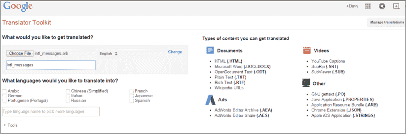

Toolkit 的一个有用功能是它与 Google Translate 绑定，因此文本的计算机翻译会被提供出来。这就是用于演示字符串资源的方法——它不会给出完美的翻译，但对于初始测试和界面布局很有用。


## 语言、运动与声音

> 即使是一个小项目，管理翻译也是一项相当大的工作量。每新增一个按钮，就意味着新的字符串、新的翻译和更多的测试！
> 
> Google Translator Toolkit 的一个替代方案是开源项目 Pootle，可以在 `http://pootle.translatehouse.org/` 找到。
> 
> 根据我的经验，译者背景各异，不一定都具备技术思维，而且你必须处理显著的时差问题。这时候就该运用那些重要的以人为本的软技能了！

每种语言都可以单独翻译，该工具允许跟踪翻译过程的进度。翻译文件可以与其他用户共享，如果需要，还可以众包翻译。

一旦某种语言的翻译完成，就可以将它们下载为 `.arb` 文件。我们来看下面的截图：

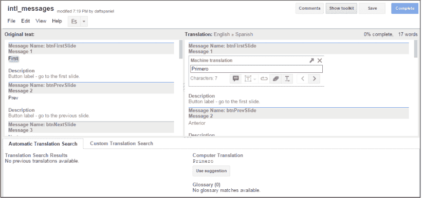

## 集成翻译文本

现在翻译已安全地存储为字符串，是时候通过将这些文件转换为 Dart 源代码文件，把它们带回 Dart 项目中了。

注意 ARB 文件的命名带有 _es 和 _fr，这使 intl:generate_from_arb 工具能够确定正在处理的是哪种语言。在本例中，Dart 文件被直接放入项目的 lib 文件夹中：

```
pub run intl:generate_from_arb
--output-dir=web/lib
web/lib/interfacetrans.dart
web/lang/messages_es.arb web/lang/messages_fr.arb
```

所创建的文件包括核心的 messages_all.dart 消息文件，它是主要的 Dart 导入文件。此外，还为所使用的每种语言创建了一个支持文件，即 messages_es.dart 和 messages_fr.dart。

## 更改用户界面的语言

要使用这些翻译，需要在 interfacetrans.dart 中导入 messages_all.dart 文件。必须告诉 intl 包我们要使用哪种语言，它会在后台负责加载正确的资源。interfacetrans.dart 中的 setInterfaceLang 函数执行此任务，并由 SlideShowApp 构造函数调用：

```
setInterfaceLang(String langID){
  initializeMessages(langID).then((_){ 
    Intl.defaultLocale = langID;
    addInterfaceText();
  });
}
```

最棒的是，无论添加多少种新语言，addInterfaceText 方法都无需更改。

## 添加语言下拉框

对用户和开发者而言，随时更改界面语言非常有用。我们将添加一个带有 onChange 事件处理程序的下拉框，让用户可以从列表中选择语言：

```
<select id="interfaceLang">
<option>en</option>
<option>fr</option>
<option>es</option>
</select>
```

界面的所有初始化都已封装在 setInterfaceLang 方法中，因此唯一需要传入的参数就是来自下拉框（SelectElement）的值：

```
setInterfaceLang("en");
qs("#interfaceLang").onChange.listen((e) {
var lang = qs("#interfaceLang").value;
setInterfaceLang(lang);
langInterface = lang;
...
```

这是在 SlideShowApp 构造函数中与其他监听器一起设置的，并会触发用户所请求的界面更改。运行时，只需单击一下即可将语言切换为法语用户界面，而且更改几乎立即生效。

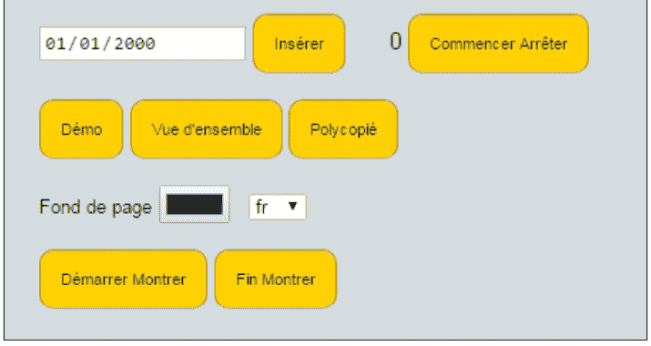

字符串的长度在不同语言之间可能有很大差异——按钮布局预留了扩展空间。请注意西班牙语和法语翻译中按钮的差异。

在设计多语言应用的界面布局时，这是一个需要考虑的因素。最好假设其他语言会更长，并为扩展留出一些空间。

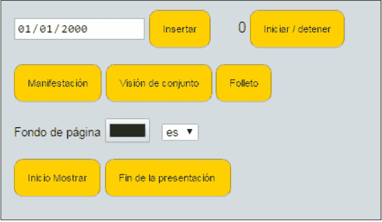

尽管这个应用已经相当先进，但恐怕演示用的 coconut 演示文稿材料仍需用户自己去翻译！

## 处理日期

ISO 8601 日期标准是“年 月 日”，自然，世界上没有任何国家在日常生活中使用这种标准！典型的变体是先写月或日，然后使用分隔符连接简写形式的数字。

intl 包可以帮助提供适合每种语言的格式和翻译。由于可能需要显示星期或月份的名称，因此也需要翻译字符串。

日期处理在 SlideShowApp 类中实现：

```
import 'package:intl/date_symbol_data_local.dart';
```

使用一个字段来保存对活动 DateFormat 对象的引用：

```
DateFormat slideDateFormatter;
```

我们将考虑如何初始化此格式化器，并根据用户语言的变化使其保持最新。

## 针对区域设置进行格式化

每当界面语言更改时，日期格式化器的区域设置也需要更新：

```
qs("#interfaceLang").onChange.listen((e) {
  var lang = qs("#interfaceLang").value;
  setInterfaceLang(lang);
  langInterface = lang;
  initDefaultDate();
});
```

当请求某个区域设置时，需要创建相应的 DateFormat 对象：

```
initDefaultDate() {
  initializeDateFormatting(langInterface, null).then((d) {
    slideDateFormatter = new DateFormat.yMMMMEEEEd(langInterface);
  });
}
```

一旦完成这些设置，就可以使用下拉框更改界面语言，并获得格式和语言都正确的日期。

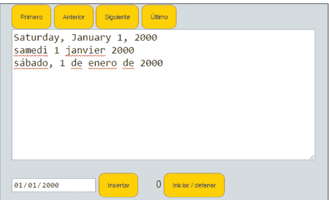

关于这个话题的最后一句话：大多数 Web 应用在语言选择上远没有这么动态。通常，界面语言选择是每个用户的配置选项，在用户登录时为每个会话设置。

## 制作幻灯片动画

全屏显示在任何时候都只展示一张幻灯片。*新*幻灯片最初会放置在屏幕顶部，然后缓缓降落到视野中。*旧*幻灯片从演示查看者的角度来看会立即消失。

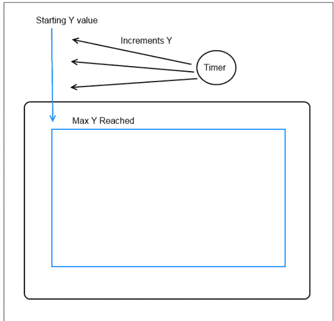

## 使用定时器

Dart 中的周期性定时器对你来说应该已经是老朋友了。它用于检查幻灯片是否已到达最终位置。如果尚未到达，则更新位置：

```
new Timer.periodic(new Duration(milliseconds: 50), (timer) {
  if (isFullScreen && liveSlideY < 0) {
    liveSlide.style.top = liveSlideY.toString() + "px";
    liveSlideY += 50;
  }
});
```

你可能会担心 Timer 对象会一直运行，即使演示未在全屏模式下也是如此。实际上，它们非常轻量，动画执行的工作量极小，影响可以忽略不计。

## 在浏览器中播放声音

这个特性故意留到最后讲，因为不断听同一个音效可能会变得相当烦人！MP3 可能是各种 Web 浏览器支持最好的格式，但有一个例外——Dartium。

> Dartium 是基于开源项目 Chromium 构建的。该项目不包含包括 MP3 在内的任何专有编解码器。创建项目时，有时可以直接使用 MP3，并在另一个浏览器中测试应用的音频部分。

对于这个项目，提供了同一个声音文件的三种格式。OGG 格式可在 Dartium 和大多数浏览器中运行。如果遇到问题，请尝试其他格式。

## 制作音效

要创建幻灯片切换时播放的音效，可以使用 Bfxr 之类的工具。可以在 http://www.bfxr.net/ 上找到它（那里也有独立版本的下载链接），它是一个强大的音频创建工具。

由于它是为游戏黑客松（限时游戏编程竞赛）期间使用而创建的，所以易于上手且使用快速。我们来看下面的截图：

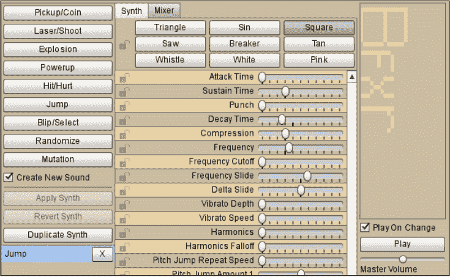

## 创建声音文件

Audacity（http://web.audacityteam.org/）是一个流行且稳定的音频编辑和录制软件包。它是一个开源桌面应用，可用于所有主流操作系统平台。我们来看下面的截图：

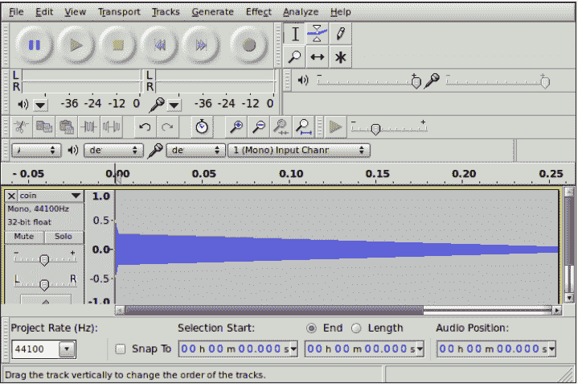


你可以在最后对声音进行一些微调并将其导出（File | Export...）为多种格式（如 MP3、Ogg 和 WAV）。在某些系统上，你可能需要下载 MP3 编解码器。

> 不过要注意文件大小和时长！理想情况下，声音长度应约为 200ms。

### Loading sounds

声音是在从 SlideShowApp 对象的构造函数中调用的方法中加载的，并且正如你在 Dart 中所期望的那样，这是一个异步操作：

```
List loadAudio() {
  slideChange = new AudioElement("snd/slidechange.ogg");
  slideChange.preload = "auto";
  return [slideChange.onLoad.first];
}
```

```
playSnd() {
  slideChange
    .play()
    .onEnded.listen(done);
}
```

```
done(e) {
  slideChange.load();
}
```

AudioElement 的 onLoad 属性是该对象的加载事件流（音频和其他媒体元素可能加载多个文件）。

该流的 first 属性等待第一个加载事件，然后停止监听流。这是一种确保所有媒体，例如游戏中的图像和声音，在使用前已全部加载的有用方法。

### Playing back sounds

完成所有设置后，实际播放音频只是调用 playSnd 方法并确保扬声器已插入的问题！会监听 onEnded 事件并提供回调。这处理了一个浏览器的怪癖，即在重新播放之前需要重新加载文件。

这个怪癖提醒我们，尽管浏览器中的音频支持已大幅改善，但它主要面向大型媒体播放，而播放短音效的工作量可能比应有的要多一些。

> 这里有一个网站，你可以用它来通过错误报告或功能建议为 Dart 开发做出贡献：
>
> `http://dartbug.com`
>
> 这会将你重定向（截至撰写时）到一个 Google Code 项目。Google Code 服务正在逐步淘汰，但为了 Chromium 项目仍会保留一段时间。由于 Dart 团队是 Google Chrome 团队的一部分，因此项目的一部分可能同时存在于 Google Code 和 GitHub 上。
>
> 如果你有想法或认为发现了错误，在提出该问题之前，先搜索现有问题或在 **Google+** (`http://g.co/dartisans`) 或邮件列表上讨论它是个好主意。

### Summary

演示应用程序现在已具备足够的功能，使最终幻灯片对接收者的眼睛和耳朵都令人愉悦。

在幕后，该界面可供不讲英语的人使用。此外，软件只需做最少的代码更改即可轻松翻译成更多语言。

我们研究了 Dart 强大的元数据功能，并看到了它们在 SDK 和用户应用程序中的使用方式。我们看到了 pub 工具如何让我们使用 Dart 包中的工具。

有了文本编辑器和演示应用程序，Dart 的客户端故事已被充分探索；将其带到服务器端将让我们看到 Dart 在另一个环境中的表现！
