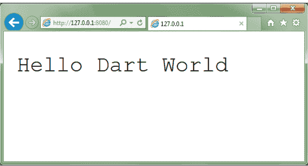
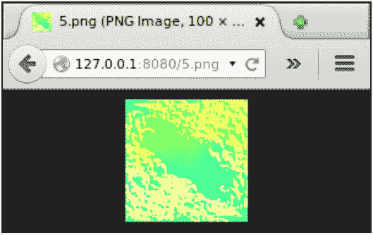
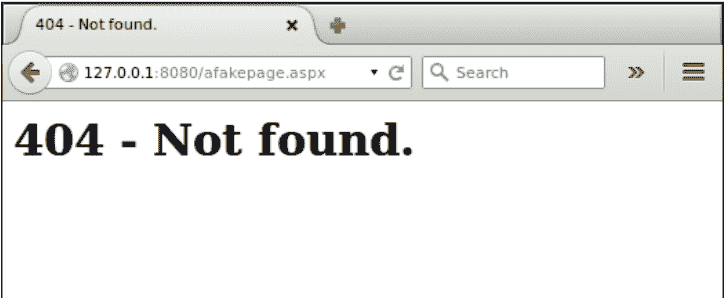
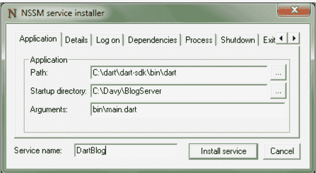
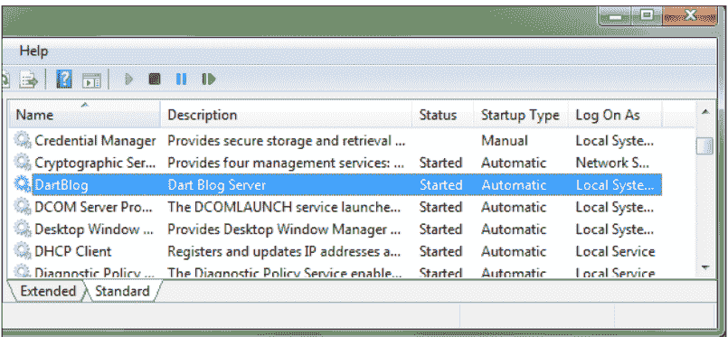

## 5 A Blog Server

> 忘掉某人的简历或他们在聚会上的表现吧。他们会写博客吗？博客不会说谎。
>
> – Nick Denton

我希望我能记得我在网上读到的第一篇博客，但我确实记得在“博客”一词被发明之前很久，就在主页上阅读过（并拥有过）日记部分。尽管各种社交媒体平台 meteoric 上升，博客仍然保持了其地位。

是时候让我们探索 Dart 故事的服务器端了，而博客为我们提供了探索这种语言不同方面的绝佳机会。在服务器端，由于上下文在 Web 浏览器之外，因此提供了新的功能。

### The Hello World server example

在 Dart 中创建最小的 Hello World 服务器非常简单。打开本章的示例 HelloWorld 文件在 Dart 编辑器中。该项目是一个命令行项目，因此 main.dart 文件放在 bin 文件夹中：

```
import 'dart:io';
void main() {
  HttpServer.bind('127.0.0.1', 8080).then(
    (server) {
      server.listen((HttpRequest request) {
        request.response
          ..write('Hello Dart World')
          ..close();
      });
    });
}
```

输出显示在以下屏幕截图中：



dart:io 包对于服务器端非常重要。它允许我们访问在 Web 浏览器上下文中由于安全原因而无法使用的功能，例如文件系统和网络。

启动服务器程序不会像我们之前的应用程序那样打开 Web 浏览器。你必须手动打开浏览器，然后转到你绑定的地址和端口。此外，如果在服务器代码中进行了更改，则必须停止并重新启动应用程序才能看到更改。

HttpServer.bind 方法接受两个参数——IP地址和端口号。然后尝试将服务器绑定到此网络配置，如果成功（通常只有在绑定已被使用时才会失败），则执行该函数。

> 网络设置因计算机而异。本章的示例代码使用了通常可用的端口和 IP 号；然而，你可能需要为你的系统调整这些——如果你有一个繁忙的开发系统，这很可能！

返回的服务器对象被设置为在该端口上监听 HTTP 请求。如果收到任何请求，消息 Hello Dart World 将传递给请求对象的 response 方法，然后，非常重要的是，响应将被关闭。

这个简单示例展示了所有基于 HTTP 的服务器应用程序的结构——绑定到网络然后处理请求。当然，处理请求并产生高质量输出通常要复杂得多。

如果你对网络不太熟悉，这里有一个快速回顾！IP（Internet Protocol）地址帮助我们识别网络上的机器（通常），由 4 个数字组成，用句点分隔，例如 192.168.0.1。

大多数计算机都有一个特殊的 IP 127.0.0.1，仅用于该机器上的网络通信。这是用于与自身建立连接的计算机的网络地址，不能被远程机器使用。除了这个区别外，它与其他任何 IP 地址一样操作。

端口有助于识别连接附加到的应用程序或服务。打个比方，IP 是人们的名字，端口是对话的话题。为了获得正确的信息，你需要两者都正确！


在应用程序仍在运行时，转到 main.dart 并通过在行尾添加 ! 来更改消息，即输出。刷新浏览器页面，你会发现没有任何变化。Dart 代码在服务器上运行，不再在浏览器中执行，因此简单的刷新功能来查看更改现在很遗憾地消失了。

好消息是，启动和停止服务器应用程序非常容易，我们可以使用任何 Web 浏览器来测试应用程序。仍然可以在代码中放置断点，并在页面提供服务时触发。

### A blog server

博客服务器需要以与任何其他 Web 服务器相同的方式响应网络请求，以便可以被现有客户端使用。服务器的主要客户端将是 Web 浏览器，例如 Google Chrome 和 Internet Explorer。

博客服务器需要在不同的操作系统上作为可靠的应用程序运行。本章后面，我们将看看 Dart 应用程序如何部署——需要辅助应用程序和依赖项来实现这一点。

### Introducing the HTTP protocol

HTTP 协议简单而轻量。一般来说，服务器用一组标头响应请求，说明请求是否成功或不成功。然后它发送将要发送内容的详细信息，以及内容本身，然后关闭连接。

HTTP 协议要求所有标头必须在任何内容之前发送。Dart 有助于强制执行此操作，如果你尝试在发送了一些内容后修改标头，将抛出 HttpException。


## 启动服务器

博客服务器的 main.dart 入口点与 Hello World 示例类似。提供内容的实际功能由 BlogServerApp 类处理，其中初始化了一个实例：

```
import 'dart:io';
import 'package:blogserver/blogserver.dart';

main() {
  print("starting");
  var blogServer = new BlogServerApp();
  print("Starting blog server...");

  HttpServer.bind('127.0.0.1', 8080).then((server) {
    server.listen(blogServer.handleRequest);
  });
}
```

服务器启动时向用户提供一些反馈是良好的实践。此服务器为单线程，所有请求都由一个进程以串行方式处理。

## 博客文章的存储格式

博客文章保存在一种简单的文本文件格式中，文件名即为博客文章 ID，并带有 txt 文件扩展名：

```
1st Line - Date
2nd Line - Title
3rd Line until end of file - Post Body
```

1.txt 中的一篇博客文章如下所示：

```
01/05/2015
Giraffe Facts
<p>
Lorem ipsum dolor sit amet, consectetur adipiscing elit, sed do eiusmod tempor incididunt ut labore et dolore magna aliqua. Ut enim ad minim veniam, quis nostrud exercitation ullamco laboris nisi ut aliquip ex ea commodo consequat. Duis aute irure dolor in reprehenderit in voluptate velit esse cillum dolore eu fugiat nulla pariatur. Excepteur sint occaecat cupidatat non proident, sunt in culpa qui officia deserunt mollit anim id est laborum.
</p>
```

内容是标准的 Lorem ipsum 文本，排版者几个世纪以来一直在使用它。

## 读取文本文件

现在我们已在浏览器之外工作，可以更直接地使用文件系统。让我们看看如何读取文本文件并将每一行打印到标准输出：

```
void main() {
    File myfile = new File("readme.txt");
    myfile.readAsLines().then(
        (List<String> lines)
        {lines.forEach( (line) => print(line) ); }
    );
}
```

要按我们定义的格式读取博客文章，行列表需要进行一些额外处理。这是在 blog.dart 源文件中 BlogPost 构造函数中调用的 process 方法中实现的：

```
BlogPost(String filename, this._id) {
    File postFile = new File(filename);
    _source = postFile.readAsLinesSync();
    process();
}
```

文件使用 readAsLines 的同步版本读取，因此 process 调用无需像前一个示例那样放在 then 处理程序中：

```
process() {
    _html = "";
    _date = _source[0];
    _title = _source[1];
    _html = "<h2>$_title</h2><b>$_date</b><br/>";
    _html += "";
    _source.sublist(2).forEach((line) => _html += line);
    _html += "<br/><a href=\"post$_id.html\">Permalink</a>";
}
```

前两行使用 [] 方法选择。剩余的行从列表中拆分为子列表，并直接用于构建将作为输出的 HTML 文件。内容被假定为有效的 HTML。

## 读取文件文件夹

在项目中，content 文件夹的 posts 子文件夹包含所有博客内容。要获取要加载的所有文件的列表，可以使用 `Directory` 对象获取列表，然后使用 `forEach` 进行处理：

```
void _loadPostList() {
    Directory blogContent = new Directory(_pathPosts);
    blogContent.list().forEach((File f) {
        String postFilename =
            path.basename(f.path).replaceAll(".txt", "");
        int id = int.parse(postFilename);
        IDs.add(id);
        postPaths[id] = f.path;
    }).then((v) {
        IDs.sort();
        IDs = IDs.reversed.toList();
    });
}
```

博客文章的文件路径存储在 `Map` 中，以便可以通过 `id` 值检索。`IDs` 存储在列表中，然后可以排序（文件系统无法保证按任何特定顺序提供文件名列表），并且我们可以轻松检索帖子，最近发布的帖子排在最前面。

## 请求处理

传入的 `HttpRequest` 对象包含有关客户端的大量信息——所做的请求和到服务器的网络连接：

```
handleRequest(HttpRequest request) {

    if (request.uri.path.endsWith(".html")) {
        _serveTextFile(request);
    }
    else if (request.uri.path.endsWith(".png")) {
        _servePngFile(request);
    }
    else if (request.uri.path == "/robots.txt") {
        _serveRobotsFile(request);
    }
    else {
        _serve404(request);
    }
}
```

在博客服务器的上下文中，我们最感兴趣的是 `request` 对象的 **Uri（统一资源标识符）** 属性，更 commonly 称为 URL，它给出所请求资源的路径。

例如，如果发送到服务器的请求是 `http://127.0.0.1:8080/post6.html?test=false`（查询字符串不被博客服务器使用），则 `request.uri` 的值将为 `/post6.html?test=false`，而 `request.uri.path` 的值将为 `/post6.html`。

对于正在请求的页面、图像或文件，`request.uri.path` 属性提供了所需详细信息。对 `robots.txt` 文件的请求与博客文章和图像的处理方式不同，这将在后面的章节中详细介绍。

## 提供文本

如果请求页面，我们需要向发出请求的客户端提供反馈。我们的响应首先是告诉客户端我们将响应的数据类型格式（内容类型），也称为 MIME 类型。其次，我们希望让客户端知道我们已理解请求（`HttpStatus.OK`），并即将发送请求的内容：

```
void _serveTextFile(HttpRequest request) {
    String content = _getContent(request.uri.path.toString());

    request.response
        .headers.set('Content-Type', 'text/html')
        .statusCode = HttpStatus.OK
        .write("""<html>
<head><title>$BlogTitle</title></head>
<body>
$content
</body>
</html>""")
        .close();
}
```

设置这些项目后，可以使用请求对象的 `response` 属性将页面内容提供给请求客户端。最后调用 `close()` 方法，以便客户端知道服务器已完成发送内容。

MIME 代表 Multipurpose Internet Mail Extensions。它是 IETF 标准，用于指示文件包含的数据类型。随着在线共享的更多数据类型，此列表不断增长。有关更多详细信息，请参阅 http://www.iana.org/assignments/media-types/media-types.xhtml。

## Robots.txt

使用网络浏览器的用户只是网络用户的一种类型。实时互联网上有许多机器人和蜘蛛。为了给非人类访客提供一些指导，robots.txt 标准告诉机器人是否受欢迎，如果是搜索引擎，则如何索引它。对于博客服务器的目的，我们希望欢迎搜索引擎索引内容以带来更多读者。

此响应的文本内容为：

```
User-agent: *
Disallow:
```

robots.txt 请求需要以与普通文本页面相同的方式处理和提供服务：

```
void _serveRobotsFile(HttpRequest request) {
    request.response
    ..statusCode = HttpStatus.OK
    ..headers.set('Content-Type', 'text/html')
    ..write(RobotsTxt)
    ..close();
}
```

页面以正面的 OK HTTP 状态提供服务。

## 渲染单篇博客文章

博客文章将通过永久链接的 URI 在单个页面上提供，例如 http://127.0.0.1:8080/post6.html，并且 _getContent 方法解析 Uri 路径以获取帖子的 ID 号：

```
if (path.startsWith("/post")) {
    String idfromUrl =
        path.replaceFirst("/post", "").replaceFirst(".html", "");
    int id = int.parse(idfromUrl);
    return hostedBlog.getBlogPost(id).HTML;
}
```


## 定位文件

Blog 类的 `getBlogImage` 方法返回用于在博客文章中显示的 PNG 文件。当构造函数中调用 `_loadImgList` 时，Blog 类会构建一个图像文件名列表。这与之前描述的 `_loadPostList` 函数的方式相同：

```dart
File getBlogImage(int index) {
    return new File(imgPaths[index]);
}
```

该 ID 被用作从映射中获取值的键，并返回完整的文件路径。Web 服务器指向文件的 Uri 与文件系统的位置完全无关，由应用程序的逻辑决定将哪个文件传送给客户端。

## 提供单个图像文件

服务器并不知道为 index.html 提供的网页（HTML 和图像）的完整结构。它只是以单一的方式返回对 Web 浏览器 HTTP 请求的响应：



单个图像可以在 HTML 页面之外直接请求。

## 提供 404 错误

即使是非技术性的 Web 用户也熟悉 404 错误，它表示网站上的页面无法找到：

```dart
void _serve404(HttpRequest request) {
  request.response
    ..statusCode = HttpStatus.NOT_FOUND
    ..headers.set('Content-Type', 'text/html')
    ..write(page404)
    ..close();
}
```

此页面是一个普通文本页面（常量字符串 page404 包含内容），并通过将状态码设置为 NOT_FOUND 进一步告知客户端 404 状态，如下面的截图所示：



希望博客服务器不需要提供太多这样的页面！

## 介绍 Dart 的服务器框架

本项目中的博客服务器直接基于 dart:io 编写，因此你可以了解其内部工作原理。正如你所期望的，Dart 有许多框架可以帮助编写服务器应用程序，这样基本任务（如提供文本文件）就不必为每个应用程序从头实现。

这些都可以在 pub 包库中找到。

### Redstone

Redstone 被描述为“Dart 平台的服务端微框架”。它使用简单的代码注解将 Dart 函数暴露给 Web。Redstone 的 Hello World 示例非常清晰，展示了注解如何向开发者隐藏复杂性，使他们能够专注于应用程序逻辑：

```dart
import 'package:redstone/server.dart' as app;

@app.Route("/")
helloWorld() => "Hello, World!";

main() {
  app.setupConsoleLog();
  app.start();
}
```

> 你可以在 http://redstonedart.org/ 了解更多关于 Redstone 的信息。

### Rikulo

Rikulo 谦虚地将自己描述为一个轻量级的 Dart Web 服务器。它拥有一系列有趣的功能，包括请求路由、模板引擎和 MVC（模型-视图-控制器）设计模式。Rikulo Stream 是服务器端的解决方案，其提供静态内容的 Hello World 示例只有一行：

```dart
import "package:stream/stream.dart";
void main() {
  new StreamServer().start();
}
```

> 你可以在 http://rikulo.org/ 了解更多关于 Rikulo 的信息，那里列出了几个项目。

### Shelf

Shelf 声称它可以轻松创建和组合 Web 服务器以及 Web 服务器的各个部分。其基于管道的模型允许添加中间件（例如其 Hello World 示例中的请求记录器）：

```dart
import 'package:shelf/shelf.dart' as shelf;
import 'package:shelf/shelf_io.dart' as io;

void main() {
  var handler = const shelf.Pipeline().addMiddleware(shelf.logRequests())
    .addHandler(_echoRequest);

  io.serve(handler, 'localhost', 8080).then((server) {
    print('Serving at http://${server.address.host}:${server.port}');
  });
}

shelf.Response _echoRequest(shelf.Request request) {
  return new shelf.Response.ok('Request for "${request.url}"');
}
```

> 在 https://github.com/dart-lang/shelf 了解更多关于 Shelf 的信息，正如这个 URL 所暗示的，这个包来自 Dart 团队。

## 部署

在一个漫长而艰难的软件开发项目之后，如果最后一刻出现意外，要让最终产品在正式系统上运行可能会带来极大的压力。最好在开发过程的早期就考虑部署，以便应用程序适合目标环境。

我们将了解如何在两种常见环境中部署 Dart——Windows 和 Unix。当然，每个具体系统在细节上可能有所不同，因此你可能需要检查系统上等效的设置或程序，并考虑到任何当前正在运行的应用程序，例如 Web 服务器。

### 依赖项

Dart SDK 本身是任何 Dart 服务器应用程序的关键依赖。应用程序通过 dart 命令行应用程序运行，并将 main.dart 脚本作为参数传递。

对于交互式会话来说，这很简单；然而，对于服务器应用程序，我们需要在没有用户登录到机器时运行该应用程序。

> Dart SDK 可作为单独下载（不包括开发人员工具），网址为 https://www.dartlang.org/downloads/。

### 在 Unix 上部署

在 Linux 或其他类 Unix 系统上，Web 应用程序可以在名为 screen（小写 s）的控制台应用程序中启动。screen 命令允许创建其他控制台会话，一旦主会话结束，这些会话可以在后台继续运行。

可以创建一个 screen 应用程序——应用程序启动后，screen 被分离，主会话结束。然后 Web 应用程序继续运行。如果需要进行更改，可以重新连接已分离的 screen（这可能是在几个月或几年之后！）进行任何调整；例如，安装新版本或更改配置。

这可以用于允许直接在服务器上进行 shell 访问（通常是 SSH）的托管系统。

### 使用 screen 命令

以适当的用户身份登录系统上的交互式 shell。要检查是否安装了 screen，请运行以下命令以获取版本和描述：

```
Screen
Screen version 4.01.00devel (GNU) 2-May-06

Copyright (c) 2010 Juergen Weigert, Sadrul Habib Chowdhury
Copyright (c) 2008, 2009 Juergen Weigert, Michael Schroeder
...
```

如果程序未安装，请使用你的包管理器安装该包，它简单地称为 screen。

### 启动 screen

一旦 screen 应用程序运行，按 Enter 键，你将再次进入命令提示符。按 Ctrl+a，将显示版本屏幕，表明我们不在正常的 shell 中。

使用 cd 进入 BlogServer 文件夹，并启动 Dart 博客服务器：

```
dart bin/main.dart
```

接下来，按 Ctrl+a、Ctrl+d，你将看到类似以下的消息：

```
[detached from 398.pts-2.localhost]
```

现在你应该回到常规终端了。运行 top 命令（或任何其他列出系统上正在运行的进程的程序）来获取进程列表，你会看到 Dart 在后台运行。

运行 Web 浏览器并导航到 index.html 页面。博客将从编辑器调试会话中提供。

要重新连接到这个 screen，使用命令 screen -r，你将回到该会话中。

> screen 命令是一个强大的工具，但要记住哪个 screen 正在使用可能会有点令人困惑。建议你将键盘快捷键牢记于心，以便于导航。

### 在 Windows 上部署

在 Windows 上，服务器应用程序通常作为 Windows 服务运行，对于 .NET 应用程序，则通过 Internet Information Services 托管。

将 Dart bin/main.dart 命令放入批处理文件中是一项相对简单的操作，这样它可以在交互式会话中双击运行。如果机器意外重启或应用程序崩溃，最好消除需要用户登录的要求。

### 使用 NSSM 工具

免费工具 NSSM（Non-Sucking Service Manager）（可在 http://nssm.cc/ 获取）具有一系列管理服务的功能。其中之一是将任何应用程序安装为服务，如下面的截图所示：



DartBlog 服务已安装并设置为自动启动，并在 Local System 账户下运行：



请注意，服务在首次安装时处于停止状态。根据应用程序的功能，服务将需要在适当的用户账户下运行，例如写入文件或执行其他操作。


### 使用 Microsoft 解决方案

一些系统管理员如果使用更官方的基于 Microsoft 的解决方案，可能会更满意。

作为替代方案，Microsoft 提供了一个名为 srvany 的工具，它是一个用于启动其他应用程序的服务。这是一个较老的工具（可追溯到 NT4 Resource Kit），但常用于此目的。有关更多信息，请参阅 https://support.microsoft.com/en-us/kb/137890。

### 负载测试

在达到应用程序的极限之前很久就了解其极限是很好的。HttpClientRequest 函数可用于创建对博客服务器的请求，HttpClientResponse 函数可用于接收来自博客服务器的传入数据。

将检查 statusCode 属性，以确保页面请求已由服务器成功处理。

### 构建一个简单的负载工具

博客服务器的一个简单基准是提供 1000 个文件所需的时间。getUrl 方法通过第一个 then 子句触发实际请求，关闭对服务器的请求。接下来的 then 子句处理来自服务器的实际响应。

此方法可用于监控实时网站，如果收到 HttpStatus.OK 以外的状态，或许可以触发通知：

```
import 'dart:io';

main() {
    print("Starting...");

    var url = "http://127.0.0.1:8080/index.html";
    var hc = new HttpClient();
    var watch = new Stopwatch();
    int attemptedRequests = 1000;

    print("Starting testing...");
    watch.start();

    for (int i=0;i<attemptedRequests;i++)
    {
        hc.getUrl(Uri.parse(url))
            .then((HttpClientRequest request) => request.close())
            .then((HttpClientResponse response) {
                if (response.statusCode==HttpStatus.OK)
                    print("$i, ${response.statusCode}, ${watch.elapsed.inMilliseconds}");
            });
    }
}
```

Stopwatch 类可用于测量所花费的时间，并通过 print 语句报告到标准输出。由于响应是异步到达的，因此在每个响应之后打印状态。请求编号、状态码和经过的时间以逗号分隔打印，以便数据可以轻松地在电子表格应用程序中处理。

尝试在循环结束后直接放置一个 print 语句，您会看到在收到服务器的第一个响应之前（或之后不久）打印运行。

在我普通的 Linux 笔记本电脑上，服务器能够在 3.8 秒内提供 index.html 2000 次——还不错！尝试试验请求数量；但是，您很可能会遇到打开文件的限制，因为这个简单的基准测试会同时发出许多请求。

### 总结

我们看到了 dart:io 包如何帮助非常快速地构建 HTTP 服务器，以及框架如何使这变得更加容易。通过对请求字符串进行一些简单的处理，我们可以做的不仅仅是从文件系统平面地提供文件，例如在首页上提供最近的条目。

脱离浏览器的自由允许操作文件系统。尽管不在 Web 上，但仍然对 HTTP 操作提供了良好的支持，我们用它来测试服务器的性能。Dart 服务器应用程序可以很容易地以标准方式安装在行业标准的主机操作系统上。

我们的博客服务器有了一个良好的开端。为了进步，它需要为作者、读者以及互联网上越来越多的智能网络爬虫和机器人做更多的事情。我们将提供一个编辑器来创建帖子，缓存请求以更快地提供页面，并以其他数据格式公开帖子。
