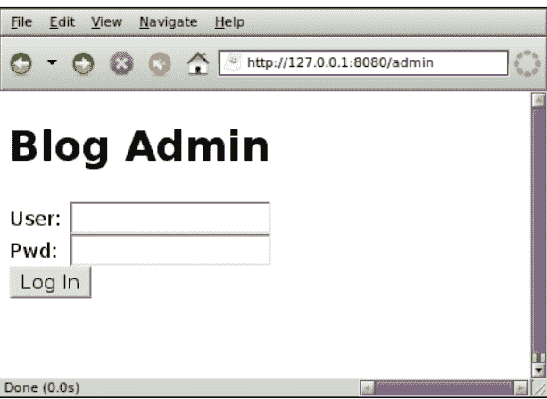
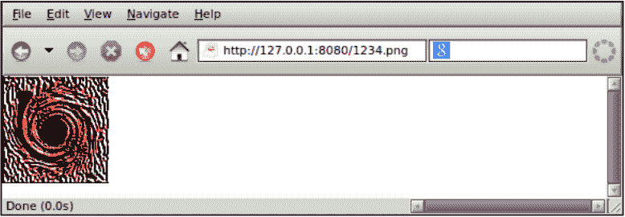

## 6 博客服务器高级

> 我鼓励人们写博客的一个原因是，写作行为会扩展你可用的词汇量，并磨练出新的声音。
>
> - 赛斯·戈丁

博客（“web logs”一词的缩写形式）从简单的个人主页发展而来，使休闲用户能够更快地将内容上线。它们还处理了一些元信息和发布工作，使内容能够在互联网上传播，并被机器和人类消费者找到。

在服务器端，Dart 对文件系统有更大的访问权限，并且不受浏览器功能的限制。本章在向博客服务器添加更多功能时进一步探讨了这些特性。

### 日志记录

Apache 和 IIS 等 Web 服务器会跟踪访问者的 Web 浏览器使用情况，这有助于网站管理员了解访问者如何使用他们的网站以及有多少人查看页面。这种良好做法还有助于 Web 开发人员发现其网站中的问题，并帮助 Web 服务器软件的开发人员诊断问题。

对于 Dart 应用程序中的通用日志记录，请查看 logging 包，该包由 Dart 团队编写，可在 https://pub.dartlang.org/packages/logging 获取。

### 写入文本文件

使用 dart:io，我们已经从文件系统读取文件，写入操作以类似的方式运行，如下所示：

```
import 'dart:io';

void main() {
  File myfile = new File("example.txt");
  myfile.writeAsStringSync("Hello World!");
}
```

这演示了该函数的同步版本，writeAsString 是异步版本。

打开本章项目中的 log.dart 文件。为此，请查看以下代码片段：

```
void log(HttpRequest request) {
  String entry = getLogEntry(request);
  File logstore = new File("accesslog.txt");
  logstore.writeAsStringSync(entry, mode: FileMode.APPEND);
}
```

为了将 Web 访问请求记录到磁盘，日志条目必须是累积的，以便以命名参数的形式传递 APPEND 模式来写入条目。

### 提取请求信息

HttpRequest 对象和 headers 属性向客户端公开请求的元数据。例如，headers 属性可以提供主机和端口号。user-agent 标识发出请求时使用的程序或 Web 浏览器，如以下代码片段所示：

```
String getLogEntry(HttpRequest request) {

  //USER_AGENT
  HttpHeaders headers = request.headers;
  String reqUri = "${headers.host},${headers.port}${request.uri.toString()}";
  String entry = "  ${request.connectionInfo.remoteAddress.address}, $reqUri, ${headers[HttpHeaders.USER_AGENT]}\r\n";

  return (new DateTime.now()).toString() + entry;
}
```

remoteAddress getter（IP 地址）可用于跟踪谁在浏览以及来自世界哪个地区。请求 index.html 博客的日志条目如下所示：

```
2015-05-17 17:03:48.496 127.0.0.1, 127.0.0.1,8080/index.html, [Mozilla/5.0 (X11; CrOS x86_64 6812.88.0) AppleWebKit/537.36 (KHTML, like Gecko) Chrome/42.0.2311.153 Safari/537.36]
2015-05-17 17:03:49.177 127.0.0.1, 127.0.0.1,8080/6.png, [Mozilla/5.0 (X11; CrOS x86_64 6812.88.0) AppleWebKit/537.36 (KHTML, like Gecko) Chrome/42.0.2311.153 Safari/537.36]
2015-05-14 18:52:45.690 127.0.0.1, 127.0.0.1,8080/favicon.ico, [NetSurf/2.9 (Linux; x86_64)]
```

浏览器会请求用户浏览的页面以及其他资源，例如 favicon.ico（通常显示在 Web 浏览器 URL 栏或书签中的小方形图形）。

### 博客编辑器

博客将有一个管理部分，允许我们使用 Web 更新博客。这将通过地址 http://localhost:8080/admin 访问，使用 admin 登录作为用户名，Password1 作为密码（两者都区分大小写）。

> 永远永远不要在真实应用程序中使用如此简单的登录！

博客网站的管理部分将由 Web 表单组成。表单将使用 post 方法，因此博客服务器必须在 BlogServerApp 类的 _handleRequest 方法中正确检测到这一点以处理请求。这由请求对象的 method 属性公开，如以下代码片段所示：

```
if (request.method == 'POST') {
    _handleFormPost(request);
}
```

POST 请求仍然具有与之关联的 URI，允许决定如何处理输入。有关详细信息，让我们看一下以下代码片段：

```
void _handleFormPost(HttpRequest request) {
    if (request.uri.path == "/login") _performLogin(request);
    if (request.uri.path == "/add") _performNewPost(request);
}
```

登录过程和新博客文章的处理方式相当不同。


## 密码保护

`/admin` 路径提供了一个 Web 表单，用于输入访问管理功能所需的用户名和密码，如下图所示：



系统会对用户名和密码进行验证，如果正确，将显示用于添加博客文章的表单。让我们看看下面的代码片段：

```
void _performLogin(HttpRequest request) {
    request.listen((List<int> buffer) {
        String page = _checkAdminLogin(buffer);

        request.response
            .statusCode = HttpStatus.OK
            .headers.set('Content-Type', 'text/html')
            .write(page)
            .close();
    }, onDone: () => request.response.close());
}
```

`checkAdminLogin` 方法负责检查登录信息，并返回 Web 表单或提示登录失败的消息。

## 加密

安全性是 Web 应用程序任意管理功能的重要特性。我们不希望将密码以明文形式存储在站点上！一种典型的密码存储方式是单向哈希，即使攻击者获得了哈希值，也很难破解密码。

`crypto` 包提供了一系列加密选项。博客将使用 SHA 算法来实现这一目的，如下所示：

```
String _checkAdminLogin(List<int> buffer) {
    var sha = new SHA256();
    sha.add(buffer);
    var digest = sha.close();
    String hex = CryptoUtils.bytesToHex(digest);
    String page = "";

    if (hex != expectedHash) {
        page = wrongPassword;
    } else {
        page = addForm;
    }

    return page;
}
```

方便的是，哈希输入是一个 `List<int>` 列表，而这正是从 Web 表单输入到请求的 `listen` 处理器中接收到的内容。SHA256 算法只需接收一段数据，然后调用 `close` 方法返回计算出的哈希值。

> SHA 代表安全哈希算法（Secure Hash Algorithm）。256 指的是字长。如果你曾在 Linux 系统上安装过软件包，那么你已经使用过 **SHA-256**。加密货币比特币的某些操作也使用 SHA。

由于用户名和密码都必须正确，因此可以将表单的整个输入进行哈希，并与事先计算的值进行比较。为了便于存储，哈希值被转换为十六进制字符串，如下所示：

```
const String expectedHash = "bdf252c8385e7c4ae76bca280acd8d44f85d7fdb561fbfb44f5749ff549ba2f6";
```

它作为常量存储在 `content.dart` 中。

```
pieces
    .forEach((dateItem) =>
        data.add(dateItem.substring(dateItem.indexOf("=") + 1));

    data.forEach(
        (encodedItem) => finalData.add(Uri.decodeQueryComponent(encodedItem)));

    return finalData;
}
```

数据首先被拆分为来自每个控件的数据，然后使用 `Uri.decodeQueryComponent` 组件将数据解码为原始数据，再返回给调用方。

## 将数据保存到磁盘

数据已被处理成可管理的列表，现在我们只需要构建一篇博客文章并将其保存到文件系统。这由 `BlogServerApp` 类的 `_performNewPost` 方法完成。让我们看看下面的代码片段：

```
List formData = _getFormData(buffer);
String newID = hostedBlog.getNextPostID();
String filename = "$newID.txt";
var p = path.join("content", "posts");
p = path.join(p, filename);

File postFile = new File(p);
String post = BlogPost.createBlogPost(formData[0], formData[1]);
postFile.writeAsStringSync(post);
```

博客对象返回下一个可用的 PostId，用于文件名，并使用 `path` 包中的 `path.join` 构建完整路径。`BlogPost` 类上的 `createBlogPost` 静态方法用于按照定义好的格式添加附加数据。然后使用同步写入函数将其写入构建好的路径。

## 提供默认图片

这个版本的添加表单不允许用户设置图形文件，而每篇文章都需要一个图形文件。如果博客文章 ID 是 8，那么会请求 `8.png`。为了不加载空文件，将加载默认图片（`default.png`）。让我们看看下面的截图：



如果在文件系统中找不到该文件（例如虚构的 `1234.png` 图片！），则会加载并提供 `6.png` 作为替代，如下面的代码片段所示：

```
File getBlogImage(int index) {
    String path;
    if (imgPaths.containsKey(index)) {
        path = imgPaths[index];
    } else {
        path = _pathDefaultImg;
    }

    return new File(path);
}
```

这是通过检查 `imgPaths` 映射中是否存在请求的索引变量来实现的。如果键不在 `imgPaths` 映射中，则使用默认图片路径。

## 刷新博客

博客服务器启动时会读取博客内容。由于新增博客文章后内容已经改变，必须使用名为 `initBlog` 的 `BlogServerApp` 方法刷新此列表，如下所示：

```csharp
initBlog() async {
    _cache = {};
    IDs = new List<int>();
    postPaths = new Map<int, String>();
    imgPaths = new Map<int, String>();
    await _loadPostList();
    _loadImgList();
}
```

`BlogServerApp` 和 `_performNewPost` 方法会在提供新文章之前调用 `initBlog`，如下所示：

```csharp
hostedBlog.initBlog();

req.response
  ..statusCode = HttpStatus.OK
  ..headers.set('Content-Type', 'text/html')
  ..redirect(new Uri(path: "post$newID.html"))
  ..close();
```

博客重新初始化后，应用程序会将新的博客文章作为单个页面提供给用户。

## 缓存

第一版 Web 服务器提供内容的方式效率相当低——我希望你已经注意到了！每次 GET 请求都会从磁盘读取博客源文件并进行处理。为了提高效率，我们可以在 `Blog` 类中添加一个 Map 字段。让我们看看下面的代码片段以了解更多信息：

```csharp
BlogPost getBlogPost(int index) {
  if (!_cache.containsKey(index)) {
    _cache[index] = new BlogPost(postPaths[index], index);
  }
  return _cache[index];
}
```

该 Map 对象以博客索引为键，以生成的博客文章为值。此缓存保存在内存中，因此如果博客服务器应用程序停止并重新启动，新的请求不会一开始就从缓存中获取。

## 鸡的事实

17/05/2015

Lorem ipsum dolor sit amet, consectetur adipiscing elit, sed do eiusmod tempor incididunt ut labore et dolore magna aliqua. Ut enim ad minim veniam, quis nostrud exercitation ullamco laboris nisi ut aliquip ex ea commodo consequat. Duis aute irure dolor in reprehenderit in voluptate velit esse cillum dolore eu fugiat nulla pariatur. Excepteur sint occaecat cupidatat non proident, sunt in culpa qui officia deserunt mollit anim id est laborum.

永久链接

返回文件夹并将 `7.txt` 文件移出 `posts` 文件夹。再次刷新 Web 浏览器，关于鸡的事实的最新文章将会消失。

## 生成 XML feed

为了便于博客读者搜索和聚合，博客需要生成 RSS feed。RSS 是一种 XML 规范，它以指定格式将博客文章列为独立的条目，便于处理。

> 20 世纪 90 年代末，人们曾多次尝试创建 Web 聚合格式。来自 Netscape 的 Dan Libby 和 Ramanathan V. Guha 于 1999 年创建了 RDF 站点摘要格式，用于 My.Netscape.Com 门户。RDF 规范经过不断完善，最终演变为 RSS。
> 与之竞争的（在我看来更优越的！）feed 格式是 Atom。Atom 是为了修复 RSS 的缺陷而开发的，但并未在简单的 RSS 和用于更高级应用的 Web 服务中获得太多关注。
> 除了博客和新闻出版物，RSS 也已成为播客及其支持的客户端和工具的标准格式。
> 完整规范见 https://validator.w3.org/feed/docs/rss2.html。


## 博客服务器高级功能

为了生成博客的提要，我们可以轻松遍历帖子，因为我们已经有了一个 ID 列表。为了生成有效的 XML 提要，将使用 `xml` 包。该包不属于 SDK，而是一个开源库，它已成为 Dart 中用于 XML 创建和处理的热门选择。SDK 曾经包含一个 XML 处理包，但 `xml` 包改进得如此之快，以至于将其作为标准包更有意义。让我们看看下面的代码片段以了解更多信息：

```dart
String getRSSFeed() {
  var RssXb = new XmlBuilder();
  RssXb.processing('xml', version: '1.0');

  RssXb.element('rss', attributes: {'version': '1.0'}, nest: () {
    RssXb.element('channel', nest: () {
      IDs.forEach((int postID) {
        BlogPost post = getBlogPost(postID);
        RssXb.element('item', nest: () {
          RssXb.element('pubDate', nest: () {
            RssXb.text(post._date);
          });
          RssXb.element('title', nest: () {
            RssXb.text(post._title);
          });
          RssXb.element('link', nest: () {
            RssXb.text("http://127.0.0.1:8080/post${post._id}.html");
          });
        }); //item
      });
    }); //channel
  }); //rss

  var xml = RssXb.build();
  return xml.toXmlString(pretty: true);
}
```

这里元素以嵌套方式添加，这反映了 RSS 的结构。一旦数据结构组装完成，`build` 方法会构建 XML 结构，最后将其转换为字符串。

对于简单的 XML，直接拼接字符串很有诱惑力。然而，XML 库可以提供诸如字符编码、验证和格式化等功能，这些功能使得稍微冗长的代码在较小的用例中也是值得的。

由于 XML 既会被人类查看，也会被计算机查看，可选命名参数 `pretty` 被设置为 `true`，以输出格式规整的内容，如下例所示：

```
<?xml version="1.0"?>
<rss version="1.0">
    <channel>
        <item>
            <pubDate>02/05/2015</pubDate>
            <title>Lemur Facts</title>
            <link>http://127.0.0.1:8080/post6.html</link>
        </item>
    ...
```

RSS 提要提供给 http://127.0.0.1:8080/feed.xml，并且可以在大多数 Web 浏览器中直接查看。

## 提供 RSS 服务

RSS 提要可以像任何其他文本文件一样提供，但需要设置响应头以帮助客户端应用程序。让我们看看下面的代码片段以了解更多信息：

```
void _serveRSSFeed(HttpRequest request) {
    request.response
        ..statusCode = HttpStatus.OK
        ..headers.set('Content-Type', 'application/rss+xml')
        ..write(hostedBlog.getRSSFeed())
        ..close();
}
```

内容类型设置为 `application/rss+xml`，这会触发浏览器中的 XML 显示。否则，浏览器可能会尝试将内容显示为 HTML。

## JSON 提要的生成

提供 JSON（JavaScript 对象表示法）提要是一种比 XML 更有用的替代方案，因为它需要传输更少的数据，并且通常比处理 XPath 更简单、更快速。`getJSONFeed` 方法是 `Blog` 类的一部分，如下所示：

```
String getJSONFeed() {
    List posts = new List();
    IDs.forEach((int postID) {
        BlogPost post = getBlogPost(postID);
        Map jsonPost = {};
        jsonPost["id"] = post._id;
        jsonPost["date"] = post._date;
        jsonPost["title"] = post._title;
        jsonPost["url"] = "http://127.0.0.1:8080/post${post._id}.html";
        posts.add(jsonPost);
    });
    return JSON.encode(posts);
}
```

此方法与 RSS 采取相同的方法，只是这次主要数据结构是一个列表，条目是该列表中的元素。可以使用 `dart:convert` 中的 `JSON.encode` 方法将列表转换为 JSON：

```
[
  ...
  {"id" : 6,
    "date" : "02/05/2015",
    "title" : "Lemur Facts",
    "url" : "http://127.0.0.1:8080/post6.html"},
  ...
]
```

> JSON 提要提供给 http://127.0.0.1:8080/feed.json，并且可以在大多数 Web 浏览器中直接查看。

## 提供 JSON 服务

提供 JSON 服务不仅需要指定正确的类型，还需要处理从另一个 Web 域消费此数据提要时的安全问题：

```
void _serveJsonFile(HttpRequest request) {
  request.response
    ..statusCode = HttpStatus.OK
    ..headers.set('Content-Type', 'application/json')
    ..headers.add("Access-Control-Allow-Origin", "*")
    ..headers.add(
      "Access-Control-Allow-Methods",
      "POST,GET,DELETE,PUT,OPTIONS")
    ..write(hostedBlog.getJSONFeed())
    ..close();
}
```

内容类型设置为 `application/json`，这会触发浏览器中的 JSON 显示。访问控制（CORS）被设置为允许任何来源以及一组 HTTP 动词。

> 跨源资源共享（CORS）是一种允许从其他 Web 域请求受限资源（如脚本）的技术。例如，新闻网站希望以 JSON 格式请求博客的头条新闻以进行显示。
> 默认情况下，资源只能从同一域加载。CORS 允许共享特定资源以及这些资源上的操作（HTTP 动词），如 GET、POST 等。因此，我们可能乐意共享头条新闻，但不乐意共享登录验证脚本。

## 消费 JSON 提要

JSON 无疑已经成为现代 Web 数据格式，无论是生成还是消费都非常轻量。为了全面探索 JSON 功能，我们将暂时从服务器端转到客户端 Dart，以使用博客的 JSON 数据提要。为此，请查看以下代码片段：

打开本章的示例项目 `BlogJsonClient`。这是一个简单的 Web 项目，充当博客服务器 JSON 提要的客户端。要让此客户端运行，博客服务器也必须正在运行。

```
void main() {
  var jsonSrc = "http://127.0.0.1:8080/feed.json";
  HttpRequest.getString(jsonSrc).then((String data) {
    List decoded = JSON.decode(data);
    decoded.forEach((post) {
      querySelector('#output').children.add(new LIElement()
        ..append(new AnchorElement()
          ..href = post['url']
          ..text = "${post['date']} ${post['title']}");
    }); //for
  }); //then
}
```

这里，`HttpRequest` 类有一个静态方法，可以将远程资源作为 `Future<String>` 返回，并在 `then` 子句中异步处理。

然后对 JSON 进行迭代，并将 `LI` 元素（列表项）添加到网页的 DOM 结构中。

## 静态生成

Web 托管设施因提供商而异。运行程序和安装软件的能力并非普遍可用。随着在云上运行小型简单虚拟机的普及，网站的静态生成变得越来越流行。

其优势非常明显：无需维护软件或数据库，使系统非常安全，同时服务速度也非常快。不过，它并不适用于所有应用。博客是静态生成可能合理的场景之一。

## 冻结网站

在本章的项目中，`bin` 文件夹里有一个 `staticgen.dart` 文件。这是一个独立程序，用于生成博客首页的静态 HTML 文件。请注意，`main` 函数用 `async` 关键字标记，并且缺少 `void` 关键字。

## 介绍 await 和 async 关键字

`await` 和 `async` 关键字是在 Dart 1.9.4 中引入的，目的是简化异步操作。考虑以下对返回 `Future` 的方法的调用：

```
obj.method().then(handlerFunction)
```

这在大多数情况下没问题，但如果事情变得更复杂，并且 `handlerFunction` 也返回一个 future 呢？

```
obj.method().then(handlerFunction).then(handlerFunction2);
```

事情已经开始变得复杂——调试不再简单直观。理想情况下，我们希望一次只处理链条的一部分，并在所需操作完成之前暂停语句的执行。这就是 `await` 所允许的：

```
var f1 = await obj.aMethod();
var result = await f1.aMethod();
```

使用 `await` 调用的函数和方法返回 `Future`。它们还必须在方法头中声明为 `async`，使用 `await` 调用的函数也是如此：

```
class Foo{
  Future<int> aMethod() async {
    return await aFunction();
  }
}
```


async 和 await 关键字简化了代码，尤其是在使用内联函数时，它们也让异步代码更加可读。

## 连接文件路径

大多数计算机用户都遇到过 Unix 风格路径（/home/davymitchell/）和 Windows 操作系统路径（c:\users\davymitchell\）中使用正斜杠和反斜杠的问题：

```
var contPath = path.join( Directory.current.path, "content" );
var srcPath = path.join(contPath, "posts");
var imgPath = path.join(contPath, "img");
```

path 包提供了一个跨平台方法 join，用于连接文件夹和文件名。

## 创建输出文件夹

输出文件将放在当前路径下名为 staticoutput 的文件夹中。会检查该文件夹是否存在，如果不存在，则创建它。让我们看看下面的代码片段：

```
main() async {
    var contPath = path.join( Directory.current.path, "content" );
    var srcPath = path.join(contPath, "posts");
    var imgPath = path.join(contPath, "img");

    Blog staticBlog = new Blog(srcPath, imgPath);
    await staticBlog.initBlog();
    print(Directory.current);

    // Create output directory if it does not exist.
    var outDir = new Directory('staticoutput');
    var staticPath = path.join(Directory.current.path, 'staticoutput');
    if (!await outDir.exists()) {
        outDir.create();
    }

    // Write out main page.
    var outPath = path.join(staticPath, "index.html");
    var pageContent = staticBlog.getFrontPage();
    File indexPage = new File(outPath);
    await indexPage.writeAsString(pageContent, mode: FileMode.WRITE);

    // Return success exit code.
    exit(0);
}
```

在程序继续执行之前，会等待异步方法的结果。

## 生成首页

在第 5 章“博客服务器”中，有一个从构造函数调用的 Blog Server 版本 initBlog。它已移动到文章对象创建的初始化调用中，以便可以使用 await。标记为 async 的方法和函数不能从构造函数调用。使用 async 简化了 _loadPostList 方法，因为嵌套大大减少，如下面的代码片段所示：

```
_loadPostList() async {
  print("Loading from $_pathPosts");
  Directory blogContent = new Directory(_pathPosts);

  var postsSrc = await blogContent.list();

  await postsSrc.forEach((File f) {
    String postFilename = path.basenameWithoutExtension(f.path);
    int id = int.parse(postFilename);
    IDs.add(id);
    postPaths[id] = f.path;
  });

  IDs.sort();
  IDs = IDs.reversed.toList();
}
```

以前，文章是异步加载和设置博客的。

> 如果你在寻找有关 Dart 编程的好博客，可以从 http://www.dartosphere.org/ 开始，这是一个博客聚合器或行星风格网站，提供来自各种来源的新闻和资源。

## 编写静态版本

既然页面内容可以在确定的时间获取，就可以使用 writeAsString 方法将其写入磁盘。FileMode.WRITE 权限将覆盖任何现有文件，因此适合更新。让我们看看下面的代码片段：

```
var outPath = path.join(staticPath, "index.html");
var pageContent = staticBlog.getFrontPage();
File indexPage = new File(outPath);
indexPage.writeAsStringSync(pageContent, mode:FileMode.WRITE);

exit(0);
```

最后一行在程序完成时向操作系统返回退出代码，0 表示成功的约定。此函数不会等待任何挂起的操作，会立即关闭程序。

## 重新审视负载测试

最初的负载测试应用程序相当有限，虽然有用，但它不能给出真实的全貌，因为这么多请求同时抛向服务器应用程序，而没有等待响应。

### 更新负载测试器

负载测试应用程序的新版本将进行一次 HTTP 调用并等待结果，然后再进行下一次调用。这发生在 main.dart 源文件中。请注意，main 函数本身现在被标记为 async。await 命令用于 main 函数的调用循环中，如下所示：

```
main() async {
  print("Starting...");

  var url = "http://127.0.0.1:8080/index.html";
  var hc = new HttpClient();
  var watch = new Stopwatch();
  int attemptedRequests = 200;

  print("Starting testing...");
  watch.start();

  for (int i = 0; i < attemptedRequests; i++) {
    await callWebPage(hc, url, i, watch);
  }

  watch.stop();
  print("${watch.elapsed.inMilliseconds}");
}
```

callWebPage 方法也需要标记为 async，因为将使用两次 await：

```
callWebPage(HttpClient webClient, String targetURL, int requestNumber,
    Stopwatch watch) async {
  HttpClientRequest request;
  HttpClientResponse response;
  request = await webClient.getUrl(Uri.parse(targetURL));
  response = await request.close();
  print("${requestNumber}, ${response.statusCode}, ${watch.elapsed.inMilliseconds}");
}
```

在将输出处理到屏幕之前，会等待这两个持续时间未知的操作：URL 获取和响应关闭。

## 总结

服务器端开放了文件系统的许多功能，可以直接从应用程序保存内容，为 Web 服务器提供内容以及元数据（例如日志文件）。

Dart 具备在 Web 客户端和服务器上创建、提供和消费现代 Web 格式的功能。我们看到了如何快速构建一个专门的 Web 服务器。你现在非常熟悉如何使用核心 SDK 之外的 Dart 包来实现重要的应用功能。

异步设施允许编写响应式应用程序，await/async 帮助我们编写清晰的代码，并将异步任务组合在一起，以便我们以同步方式操作它们。

我们的下一个也是最大的项目将是端到端的 Dart。在本章中，我们探讨了如何在服务器方面进行构建。我们将不再使用本地文件系统，而是连接数据库和 Web 服务来构建实时显示。
