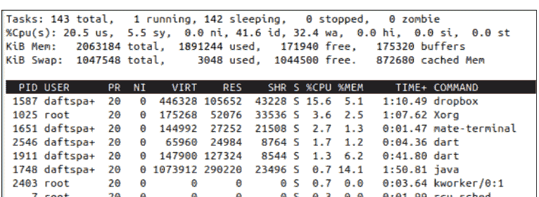
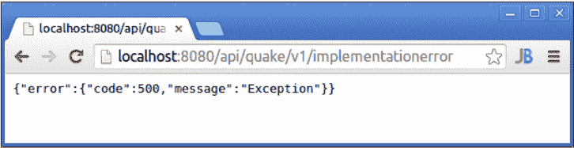
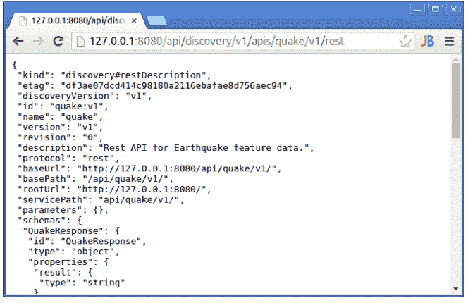
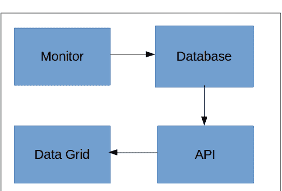
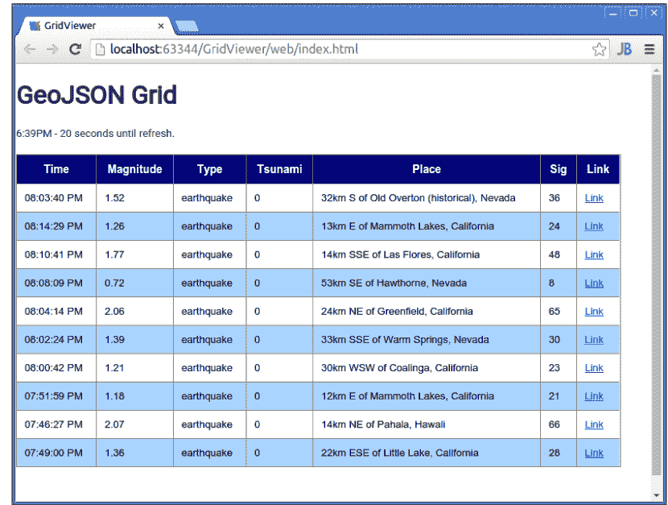

## 实时数据与 Web 服务

> > 数据是宝贵的东西，其寿命比系统本身更长久。
> >
> > ——蒂姆·伯纳斯-李

如今，许多人很难想象，曾几何时，大多数个人和工作计算机并未连接到更广泛的网络。就在不久前，向口袋中的设备自发传输即时通知的网络流是不可想象的。

新闻源、流和更新是当今 Web 应用程序的标准。数据仅仅可访问或可发现是不够的。它必须触达用户，最好甚至在他们知道自己需要之前。

### 释放数据

数据监视器收集的数据相当受困在数据库中，虽然 PostgreSQL 数据库系统在 pgAdmin 的 GUI 中有合理的显示，但网页会更美观，也更容易被更广泛的受众查看。

共享数据供客户端使用？我希望 JSON 能立即浮现在您的脑海中！项目这一阶段的最终目标是一个网页，我们可以访问该网页以友好地查看地震信息。页面应该平滑地自我更新，并且数据应以可消费的方式提供，以支持未来的扩展。

在本章示例代码的 QuakeMonitorDB 文件夹中打开项目。

### 改造数据收集器

上一章中的 GeoJSON 数据收集器的迭代只是将数据直接捕获到数据库中。为了使数据更容易被其他应用程序处理，程序将改进为生成一个列出各个要素的表。

### 添加新数据表

数据库中的分离要素将存储在一个名为 `dm_quakefeatures` 的新表中，如下所示：

```
CREATE TABLE dm_quakefeatures
(
    qufeat_id text NOT NULL,
    geojson text NOT NULL,
    modified_date timestamp without time zone DEFAULT now(),
    CONSTRAINT dm_qufeat_pkey PRIMARY KEY (qufeat_id)
)
WITH (
    OIDS=FALSE
);
ALTER TABLE dm_quakefeatures
    OWNER TO webquakeuser;
```

用于创建数据库的 SQL 语句位于示例代码的 SQL 文件夹中。

### 过滤数据

文件 quakemonitordb.dart 中的 DataMonitor 类有一个更新后的 fetchData 方法，它在将原始 JSON 存储到数据库后，会单独存储底层要素：

```
GeoUpdate update = new GeoUpdate(JSON.encode(dataset));

log.fine("Features to process ${update.features.length}");

for (int i = 0; i < update.features.length; i++) {
    GeoFeature feature = update.features[i];

    await daoGeoJson.storeFeature(feature.id, feature.toJson());
}
```

正如前面的摘录所示，这并不是一个将数据排列到方便字段中的复杂对象。

### 将要素转换为 JSON

为了将对象转换回 JSON，将添加一个名为 `toJson` 的特定方法，如以下代码片段所示：

```
String toJson() {
    Map out = {};
    out["properties"] = properties;
    out["geometry"] = geometry;
    return JSON.encode(out);
}
```

properties 和 geometry 的关键字段在传递给编码函数并返回给调用者之前会添加到 Map 中。

### 改进数据维护

由于数据库中有一个新表，我们将需要更新维护程序 `maintenance.dart` 以清除两个表，如以下代码片段所示：

```
deleteRecords() async {
    var dbConn;
    try {
        dbConn = await connect(uri);

        var query = "delete from dm_quakefeed";
        await dbConn.execute(query);

        query = "delete from dm_quakefeatures";
        await dbConn.execute(query);
    } catch (exception, stacktrace) {
        log.severe("Exception getting info.", exception, stacktrace);
        print(exception);
    } finally {
        dbConn.close();
    }
}
```

这是通过使用另一个 `delete` SQL 语句完成的，并复用了与数据库的现有连接。

### 存储单个要素

要素的存储将采用两个独立的查询。第一个查询将使用 ID 字段检查它当前是否在表中。如果是，则函数将退出而不存储 JSON 字符串。让我们看一下以下代码片段：

```
storeFeature(String featureID, String json) async {
    var dbConn;
    try {
        dbConn = await connect(uri);

        var query = """select count(*) as Count
            from dm_quakefeatures where qufeat_id ='$featureID'
        """;
        var results = await dbConn.query(query).toList();

        if (results[0][0] != 0) return;

        await dbConn.execute(
            'insert into dm_quakefeatures (qufeat_id, geojson) values (@
            qufeat_id, @geojson)',
            {'qufeat_id': featureID, 'geojson': json});
    } catch (exception, stacktrace) {
        log.severe("Exception storing Feature.", exception, stacktrace);
        print(exception);
        print(stacktrace);
    } finally {
        dbConn.close();
    }
}
```

第一个查询返回匹配 ID 的记录数。返回的结果被转换为列表格式，并通过 [0][0] 访问该值——第一条记录和第一个字段。如果结果不为零，则方法返回而不采取进一步操作。

第二个 SQL 操作通过使用 insert 语句将要素存储在数据库中。


## 运行数据应用程序

该应用程序可以像往常一样从命令行运行。您可能希望这样运行数据收集器，以避免长时间打开多个 IDE。让我们看看下面的代码片段：

```bash
$ cd QuakeMonitorDB/
QuakeMonitorDB$ dart bin/main.dart
Starting QuakeMonitor DB version...
```

这展示了在终端中启动 QuakeMonitor 程序的过程。如果仔细观察系统上运行的进程，可以看到 Dart VM 所使用的资源，如下面的截图所示：



为 QuakeMonitor 启动的 Dart 进程大约仅占用 64 兆字节，并且几乎可以立即启动。

## 创建 Web 服务

现在数据收集和存储已经重构完毕，是时候构建一个 Web 服务了。在某些方面，这与我们之前创建的博客服务器类似。然而，我们希望有更远大的目标，因此将开始为我们的数据构建一个 Web API，为未来的发展做好规划。

REST 架构风格非常流行，因为它非常适合 JSON，并且适合客户端 Web 应用程序使用。REST 是一种 Web 服务架构风格，作为 WSDL 和 SOAP 的一种更简单的替代方案，已被广泛接受。

REST 基于 HTTP，使用 GET、POST、PUT 和 DELETE 等请求动词。它可以使用任何 Internet 格式作为数据类型（XML、图像等），但通常使用 JSON。

RESTful Web API 没有统一的标准，因为它是一种风格而非协议。这意味着它非常灵活，但也可能难以回答诸如“这是正确的做法吗？”之类的问题。通常的建议是务实一点，在合理的情况下遵循 REST。

有关更多信息，请参阅 http://www.restapitutorial.com/。

### 使用 rpc 包

RESTful API 有许多约定和预期。幸运的是，有一个由 Dart 开发团队编写的现有 Dart 包，涵盖了大部分实现细节。

rpc 包可从 Pub 获取：https://pub.dartlang.org/packages/rpc。
源代码可从 GitHub 获取：https://github.com/dart-lang/rpc。

额外的好处是，rpc 包还包含可发现性功能（通过 Google 的发现文档，https://developers.google.com/discovery/v1/reference/apis），这允许轻松创建任何支持语言的客户端代码。

### 启动 API 服务器

在 main.dart 文件中，服务器被设置并配置为在本地机器上使用端口 8080 提供服务，如下面的代码片段所示：

```dart
library io_rpc_sample;

import 'dart:io';
import 'package:georestwebservice/georestwebservice.dart';
import 'package:rpc/rpc.dart';

final ApiServer _apiServer = new ApiServer(apiPrefix: '/api', prettyPrint: true);

main() async {
  _apiServer.addApi(new Quake());
  _apiServer.enableDiscoveryApi();

  HttpServer server = await HttpServer.bind(InternetAddress.ANY_IP_V4,
  8080);
  server.listen(_apiServer.httpRequestHandler);
}
```

_apiServer 实例的创建使用了两个参数。第一个参数为 API 设置了一个预期前缀，这样有效的 URL 将以 `http://127.0.0.1:8080/api` 的形式开头。第二个参数 prettyPrint 对 JSON 进行格式化，便于在浏览器或其他可能包含调试器的消费应用程序中查看。当 JSON 嵌套层级较深时，这尤其有用。

然后，_apiServer 实例被配置为一个 Quake 对象。该对象包含 API 方法的实现。Quake 类的定义位于文件 `georestwebservice.dart` 中，并且带有大量注解。让我们看看下面的代码片段：

```dart
@ApiClass(
    name: 'quake',
    version: 'v1',
    description: 'Rest API for Earthquake feature data.')
class Quake {
  ...
}
```

@ApiClass 注解将这个类作为 rpc 服务器上的一个 API 暴露出来。这允许单独的类分别处理每个 API 名称和版本的实现。可以通过更改向服务器请求的 URL 中的版本或名称来访问不同的版本。

### 暴露方法

最简单的方法是经典的 Hello World 示例：

```dart
@ApiMethod(path: 'hello')
QuakeResponse hello() {
  return new QuakeResponse()..result = 'Hello world.';
}
```

这个注定会失败的方法将产生一个客户端应用程序可以处理的有效 JSON 响应：



### 提供最新信息

对于网格视图数据展示，Web API 最重要的 URL 将是 http://127.0.0.1:8080/api/quake/v1/latest：

```dart
@ApiMethod(path: 'latest')
List<String> latest() {
  DaoQuakeAPI qa = new DaoQuakeAPI();
  return qa.fetchTopTenLatest();
}
```

rpc 包处理了几种常见返回类型到 JSON 的转换。List<String> 可能是最常见的集合。

### 提供数据

DaoQuakeAPI 类在文件 daoapi.dart 中实现，并从数据库中检索要素列表，如下面的代码片段所示：

```dart
Future<List<String>> fetchTopTenLatest() async {
  var dbConn;
  try {
    dbConn = await connect(uri);

    var query = """
    select geojson from dm_quakefeatures order by modified_date desc
    limit 10
    """;

    List<Row> dbResults = await dbConn.query(query).toList();
    List<String> results = new List<String>();

    dbResults.forEach((record) {
        results.add(record[0]);
    });

    return results;
  } catch (exception, stackTrace) {
    print(exception);
    print(stackTrace);
  } finally {
    dbConn.close();
  }
}
```

结果以记录列表的形式返回，每条返回的记录都是一个 List 对象。这意味着需要指定 record[0]，因为我们只需要第一个字段中的字符串。

### 发现 API

rpc 包为 API 提供了内置的可发现性。这是以服务的 JSON 定义形式提供的，可从 API 服务器访问：

http://127.0.0.1:8080/api/discovery/v1/apis/quake/v1/rest

该定义将被开发工具使用，以生成所需的包装器对象和支持代码。让我们看看下面截图中的输出：



头部包含标识信息（如版本）和关键使用数据（如调用方法的基本 URL）。

`schemas` 部分总结了 API 使用的所有数据类型、方法列表以及可进行的可用函数调用。此外，resources 部分（此项目为空）将包含将 API 方法分组在一起的对象。

### 运行 Web 服务

与数据监控器一样，您可能希望在开发环境之外运行 REST Web 服务。要从终端（命令行）运行，请输入以下代码：

```bash
$ cd georestwebservice/
$ dart bin/main.dart
Starting georestwebservice...
```

### 回顾目前的系统

我们现在已经完成了系统的两个部分。第一部分联系实时数据源并提取突发信息，第二部分通过标准 API 公开收集到的数据：



这两部分都需要运行，并且建议在开发环境之外运行它们。这因操作系统而异，因此请酌情使用批处理文件或 shell 脚本。

打开一个进程资源管理器应用程序（Linux 命令行中的 top，Windows 中的任务管理器，Mac OS 中的活动监视器），您将能够看到 Dart VM 的效率有多高。应用程序会立即启动，并且只使用相对较少的内存。

## 消费应用程序

我们现在已经有了解决方案的两个部分：收集到的数据和发布这些数据的 Web 服务。下一步是构建一个与 Web 服务通信的客户端应用程序。最初，我们将有一个包含最新十条传入数据的详细信息网格视图（或者对于熟悉 HTML 的人来说，就是一个表格）。

屏幕不会让用户手动更新页面，而是会定期自动更新最新地震信息。

### 打包网格

网格显示可能对其他应用程序也有用，因此它将作为包 webgridview 拆分到自己的项目中，如下所示：

```yaml
name: 'GridViewer'
version: 0.0.1
description: A grid viewer for GeoJSON data.
environment:
  sdk: '>=1.0.0 <2.0.0'
dependencies:
  browser: '>=0.10.0 <0.11.0'
  intl: any
  webgridview:
    path: ../webgridview/
```

该包可以在 pubspec.yaml 中作为本地包被引用。

### 启动实时更新

main.dart 中的主函数将执行网格的初始更新，然后启动一个 Timer，定期更新页面：

```dart
void main() {
  performUpdate(null);
  updater = new Timer.periodic(new Duration(seconds: 10),
  performUpdate);
}
```


周期性计时器处理器 `performUpdate` 在每次触发 10 秒时，会作为参数提供一个 `Timer` 对象。当我们直接调用它时，`null` 会被提供而不是 `Timer` 实例。

### 执行更新

正在更新的两个元素是当前时间，以及到下一次刷新的倒计时，还有数据的网格。让我们来看一下以下代码片段：

```dart
void performUpdate(Timer triggerTimer) {
    DivElement outputDiv = querySelector('#timestatus');

    DateTime currentDateTime = new DateTime.now();
    DateFormat timeStamp = new DateFormat("hh:mm a");

    if (triggerTimer != null) {
        secondsToUpdate -= 10;
    } else updateDataView();

    if (secondsToUpdate == 0) {
        updateDataView();
        secondsToUpdate = 60;
    }

    outputDiv.text =
        "${timeStamp.format(currentDateTime)} - $secondsToUpdate seconds until refresh.";
}
```

`secondsToUpdate` 变量从 60 递减到 0，并在每六次调用时触发一次更新，以便显示每分钟更改一次。

### 获取 JSON

`main.dart` 文件中的 `updateDataView` 函数负责获取数据并更新网格视图：

```dart
...
HttpRequest.getString(jsonSrc).then((String data) {
    outputDiv.children.clear();

    List items;
    try {
        items = JSON.decode(data);
    } catch (exception, stackTrace) {
        print(exception);
        print(stackTrace);
    }
...
```

`DivElement outputDiv` 是动态更新内容的容器，在每次更新时都会被完全清空。传入的 JSON 数据被解码并存储在名为 `items` 的 `List` 对象中。

### 配置网格视图控件

网格的数据以列表的列表结构提供。结构中的第一个列表构成表格的标题。让我们来看一下以下代码片段：

```dart
...
if (items != null) {
    List allQuakeData = [];
    allQuakeData.add(
        ['Time', 'Magnitude', 'Type', 'Tsunami', 'Place', 'Sig', 'Link']);

    items.forEach((String post) {
        Map decodedData = JSON.decode(post);

        List quakeData = [];
        quakeData.add(convertTime(decodedData['properties']['time']));
        quakeData.add(decodedData['properties']['mag']);
        quakeData.add(decodedData['properties']['type']);
        quakeData.add(decodedData['properties']['tsunami']);
        quakeData.add(decodedData['properties']['place']);
        quakeData.add(decodedData['properties']['sig']);
        quakeData.add(decodedData['properties']['url']);

        allQuakeData.add(quakeData);
    });

    outputDiv.append(Gridview.getTable(allQuakeData));
}
...
```

JSON 项会被迭代，并提取网格的值。唯一未直接使用的值是时间字段，该字段需要格式化。

前述代码渲染以下输出显示，其内容会根据执行时间而变化：

Date and Time Demo

| Format | Output |
|--------|--------|
| hh:mm a | 04:12 PM |
| HH:MM | 16:06 |
| y | 2015 |
| d | 13 |
| EEEE | Saturday |

函数 `printTime` 将输入的 `DateTime` 格式化为所需样式。`String` 对象上的 `padRight` 方法用于通过添加空格将字符串填充到 12 个字符来制作简单的表格，如下所示：

```dart
void printTime(DateTime dt, String format) {
  DateFormat timeStamp = new DateFormat(format);
  print("\t${format.padRight(12)} ${timeStamp.format(dt)}");
}
```

程序的第二部分允许使用 `stdin.readLineSync()` 方法输入日期。用户可以输入空行以退出。字符串根据格式 `yyyy-MM-dd` 进行解析，如果解析成功则显示星期几：

```dart
while (true) {
  String userDate = "";
  print("\nPlease enter a date (yyyy-MM-dd):");

  try {
    DateFormat timeStamp = new DateFormat("yyyy-MM-dd");
    DateFormat outputFmt = new DateFormat("EEEE");

    userDate = stdin.readLineSync();
    if (userDate.length == 0) exit(0);

    print(outputFmt.format(timeStamp.parse(userDate)));
  } catch (exception, stacktrace) {
    print('Error parsing the entered date.');
    print(exception);
    print(stacktrace);
  }
}
```

解析被包裹在 `try catch` 中以处理日期字符串解析失败时引发的异常。

### 构建表格

位于文件 `lib/src/webgridview_base.dart` 中的类 `GridView` 从调用的网页提供的列表的列表中准备表格。静态方法 `getTable` 执行此任务。由于它是静态的，因此无需类的实例即可调用此函数。让我们来看一下以下代码片段：

```dart
static TableElement getTable(List rows) {
  TableElement te = new TableElement();
  rows.forEach((row) => addRow(te, row));
  return te;
}
```

`addRow` 函数遍历结果中的列。标题行作为普通行添加，因为 CSS 会负责第一行的特殊格式，如下所示：

```dart
static addRow(TableElement table, List cols) {
  TableRowElement tableRow = table.addRow();

  cols.forEach((column) {
    TableCellElement tableCell = tableRow.addCell();
    String content = column.toString();
    if (content.startsWith('http')) {
      content = "<a href=\"$content\">Link</a>";
      tableCell.appendHtml(content);
    } else tableCell.text = content;
  });
}
```

内容作为文本添加到表格单元格中，其中一个特殊情况是字符串以 `http` 开头。这些 URL 被格式化为 HTML 并使用通用链接文本，并使用 `appendHtml` 方法以确保文本在添加到页面之前不会被清理。

### 显示页面

在 Dartium 中启动应用程序将显示 `index.html` 页面：



在一段时间内保持此页面打开，表格将随着新数据的可用而平滑更新。来自美国以外的事件也会出现，尽管频率较低。相当罕见的是，Type 列并不总是显示为 'earthquake'。

### 总结

本章中创建的应用程序众多，但它们共同协作以实现实时数据显示的目标。

数据收集器将原始实时数据转换为可处理的形式。REST API 是使用 rpc 包创建的，省去了大部分工作。创建新的 Web API 方法只需添加一个带注解的常规 Dart 方法即可。

消费型 Web 应用程序展示了如何连接到 JSON 标准 Web 服务并生成高质量的输出，并在实时更新。HTML DOM 被用来替换基于表格的新显示。

传入的地震数据被证明非常引人入胜，但它可以更具视觉效果。在下一章中，我们将使用数据库中存储的要素几何数据创建可视化，并查看扩展 API 以提供超出数据馈送的功能。
