## 9 实时可视化

> 地图确实有一种催眠般的吸引力。
>
> - Ken Jennings

地图确实令人着迷，闪烁的指示灯也是如此，这可能让你大致了解地震监测项目下一步的发展方向。这是显示我们收集的丰富地理数据的逻辑格式。

动画显示比静态显示更进一步，而动画之后的步骤是使其具有交互性。我们将研究如何从 Dart 访问 Web 浏览器功能，以便集成到桌面并使用用户的位置。

为了在专业的开发环境中工作或在线与社区分享，我们需要从 Dart 源代码创建文档。

### 迭代概述

网格视图提供了从收集数据的软件堆栈中获得的数据的非常详细的视图，该数据从 Web 服务收集，存储在数据库中，然后通过 API 从数据库共享。

对于项目的这一部分，我们将重用除 `gridview` 之外的每个部分，并使用世界地图构建新的可视化。


The MapDisplay class sets up the map on the web page (on the div element with the ID mapview) and the image is loaded in. Then, quakeUpdate() is called to ensure the initial display of the map and data on the page.

Once the initial display is handled, the **Zoom** button is connected to the zoomMap function. Then the two timers have handlers to deal with updating the quake data and the animation display. The FeaturePlotter class handles the data and display updates and is used by quakeUpdate and animationUpdate.

## Drawing the map image

The HTML5 canvas will host the live display. The background is a block-like map of the world; feel free to find and use a different version!

Let's have a look at the following screenshot:

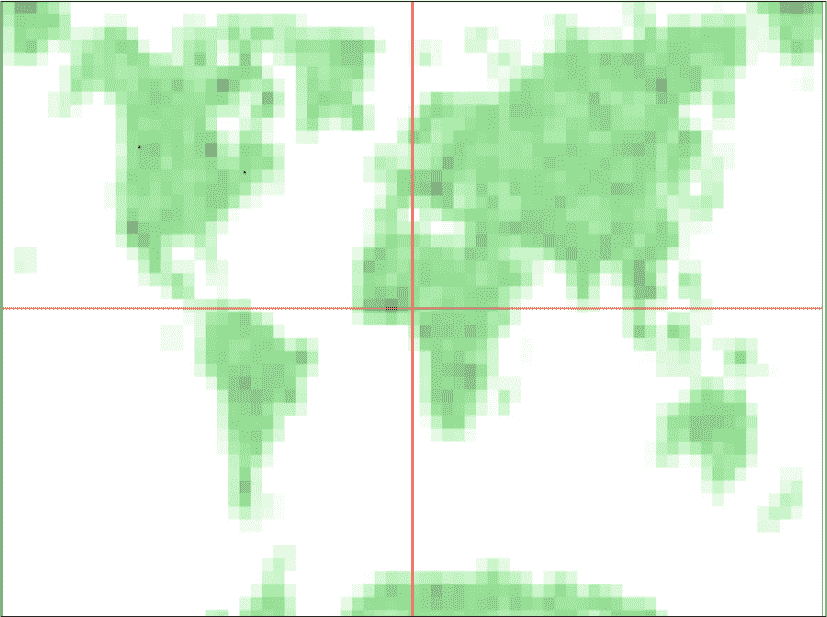

The red lines represent 0 degrees of latitude and longitude.

## Plotting on the map

The geometry point contains three pieces of data in a list called coordinates. They are the longitude, latitude, and also the depth in kilometers of where the earthquake originated:

```
{type: Point, coordinates: [-117.4505005, 34.2316666, 13.31]}
```

To map these coordinates to the map, we use the method toPoint in the FeaturePlotter class in the file featureplotter.dart, which performs the conversion as follows:

```
Point toPoint(double longitude, double latitude) {
  double x = 0.0;
  double y = 0.0;
  double hdeg = width.toDouble() / 360;
  double vdeg = height.toDouble() / 180;

  x = (width / 2) + (hdeg * longitude);
  y = (height / 2) - (vdeg * latitude);

  return new Point(x.toInt(), y.toInt());
}
```

The longitude and latitude is based on the spherical nature of the Earth, and the x axis is 360 degrees wide with 0 being the mid-point. The y axis is 180 degrees wide with 0 being the midpoint at the equator. In terms of the GeoJSON data, the x values are in the range of -180 to +180 and y is from -90 to 90.


> Dart, at the time of writing is at version 1.11 and you may be wondering if it will reach version 2 in the near future. Yes, it will! During the first Dart Developer Summit, version 2 of Dart was mentioned for the first time by Lars Bak. While it was hinted that there may be some language changes, it was strongly emphasized these would only be made with tools to handle updating existing code. In Bak's words, "this is not Python!" This quote is a reference for the somewhat disruptive move from Python 2 to Python 3. One key change that has already begun is the moving of some packages out of the SDK. This allows them to update on their own schedule. For example, dart:html has to respond more quickly than the SDK update cycle to web browser changes.

## Fetching the data

The data is fetched as an `HttpRequest` in the same manner as in the grid view project, and the fields we are interested in are put into the list `quakePoints` before being filtered into the `geoFeatures` list:

```dart
fetchFeatureList() async {
  geoFeatures.clear();

  String data = await HttpRequest.getString(jsonSrc);
  List items;
  List quakePoints = [];

  try {
    items = JSON.decode(data);
  } catch (exception, stacktrace) {
    print(exception);
    print(stacktrace);
  }

  if (items != null) {
    items.forEach((String post) {
      Map feature = JSON.decode(post);

      List quakedata = [
        feature['geometry']['coordinates'][0],
        feature['geometry']['coordinates'][1],
        feature['properties']['mag'],
        feature['properties']['place'],
        feature['properties']['type'],
        feature['geometry']['coordinates'][2]
      ];

      quakePoints.add(quakedata);
    });

    quakePoints.where((qp) => qp[4] == 'earthquake').forEach((qp) {
      geoFeatures.add(qp);
    });
  }
}
```

All the items returned are added to the quake points list, but we only want to add the `earthquake` ones to the `geoFeatures` list. The list may contain other types such as `quarry blast`.

Using a `where` clause, we can filter the list an item at a time. The list item is run through the function, and the list item at index number 4 is compared against the string `earthquake`.

This is a very convenient method for getting only the required data and best of all it is available on any iterable object. On top of this, there are a number of variants such as `firstWhere` and `lastWhere` that help to quickly get a reference to the data that matches a criterion.

## Updating the map indicators

Once a list of `geoFeatures` is available, it can be used to construct a list of `MapIndicator` objects that will appear on the map. The entire list is cleared out each time so that the number of indicators on the map does not build up too much over time. Let's take a look at the following screenshot:

```
updateData() async {
    await fetchFeatureList();
    mapIndicators.clear();
    geoFeatures.forEach((List feature) {
        Point pos = toPoint(feature[0], feature[1]);
        MapIndicator mi;
        mi = new MapIndicator(pos.x, pos.y, ctx, feature[2].toInt());
        mi.summary = "Magnitude ${feature[2]} - ${feature[3]}.";
        mapIndicators.add(mi);
    });
}
```

This function is marked `async` as there is an `await` being used for the `fetchFeatureList` method call. Once the features are available, the `mapIndicators` list is reset and a new one is constructed.

## Mouse over popups

To give the user more details about the feature on the map, a popup appears at the top of the screen when the pointer is moved over a map indicator. To get the mouse pointer coordinates, a handler can be added to handle the mouse move events on the canvas element:

```dart
MapDisplay(CanvasElement mapcanvas, this.width, this.height) {
  mapctx = mapcanvas.getContext("2d");
  mapcanvas.onMouseMove.listen(onMouseMove);
}
```

This is carried out in the MapDisplay constructor and the method handles the triggering of the implementation function. This function is a field in the class that is set by the page using the map display:

```dart
void mouseMove(MouseEvent e) {
  if (showPopup != null)
    showPopup(e.client.x - 50, e.client.y - 90);
}
```

The implementation of the showPopup function is in main.dart. It displays the initially hidden popup above the map and then populates it with the feature details:

```dart
void showPopup(int x, int y) {
  bool inHotspot = false;

  if (zoomed) {
    x = x ~/ 2;
    y = y ~/ 2;
  }

  featPlotter.hotspotInfo.forEach((Rectangle<int> key, String value) {
    if (key.containsPoint(new Point(x, y))) {
      inHotspot = true;
      querySelector('#popup').innerHtml = value;
    }
  });

  if (inHotspot)
    querySelector('#popup').style.visibility = "visible";
}
```

If the map display is zoomed in, then the coordinates must be updated; this is performed with the ~/ division operator, which returns an integer value. This is faster than the equivalent (x/2).toInt() and gives the required whole numbers for plotting:

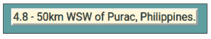

The Map containing the hotspotInfo is iterated over with a convenient forEach loop, giving both the dictionary key and the respective value. The current point of the mouse relative to the top-left corner of the canvas element is tested against each rectangle that defines the hotspot (the hotspot is the area on the map that will trigger the popup).

The hotspots are stored as a list of Rectangle<int> objects generated when the data list is being updated by the FeaturePlotter class. This class is from the dart:math package:

```
void updateHotspots() {
    hotspotInfo.clear();
    mapIndicators.forEach((MapIndicator mi) {
        Rectangle<int> rect = new Rectangle(mi.x - mi.maxWidth,
            mi.y - mi.maxWidth, mi.maxWidth * 2, mi.maxWidth * 2);

        hotspotInfo[rect] = mi.summary;
    });
}
```

The hotspot is defined as a square area around the map indicator when it is at its maximum width. The summary property gives the text to be displayed. The screenshot of the quake map is as follows:

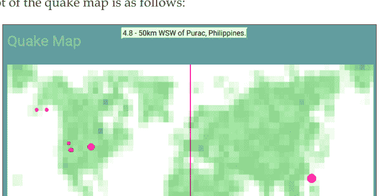


希望这能帮助你提高地理知识并了解更多关于 Dart 的信息！

在 Dartium 中调试时，使用 REST 或其他类似的 Web 服务，可以在浏览器开发者工具的控制台窗口中获得 XMLHttpRequests 的额外日志。

调出上下文菜单（右键单击），其中有一个名为 Log XMLHttpRequests 的选项，可在控制台输出窗口中显示网页发出的 HTTP 请求：

[-121.5371704, 36.8165016, 0.93]
129.91739911111114 177.278328
2.2222222222222223 3.3333333333333335
maxWidth 2
XHR finished loading: GET "http://127.0.0.1:8080/api/quake/v1/latest".

在调试项目时，这非常宝贵，可以节省在每个发出 HTTP 请求的代码部分添加日志的工作。

## 放大显示

canvas 元素具有一系列 2D 绘图功能，其中包括一个缩放功能，我们可以利用它来聚焦地图上最活跃的部分，即北美。在 main.dart 中，有一个名为 zoomed 的标志，默认为 false，可帮助应用程序跟踪当前显示状态。一个按钮绑定到缩放代码实现：

```dart
zoomMap(Event evt) async {
  if (zoomed == true) {
    zoomed = false;
    quakeMap.mapCtx.resetTransform();
    quakeMap.mapCtx.scale(1, 1);
  } else {
    zoomed = true;
    quakeMap.mapCtx.scale(2, 2);
  }
  quakeMap.drawMapGrid();
}
```

## 实时可视化

canvas 在缩放设置之间切换，其中对 `resetTransform` 方法的调用至关重要。如果没有它，缩放将无法恢复正常。整个地图视图必须立即重绘，以便用户获得响应式体验。让我们看一下以下屏幕截图：

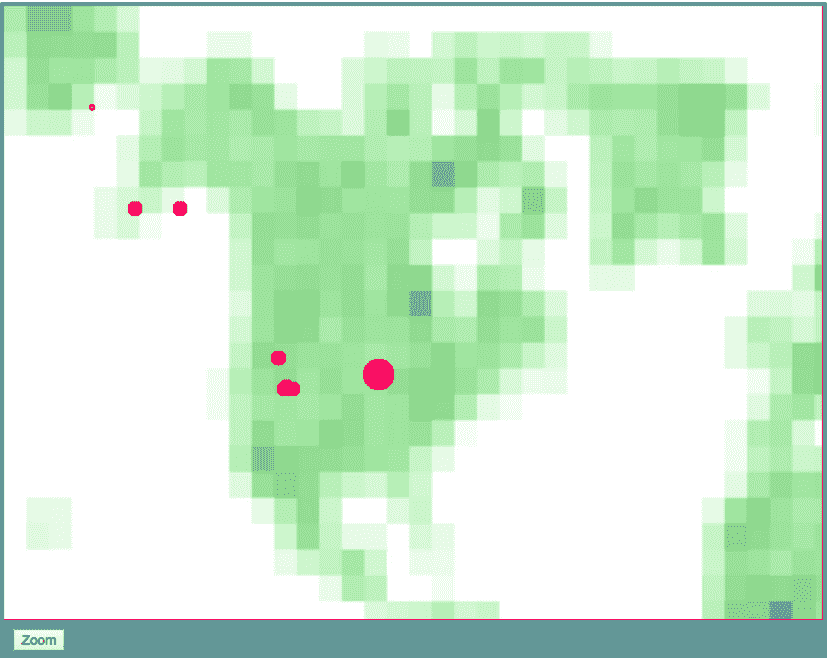

如果你观看此页面一段时间，你会发现加利福尼亚和阿拉斯加的特征在数据中占据很大比重。随着弹出代码处理缩放变化，这些特征仍然可用。第二次按下 **Zoom** 按钮会返回到完整的世界视图。

> print 函数不仅仅用于命令行应用程序，也可用于 Web 应用程序。输出显示在 **Developer Tools** 控制台日志窗口中，可通过右键单击页面调出上下文菜单，然后单击 `Inspect Element` 来显示。

## 实时可视化

一旦获得许可，最后一步是创建通知类的实例。不需要进一步的方法调用：

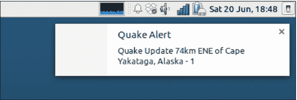

应用程序设置为经常通知——你可能希望提高通知地震的级别，否则你会发现自己需要 dismiss 很多通知。通知的视觉显示在不同平台和 Web 浏览器上可能有所不同。

## 绘制用户位置

大多数移动设备都配备了地理位置设备，或者可以通过 IP 等次要信息甚至回退到用户输入来确定位置。这通过 HTML5 地理位置 API 在 `http://www.w3.org/TR/geolocation-API/` 上向现代 Web 开发者公开以供应用程序使用。

与桌面通知一样，用户必须授予页面使用其位置的权限。另一个小障碍是，位置功能在 Dartium 上不起作用。要尝试此应用程序的功能，请使用 pub build 创建 JavaScript 版本并使用其他浏览器：

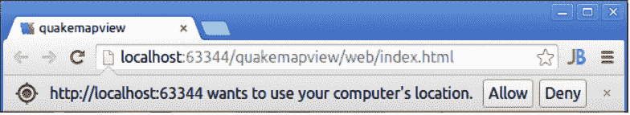

页面上的 **Locate** 按钮将尝试获取用户的位置并通过将其添加到 `featurePlotter` 类实例在页面上绘制它：

```dart
locateUser(Event evt) async {
  Geoposition geoPos = await window.navigator.geolocation.
  getCurrentPosition();
  MapIndicator mapIndicator;
  var pos =
  featPlotter.toPoint(geoPos.coords.longitude, geoPos.coords.
  latitude);
  mapIndicator = new MapIndicator(pos.x, pos.y, quakeMap.mapCtx, 4);
  mapIndicator.colorPrimary = "#0000ff";
  mapIndicator.colorSecondary = "#00ffff";
  featPlotter.userLocation.add(mapIndicator);
}
```

坐标的转换方式与地震相同，并且指示器更改为蓝色，以便在地图上突出显示，如以下屏幕截图所示：

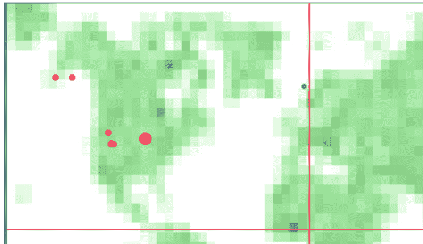

一旦应用程序编译为 JavaScript，在获得用户许可的情况下，地理位置数据即可使用，蓝色点指示用户的位置，在本例中是相对地震较少的英国。

在命令行和 Dartium 中运行的 Dart VM 并不是唯一的体现。Dart 团队正在开发两个在其他环境中运行的 Dart 实验版本，与主 Dart VM 有很大不同。目前，两者都运行在移动环境中，并专注于并发和高性能。

Fletch 在桌面操作系统上运行，但旨在在 Android 和 iOS 上执行且没有 JIT。Fletch 对高度异步的 Dart 采取了 somewhat 相反的方法，偏爱用户级线程，这些线程被阻塞但只保留少量资源。Fletch 为在不同平台上共享同一代码提供了有趣的前景；这将对移动开发者来说是巨大的生产力提升。

https://github.com/dart-lang/fletch

Sky 仅在撰写时为 Android，并雄心勃勃地旨在以 120 FPS 运行高度响应式的应用程序。为了实现这一点，它优先考虑用户界面，以便在进行其他处理时仍能保持 8 ms 的响应。目前，它可能可以在 Dart VM 可以运行的任何地方运行。

https://github.com/domokit/sky_engine/tree/master/sky/packages/sky

如果 Fletch 和 Sky 原型成功，它们很可能将是移动或服务器虚拟机，而不是嵌入在 Web 服务器中。

## 对功能列表进行排序

到目前为止，坐标列表中的第三个数据，即地震深度，还没有被使用。当用户按下 Sort 按钮时，此数据将以当前功能的排序列表形式呈现。让我们看一下以下代码片段：

```dart
void sortFeatures(Event evt) {
  featPlotter.sortFeatures();
  DivElement out = querySelector('#depthDetail');
  out.nodes.clear();
  featPlotter.geoFeatures.forEach((feature) {
    LIElement detail = new LIElement();
    detail.innerHtml = "${feature[5]}km - ${feature[3]}";
    out.nodes.add(detail);
  });
}
```

## 使用 dartdoc 记录 Dart 代码

文档是软件开发的关键部分，为了鼓励对包进行良好的文档记录，Dart 提供了工具 dartdoc (https://github.com/dart-lang/dartdoc/)，它基于特殊格式的代码注释创建静态 HTML 文档。Dart 之前的文档工具是 SDK 的一部分，而 dartdoc 是 Dart 团队开发的独立项目。

它可以通过命令行使用 pub 安装：

```bash
pub global activate dartdoc
```

我们将查看一个 Dart 包项目以探索 dartdoc 的功能。在 WebStorm 编辑器中打开项目 quakerecord，并查看文件 quakerecord.dart：

```dart
library quakerecord;
export 'src/quakerecord_base.dart';
```

该包导出单个文件 quakerecord_base.dart，在此文件中声明了类 Processor：

```dart
/// A lightweight object to process a raw earthquake feature.
///
/// * Must have valid JSON.
/// * Must be less than 128MB.
///
class Processor {

// Store for the JSON.
String _feature;

/// The state of processing
bool get processed => true;

/// The default constructor.
///     Processor processor;
///     processor = new Processor('{}');
Processor(String feature) {}

/// Returns a converted object based on the feature passed into
/// the constructor [Processor].
object convert() {
    // A normal comment.
```


### 实时可视化

项目中创建了一个文档子文件夹，其中包含一个名为 `api` 的文件夹，用于存放文档。在你喜欢的网络浏览器中打开该页面，查看 `Processor` 类的输出。让我们看看下面的截图：

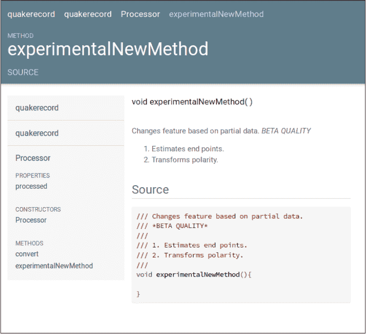

最后，你可能想知道来自 `recordhelper.dart` 的 `ProcessHelper` 类在生成的页面上位于何处。它不属于文档的一部分，因为它没有从包中导出，因此被视为包的消费者无需知道的私有实现细节。

### 总结

我们已经看到如何从原始数据生成可视化，并使用基于 HTML5 canvas 的客户端以动画形式渲染。此外，还可以通过弹出窗口和缩放功能使其具有交互性。

HTML5 可用于提供桌面通知，并利用用户的地理位置作为应用程序的一部分。SDK 工具 dartdocgen 为地震地图查看器项目生成了高质量、格式规范且标准化的文档。

我们已经探索了数据结构，并了解了便捷的排序和迭代工具。

从这个项目继续深入，数据仍然可以在日期范围内以更详细的方式呈现。我们将研究如何使用 Dart 构建业务和其他应用程序的常用功能——可打印报告。此外，我们将在 API 的基础上进行扩展，允许直接输入地理信息，而不是依赖外部数据源。

这些报告将主要采用 HTML 格式，不过我们也会探讨其他格式。**逗号分隔值（CSV）**格式至今仍是大多数系统上的用户需求，因为它灵活且易于在电子表格和其他应用程序中使用。让我们看看 API 客户端和报告如何融入整个系统：

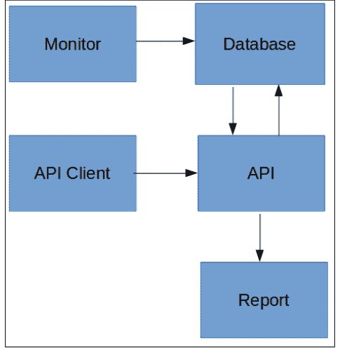

该项目完成后将包含许多部分，这是许多系统的典型特征。这并非要吓唬新程序员，但实际上这是一个相当简单的系统。如果你不信，可以想想一个现代社交网络网站，它接收来自各种设备的文本、照片以及 API 客户端提交的数据。再想象一下它需要多少子系统和管理报告！

## 推进 REST API

这个 API 将更加实用，并使我们能够添加数据，这样一来，当前网络数据源就不再是唯一的数据来源。

georestwebservice 项目（本章中的）中的示例代码是 API 的更新版本，其中的 georestwebservice.dart 文件新增了 recordFeature 方法：

```
@ApiMethod(path: 'record', method: 'POST')
QuakeResponse recordFeature(QuakeRequest request) {
  DaoQuakeAPI quakeAPI = new DaoQuakeAPI();
  quakeAPI.recordFeature(getFeatureAsJSON(request));

  QuakeResponse quakeResponse = new QuakeResponse();
  quakeResponse.result = "1";

  return quakeResponse;
}
```

此方法将使用标准的 HTTP POST 动词来接收来自客户端应用程序的输入。由于 rpc 包封装了整个方法，并负责构造和发送错误响应，因此此方法中无需进行错误处理。例如，如果在数据库中存储结果时出现问题，客户端将收到一条错误消息。

下面的 getFeatureAsJSON 函数位于 helpers.dart 文件中，它将传入的 QuakeRequest 对象转换为 JSON 字符串：

```
String getFeatureAsJSON(QuakeRequest request) {
  String feature = jsonData;
  feature = feature.replaceAll("MAG", request.magnitude.toString());
  feature = feature.replaceFirst("TIME", request.time.toString());
  feature = feature.replaceFirst("LAT", request.latitude.toString());
  feature = feature.replaceFirst("LONG", request.longitude.toString());
  return feature;
}
```

jsonData 字符串是 GeoJSON feature 的模板。String 类提供了许多用于字符串匹配的有用方法，这些方法被用来生成函数返回的最终字符串。replaceAll 方法用于替换字符串中的所有匹配项；在本例中，用于替换以值形式出现并出现在文本描述中的 magnitude。replaceFirst 方法用于替换字符串中第一次出现的匹配项，在该函数中用于替换那些只在字符串中出现一次的值。

下面 API 方法的参数是一个简单的类，它声明在同一个文件中，包含四个字段：

```
class QuakeRequest {

    @ApiProperty(required: true)
    int time;

    @ApiProperty(required: true)
    double magnitude;

    @ApiProperty(required: true)
    double longitude;

    @ApiProperty(required: true)
    double latitude;
}
```

这些字段带有注解，这使得 rpc 包能够通过 REST 接口处理数据的编组（marshaling）。

### 向 API 传递参数

向 REST API 提供输入的一种方式是通过调用 URL，下面这个 URL 将用于从数据库获取指定数量的条目：

```
http://127.0.0.1:8080/api/quake/v1/recent/100
```

该实现涉及用花括号语法扩展路径模式（这些花括号对应函数中的 String 参数）：

```
@ApiMethod(path: 'recent/{count}')
Future<List<String>> recent(String count) async {
  DaoQuakeAPI quakeAPI = new DaoQuakeAPI();
  return await quakeAPI.fetchRecent(int.parse(count));
}
```

int.parse 方法用于将 count 字符串转换为数据库查询参数。

### 向 API 发布数据

在本章的 georestwebservice 项目中，源代码是 API 的更新版本，其中 daoapi.dart 文件新增了 recordFeature 方法，如下所示：

```
Future<List<String>> recordFeature(String json) async {
  var dbConn;
  DateTime time = new DateTime.now();
  String featureID = time.millisecondsSinceEpoch.toString();
  List<String> result = new List<String>();

  try {
    dbConn = await connect(uri);

    await dbConn.execute(
      'insert into dm_quakefeatures (qufeat_id, geojson) values (@qufeat_id, @geojson)',
      {'qufeat_id': featureID, 'geojson': json});
  } catch (exception, stacktrace) {
    print(exception);
    print(stacktrace);
  } finally {
    dbConn.close();
  }
  result.add(featureID);
  return result;
}
```

此方法将为传入的 feature 详细信息创建一个 featureID 字符串，然后将其与来自客户端的数据一起插入到 dm_quakefeatures 表中。生成的 featureID 字符串随后返回给调用方应用程序，以备将来引用。

### 连接 API 客户端

客户端将是一个命令行应用程序，用于通过新的 REST API 方法向数据库添加新的 feature。

这个项目是一个命令行应用程序，使用 `dart:io` 包处理 HTTP 请求，其功能与 `dart:html` 类似，如下列代码所示：

```
main() async {
  print("API client");

  HttpClient client = new HttpClient();
  HttpClientRequest request = await client.postUrl(Uri.parse(apiUrl));
  request.headers.contentType = ContentType.JSON;
  await request.write(JSON.encode(getFeature()));

  HttpClientResponse response = await request.close();
  print("${response.toString()}");

  response.transform(UTF8.decoder).listen((contents) {
    request.close();
    print(contents);
    print("API client - done");
    exit(0);
  });
}
```

该应用程序将向 API 提交一个包含单个 feature 的 JSON 字符串，等待响应，显示响应，然后退出。如果需要多个 feature，只需重新运行该程序即可。

### 多样化数据

客户端在运行时将提供一个生成的 feature 提交给 API。该 feature 不是使用固定数据，而是随机生成的。要在 Dart 中生成随机数，我们可以使用 dart:math 中的 Random 类，如下所示：

```
Map getFeature() {
  var rng = new Random();
  var now = new DateTime.now();
  Map feature = new Map();
  feature['time'] = now.millisecondsSinceEpoch;
  feature['magnitude'] = rng.nextInt(8) + 1;
  feature['latitude'] = rng.nextDouble() * 90;
  feature['longitude'] = rng.nextDouble() * 90;
  return feature;
}
```

Random 类提供了生成整数和 double 值的方法，其中前一种方法可以设置上限。nextDouble 方法返回一个介于 0 和 1 之间的值，因此只需将该值乘以期望的最大值即可。time 字段将设置为当前时间。


> dart:math 包包含了大量的函数，如果你浏览文档，你会发现大多数类型不是 integer 或 double，而是 num。在 Dart 中，integer 和 double 是 num 对象的子类型，而 num 对象实现了基本运算符（+、*、/ 等）。
> 
> Dart 规范包含任意精度的整数，这导致在处理非常大的数字时，JavaScript 与编译为 JavaScript 的 Dart 之间存在行为差异。这适用于 -2^53 到 2^53 范围之外的数字，因此对于非常高级和特殊的应用程序来说，这可能是我们唯一需要担心的点！


## 返回地图

要查看生成的数据，可以使用上一章中的地震地图视图。让我们在下面的屏幕截图中查看生成数据的可视化表示：

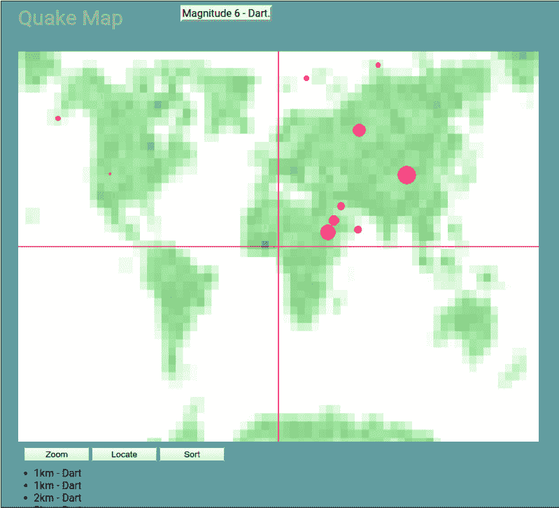

一旦命令行 API 客户端运行了多次，地图很快就会被填充。尝试调整生成数据的输入以覆盖地图的更多区域，因为当前数字偏向于右上角。

## 数据报告

有许多现有的系统可用于创建报告，例如安装基数很大的 Microsoft SQL Server Reporting Services (SSRS)。由于 Dart 对 XML 等最普遍格式的支持，以及能够与工业标准数据库配合使用，因此使用 Dart 构建的解决方案当然可以集成。

我们在此考虑的报告功能是一个纯 Dart 实现。对于许多应用程序来说，报告——即使是轻量级报告功能和导出——可以大大提高其有用性。这里的额外优势是部署的简易性，即使在企业环境中也是如此。

## ReportSite 项目

用户将通过一个小型网站访问报告，该网站允许他们选择每种报告类型。该网站在 ReportSite 项目中实现，`main.dart` 文件设置了初始页面，其中包含按钮的事件处理程序，如下图所示：

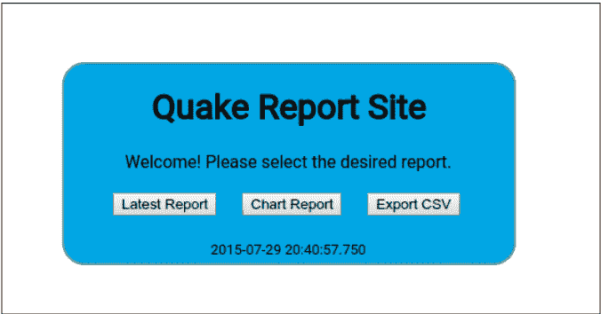

报告的数据来自 REST API 方法，因此如果您希望查看报告，请确保其正在运行。它们以 HTML 形式呈现并显示在同一网页上。以下摘自 `report_latest.dart` 文件，展示了其实现方式：

```dart
querySelector('body').setInnerHtml(rep.output.toString(),
  treeSanitizer: new ReportSanitizer());
```

这是一个简单的函数调用，参数为页面的 HTML 字符串，那么为什么需要第二个参数呢？这是一个安全措施，以确保用户提供的内容在显示时渲染不包含任何不需要的 HTML 字符串或脚本。请考虑以下代码片段：

```dart
class ReportSanitizer implements NodeTreeSanitizer {
  void sanitizeTree(Node node) {}
}
```

`ReportSanitizer` 类是一个 **无操作 (NOP)** 实现，因为 HTML 已知来自受信任的来源。

## 报告类

报告由列表中的一系列对象组成，页面元素应基于类似的接口，以便可以在不更改显示或导出功能的情况下将新页面元素添加到包中。

页面元素在 `report_elements.dart` 文件中实现，该文件是 Reports 包项目的一部分。

核心类将称为 `Element`，由于它将被用作其他类的接口，因此将声明如下：

```dart
abstract class Element {
  void setContent(var content);
  String toHtml();
}
```

该类声明为抽象类，并未为方法提供实现。

为了演示这一点，我们将考虑 `Title` 页面元素类，它实现了该元素（方法具有 `@override` 注解，该注解向代码分析工具和其他开发人员提供反馈，表明该方法是基类的实现）如下：

```dart
class Title implements Element {

  String content;

  Title(this.content) {}

  @override
  void setContent(var content) {
    String input = content.toString();
    content = input;
  }
}
```

```dart
@override
String toHtml() {
  return "<h1>$content</h1>";
}

}
```

如果方法未提供实现，则 Dart 分析器会警告您“Missing concrete implementation”。

其他核心页面元素遵循相同的模式。要创建报告，只需几行代码，如下所示：

```dart
var rep = new Report('Sample');
rep..addSection(new Title("Sample Report"))
    ..addSection(new Paragraph("This is a paragraph"))
    ..addSection(new Pagebreak())
    ..addSection(new Paragraph("This is a paragraph too"));
```

`Report` 对象可以在 Reports 项目的 `reports_base.dart` 文件中找到，其最重要的 `generate` 方法被生成。该方法遍历所有页面元素对象以构建 HTML 报告，该报告存储在 `output` 字段中，如下所示：

```dart
bool generate() {
  output = new StringBuffer();
  allContent.forEach((content){
    output.write(content.toHtml());
  });
  generatedTimestamp = new DateTime.now();
  return true;
}
```

`StringBuffer` 对象用于构建 HTML 报告。此类比追加多个字符串更高效。

字符串在 Dart 中内部以不可变格式存储（与大多数编程语言一样），并且更新字符串实际上意味着构建一个全新的字符串对象。`StringBuffer` 对象仅在调用 `toString` 方法时才创建 String 对象。

## 创建可打印报告

数据从 REST API 检索，并通过使用 HTML `table` 元素以表格形式显示。在 `performLatest` 方法中，使用以下 URL 从 Web 服务检索 JSON：

```text
http://127.0.0.1:8080/api/quake/v1/recent/100
```

这会返回所请求长度的 JSON 列表（如果数据库记录不足，则更少），如下面的代码片段所示：

```text
[ "{\"properties\":{\"mag\":1.04,\"place\":\"3km SSW of San Bernardino, California\",\"time\":1440707640360,\"updated\":1440707771997,\"tz\":-420,\"url\":\"http://earthquake.usgs.gov/earthquakes/eventpage/ci37234439\",\"detail\":\"http://earthquake.usgs.gov/earthquakes/feed/v1.0/detail/ci37234439.geojson\",\"felt\":null,\"cdi\":null,\"mmi\":null,\"alert\":null,\"status\":\"automatic\",\"tsunami\":0,\"sig\":17,\"net\":\"ci\",\"code\":\"37234439\",\"ids\":\",ci37234439\",\"sources\":\"ci\",\"types\":\"general-link,geoserve,nearby-cities,origin,phase-data,scitech-link\",\"nst\":27,\"dmin\":0.09553,\"rms\":0.11,\"gap\":62,\"magType\":\"ml\",\"type\":\"earthquake\",\"title\":\"M 1.0 - 3km SSW of San Bernardino,California\"},\"geometry\":{\"type\":\"Point\",\"coordinates\":[-117.30233,34.1023331,10.84]}}", ...
```

检索到数据后，会创建报告的元素对象，并使用以下代码通过段落插入报告详细信息的 HTML：

```dart
... String json = await HttpRequest.getString(jsonSrc); List<String> items = JSON.decode(json); DateTime dt = new DateTime.now(); Report rep = new Report('Latest'); rep
  ..addSection(new Title("Latest Quake Data Report"))
  ..addSection(new Paragraph(' <div style="align:center"></div>'))
  ..addSection(new Paragraph("Report Generated At : ${dt}"))
  ..addSection(new Pagebreak());
var table = buildFeatureTable(items);
rep
```

```dart
.addSection(new Paragraph('<table id="reporttable">' + table + '
'</table>'))
    .addSection(new Pagebreak())
    .addSection(new Notes("Looks like a busy day!"))
    .generate();
    ...
```

`buildFeatureTable` 遍历传入的 JSON 数据以创建表格的行，如下图所示：

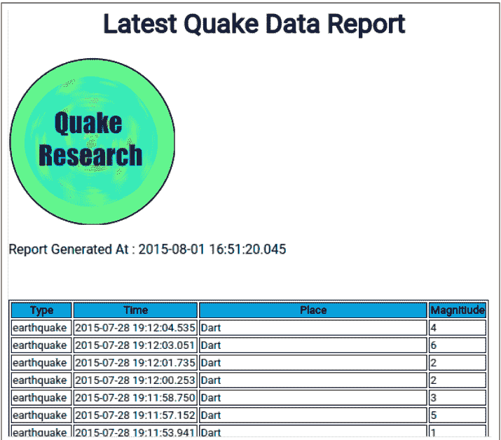

报告以连续的方式在屏幕上显示。切换到打印预览将显示使用级联样式表 (CSS) 创建的各部分之间的分页符。`div` 元素通过 `Pagebreak` 页面元素以 `page-break-after: always` 样式添加到报告中。

## 数据图表

良好的可视化可以对分析数据的人产生很大影响。为此，我们可以使用 `modern_charts` 包，它提供了一系列图表选项。图表报告在 ReportSite 项目的 `report_chart.dart` 文件中实现。

此图表将基于地震数据库中最新的 20 条记录，使用以下 URL：

```text
http://127.0.0.1:8080/api/quake/v1/recent/20
```

创建图表的第一步是从传入的 JSON 字符串构建数据集，如下所示：

```dart
List dataset = [['Place', 'Magnitude']];

items.forEach((String featureJSON) {
  Map feature = JSON.decode(featureJSON);
  String place = feature['properties']['place'];
  place = place.substring(place.lastIndexOf(",") + 1);

  if (place.length > 5) place = place.substring(0, 5) + ".";
  var mag = feature['properties']['mag'];
  dataset.add([place, mag]);
});
DataTable table = new DataTable(dataset);
```

数据集中的第一项包含要绘制的系列的数量和名称。地名经过处理，以便长而具体的地名可以适合图表的轴上。然后将其与震级一起添加到列表中，如下所示：

```dart
Map options = {
  'colors': ['#3333cb'],
  'series': {'labels': {'enabled': true}}
};
```

`options` 对象包含图表绘制的各种详细信息，如下所示：

```dart
DivElement container = new DivElement();
container
  ..id = "chartContainer"
  ..style.width = "90%"
  ..style.height = "90%";
```


```dart
var Title = new HeadingElement.h1();
Title.text = "Quake Chart";
document.body.nodes
  ..clear()
  ..add(Title)
  ..add(container);

LineChart chart = new LineChart(container);
chart.draw(table, options);
```

一旦数据集准备就绪，页面的 HTML 元素就可以组装起来，并且创建的 `LineChart` 对象会获得一个引用，以便将其添加到页面上；在这种情况下，是一个 `div` 元素容器（有关完整细节，请参阅 `modern_chart` 包文档）。

上一段代码的输出显示在下面的图表中：

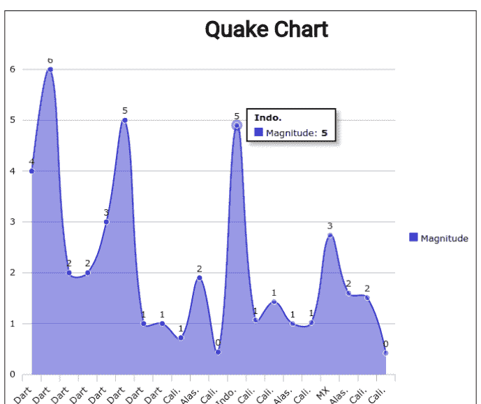

你可能会觉得在 Dartium 中工作是一种奇怪的体验。它是一个不错的浏览器，但你可能更喜欢你的日常网页浏览器，例如 Internet Explorer、Firefox 或 Chrome，以及你精心管理的设置和扩展集合。在其他浏览器上测试之前使用 Dart 到 JavaScript（dart2js）会中断编辑和刷新循环。理想情况下，Dart 应该能在任何网页浏览器中运行。

> Dartium 仍将存在很长时间；然而，Dart 团队正在进行一个名为 Dart 开发编译器的项目。该新编译器有两个目标，首先是允许在所有浏览器上实现流畅的编辑和刷新开发体验。使用了模块化（增量）编译来帮助实现快速的编辑/刷新周期。有关编译器项目的更多信息，请访问 https://github.com/dart-lang/dev_compiler。
>
> 编译器的第二个目标是创建一种人类可读的 JavaScript 格式，以便输出可以轻松调试。它最初支持 Dart 语言的一个子集，该子集是静态类型检查的。类型系统对 dart2js 采用了不同的方法；它允许 Dart 语言到 JavaScript 的更直接和可读的映射。如果你正在 Firefox 中开发，那么你将希望能够在其中调试你的 Dart 代码，这样你就不必逐步执行混淆后的代码。

## 导出为 CSV

CSV 是一种格式，由于其易于导入到电子表格中而一直流行下去。本报告的实现位于 `report_csv.dart` 文件中，它使用以下 URL 获取最近的 50 条条目：

```
http://127.0.0.1:8080/api/quake/v1/recent/50
```

> CSV 是一种文本格式，并且字段中已清除所有逗号字符，以免产生额外的分隔符。

让我们考虑以下代码：

```dart
performExport(MouseEvent event) async {
  String json = await HttpRequest.getString(jsonSrc);
  List<String> items = JSON.decode(json);
  String csvexport = "Type, Time, Place, Magnitude\r\n";

  items.forEach((String featureJSON) {
    Map feature = JSON.decode(featureJSON);
    String type = feature['properties']['type'];
```
