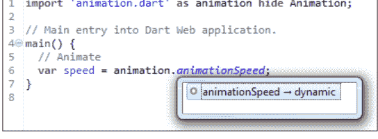
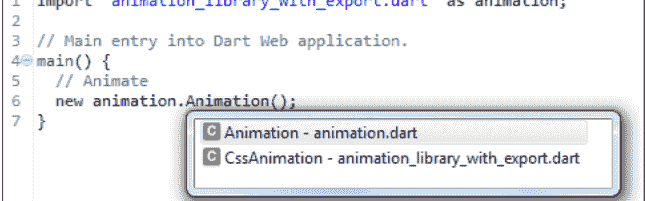

## 1. 超越 Dart 的基础

Dart 是一种非常年轻的计算机语言，具有许多有趣的功能。Dart 是一种基于类的面向对象语言，具有可选类型，可以帮助你编写非常强大的程序。在本章中，我们将涵盖以下主题：

- 模块化和命名空间
- 不同作用域中的函数和闭包
- 类和混入
- 方法和运算符

### 模块化和命名空间

复杂的事物是我们世界的基石。要理解我们周围事物的复杂性，有必要理解构成它们的各个部分。复杂事物的演变归因于功能和行为上的模块化。功能模块化是具有明确边界和功能的较小独立组件的组合。行为模块化主要涉及可以独立演变的特性和属性。

*模块化* 并非新鲜事物。早些时候，产品制造商想出了提高产品产量和质量的方法，同时仍能降低成本压力。他们通过模块化实现了这一点。模块化设计可以在汽车行业、建筑以及许多其他行业中看到。亨利·福特在其装配线上引入了模块化的概念，使用标准化和可互换的零件。结果，他减少了生产周期和成本，实现了汽车的大规模生产。许多公司至今仍在使用这些概念。

下面是一个隐式命名的库，其中 dart:html 的所有资源都以前缀 dom 在我们的库范围内可用：

```dart
/**
 * Implicitly named library.
 * The dart:core library is automatically imported.
 */
import 'dart:html' as dom;
```

```dart
/**
 * Get [Element] by [id].
 */
dom.Element getById(String id) => dom.querySelector('#$id');
```

库命名空间仅在 Dart 环境中有意义。

> 编译为 JavaScript 的代码会丢失所有库信息。

Dart 通过隐私实现封装。库的每个成员或标识符都有两个访问级别之一：私有或公共。私有成员仅在声明它们的库内部可见。相反，具有公共访问权限的成员在任何地方都可见。它们之间的区别在于下划线前缀（`_`），如下面的代码所示：

```dart
// Animation library.
library animation;

// Class publicly available everywhere.
class Animation {
  // ...
}

// Class visible only inside library.
class _AnimationLibrary {
  // ...
}

// Variable publicly available everywhere.
var animationSpeed;
```

前面的代码显示了一个动画库，其中包含两个类和一个变量。`Animation` 类和 `animationSpeed` 变量是公共的，因此在库外部可见。`_AnimationLibrary` 类是私有的，只能在库中使用。

现在我们隐藏了 Animation 类，但命名空间 animation 中的所有其他公共成员仍然可用，如下图所示：



正如你所见，导入库的成员变得不可见。这是因为库从公共命名空间导出成员。如果需要，可以使用 `export` 语句重新导出导入的库。此 `export` 语句可以像 `import` 语句一样使用 `show` 和 `hide` 来管理，如下面的代码所示：

```dart
library animation.css;

import 'animation.dart' as animation;
export 'animation.dart' show Animation;

class CssAnimation extends animation.Animation {
  // ...
}
```

前面的代码显示了 `animation.css` 库。我们将 `Animation` 类作为库命名空间的一部分导出。让我们看看如何使用它们：



导出的 `Animation` 和原始的 `CssAnimation` 类都可用于我们的主代码中。如果没有 `export`，`Animation` 类在主代码中将无法访问。

### 不同作用域中的函数和闭包

我喜欢 Dart，因为一切都是对象。函数是第一类公民，因为它们支持通常可用于其他类型的所有操作。这意味着每个函数都具有以下属性：

- 它们可以由变量命名
- 它们可以作为参数传递给函数
- 它们可以作为函数的返回值返回
- 它们可以存储在数据结构中
- 它们可以在任何作用域中创建

让我们看看在何处以及如何像往常一样或作为第一类公民使用函数。

#### 使用变量命名函数

使用变量命名函数意味着我们可以创建一个对函数的引用并将其分配给变量，如下面的代码所示：

```dart
library function_var;

// Returns sum of [a] and [b]
add(a, b) {
  return a + b;
}

// Operation
var operation;

void main() {
  // Assign reference to function [add]
  operation = add;
  // Execute operation
  var result = operation(2, 1);
  print("Result is ${result}");
}
```

以下是前述代码的结果：

```
Result is 3
```

我们有 `add` 函数和 `operation` 变量。我们将 `add` 函数的引用分配给一个变量，并在稍后将其作为函数调用。


## 将函数作为参数传递给另一个函数

当我们需要实现策略设计模式，使程序代码能够在运行时被选择和执行时，将函数作为参数传递给其他函数会非常有用，如下面的代码所示：

```
library function_param;

// Returns sum of [a] and [b]
add(a, b) {
  return a + b;
}

// Operation executor
executor(operation, x, y) {
  return operation(x, y);
}

void main() {
  // Execute operation
  var result = executor(add, 2, 1);
  print("Result is ${result}");
}
```

上述代码的执行结果如下：

```
Result is 3
```

上述示例中的全局 executor 函数可以调用任何接受两个参数的函数。你可以看到策略设计模式以匿名函数的形式实现，这些匿名函数作为集合中方法的参数传递。

## 将一个函数作为另一个函数的结果返回

有时，一个函数可以作为另一个函数的结果返回，如下面的代码所示：

```
library function_return;

// Returns sum of [a] and [b]
```

上述代码的执行结果如下：

```
Result is 3
```

在我们的示例中，有两个函数和一个数组 **operations**，该数组存储了对它们的引用。

## 闭包

函数可以在全局作用域中创建，也可以在另一个函数的作用域中创建。如果一个函数可以被引用，并能访问其词法作用域中的变量，那么它被称为闭包，如下面的代码所示：

```
library function_closure;

// Function returns closure function.
calculate(base) {
  // Counter store
  var count = 1;
  // Inner function - closure
  return () => print("Value is ${base + count++}");
}

void main() {
  // The outer function returns inner
  var f = calculate(2);
  // Now we call closure
  f();
  f();
}
```

上述代码的执行结果如下：

```
Value is 3
Value is 4
```

我们有一个 `calculate` 函数，它包含 `count` 变量并返回一个内部函数。内部函数可以访问 `count` 变量，因为两者定义在相同的作用域中。`count` 变量只存在于 `calculate` 的作用域内，正常情况下会在函数退出时消失。但这里情况并非如此，因为 `calculate` 返回的内部函数持有对 `count` 的引用。该变量已被“闭合”，意味着它处于一个闭包中。

最后，我们了解了 **一等函数** 是什么、可以在哪里使用它们，以及使用闭包的重要性。让我们继续学习类和混入。

## 类和混入

我们都知道，尝试重新发明轮子是浪费时间的。每次想要造一辆汽车时都这样做，更是浪费。那么，如何更高效地编写程序代码并使其可复用，以帮助我们开发更强大的应用程序呢？在大多数情况下，我们在回答这个问题时会求助于面向对象编程（OOP）范式。OOP 代表了对象的概念，这些对象包含数据字段以及作用于这些数据的方法。程序被设计为使用对象作为类的实例，这些实例相互交互以组织功能。

### 类型

Dart 语言是动态类型的，因此我们可以在代码中编写带或不带类型注解的程序。最好使用类型注解，原因如下：

- 类型注解可以早期发现错误。静态分析器可以在你犯错的地方提醒我们潜在的问题。
- Dart 会自动将类型注解转换为运行时断言检查。在检查模式下，动态类型断言处于启用状态，当类型不匹配时可以捕获一些错误。
- 类型注解可以提高编译为 JavaScript 的代码的性能。
- 它们可以改进文档，使代码更容易阅读。
- 它们在特殊工具和 IDE（如名称补全）中非常有用。

我们的代码中没有包含类型注解，这一事实并不会阻止程序运行。没有类型注解的变量具有动态类型，并使用 var 或 dynamic 标记。以下是适合使用类型注解的一些建议：

- 你应该为公有和私有变量添加类型
- 你可以为方法和函数的参数添加类型
- 你应该避免在方法或函数的主体中添加类型

如果我们定义一辆赛车，那么我们必须实现 Car 类的所有特征和行为，但要对发动机、悬架、刹车等进行大幅修改：

```
import 'car.dart';
import 'passenger_car.dart';

void main() {
  // Create an instance of passenger car of white color,
  // carrying 750 kg and max passengers 5.
  Car car = new PassengerCar('white', 750.0, 5);
  // Move it
  car.move(100.0);
}
```

这里，我们只是创建了一个 PassengerCar 实例，并将其赋值给 car 变量，而无需定义任何特殊的接口。

### 混入

Dart 具有基于混入的继承，因此类主体可以在多个类层次结构中复用，如下面的代码所示：

```
library trailer;

// The trailer
class Trailer {
  // Access to car's [carrying] info
  double carrying = 0.0;

  // Trailer can carry [weight]
  void carry(double weight) {
    // Car's carrying increases on extra weight.
    carrying += weight;
  }
}
```

Trailer 类独立于 Car 类，但可以增加汽车的载重能力。我们在下面的代码中使用 with 关键字后跟 Trailer 类，将混入添加到 PassengerCar 类：

```
library passenger_car;

import 'car.dart';
import 'trailer.dart';

// Passenger car with trailer.
class PassengerCar extends Car with Trailer {
  // Max number of passengers.
  int maxPassengers = 4;

  /**
   * Create [PassengerCar] with [color], [carrying] and [maxPassengers].
   * We can use [Trailer] to carry [extraWeight].
   */
  PassengerCar(String color, double carrying, this.maxPassengers,
      {double extraWeight: 0.0}) : super(color, carrying) {
    // We can carry extra weight with [Trailer]
    carry(extraWeight);
  }
}
```

我们将 `Trailer` 作为混入添加到 `PassengerCar`，结果 `PassengerCar` 现在可以承载更多重量。请注意，我们没有修改 `PassengerCar` 本身，只是扩展了它的功能。同时，`Trailer` 可以与 `Truck` 或 `Bus` 类结合使用。混入看起来像一个接口，并通过类声明隐式定义，但有以下限制：

- 它没有声明的构造函数
- 混入的超类只能是 Object
- 它们不包含对 `super` 的调用

### 设计良好的类

设计良好的类与设计不良的类有什么区别？
以下是设计良好的类的特征：

- 它隐藏了所有实现细节
- 它通过使用抽象类将接口与实现分离
- 它只通过接口与其他类进行通信

上述所有特性都导致了封装。封装在 OOP 中扮演着重要角色。封装具有以下好处：

- 类可以独立地开发、测试、修改和使用
- 程序可以快速开发，因为类可以并行开发
- 类的优化可以在不影响其他类的情况下进行
- 类可以被更频繁地复用，因为它们没有紧密耦合
- 每个类的成功开发都会带来应用程序的成功

我们前面所有的示例都包含公有成员。这样对吗？那么，我们必须遵循什么规则来创建设计良好的类呢？

### 公有还是私有

让我们遵循以下简单原则来创建设计良好的类：

- 为类定义一个最小的公有 API。类的私有成员始终可以在库作用域内访问，所以不要犹豫去使用它们。
- 为了便于测试而将成员变量的私有级别改为公有级别，这是不可接受的。
- 非 final 的实例变量绝不应该是公有的；否则，我们就放弃了限制变量可存储值以及强制与该变量相关的不变式的能力。
- 当 final 实例变量或静态常量指向可变对象时，绝不应是公有的；否则，当 final 变量被修改时，我们限制了采取任何行动的能力。
- 不应有公有的、静态 final 的集合实例；否则，getter 方法会返回它，而我们就限制了修改集合内容的能力。

最后两条原则可以在下面的示例中看到。假设我们有一个 Car 类，其中定义了一个 final 静态的零件列表。我们可以用 Pedal 和 Wheel 来初始化它们，如下面的代码所示：

```
class Car {
  // Be careful with that code !!!
  static final List PARTS = ['Pedal', 'Wheel'];
}
void main() {
  print('${Car.PARTS}'); // Print: [Pedal, Wheel]
```


```dart
// Change part
Car.PARTS.remove('Wheel');
print('${Car.PARTS}'); // Print: [Pedal]
}
```

但是，这里有一个问题。虽然我们不能改变实际的集合变量，因为它被标记为 `final`，但我们仍然可以改变它的内容。为了防止任何人改变集合的内容，我们将其从 `final` 改为 `constant`（常量），如下代码所示：

```dart
class Car {
  // This code is safe
  static const List PARTS = const ['Pedal', 'Wheel'];
}

void main() {
  print('${Car.PARTS}'); // Print: [Pedal, Wheel]

  // Change part
  Car.PARTS.remove('Wheel');
  print('${Car.PARTS}');
}
```

如果我们尝试改变 `PARTS` 的内容，以下代码将产生如下异常：

```text
Unhandled exception:
Unsupported operation: Cannot modify an immutable array
#0 List.remove (dart:core-patch/array.dart:327)
...
```

## 变量与访问器方法

在上一节中，我们提到非 `final` 的实例变量绝不应是公开的，但这总是正确的吗？这里有一种情况：我们包中的一个类有一个公开变量。在我们的 `Car` 类中，有一个 `color` 字段，并且特意将其保持为公开状态，如下代码所示：

```dart
// Is that class correct?
class Car {
  // Color of the car.
  String color;
}
```

如果 `Car` 类只能在库内部访问，那么它拥有公开字段也没有问题，因为它们不会破坏库的封装概念。

## 继承与组合

我们定义了创建设计良好的类所需遵循的主要规则。一切都很完美，我们没有违反任何规则。现在，是时候在我们的项目中使用一个设计良好的类了。首先，我们将创建一个继承当前类的新类。然而，这可能是一个问题，因为继承会破坏封装。

在以下情况下，最好使用继承：

- 在库内部，因为我们控制着类的实现和类之间的关系
- 如果该类是专门设计并文档化以供扩展的

最好不要继承普通类，因为这样很危险。我们来讨论一下原因。例如，有人开发了下面的 `Engine` 类来启动和停止通用引擎：

```dart
// General purpose Engine
class Engine {
  // Start engine
  void start() {
    // ...
  }

  // Stop engine
  void stop() {
    // ...
  }
}
```

我们从 `Engine` 类继承了 `DieselEngine` 类，并定义了何时启动引擎，我们需要在 `init` 方法中对其进行初始化，如下代码所示：

```dart
import 'engine.dart';

// Diesel Engine
class DieselEngine extends Engine {
  DieselEngine();

  // Initialize engine before start
  void init() {
    // ...
  }

  void start() {
    // Engine must be initialized before use
```

```dart
// ...
}

void start() {
  // Engine must be initialized before use
  init();
  // Start engine
  _engine.start();
}

void stop() {
  _engine.stop();
}
}
```

我们在 `DieselEngine` 类中创建了私有变量 `_engine`，它引用了 `Engine` 类的一个实例。`Engine` 现在成为 `DieselEngine` 的一个组件。这被称为组合（composition）。`DieselEngine` 中的每个方法都调用 `Engine` 实例中的相应方法。这种技术称为转发（forwarding），因为我们将方法调用转发给了 `Engine` 类的实例。因此，我们的解决方案是安全且稳固的。如果向 `Engine` 添加一个新方法，也不会破坏我们的实现。

这种方法的缺点与性能问题和内存使用增加有关。

## 方法与运算符

既然我们已经介绍了设计良好的类，我们需要讨论方法。

### 在使用参数之前检查其值

类构造函数、方法、修改器（setters）和运算符对必须传入其参数的值施加了一些限制。如果向方法传递了无效的参数值，会发生什么？一种可能是方法将因令人困惑的异常而失败，或者更糟，它会成功但产生错误的结果。无论如何，在使用方法参数之前不检查它们都是危险的。这里的规则是尽快检查参数值是否有效。最好的地方是方法开头。

Dart 虚拟机可以在对开发者友好的检查模式和对速度痴迷的生产模式下工作。我们在开发应用程序时通常使用检查模式。这种模式的一个好处是动态断言。我们应该使用 `assert` 语句来检查方法的参数在使用前是否有效。如果动态断言的布尔结果为 `true`，Dart VM 会继续执行程序，否则停止执行。如下代码所示：

```dart
/**
 * Return sum of [a] and [b].
 * It throws [AssertionError] if any of [a] or [b] equals null
 */
sum(int a, int b) {
  assert(a != null);
  assert(b != null);
  return a + b;
}
```

> 当程序在生产模式下执行或编译为 JavaScript 代码时，`assert` 语句不起作用。

在存储参数以供后续使用之前，我们必须检查参数的有效性。忽略这一点可能会导致以后出现问题，因为与参数相关的错误可能在一个完全不同的地方抛出，从而更难追踪其来源。这具有严重影响，尤其是在构造函数中。

有时，在方法中验证类的内部状态并生成特殊错误非常重要，如下代码所示。典型的错误有 `StateError`、`RangeError` 和 `ArgumentError`。

```dart
class Car {
  double petrol;

  /**
   * Start engine.
   * That method throws [StateError] if petrol is null
   * or less than 5 liters.
   */
  void startEngine() {
    if (petrol == null || petrol <= 5.0) {
      throw new StateError('Not enough petrol');
    }
  }
}
```

这里，我们有一个带有 `petrol` 变量和 `startEngine` 方法的 `Car` 类。`startEngine` 方法检查是否有足够的汽油来启动引擎；否则，它会抛出一个错误。

> 每次创建方法时，都要思考适用于其参数的限制。

### 设计良好的方法

那么，既然我们已经定义了设计良好的类，是时候定义设计良好的方法了。我们必须记住，方法是类接口的一部分，以下简单规则可以使它们更易于使用且更不容易出错：

- 选择正确的方法名称。请记住，Dart 不支持方法重载。相反，我们可以使用不同的方法名称或可选参数。
- 使用可选命名参数。这有助于程序员使用你的方法，而无需记住每个参数的位置。
- 在参数类型方面，应该引用对象的接口而不是类。例如，我们有一个接口，类实现了该接口。使用接口作为方法的参数类型，而不是具体的类。不要将解决方案限制在特定的实现上。

一辆汽车可能有以下不同类型的引擎：

```dart
// Engine interface
abstract class Engine {
  void start();
}

// Diesel engine
class DieselEngine implements Engine {
  void start() {
    // ...
  }
}

// Carburetor engine
class CarburetorEngine implements Engine {
  void start() {
    // ...
  }
}
```

```dart
// Car
class Car {
  var engine;

  // Car may have any engine
  Car(Engine this.engine);
}
```

最好将抽象的 `Engine` 类作为汽车构造函数的参数传递，以防止将来出现问题。

> **下载示例代码**
>
> 你可以从你在 `http://www.packtpub.com` 的账户下载所有你已购买的 Packt 图书的示例代码文件。如果你从其他地方购买了这本书，可以访问 `http://www.packtpub.com/support` 并注册，以便通过电子邮件直接将文件发送给你。

## 总结

本章涵盖了 Dart 语言一些最有用的高级特性。Dart 语言在设计时考虑了模块。Dart 中的模块化通过包、库和类来实现。编译为 JavaScript 的代码会丢失所有库信息。

函数是一等公民，因为它们支持通常可用于其他类型的所有操作。可以被引用并访问其词法作用域中变量的函数称为闭包。

程序被设计为使用对象作为类的实例，这些实例相互交互以组织功能。Dart 语言是动态类型的，因此我们可以在代码中使用或不使用类型注解来编写程序。

在下一章中，我们将讨论泛型、错误与异常，以及注解与反射。


