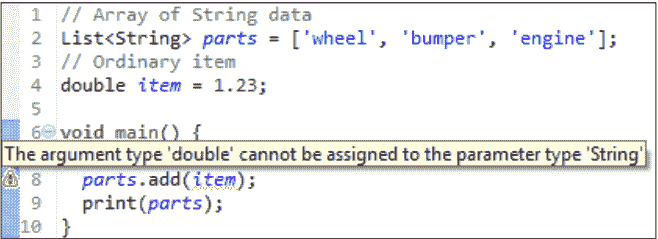
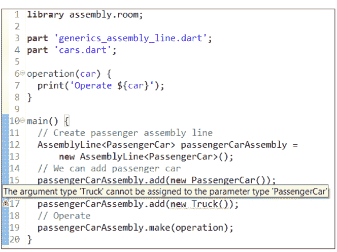
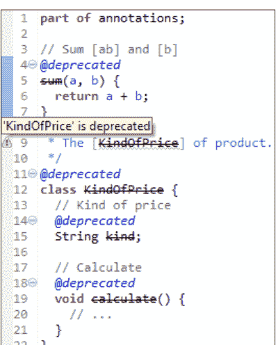
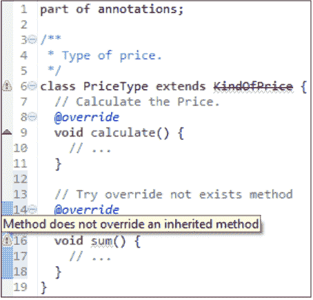

## 2 高级技术与反射

在本章中，我们将借助 Dart 中的高级技术来讨论代码的灵活性与可复用性。泛型编程应用广泛，它的作用是让代码对类型无感知。使用类型和泛型可以让代码更安全，并帮助你尽早发现 bug。关于错误与异常的争论把开发者分成了两个阵营。该选择哪一边？如果你知道同时使用两者的诀窍，这并不重要。注解是另一种高级技术，用于在运行时装饰已有类以改变其行为。注解有助于减少编写应用程序所需的样板代码。最后但同样重要的是，我们将通过反射的镜子打开潘多拉魔盒。在本章中，我们将涵盖以下主题：

- 泛型
- 错误与异常
- 注解
- 反射

## 泛型

Dart 从一开始就提供了**泛型**——泛型编程的一种设施。我们必须告诉静态分析器集合所允许的类型，这样在编译时，如果我们插入了错误类型的对象，它就能提醒我们。这使得程序更加清晰、使用起来更安全。我们将讨论如何有效使用泛型，并尽量减少与之相关的复杂性。

## 原始类型

Dart 通过 List 类支持数组。假设你使用列表来存储数据。你放入列表的数据取决于代码的上下文。列表可能同时包含不同类型的数据，如下代码所示：

```dart
// List of data
List raw = [1, "Letter", {'test':'wrong'}];
// Ordinary item
double item = 1.23;

void main() {
  // Add the item to array
  raw.add(item);
  print(raw);
}
```

在前面的代码中，我们将不同类型的数据赋给了 raw 列表。当代码执行时，我们得到以下结果：

```
[1, Letter, {test: wrong}, 1.23]
```

那么这段代码有什么问题呢？没有问题。在我们的代码中，我们特意使用了默认的原始列表类，以便存储不同类型的条目。但这种情况非常少见。通常，我们会在列表中保存特定类型的数据。如何防止向列表插入错误的数据类型呢？一种方法是在每次向列表读写数据时检查数据类型，如下代码所示：

```dart
// Array of String data
List parts = ['wheel', 'bumper', 'engine'];
// Ordinary item
double item = 1.23;

void main() {
  if (item is String) {
    // Add the item to array
    parts.add(item);
  }
  print(parts);
}
```

现在，从以下结果可以看出，代码更安全，并且按预期工作：

```text
[wheel, bumper, engine]
```

这些额外的条件语句使代码变得更加复杂。当你向列表添加错误类型并抛出异常时，该怎么办？如果你忘记插入额外的条件语句怎么办？这正是泛型的用武之地。

在操作集合时，与其编写大量类型检查和类转换，不如告诉静态分析器列表允许包含什么类型的对象。下面是修改后的代码，其中我们指定了 parts 只能包含字符串：

```dart
// Array of String data
List<String> parts = ['wheel', 'bumper', 'engine'];
// Ordinary item
double item = 1.23;

void main() {
  // Add the item to array
  parts.add(item);
  print(parts);
}
```

现在，List 是一个带有 String 参数的泛型类。Dart 编辑器会调用静态分析器在编译时检查代码中的类型是否存在潜在问题，并在我们尝试向集合插入错误类型对象时提醒我们，如下截图所示：



这有助于我们让代码更清晰、更安全，因为静态分析器会在编译时检查集合的类型。重点是你不应该使用原始类型。作为额外的好处，我们可以使用一大堆简写方法来组织对条目列表的迭代，实现更安全的转换。请记住，静态分析器只警告潜在问题，不会生成任何错误。

> Dart 仅在检查模式下检查泛型类的类型。在生产模式下执行或编译为 JavaScript 的代码会丢失所有类型信息。

## 使用泛型

让我们通过一些实际示例来讨论如何过渡到在代码中使用泛型。假设我们有如下的 AssemblyLine 类：

```dart
part of assembly.room;

// AssemblyLine.
class AssemblyLine {
  // List of items on line.
  List _items = [];

  // Add [item] to line.
  add(item) {
    _items.add(item);
  }

  // Make operation on all items in line.
  make(operation) {
    _items.forEach((item) {
      operation(item);
    });
  }
}
```

同样，我们还有一组不同种类的汽车，如下代码所示：

```dart
part of assembly.room;

// Car
abstract class Car {
  // Color
  String color;
}

// Passenger car
class PassengerCar extends Car {
  String toString() => "Passenger Car";
}

// Truck
class Truck extends Car {
  String toString() => "Truck";
}
```

最后，我们有如下包含 main 方法的 assembly.room 库：

```dart
library assembly.room;

part 'assembly_line.dart';
part 'car.dart';

operation(car) {
  print('Operate ${car}');
}

main() {
  // Create passenger assembly line
  AssemblyLine passengerCarAssembly = new AssemblyLine();
  // We can add passenger car
  passengerCarAssembly.add(new PassengerCar());
  // We can occasionally add Truck as well
  passengerCarAssembly.add(new Truck());
  // Operate
  passengerCarAssembly.make(operation);
}
```

在前面的示例中，我们能够毫无问题地将偶尔的卡车添加到乘用车装配线上，得到以下结果：

```
Operate Passenger Car
Operate Truck
```

这看起来有点牵强，因为在现实生活中，我们不能在同一条装配线上组装乘用车和卡车。因此，要使你的解决方案更安全，你需要将 AssemblyLine 类型设为泛型。

## 泛型类型

通常，将类型设为泛型并不困难。考虑一下 AssemblyLine 类的以下示例：

```dart
part of assembly.room;

// AssemblyLine.
class AssemblyLine<E extends Car> {
  // List of items on line.
  List<E> _items = [];

  // Add [item] to line.
  add(E item) {
    _items.insert(0, item);
  }

  // Make operation on all items in line.
  make(operation) {
    _items.forEach((E item) {
      operation(item);
    });
  }
}
```

在前面的代码中，我们在 AssemblyLine 类的声明中添加了一个类型参数 E。在这种情况下，类型参数要求原始类型是 Car 的子类型。这使 AssemblyLine 实现能够利用 Car 的优势，而无需进行类转换。类型参数 E 被称为有界类型参数。对 assembly.room 库的任何修改将如下所示：

```dart
library assembly.room;

part 'assembly_line.dart';
part 'car.dart';

operation(car) {
  print('Operate ${car}');
}

main() {
  // Create passenger assembly line
```

```dart
AssemblyLine<PassengerCar> passengerCarAssembly =
    new AssemblyLine<PassengerCar>();
// We can add passenger car
passengerCarAssembly.add(new PassengerCar());
// We can occasionally add truck as well
passengerCarAssembly.add(new Truck());
// Operate
passengerCarAssembly.make(operation);
}
```

如果我们在乘用车装配线上尝试插入 Truck 参数，静态分析器会在编译时提醒我们，如下截图所示：



在修复第 17 行的代码后，一切看起来都很好。我们的装配线现在是安全的。但如果你看看 operation 函数，它对乘用车与对卡车是完全不同的；这意味着我们也必须让 operation 变成泛型。静态分析器不会显示任何警告，更糟糕的是，我们无法直接让 operation 变成泛型，因为 Dart 不支持函数泛型。但有一个解决方案。


## 泛型函数

函数与 Dart 中所有其他数据类型一样，都是对象，并且它们具有数据类型 `Function`。在下面的代码中，我们将创建一个 `Operation` 类作为 `Function` 的实现，然后像往常一样对其应用泛型：

```dart
part of assembly.room;

// Operation for specific type of car
class Operation<E extends Car> implements Function {
  // Operation name
  final String name;
  // Create new operation with [name]
  Operation(this.name);
  // We call our function here
  call(E car) {
    print('Make ${name} on ${car}');
  }
}
```

我们类中的亮点是 `call` 方法。由于 `Operation` 实现了 `Function` 并具有 call 方法，我们可以将类的实例作为函数传递给装配线的 `make` 方法，如下面的代码所示：

```dart
library assembly.room;

part 'assembly.dart';
part 'car.dart';
part 'operation.dart';

main() {
  // Paint operation for passenger car
  Operation<PassengerCar> paint = new
    Operation<PassengerCar>("paint");
  // Paint operation for trucks
  Operation<Truck> paintTruck = new Operation<Truck>("paint");
  // Create passenger assembly line
  Assembly<PassengerCar> passengerCarAssembly =
    new Assembly<PassengerCar>();
  // We can add passenger car
  passengerCarAssembly.add(new PassengerCar());
  // Operate only with passenger car
  passengerCarAssembly.make(paint);
  // Operate with mistake
  passengerCarAssembly.make(paintTruck);
}
```

在前面的代码中，我们创建了 `paint` 操作用于喷涂 passenger cars，以及 `paintTruck` 操作用于喷涂 trucks。接着，我们创建了 `passengerCarAssembly` 装配线，并通过 `add` 方法向该装配线添加了一辆新的乘用车。我们可以通过调用 `passengerCarAssembly` 装配线的 `make` 方法来对乘用车执行 `paint` 操作。接下来，我们故意犯了一个错误，尝试在乘用车装配线上喷涂卡车，结果引发了以下运行时异常：

```
Make paint on Passenger Car
Unhandled exception:
type 'PassengerCar' is not a subtype of type 'Truck' of 'car'.
#0 Operation.call (../generics_operation.dart:10:10)
#1 Assembly.make.<anonymous
closure>(../generics_assembly.dart:16:15)
#2 List.forEach (dart:core-patch/growable_array.dart:240)
#3 Assembly.make (../generics_assembly.dart:15:18)
#4 main (../generics_assembly_and_operation_room.dart:20:28)
...
```

这种利用 `Function` 类型的 `call` 方法的技巧，可以帮助你让装配线的所有方面都变得泛型化。我们已经看到了如何将类泛型化和函数化，从而使应用程序的代码更安全、更简洁。

> 文档生成器会自动在生成的文档页面中添加关于泛型的信息。

为了理解错误（Errors）与异常（Exceptions）之间的区别，让我们进入下一个主题。

## 错误与异常

在 Dart 程序的执行过程中，运行时故障可能发生，也确实会发生。我们可以将所有故障分为两类：

- 错误
- 异常

在决定何时使用每种故障类型时，总是存在一些混淆，但我们将给出几条通用规则，让您的生活更加轻松。您的所有决策都将基于可恢复性这一简单原则。如果您的代码生成了一个可以合理恢复的故障，请使用异常。相反，如果代码生成的故障无法恢复，或者继续执行会造成更大的危害，请使用错误。

让我们逐一详细了解它们。

## 错误

如果您的代码存在应由程序员修复的编程错误，就会发生**错误**。让我们看看下面的 `main` 函数：

```dart
main() {
    // Fixed length list
    List list = new List(5);
    // Fill list with values
    for (int i = 0; i < 10; i++) {
        list[i] = i;
    }
    print('Result is ${list}');
}
```

我们创建了一个固定长度的 `List` 类实例，然后尝试在循环中向其中填充值，而循环中的项目数超过了 `List` 类的固定大小。执行上述代码会生成 `RangeError`，如下面的截图所示：

```
Unhandled exception:
RangeError: 5
#0      List.[]=(dart:core-patch/array.dart:13)
#1      main (file:///C:/Users/sergey/errors vs exceptions/bin/range_error.dart:6:9)
#2      _startIsolate.isolateStartHandler (dart:isolate-patch/isolate_patch.dart:214)
#3      _RawReceivePortImpl._handleMessage (dart:isolate-patch/isolate_patch.dart:122)
```

发生此错误是因为我们在代码中违反了前置条件，尝试在有效范围之外的索引处向列表中插入值。大多数情况下，当代码与调用 API 之间的契约被破坏时，就会发生这类故障。在我们的示例中，`RangeError` 表示前置条件被违反。Dart SDK 中有大量错误类型，例如 `CastError`、`RangeError`、`NoSuchMethodError`、`UnsupportedError`、`OutOfMemoryError` 和 `StackOverflowError`。此外，还有更多错误类型可以在 `dart.core` 库的 `errors.dart` 文件中找到。所有错误类都继承自 `Error` 类，并可以返回堆栈跟踪信息以帮助快速定位 bug。在前面的示例中，错误发生在 `range_error.dart` 文件第 6 行的 `main` 方法中。

我们可以在代码中捕获错误，但由于代码实现不佳，我们更应该修复它。错误并非设计用于被捕获，但在发生严重情况时，我们可以抛出它们。当发生错误时，Dart 程序通常应终止运行。

## 异常

**异常**与错误不同，它们旨在被捕获，通常携带有关失败的信息，但不包含堆栈跟踪信息。异常发生在可恢复的情况下，并且不会停止程序的执行。您可以抛出任何非 null 对象作为异常，但最好创建一个新的异常类，实现抽象类 `Exception` 并重写 `Object` 类的 `toString` 方法，以便提供更多信息。异常应该在 catch 子句中处理，或者使其向外传播。下面是一个不使用异常的代码示例：

```dart
import 'dart:io';

main() {
  // File URI
  Uri uri = new Uri.file("test.json");
  // Check URI
  if (uri != null) {
    // Create the file
    File file = new File.fromUri(uri);
    // Check whether file exists
    if (file.existsSync()) {
      // Open file
      RandomAccessFile random = file.openSync();
      // Check random
      if (random != null) {
        // Read file
        List<int> notReadyContent =
          random.readSync(random.lengthSync());
        // Check not ready content
        if (notReadyContent != null) {
          // Convert to String
          String content = new
            String.fromCharCodes(notReadyContent);
          // Print results
          print('File content: ${content}');
        }
        // Close file
        random.closeSync();
      }
    }
  } else {
    print("File doesn't exist");
  }
}
```

以下是此代码执行的结果：

```
File content: [{ name: Test, length: 100 }]
```

如您所见，错误检测和处理导致了令人困惑的意大利面条式代码。更糟糕的是，代码的逻辑流程已经丢失，使其难以阅读和理解。因此，我们将代码转换为使用异常，如下所示：

```dart
import 'dart:io';

main() {
    RandomAccessFile random;
    try {
        // File URI
        Uri uri = new Uri.file("test.json");
        // Create the file
        File file = new File.fromUri(uri);
        // Open file
        random = file.openSync();
        // Read file
        List<int> notReadyContent =
            random.readSync(random.lengthSync());
        // Convert to String
        String content = new String.fromCharCodes(notReadyContent);
        // Print results
        print('File content: ${content}');
    } on ArgumentError catch(ex) {
        print('Argument error exception');
    } on UnsupportedError catch(ex) {
        print('URI cannot reference a file');
    } on FileSystemException catch(ex) {
        print("File doesn't exist or accessible");
    } finally {
        try {
            random.closeSync();
        } on FileSystemException catch(ex) {
            print("File can't be closed");
        }
    }
}
```


`finally` 语句中的代码无论是否发生异常都会始终执行，以关闭 `random` 文件。最后，我们实现了异常处理与工作代码的清晰分离，并且现在可以将未捕获的异常向外传播到调用栈中。

基于异常后可恢复性的建议是脆弱的。在我们的示例中，我们将 `ArgumentError` 和 `UnsupportedError` 与 `FileSystemException` 一同捕获。这只是为了说明错误和异常具有相同的本质，可以随时被捕获。那么，真相是什么呢？在开发我自己的框架时，我使用了以下原则：

> 如果我认为代码无法恢复，我使用错误；如果我认为它可以恢复，我使用异常。

让我们讨论另一种高级技术，它变得非常流行，并且可以帮助你在不修改代码的情况下改变代码的行为。

## Annotations

**annotation** 是元数据 – 关于数据的数据。annotation 是一种在代码本身中保留有关代码的额外信息的方式。annotation 可以具有参数值以传递有关被注解成员的特定信息。
没有参数的 annotation 称为标记 annotation。标记 annotation 的目的只是标记被注解的成员。

Dart annotation 是以 @ 字符开头的常量表达式。我们可以将 annotation 应用于 Dart 语言的所有成员中，排除注释和 annotation 本身。annotation 可以：

- 通过解析程序并通过合适的解释器评估常量来进行静态解释
- 通过框架在运行时通过反射检索

> 文档生成器不会自动将 annotation 添加到生成的文档页面中，因此有关 annotation 的信息必须在注释中单独指定。

## Built-in annotations

在 Dart SDK 中定义了几个内置 annotation，由静态分析器解释。让我们来看看它们。

### Deprecated

第一个内置 annotation 是 deprecated，当你需要将函数、变量、类的一个方法，甚至整个类标记为已弃用且不应再使用时非常有用。只要在代码中使用了被标记的语句，静态分析器就会生成警告，如以下屏幕截图所示：



### Override

另一个内置 annotation 是 override。此 annotation 通知静态分析器，任何实例成员，例如方法、getter 或 setter，都是为了覆盖具有相同名称的超类成员。类实例变量以及静态成员永远不会相互覆盖。如果标记为 override 的实例成员未能正确覆盖其超类之一中的成员，静态分析器会生成以下警告：



### Proxy

最后一个 annotation 是 proxy。Proxy 是一种众所周知的模式，当我们需要通过另一个类的实例调用真实类的 方法时使用。假设我们有以下 Car 类：

```
part of cars;

// Class Car
class Car {
    int _speed = 0;
    // The car speed
    int get speed => _speed;

    // Accelerate car
    accelerate(acc) {
        _speed += acc;
    }
}
```

要驱动 car 实例，我们必须按如下方式加速它：

```
library cars;

part 'car.dart';

main() {
  Car car = new Car();
  car.accelerate(10);
  print('Car speed is ${car.speed}');
}
```

我们现在运行示例以获得以下结果：

```
Car speed is 10
```

在实践中，我们可能有很多不同类型的汽车，并且希望测试它们全部。为了帮助我们，我们通过在代理的构造函数中传递 Car 的实例创建了 CarProxy 类。从现在开始，我们可以通过代理调用汽车的方法并将结果保存到日志中，如下所示：

```
part of cars;

// Proxy to [Car]
class CarProxy {

  final Car _car;
  // Create new proxy to [car]
  CarProxy(this._car);

  @override
  noSuchMethod(Invocation invocation) {
    if (invocation.isMethod &&
        invocation.memberName == const Symbol('accelerate')) {
      // Get acceleration value
      var acc = invocation.positionalArguments[0];
      // Log info
      print("LOG: Accelerate car with ${acc}");
      // Call original method
      _car.accelerate(acc);
    } else if (invocation.isGetter &&
               invocation.memberName == const Symbol('speed')) {
      var speed = _car.speed;
      // Log info
```

## Custom annotations

假设我们想要创建一个测试框架。为此，我们需要几个自定义 annotation 来标记可测试类中的方法以包含在测试用例中。以下代码有两个自定义 annotation。在我们只需要标记 annotation 的情况下，我们使用常量字符串 test。在我们需要向 annotation 传递参数的情况下，我们将使用具有常量构造函数的 Test 类，如以下代码所示：

```
library test;

// Marker annotation test
const String test = "test";

// Test annotation
class Test {
  // Should test be ignored?
  final bool include;
  // Default constant constructor
  const Test({this.include:true});

  String toString() => 'test';
}
```

Test 类具有 final include 变量，其初始化值为 true 的默认值。要从测试中排除一个方法，我们应该将 false 作为 annotation 的参数传递，如以下代码所示：

```
library test.case;

import 'test.dart';
import 'engine.dart';

// Test case of Engine
class TestCase {
  Engine engine = new Engine();

  // Start engine
  @test
  testStart() {
    engine.start();
    if (!engine.started) throw new Exception("Engine must start");
  }

  // Stop engine
  @Test()
```

Dart 反射遵循第二种方法，使用 Mirrors。你可以在 Gilad Bracha 编写的原始论文 http://bracha.org/mirrors.pdf 中找到有关 Mirrors 概念的更多信息。让我们讨论 Mirrors 的优点：

- Mirrors 与主代码分离，不能被利用于恶意目的
- 由于反射不是代码的一部分，因此生成的代码更小
- 反射 API 与被检查类之间不存在方法命名冲突
- 可以实现具有不同反射权限级别的许多不同的 Mirrors
- 可以在命令行和 Web 应用程序中使用 Mirrors

让我们尝试 Mirrors，看看我们能用它们做什么。我们将继续创建一个库来运行我们的测试。

## Introspection in action

我们将通过诸如内省之类的简单事物来演示 Mirrors 的使用。我们需要一段通用代码，可以检索有关程序中任何对象或类的信息，以发现其结构并可能使用属性操作它并调用方法。为此，我们准备了 TypeInspector 类。让我们看看代码。我们在这里导入了 dart:mirrors 库，以向我们的代码添加内省能力：

```
library inspector;

import 'dart:mirrors';
import 'test.dart';

class TypeInspector {
  ClassMirror _classMirror;
  // Create type inspector for [type].
  TypeInspector(Type type) {
    _classMirror = reflectClass(type);
  }
}
```

ClassMirror 类包含有关被观察类型的所有信息。我们使用 Mirrors 的 reflectClass 函数执行实际的内省并返回一个不同的 Mirror 对象作为结果。然后，我们调用 getAnnotatedMethods 方法并指定我们感兴趣的 annotation 的名称。这将返回一个 MethodMirror 列表，其中包含带有指定参数的 annotation 的方法。一个一个地，我们遍历所有实例成员并调用私有 _isMethodAnnotated 方法。如果 _isMethodAnnotated 方法的执行结果成功，则我们将发现的方法添加到找到的 MethodMirror 的结果列表中，如以下代码所示：

```
// Return list of method mirrors assigned by [annotation].
List<MethodMirror> getAnnotatedMethods(String annotation) {
    List<MethodMirror> result = [];
    // Get all methods
    _classMirror.instanceMembers.forEach(
        (Symbol name, MethodMirror method) {
            if (_isMethodAnnotated(method, annotation)) {
                result.add(method);
            }
        }
    );
    return result;
}
```

_isMethodAnnotated 的第一个参数具有 metadata 属性，该属性保存 annotation 的列表。此方法的第二个参数是我们想要查找的 annotation 名称。inst 变量保存对 reflectee 属性中原始对象的引用。我们遍历方法的所有 metadata 以排除一些用 Test 类注解并标记为 include 等于 false 的方法。所有其他方法的 annotation 应该与 annotation 名称进行比较，如下所示：

```
// Check is [method] annotated with [annotation].
bool _isMethodAnnotated(MethodMirror method, String annotation) {
    return method.metadata.any(
        (InstanceMirror inst) {
            // For [Test] class we check include condition
            if (inst.reflectee is Test &&
                !(inst.reflectee as Test).include) {
                // Test must be exclude
                return false;
            }
            // Literal compare of reflectee and annotation
            return inst.reflectee.toString() == annotation;
        }
    );
}
```

Dart 的 Mirrors 库提供以下三个用于内省的主要函数：

- `reflect`：该函数用于内省传入的参数实例，并将结果保存在 `InstanceMirror` 或 `ClosureMirror` 中。对于前者，我们可以调用 `reflectee` 属性的方法、函数，或获取和设置其字段；对于后者，我们可以执行该闭包。
- `reflectClass`：该函数反射类的声明并返回 `ClassMirror`。它持有作为参数传入的类型的完整信息。
- `reflectType`：该函数返回 `TypeMirror`，并反射一个类、`typedef`、函数类型或类型变量。

让我们看一下主要代码：

```dart
library test.framework;

import 'type_inspector.dart';
import 'test_case.dart';

main() {
  TypeInspector inspector = new TypeInspector(TestCase);
  List methods = inspector.getAnnotatedMethods('test');
  print(methods);
}
```

首先，我们创建了一个 `TypeInspector` 类的实例，并传入了可测试的类，也就是这里的 `TestCase`。然后，我们以注解名 `test` 调用了 `inspector` 的 `getAnnotatedMethods` 方法。执行结果如下：

[MethodMirror on 'testStart', MethodMirror on 'testStop']

`getAnnotatedMethods` 方法按照我们的要求找到了 `testStart` 和 `testStop` 方法，并忽略了 `TestCase` 类中的 `testWarmUp` 方法。

## 反射实战

我们已经看到内省如何帮助我们找到带有注解的方法。现在，我们需要调用每个被标记的方法来运行实际的测试。我们将通过反射来实现这一点。让我们创建一个 `MethodInvoker` 类来展示反射的实际应用：

```dart
library executor;

import 'dart:mirrors';

class MethodInvoker implements Function {
  // Invoke the method
  call(MethodMirror method) {
    ClassMirror classMirror = method.owner as ClassMirror;
    // Create an instance of class
    InstanceMirror inst =
        classMirror.newInstance(new Symbol(''), []);
    // Invoke method of instance
    inst.invoke(method.simpleName, []);
  }
}
```

由于 `MethodInvoker` 类实现了 `Function` 接口，并且拥有 `call` 方法，因此我们可以像调用函数一样调用它。为了调用方法，我们必须首先实例化一个类。每个 `MethodMirror` 方法都有一个 `owner` 属性，它指向层级结构中的拥有者对象。在我们的例子中，`MethodMirror` 的 owner 就是 `ClassMirror`。在前面的代码中，我们使用空的构造函数创建了该类的一个新实例，然后按名称调用了 `inst` 的方法。在这两种情况下，第二个参数都是空的方法参数列表。

现在，我们把 `MethodInvoker` 引入到主代码中。除了 `TypeInspector`，我们还创建了 `MethodInvoker` 的实例。我们逐个遍历这些方法，并将每个方法发送给 invoker。只有在没有异常发生时，我们才会打印 Success。为了防止当任意测试失败时程序终止，我们将 invoker 包装在 try-catch 块中，如下面的代码所示：

```dart
library test.framework;

import 'type_inspector.dart';
import 'method_invoker.dart';
import 'test_case.dart';

main() {
  TypeInspector inspector = new TypeInspector(TestCase);
  List methods = inspector.getAnnotatedMethods('test');
  MethodInvoker invoker = new MethodInvoker();
  methods.forEach((method) {
    try {
      invoker(method);
      print('Success ${method.simpleName}');
    } on Exception catch (ex) {
      print(ex);
    } on Error catch (ex) {
      print("$ex : ${ex.stackTrace}");
    }
  });
}
```
