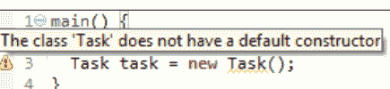

## 3. 对象的创建

在本章中，我们将讨论对象的创建。我们将了解如何依据编程世界的最佳实践来创建对象、何时创建，并为它们在 Dart 中找到合适的位置。这里介绍的各种技术将帮助我们在不同的业务场景中做出正确的选择。

在本章中，我们将介绍以下主题：

- 生成构造函数
- 带可选参数的构造函数
- 命名构造函数
- 重定向构造函数
- 私有构造函数
- 工厂构造函数
- 常量构造函数
- 变量的初始化
- 语法糖

### 创建对象

**类**是对象的蓝图。根据类创建对象的过程称为实例化。对象可以通过 `new` 语句从类实例化，也可以通过反射实例化。它必须在使用前完成实例化。

类中包含一个构造函数，它在从类创建对象时被调用。它的名称始终与类名相同。Dart 定义了两类构造函数：生成构造函数和工厂构造函数。

### 生成构造函数

**生成**构造函数由构造函数名称、构造函数参数列表、重定向子句或初始化列表，以及可选函数体组成。实例化类时，Dart 总是先调用生成构造函数，如下面的代码所示：

```dart
class SomeClass {
  // Default constructor
  SomeClass();
}

main() {
  var some = new SomeClass();
}
```

如果没有定义构造函数，Dart 会隐式地为我们创建一个，如下所示：

```dart
class AnyClass {
  // implicit constructor
}

main() {
  var some = new AnyClass();
}
```

生成构造函数的主要目的是安全地初始化类的实例。这种初始化在类内部进行，并确保被实例化的对象始终处于有效状态。

### 带可选参数的构造函数

构造函数是类的一个方法，其参数用于指定类的初始状态或其他重要信息。构造函数中有必选参数和可选参数。可选参数可以是一组命名参数，也可以是一组位置参数。Dart 不支持方法重载，因此，拥有可选参数的能力会非常方便。

> Dart 不允许你将命名可选参数和位置可选参数组合使用。

让我们看看下面这个 `Car` 类构造函数，它带有可选位置参数：

```dart
// Class Car
class Car {
  String color;
  int weight;

  Car([this.color = 'white', this.weight = 1000]);
}
```

我们可以省略其中一个或全部参数来创建该类的对象，如下所示：

```dart
import 'car_optional_parameters.dart';

main() {
  var car = new Car('blue');
  var car2 = new Car();
}
```

让我们看看下面这个 `Car` 类构造函数，它使用了可选命名参数：

```dart
// Class Car
class Car {
  String color;
  int weight;

  Car({this.color:'white', this.weight:1000});
}
```

在下面的 main 代码中，我使用命名参数创建了该对象的一个实例：

```dart
import 'car_named_parameters.dart';

main() {
  var car = new Car(weight:750, color:'blue');
}
```

那么，哪种可选参数更好呢？我推荐使用命名参数，原因如下：

- 这里，你无需记住参数的位置
- 它能更好地说明这些参数的作用

### 命名构造函数

假设我们要创建一个 `Collection` 类，把所有数据存储在一个地方。我们可以这样做：

```dart
library collection;

// Collection class
class Collection {
  // We save data here
  List _data;

  // Default constructor
  Collection() {
    _data = new List();
  }

  // Add new item
  add(item) {
    _data.add(item);
  }

  // ...
}
```

在 main 方法的某处，我们创建了类的实例，并将数据添加到集合中：

```dart
import 'collection.dart';

var data = [1, 2, 3];

main() {
  var collection = new Collection();
  //
  data.forEach((item) {
    collection.add(item);
  });
}
```

将来我的集合以这种方式初始化的可能性很高。因此，如果能在 `Collection` 类中提供一个初始化方法，用来添加一组数据，那就太好了。解决方案之一是创建带命名参数的构造函数来管理初始化。如下面的代码所示，如果指定了可选参数，代码就会根据该可选参数的值创建一个新的集合：

```dart
library collection;

// Collection class
class Collection {
  // We save data here
  List _data;

  // Default constructor with optional [values] or [item].
  Collection({Iterable values:null, String item:null}) {
    if (item != null) {
      _data = new List();
      add(item);
    } else {
      _data = values != null ?
          new List.from(values) :
          new List();
    }
  }

  // Add new item
  add(item) {
    _data.add(item);
  }

  // ...
}
```

这种解决方案有*存在的理由*，但仅限于参数数量较少的情况。否则，即使是简单的变量初始化任务，也会变成非常复杂的代码。我为命名参数指定了两个可选项，其逻辑实在纠缠不清。很难传达 `values` 的含义。更好的方式是使用命名构造函数，如下面的代码所示：

```dart
library collection;

// Collection class
class Collection {
  // We save data here
  List _data;
```


```dart
// Default constructor
Collection() {
  _data = new List();
}

// Create collection from [values]
Collection.fromList(Iterable values) {
  _data = values == null ?
    new List() :
    new List.from(values);
}

// Create collection from [item]
Collection.fromItem(String item) {
  _data = new List();
  if (item != null) {
    add(item);
  }
}
// ...
```

这种构造函数之所以被称为命名构造函数，是因为它提供了一种可读且直观的方式来创建类的对象。在我们的代码中，有名为 `Collection.fromList` 和 `Collection.fromItem` 的构造函数。根据参数类型的不同，我们的类可以有多个命名构造函数，以完成简单的类实例化任务。但请记住，任何超类的命名构造函数都不会被子类继承。

> 命名构造函数提供了直观且更安全的构造操作。

## 重定向构造函数

带有可选参数的构造函数和命名构造函数有助于提高代码的可用性和可读性。然而，有时我们还需要更多。假设我们想要将映射表中的值添加到集合中，可以通过添加 `Collection.fromMap` 命名构造函数来实现，如下代码所示：

```dart
//...
// Create collection from [values]
Collection.fromList(Iterable values) {
  _data = values == null ?
      new List() :
      new List.from(values);
}
// Create collection from values of [map]
Collection.fromMap(Map map) {
  _data = map == null ?
      new List() :
      new List.from(map.values);
}
// …
```

上述方法不太合适，因为两个命名构造函数具有相似的代码。我们可以通过使用一种特殊形式的生成构造函数（重定向构造函数）来纠正这一点，如下代码所示：

```dart
// …
// Create collection from [values]
Collection.fromList(Iterable values) {
  _data = values == null ?
      new List() :
      new List.from(values);
}
// Create collection from values of [map]
Collection.fromMap(Map map) :
    this.fromList(map == null ? [] : map.values);
```

重定向构造函数调用另一个生成构造函数，并传递映射表的值或空列表。我喜欢这种方法，因为它简洁、不易出错，并且不再包含相似的代码。

> 重定向构造函数不能有函数体和初始化列表。

## 私有构造函数

在继续我们的旅程之前，我想提一下关于私有构造函数的几点。私有构造函数是一种特殊的生成构造函数，它防止类被调用者显式实例化。它通常用于以下情况：

- 单例类
- 工厂方法中
- 工具类仅包含静态方法时
- 常量类

让我们定义一个 `Task` 类，如下所示：

```dart
class Task {
  int id;

  Task._();

  Task._internal();
}
```

在上述代码中，`Task` 类中有一个私有命名构造函数 `Task._` 和 `Task._internal`。此外，由于没有可用的公共构造函数，Dart 不允许你创建 `Task` 的实例，如下面的截图所示：



> 私有构造函数用于防止创建类的实例。

## 工厂构造函数

工厂构造函数只能创建类或继承类的实例。它是一个类的静态方法，与类同名，并用 `factory` 关键字标记。

> 工厂构造函数无法访问类成员。

### 工厂方法设计模式

假设我们正在创建一个框架，此时需要记录类方法的不同操作的信息。下面这个简单的 `Log` 类可以为我们所用：

```dart
library log;

// Log information
abstract class Log {
  debug(String message);
  // ...
}
```

我们可以使用 `ConsoleLog` 类将日志信息打印到控制台，如下所示：

```dart
library log.console;

import 'log.dart';

// Write log to console
class ConsoleLog implements Log {
  debug(String message) {
    // ...
  }
  // ...
}
```

我们还可以使用 `FileLog` 类将日志消息保存到文件中，如下所示：

```dart
library log.file;

import 'log.dart';

// Write log to file
class FileLog implements Log {
  debug(String message) {
    // ...
  }
  // ...
}
```

现在，我们可以在 `Adventure` 类中使用 `log` 变量将调试信息打印到控制台，如下所示：

```dart
import 'log.dart';
import 'console_log.dart';

// Adventure class with log
class Adventure {
  static Log log = new ConsoleLog();

  walkMethod() {
    log.debug("entering log");
    // ...
  }
}
```

我们创建了一个 `ConsoleLog` 实例，并使用它将所有消息打印到控制台。会有很多类需要支持日志记录，我们会在每个类中包含与上述类似的代码。我可以想象，当我们决定将 `ConsoleLog` 改为 `FileLog` 时会发生什么。一个简单的操作可能会变成一场噩梦，因为进行这些更改可能需要花费大量时间和资源。与此同时，我们必须避免修改我们的类。

解决方案是使用工厂构造函数，将类型的代码替换为子类，如下所示：

```dart
library log;

part 'factory_console_log.dart';

// Log information
abstract class Log {

  factory Log() {
    return new ConsoleLog();
  }

  debug(String message);
  // ...
}
```

`Log` 类的工厂构造函数是一个静态方法，每次都会创建一个新的 `ConsoleLog` 实例。更新后的 `Adventure` 类如下所示：

```dart
import 'factory_log.dart';

// Adventure class with log
class Adventure {
  static Log log = new Log();

  walkMethod() {
    log.debug("entering log");
    // ...
  }
}
```

现在，我们不再将 `ConsoleLog` 视为 `Log` 的实现，而只使用工厂构造函数。从 `ConsoleLog` 到 `FileLog` 的所有更改都将发生在一处，即在工厂构造函数内部。然而，如果能在不修改 `Log` 类的情况下，根据特定场景使用不同的实现，那就更好了。这可以通过在工厂构造函数中添加条件语句并实例化不同的子类来实现，如下所示：

```dart
library log;

part 'factory_console_log.dart';
part 'factory_file_log.dart';

// Log information
abstract class Log {

  static bool useConsoleLog = false;

  factory Log() {
    return useConsoleLog ?
      new ConsoleLog() :
      new FileLog();
  }

  debug(String message);
  // ...
}
```

`useConsoleLog` 静态变量可以在任何时间点通过编程方式更改，从而让我们有机会改变日志记录方向。因此，我们根本不需要修改 `Log` 类。

在我们的示例中，工厂构造函数是工厂方法设计模式的一种实现。它使设计更加可定制，并且只是稍微复杂一点。

在以下情况下，最好使用工厂构造函数而不是生成构造函数：

- 不需要总是返回类的新实例时
- 需要实例化返回类型的任何子类型时
- 减少创建参数化类型实例的冗长代码时

## 单例设计模式

如果我们想在可想象的框架中的某个位置保存关于用户的唯一信息，那么我们需要为此创建一个 `Configuration` 类，如下所示：

```dart
library configuration;

// Class configuration
class Configuration {
// It always keep our [Configuration]
static final Configuration configuration = new Configuration._();

// Database name
String dbName;

// Private default constructor
Configuration._();
}
```

`Configuration` 类有一个 `dbName` 变量来保存数据库的名称，可能还有其他一些属性和方法。它有一个私有默认构造函数，因此不能从其他类实例化。静态变量 `configuration` 是 `final` 的，并且只会初始化一次。一切看起来都很好，符合单例设计模式的实现标准。


在任一时刻，我们只会有一个 Configuration 类的实例，这正是单例模式的主要目的。这里的一个缺点是配置变量的初始化时机。这只会发生在程序启动时。更好的做法是，在第一次调用配置变量时使用惰性初始化。下面的工厂构造函数就派上了用场：

```dart
library configuration;

// Class configuration
class Configuration {
  // It always keeps our [Configuration]
  static Configuration _configuration;

  // Factory constructor
  factory Configuration() {
    if (_configuration == null) {
      _configuration = new Configuration._();
    }
    return _configuration;
  }

  // Database name
  String dbName;

  // Private default constructor
  Configuration._();
}
```

现在，当我们第一次引用 Configuration 类时，Dart 会调用工厂构造函数。它会检查私有变量 configuration 之前是否已初始化，如有必要则创建一个新的 Configuration 类实例，然后才返回我们类的一个实例。以下是代码框架中的改动：

```dart
import 'factory_configuration.dart';

main() {
  // Access to database name
  new Configuration().dbName = 'Oracle';
  // ...
  print('Database name is ${new Configuration().dbName}');
}
```

在这个解决方案中，每当我们调用工厂方法时，总是会获得 Configuration 类的同一个实例。工厂构造函数可以广泛用于实现享元模式和对象池。

## 常量构造函数

假设在我们的虚构框架中有以下 Request 类：

```dart
library request;

// Request class
class Request {
  static const int AWAIT = 0;
  static const int IN_PROGRESS = 1;
  static const int SUCCESS = 2;
  static const int FAULT = 3;

  // Result of request
  int result = AWAIT;

  // Send request with optional [status]
  void send({status: IN_PROGRESS}) {
    // ...
  }
  // ...
}
```

result 变量以整数值的形式保存上一次请求的状态。Request 类使用常量将所有可能的状态值集中放在一处，以便我们随时引用它们。这使代码的可读性更好，同时也更安全。这种技术被称为枚举模式，并被广泛使用。然而，在安全性方面它有一个问题：任何其他整数值都可能被赋给 result 变量。这个问题使类变得非常脆弱。枚举类型可以帮助我们解决这个问题，但遗憾的是，Dart 中并不存在枚举类型。解决方法是，我们借助常量构造函数自行创建一种枚举类型，因为它可以用来创建编译期常量。

我们可以创建一个带有传入参数的抽象 Enum 类，如下所示：

```dart
library enumerated_type;

// Enum class
abstract class Enum<T> {
  // The value
  final T value;

  // Create new instance of [T] with [value]
  const Enum(this.value);

  // Print out enum info
  String toString() {
    return "${runtimeType.toString()}." +
        "${value == null ? 'null' : value.toString()}";
  }
}
```

在前面的代码中，我特意使用了一个泛型类，因为我不知道我们将要创建哪种类型的枚举。例如，要基于整数值创建 RequestStatus 的枚举类型，我们可以创建如下具体类：

```dart
import 'enum.dart';

// Enumerated type Status of Request
class RequestStatus extends Enum<int> {

  static const RequestStatus AWAIT = const RequestStatus(0);
  static const RequestStatus IN_PROGRESS = const RequestStatus(1);
  static const RequestStatus SUCCESS = const RequestStatus(2);
  static const RequestStatus FAULT = const RequestStatus(3);

  const RequestStatus(int value) : super(value);
}
```

RequestStatus 类扩展了 Enum 类，并将请求状态定义为类的静态常量成员。要实例化 RequestStatus 类对象，我们使用 const 而不是 new 实例化表达式。

> 常量构造函数会创建类的编译期不可变实例。

让我们回到 Request 类，并用 RequestStatus 对其进行修改，如下面的代码所示：

```dart
library request;

import 'request_status.dart';

// Request class with enum
class Request {
  // Result of request
  var result = RequestStatus.AWAIT;

  // Send request with optional [status]
  void send({status: RequestStatus.IN_PROGRESS}) {
    // ...
  }
}
```

在前面的代码中，我们在整个类中使用了枚举类型。最后，这是使用 Request 类的 main 方法：

```dart
import 'request_with_enum.dart';
import 'request_status.dart';

void main() {
  Request request = new Request();
  // ...
  request.send(status: RequestStatus.SUCCESS);
  // ...
  RequestStatus status = request.result;
  //
  switch (status) {
    case RequestStatus.AWAIT:
      print('Result is $status');
      // ...
      break;
  }
}
```

如你所见，编译期常量用途广泛，例如用作变量和常量的默认值、方法签名中的默认值、switch 分支、注解和枚举值。此外，代码使用它们可以获得更好的性能，并将它们转换为优化后的 JavaScript 代码。

常量构造函数的使用场景有以下限制：

- 常量构造函数没有函数体，以防止类的状态发生任何更改
- 具有常量构造函数的类中的所有变量都必须是 final，因为它们的绑定在初始化时即已固定
- 常量构造函数初始化列表中的变量必须使用编译期常量进行初始化

## 初始化变量

变量反映了类实例的状态。变量有两类，即类变量和实例变量。在 Dart 中，类变量是静态的。类的静态变量在同一个类的所有实例之间共享信息。当类的每个实例需要彼此独立地维护信息时，该类就提供了实例变量。如前所述，构造函数的主要目的是以安全的方式初始化类的实例。换句话说，我们初始化的是实例变量。下面来讨论何时以及如何初始化它们。

在 Dart 中，未初始化的变量的值为 null，因此我们应该在使用它们之前对其进行初始化。变量的初始化可能发生在多个位置，如下所示：

- 我们可以在声明变量的地方为其赋任意值
- 变量可以在构造函数体内初始化
- 变量可以通过构造函数参数初始化
- 初始化可以发生在构造函数的初始化列表中

哪里是初始化变量的最佳位置？未初始化的变量在我们尝试使用它们时会产生 null 引用运行时异常，如下面的代码所示：

```dart
class First {
  bool isActive;

  doSomething() {
    if (isActive) {
      // ...
    }
  }
}

void main() {
  First first = new First();
  first.doSomething();
}
```

在下面的代码中，我们在声明变量的位置初始化了 `isActive` 变量：

```dart
class First {
  final bool isActive = false;

  First();
}
```

在 Second 类中，我们通过构造函数的参数来初始化 `isActive` 变量，如下所示：

```dart
class Second {
  final bool isActive;

  Second(this.isActive);
}
```

如果 `isActive` 这个 final 变量间接依赖于构造函数的参数，我们就会使用初始化列表，如下面的代码所示，因为 Dart 不允许我们在构造函数体内初始化 final 变量：

```dart
class Third {
  final bool isActive;

  Third(value) :
    this.isActive = value != null;
}
```

> 初始化 final 变量的最后一个位置是构造函数初始化列表。

## 语法糖

我们谈了很多关于代码可用性的内容，但我还是忍不住想提一下关于**语法糖**的两点——这是一种旨在让代码更易于阅读或表达的语法。


## 对象创建

### 方法调用

Dart 按照定义是一种面向对象的编程语言。然而，有时我们需要在我们的代码库中加入一些函数式语言的特性。为此，Dart 提供了一个有趣的特性，可以使任何类实例的行为像一个函数，如以下代码所示：

```dart
import 'dart:async';

class Request {
  send() {
    print("Request sent");
  }
}

main() {
  Request request = new Request();
  Duration duration = new Duration(milliseconds: 1000);
  Timer timer = new Timer(duration, (Timer timer) {
    request.send();
  });
}
```

我们有一个定时器函数，它调用一个回调并定期向服务器发送请求，以帮助组织轮询请求，如下所示：

```
Request sent
Request sent
…
```

添加到类中的 call 方法帮助 Dart 将 Request 类的实例模拟为函数，如以下代码所示：

```dart
import 'dart:async';

class Request {
  send() {
    print("Request sent");
  }

  call(Timer timer) {
    send();
  }
}

main() {
  Duration duration = new Duration(milliseconds: 1000);
  Timer timer = new Timer.periodic(duration, new Request());
}
```

因此我们现在从 Request 类的 call 方法中调用 send 方法。执行的結果与前一个示例的结果相似：

```
Request sent
Request sent
...
```

> call 方法允许 Dart 将类实例作为函数执行。

### 级联方法调用

Dart 具有大量创新来舒适地创建应用程序，但我将提到其中一个可以帮助我们编写紧凑代码的特性。它是级联方法调用。让我们看看以下代码中的普通 SomeClass 类：

```dart
library some_class;

class SomeClass {
  String name;
  int id;
}
```

此外，我们可以看到完全普通的 对象创建：

```dart
import 'some_class.dart';

void main() {
  SomeClass some = new SomeClass();
  some.name = 'John';
  some.id = 1;
}
```

我们创建了一个类的实例并初始化了实例变量。之前的代码非常简单。更优雅和紧凑的代码版本使用级联方法调用，如下所示：

```dart
import 'some_class.dart';

void main() {
  SomeClass some = new SomeClass()
  ..name = 'John'
  ..id = 1;
}
```

单线程执行模型与异步操作的结合使应用程序能够更高效地运行，并且资源消耗更少。

Dart VM 的主要部分是一个事件循环。独立的代码片段可以将回调作为事件处理程序注册给特定类型的事件。回调是传递给另一个函数的参数并在事件发生后在另一个函数中将来被调用的函数的名称。来自定时器、鼠标事件、输入输出事件以及系统中发生的许多其他事件都注册在事件队列中。事件循环通过执行已注册的关联回调来按顺序处理排队的事件。

> 回调必须是短运行的函数，以防止阻塞事件循环。

Dart 支持匿名函数和闭包来定义回调。闭包具有绑定到回调函数的状态。一旦回调被执行，状态在事件循环中可用。由于单线程执行，回调永远不会并行执行，因此不可能发生死锁。一旦回调被执行，事件循环就会从事件队列中获取下一个事件并应用其回调。

Dart 为稍后必须完成的任务引入了一个新术语：微任务。顾名思义，微任务是一个短运行的函数，做一些非常小的操作，例如更新变量的状态或分派新事件。Dart VM 为微任务提供了一个特殊队列。微任务队列和事件队列在单个事件循环中处理。然而，微任务队列的优先级高于事件队列。事件循环会一次性处理所有微任务，直到队列变空。然后，它转到事件队列并每轮处理一个事件。在微任务队列中使用长时间运行的代码会增加饥饿事件队列的风险，并可能导致应用程序响应性降低。

> 确保微任务极其小，以防止阻塞事件循环。

Dart VM 不公开事件循环，我们无法更改或管理它。请记住，事件执行的顺序由事件队列预先确定。您还应考虑到，事件循环何时会处理下一个事件对您来说完全未知。

### 同步与异步代码

关于什么是更好的：同步或异步编程，有很多猜测。这些讨论最终总是以架构设计结束。因此，重要的问题是同步和异步代码设计之间的区别是什么？

让我们讨论一下我们将使用的术语。同步 (**sync**) 代码中的操作是串行执行的，不多不少。这很受欢迎，因为它很简单。同步代码的逻辑流程清晰，我们可以轻松阅读和理解。让我们看一下以下代码片段：

```dart
import 'dart:io';

main() {
  try {
    File file = new File("data.txt");
    RandomAccessFile handler = file.openSync();
    List<int> content = handler.readSync(handler.lengthSync());
    String contentAsString = new String.fromCharCodes(content);
    print("Content:  $contentAsString");
    handler.closeSync();
  } on FileSystemException catch(e) {
    print(e.message);
  }
}
```

首先，我们在文件系统中创建一个对 `data.txt` 的文件引用。然后，我们通过打开文件创建句柄。接下来，句柄将字节从文件读取到 content 变量中。最后，我们将内容转换为字符串，打印结果并关闭文件句柄。此代码中的某些操作比其他操作花费更多时间。文件读取操作可能很快，因为文件大小很小。如果它更大，那么在读取文件时，我们的程序将等待直到完成。转换文件内容可能需要时间。这些操作会阻塞我们程序的执行；每个耗时的操作必须在开始另一个操作之前完成。此代码以同步方式实现，在执行此类简单任务时可能很有用。然而，这种方法不能应用于复杂软件。复杂的程序可能有不同的代码片段相互通信以绘制 **用户界面 (UI)**、处理键盘输入、从远程站点读取信息或同时将信息保存到文件中。因此，是时候讨论以异步 (**async**) 方式编写的代码了。异步代码不会等待每个操作完成；每个操作的结果将在可用时稍后处理。异步代码使用 Dart SDK 中的几个重要类，其中之一是 Future。

### Future

让我们将上一节的代码改为异步，如下所示：

```dart
import 'dart:io';

main() {
  File file = new File("data.txt");
  file.open().then(processFile);
}

processFile(RandomAccessFile file) {
  file.length().then((int length) {
    file.read(length).then(readFile).whenComplete(() {
      file.close();
    });
  });
}

readFile(List<int> content) {
  String contentAsString = new String.fromCharCodes(content);
  print("Content: $contentAsString");
}
```

正如你所见，Future 类是初始未知结果的代理，并返回一个值而不是调用回调。Future 可以自行创建或与 Completer 一起创建。创建 Future 的不同方式必须在不同情况下使用。Future 和 Completer 之间的关注点分离非常有用。一方面，我们可以将 Future 给任意数量的消费者以独立观察其解析；另一方面，Completer 可以给任意数量的生产者，Future 将由最先解析它的那个解析。Future 表示从回调处理程序返回的最终值，它可以处于以下状态之一：

- 不完整状态是初始状态，此时 Future 等待结果。结果字段保存 Future 监听器的单链表。
- 带有值作为结果的已完成状态。
- 带有错误作为结果的已完成状态。
- Future 类在完成或链接到另一个 Future 类时处于挂起、完成或链式状态，成功或错误。它将在您尝试再次完成它时显示错误。

> Future 只能用值或错误完成一次。


> `whenComplete` 方法是与 `finally` 块等价的异步实现。

现在我们已经完成了定义，接下来讨论 `Future` 的不同工厂构造函数。

## Future 与 Timer

让我们使用 `Timer` 类的 `run` 方法异步创建一个包含调用计算结果的新 `Future` 类，如下所示：

```
Future calc = new Future(computation);
calc.then((res) => print(res));
```

这个 `Future` 类不会立即完成。`Timer` 类会将事件添加到事件队列中，并在事件循环处理该事件时执行计算回调。如果计算函数的结果抛出错误，返回的 `Future` 会以错误状态完成。如果计算函数创建了另一个 `Future`，当前 `Future` 会等待新的 `Future` 完成，然后以相同的结果完成。

## Future 与微任务（Microtask）

在以下代码中，`Future` 类是微任务队列中的一个调度任务，不会立即完成：

```
Future calc = new Future.microtask(computation);
calc.then((res) => print(res));
```

如果计算结果抛出异常，返回的 `Future` 会以该错误完成。如果计算过程创建了另一个 `Future`，当前 `Future` 会等待新的 `Future` 完成，然后以相同的结果完成。

## 同步 Future 类

这听起来可能有些矛盾，但我们仍然可以创建 `Future` 类的同步版本，如下所示：

```
Future calc = new Future.sync(computation);
calc.then((res) => print(res));
```

原因是 `Future` 会立即调用计算函数。计算结果将在下一个事件循环迭代中返回。

## 带值的 Future

`Future` 类可以通过指定值来创建，如下所示：

```
Future valueFuture = new Future.value(true);
valueFuture.then((res) => print(res));
```

在这里，`Future` 会在下一个事件循环迭代中返回指定值。

## 带错误的 Future

`Future` 类可以通过指定错误来创建，如下所示：

```
try {
    throw new Error();
} on Error catch(ex, stackTrace) {
    Future errorFuture = new Future.error(ex, stackTrace);
    errorFuture.catchError((err, stack) => print(err));
}
```

这个 `Future` 会在下一个事件循环迭代中以错误状态完成。

## 延迟 Future 类

有时可能需要延迟完成 `Future`。可以按如下方式实现：

```
Future calc = new Future.delayed(
    new Duration(seconds: 1), computation);
calc.then((res) => print(res));
```

`Future` 会在指定的持续时间过后，以计算函数的结果完成。它始终会在事件队列中创建一个事件，如果持续时间小于或等于零，该事件也不会早于下一个事件循环迭代完成。

> `Future` 类不得更改已完成的数值或错误，以避免对监听器产生副作用。

如果 `Future` 没有后继者，任何错误都可能会被静默丢弃。为了防止这些情况，Dart 通常会将错误转发给全局错误处理器。

那么，如何解决这个问题呢？我们将代码包装在 try/catch 块中，以捕获所有未捕获的异常，这种方法非常有效，如下列代码所示：

```
main() {
    try {
        runServer();
    } on Error catch(e) {
        // ...
    }
}
```

这个解决方案具有通用性，可用于类似场景，因此我们将通过创建单独的包装函数来对其进行通用化：

```
wrapper(Function body, {Function onError}) {
    try {
        body();
    } on Error catch(e) {
        if (onError != null) {
            onError(e);
        }
    }
}

main() {
    wrapper(runServer, onError: (e) {
        // ...
    });
}
```

`body` 参数代表任何受保护的代码，并被包含在 `wrapper` 内部的 try/catch 块中。`wrapper` 函数使用 `onError` 函数来处理所有未捕获的异常。使用包装函数是一种良好的实践，建议在其他类似场景中也使用它。这就是 zone（区域）。

> zone（区域）是一种可配置的执行上下文，用于处理未捕获的异常和异步任务。

让我们看看 zone 可以做什么：

- 在关键情况下，它允许你妥善处理异常
- 它提供了一种在单个组中处理多个异步操作的方法
- 它可以拥有无限数量的嵌套 zone，其行为与父 zone 相同

每个 zone 都会创建一个上下文，一种受保护的区域，使执行中的代码存在于其中。除了拦截未捕获的异常外，zone 还可以拥有局部变量，并可以调度微任务、创建一次性或重复定时器、打印信息，以及保存堆栈跟踪以用于调试。

## 简单的 zone 示例

让我们将代码改为使用 zone 来代替包装函数，如下所示：

```
import 'dart:io';
import 'dart:async';

main() {
    runZoned(runServer, onError: (e) {
        // ...
    });
}
```

`runZoned` 函数是一个代码包装器。默认情况下，async 库会隐式创建一个根 zone，并将其分配给 `Zone` 类中的一个静态 `current` 变量。因此，我们在 `runZoned` 函数内总是可以获得一个活动 zone。当 `runZoned` 函数运行时，它会从根 zone 分叉出新的嵌套 zone，并在其上下文中执行 `runServer` 函数。使用当前 zone 的 `fork` 方法可以创建它的一个新子 zone。

> 只能通过当前 zone 的 `fork` 方法创建 zone。

## zone 嵌套

假设我们需要在服务器中提供静态文件服务。那么，我们将需要读取文件并提供服务。为了正确实现这一点，我们分叉出嵌套 zone，并使用 `runZoned` 函数保护我们的代码，如下所示：

```
runServer() {
    HttpServer
    .bind(InternetAddress.ANY_IP_V4, 8080)
    .then((server) {
        server.listen((HttpRequest request) {
            runZoned(() {
                readFile(request.uri.path).then((String content) {
                    request.response.write(content);
                    request.response.close();
                });
            }, onError: (e) {
                request.response.statusCode = HttpStatus.NOT_FOUND;
                request.response.write(e.toString());
                request.response.close();
            });
        });
    });
}

Future<String> readFile(String fileName) {
  switch (fileName.trim()) {
    case "/":
    case "/index.html":
    case "/favicon.ico":
      return new Future.sync(() => "Hello, world!");
  }
  return new Future.sync(() =>
    throw new Exception('Resource is not available'));
}
```

在嵌套 zone 内部，我们使用资源名称调用 `readFile` 函数，它会返回内容。如果资源不可用，`readFile` 会产生异常，程序会在 `onError` 函数中捕获该异常，该函数被注册为 zone 的错误处理器。如果我们不指定错误处理器，异常将沿着 zone 嵌套层次向上传播，直到某个父级 zone 捕获它，或者它到达顶层可执行代码并终止程序。

## zone 值

现在，我们来讨论服务器上的身份验证问题，因为某些资源可能不对公众开放。我们将采用基于令牌的身份验证思路，该思路依赖在每个请求中发送到服务器的签名令牌。我们将创建一个令牌集合来记录所有已授权的客户端，然后分叉出一个新的 zone 进行身份验证。随后，我们将从请求头中读取用于身份验证的客户端令牌。当我们从当前 zone 获取令牌集合时，我们会通过 `zoneValues` 将其注入到 zone 中，如下列代码所示：

```
runServer() {
  HttpServer
  .bind(InternetAddress.ANY_IP_V4, 8080)
  .then((server) {
    Set tokens = new Set.from(['1234567890']);
    server.listen((HttpRequest request) {
        runZoned(() {
            authenticate(request.headers.value('auth-token'));
        }, zoneValues: {'tokens': tokens}, onError: (e) {
            request.response.statusCode = HttpStatus.UNAUTHORIZED;
            request.response.write(e.toString());
            request.response.close();
        });
        runZoned(() {
            readFile(request.uri.path).then((String content){
                request.response.write(content);
                request.response.close();
            });
        }, onError: (e) {
            request.response.statusCode = HttpStatus.NOT_FOUND;
            request.response.write(e.toString());
            request.response.close();
        });
    });
  });
}
```

基于令牌是否存在于 `tokens` 集合中的身份验证如下所示：

```
authenticate(String token) {
    Set tokens = Zone.current['tokens'];
    if (!tokens.contains(token)) {
        throw new Exception('Access denied');
    }
}
```

在上述代码中，我们使用 zone 局部变量来跟踪令牌并验证客户端。在这里，变量通过 `runZoned` 函数的 `zoneValues` 参数被注入到 zone 中。我们的 `tokens` 变量在异步上下文中的作用类似于静态变量。

> zone 局部变量可以扮演静态变量的角色，仅在该 zone 的范围内可见。


