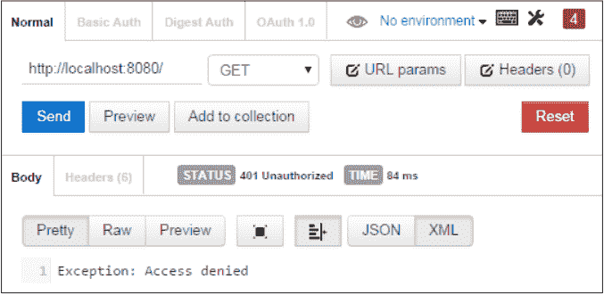
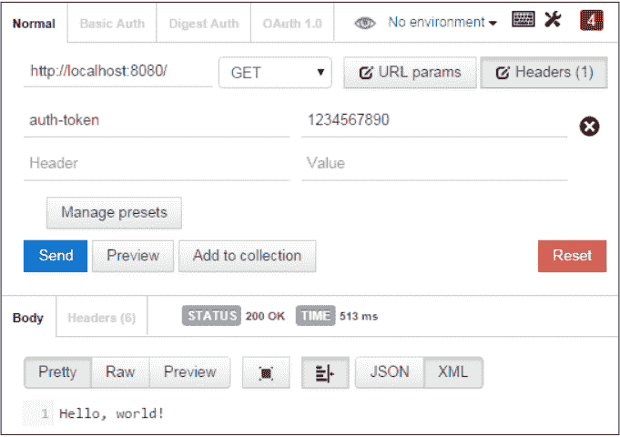
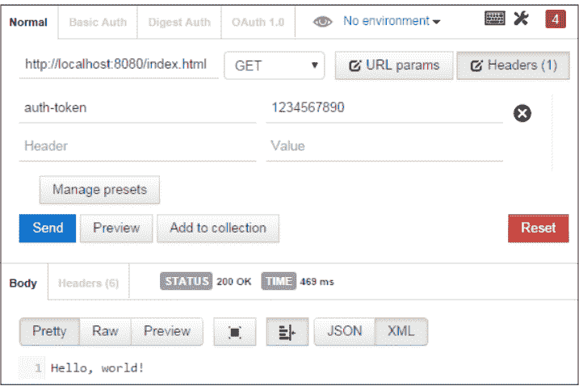

## 异步编程

现在检查我们的服务器端代码是否按预期工作。我们从 http://www.getpostman.com/ 安装了 Postman 扩展，用于从 Dartium Web 浏览器发送请求。我们发送到 http://localhost:8080 的第一个请求没有携带 auth-token，如下面的截图所示：



由于缺少 auth-token，该请求未获授权。让我们把它添加到 HTTP 头中，看看会发生什么：



最终，我们的请求得到授权，并返回 Hello, world! 作为成功消息。

### Zone 规范

现在，我们决定记录每个服务器请求和认证的信息。不建议在所有可能的地方注入日志函数。Zone 有 print 函数，可以将消息作为字面字符串打印。print 函数会按照 zone 嵌套层级向上冒泡消息，直到某个父 zone 拦截它，或者到达根 zone 并打印它。因此，我们只需要在 ZoneSpecification 类中重写 print 函数，将消息拦截到日志记录器。我们创建一个带有拦截器函数的新的 zoneSpecification，用于打印并在其中调用 log 函数，如下所示：

```dart
//...
main() {
  runZoned(runServer,
      zoneSpecification: new ZoneSpecification(
          print: (self, parent, zone, message) {
            log(message);
          }
      ),
      onError: (e) {
        // ...
      });
}
```

在后续的代码中，我们的 log 函数将消息记录到标准的 print 中，如下所示：

```dart
log(String message) {
  print(message);
}
```

在下面的代码中，我们打印请求路径：

```dart
runServer() {
  HttpServer
    .bind(InternetAddress.ANY_IP_V4, 8080)
    .then((server) {
      Set tokens = new Set.from(['1234567890']);
      server.listen((HttpRequest request) {
        runZoned((){
          Zone.current.print('Resource ${request.uri.path}');
          authenticate(request.headers.value('auth-token'));
          //...
        });
      });
    });
}
```

请记住，所有拦截器函数都期望以下四个参数：

```
print: (Zone self, ZoneDelegate parent, Zone zone, String message)
```

其中前三个参数始终相同：

- `self`：该参数表示正在处理回调的 zone。
- `parent`：该参数提供指向父 zone 的 ZoneDelegate，我们可以用它来与父 zone 通信。
- `zone`：该参数是第一个接收请求的 zone（在请求被冒泡之前）。

第四个参数始终取决于函数。在我们的示例中，它是将要打印的消息。

> ZoneSpecification 是覆盖 zone 特定函数的唯一方式。

让我们通过 Postman 扩展请求 index.html 文件来检查这段代码，如下面的截图所示：



控制台日志中将显示以下结果：

```
Resource /index.html
```

最后，一切都如预期般工作。

### Zone 之间的交互

让我们看看在服务器示例中，父 zone 与嵌套 zone 之间的交互如何发挥作用。假设您希望更好地控制静态页面的打印内容，可以使用以下代码：

```
//...
Set tokens = new Set.from(['1234567890']);
bool allowPrintContent = true;
server.listen((HttpRequest request) {
runZoned(() {
//...
});
runZoned(() {
readFile(request.uri.path).then((String context){
Zone.current.print(context);
request.response.write(context);
request.response.close();
});
}, zoneValues: {'allow-print':allowPrintContent},
zoneSpecification: new ZoneSpecification(
print: (Zone self, ZoneDelegate parent, Zone zone,
String message) {
if (zone['allow-print']) {
parent.print(zone, message);
}
}),
onError: (e) {
//...
```
```

我们添加一个布尔变量 allowPrintContent 来管理打印操作。在处理 readFile 的 Future 时，我们调用 zone 的 print 函数来打印页面内容。我们将 allowPrintContent 作为 zoneValues 中 allow-print 键的值注入。最后，在重写后的 print 函数内部，我们添加一个条件，允许仅在 allow-print 为 true 时打印页面内容。

我们再次通过 Postman 扩展请求 index.html 文件，并在控制台中看到以下结果：

```
Resource /index.html
Hello, world!
```

如预期那样，我们的代码打印出来自两个嵌套 zone 的信息。现在，我们将值改为 false 并重启服务器。下面的请求只打印来自第一个 zone 的消息：

```
Resource /index.html
```

通过 zone 变量，可以轻松地组织 zone 之间的交互。

### 跟踪 Zone 执行

服务器监听器包含两个 zone。第一个用于验证请求，第二个用于读取静态文件的内容并将其发送回客户端。了解每个静态页面的加载和处理耗时很有趣。Zone 支持多种 run 方法来在 zone 中执行给定的函数。我们可以重写 ZoneSpecification 中的 run 方法来统计请求处理函数所花费的时间。在我们的示例中，我们使用 Stopwatch 作为计时器。我们在向客户端发送响应之后，立即打印每个请求的剖析时间，如下面的代码所示：

```
//...
runServer() {
  HttpServer
    .bind(InternetAddress.ANY_IP_V4, 8080)
    .then((server) {
      Set tokens = new Set.from(['1234567890']);
      bool allowPrintContent = true;
      Stopwatch timer = new Stopwatch();
      server.listen((HttpRequest request) {
        runZoned(() {
//...
        });
        runZoned(() {
          readFile(request.uri.path).then((String context){
            Zone.current.print(context);
            request.response.write(context);
            request.response.close();
            Zone.current.print(
"Process time ${timer.elapsedMilliseconds} ms");
}});
}, zoneValues: {'allow-print':allowPrintContent},
zoneSpecification: new ZoneSpecification(
print: (Zone self, ZoneDelegate parent, Zone zone, String message) {
if (zone['allow-print']) {
parent.print(zone, message);
}
},
run: (Zone self, ZoneDelegate parent, Zone zone, f)
=> run(parent, zone, f, timer)
),
onError: (e) {
request.response.statusCode = HttpStatus.NOT_FOUND;
request.response.write(e.toString());
request.response.close();
}});
}});
}});
```

现在，我们在 ZoneSpecification 中重写 run 函数，以调用带 timer 的全局 run 函数，如下所示：

```
run(ZoneDelegate parent, Zone zone, Function f, Stopwatch timer) {
  try {
    timer.start();
    return parent.run(zone, f);
  } finally {
    timer.stop();
  }
}
```

在全局 run 函数中，我们在从父 zone 委托调用原始函数时运用了一个技巧。我们打算将函数包装在 try/finally 块中，以便在将结果返回给 zone 之前停止计时器。让我们再次请求相同的资源，如下所示：

```
Resource /index.html
Hello, world!
Process time 54 ms
```

现在，我们拥有了服务器上每个被处理的请求的剖析信息。除了标准的 run 函数之外，zone 还有 runUnary 和 runBinary 函数，用于传入一个或两个额外的参数，以便在 zone 内执行给定的函数。

### 隔离区（Isolates）

现在，是时候讨论我们服务器的性能了。我们使用一个 HTTP 基准测试工具，例如 Will Glozer 开发的 wrk（https://github.com/wg/wrk），来帮助我们进行调查。为避免混淆，我们将采用服务器的最简单版本，如下所示：

```
import 'dart:io';

main() {
  HttpServer
    .bind(InternetAddress.ANY_IP_V4, 8080)
    .then((server) {
      server.listen((HttpRequest request) {
        // Response back to client
        request.response.write('Hello, world!');
        request.response.close();
      });
    });
}
```

我们将这段代码与基准测试工具一起使用，并保持 256 个并发连接打开 30 秒，如下所示：

```
./wrk -t1 -c256 -d30s http://127.0.0.1:8080
```

以下是上述代码的结果：

```
Running 30s test @ http://127.0.0.1:8080
  1 threads and 256 connections
  Thread Stats   Avg   Stdev   Max   +/- Stdev
    Latency    33.89ms  24.51ms 931.37ms  99.76%
    Req/Sec    7.63k   835.29   9.77k   89.93%
  225053 requests in 30.00s, 15.02MB read
Requests/sec:  7501.81
Transfer/sec:     512.82KB
```

测试表明，我们的服务器每秒可以处理接近 7,500 个请求。实际上，这还不错。这个值还能提高吗？关键问题在于，所有这些工作都由单个线程处理：

- 单线程拥有处理所有出现在同一位置的客户端的代码。
- 所有工作都将在单个线程上按顺序运行。


如果总的工作量使核心饱和，那么额外的任务会扼杀并减慢服务器对所有客户端的响应速度，因为后续请求会排队等待之前的工作完成。**Isolates** 可以解决这个问题，并在不同的线程中运行服务器的多个实例。我们将继续改进我们的服务器，并使用随 Dart 1.4 版本发布的 `ServerSockets` 功能。我们将使用 `ServerSocket` 的引用同时运行多个服务器实例。不是创建 `HttpServer` 的实例，我们使用之前使用的相同初始参数创建 `ServerSocket`。

首先，我们需要在主线程中创建 `ReceivePort`，以接收从已生成的 isolates 发出的握手和常规消息。我们根据拥有的处理器数量创建尽可能多的 isolates。`Isolate` 类的 `spawn` 静态方法的第一个参数是一个全局函数，有助于在主线程和已生成的 isolate 之间组织握手。第二个参数是端口，作为全局函数的参数使用。相同的端口也用于从已生成的 isolates 向主线程发送消息。现在，我们需要监听来自已生成 isolates 的消息。已生成的 isolate 遵循握手过程，并且所有使用 `SendPort` 发送的消息都在主线程中被监听。握手过程完成后，我们创建并发送一个 `ServerTask` 实例。所有其他消息将作为字符串到来，并在控制台上打印，如以下代码所示：

```
import 'dart:isolate';
import 'dart:io';

main() {
  ServerSocket
    .bind(InternetAddress.ANY_IP_V4, 8080)
    .then((ServerSocket server) {
      // Create main ReceivePort
      ReceivePort receivePort = new ReceivePort();
      // Create as much isolates as possible
      for (int i = 0; i < Platform.numberOfProcessors; i++) {
        // Create isolate and run server task
        Isolate.spawn(runTask, receivePort.sendPort);
      }
      // Start listening messages from spawned isolates
      receivePort.listen((msg) {
        // Check what the kind of message we received
        if (msg is SendPort) {
          // There is hand-shaking message.
          // Let's send ServerSocketReference and port
          msg.send(new ServerTask(
              server.reference, receivePort.sendPort));
        } else {
          // Usual string message from spawned isolates
          print(msg);
        }
      });
    });
}

/**
 * Global function helps organize hand-shaking between main
 * and spawned isolate.
 */
void runTask(SendPort sendPort) {
    // Create ReceivePort for spawned isolate
    ReceivePort receivePort = new ReceivePort();
    // Send own sendPort to main isolate as response on hand-shaking
    sendPort.send(receivePort.sendPort);
    // First message comes from main contains a ServerTask instance
    receivePort.listen((ServerTask task) {
        // Just execute our task
        task.execute();
    });
}

/**
 * Task helps create ServerSocket from ServerSocketReference.
 * We use new instance of ServerSocket to create new HttpServer
 * which starts listen HttpRequests and sends requested path into
 * main's ReceivePort.
 */
class ServerTask {
    ServerSocketReference reference;
    SendPort port;

    ServerTask(this.reference, this.port);

    execute() {
        // Create ServerSocket
        reference.create().then((serverSocket) {
            // Create HttpServer and start listening incoming HttpRequests
            new HttpServer.listenOn(serverSocket)
                .listen((HttpRequest request) {
                    // Send requested path into main's ReceivePort
                    port.send(request.uri.path);
                    // Response back to client
                    request.response.write("Hello, world");
                    request.response.close();
                });
        });
    }
}
```

我们的代码足够清晰，并且在 isolates 的帮助下性能潜力更高。程序更清晰，因为处理每个请求的代码被很好地封装在其自己的函数中，并且更快，因为每个 ServerSocket 实例保持不同的连接异步且独立；一个连接上的工作不必在另一个连接上的工作之后按顺序等待处理。总的来说，这即使在单核服务器上也能提供更好的响应性。在实践中，在具有并行硬件的服务器上，它在负载下提供了更好的可扩展性。现在，运行测试，我们将看到服务器的显著改进：

```
./wrk -t1 -c256 -d30s http://127.0.0.1:8080
```

以下是前述代码的结果：

```
Running 30s test @ http://127.0.0.1:8080
  1 threads and 256 connections
Thread Stats   Avg   Stdev   Max   +/- Stdev
  Latency    10.31ms   6.11ms  50.81ms   73.78%
    Req/Sec   24.01k   2.00k  28.32k   67.52%
  709163 requests in 30.00s, 46.67MB read
Requests/sec:  23638.95
Transfer/sec:      1.56MB
```

我们的服务器在支持并发的环境中可以处理接近 24,000 个请求每秒。太棒了！

因此，在快速探索并发世界之后，让我们总体讨论 isolates。只需重复异步编程的最佳实践：

- 程序由来自不同独立源的排队事件驱动
- 程序的所有部分必须松散耦合

Isolate 是一个围绕为简单的 FIFO 消息队列提供服务而构建的进程。它不与其他 isolates 共享内存，并且所有 isolates 通过传递消息进行通信，消息在发送前会被复制。正如你所见，isolates 的实现遵循与异步编程相同的核心原则。

> 如果你需要从其他 isolates 接收消息或相互发送消息，请始终将接收端口设置为主 isolate。

## Summary

你现在对事件驱动架构有了更好的理解，这是 Dart VM 的关键概念之一。事件驱动架构是构建松散耦合的异步系统的正确方法。

Dart 依赖于基于单线程执行模型、单个事件循环和两个队列的事件驱动架构。事件循环由单个线程支持，因此完全不需要同步或锁。当事件循环被操作阻塞时，整个应用程序都会被阻塞。单线程执行模型与异步操作的结合使应用程序更具生产力且资源消耗更少。

Future 是对初始未知结果的代理，其返回值而不是调用回调。Future 几乎总是向正在事件循环中处理的队列添加一个事件或微任务。Future 只能用值或错误完成一次。

Zones 实现了可配置的代码包装器的最佳实践，以处理未捕获的错误。Zones 可以具有局部变量，可以调度微任务、创建一次性或重复计时器、打印信息，并为调试目的保存堆栈跟踪。

Isolate 是一个围绕为简单消息队列提供服务而构建的进程。它不与其他 isolates 共享内存，并且所有 isolates 通过传递消息进行通信，消息在发送前会被复制。

在下一章中，我们将看到流框架并展示何时以及如何正确使用它。
