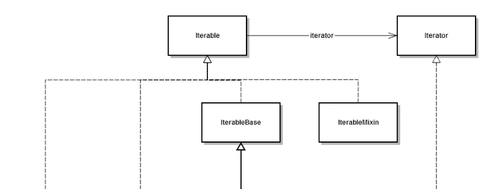

## 集合框架

集合框架是一组用于存储和操作对象组的高性能类。该框架允许不同类型的集合以类似的方式工作，并且是围绕一组标准接口设计的。接口的几种标准实现可以很容易地扩展或调整。

在本章中，我们将介绍以下主题：

- 集合框架简介
- 集合中元素的排序
- 主要接口的类层次结构
- Iterable 和 Iterator 接口
- List、Set、Queue 和 Map 集合的实现
- 不可变集合
- 选择合适的集合

### Dart 集合框架

通常，集合是持有一组对象的对象。集合中的每个项称为元素。Dart 集合框架具有以下优点：

- 它是一组接口，迫使开发者采用某些设计原则
- 它可以显著提高应用程序的性能

框架提供了统一的接口来存储和操作集合的元素，并隐藏实际实现。Dart 集合实现针对 Dart 和 JavaScript VM 中的执行进行了高度优化，比你自己编写的实现高效得多。

```
var list = [second, first];
print(list);
// => [2, 1]
list.sort();
print(list);
// => [1, 2]
}
```

## Comparator 类型

那么，如何对未实现 `Comparable` 接口的类进行排序呢？下面是一个 `Entity2` 类，对其实现 `Comparable` 接口要么不可能，要么不必要：

```
class Entity2 {
    final int index;

    Entity2(this.index);

    @override
    String toString() => index != null ? index.toString() : null;
}
```

为了比较这个类，你必须使用如下 `Comparator` 类型定义：

```
typedef int Comparator<T>(T a, T b);
```

所有集合类的 `sort` 方法都接受一个符合 `Comparator` 签名的函数。这里，我们传递一个匿名函数来对 `Entity2` 类进行比较排序，如下所示：

```
void main() {
    var list = [new Entity2(2), new Entity2(1)];
    print(list);
    // => [2, 1]
    list.sort((Entity2 a, Entity2 b) {
        return a.index.compareTo(b.index);
    });
    print(list);
    // => [1, 2]
}
```

如你所见，匿名函数接受两个相同类型的参数，并返回一个整数。这与 `Comparator` 类型定义的签名完全匹配。

如果省略 `sort` 方法的参数，它将使用 `Comparable` 接口的静态 `compare` 方法。

## 集合与泛型

所有已实现的集合类都非常依赖泛型。

如第 2 章“高级技术与反射”所讨论的，泛型提供了集合所包含对象的类型。每次尝试添加其他类型的元素都会生成静态分析警告。集合中的泛型具有以下优点：

- 它们有助于避免运行时的类转换错误，因为我们会在静态分析期间获得警告
- 它们使代码更简洁，因为无需使用转换运算符和条件来检查类型
- 它们仅在执行以生产模式进行时才带来运行时优势。编译为 JavaScript 的代码不检查类型和泛型

## 集合类层次结构

Dart 集合框架具有一组可用的集合类，这些类存在于 `dart:core` 和 `dart:collection` 库中，如下图所示：



标准集合接口简化了集合在类方法之间传递和返回的过程，并使这些方法能够处理各种集合。使用常见的集合实现可以使代码更简短、更快速。遵循这些实现，你可以使代码更加标准化，更容易让自己和别人理解。

## Iterable 接口

`Iterable` 接口可以定义为集合框架中所有类的共同行为，这些类支持一种遍历集合中所有元素的机制。它是一个使用 `Iterator` 接口来遍历集合中所有元素的对象。有两个实现 `Iterator` 接口的抽象类：`IterableBase` 和 `IterableMixin`。`IterableMixin` 类非常适合在 mixin 解决方案中被扩展。如果你计划创建自己的 `Iterable` 接口实现，则需要扩展其中一个类。`Iterable` 接口中有许多不同的方法可以帮助你操作集合中的元素。

> `Iterable` 接口不支持向集合中添加或移除元素。

## Iterable 集合的属性

以下列表是所有集合共有的只读属性：

- `length`：此属性返回集合中元素的数量。
- `isEmpty`：如果集合中没有元素，此属性返回 `true`。
- `isNotEmpty`：如果集合中至少有一个元素，此属性返回 `true`。
- `first`：此属性返回集合的第一个元素，如果集合为空，则抛出 `StateError`。
- `last`：此属性返回集合的最后一个元素，如果集合为空，则抛出 `StateError`。
- `single`：此属性返回集合中的唯一一个元素。如果集合为空或包含多个元素，则抛出 `StateError`。
- `iterator`：此属性返回一个对 `Iterator` 类实例的引用，该类实例用于遍历集合的元素。


## 在条件上检查集合的项

有时，你想知道集合中的所有对象或其中任何对象是否符合特定条件。以下方法检查集合是否符合特定条件：

- **every**：此方法如果集合中的每个元素都满足指定的条件，则返回 `true`。这可以在以下代码中看到：
```
List colors = ['red', 'green', 'blue'];
print(colors.every((color) => color != null || color != ''));
 // => true
```
- **any**：此方法如果集合中的一个元素满足指定的条件，则返回 `true`。这在以下代码中有所说明：
```
List colors = ['red', 'green', 'blue'];
print(colors.any((color) => color == 'red'));
// => true
```

## 遍历集合

以下方法帮助你遍历集合的元素：

- **forEach**：此方法将指定的函数应用于集合的每个元素。这可以在以下代码中看到：
```
List colors = ['red', 'green', 'blue'];
colors.forEach((color) => print(color));
// => red
// => green
// => blue
```

## 在集合上搜索

在集合上搜索列表包括以下用于在集合中搜索元素的方法：

- **contains**：此方法如果集合包含等于所请求的元素，则返回 `true`。这在以下代码中显示：
```
List colors = ['red', 'green', 'blue'];
print(colors.contains('red'));
// => true
```
- `elementAt`：此方法返回 `indexth` 元素。返回的确切对象取决于你使用的特定集合类实现的排序算法，如以下代码所示：
```
List colors = ['red', 'green', 'blue'];
print(colors.elementAt(0));
// => red
```
- `firstWhere`：此方法返回集合中满足给定谓词测试的第一个元素或 `orElse` 函数的结果。如果未指定 `orElse`，则抛出 `StateError`，如以下代码所示：
```
List colors = ['red', 'green', 'blue'];
print(colors.firstWhere((color) => color == 'orange',
orElse:() => 'orange'));
// => orange
```
- `lastWhere`：此方法返回集合中满足给定谓词测试的最后一个元素或 `orElse` 函数的结果。如果未指定 `orElse`，则抛出 `StateError`，如以下代码所示：
```
List colors = ['red', 'green', 'blue'];
print(colors.lastWhere((color) => color != 'orange',
    orElse:() => ''));
// => blue
```
- `singleWhere`：此方法返回集合中满足测试的单个元素。如果集合为空或匹配的元素多于一个，则抛出 `StateError`。代码如下：
```
List colors = ['red', 'green', 'blue'];
print(colors.singleWhere((color) => color == 'red'));
// => red
```

> 如果集合不支持排序，则调用 elementAt 的结果可能是任意元素。

## 创建新集合

以下列表包括从原始集合创建新集合的方法；它们都返回 Lazy Iterable 结果：

- **expand**：此方法通过将原始集合的每个元素扩展为零个或多个元素来返回新集合。这可以在以下代码中看到：
```
List colors = ['red', 'green', 'blue'];
print(colors.expand((color) {
    return color == 'red'
        ? ['orange', 'red', 'yellow']
        : [color];
}));
// => [orange, red, yellow, green, blue]
```
- **map**：此方法基于使用指定函数转换的原始集合的元素创建新集合。代码如下：
```
List colors = ['red', 'green', 'blue'];
print(colors.map((color) {
    if (color == 'green') return 'orange';
    if (color == 'blue') return 'yellow';
    return color;
}));
// => ['red', 'orange', 'yellow']
```
- **take**：此方法返回一个 Iterable 集合，其中包含来自原始集合的指定数量的元素。这些元素的值必须不为负数。如果请求的元素数量超过实际元素数量，则返回集合中的所有元素：
```
List nums = [1, 2, 3, 4, 5, 6];
print(nums.take(7));
// => [1, 2, 3, 4, 5, 6]
```
- **takeWhile**：此方法返回一个 Iterable 集合，一旦测试不再满足就停止。这在以下代码中有所说明：
```
List nums = [1, 2, 3, 4, 5, 6];
print(nums.takeWhile((element) => element < 5));
// => [1, 2, 3, 4]
```
- fold：此方法通过使用指定的函数迭代地将集合的每个元素与现有值组合，将集合简化为单个值。在这里，我们必须指定初始值和聚合函数：
```
List nums = [1, 2, 3];
print(nums.fold(0, (acc, element) => acc + element));
// => 6
```

## 转换集合

以下方法用于转换集合的所有元素：

- **join**：此方法将集合的每个元素转换为字符串并返回用可选分隔符分隔的连接结果。如果集合为空，它实际上不会修改集合中元素的类型，但只是返回一个空字符串：
```
List nums = [1, 2, 3];
print(nums.join(' - '));
// => 1 - 2 - 3
```

## 生成集合

Iterable 接口有一个工厂方法，有助于创建新的 Iterable 接口并用生成器函数生成的指定数量的值填充，如以下代码所示：

```
Iterable generated = new Iterable.generate(4,
    (count) => "Is $count");
print(generated);
// => [Is 0, Is 1, Is 2, Is 3]
```

如果生成器函数不存在，此方法生成一个仅包含整数值的集合：

```
Iterable generated = new Iterable.generate(4);
print(generated);
// => [0, 1, 2, 3]
```

## 惰性 Iterable

惰性 Iterable 术语在 Iterable 接口中被大量使用。它是一种迭代策略，延迟集合的迭代直到其值被需要，并避免重复迭代。在以下示例中，我们的代码遍历数字列表。

where 方法打印有关当前获取元素的的信息。此函数仅在我们实际在 Iterable 接口的 forEach 方法中获取元素时才调用对象，如以下代码所示：

```
lazyIterable() {
    List nums = [1, 2, 3];
    print('Get Iterable for $nums');
    Iterable iterable = nums.where((int i) {
        print('Fetched $i');
        return i.isOdd;
    });
    print('Start fetching');
    iterable.forEach((int i) {
        print("Received $i");
    });
}
```

以下是前面函数的输出：

```
Get Iterable for [1, 2, 3]
Start fetching
Fetched 1
Received 1
Fetched 2
Fetched 3
Received 3
```

以下是惰性 Iterable 的优点：

- 性能提高，因为避免了不必要的迭代
- 内存使用占用减少，因为值在需要时才迭代
- 它有助于创建无限数据结构

请记住，遍历惰性 Iterable 可能比正常迭代慢得多，因为代码会产生从 Iterable 源获取下一个项目的调用成本。

结果如预期：

```
red
green
blue
```

调用 moveNext 方法在集合结束时会返回 false，并且当前指针始终返回最后一个元素。

for 循环语句透明地使用 Iterator 遍历集合：

```
void main() {
  List<String> colors = ['red', 'green', 'blue'];

  for (String color in colors) {
    print(color);
  }
}
```

结果与前面的示例类似。

## BidirectionalIterator

有时，我们需要在两个方向上遍历元素集合。为了帮助这种情况，Dart 提供了 BidirectionalIterator。在以下代码中，BiListIterator 是 BidirectionalIterator 的实现：

```
class BiListIterator<E> implements BidirectionalIterator<E> {
  final Iterable<E> _iterable;
  final int _length;
  int _index;
  E _current;
```

构造函数有一个额外的可选 back 参数，定义迭代的方向：

```
BiListIterator(Iterable<E> iterable, {bool back:false}) :
  _iterable = iterable, _length = iterable.length,
  _index = back ? iterable.length - 1 : 0;

E get current => _current;
```


## 集合框架

下面的代码展示了 Iterator 的 moveNext 方法，用于向前移动。该方法与下一个方法会比较 Iterable 的长度和集合的实际长度，以检查并发修改。代码如下：

```
bool moveNext() {
    int length = _iterable.length;
    if (_length != length) {
        throw new ConcurrentModificationError(_iterable);
    }
    if (_index >= length) {
        _current = null;
        return false;
    }
    _current = _iterable.elementAt(_index);
    _index++;
    return true;
}
```

下面展示的 BidirectionalIterator 的 movePrevious 方法用于向后移动：

```
bool movePrevious() {
    int length = _iterable.length;
    if (_length != length) {
        throw new ConcurrentModificationError(_iterable);
    }
    if (_index < 0) {
        _current = null;
        return false;
    }
    _current = _iterable.elementAt(_index);
    _index--;
    return true;
}
```

我创建了一个小示例来证明我们可以双向移动：

```
main() {
    var list = new List.from([1, 2, 3, 4]);
    // Forward Iteration
    BiListIterator iter = new BiListIterator(list);
    while(iter.moveNext()) {
        print(iter.Current);
    }
    // => 1, 2, 3, 4
```

```dart
// Backward Iteration
iter = new BiListIterator(list, back:true);
while(iter.movePrevious()) {
  print(iter.current);
}
// => 4, 3, 2, 1
}
```

首先，我创建了一个 `List` 实例，但它也可以是 `Set` 或 `Queue`，或任何其他实现了 Iterable 接口的集合。然后，我实例化了 `BiListIterator` 并将其指向我的 Iterable 集合，这样我们就可以向前遍历集合中的元素了。之后，我创建了另一个 `BiListIterator` 实例，但指定了迭代的向后方向。最后，我可以调用 `movePrevious` 向后方移动。
