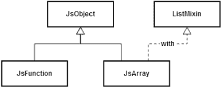
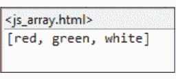
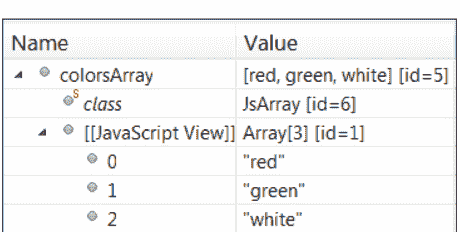
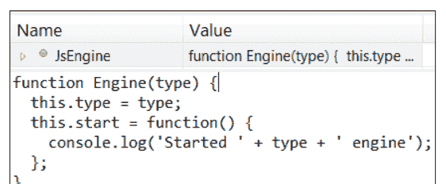

## 7
Dart 与 JavaScript 互操作

如今许多 Web 应用程序都是用 JavaScript 编写的，在本章中，我们将重点介绍如何使用 Dart 与它们通信。我们还将涵盖以下主题：

- `dart:js` 库
- 类型转换
- `JsObject` 与实例化
- `JsFunction` 与 `this` 关键字
- Dart 与 jQuery

## 互操作概览

用 Dart 编写的 Web 应用程序只能在嵌入到名为 Dartium（Chromium 的特殊版本）的浏览器中的 Dart VM 中执行。为了在其他 Web 浏览器中执行，Dart 代码必须编译为 JavaScript——所有 Web 浏览器都支持的语言。最新的趋势表明，JavaScript 将在很长一段时间内继续作为 Web 开发的语言存在，因为它广受欢迎，并且拥有大量工具和框架。这意味着 Dart 必须能够在任何 Web 浏览器中与 JavaScript 代码进行通信。

> JavaScript 库需要在 Dart 代码之前包含在 HTML 中。


## dart:js 库

Dart 核心库集合包含 `dart:js`，用于促进 Dart 和 JavaScript 代码之间的互操作。Dart 代码可以创建新实例、调用方法以及读取和写入 JavaScript 代码中编写的属性。在通信过程中，`dart:js` 库将 JavaScript 对象转换为 Dart 对象，反之亦然，或者使用代理类。让我们看一下 `dart:js` 库的类层次结构：



## JsObject

与 JavaScript 中的 `Object` 类类似，`JsObject` 是 `dart:js` 库中的主类。它表示 JavaScript 对象的代理，并提供以下优点：

- 通过 `[]` 和 `[]=` 运算符索引，访问底层 JavaScript 对象的所有属性
- 通过 `callMethod` 调用底层 JavaScript 对象的任何方法
- 通过 `context` 属性访问 Web 浏览器中的全局 JavaScript 对象（通常是 `window`）
- 使用 `instanceOf` 方法检查底层 JavaScript 对象是否在其原型链中具有指定类型
- 通过 `hasProperty` 方法检查底层 JavaScript 对象是否存在某个属性；此方法等同于 JavaScript 中的 `in` 运算符
- 底层 JavaScript 对象的任何属性都可以使用 `deleteProperty` 方法删除；此方法等同于 JavaScript 中的 `delete` 运算符

可以从 JavaScript 对象获取 `JsObject`，也可以使用以下工厂构造函数创建：

- `factory JsObject(JsFunction constructor, [List arguments])`：此构造函数从 JavaScript 构造函数创建一个新的 JavaScript 对象，并返回其代理。
- `factory JsObject.fromBrowserObject(object)`：此构造函数从原生 Dart 对象创建一个新的 JavaScript 对象，并返回其代理。仅当希望访问浏览器托管对象（如 Node 或 Blob）的属性时，才使用此工厂构造函数。如果对象为 null 或类型为 bool、num 或 string，则此构造函数会抛出异常。
- `factory JsObject.jsify(object)`：此构造函数从 Dart Map 或 Iterable 创建一个新的 JavaScript 对象或数组，并返回其代理。此构造函数递归地将集合中的每个 Dart 对象转换为 JavaScript 对象。

库有一个顶级 `context` getter，提供 `JsObject` 类实例，表示 Web 浏览器中的 JavaScript 全局对象，如下代码所示：

```dart
import 'dart:js' as js;

void main() {
  print('Context is ${js.context}');
}
```

前面代码的打印结果确认该 context 指向 Window 对象：

```text
Context is [object Window]
```

假设我们需要从 Dart 在控制台上记录一些信息。可以通过以下方式完成：

```dart
import 'dart:js' as js;

void main() {
  js.JsObject console = js.context['console'];
  console.callMethod('log', ['Hello World!']);
}
```

## Dart 与 JavaScript 互操作

首先，我们使用 `js.context` 接收 `JsObject` 控制台对象的代理。然后，我们使用 `JsObject` 的 `callMethod` 调用 console 的 `log` 函数。`callMethod` 的第二个可选参数将参数传递给底层的 JavaScript 函数。最后，我们在 Web 浏览器的控制台上获得 **Hello World!** 消息。

> 如果请求的对象不存在，context 返回 `null`。

## JsFunction

JavaScript 的下一个重要部分是 Function 类型。`dart:js` 库有 `JsFunction` 类，它扩展了 `JsObject`，表示 JavaScript 函数的代理。要从 Dart 代码调用 JavaScript `alert` 函数，可以使用以下代码：

```dart
import 'dart:js' as js;

void main() {
  js.JsFunction alert = js.context['alert'];
  alert.apply(['Hello World!']);
}
```

当我们获得 `alert` 函数的代理时，我们使用 `apply` 方法并传递参数列表，得到以下结果：


## JsArray

JavaScript 中的数组是用于在单个变量中存储多个值的对象。`JsArray` 扩展了 `JsObject` 类，表示 JavaScript 数组，并使底层实例在 Dart 代码中可用。我创建了带有 `colors` 数组的 JavaScript 代码，如下代码所示：

```javascript
var colors = ['red', 'green', 'white'];
```

要在 Dart 中获取所有颜色并打印出来，我们使用以下代码：

```dart
import 'dart:js' as js;

void main() {
  js.JsArray colorsArray = js.context['colors'];
  print(colorsArray);
}
```

现在，我们将代理分配给 JavaScript 中的颜色数组，最后将它们全部打印出来，如下面的截图所示：



如果在 Dart Editor 的变量检查器中选中 `colorsArray` 属性（当到达断点时），您可能会看到来自 JavaScript 数组的一组项目：



## 类型转换

到目前为止，我们所见的所有代码都基于 `dart:js` 库内部发生的自动类型转换。这种转换始终是双向的。一旦你了解了其发生方式，你就会更好地理解该解决方案的局限性，并有助于避免错误。

## 直接类型转换

Dart 支持通过直接从 JavaScript 类型转换以下一小部分类型：

- `null`, `bool`, `num`, `String`, 和 `DateTime`（基本类型）
- `Blob`
- `Event`
- `HtmlCollection`
- `ImageData`
- `KeyRange`
- `Node`
- `NodeList`
- `TypedData`（包括其子类，如 `Int32List`，但不包括 `ByteBuffer`）
- `Window`

以下是在 JavaScript 文件中准备的一组不同类型的 JavaScript 变量：

```javascript
var v_null = null;
var v_bool = true;
var v_num = 1.2;
var v_str = "Hello";
var v_date = new Date();
var v_blob = new Blob(
  ['<a id="a"><b id="b">hey!</b></a>'],
  {type : 'text/html'});
var v_evt = new Event('click');
var v_nodes = document.createElement("form").children;
var v_img_data = document.createElement("canvas").
  getContext("2d").createImageData(10, 10);
var v_key_range = IDBKeyRange.only(100);
var v_node = document.createElement('div');
var v_node_list = document.createElement('div').childNodes;
var v_typed = new Int32Array(new ArrayBuffer(8));
var v_global = window;
```

现在，我们将使用反射来研究转换在 Dart 中是如何发生的，如下代码所示：

```dart
import 'dart:js' as js;
import 'dart:mirrors';

void main() {
  print(getFromJSContext('v_null'));
  print(getFromJSContext('v_bool'));
  print(getFromJSContext('v_num'));
  print(getFromJSContext('v_str'));
  print(getFromJSContext('v_date'));
  print(getFromJSContext('v_blob'));
  print(getFromJSContext('v_evt'));
  print(getFromJSContext('v_nodes'));
  print(getFromJSContext('v_img_data'));
  print(getFromJSContext('v_key_range'));
  print(getFromJSContext('v_node'));
  print(getFromJSContext('v_node_list'));
  print(getFromJSContext('v_typed'));
  print(getFromJSContext('v_byte_data'));
  print(getFromJSContext('v_global'));
}

getFromJSContext(name) {
  var obj = js.context[name];
  if (obj == null) {
    return name + ' = null';
  } else {
    return name + ' = ' + obj.toString() + ' is ' + getType(obj);
  }
}

getType(obj) {
  Symbol symbol = reflect(obj).type.qualifiedName;
  return MirrorSystem.getName(symbol);
}
```

## Dart 与 JavaScript 互操作

在前面的代码中，`getFromJSContext` 方法返回了转换后的 JavaScript 对象的名称、值和类型。以下是打印在 Web 浏览器控制台上的结果：

```text
v_null = null
v_bool = true is dart.core.bool
v_num = 1.2 is dart.core._Double
v_str = Hello is dart.core._OneByteString
v_date = 2014-06-21 18:09:03.145 is dart.core.DateTime
v_blob = Instance of 'Blob' is dart.dom.html.Blob
v_evt = Instance of 'Event' is dart.dom.html.Event
v_nodes = [object HTMLCollection] is dart.js.JsObject
v_img_data = Instance of 'ImageData' is dart.dom.html.ImageData
v_key_range = Instance of 'KeyRange' is dart.dom.indexed_db.KeyRange
v_node = div is dart.dom.html.DivElement
v_node_list = [object NodeList] is dart.js.JsObject
v_typed = [0, 0] is dart.typed_data._ExternalInt32Array
v_byte_data = null
v_global = <window> is dart.dom.html.Window
```

您可以使用上述技术检查 JavaScript 对象将转换为哪种 Dart 类型。

## 代理类型转换

所有其他 JavaScript 类型都借助代理转换为 Dart 类型。让我们看一下以下 JavaScript 代码：

```javascript
var Engine = function(type) {
    this.type = type;
    this.start = function() {
        alert('Started ' + type + ' engine');
    };
};

var v_engine = new Engine('test');
```

在前面的代码中，我们实例化了 `Engine` 类并将其赋给 `v_engine` 变量。以下代码有助于研究 `Engine` 类到 Dart 的转换：

```dart
import 'dart:js' as js;
import 'dart:mirrors';

void main() {
```


```dart
print(getFromJSContext('v_engine'));
}

getFromJSContext(name) {
  var obj = js.context[name];
  if (obj == null) {
    return name + ' = null';
  } else {
    return name + ' = ' + obj.toString() + ' is ' + getType(obj);
  }
}

getType(obj) {
  Symbol symbol = reflect(obj).type.qualifiedName;
  return MirrorSystem.getName(symbol);
}
```

在上面的代码中，我们从之前的代码中复制了 `getFromJSContext` 和 `getType`。下面是在 Web 浏览器控制台中显示的结果：

```text
v_engine = [object Object] is dart.js.JsObject
```

这个结果证实了任何普通对象都可以通过 JsObject 代理转换为 Dart。

## 集合转换

Dart 集合可以通过 JsObject 的 `jsify` 构造函数转换为 JavaScript 集合。这个构造函数会递归地将 Dart Map 和 Iterable 转换为 JavaScript 对象和数组，并返回一个指向转换结果的 JsObject 代理。它也支持内部集合。下面的 JavaScript 代码包含变量 `data` 以及 `toType` 和 `log` 方法：

```javascript
function toType(obj) {
  return ({}).toString.call(obj).
    match(/\s([a-zA-Z]+)/)[1].toLowerCase()
};

var data;

function log() {
  console.log(toType(data));
  for (i in data) {
    console.log('- ' + i.toString() + ': ' +
      data[i].toString() + ' (' + toType(data[i]) + ')');
  }
};
```

让我们看一下引用了 JavaScript 的 log 函数的 Dart 代码：

```dart
import 'dart:js' as js;

void main() {
  js.JsFunction log = js.context['log'];

  js.JsArray array = new js.JsObject.jsify([1, 'a', true]);
  js.context['data'] = array;
  log.apply([]);

  js.JsObject map = new js.JsObject.jsify(
    {'n':1, 't':'a', 'b':true, 'array':array}
  );
  js.context['data'] = map;
  log.apply([]);
}
```

在上面的代码中，我们创建了一个数组并将其赋值给 JavaScript 的 data 变量。我们通过 log 的 apply 方法记录了 JavaScript 数组中的所有项目。我们向 apply 函数传入一个空数组作为参数，因为对应的 JavaScript 函数没有参数。之后，我们创建了一个 map 对象，填充好内容，然后再次调用 JavaScript 的 log 函数。为了检查对内部集合的支持，我们将数组作为最后一个项目插入到 map 对象中。结果如下：

```text
array
- 0: 1 (number)
- 1: a (string)
- 2: true (boolean)
object
- n: 1 (number)
- t: a (string)
- b: true (boolean)
- array: 1,a,true (array)
```

我们所有的对象和内部集合都被转换成了正确的 JavaScript 对象。

## JsObject 与实例化

对象构造函数是在 JavaScript 中创建 Object 类实例的标准方式。对象构造函数只是一个普通的 JavaScript 函数，它足够强大，可以定义属性、调用其他函数以及执行更多操作。要创建对象的实例，我们需要通过 new 运算符调用对象构造函数。让我们看看下面的 JavaScript 代码：

```javascript
function Engine(type) {
  this.type = type;
  this.start = function() {
    console.log ('Started ' + type + ' engine');
  };
};
```

Engine 是一个对象构造函数。它有一个 type 属性和一个 start 方法。下面是我们如何在 Dart 中创建 JavaScript 对象的实例：

```dart
import 'dart:js' as js;

void main() {
  js.JsFunction JsEngine = js.context['Engine'];
  js.JsObject engineObj = new js.JsObject(JsEngine, ['diesel']);
  assert(engineObj.instanceof(JsEngine));
  engineObj.callMethod('start');
}
```

我们创建了一个 JsFunction 变量 JsEngine，作为 JavaScript 对象构造函数 Engine 的引用。为了创建 engineObj 对象，我们使用了通过 JsObject 代理创建的对象构造函数。函数参数必须通过第二个参数传递，因此我们将 diesel 指定为引擎类型。随后，我们检查 engineObj 是否是 JsEngine 类型的实例。最后，我们从 engineObj 调用 start 方法，它会在控制台上打印以下消息：

```text
Started diesel engine
```

当代码运行到断点时，如果你在 Dart Editor 的变量检查器中选择 JsEngine 属性，就会看到 JavaScript 函数的源代码，如下面的截图所示：



## JsFunction 与 this 关键字

在 Dart 中，this 关键字指向类的当前实例，并且一旦类对象被实例化就永远不会改变。通常，我们应该省略 this 关键字，只在类成员与函数参数或变量之间出现名称冲突时才使用它。在 JavaScript 中，this 关键字指向拥有该函数的对象，其行为与 Dart 不同。它主要取决于函数是如何被调用的。在函数执行期间我们无法改变 this 的值，而且每次调用函数时它的值都可能不同。Function.prototype 的 call 和 apply 方法是在 ECMAScript 3 中引入的，用于在这些方法的调用中将任何特定对象绑定到 this 的值上：

```text
fun.call(thisArg[, arg1[, arg2[, ...]]])
fun.apply(thisArgs[, argsArray])
```

虽然这两个函数的语法看起来很相似，但根本区别在于：call 方法接受一个参数列表，而 apply 方法接受一个参数数组。

JavaScript 中的所有函数都继承自 Function.prototype 的 call 和 apply 方法，因此这两个方法都会调用原始函数，并将第一个参数永久赋值给 this 关键字的值，使其无法被覆盖。

下面的 Function.prototype 的 bind 方法是在 ECMAScript 5 中引入的：

```text
fun.bind(thisArg[, arg1[, arg2[, ...]]])
```

该方法会创建一个新函数，其函数体和作用域与原始函数相同，但 this 关键字会永久绑定到 bind 函数的第一个参数，无论该函数如何使用。call 和 bind 方法可以解决我们在改变 this 关键字时面临的问题。让我们看看如何通过下面的 JavaScript 代码实现这一点：

```javascript
this.name = 'Unknown';

function sendMessage(message) {
  console.log('Send message: ' + this.name + ' ' + message);
}

function DieselEngine() {
  this.name = 'Diesel';
}

sendMessage('engine started');

var engine = new DieselEngine()

var dieselLog = sendMessage.bind(engine);
dieselLog('engine started');
```

调用 sendMessage 函数会得到以下控制台日志：

```text
Send message: Unknown engine started
```

sendMessage 函数会在控制台上打印一条带有 Unknown 名称的消息，因为 this 引用的是 Web 浏览器中的全局对象。然后，我们创建了一个 Engine 实例，并将 sendMessage 函数绑定到 engine 上。bind 方法创建了一个名为 dieselLog 的新函数，其函数体相同，但 this 关键字被永久绑定到 engine。因此，当你调用 dieselLog 函数时，它会使用 DieselEngine 中的名称，并打印以下消息：

```text
Send message: Diesel engine started
```

如果我们需要使用 Dart 版本的 sendMessage 而不是原始版本，可以使用 JsFunction 类的 withThis 构造函数实例化 JsFunction，以将 this 的值作为第一个参数传入并调用该函数：

```dart
import 'dart:js' as js;

void main() {
  js.context['sendMessage'] = new
    js.JsFunction.withThis(otherSendMessage);

  js.JsFunction DieselEngine = js.context['DieselEngine'];
  js.JsObject engine = new js.JsObject(DieselEngine);

  js.JsFunction sendMessage = js.context['sendMessage'];
  sendMessage.apply(['engine started'], thisArg: engine);
}
```

```dart
otherSendMessage(self, String message) {
  print('Message sent: ' + self['name'] + ' ' + message);
}
```

首先，我们将 Dart 的 otherSendMessage 函数赋值给 JavaScript 的 sendMessage 函数。命名构造函数 withThis 会创建一个 JavaScript 函数模式，并在以后的所有调用中使用对 otherSendMessage 的引用，而不是 func：

```javascript
function () {
  return func(this, Array.prototype.slice.apply(arguments));
}
```

因此，当我们调用 sendMessage 的 apply 方法时，JavaScript 函数会调用原始的 otherSendMessage 函数。它将 engine 对象传递给 otherSendMessage 函数的 self 参数，并将 engine started 字符串传递给 message 参数。结果会打印到 Web 控制台中：

```text
Send message: Unknown engine started
Send message: Diesel engine started
Message sent: Diesel engine started
```

请记住，otherSendMessage 函数的 self 参数的类型取决于作为 sendMessage 实例的 apply 方法的第二个参数传入的值。

## Dart 与 jQuery

毫无疑问，jQuery 因其简单性而深受开发者欢迎。让我们尝试在一个实际示例中结合 jQuery 的简单性和 Dart 的强大功能。出于演示目的，我们创建了 js_proxy 包，以帮助 Dart 代码与 jQuery 通信。该包位于 pub 管理器中，网址为 https://pub.dartlang.org/packages/js_proxy。这个包构建于 dart:js 之上，包含一个同名库和唯一的类 JProxy。JProxy 类的实例可以通过生成构造函数创建，我们可以在其中指定一个可选的、指向被代理的 JsObject 的引用：

```dart
JProxy([this._object]);
```


我们可以通过一个命名构造函数创建 `JProxy` 实例，并提供通过 `dart:js` 上下文可访问的 JavaScript 对象的名称，如下所示：

```
JProxy.fromContext(String name) {
  _object = js.context[name];
}
```

JProxy 实例持有对被代理的 JsObject 类的引用，并在其上执行所有操作，如以下代码所示：

```
js.JsObject _object;
js.JsObject get object => _object;
```

## 如何创建 jQuery 的快捷方式

我们可以使用 `JProxy`，通过 `dart:js` 库中的上下文创建对 jQuery 的引用，如下所示：

```
var jquery = new JProxy.fromContext('jQuery');
```

另一种非常流行的方式是使用美元符号作为 jQuery 变量的快捷方式，如下列代码所示：

```
var $ = new JProxy.fromContext('jQuery');
```

请记住，JavaScript 中原始的 jQuery 和 `$` 变量是函数，因此我们的变量引用的是 JSFunction 类。从现在开始，迁移到 Dart 的 jQuery 爱好者可以使用这两种语法，通过圆括号来处理选择器。

## 为什么 JProxy 需要方法调用？

通常，jQuery 会根据 ID、类、类型、属性及其属性值或其组合来发送选择 HTML 元素的请求，然后对结果执行某些操作。我们可以使用基本语法，在 jQuery 或 `$` 函数中传入搜索条件来选择 HTML 元素：

```
$(selector)
```

*Dart 与 JavaScript 的互操作*

正如*第 3 章“对象创建”*中提到的，Dart 有一个语法糖方法 `call`，可以帮助我们模拟一个函数，并且我们可以在 jQuery 语法中使用 call 方法。Dart 对通过函数传递的参数数量一无所知，因此我们在 call 方法中使用固定数量的可选参数。通过此方法，我们调用被代理的函数（因为 jQuery 和 `$` 是函数），并在 `JProxy` 中返回结果：

```
dynamic call([arg0 = null, arg1 = null, arg2 = null,
    arg3 = null, arg4 = null, arg5 = null, arg6 = null,
    arg7 = null, arg8 = null, arg9 = null]) {
  var args = [];
  if (arg0 != null) args.add(arg0);
  if (arg1 != null) args.add(arg1);
  if (arg2 != null) args.add(arg2);
  if (arg3 != null) args.add(arg3);
  if (arg4 != null) args.add(arg4);
  if (arg5 != null) args.add(arg5);
  if (arg6 != null) args.add(arg6);
  if (arg7 != null) args.add(arg7);
  if (arg8 != null) args.add(arg8);
  if (arg9 != null) args.add(arg9);
  return _proxify(_object as js.JsFunction).apply(args);
}
```

## JProxy 如何调用 jQuery？

`JProxy` 类是其他类的代理，因此它使用 `@proxy` 注解进行标记。我们特意重写 `noSuchMethod`，以便在调用代理的方法或属性时，调用 jQuery 被代理的方法和属性。`noSuchMethod` 中的逻辑流程非常简单。当我们对代理调用方法时，它会调用被代理 `JsObject` 的 `callMethod`；如果我们对代理调用相应的属性操作，则返回被代理对象的属性值。代码如下：

```
@override
dynamic noSuchMethod(Invocation invocation) {
  if (invocation.isMethod) {
    return _proxify(_object.callMethod(
      symbolAsString(invocation.memberName),
      _jsify(invocation.positionalArguments));
  } else if (invocation.isGetter) {
    return
      _proxify(_object[symbolAsString(invocation.memberName)]);
  } else if (invocation.isSetter) {
```

```
<link rel="stylesheet" href="jquery.css">
</head>
<body>
<h1>Jquery</h1>
<p>I'm a paragraph</p>
<p>Click on me to hide</p>
<button>Click me</button>
<div class="container">
<div class="box"></div>
</div>
</body>
<script src="//code.jquery.com/jquery-1.11.0.min.js"></script>
<script type="application/dart" src="jquery.dart"></script>
<script src="packages/browser/dart.js"></script>
</html>
```

本项目旨在展示：

- Dart 与 JavaScript 之间的通信非常容易
- Dart 代码的语法可以类似于 jQuery 代码

一般来说，你可以将 JavaScript 代码复制并粘贴到 Dart 代码中，可能只需做很小的改动。

## 如何获取 jQuery 版本

现在该在我们的代码中添加 js_proxy 了。打开 `jquery.dart`，进行以下修改：

```
import 'dart:html';
import 'package:js_proxy/js_proxy.dart';

/**
 * Shortcut for jQuery.
 */
var $ = new JProxy.fromContext('jQuery');

/**
 * Shortcut for browser console object.
 */
```

```
var console = window.console;

main() {
    printVersion();
}

/**
 * jQuery code:
 *
 *   var ver = $.jquery;
 *   console.log("jQuery version is " + ver);
 *
 * JS_Proxy based analog:
 */
printVersion() {
  var ver = $.jquery;
  console.log("jQuery version is " + ver);
}
```

到目前为止，你应该已经熟悉 jQuery 和 console 的快捷方式了。使用空圆括号调用 jQuery 会返回 `JProxy`，其中包含一个引用 JavaScript 中 jQuery 的 `JSObject`。jQuery 对象有一个 jquery 属性，其中包含当前版本号，因此我们可以通过 `JProxy` 的 `noSuchMethod` 来访问它。运行应用程序，你将在控制台中看到以下结果：

```
jQuery version is 1.11.1
```

接下来，我们对选中的 HTML 元素执行一些操作。

## 如何在 jQuery 中执行操作

jQuery 的语法基于选择 HTML 元素，并对它们执行一些操作：

```
$(selector).action();
```

让我们选择 HTML 页面上的一个按钮并触发 click 事件，如下列代码所示：

```
/**
 * jQuery code:
 *
 *   $("button").click(function(){
 *     alert('You click on button');
 *   });
 *
* JS_Proxy based analog:
*/
events() {
    // We remove 'function' and add 'event' here
    $("button").click((event) {
        // Call method 'alert' of 'window'
        window.alert('You click on button');
    });
}
```

我们这里需要做的只是去掉 `function` 关键字，因为 Dart 中的匿名函数不使用它，然后添加 `event` 参数。这是因为在 Dart 版本的事件监听器中，这个参数是必需的。代码调用 jQuery 查找所有 HTML 按钮元素，并为每个按钮添加 click 事件监听器。因此，当我们点击任意按钮时，都会显示指定的 alert 消息。运行应用程序后，你将看到以下消息：


## 如何在 jQuery 中使用效果

jQuery 开箱即用地支持动画，因此在 Dart 中使用它听起来非常有吸引力。让我们看看下面的代码片段：

```
/**
 * jQuery code:
 *
 * $("p").click(function() {
 *     this.hide("slow",function(){
 *         alert("The paragraph is now hidden");
 *     });
 * });
 * $(".box").click(function(){
 *     var box = this;
```

```
*     startAnimation();
*     function startAnimation(){
*         box.animate({{height:300},"slow"});
*         box.animate({{width:300},"slow"});
*         box.css("background-color","blue");
*         box.animate({{height:100},"slow"});
*         box.animate({{width:100},"slow",startAnimation);
*     }
* });
* 
* JS_Proxy based analog:
* */
effects() {
    $("p").click((event) {
        $(event['target']).hide("slow", (){
            window.alert("The paragraph is now hidden");
        });
    });
    $(".box").click((event) {
        var box = $(event['target']);
        startAnimation() {
            box.animate({{'height':300},"slow");
            box.animate({{'width':300},"slow");
            box.css("background-color","blue");
            box.animate({{'height':100},"slow");
            box.animate({{'width':100},"slow",startAnimation);
        };
        startAnimation();
    });
}
```

这段代码会查找网页上的所有段落，并为每一段添加 click 事件监听器。JavaScript 代码使用 `this` 关键字作为选中段落的引用，来启动隐藏动画。`this` 关键字在 JavaScript 和 Dart 中含义不同，因此我们不能在 Dart 的匿名函数中直接使用它。`event` 的 `target` 属性保存了对被点击元素的引用，并在 Dart 中表现为 `JsObject`。我们将被点击的元素包装为 `JSProxy` 实例，并使用它来调用 `hide` 方法。

jQuery 非常庞大，本书中没有足够的篇幅来介绍它的全部特性，但你可以在 https://github.com/akserg/js_proxy 找到更多示例。


## 对性能有什么影响？

现在我们应该讨论在多个现代 Web 浏览器中使用不同方法时的性能影响。算法必须执行以下所有操作：

- 它应该创建 10000 个 DIV 元素
- 每个元素都应添加到同一个 DIV 容器中
- 每个元素都应使用一种样式进行更新
- 所有元素必须一个一个地删除

该算法必须在以下解决方案中实现：

- 纯 jQuery 的 JavaScript 解决方案
- 通过 `JProxy` 和 `dart:js` 从 Dart 调用 jQuery 解决方案
- 基于 `dart:html` 的纯 Dart 解决方案

我们在所有这些方案上都实现了该算法，因此我们有机会比较结果并选出冠军。以下 HTML 代码有三个按钮用于运行独立测试，三个段落元素用于显示测试结果，以及一个用作容器的 DIV 元素。代码如下：

```html
<div>
  <button id="run_js" onclick="run_js_test()">Run JS</button>
  <button id="run_jproxy">Run JProxy</button>
  <button id="run_dart">Run Dart</button>
</div>

<p id="result_js"></p>
<p id="result_jproxy"></p>
<p id="result_dart"></p>

<div id="container"></div>
```

基于 jQuery 的 JavaScript 代码如下：

```javascript
function run_js_test() {
    var startTime = new Date();
    process_js();
    var diff = new Date(new Date().getTime() -
        startTime.getTime()).getTime();
    $('#result_js').text('jQuery took ' + diff +
        ' ms to process 10000 HTML elements.');
}

function process_js() {
    var container = $('#container');
    // Create 10000 DIV elements
    for (var i = 0; i < 10000; i++) {
        $('<div>Test</div>').appendTo(container);
    }
    // Find and update classes of all DIV elements
    $('#container > div').css("color","red");
    // Remove all DIV elements
    $('#container > div').remove();
}
```

主代码注册点击事件监听器并调用函数 run_dart_js_test。run_dart_js_test 函数的第一个参数必须是函数，我们将对此进行研究。第二个和第三个参数用于传递结果元素的选择器和测试标题：

```dart
void main() {
    querySelector('#run_jproxy').onClick.listen((event) {
        run_dart_js_test(process_jproxy, '#result_jproxy', 'JProxy');
    });
    querySelector('#run_dart').onClick.listen((event) {
        run_dart_js_test(process_dart, '#result_dart', 'Dart');
    });
}

run_dart_js_test(Function fun, String el, String title) {
    var startTime = new DateTime.now();
    fun();
    var diff = new DateTime.now().difference(startTime);
    querySelector(el).text = '$title took ${diff.inMilliseconds} ms to process 10000 HTML elements.';
}
```

以下是基于 JProxy 和 dart:js 的 Dart 解决方案：

```dart
process_jproxy() {
    var container = $('#container');
    // Create 10000 DIV elements
    for (var i = 0; i < 10000; i++) {
        $('<div>Test</div>').appendTo(container.object);
    }
    // Find and update classes of all DIV elements
    $('#container > div').css("color","red");
    // Remove all DIV elements
    $('#container > div').remove();
}
```

最后，基于 dart:html 的纯 Dart 解决方案如下：

```dart
process_dart() {
  // Create 10000 DIV elements
  var container = querySelector('#container');
  for (var i = 0; i < 10000; i++) {
    container.appendHtml('<div>Test</div>');
  }
  // Find and update classes of all DIV elements
  querySelectorAll('#container > div').forEach((Element el) {
    el.style.color = 'red';
  });
  // Remove all DIV elements
  querySelectorAll('#container > div').forEach((Element el) {
    el.remove();
  });
}
```

所有结果均以毫秒为单位。运行应用程序并等待网页完全加载。通过单击相应按钮运行每个测试。我在 Dartium、Chrome、Firefox 和 Internet Explorer 上的测试结果显示在下表中：

| Web browser | jQuery framework | jQuery via JProxy | dart:html library |
| Dartium | 2173 | 3156 | 714 |
| Chrome | 2935 | 6512 | 795 |
| Firefox | 2485 | 5787 | 582 |
| Internet Explorer | 12262 | 17748 | 2956 |

现在，我们有了绝对的冠军——基于 Dart 的解决方案。即使 Dart 代码编译成在 Chrome、Firefox 和 Internet Explorer 中执行的 JavaScript 代码，也比 jQuery 快（快四到五倍），并且比基于 dart:js 和 JProxy 类的解决方案快得多（快四到十倍）。

## 总结

让我结束 Dart 到 JavaScript 互操作的介绍，以突出我们的专业知识。

Dart 核心库集包括 `dart:js`，帮助你在 Dart 和 JavaScript 代码之间进行互操作。`dart:js` 库借助 `JsObject`、`JsFunction` 和 `JsArray` 将原始 JavaScript 对象、函数和集合进行转换。它支持双向自动类型转换。Dart 支持一小部分类型，可直接从 JavaScript 类型传输。所有其他 JavaScript 类型都借助代理转换为 Dart 类型。Dart Map 和 Iterable 集合可通过 `JsObject` 的 `jsify` 构造函数转换为 JavaScript 集合。

我们将 `jQuery`、`JProxy` 和 `dart:js` 与基于 `dart:html` 解决方案的 Dart 代码进行比较，以确定谁更快。基于 `dart:html` 库的解决方案是本章无可匹敌的冠军和英雄。

在下一章中，我们将讨论如何将 i18n 和 l10n 访问嵌入到我们的代码中，以帮助设计和开发可轻松针对不同文化、地区和语言进行本地化的 Web 应用程序。
