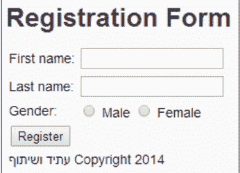
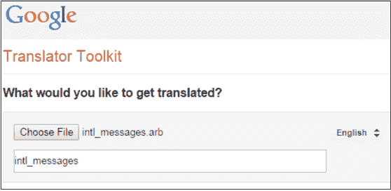
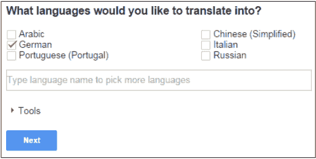
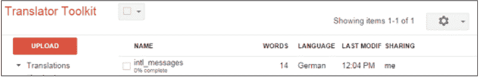
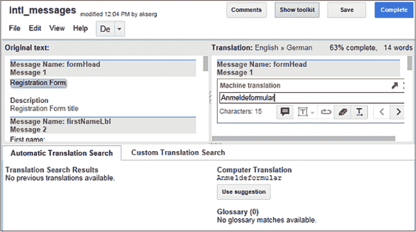
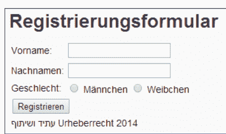

## 8 国际化与本地化

如果你计划使用多种语言工作，你需要为你的 Web 应用程序添加国际化支持。我们将看到如何将 i18n 和 l10n 访问嵌入到我们的代码中，以帮助设计和开发可轻松针对不同文化、地区和语言进行本地化的 Web 应用程序。本章将涵盖以下主题：

- 关键原则
- Intl 库
- 如何国际化 Web 应用程序
- 如何提取消息
- 如何使用 Google Translator Toolkit
- 如何使用翻译后的消息

### 关键原则

开发全球化软件并非易事。一般来说，创建全球化软件的标准开发流程包括以下步骤：

- 国际化，涵盖设计和开发 Web 应用程序
- 本地化，涵盖为特定区域设置翻译和定制 Web 应用程序

我们将使用 pub 管理器上可用的 intl 包中的 Intl 库开始设计和开发全球化软件，并遵循一些规则，这将有助于我们轻松翻译和定制应用程序。

### 可执行代码与用户界面

所有可执行代码必须与实现 **用户界面 (UI)** 的编程代码分离。此外，描述 UI 元素和 UI 元素布局的代码必须与实现和管理它们的代码分开。

### 数字和日期

不同文化对数字和日期的表示方式不同。你必须避免直接将数字和日期转换为字符串。


> 转换数字和日期必须使用特殊格式化程序进行。

### 消息

通常，包含单个文本片段的消息被一起使用以创建完整句子。在本地化过程中，这些文本片段可能会以不同的顺序组合。使用 Intl 类的消息方法允许你将消息显示为简单表达式。

### 测量单位和货币

测量单位如米和英里以及货币如美元和欧元无处不在，并且取决于区域设置。NumberFormat 类包含用于快速创建常用模式的特殊构造函数，这对于测量单位和货币非常方便。

### 文本输入和布局

屏幕上文本的大小是影响开发全球化软件的程序员的最大问题之一。其主要原因是，关于文本宽度、其流动方向及其在屏幕上的位置的任何假设，如果不正确，都可能瞬间破坏结构良好的布局。使用 BidiFormatter 类有助于管理包含双向文本的消息。

### 格式化日期和时间

区域设置决定了日期和时间应如何显示。DateFormat 类有一套很大的命名模式，这有助于避免错误并以正确格式显示数据。


## Intl 库

Intl 库可以帮助你设计和开发全球化的服务器及 Web 客户端应用。它支持所有主要区域设置和子语言对。由于屏幕上的所有信息都表现为一组字符串，我们必须使用 Intl 库提供的特殊格式化器将其他类型的对象转换为字符串格式。显示字符串的翻译版本被捆绑在单独的文本文件中。Intl 库包含一个同名的类，用于处理消息。Intl 库在各个国际化领域中考虑数字、日期和消息。每个领域都特意单独初始化，以减小应用程序体积并避免加载不必要的资源。数字和日期的国际化通过格式化器实现。消息通过特殊函数进行国际化，并可导出为 Application Resource Bundle（ARB）格式的文件。

## 更改区域设置

默认情况下，当前区域设置为美国英语（en_US）。为 `defaultLocale` 赋予新值可以通过以下代码影响 Intl 库的所有方法：

```
Intl.defaultLocale = "fr_FR";
```

除了使用当前区域设置外，还有几种方式可以临时使用不同的区域设置，具体如下：

- 在调用 Intl 类的方法时直接指定区域设置
- 在创建格式化器类的实例时提供区域设置
- 使用 Intl 类的以下特殊 `withLocale` 方法：

```
static withLocale(String locale, Function message_function)
```

`withLocale` 方法的主要目的是延迟调用 `message_function` 函数，直到设置了正确的区域设置。`message_function` 函数可以是一个简单的消息函数、一个消息函数的包装器，或者一个操纵多个消息函数的复杂包装器。由于在静态分析时无法得知区域设置字符串，该方法会静默执行以下步骤：

1. 将指定的区域设置字符串与当前字符串互换。
2. 然后执行 `message_function` 函数并保存结果。
3. 将区域设置互换回来。
4. 最后返回 `message_function` 函数的结果。

## 国际化与本地化

作为第一个参数传递的消息字符串必须是简单表达式，其中只允许函数参数和花括号。其他参数必须是字面量，不应包含任何插值表达式。

> 消息函数的 `name` 和 `args` 参数是必需的，且 `name` 参数必须与调用函数的名称匹配。

现在，我们不将消息直接赋值给代码，而是调用 `hello` 函数为我们返回翻译后的消息，如下代码所示：

```
querySelector("#dart_greeting")
    ..text = hello('John');
```

在与示例类似的其他情况下，`hello` 函数可以将翻译后的消息结果与传入的参数列表进行插值。`examples` 和 `desc` 参数在运行时不会使用，仅提供给翻译人员。现在，我们准备开始使用消息函数，无需任何本地化即可在当前区域设置中获得正确的翻译。

## 添加复数形式

我们可以使用 Intl 类的 `plural` 方法，通过括号将单数和复数形式合并为一个字符串，如下代码所示：

```
String replace(int num, String str) => Intl.plural(
    num,
    zero: "No one occurrence replaced for $str",
    one: "$num occurrence replaced for $str",
    other: "$num occurrences replaced for $str",
    name: "replace",
    args: [num, str],
    desc: "How many occurrences replaced for string",
    examples: {'num':2, 'str':'hello'});
```

`plural` 方法会将 `zero`、`one` 和 `other` 参数的内容翻译并插值到本地化消息中。我们省略了 `two`、`few` 和 `many` 参数，因为一个方法只能组合 `one` 和 `other`，但如有必要你仍可指定它们。`plural` 方法作为字符串表达式表示时，可用作 `Intl.message` 的一部分，仅指定复数属性，如下代码所示：

```
String replace(int num, String str) => Intl.message(
    """${Intl.plural(
        num,
```

```
zero: "No one occurrence replaced for $str",
    one: "$num occurrence replaced for $str",
    two: "$num occurrence replaced for $str",
    few: "$num occurrences replaced for $str",
    other: "$num occurrences replaced for $str")}"",
    name: "replace",
    args: [num, str],
    desc:"How many occurrences replaced for string",
    examples: { 'num':2, 'str':'hello'},
);
```

## 添加性别

Intl 类的 `gender` 方法提供了开箱即用的基于性别的选择支持，如下代码所示：

```
String usage(String name, String gender, String car) =>
    Intl.gender(
        gender,
        male: "$name uses his $car",
        female: "$name uses her $car",
        other: "$name uses its car",
        name:"usage",
        args: [name, gender, car],
        desc: "A person uses the car.");
```

`gender` 参数必须等于以下字面量之一：`male`、`female` 或 `other`。该方法可用作 `Intl.message` 方法的一部分：

```
String usage(String name, String gender, String car) =>
    Intl.message(
        """${Intl.gender(
            gender,
            male: "$name uses his $car",
            female: "$name uses her $car",
            other: "$name uses its car")}""",
        name: "usage",
        args: [name, gender, car],
        desc: "A person uses the car.");
```

## 添加选择

最后但同样重要的是，`Intl` 类中的 `select` 方法用于根据可用选项以不同方式格式化消息：

```
String currencySelector(currency, amount) => Intl.select(currency,
    {
        "USD": "$amount United States dollars",
        "CDN" : "$amount Canadian dollars",
        "other" : "$amount some currency or other."
    },
    name: "currencySelector",
    args: [currency, amount],
    examples: {'currency': 'USD', 'amount': '20'},
    desc: "Translate abbreviation into full name of currency");
```

`select` 方法在大小写映射中查找 `currency` 的值，并返回找到的结果，否则返回空字符串。它可以是 `Intl.message` 方法的一部分，如下代码所示：

```
String currencySelector(currency, amount) => Intl.message(
    """${Intl.select(currency,
        {
            "USD": "$amount United States dollars",
            "CDN" : "$amount Canadian dollars",
            "other" : "$amount some currency or other."
        })}""",
    name: "currencySelector",
    args: [currency, amount],
    examples: {'currency': 'USD', 'amount': '20'},
    desc: "Translate abbreviation into full name of currency");
```

## 创建复杂的消息翻译

`message`、`plural`、`gender` 和 `select` 方法可以相互组合，以创建复杂的消息翻译，如下代码所示：

```
String currencySelector(currency, amount) => Intl.select(currency,
    {
        "USD": """${Intl.plural(amount,
            one: '$amount United States dollar',
            other: '$amount United States dollars')}""",
        "CDN": """${Intl.plural(amount,
            one: '$amount Canadian dollar',
            other: '$amount Canadian dollars')}"""
```

## 国际化与本地化

```
```html
<td><input type="text" id="firstName" name="firstName"></td>
</tr>
<tr>
    <td><label for="lastName">Last Name:</label></td>
    <td><input type="text" id="lastName" name="lastName"></td>
</tr>
<tr>
    <td><label>Gender:</label></td>
    <td>
        <input type="radio" name="sex" value="male">
        <span>Male</span>
        <input type="radio" name="sex" value="female">
        <span>Female</span>
    </td>
</tr>
<tr>
    <td colspan="2"><input type="submit" value="Register"></td>
</tr>
<tr>
    <td colspan="2">
        <span dir="RTL">Copyright 2014 עמוד ושיתוף</span>
    </td>
</tr>
</table>
</form>
```
```

以下截图显示了上述代码在 Web 浏览器中的结果：




首先，我们在 `pubspec.yaml` 文件的依赖部分添加 `intl` 包。然后，我们决定尝试命名约定和国际化方法的组合，以提供在设置显示名称时最大的灵活性，因为这里有意义的显示名称非常重要。要创建组件的显示名称，我们将执行以下操作：

- 使标题标签的所有层级都以 Head 后缀结尾
- 所有标签都以 Lbl 后缀结尾
- 以 Btn 后缀结尾需要提交的输入元素

每个引用元素必须使用被引用元素的标识符名称结合前面提到的后缀。因此，现在我们准备国际化注册表单。

表单中包含字符串消息的所有元素必须具有唯一的标识符。我们将使用以下代码从注册表单中删除所有文本消息：

```html
<h1 id="formHead"></h1>
<form>
  <table>
    <tr>
      <td><label for="firstName" id="firstNameLbl"></label></td>
      <td><input type="text" id="firstName" name="firstName"></td>
    </tr>
    <tr>
      <td><label for="lastName" id="lastNameLbl"></label></td>
      <td><input type="text" id="lastName" name="lastName"></td>
    </tr>
    <tr>
      <td><label id="genderLbl"></label></td>
      <td>
        <input type="radio" name="sex" value="male">
        <span id="maleLbl"></span>
        <input type="radio" name="sex" value="female">
        <span id="femaleLbl"></span>
      </td>
    </tr>
    <tr>
      <td colspan="2"><input type="submit" id="registerBtn"></td>
    </tr>
    <tr>
      <td colspan="2"><span id="copyrightLbl"></span></td>
    </tr>
  </table>
</form>
```

我们需要在 Dart 代码中为每个被翻译的消息创建一个函数。在这种情况下，你必须为以下代码选择命名约定：

```dart
formHead() => "Registration Form";
firstNameLbl() => "First name:";
lastNameLbl() => "Last name:";
genderLbl() => "Gender:";
maleLbl() => "Male";
femaleLbl() => "Female";
registerBtn() => "Register";
copyrightLbl() => "Copyright 2014 דויש דיגיטל";
```

我们将使用 querySelector 函数找到通过唯一标识符翻译的所有元素，并将翻译后的消息分配给它们适当的属性，如以下代码所示：

```dart
querySelector("#formHead").text = formHead();
querySelector("#firstNameLbl").text = firstNameLbl();
querySelector("#lastNameLbl").text = lastNameLbl();
querySelector("#genderLbl").text = genderLbl();
querySelector("#maleLbl").text = maleLbl();
querySelector("#femaleLbl").text = femaleLbl();
(querySelector("#registerBtn") as InputElement)
  .value = registerBtn();
BidiFormatter bidiFormatter = new BidiFormatter.UNKNOWN();
querySelector("#copyrightLbl").text =
  bidiFormatter.wrapWithUnicode(copyrightLbl());
```

现在，对创建的每个函数应用 Intl.message 方法，如以下代码所示：

```dart
formHead() => Intl.message("Registration Form",
    name:"formHead",
    desc: "Registration Form title");
firstNameLbl() => Intl.message("First name:",
    name: "firstNameLbl",
    desc: "First Name label");
lastNameLbl() => Intl.message("Last name:",
    name: "lastNameLbl",
    desc: "Last Name label");
genderLbl() => Intl.message("Gender:",
    name: "genderLbl",
    desc: "Gender label");
maleLbl() => Intl.message("Male",
    name:"maleLbl",
    desc: "Male label");
femaleLbl() => Intl.message("Female",
    name: "femaleLbl",
    desc: "Female label");
registerBtn() => Intl.message("Register",
    name: "registerBtn",
    desc: "Registration Button name");
copyrightLbl() => Intl.message("Copyright 2014 דויש דיגיטל",
    name: "copyrightLbl",
    desc: "Copyright label");
```

如果你在网页浏览器中打开页面，它现在看起来就像原来的页面一样。现在你知道了如何使用 `Intl` 类翻译消息，是时候讨论本地化了。

## 提取消息

现在，我们已将所有消息与 UI 分离，并且准备进行翻译。我们需要使用 intl 包中的一个特殊程序 `extract_to_arb.dart` 从源代码中将其提取到外部文件，如以下代码所示：

```
pub run intl:extract_to_arb --output-dir=web web/registration_form.dart
```

前面的程序会在指定的 web 目录内生成 `intl_messages.arb` 文件。该文件包含 ARB 格式中的所有消息。ARB 是基于 JSON 的本地化资源格式。此格式提供以下好处：

- **简洁性**：此格式基于 JSON，简单且人类可读
- **可扩展性**：在此格式中，可以在不影响现有工具和使用的情况下添加词汇
- **直接可用性**：应用程序可以直接从此格式访问资源，而无需将其转换为其他形式

你可以在 `https://code.google.com/p/arb/wiki/ApplicationResourceBundleSpecification` 提供的规范中了解更多关于 ARB 格式的信息。

之后，你可以将 ARB 格式的文件发送给人工翻译。由于我们的表单相当简单，我们可以使用 Google Translator Toolkit 自己将文件翻译成其他语言。

## 使用 Google Translator Toolkit

以下步骤将向你展示如何使用 Google Translator Toolkit：

1. 打开你的网页浏览器并导航到 `https://translate.google.com/toolkit`。点击 **UPLOAD** 按钮上传文件，如以下屏幕截图所示：

   

2. 你将被带到另一个网页，在那里你可以添加要翻译的内容。你可以选择要翻译的 `intl_messages.arb` 文件：

   

3. 选择你希望消息被翻译成的适当翻译语言，然后点击 **Next** 按钮：

   

4. 在下一页，你可以选择其中一个准备翻译的供应商，或点击 **No, thanks** 按钮自行翻译消息。 resulting 新文件将出现在准备翻译的文件列表中，如以下屏幕截图所示：

   

5. 现在点击文件列表中的文件名，Google Translator Toolkit 将在编辑器中打开它：

   

此方法应在先使用指定的 `localeName` 方法之前调用。让我们更改代码以使德语区域设置默认可用。我们需要做的就是将 `messages_all.dart` 文件导入到我们的项目中，并在 `main` 方法中添加 `initializeMessages`，如以下代码所示：

```dart
import 'messages_all.dart';
...
void main() {
  initializeMessages('de').then((_) {
    Intl.defaultLocale = 'de';
    querySelector("#formHead").text = formHead();
    querySelector("#firstNameLbl").text = firstNameLbl();
    querySelector("#lastNameLbl").text = lastNameLbl();
    querySelector("#genderLbl").text = genderLbl();
    querySelector("#maleLbl").text = maleLbl();
    querySelector("#femaleLbl").text = femaleLbl();
    (querySelector("#registerBtn") as InputElement)
      .value = registerBtn();
    BidiFormatter bidiFormatter = new BidiFormatter.UNKNOWN();
    querySelector("#copyrightLbl").text =
      bidiFormatter.wrapWithUnicode(copyrightLbl());
  });
}
```

在前面的代码中，我们在初始化消息时指定了德语区域设置作为默认值。现在，打开浏览器中的 `index.html` 文件以查看表单在德语区域设置中的正确翻译：



## 总结

在本章中，我们讨论了基于 Dart 语言的项目国际化和本地化的一些重要方面。全球化软件的开发包括国际化，涵盖设计和开发 Web 应用程序，以及本地化，包括为特定区域设置翻译和定制 Web 应用程序。

pub 管理器中的 `intl` 包帮助你以相当直接的方式为服务器端和客户端设计和开发应用程序。所有可执行代码必须与实现 UI 的编程代码分离。你必须避免直接将数字和日期转换为字符串，因为不同文化对数字和日期的呈现方式不同。

`NumberFormat` 类包含特殊构造函数，可快速创建常用的模式，这对于测量单位和货币非常有用。`BidiFormatter` 类帮助管理包含双向文本的消息，具有 BiDi 包装、自动方向性估计和字符转义。`DateFormat` 类有一套巨大的命名模式，有助于避免错误并以正确格式显示数据。消息的国际化基于通过命名本地化版本的消息进行查找，并返回翻译后的消息，可能与指定的参数列表插值。

`Intl` 类的 `plural` 方法可以帮助使用括号将单数和复数形式组合成一个字符串。`Intl` 类的 `gender` 方法为基于性别的选择提供开箱即用的支持。`Intl` 类的 `select` 方法帮助根据可用选择以不同方式格式化消息。`Intl` 类的 `message` 方法可以将消息表示为简单的表达式，并具有使用属性插值的可能性。

在下一章中，我们将向你展示如何正确组织客户端到服务器的通信。你将找到关于使用客户端到服务器通信选择 Dart 类的可能重要问题的答案。


