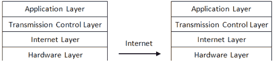
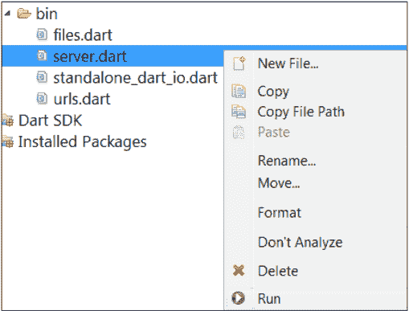

## 客户端到服务器的通信

在本章中，我们将讨论如何组织客户端到服务器的通信。我们将为一些可能重要的问题找到答案，例如如何正确选择用于客户端到服务器通信的 Dart 类。在本章中，我们将涵盖以下主题：

- 通信概览
- 超文本传输协议
- AJAX 轮询请求
- AJAX 长轮询请求
- 服务器发送事件
- WebSocket

### 通信概览

我们中的一些人无法想象没有互联网、手机或计算机的现代世界。每台连接到互联网的设备既可以是客户端，也可以是服务器，或者同时扮演这两种角色。客户端与服务器之间的通信是现代数字世界的基础。基于一套特殊规则和消息格式的通信被称为通信协议，它使客户端和服务器之间能够进行数据交换。

### 互联网协议栈

任何连接到互联网的设备都有一个**互联网协议（IP）**地址。IP 地址可以是永久的，也可以是从**动态主机配置协议（DHCP）**服务器获取的临时地址。无论如何，任何连接到互联网的设备都有一个唯一的 IP 地址。在同一个唯一 IP 地址范围内运行的许多程序使用不同的端口号来同时访问互联网。一条消息通过互联网从一台设备传输到另一台设备时，会沿着一条长路径穿过协议栈，该协议栈被表示为一组相互叠加的层，如下图所示：



让我们看看消息实际发生了什么：

- 1. 消息到达协议栈顶部的应用协议层，然后向下移动。通常，应用层会以适用于 HTTP、SMTP、FTP 或其他应用的标准方式之一格式化消息。
- 2. 格式化后的消息随后被转发到**传输控制协议（TCP）**层。该层将消息拆分为称为数据包的小型、可管理的数据块，并为每个数据块分配一个编号。该编号指定了数据包的顺序，并允许接收方的 TCP 层从这些数据包中重建原始消息。它会根据应用层所使用的协议，为每个数据包分配一个端口号。
- 3. 然后，这些数据包进入 IP 层。它会在每个数据包上附加发送方和接收方的 IP 地址。IP 地址和端口号的组合称为套接字地址。
- 4. 最后，硬件层会在数据包上附加发送方和接收方的**媒体访问控制（MAC）**地址。它使数据包能够被引导到目标设备 IP 地址上的特定网络接口。在硬件层，所有数据包被逐一转换为电子信号，通过线缆传输，并连接到**互联网服务提供商（ISP）**的调制解调器。
- 5. 从这里开始，将消息数据包通过路由器和 ISP 主干网传送到互联网上指定的 IP 地址，是 ISP 的任务。
- 6. ISP 传送来的数据包从目标设备协议栈的底部开始。从数据包中剥离的任何额外信息都会向上传递。
- 7. 最终，数据到达协议栈顶部，在那里被解码为原始消息。

### 超文本传输协议

万维网（WWW）是互联网上最常用的服务之一。超文本传输协议（HTTP）是一种基于文本的应用层协议，它使万维网得以运作。所有 Web 浏览器和 Web 服务应用程序都使用 HTTP 通过互联网相互通信。Web 浏览器或独立应用程序会打开一个连接并向 Web 服务器发送请求。Web 服务器处理请求，然后关闭与 Web 客户端的连接。

> HTTP 是一种无状态协议。

在 HTTP 1.0 规范中，你找不到任何关于持久连接的信息。然而，实际上，它通过向请求中添加以下额外的头部，被非正式地加入到了现有协议中：

```
Connection: Keep-Alive
```

因此，如果客户端支持 Keep-Alive，它就会在请求中添加上述头部。服务器收到这个请求后，生成的响应也会包含这个头部。

从 HTTP 1.1 开始，除非另有声明，否则所有连接都被视为持久连接。HTTP 持久连接不使用外部的 Keep-Alive 消息。可以通过一个已打开的连接发送多个请求。

我们可以通过以下不同的库使用 HTTP 协议进行通信：

- Dart SDK 中的 dart:io 库包含 HttpClient 类，它通过 HTTP 协议与服务器通信。
- Dart SDK 中的 dart:html 库具有 HttpRequest 类，它使用客户端 XMLHttpRequest 从 URL 获取数据。它还有助于从 HTTP 或 FTP 获取数据，或通过 AJAX 更新页面内容。

## 客户端到服务器的通信

由 Google 开发团队编写的、来自 pub 服务器的 http 包包含一个基于 Future 的库，用于创建 HTTP 请求。它是平台无关的，因此我们可以使用 `http.dart` 库从独立应用程序生成 HTTP 请求，或者使用 `browser_client.dart` 库用于基于 Web 浏览器的应用程序。

让我们看看如何组织 Web 浏览器或独立应用程序与 Web 服务器之间的通信。

### Web 服务器

在本章中，我们将创建一个简单的 Web 服务器，可用于所有示例，如下所示：

```
import 'dart:io';
import 'package:route/server.dart';

import 'urls.dart' as urls;
import 'files.dart';
main() {
  final allUrls = new RegExp('/(.*)');

  HttpServer.bind(urls.serverAddress, urls.serverPort)
    .then((server) {
      print("Server runs on ${server.address.host}:${server.port}");
      new Router(server)
        ..serve(urls.dataUrl, method:'GET').listen(processParams)
        ..serve(urls.dataUrl, method:'DELETE').listen(processParams)
        ..serve(urls.dataUrl, method:'POST').listen(processBody)
        ..serve(urls.dataUrl, method:'PUT').listen(processBody)
        ..serve(allUrls).listen(serveDirectory('', as: '/'))
        ..defaultStream.listen(send404);
    });
}
```

在前面的代码中，我们特意使用了来自 pub 服务器的 route 包，以减少围绕主要功能的代码包装。我们的代码处理客户端请求以匹配 `dataUrl`。根据请求方法的不同，代码会调用 `processParams` 或 `processBody` 函数。我们将 `serverAddress`、`serverPort` 和 `dataUrl` 放在 `urls.dart` 文件中。我们特意将它们移到外部文件中，以便与客户端代码共享这些数据。我们在 `setHeaders` 方法中设置共享的头部，如以下代码所示：

```
setHeaders(HttpRequest request) {
  request.response.headers.contentType =
    new ContentType("text", "plain", charset: "utf-8");
}
```

## 客户端到服务器的通信

我们的服务器并没有做什么特殊的事情。它响应每个请求，返回请求方法的名称、查询参数或消息体（以字符串表示）。服务器必须始终在线才能处理我们的请求。Dart Editor 可以同时运行不同的 Dart 程序。要做到这一点，只需右键单击 `server.dart` 文件并运行它，如下面的截图所示：



### 通过 dart:io 库进行独立 HTTP 通信

让我们从标准的 `dart:io` 库和 `HttpClient` 类开始，组织从独立客户端到 Web 服务器的通信。`HttpClient` 类中任何用于通信的方法都是一个两步过程。第一次调用原始方法时，它返回带有 `HttpClientRequest` 的 `Future`。此时，底层网络通信已经打开，但尚未发送任何数据。你可以在请求上设置 HTTP 头部或消息体，最后返回请求的 `close` 方法的结果。请看以下基于 `dart:io` 库中 `HttpClient` 类的代码：

```
```dart
import 'dart:io';
import 'dart:convert';
import 'urls.dart' as urls;

var url = "http://${urls.serverAddress}:${urls.serverPort}${urls.dataUri}";
var name = "HttpClient Standalone";
// The following method processes all responses:
responseHandler(response) {
```
```


```dart
if (response is HttpClientResponse) {
  response.transform(UTF8.decoder).listen((contents) {
    print("${response.statusCode}: ${contents}");
  });
} else {
  print("Readed: " + response.toString());
}
}

// We send data to a server via this method:
sendData(HttpClientRequest request, data) {
  request.headers.contentType =
      new ContentType("application", "json", charset: "utf-8");
  List<int> buffer = JSON.encode(data).codeUnits;
  request.contentLength = buffer.length;
  request.add(buffer);
}

main() {
  // We need to encode name before sending it:
  String query = "name=" + Uri.encodeQueryComponent(name);
  // We create the client instance to send multiple requests:
  HttpClient client = new HttpClient();
  // Make a GET request with query:
  client.getUrl(Uri.parse("$url?$query"))
    .then((HttpClientRequest request) {
      return request.close();
    }).then(responseHandler);
  // Here we send a map with data via the POST request:
  client.postUrl(Uri.parse(url))
    .then((HttpClientRequest request) {
      sendData(request, {'post name': name});
      return request.close();
    }).then(responseHandler);
  // The PUT request is very similar to the POST one:
  client.putUrl(Uri.parse(url))
    .then((HttpClientRequest request) {
      sendData(request, {'put name': name});
      return request.close();
    }).then(responseHandler);
  // Here is the DELETE request:
  client.deleteUrl(Uri.parse("$url?$query"))
    .then((HttpClientRequest request) {
      return request.close();
    }).then(responseHandler);
}
```

按 *Web server* 小节中说明的方式运行服务器代码，然后通过上下文菜单运行 `standalone_dart_io.dart` 中的代码。参考以下客户端输出：

```
200: GET: /data, Params:{name: HttpClient Standalone}
200: DELETE: /data, Params:{name: HttpClient Standalone}
200: POST: /data, Data:{"post name":"HttpClient Standalone"}
200: PUT: /data, Data:{"put name":"HttpClient Standalone"}
```

HttpClient 类提供了一组创建 HTTP 请求的方法，但这种两步过程是一个真正的劣势。

## 通过 http 包进行独立 HTTP 通信

让我们看看 http 包中的 http 库如何能改善客户端开发体验。在使用 http 库之前，我们应该在项目 pubspec.yaml 文件的 dependencies 组中添加 http 包。我们借助以下代码创建 standalone_http.dart 文件：

```dart
import 'package:http/http.dart' as http;
import 'dart:async';
import 'urls.dart' as urls;

var url = "http://${urls.serverAddress}:${urls.serverPort}${urls.dataUrl}";
var name = "Http Standalone";
// We process all responses in this method:
responseHandler(response) {
  if (response is http.Response) {
    print("${response.statusCode}: ${response.body}");
  } else {
    print("Readed: " + response.toString());
  }
}

main() {
  // We need to encode name before sending it:
  String query = "name=" + Uri.encodeQueryComponent(name);
  // Static functions such as GET, POST, and so on create new
  // instances of the Client interface per request.
  // All static functions such as get from the http library always create
  // new instance of the Client class.
  http.get("$url?$query").then(responseHandler);

  var client = new http.Client();
  Future.wait([
    client.get("$url?$query").then(responseHandler),
    client.post(url, body: {"name": name}).then(responseHandler),
    client.put(url, body: {"name": name}).then(responseHandler),
    client.delete("$url?$query").then(responseHandler)])
  .then((list) {
    client.close();
  });
}
```

使用 http 库中的 client 类相比 dart:io 库中的 HttpClient 的巨大优势在于代码更简洁，结果相似：

```
200: GET: /data, Params:{name: Http Standalone}
200: GET: /data, Params:{name: Http Standalone}
200: POST: /data, Data:name=Http+Standalone
200: PUT: /data, Data:name=Http+Standalone
200: DELETE: /data, Params:{name: Http Standalone}
```

## 通过 dart:html 库进行 Web 浏览器 HTTP 通信

你不能使用 dart:io 库来编写基于 Web 浏览器的应用程序，因为该库是专门为独立和服务器应用程序编写的。相反，我们将使用 dart:html 库中的 HttpRequest 类来实现相同的结果。此类可用于通过 HTTP 或 FTP 应用程序协议获取数据，以及 AJAX 轮询请求，如以下代码所示：

```dart
import 'dart:html';
import 'dart:convert';
import 'urls.dart' as urls;

var url = "http://${urls.serverAddress}:${urls.serverPort}${urls.dataUrl}";
var name = "HttpClient Browser";
// We save the response text in a DIV element and append it to the
// DIV container:
responseHandler(DivElement log, responseText) {
  DivElement item = new DivElement()
    ..text = responseText.toString();
  log.append(item);
}

void main() {
  DivElement log = querySelector("#log");
  // Here we prepare query to send:
  String query = "name=" + Uri.encodeQueryComponent(name);
  String data = JSON.encode({"name": name});

  request = new Request("PUT", Uri.parse(url));
  request.body = data;
  client.send(request).then((StreamedResponse response)
      => responseHandler(log, response));

  request = new Request("DELETE", Uri.parse("$url?$query"));
  client.send(request).then((StreamedResponse response)
      => responseHandler(log, response));
}
```

创建 Dartium 启动配置并在 Web 浏览器中打开 `index.html` 文件。运行服务器并启动新配置以查看以下预期结果：

```
GET: /data, Params:{name: HttpClient Browser}
POST: /data, Data:{"name":"HttpClient Browser"}
DELETE: /data, Params:{name: HttpClient Browser}
PUT: /data, Data:{"name":"HttpClient Browser"}
```

你现在知道如何通过 http 和 html 包中的 `BrowserClient` 和 `Request` 类轻松创建客户端到服务器的通信。

## AJAX 轮询请求

通常，Web 浏览器发送请求并立即接收响应。每次从服务器请求新数据部分时，整个网页都会重新加载。**异步 JavaScript 和 XML (AJAX)** 是一种技术，允许客户端 JavaScript 代码在无需重新加载 Web 浏览器中当前页面的情况下从服务器请求数据。与传统网页流程相比，使用 AJAX 的一个重要优势是它能够将桌面应用程序的可用性和行为带入 Web 应用程序。`HttpRequest` 是获取 URL 数据的客户端 XHR 请求，正式名称为 `XMLHttpRequest`，在 AJAX Web 开发技术中发挥着重要作用。

> `HttpRequest` 内部创建的所有请求必须与请求的资源来自同一源的服务器中。

许多 Web 应用程序的状态本质上是易变的。变化可能来自众多来源，例如其他用户、外部新闻和数据、复杂计算的结果，以及基于当前时间和日期的触发器。解决方案是定期发出请求以获取新信息。为此，我们可以使用 AJAX 轮询请求技术。让我们看看我们 Web 应用程序的客户端：

```dart
import 'dart:html';
import 'dart:async';
import 'urls.dart' as urls;

var url = "http://${urls.serverAddress}:${urls.serverPort}${urls.dataUrl}";
```

要打印时间戳，请使用以下代码：

```dart
timeStamp() {
  DateTime dt = new DateTime.now();
  return " (${dt.minute}:${dt.second})";
}
```

响应按如下方式保留请求编号：

```dart
responseHandler(DivElement log, responseText) {
  DivElement item = new DivElement()
    ..text = responseText.toString() + timeStamp();
  // We insert a new element at the top of the log:
  log.insertAdjacentElement('beforebegin', item);
}
```

```dart
void main() {
  DivElement log = querySelector("#log");
  int num = 0;
  // A timer in 2 seconds interval calls the callback function:
  new Timer.periodic(new Duration(seconds: 2), (Timer timer) {
    // We generate the query parameter with number:
    String query = "number=${num++}";
    HttpRequest.getString("$url?$query")
      .then((response) => responseHandler(log, response));
  });
}
```


创建 Dartium 启动配置并在 Web 浏览器中打开 index.html 文件。运行服务器并启动新的配置以查看以下结果：

```
GET: /data, Data:4, Params:{number: 0} (31:28)
GET: /data, Data:26, Params:{number: 1} (31:30)
GET: /data, Data: , Params:{number: 2} (31:32)
GET: /data, Data: , Params:{number: 3} (31:34)
GET: /data, Data:47, Params:{number: 4} (31:36)
GET: /data, Data:69, Params:{number: 5} (31:38)
GET: /data, Data: , Params:{number: 6} (31:40)
GET: /data, Data: , Params:{number: 7} (31:42)
GET: /data, Data:98, Params:{number: 8} (31:44)
```

轮询请求存在以下缺点：

- 周期性请求消耗带宽和服务器资源
- 服务器必须始终有数据或无数据时都做出响应；因此，客户端会收到大量空字符串

让我们尝试使用 AJAX 长轮询请求来修复它们。

## AJAX 长轮询请求

从客户端角度来看，AJAX 长轮询请求看起来与普通请求相似。它们在服务器端的一个重要区别是，如果服务器没有可供客户端的信息，它会保持请求并等待信息变得可用或等待合适的超时时间，之后再向客户端发送完成的响应。长轮询请求减少了需要发送的数据量，因为服务器只在数据真正可用时才发送数据。

长轮询请求在以下情况下很有用：

- 你的解决方案必须在旧版 Web 浏览器中工作
- 客户端与服务器之间的数据流量很低
- 实现非常简单

使用长轮询请求的优点如下：

- 它适用于所有浏览器
- 它易于开发，并且可以完美地融入遗留代码中而无需重大更改和努力
- 它可以快速检测连接故障并恢复会话以避免数据丢失
- 它对 IP 地址变化具有很强的免疫力，因为请求是短暂的并且其状态是独立存储的
- 它对大多数实时应用程序性能良好，并减少了带宽消耗和服务器资源利用率

使用此请求的缺点如下：

- 客户端必须不断建立连接；如果服务器将信息发送回客户端并且连接被关闭，它必须等待客户端发送下一个请求以打开新连接
- 客户端需要创建额外的连接来向服务器发送数据
- 并行请求存在问题
- 数据量可能会使服务器的下一次更新变得相当过量，如果数据在服务器上到来之前它等待来自客户端的新连接

以下浏览器受长轮询请求支持：

- Chrome 1.0+
- Firefox 0.6+
- Opera 8.0+
- Safari 1.2+
- Internet Explorer 5.0+

要实现持久的 HTTP 连接，你需要在客户端和服务器端进行更改。我们引入 longLasting 方法来管理请求并将其注册，而不是使用 processParams：

```
//...
main() {
    final allUrls = new RegExp('(/.*)');

    HttpServer.bind(urls.serverAddress, urls.serverPort)
    .then((server) {
        print("Server runs on ${server.address.host}:${server.port}");
        new Router(server)
            .serve(urls.dataUrl, method: 'GET').listen(longLasting)
            .serve(allUrls).listen(serveDirectory('', as: '/'))
            .defaultStream.listen(send404);
    });
}
```

```
// Next function was changed to return data only:
String fetchData() {
    return dataGenerator.nextInt(100).toString();
}
```

新的 longLasting 函数显示在以下代码中。它运行两个周期性计时器。第一个模拟基于请求超时的处理。如果每 30 秒没有收集到数据，它会重置第二个计时器并响应空字符串。第二个管理数据的可用性。如果数据在一秒间隔内可用，它会重置第一个计时器并响应收集到的数据：

```
longLasting(HttpRequest request) {
    Timer reqTimer, dataReadyTimer;

    reqTimer = new Timer.periodic(
        new Duration(seconds:30), (Timer t) {
        dataReadyTimer.cancel();
        processParams(request);
    });

    dataReadyTimer = new Timer.periodic(
        new Duration(seconds:1), (Timer t) {
        if (ready.nextBool()) {
            reqTimer.cancel();
            processQueryParams(request, ready:true);
        }
    });
}
```

processQueryParams 函数的更新版本在以下代码中说明。此函数根据 ready 属性的值返回来自 fetchData 的数据或返回空字符串。代码如下：

```
processQueryParams(HttpRequest request, {bool ready:false}) {
    request.response.write(
        "${request.method}: ${request.uri.path}");
    if (ready) {
        request.response.write(", Data:" + fetchData());
    } else {
        request.response.write(", Data:");
    }
    if (request.uri.queryParameters.length > 0) {
request.response.write(", Params:" +
    request.uri.queryParameters.toString());
}
request.response.close();
}
```

让我们看看如何更改 AJAX 轮询请求示例以在客户端组织长轮询请求。你可以通过调用 longPolling 函数按如下方式启动长轮询请求：

```
void main() {
  DivElement log = querySelector("#log");
  int num = 0;
  longPolling(log, num);
}
```

在此函数中，我们发送 AJAX 请求并等待服务器的响应。当响应可用时，我们调用 responseHandler 函数并立即启动新的请求：

```
longPolling(DivElement log, int num) {
  String query = "number=${num++}";
  HttpRequest.getString("$url?$query")
    .then((response) {
      responseHandler(log, response);
      longPolling(log, num);
    });
}
```

创建 Dartium 启动配置，运行服务器，并在 Web 浏览器中打开 index.html 文件以查看以下结果：

```
GET: /data, Data:12, Params:{number: 0} (51:0)
GET: /data, Data:9, Params:{number: 1} (51:2)
GET: /data, Data:60, Params:{number: 2} (51:3)
GET: /data, Data:41, Params:{number: 3} (51:5)
GET: /data, Data:15, Params:{number: 4} (51:7)
GET: /data, Data:0, Params:{number: 5} (51:8)
```

现在，我们减少了带宽消耗和服务器利用率；因此，客户端将主要只接收有效数据。

## Server-Sent Events

另一种基于 AJAX 的技术是 **Server-Sent Events (SSE)**，也称为 **Server Push** 或 **HTTP Streaming**。在这种情况下，客户端通过初始 HTTP 请求向服务器打开连接，并且当有新信息可用时，服务器向客户端发送事件。因此，如果你的客户端的常规功能类似于股票行情或新闻推送，并且它们需要随着时间的推移从服务器获取更新，那么 SSE 技术就是理想的解决方案了。顺便说一下，如果客户端有新信息要发送给服务器，它可以通过新的 HTTP 请求发送。

SSE 在以下情况下很有用：

- 客户端面向接收大量数据
- 解决方案必须在旧版 Web 浏览器中工作

SSE 的优点如下：

- 服务器实现足够简单
- Web 浏览器可以自动重新连接到服务器
- 消息交换的格式足够灵活
- 解决方案基于到服务器的一个永久连接
- 解决方案足够适用于实时应用程序
- 客户端不需要在每次响应后建立新连接
- 服务器解决方案可以基于事件循环

SSE 的缺点如下：

- 它仅从服务器到客户端工作
- Internet Explorer 不支持它
- 它可能被代理服务器阻止
- 不可能从另一个域连接到服务器

以下浏览器受支持：

- Chrome 6.0+
- Firefox 6.0+
- Opera 9.0+
- Safari 5.0+


EventSource 类用于接收 SSE。该类通过指定的 URL 经 HTTP 连接到服务器，并在不关闭连接的情况下接收服务器事件。事件以 text/event-stream 格式传入。要打开到服务器的连接并开始接收事件，我们通过工厂构造函数创建 EventSource 类的新实例，并将生成事件的资源的 URL 传递给它。连接建立后，我们便等待消息。

> 生成事件的资源的 URL 必须与调用页面的来源（origin）匹配。

在服务器端，每条消息都以一个文本块的形式发送，并以两个换行符结尾。文本数据使用 UTF-8 编码。每条消息由一行或多行文本组成，列出该消息的字段。每个字段由字段名、冒号和该字段值的文本数据表示。以下是一个仅包含数据的消息示例：

```
; this is a comment
data: some text

data: another text
```

在前面的代码中，第一行只是一个注释。所有以冒号字符开头的文本消息都是注释。如果消息不是定期发送的，注释可作为 Keep-Alive（保持连接）机制使用。第二行和第三行仅包含一个带有文本值的数据字段。第三行包含一个额外的换行符，用于终止消息。通过一条消息可以发送多个事件。每个事件都有一个在 event 字段中指定的名称，以及一个值可以是任意字符串的 data 字段。数据也可以是 JSON 格式，如下面的代码所示：

```
event: userLogon
data: {"username": "John", "time": "01:22:45", "text": "Hello World"}

event: userMessage
data: "Any data"
```

你可以在消息中使用不带 event 字段的未命名事件。SSE 实现使用 message 作为未命名事件的名称。每个事件可能有一个 id。在这种情况下，数据可以按如下方式组合：

```
id: 123
data: some text
data: {"text": "Another text}
```

## 客户端到服务器端的通信

让我们看一下示例的服务器端：

```java
//...
main() {
    final allUrls = new RegExp('/(.*)');

    HttpServer.bind(urls.serverAddress, urls.serverPort)
      .then((server) {
        print("Server runs on ${server.address.host}:${server.port}");
        new Router(server)
            ..serve(urls.dataUrl, method: 'GET').listen(processSSE)
            ..serve(allUrls).listen(serveDirectory('', as: '/'))
            ..defaultStream.listen(send404);
      });
}

String fetchData() {
    return dataGenerator.nextInt(100).toString();
}
```

客户端创建的 EventSource 类实例会打开一个连接，该连接在 accept 标头中提交包含 text/event-stream 值的 HTTP 请求。这是服务器开始 SSE 通信的信号。在我们的示例中，我们先发送 logon 事件。服务器与客户端之间的连接保持打开状态，因此我们可以定期发送 message 事件，如下面的代码所示：

```java
processSSE(HttpRequest request) {
    if (request.headers.value(HttpHeaders.ACCEPT) == EVENT_STREAM) {
        writeHead(request.response);
        int num = 0;

        new Timer.periodic(new Duration(seconds: 5), (Timer t) {
            sendMessageEvent(request.response, num++);
        });

        sendLogonEvent(request.response);
    }
}
```

为了允许你发送推送事件，必须禁用 `HttpResponse` 中的输出缓冲。除此之外，你还需要通过标头属性指定内容类型、缓存控制和连接类型，如下所示：

```
writeHead(HttpResponse response) {
    response.bufferOutput = false;
    response.headers.set(HttpHeaders.CONTENT_TYPE, EVENT_STREAM);
    response.headers.set(HttpHeaders.CACHE_CONTROL, 'no-cache');
    response.headers.set(HttpHeaders.CONNECTION, "keep-alive");
}
```

要发送消息，你可以使用 response 的 `writeln` 方法。它会自动为每个字符串附加一个换行符，因此你只需在事件末尾添加一个换行符。最后，response 的 `flush` 方法会将事件推送到客户端，如下所示：

```
sendMessageEvent(HttpResponse response, int num) {
    print("Send Message event");
    response.writeln('id: 123');
    response.writeln('data: {"msg": "hello world", "num": $num, "value": ${fetchData()} }\n');
    response.flush();
}
```

对于 logon 消息，我们创建一个自定义的 userLogon 事件类型。如果通过 EventSource 打开的连接终止，Web 浏览器将自动在约三秒后重新建立到服务器的连接。你可以通过事件的 `retry` 属性更改此值。该值必须是一个整数，指定以毫秒为单位的重新连接时间：

```
sendLogonEvent(HttpResponse response) {
    print("Send Logon event");
    response.writeln('event: userlogon');
    response.writeln('retry: 15000');
    response.writeln('id: 123');
    response.writeln('data: {"username": "John", "role":
        "admin"}\n');
    response.flush();
}
```

## 客户端到服务器端的通信

客户端侧的 SSE 代码实现如下：

```
import 'dart:html';
import 'urls.dart' as urls;

var url = "http://${urls.serverAddress}:${urls.serverPort}${urls.dataUrl}";
String get timeStamp {
  DateTime dt = new DateTime.now();
  return "(${dt.minute}:${dt.second})";
}

responseHandler(DivElement log, String data) {
  DivElement item = new DivElement();
  item.text = data + timeStamp;
  log.insertAdjacentElement('beforebegin', item);
}
```

在前面的代码中，我们使用指定的 URL 创建了一个 EventSource 实例。从现在开始，我们将开始监听来自服务器的事件。我们添加了 open 和 error 事件监听器。EventSource 类通过 readyState 属性的变化向代码通知服务器侧的连接已关闭。message 监听器处理所有未知事件。一个专门用于 userlogon 事件的事件监听器处理可以通过 EventSource 类的 addEventListener 方法添加的这类事件。事件在 data 属性中保存消息信息。服务器端分配的事件标识符可通过 lastEventId 属性获取，如下面的代码所示：

```
main() {
  DivElement log = querySelector("#log");
  EventSource sse = new EventSource(url);
  sse.onOpen.listen((Event e) {
    responseHandler(log, "Connected to server: ${url}");
  });

  sse.onError.listen((Event e) {
    if (sse.readyState == EventSource.CLOSED) {
      responseHandler(log, "Connection closed");
    } else {
      responseHandler(log, "Error: ${e}");
    }
  });
  sse.onMessage.listen((MessageEvent e) {
    responseHandler(log,
      "Event ${e.lastEventId}: ${e.data}");
```

```
});
    sse.addEventListener("userlogon", (Event e) {
        responseHandler(log,
            "User Logon: ${(e as MessageEvent).data}");
    }, false);
}
```

现在，创建一个 Dartium 启动器，运行服务器，并在 Web 浏览器中打开 index.html，即可看到以下结果：

```
Connected to server: http://localhost:8080/data (43:33)
User Logon: {"username": "John", "role": "admin"} (43:33)
Event 123: {"msg": "hello world", "num": 0, "value": 45} (43:38)
Event 123: {"msg": "hello world", "num": 1, "value": 1} (43:43)
Event 123: {"msg": "hello world", "num": 2, "value": 65} (43:48)
Event 123: {"msg": "hello world", "num": 3, "value": 10} (43:53)
//...
```

让我们看一下服务器日志，了解服务器生成的消息：

```
Server runs on 127.0.0.1:8080
Send Logon event
Send Message event 0
Send Message event 1
Send Message event 2
Send Message event 3
//...
```

## WebSocket

WebSocket 是客户端和服务器之间一种双向、面向消息的流式传输。它构建于 TCP 之上，并使用 HTTP 升级握手。WebSocket 是一种基于消息的传输。其简单而极简的 API 抽象了所有复杂性，并免费提供以下额外服务：

- 同源策略强制
- 与现有 HTTP 基础设施的互操作性
- 面向消息的通信
- 子协议协商的可用性
- 低成本的扩展性


## 客户端到服务器通信

WebSocket 是浏览器中最灵活的传输方式之一。API 实现了该层，并在客户端与服务器之间以流式方式传递任意应用协议，并且可以在任一端随时发起。

> WebSocket 是一组多个标准：WebSocket API 和 WebSocket 协议及其扩展。

WebSocket 可用于以下情况：
- 当数据的相关性非常关键时
- 当解决方案非常经常基于海量数据或数据传输时

WebSocket 的优点如下：
- 它是一个全双工、双向通信通道，通过单个套接字运行
- 它基于套接字协议提供快速的文件交换
- 它支持二进制格式

WebSocket 的缺点如下：
- 它不是 HTTP，可能会被代理服务器阻止
- 调试比较复杂
- 它仅被所有浏览器的现代版本支持

以下浏览器受支持：
- Chrome 14.0+
- Firefox 11.0+
- Opera 8.0+
- Safari 6.0+
- Internet Explorer 10.0+

请记住，WebSocket 使用自定义的 WS 协议而不是 HTTP。
WebSocket 协议的用例是为在浏览器中运行的应用与服务器之间提供优化的、双向通信通道，而使用 HTTP 协议是显而易见的。WebSocket 使用自定义 URL 方案，因为 WebSocket 线路协议可以在浏览器之外使用，并且可以通过非 HTTP 交换建立，而双向或服务器发起的 HTTP（HyBi）工作组选择采用自定义 URL 方案。让我们来看一下我们示例的客户端代码：

```
import 'dart:html';
import 'dart:convert';
import 'dart:typed_data';
import 'urls.dart' as urls;

var url = "ws://${urls.serverAddress}:${urls.serverPort}${urls.dataUrl}";

String get timeStamp {
  DateTime dt = new DateTime.now();
  return " (${dt.minute}:${dt.second})";
}

responseHandler(DivElement log, String data) {
  DivElement item = new DivElement();
  item.text = data + timeStamp;
  log.insertAdjacentElement('beforebegin', item);
}
```

首先，我们创建一个 WebSocket 类实例以使用指定的 URL 发起新的连接。然后，我们为 open、error、close 和 message 事件创建监听器。正如你所见，API 看起来与我们在上一主题中看到的 EventSource API 非常相似。这是故意的，因为 WebSocket 提供类似的功能，并且可以帮助快速从 SSE 解决方案过渡。
当连接建立后，我们可以向服务器发送数据。由于 WebSocket 对应用负载没有任何假设和约束，我们可以发送任何数据类型，例如 Map、String 和 Typed：

```
void main() {
  DivElement log = querySelector("#log");
  var webSocket = new WebSocket(url);
  if (webSocket != null) {
```

```
responseHandler(log, "Connected to server: ${url}");
sendData(webSocket);
});
webSocket.onError.listen((Event e)
    => responseHandler(log, "Error: ${e}") );
webSocket.onClose.listen((CloseEvent e)
    => responseHandler(log, "Disconnected from server"));
webSocket.onMessage.listen((MessageEvent e)
    => responseHandler(log, "Event ${e.type}: ${e.data}"));
}
}
sendData(WebSocket webSocket) {
  webSocket.send(JSON.encode({'name':'John', 'id':1234}));
  webSocket.sendString("Hello World");
  webSocket.sendTypedData(new Int16List.fromList([1, 2, 3]));
}
```

浏览器会自动将接收到的基于文本的数据转换为 DOMString 对象，并将二进制数据转换为 Blob 对象，然后直接传递给应用。我们可以通过 WebSocket 类的 binaryType 属性强制进行 arrayBuffer 转换，当接收到二进制消息时：

```
webSocket.binaryType = "arraybuffer";
```

这是向用户代理提示如何根据 binaryType 中的值处理传入二进制数据的完美提示：
- 如果它等于 `Blob`，则保存到磁盘
- 如果它等于 `arrayBuffer`，则保留在内存中

Blob 对象中的数据是不可变的，表示原始数据。它可能是保存从服务器下载的图像的最佳格式。我们可以直接将该数据传递给图像标签。另一方面，arrayBuffer 对象更适合对二进制数据进行额外处理。在我们的示例中，我们使用了 UTF-8 编码的文本消息、UTF-8 编码的 JSON 有效负载以及二进制有效负载的 arrayBuffer 对象。WebSocket 类的所有发送方法都是异步的，但它们以客户端排队的确切顺序传递。因此，队列中大量消息的传递会被延迟。为了解决这个问题，应用可以将大消息拆分为小块，并通过 WebSocket 类的 bufferingAmount 属性监控发送数据，如下所示：

```
if (webSocket.bufferingAmount == 0) {
  ws.send(nextData);
}
```

## 总结

为了总结到目前为止所讨论的内容，我想强调客户端到服务器通信的一些重要方面。基于消息交换数据以使客户端和服务器之间进行数据交换的特殊规则和格式的系统称为通信协议。连接到互联网的任何设备都有唯一的 IP 地址。从一台设备传输到另一台设备通过互联网的消息会遵循长路由通过协议栈传递。HTTP 是一种基于文本的应用协议，使网络工作。Web 浏览器或独立应用发送请求并打开到 Web 服务器的连接。Web 服务器遵守请求并关闭到 Web 客户端的连接。

AJAX 是一种技术，允许客户端 JavaScript 代码在不重新加载 Web 浏览器中当前页面的情况下从服务器请求数据。`HttpRequest`（以前称为 `XMLHttpRequest`）在 AJAX Web 开发技术中起着重要作用。AJAX 轮询请求会定期发出请求以获取新信息。长轮询请求始终保持与服务器的打开连接。该连接保持活动状态，直到服务器决定将信息提交回客户端，其中有更改，然后关闭连接。客户端将再次打开与服务器的连接以开始新的长轮询请求。

在 SSE 中，客户端通过初始 HTTP 请求打开与服务器的连接，并且当有新信息可用时，服务器向客户端发送事件。通过 SSE 发送回的响应是使用 `text/event-stream` 内容类型提供的纯文本。它包含一个或多个以 `data:` 字符串开头并以换行符结束的字符串行。最后，整个消息以额外的换行符结束。

WebSocket 是客户端与服务器之间的双向、面向消息的流式传输。它建立在 TCP 之上，使用 HTTP 升级握手。API 实现了该层，并在客户端与服务器之间以流式方式传递任意应用协议，并且可以在任一端随时发起。

在下一章中，我们将讨论在客户端本地存储数据并突破 Web 应用中 cookie 存储限制的能力。我们还将演示如何使用 Web Storage 并探索更强大、更有用的 IndexedDB 以在用户的 Web 浏览器中存储大量数据。
