## 高级存储

Cookie 由 Web 浏览器透明处理。如果其 URL 匹配域并且 cookie 中指定的路径匹配，则它们会添加到每个 HTTP 请求的标头中。Cookie 可通过 `document.cookie` 属性访问。请记住，当你创建 cookie 时，你以特殊文本格式指定 cookie 的名称、值、到期日期，以及可选的路径和域。你只能按名称查找 cookie 并获取值，因为在创建 cookie 时指定的所有其他信息都由 Web 浏览器使用，对你不可用。我们创建了 `cookies.dart` 文件以保留原始 cookie API 的小型库包装器，以避免样板代码和代码重复，这允许你轻松地从任何应用中设置、获取和删除 cookie。Cookie 使用源自 RFC 1123 国际格式的日期格式，即 Wdy, DD Mon YYYY HH:MM:SS GMT。让我们更详细地看一下：
- **Wdy**：这是代表星期几的三个字母缩写，后跟一个逗号
- **DD**：这是代表月份中某一天的两个数字
- **Mon**：这是代表月份名称的三个字母
- **YYYY**：这是代表年份的四个数字
- **HH**：这是代表小时的两个数字
- **MM**：这是代表分钟的两个数字
- **SS**：这是代表秒的两个数字

你可以在此示例中看到日期：Thu, 09 Oct 2014 17:16:29 GMT。

让我们通过以下代码并看看 Dart 如何访问 cookie。我们特别导入 `dart:html` 包以使 `document.cookies` 在我们的代码中可用。`intl.dart` 包是因 `toUTCString` 函数中使用 DateFormat 而导入，用于根据 days 属性中的值计算 cookie 的 UTC 格式到期日期并将其转换为字符串。如果 days 的值小于一，则 toUTCString 函数返回空字符串。要使用 setCookie 函数创建 cookie，我们需要指定 cookie 的名称、值和到期天数。我们也可以提供可选的路径和域信息。在实践中，你根本不能在 cookie 中使用非 ASCII 字符。要使用 Unicode、控制代码或其他任意字节序列，你必须使用最流行的 UTF-8-inside-URL 编码，该编码由 Uri 类的不同编码方法生成。要通过 getCookie 返回 cookie，我们只需要 cookie 的名称。最后，你会找到 removeCookie 函数。

```
library cookie;

import 'dart:html';
import 'package:intl/intl.dart';
```

// Number milliseconds in one day
var theDay = 24*60*60*1000;

DateFormat get cookieFormat =>
    new DateFormat("EEE, dd MMM yyyy HH:mm:ss");

String toUTCString(int days) {
    if (days > 0) {
        var date = new DateTime.now();
        date = new DateTime.fromMillisecondsSinceEpoch(
            date.millisecondsSinceEpoch + days*24*60*60*1000);
        return " expires=${cookieFormat.format(date)} GMT";
    } else {
        return " ";
    }
}

void setCookie(String name, String value, int days,
                {String path:'/', String domain:null}) {
    StringBuffer sb = new StringBuffer(
        "${Uri.encodeQueryComponent(name)}=" +
        "${Uri.encodeQueryComponent(value)};");
    sb.write(toUTCString(days));
    sb.write("path=${Uri.encodeFull(path)}; ");
    if (domain != null) {
        sb.write("domain=${Uri.encodeFull(domain)}; ");
    }
    document.cookie = sb.toString();
}

String getCookie(String name) {
    var cName = name + "=";
    document.cookie.split("; ").forEach((String cookie) {
        if (cookie.startsWith(cName)) {
            return cookie.substring(cName.length);
        }
    });
    return null;
}

void removeCookie(String name) {
    setCookie(name, '', -1);
}

## Advanced Storage

Cookie 的域告诉浏览器 cookie 应该发送到的域，如果没有指定，则 cookie 的域变为页面的域。它允许 cookie 跨子域，但不允许 cookie 跨域。域的路径是 cookie 在其中活动的位于域根目录下的目录。

为了更好地理解 cookie 在现实世界中的使用，你可以查看 `shopping_cart_cookie` 项目。该项目非常庞大，因此我将向你展示一些小的代码片段并为你指明正确的方向。该项目包含以下主要类：

- `Product`：此类描述购物车中的商品，具有 ID、描述和价格。用户可以指定想要购买的商品数量，因此金额可以通过将数量乘以价格来计算。
- `ShoppingModel`：此类帮助你从 `product.json` 文件中获取商品并返回包含商品列表的 `Future` 实例。
- `ShoppingController`：此类渲染商品网格并更新每个商品的金额以及总金额。我们可以在表格主体中发送引用。该引用在元素上保存总金额以及通过构造函数注入的 `ShoppingModel` 和 `StorageManager` 类的实例。

我们将在构造函数中特别调用模型中的 `getProducts`，以便从服务器返回数据，并在数据准备好时调用 `_init` 方法来初始化我们的应用程序。`readQuantity` 方法首次被调用以检查并返回保存在 cookie 中的商品数量。稍后在代码中，我们将根据数量和价格调用商品的 `calculateAmount`，如下所示的代码：

```
ShoppingController(this.tBody, this.totalAmount, this.service,
    this.storage) {
    model.getProducts().then((List<Product> products) {
        _products = products;
        _init();
    });
}

_init() {
    update().then((value) {
        draw();
        drawTotal();
    });
}
```

```
Future update() {
    return Future.forEach(_products, (Product product) {
        // Read quantity of product from cookie
        return readQuantity(product);
    });
}

Future readQuantity(Product product) {
    return storage.getItem(Product.toCookieName(product))
    .then((String quantity) {
        if (quantity != null && quantity.length > 0) {
            product.quantity = int.parse(quantity);
        } else {
            product.quantity = 0;
        }
    });
}
//...
```

Product.toCookieName 方法使用 Product.NAME 和 product.id 的组合创建一个唯一的字符串标识符。现在启动应用程序并在 Dartium Web 浏览器中打开 index.html 文件以查看商品列表。

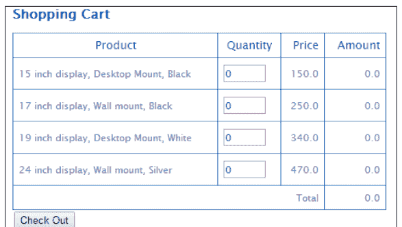

## Advanced Storage

我们可以在 Web 浏览器中检查 cookie 的存在。在 Dartium 中，从 Tools 菜单项打开开发者工具并选择 Resources 选项卡，如以下屏幕截图所示：

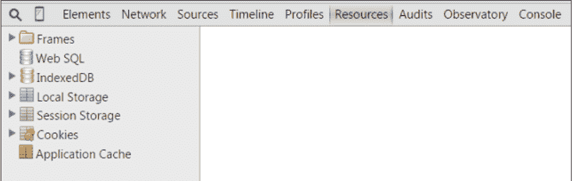

选择 Cookies 并选择 localhost，以确保没有 cookie 与我们的 Web 服务器关联。

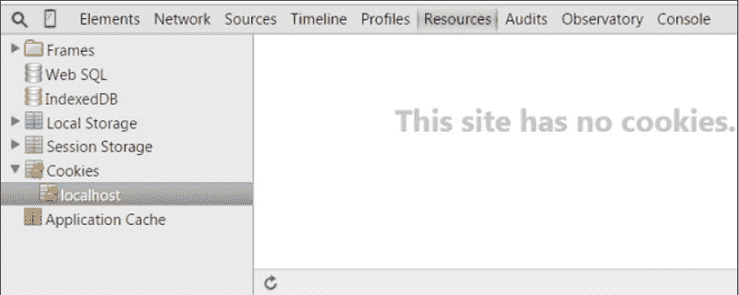

如果用户通过文本输入字段更改任何商品的数量，则商品数量和所选商品的总数量将被重新计算。同时，我们的代码会调用 ShoppingController 类的 saveQuantity 方法，如下所示：

```
saveQuantity(Product product) {
    if (product.quantity == 0) {
        storage.removeItem(Product.toCookieName(product));
    } else {
        storage.setItem(Product.toCookieName(product),
            product.quantity.toString());
    }
}
```

如果数量字段中的数字等于零，则商品将从 cookie 中移除。在其他情况下，我们将在 cookie 中创建或更新数量值。

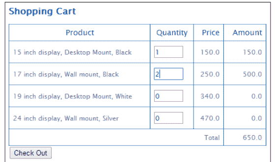

让我们检查前面的信息。返回 Resources 选项卡并导航到 localhost 树项。单击窗口底部的刷新图标以查看与我们的服务器关联的 cookie 列表。

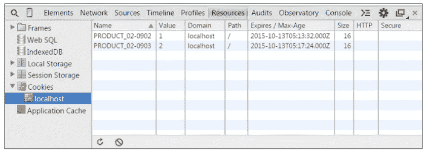

现在，关闭 index.html 页面并再次打开它。有关所选商品及其指定数量和数量的信息将在这里可用。单击 Check Out 按钮以调用 cart.checkOut 方法来显示已付款商品的消息并从中移除 cookie。代码如下：

```
checkOut.onClick.listen((Event event) {
  cart.checkOut();
});
```

以下屏幕截图显示了 resulting 消息：

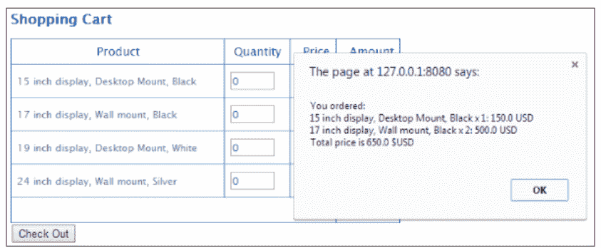

Cookie 是一种通用机制，有助于在 Web 浏览器中持久保存用户特定数据。在尝试以下角色时，它们可能非常有用：

- 跟踪 cookie 有助于编译浏览历史的长期记录。
- Web 服务器使用的身份验证 cookie 有助于你知道用户是否已登录。
- 会话 cookie 在用户导航到网站时存在，并在指定间隔后过期，或如果用户通过服务器逻辑再次登录。
- 持久 cookie 比会话 cookie 存在时间更长，可能用于保存有关用户的关键信息，例如姓名、姓氏等。
- 安全 cookie 仅通过启用安全属性的 HTTPS 使用，以确保客户端和服务器之间 cookie 传输始终安全。
- 第三方 cookie 与第一方 cookie 相反，它们不属于 Web 浏览器中显示的同一域。从第三方域呈现的网页上的不同内容可能包含脚本，有助于跟踪用户的浏览器历史记录以进行有效广告。

你可以将不同的角色组合起来以满足业务逻辑的特定要求。以下是拥有 cookie 的好处：

- **便利性：** Cookie 可以记住你访问过的所有网站，以及表单中的信息，如住宅或商业地址、电子邮件地址、用户名等
- **个性化：** Cookie 可以存储偏好设置，有助于每个用户个性化网站内容
- **有效广告：** Cookie 可以帮助运行营销活动，为特定用户提供相关产品或服务
- **控制便捷：** Cookie 可以通过客户端 Web 浏览器清除或禁用

以下是 cookie 的缺点：

- **隐私：** Cookie 会跟踪你访问过的所有网站
- **安全：** 在不同 Web 浏览器上实现 cookie 会伴随各种安全漏洞的检测
- **限制：** Cookie 每个 cookie 限制为 4095 字节
- **数据：** Cookie 可能会为每个请求带来过多的额外数据开销

因此，cookie 的主要目的是使客户端到服务器的通信具有状态性。如果你只需要仅在客户端保存数据或离线工作，你可以使用其他技术，其中之一是 Web Storage。

## Web Storage

**Web Storage**（或 DOM 存储）代表了一种比 cookie 更优且更安全的方式在客户端持久保存数据。Web Storage 在以下情况下更好：

- 当你需要更大的存储容量时（它可以保留每个可用存储 5 - 10 MB，具体取决于 Web 浏览器）
- 当你不需要与服务器通信来管理客户端数据时
- 当你不希望存储的数据过期时
- 当存储的数据跨同一浏览器的不同标签页或窗口时

有两个 Web Storage 对象（`Session` 和 `Local`）可用于在 Web 浏览器中持久保存用户数据，持续时间为会话长度和无限期。它们都具有通过 Storage 接口声明的相似简单 API。Web Storage 具有事件驱动的实现。每当存储区域发生变化时，就会触发 storage 事件。


## Session 存储

Session 存储可通过 `window.sessionStorage` 属性访问。它旨在在同一标签页或窗口中保存短暂数据，并且仅在同一域的页面之间共享。浏览器每次用户打开新标签页或窗口时都会创建一个新的 session storage 数据库。

## Local 存储

与 Session 存储相反，Local 存储可通过 `window.localStorage` 属性访问，允许你保存比单个会话更长的数据。Local 存储将所有数据保存在一个特殊的本地存储区域中，不受标签页或窗口生命周期的限制。本地存储区域在不同的标签页和窗口之间共享，在多事务场景中非常方便。

让我们看看如何将上一节 Cookies 部分的示例更改为在 Web Storage 中使用。我们不会完全删除 cookie，以便有机会比较不同的持久化技术。打开 shopping_cart_web_storage 项目。在以下代码中，我们添加业务逻辑以使用 StorageManager 类检查 Web Storage 是否得到 Web 浏览器支持：

```dart
abstract class StorageManager {
  factory StorageManager() {
    if (WebStorageManager.supported) {
      return new WebStorageManager();
    } else {
      return new CookieStorageManager();
    }
  }

  Future<String> getItem(key);
  Future setItem(key, value);
  Future removeItem(key);
}
```

在前面的代码中，你可以看到新的 WebStorageManager 类。很难确定 Web 浏览器是否支持 Web Storage。你可以在以下使用 `supported` getter 方法的代码中找到一种可能的解决方案。`getItem` 函数返回与给定键关联的值。`setItem` 函数在此方法中设置键值对，最后一个方法删除指定键的项目。代码如下：

```dart
class WebStorageManager implements StorageManager {
  static bool get supported {
    if (window.localStorage != null) {
      try {
        window.localStorage["__name__"] = "__test__";
        window.localStorage.remove("__name__");
        return true;
      } catch(e) {
        return false;
      }
    } else {
      return false;
    }
  }

  Future<String> getItem(key) {
    return new Future.sync(() {
      return window.localStorage[key];
    });
  }

  Future setItem(key, value) {
    return new Future.sync(() {
      window.localStorage[key] = value;
    });
  }

  Future removeItem(key) {
    return new Future.sync(() {
      window.localStorage.remove(key);
    });
  }
}
```

以下屏幕截图显示了执行程序的结果：

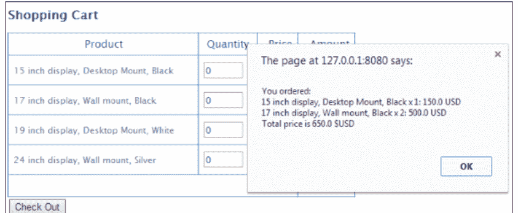

你可以在我们看到 cookie 的同一位置找到有关本地存储状态的信息。展开 Local Storage 树项并选择 localhost 选项以查看本地存储数据：

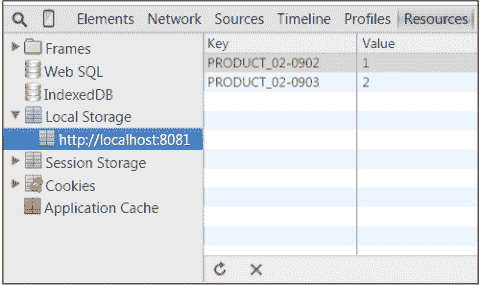

现在，我们可以使用 Web Storage 和 cookie 为客户端存储数据。我们将继续穿越高级存储之旅，下一个目标是 Web SQL。

## Web SQL

Web SQL 由 Apple 引入，基于免费数据库 SQLite。它很快将被淘汰，我只在这里添加它以向你展示它如何被使用，以及我们如何在不出现故障的情况下迁移到其他高级技术。在以下代码中，我们创建了一个新的 shopping_cart_web_sql 项目，作为 Web Storage 部分项目的副本，并在 StorageManager 类中添加了 WebSQLStorageManager：

```dart
abstract class StorageManager {
    factory StorageManager() {
        if (WebSQLStorageManager.supported) {
            return new WebSQLStorageManager();
        } else if (WebStorageManager.supported) {
            return new WebStorageManager();
        } else {
            return new CookieStorageManager();
        }
    }

    Future<String> getItem(key);
    Future setItem(key, value);
    Future removeItem(key);
}
```

首先，检查 Web 浏览器是否支持 Web SQL，并在成功时实例化它。你应该指定要使用的数据库的版本和初始大小。Web 浏览器对 Web SQL 的支持可以通过 `SqlDatabase` 类的 `supported` 属性快速检查。Web SQL 在使用前需要一些准备。首先，我们需要打开数据库。数据库打开后，我们可以创建表（如果不存在）。Web SQL 的 API 比 cookie 和 Web Storage 更复杂，每个方法的大小呈指数级增长。至关重要的是，所有方法都必须执行非常具体的 SQL 语句。WebSQL 还支持读写事务。当事务开始时，你需要指定将分配给 SQL 参数的键。`SqlResultSet` 的实例跟踪事务。`SqlResultSet` 的 `rows.isEmpty` 属性是一个重要的属性，它告诉我们确切返回了多少行，如以下代码所示：

```dart
class WebSQLStorageManager implements StorageManager {

  static const SHOPPING = "SHOPPING";
  static const PRODUCT = "PRODUCT";
  static const TRANS_MODE = "readwrite";
  static final String VERSION = "1";
  static const int SIZE = 1048576;

  SqlDatabase _database;
  static bool get supported => SqlDatabase.supported;
  Future<SqlDatabase> _getDatabase(
    String dbName, String storeName) {
    if (_database == null) {
      _database = window.openDatabase(dbName, VERSION,
        dbName, SIZE);
      var sql = 'CREATE TABLE IF NOT EXISTS ' +
        storeName +
        ' (id NVARCHAR(32) UNIQUE PRIMARY KEY, value TEXT)';
      var completer = new Completer();
      _database.transaction((SqlTransaction tx) {
        tx.executeSql(sql, [],
          (SqlTransaction txn, SqlResultSet result) {
            completer.complete(_database);
          }, (SqlTransaction transaction, SqlError error) {
            completer.completeError(error);
          });
      }, (error) => completer.completeError(error));
      return completer.future;
    } else {
      return new Future.sync(() => _database);
    }
  }

  Future<String> getItem(key) {
    var sql = 'SELECT value FROM $PRODUCT WHERE id = ?';
    var completer = new Completer();
    _getDatabase(SHOPPING, PRODUCT).then((SqlDatabase database) {
      database.readTransaction((SqlTransaction tx) {
        tx.executeSql(sql, [key],
          (SqlTransaction txn, SqlResultSet result) {
            if (result.rows.isEmpty) {
              return completer.complete(null);
            } else {
              Map row = result.rows.first;
              return completer.complete(row['value']);
            }
          }, (SqlTransaction transaction, SqlError error) {
            completer.completeError(error);
          });
      });
    });
    return completer.future;
  }
}
```

对于创建和更新操作，我们使用以下事务并指定特殊的 SQL 语句，并且我们还需要指定 SQL 参数 key 和 value：

```dart
Future setItem(key, value) {
  var sql = 'INSERT OR REPLACE INTO $PRODUCT (id, value) ' +
      'VALUES (?, ?)';
  var completer = new Completer();
  _getDatabase(SHOPPING, PRODUCT).then((SqlDatabase database) {
    database.transaction((SqlTransaction tx) {
      tx.executeSql(sql, [key, value],
        (SqlTransaction txn, SqlResultSet result) {
          return completer.complete(value);
        }, (SqlTransaction transaction, SqlError error) {
          completer.completeError(error);
        });
    }, (error) => completer.completeError(error));
  });
  return completer.future;
}
```

要删除项目，我们使用以下事务并指定将分配给 SQL 参数的 key 参数：

```dart
Future removeItem(key) {
  var sql = 'DELETE FROM $PRODUCT WHERE id = ?';
  var completer = new Completer();
  _getDatabase(SHOPPING, PRODUCT).then((SqlDatabase database) {
    database.transaction((SqlTransaction tx) {
      tx.executeSql(sql, [key],
        (SqlTransaction txn, SqlResultSet result) {
          return completer.complete();
        }, (SqlTransaction transaction, SqlError error) {
          completer.completeError(error);
        });
    }, (error) => completer.completeError(error));
  });
  return completer.future;
}
```

启动我们的应用程序并更改产品数量。从 **Resources** 选项卡展开 **Web SQL** 树项以查看 Web SQL 存储数据。以下屏幕截图显示了 **SHOPPING** 数据库和包含存储数据的 **PRODUCT** 表：

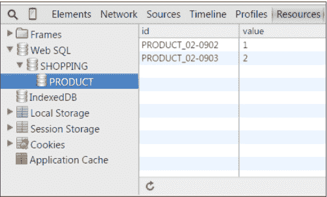

Web SQL 数据库 API 实际上并不是 HTML5 规范的一部分。因此，如果你有使用 Web SQL 的代码，是时候迁移到 IndexedDB 了。


## IndexedDB

**IndexedDB** 由 Oracle 推出，并迅速流行起来。它是一种 Not Only SQL（NoSQL）数据库。IndexedDB API 是一个功能更强大、也复杂得多的 API。IndexedDB 具有以下显著优势：

- 它通过最大限度地减少 HTTP 请求数量，提高了 Web 程序的响应速度和运行速度。
- 它提供了更大的数据存储空间，不受 Web Storage 的限制。
- 它支持离线工作。
- NoSQL 数据库可帮助您直接处理 Dart 和 JavaScript 对象。
- 它支持快速索引、对象搜索，以及每个事务的细粒度锁定。
- 它支持同步和异步 API。

其中一个主要缺点是，如果你来自关系型数据库领域，可能很难理解它。在 IndexedDB 中，我们可以存储大量结构化数据、图像、数组和整个对象；你只需用键为它们建立索引。它遵循同源策略，因此我们无法跨不同域访问数据。如果你仍在使用 Web SQL 数据库，那么是时候迁移到 IndexedDB 了，因为 Web SQL 数据库已于 2010 年 11 月被**万维网联盟（W3C）**弃用。

> IndexedDB 是一个索引表系统。

IndexedDB 对单个数据库条目的大小没有任何限制，但可能对每个数据库的条目总数施加限制。我们将使用异步 API，因为它适用于大多数场景，包括 Web Workers。IndexedDB 是一个真正的数据库；因此，在使用它之前，我们需要指定数据库模式、打开连接，并在事务中开始使用它来检索和更新数据。在这种情况下，它与 Web SQL 解决方案非常接近，但简单得多。让我们看看如何在我们的示例中使用 IndexedDB。我们将使用 Dart SDK 中的 `dart:indexed_db` 包来处理 IndexedDB。你可以从 *Web SQL* 部分复制一份项目，将其重命名为 `shopping_cart_indexed_db`，并使用 `IndexedDBStorageManager` 代替 `WebSQLStorageManager`。代码如下：

```dart
abstract class StorageManager {
    factory StorageManager() {
        if (IndexedDBStorageManager.supported) {
            return new IndexedDBStorageManager();
        } else if (WebStorageManager.supported) {
            return new WebStorageManager();
        } else {
            return new CookieStorageManager();
        }
    }

    Future<String> getItem(key);
    Future setItem(key, value);
    Future removeItem(key);
}
```

上述代码展示了 `IndexedDBStorageManager` 类。我们构建了一个特殊的 `_getDatabase` 方法来获取 `Database` 类的实例。如前所述，在使用 IndexedDB 之前，我们需要打开 IndexedDB 数据库。在下面的代码中，我们使用 `window.indexedDB.open` 方法来打开数据库。接下来，我们需要检查存储对象是否存在于数据库的 `objectStoreNames` 数组中。如果不存在，我们必须关闭数据库，并使用更高的版本号重新打开。由于这个过程是异步的，我们在 `onUpgradeNeeded` 监听器中创建存储对象的新实例。对数据库对象的每次操作都发生在事务内部。因此，我们每次都会创建一个新事务，并在 `startTransaction` 方法中返回 `ObjectStore` 实例。我们将通过 `getObject` 方法返回 `ObjectStore` 的值。要在数据库中设置条目，我们使用 `ObjectStore` 的 `put` 方法。要从存储中移除对象，只需调用 `delete` 方法，如下代码所示：

```dart
class IndexedDBStorageManager implements StorageManager {

  Database _database;

  static const SHOPPING = "SHOPPING";
  static const PRODUCT = "PRODUCT";
  static const TRANS_MODE = "readwrite";
  Future _getDatabase(String dbName, String storeName) {
    if (_database == null) {

      return window.indexedDB.open(dbName).then((Database d) {
        _database = d;
        if (!_database.objectStoreNames.contains(storeName)) {
          _database.close();
          return window.indexedDB.open(dbName,
              version: (d.version as int) + 1,
              onUpgradeNeeded: (e) {
                Database d = e.target.result;
                d.createObjectStore(storeName);
              }).then((Database d) {
            _database = d;
            return _database;
          });
        }
        return _database;
      });
    } else {
      return new Future.sync(() => _database);
    }
  }
  Future<ObjectStore> startTransaction(String storeName) {
    return _getDatabase(SHOPPING, PRODUCT)
        .then((Database database) {
            Transaction transaction =
                _database.transactionStore(storeName, TRANS_MODE);
            return transaction.objectStore(storeName);
        });
  }
  Future<String> getItem(key) {
    return new Future.sync(() {
        return startTransaction(PRODUCT).then((ObjectStore store) {
            return store.getObject(key);
        });
    });
  }
  Future setItem(key, value) {
    return new Future.sync(() {
        return startTransaction(PRODUCT).then((ObjectStore store) {
            return store.put(value, key);
        });
    });
  }
  Future removeItem(key) {
    return new Future.sync(() {
        return startTransaction(PRODUCT).then((ObjectStore store) {
            return store.delete(key);
        });
    });
  }
}
```

就这样。我们可以对 `ObjectStore` 中的数据进行所有操作。`ObjectStore` 类实例通过 `Transaction` 类返回这一事实表明，原始实例中的所有步骤都将被事务包围。让我们展开 Resources 选项卡中的 IndexedDB 树项，查看 `SHOPPING` 数据库。

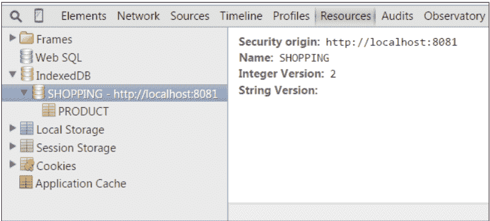

数据库的版本号为 2。现在，选择 `PRODUCT` 树项，你会看到同名包含我们的数据。

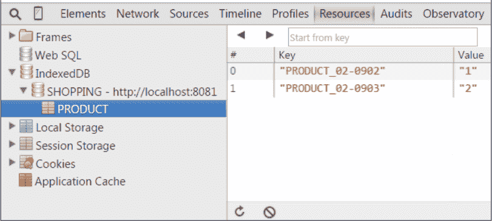

与 Web SQL 相比，IndexedDB 更简单、更灵活。它使用索引在事务中访问数据库中的对象。

## 总结

总而言之，我们将重点介绍有关高级存储空间的一些重要事实。

Cookie 的概念首次引入于 Netscape 浏览器，后来迁移到 Internet Explorer。它至今仍然很重要。为了实现有状态通信，Web 浏览器在其子目录中提供了一个区域，用于存储和访问状态信息。该区域以及存储在该区域中的信息称为 cookie。Cookie 的域告诉浏览器应将 Cookie 发送到哪个域。它允许 Cookie 跨子域，但不允许跨域。路径是 Cookie 生效的域根目录中的目录。Cookie 是帮助在 Web 浏览器中持久化用户特定数据的通用机制。

Web Storage 代表了一种比 Cookie 更好、更安全的客户端数据持久化机制。有两个 Web Storage 对象（Session 和 Local），可用于在 Web 浏览器中将会话长度的用户数据持久化，也可以无限期持久化。两者都通过 Storage 接口声明了类似的简单 API。

Web SQL 由 Apple 推出，基于免费数据库 SQLite。它很快就会被停止使用，我们在这里使用它只是为了了解它的用法，以及如何轻松迁移到其他先进技术。

在 IndexedDB 中，我们可以存储大量结构化数据、图像、数组和整个对象，只需用键为它们建立索引。IndexedDB 对单个数据库条目的大小没有任何限制，但可能对每个数据库的条目总数施加限制。

在下一章中，我们将演示如何在 Dart 中使用不同的 HTML5 功能。
