# 11 支持其他 HTML5 功能

HTML5 旨在提供丰富的跨平台内容，而无需使用额外的插件。在本章中，我们将学习如何在 Dart 中使用不同的 HTML5 功能。我们将涵盖以下主题：

- 通知 API。
- 原生拖放 API。
- 地理定位 API。
- Canvas。

## 通知 API

Web 应用程序中发生的过程是异步的，随着时间的推移，它们会生成事件消息，以提醒最终用户进程执行的开始、结束或进度。Web 通知 API 允许你在网页上下文之外显示通知。用户代理会决定通知的最佳呈现方式。这方面取决于其运行所在的设备。通常，它可以在以下区域显示通知：

- 在显示器的一个角落。
- 在用户代理内的某个区域。
- 在移动设备的主屏幕上。


```
Notification notification =
    new Notification('My Notification', body: "Hello World");
}
});
}
```

在你向用户发送任何通知之前，网站必须拥有权限。你可以让网站自动发送通知，也可以先通过权限请求来发送。当API试图与web上下文之外的内容交互时，这是一个常见需求，尤其是为了避免向用户发送无用的通知。要查看通知设置，请按照以下步骤操作：

1. 在Dartium中打开**设置**选项，并在搜索字段中输入`notifications`，如下面的截图所示：

    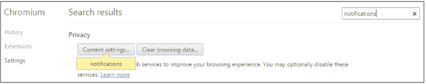

2. 通过点击同名按钮打开**内容**设置弹出对话框，然后向下滚动找到**通知**设置：

    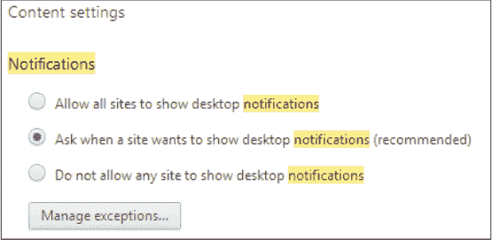

3. 选择推荐选项，然后点击**管理例外**按钮打开**通知例外**对话框。目前，其中不会包含我们的网站，如下面的截图所示：

    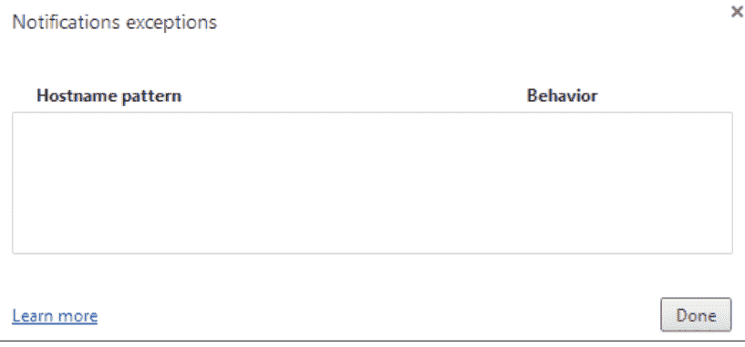

4. 现在，运行应用程序并点击**通知**按钮。如下面的截图所示，**Notification**类的`requestPermission`静态方法请求权限以允许`localhost`的桌面通知：

    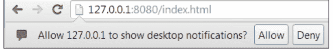

5. 你可以允许或拒绝该网站的通知。你的选择将以所选权限的值来完成未来的权限请求。被允许的桌面通知会被添加到**通知例外**列表中。现在，再次打开**通知例外**对话框查看你的网站，如下面的截图所示：

    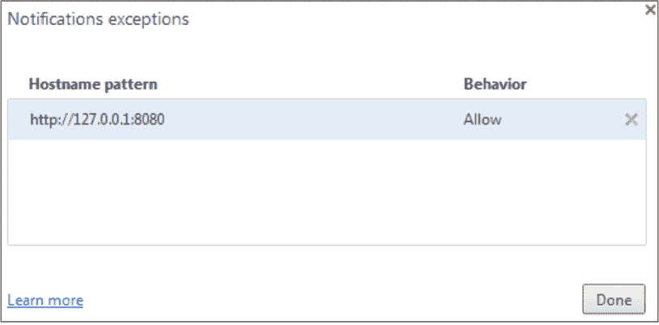

6. 下一步是创建通知。只需指定通知的标题即可创建一个原始通知。`Notification`类的构造函数具有可选属性，可以帮助我们创建带有正文和图标的通知。实例化后的通知会尽快显示，如下面的截图所示：

    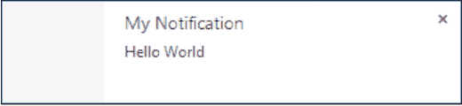

通知会触发以下四个事件，用于跟踪通知的当前状态：

- `show`：当通知显示时触发该事件
- `click`：当用户点击通知时触发该事件
- `close`：当通知关闭时触发该事件
- `error`：当显示通知时出现错误时触发该事件

## 支持其他HTML5功能

通知在用户关闭之前会一直保持打开状态，但你可以使用`Notification`类的`close`方法通过程序关闭它们，如下面的代码所示：

```
void sendNotification() {
    Notification.requestPermission().then((String permission) {
        if (permission == "granted") {
            Notification notification =
                new Notification('My Notification', body: "Hello World");
            notification.onShow.listen((Event event) {
                new Timer(new Duration(seconds:2), () {
                    notification.close();
                });
            });
        }
    });
}
```

## 防止重复通知

每次单击应用程序中的“通知”按钮时，web通知API都会生成新通知，并将其放在前一个通知之上。类似的通知可以使用以下tag属性进行标记，以防止用户桌面上堆满数百个类似的通知：

```
void sendNotification() {
    Notification.requestPermission().then((String permission) {
        if (permission == "granted") {
            Notification notification =
                new Notification('My Notification', body: "Hello World",
                    tag: "myNotification");
            notification.onShow.listen((Event event) {
                new Timer(new Duration(seconds:2), () {
                    notification.close();
                });
            });
        }
    });
}
```

现在，当你使用相同的`tag`生成通知时，web通知API会移除前一个通知并添加新通知。Web通知规范尚不稳定，并且仅受Chrome、Firefox、Safari和Opera等最新版本的web浏览器支持。

## 原生拖放API

**拖放**是一种将指针设备的移动和点击转换为软件可识别的特殊命令的方式，以便快速访问程序的常用功能。用户抓取一个虚拟对象，将其拖到另一个位置或其他虚拟对象上，然后放到那里。原生浏览器对拖放的支持意味着更快速、响应更灵敏、更直观的web应用程序。在使用拖放功能之前，请确保你有可拖拽的内容。

## 可拖拽内容

抽象`Element`类有一个`draggable`属性，用于指示元素是否可以被拖放。由于所有DOM元素都源自`Element`抽象类，这意味着它们都默认支持拖放操作。要使元素可拖拽，我们需要将其`draggable`属性设置为`true`。可以使用以下代码完成：

```
var dragSource = querySelector("#sample_drag_id");
dragSource.draggable = true;
```

或者，你可以使用以下HTML标记来完成：

```
<p id="sample_dnd_id" draggable="true">Drag me!</p>
```

如果你想防止可拖拽元素的文本内容被选中，你可以对该元素进行样式设置，如下面的代码所示：

```
[draggable] {
  -moz-user-select: none;
  -khtml-user-select: none;
  -webkit-user-select: none;
  user-select: none;
  -khtml-user-drag: element;
  -webkit-user-drag: element;
}
```

让我们打开`drag_and_drop`项目并运行它。在下面的截图中，你会看到你可以在浏览器窗口内拖动文本元素，但无法放置它：

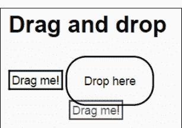

> 在拖拽操作期间，原生拖放API仅由拖拽事件触发，而非鼠标事件。

## 拖放事件

原生拖放API触发以下事件：

- `dragstart`：当拖拽开始时，在该元素上触发该事件。可在侦听器中设置拖拽数据和要与拖拽操作关联的图像等信息。
- `dragenter`：当拖拽开始后光标首次悬停在一个元素上时触发该事件。默认不允许放置操作。有一个或多个侦听器执行拖放操作。通常，侦听器会高亮或标记可以放置的放置元素。
- `dragover`：当光标悬停在一个元素上且拖拽正在进行时触发该事件。
- `dragleave`：当拖拽过程中光标离开一个元素时触发该事件。侦听器会从可以放置的元素上移除高亮或标记。
- `drag`：在触发`dragstart`事件的元素上触发该事件。
- **drop**：在发生放置的元素上触发该事件。仅当允许放置时才会触发。用户可以通过按*Esc*键或在无效放置区域释放鼠标按钮来取消放置操作。
- **dragend**：在开始拖拽的元素上触发该事件，以告知拖拽操作已完成，无论是否成功。

我们将继续从我们的示例中使元素可拖拽。我们需要为`dragstart`事件添加一个侦听器，并在侦听器中设置拖拽数据，如下所示：

```
var dragSource = querySelector("#sample_drag_id")
..draggable = true
..onDragStart.listen((MouseEvent event) {
  //...
});
```

如果元素被设置为可拖拽，你将无法通过鼠标点击并拖拽来选择文本。


> 用户必须按住Alt键才能用鼠标选择文本。

## 拖动数据

每个拖拽事件都有一个`dataTransfer`属性，用于保存与拖拽操作关联的数据。如果你拖拽选中的文本，则关联数据就是文本。如果你拖拽图像，则关联数据就是图像本身。拖拽数据结合了数据格式的字符串表示和数据值。我们将在`dragenter`和`dragover`事件的侦听器中使用数据格式来检查是否允许放置操作。你可以通过多次使用不同格式调用`setData`方法来设置多个拖拽数据。要删除它们，请调用`dataTransfer`属性的`clearData`方法，如下面的代码所示：

```
var dragSource = querySelector("#sample_dnd_id")
..draggable = true
..onDragStart.listen((MouseEvent event) {
  event.dataTransfer.setData("text/plain", "I'm draggable");
  event.dataTransfer.setData("text/data", "1234");
});
```


## 拖动反馈图像

通常，原生的拖放 API 会自动创建半透明图像，该图像由 `dragstart` 事件的拖动目标生成，并在拖动操作期间跟随鼠标指针。你可以使用 `dataTransfer` 属性的 `setDragImage` 方法来指定自定义拖动图像。此函数的第一个参数是自定义拖动图像，可以是对真实图像、画布或其他元素的引用。第二个和第三个参数是图像相对于鼠标指针出现时的偏移量。代码如下：

```
var dragSource = querySelector("#sample_drag_id")
  ..draggable = true
  ..onDragStart.listen((MouseEvent event) {
    event.dataTransfer.setData("text/plain", "I'm draggable");
    event.dataTransfer.setDragImage(new
        ImageElement(src:'notification.png'), 0, 0);
  });
```

以下反馈图像将代替标准的半透明图像出现：

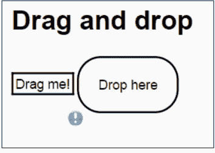

## 拖动效果

拖放 API 支持对可拖动数据执行复制、移动、链接及其组合等操作。我们可以使用复制操作来表示被拖动的数据将从当前位置复制到放置位置。类似地，你可以使用移动操作来表示被拖动的数据将被移动，而链接操作表示将在源位置和放置位置之间创建连接。你应该通过在监听器中设置 `dragstart` 事件的 `effectAllowed` 属性来指定允许并执行的某个操作或组合，如以下代码所示：

```
var dragSource = querySelector("#sample_drag_id")
  ..draggable = true
  ..onDragStart.listen((MouseEvent event) {
    event.dataTransfer.setData("text/plain", "I'm draggable");
    event.dataTransfer.setDragImage(new
        ImageElement(src:'notification.png'), 0, 0);
    event.dataTransfer.effectAllowed = 'copy';
  });
```

在前面的示例中，我们只允许复制操作。让我们看看我们可以将哪些值用作操作的名称：

- none: 此操作表示不允许任何操作
- copy: 此操作表示拖动数据只能从源复制到放置位置
- move: 此操作表示拖动数据只能从源移动到放置位置
- link: 此操作表示拖动数据只能从源链接到放置位置
- copyMove: 此操作表示拖动数据可以从源复制或移动到放置位置
- copyLink: 此操作表示拖动数据可以从源复制或链接到放置位置
- all: 此操作表示拖动数据可以从源复制、移动或链接到放置位置

默认情况下，`effectAllowed` 属性允许全部三种操作。允许的操作可以在 `dragenter` 或 `dragover` 事件的监听器中通过 `effectAllowed` 属性进行检查，并且应该在相关的 `dropEffect` 属性中设置，以指定应执行哪个单一操作。`dropEffect` 属性的有效操作仅为 none、move 或 link，只有这三种，任何其他组合都被禁止。期望的操作会改变鼠标指针，因此对于复制操作，光标可能会出现加号。期望的效果可以通过用户按下修饰键来修改。具体键因平台而异。在 Windows 操作系统中，用户通常使用 Shift 和 Ctrl 键在复制、移动和链接操作之间切换。在 `dragenter` 和 `dragover` 事件期间，我们可以修改 `effectAllowed` 和 `dropEffect` 属性，以指定放置目标支持的操作。`dropEffect` 中指定的效果必须是 `effectAllowed` 属性中列出的其中一个。`dropEffect` 属性的值可以告诉我们拖动操作的确切结果。如果 `dropEffect` 属性的值为 none，则拖动已取消；否则，指定的效果即为已执行的操作。拖放操作在 `dragend` 事件结束之后被视为完成。

> `none` 值可用于任一属性，以表示在目标位置不允许放置操作。

### 放置目标

放置目标是拖动项可能被放置的位置。放置目标非常重要，因为网页的大多数区域不允许放置。`dragenter` 和 `dragover` 事件的事件监听器用于通过取消事件来阻止默认处理，从而指示有效的放置目标，如以下代码所示：

```
var dropTarget = querySelector("#sample_drop_id")
    .onDragOver.listen((MouseEvent event) {
        if (checkTarget(event.target)) {
            event.preventDefault();
            event.dataTransfer.dropEffect = 'copy';
        }
    });
```

在前面的代码中，我们调用 `checkTarget` 方法以确保目标位于可放置的正确位置。在我们的例子中，放置目标必须具有 `droppable` 属性，如以下代码所示：

```
bool checkTarget(Element target) {
    return target.attributes.containsKey('droppable');
}
```

然而，通常放置是否被接受或拒绝取决于 `dataTransfer` 属性中的拖动数据类型。在这种情况下，我们应该检查 `dataTransfer` 属性的类型，以决定是否可以接受数据放置。代码如下：

```
var dropTarget = querySelector("#sample_drop_id")
    .onDragOver.listen((MouseEvent event) {
        if (checkTarget(event.target) &&
            checkTypes(event.dataTransfer.types)) {
            event.preventDefault();
            event.dataTransfer.dropEffect = 'copy';
        }
    });
```

在以下代码中，`checkTypes` 函数仅接受通过 `dragstart` 事件监听器内部 `dataTransfer` 的 `setData` 方法指定的 `text/plain` 类型：

```
bool checkTypes(List<String> types) {
    return types.contains("text/plain");
}
```

你现在可以运行 Web 应用程序，将带有 `Drag me!` 文本的框拖动，并将其放置在带有 `Drop here` 文本的框内。让我们完善我们的应用程序并更改放置区域的文本。

## 完成放置

当用户释放鼠标时，拖放操作结束。如果这发生在被识别为有效放置目标的元素上，拖放 API 将在目标上触发 `drop` 事件。`drop` 事件的 `dataTransfer` 属性保存正在拖动的数据。为了检索拖动数据，我们将使用 `dataTransfer` 属性的 `getData` 方法，如下所示：

```
var dropTarget = querySelector("#sample_drop_id")
  ..onDragOver.listen((MouseEvent event) {
    if (checkTarget(event.target) &&
        checkTypes(event.dataTransfer.types)) {
      event.preventDefault();
      event.dataTransfer.dropEffect = 'copy';
    }
  })
  ..onDrop.listen((MouseEvent event) {
    Element dropTarget = event.target;
    dropTarget.innerHtml = event.dataTransfer.getData('text/plain');
    event.preventDefault();
  });
```

`getData` 方法将检索在调用 `setData` 方法时设置的字符串值。当从 `getData` 返回空字符串时，这意味着指定类型的数据不存在。在 `getData` 方法结束时，如果你已接受放置，则需要调用事件的 `preventDefault` 方法。以下是拖放操作的结果：

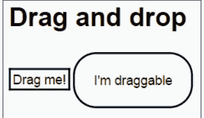

## 完成拖动

最后，当拖动操作完成后，拖放 API 会在接收到 `dragstart` 事件的源元素上生成 `dragend` 事件。无论拖放操作的结果如何，API 都会生成该事件。`dropEffect` 属性的值可以告诉我们拖动操作的确切结果。如果 `dropEffect` 属性的值为 `none`，则拖动已取消；否则，指定的效果即为已执行的操作。拖放操作在 `dragend` 事件结束之后被视为完成。

## 地理位置 API

**地理位置** API 是一个用于定位信息的高级接口。它让你能够获知用户所在位置，并在用户移动时跟踪其位置。地理位置 API 与底层位置源无关，并且不关心 Web 浏览器如何确定位置。以下是常见的定位来源：

- GPS
- 网络 IP 地址
- RFID
- Wi-Fi
- 蓝牙 MAC 地址
- GSM/CDMA 基站 ID
- 用户输入


API 使用纬度和经度坐标来表示位置。

> 地理定位 API 不保证返回设备的真实位置。

地理定位 API 包含以下类：

- `Geolocation`：此类用于确定与宿主设备关联的位置信息
- `Geoposition`：此类用于存储坐标和时间戳
- `Coordinates`：此类用于存储设备的位置信息和速度

## 确定当前位置

让我们看看如何使用地理定位 API 获取当前位置的信息：

```
import 'dart:html';

void main() {
  window.navigator.geolocation.getCurrentPosition()
    .then((Geoposition geoposition) {
      querySelector("#latitude").text = geoposition.coords.latitude.toStringAsFixed(6);
      querySelector("#longitude").text = geoposition.coords.longitude.toStringAsFixed(6);
    }, onError: (PositionError error) {
      print(error.message);
    });
}
```

我们可以从 `window` 对象的 `navigator` 属性中获取 `geolocation` 实例。`geolocation` 的 `getCurrentPosition` 方法在 `Future` 对象中返回 `Geoposition`。当 Future 被解析时，我们将把 `geoposition` 的坐标赋值给纬度和经度的 HTML 字段。

> Dartium 不支持地理定位，因此请运行 pub serve 并使用 Chrome 浏览器进行测试。

- 3. 选择**推荐**选项，并通过点击**管理例外**按钮打开**地理位置例外**对话框。目前，该对话框中不会包含我们的网站，如以下截图所示：

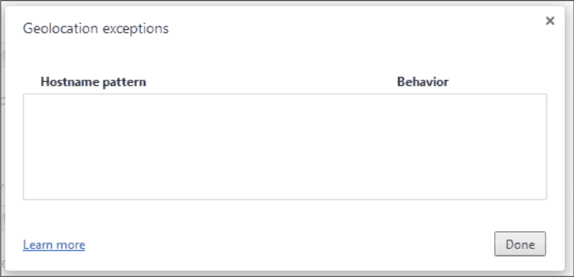

- 4. 运行地理定位应用。Chrome 浏览器会询问你是否允许使用你的位置信息，如以下截图所示：

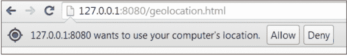

5. 你可以允许或拒绝该网站的位置请求。你的选择将决定后续权限请求如何处理 `geoposition` 的值。网站随后会被添加到**地理位置例外**列表中。请再次打开**地理位置例外**对话框以查看你的网站：

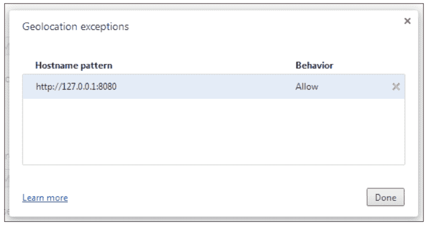

`geolocation` 服务中发生的任何错误都会被打印出来：

```
Network location provider at 'https://www.googleapis.com/'
: Returned error code 400.
```

6. 现在，我们将从项目的根目录运行 `pub serve`：

```
Loading source assets...
Serving geolocation web on http://localhost:8080
Build completed successfully
[web] GET /geolocation.html => geolocation|web/geolocation.html
[web] GET /geolocation.css => geolocation|web/geolocation.css
[web] GET /packages/browser/dart.js => browser|lib/dart.js
[Info from Dart2JS]:
Compiling geolocation|web/geolocation.dart...
[Info from Dart2JS]:
Took 0:00:27.723586 to compile geolocation|web/geolocation.dart.
Build completed successfully
[web] GET /geolocation.dart.js => geolocation|web/geolocation.dart.js
[web] GET /geolocation.dart.js.map => geolocation|web/geolocation.dart.js.map
```

- 7. 接着，在 Chrome 浏览器中打开该 Web 应用，会得到以下结果：

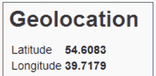

如果加入 Google Maps 在真实地图上显示你的当前位置，这个示例会更有趣。

## 地图上的地理定位

将 google_maps 包添加到你的项目中，并对代码进行以下修改：

```
import 'dart:html';
import 'package:google_maps/google_maps.dart';

void main() {
  final mapOptions = new MapOptions()
    ..zoom = 15
    ..mapTypeId = MapTypeId.ROADMAP;
  final map = new GMap(querySelector("#map_canvas"), mapOptions);

  window.navigator.geolocation.getCurrentPosition()
    .then((Geoposition geoposition) {
      Coordinates coords = geoposition.coords;
      querySelector("#latitude").text = coords.latitude.toStringAsPrecision(6);
      querySelector("#longitude").text = coords.longitude.toStringAsPrecision(6);
      //
      map.center = new LatLng(coords.latitude, coords.longitude);
    }, onError: (PositionError error){
      print(error.message);
    });
}
```

## 支持其他 HTML5 特性

在 mapOptions 中，我们指定了缩放级别和视图类型。地图可以以卫星、地形或混合视图呈现。使用 Google Maps API 非常简单。只需在 HTML 页面中添加带有指定 ID 的 div 元素，然后执行 pub serve 命令来编译代码并运行服务器。当你在 Chrome 浏览器中打开**地理位置**页面时，将得到以下结果：

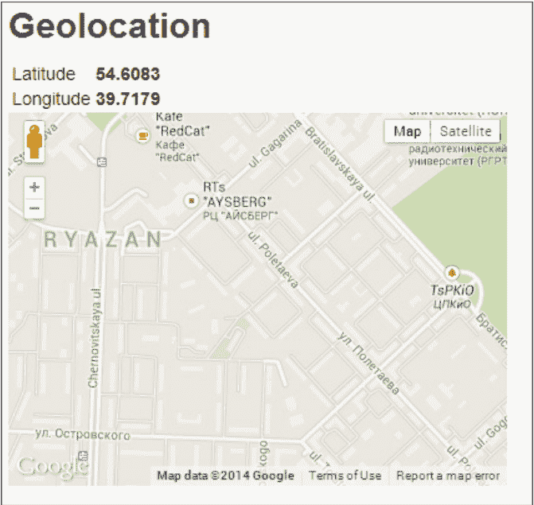

## 跟踪当前位置

地理定位 API 可以使用 watchPosition 方法监控设备的当前位置。通过 enableHighAccuracy 参数，地理定位 API 会开始使用设备上可用的更精确的硬件。该方法返回一个 geoposition 坐标流。你只需监听事件即可跟踪当前位置的变化。代码如下：

```
import 'dart:html';
import 'package:google_maps/google_maps.dart';
```

```
void main() {
    final mapOptions = new MapOptions()
    ..zoom = 25
    ..mapTypeId = MapTypeId.ROADMAP;
    final map = new GMap(querySelector("#map_canvas"), mapOptions);

    window.navigator.geolocation
    .watchPosition(enableHighAccuracy:true)
    .listen((Geoposition geoposition) {
        Coordinates coords = geoposition.coords;
        map.center = new LatLng(coords.latitude, coords.longitude);
        //
        querySelector("#location_tracker").append(new DivElement()
        ..text = coords.latitude.toStringAsPrecision(6) + " x " +
        coords.longitude.toStringAsPrecision(6));
    }, onError: (PositionError error){
        print(error.message);
    });
}
```

当你运行该 Web 应用时，会得到以下结果：

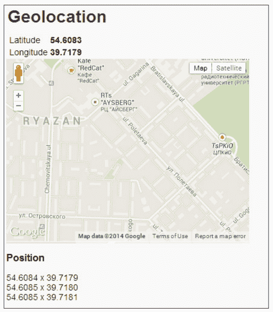

## Canvas

HTML5 canvas 是一个非常出色的功能，它允许你通过代码进行编程式绘图操作。它之所以变得非常流行，是因为它允许你在网页中直接创建和处理图像。canvas 是 HTML5 新特性中最灵活的标签之一。这个标签就像一块空白的画板。它定义了一个上下文对象，用户可以在其中绘制图形。实际的绘制操作可以分为以下几种方式：

- 绘制 2D 上下文
- 绘制 3D 上下文（正式名称为 WebGL）

所有现代网络浏览器都支持 2D 上下文。它更为成熟和稳定，而 3D 上下文仍处于早期的定义阶段。由于 2D 上下文得到更广泛的支持，我们来讨论一下它。

canvas API 既简单又强大。你只能通过脚本在 2D 位图表面上绘制。在绘制过程中，你所绘制的形状不会对应任何 DOM 节点。你生成的只是像素，因此即使图形复杂度增加，也无需担心性能下降。

在 canvas 上绘图，本质上就是在屏幕上的适当坐标处添加像素。通常，屏幕上像素的坐标与 canvas 中用网格表示的点一一对应，但当我们放大或缩小屏幕，或通过 CSS 调整 canvas 的大小时，这些坐标可能会发生变化。网格的关键点是位于 canvas 左上角的原点，其坐标为 (0, 0)。绘制在 canvas 上的每个形状都有一个 x 轴和 y 轴的偏移量，以及宽度和高度属性。

## 示例 —— canvas 编辑器

canvas API 允许你执行以下操作：

- 绘制矩形、椭圆、线条等形状
- 渲染文本
- 像素操作
- 在区域、形状或文本中填充颜色
- 创建渐变和图案以填充区域、形状或文本
- 复制图像、其他 canvas 或视频帧
- 将 canvas 内容导出到文件


## 支持其他HTML5特性

```
<link rel="stylesheet" href="https://maxcdn.bootstrapcdn.com/bootstrap/3.2.0/css/bootstrap.min.css">
<link rel="stylesheet" href="https://maxcdn.bootstrapcdn.com/bootstrap/3.2.0/css/bootstrap-theme.min.css">

<link rel="stylesheet" type="text/css" href="css/bootstrap-colorselector.css" />
<link rel="stylesheet" type="text/css" href="css/index.css">

<!-- HTML5 Shim and Respond.js IE8 support of HTML5 elements and media queries -->
<!-- WARNING: Respond.js doesn't work if you view the page via file:// -->
<!--[if lt IE 9]>
<script src="https://oss.maxcdn.com/html5shiv/3.7.2/html5shiv.min.js"></script>
<script src="https://oss.maxcdn.com/respond/1.4.2/respond.min.js"></script>
<![endif]-->

<!-- jQuery (necessary for Bootstrap's JavaScript plugins) -->
<script src="https://ajax.googleapis.com/ajax/libs/jquery/1.11.1/jquery.min.js"></script>
<script src="https://maxcdn.bootstrapcdn.com/bootstrap/3.2.0/js/bootstrap.min.js"></script>

<script async type="application/dart" src="index.dart"></script>
<script async src="packages/browser/dart.js"></script>
```

HTML页面中包含的所有Bootstrap样式表和JavaScript代码均从免费公共内容分发网络（CDN）下载。html5shiv和respond库有助于在IE 8或更高版本上运行HTML5特性。

网页的主体分为两部分。第一部分是响应式导航栏组件，用作我们应用程序的导航标题。它在移动视图中折叠并切换，如果可用宽度空间增加则变为水平。我们将导航栏分为两个子部分。第一个子部分是主工具栏，包含所有与画布直接操作相关的组件。另一个是辅助工具栏，包含在应用程序中起辅助作用的组件。

这组组件中的最后一个是“清除”按钮。用户可以单击此按钮清除画布的内容，如下代码所示：

```
<div class="form-group">
<button type="button"
class="btn btn-default clear-btn">Clear</button>
</div>
```

辅助工具栏右对齐。它只有一个“预览”按钮组件，如下代码所示：

```
<ul class="nav navbar-nav navbar-right">
<li><a href="#" class="previewBtn">Preview</a></li>
</ul>
```

现在，让我们看看我们的画布组件：

```
<div class="col-lg-12 text-center canvas-container">
<canvas class="canvas view-canvas" width="600px"
height="400px">
<p>Unfortunately, your browser is currently unsupported by
our web application.</p>
</canvas>
<canvas class="canvas draw-canvas" width="600px"
height="400px">
<p>Unfortunately, your browser is currently unsupported by
our web application.</p>
</canvas>
</div>
```

我们在应用程序中使用两个画布。第一个标记有view-canvas类。它仅用于呈现数据，与第二个标记有draw-canvas类的画布相对。第二个画布的用途是所有工具都必须在此绘制。当它们的绘制操作结束时，它们生成的像素随后被移动到第一个画布中。

## 进入主函数

我们应用程序的基础是分为两类的组件：小部件（widgets）和工具（tools）。小部件是处理HTML元素并包含额外行为的组件。所有工具组件都基于Tool类。我们使用基于工具的组件在画布中绘制。以下是我们应用程序的主函数：

```
// Calculate absolute value of number
num abs(num value) => value < 0 ? -value : value;
```

## CanvasWidget 组件

如前所述，应用程序使用两个画布组件——一个叠在另一个之上。两者都可以通过选择器获取。当我们创建CanvasWidget组件的实例时，我们将这些选择器作为构造函数的参数传递。该组件引用用于绘制的Tool组件。代码如下：

```
```dart
/**
 * Canvas widget listens for mouse events from [CanvasElement] to draw
 * with selected tool.
 */
class CanvasWidget implements StreamConsumer {

  CanvasElement _viewCanvas, _drawCanvas;

  CanvasElement get viewCanvas => _viewCanvas;
  CanvasElement get drawCanvas => _drawCanvas;
  CanvasRenderingContext2D get context => _viewCanvas.context2D;
  CanvasRenderingContext2D get drawContext => _drawCanvas.context2D;

  Tool _tool;

  /**
   * Create an instance of CanvasWidget. The [viewCanvasSelector] and
   * [drawCanvasSelector] need to find CanvasElements.
   */
  CanvasWidget(String viewCanvasSelector, String drawCanvasSelector) {
    // Find canvas elements
    _viewCanvas = querySelector(viewCanvasSelector);
    _drawCanvas = querySelector(drawCanvasSelector);
    // Add mouse event listeners
    _drawCanvas.onMouseDown.listen((evt) =>
      _tool.beginDraw(drawContext, offset(evt)));
    _drawCanvas.onMouseMove.listen((evt) =>
      _tool.drawing(drawContext, offset(evt)));

    var _finishDraw = (evt) {
      _tool.finishDraw(drawContext, offset(evt));
      copyContext();
    };

    _drawCanvas.onMouseUp.listen(_finishDraw);
    _drawCanvas.onMouseLeave.listen(_finishDraw);
  }
}
```
```

用户开始绘制时按下鼠标按钮。因此，onMouseDown监听器调用Tool类的beginDraw方法。drawContext方法和鼠标坐标的偏移量作为该方法的参数传递。每次移动鼠标时都会调用Tool类的drawing方法。最后，当用户释放鼠标按钮时调用finishDraw方法，并调用本地copyContext方法将draw画布的内容复制到view画布。CanvasWidget组件通过addStream方法实现StreamConsumer接口，以监听两类事件，即来自ColorSelectorWidget的ColorSelectedEvent和来自ToolSelectorWidget的ToolSelectedEvent。addStream方法处理传入的事件，如下代码所示：

```
/**
 * Copy drawn image from draw canvas into view context.
 * After all it clears the draw canvas.
 */
copyContext() {
    context.drawImage(_drawCanvas, 0, 0);
    _drawCanvas.context2D.clearRect(0, 0,
        _drawCanvas.width, _drawCanvas.height);
}

/**
 * Clear the view canvas
 */
clear() {
    context.clearRect(0, 0, _viewCanvas.width, _viewCanvas.height);
}

/**
 * Consumes the elements of [stream].
 * Listens on [stream] and does something for each event.
 */
Future addStream(Stream stream) {
    return stream.listen((event) {
        if (event is ColorSelectedEvent) {
            if (event.type == ColorSelectedEvent.STROKE_COLOR) {
                drawContext.strokeStyle = event.value;
            } else {
                drawContext.fillStyle = event.value;
            }
        } else if (event is ToolSelectedEvent) {

```

}
throw new Exception("Brush with $name not found");
}

selectTool(String name) {
  _selectedTool = getTool(name);
  _toolSelectedController.add(new ToolSelectedEvent(selectedTool));
  _selectElement.value = selectedTool.name;
}
}
```

当用户选择新工具时，该组件会生成一个 `ToolSelectedEvent` 方法，并将选定的工具实例作为参数。`StreamController` 方法用于将 `ToolSelectedEvent` 广播给任何监听器，即 `CanvasWidget`。

## ColorSelector 小部件

这个小部件是 bootstrap-colorselector 到 Dart 的移植。该组件仅从预定义的颜色集合中创建一个下拉调色板。我们已通过HTML标记设置了预定义颜色。每次用户选择新颜色时，`StreamController` 方法都会向 `CanvasWidget` 类广播一个 `ColorSelectedEvent` 事件。

## Tool 类

我们的应用程序有一个抽象的 `Tool` 类，用于抽象所有基于工具的组件的共同行为和属性，如下代码所示：

```
/**
 * Abstract class defines common behavior and properties
 * for all tools.
 */
abstract class Tool {
  bool isDrawing = false;
  Point startPoint;

  String get name;

  void beginDraw(CanvasRenderingContext2D context, Point point) {
    isDrawing = true;
    startPoint = point;
  }
}
```


```void drawing(CanvasRenderingContext2D context, Point point);

void finishDraw(CanvasRenderingContext2D context, Point point) {
    if (isDrawing) {
        drawing(context, point);
        isDrawing = false;
    }
}
```

The isDrawing property reflects the status of the drawing operation. The startPoint property simply holds the cursor coordinates relative to the canvas when the user starts drawing on the canvas. The read-only property name returns the name of the tool. This name is used when the tool is added to ToolSelectorWidget. Each tool has three methods, and the whole drawing process is split into the following three phases:

- **Start the drawing phase**: The program calls the beginDraw method when a user starts holding down the mouse button. We always switch on the isDrawing property and remember the cursor coordinates in startPoint.
- **Drawing phase**: The drawing method is called every time the user moves the cursor. Implementation of this method strongly depends on the tool, so we do not implement it in the abstract class Tool.
- **End the drawing phase**: The program invokes the finishDraw method when the user releases the mouse button. In this method, we need to call the drawing method for the last time and switch off isDrawing only if the drawing process has happened.

Now, it's time to look at our tools implementation in detail.

## The Pen tool

As the canvas element doesn't directly support drawing a single point, we use lines instead. Drawing in a canvas is similar to using a virtual pen. At the beginning, we must call beginPath of context where we begin drawing. This method creates a new drawing path, so future drawing commands will be directed to the path and will be used to build the path. We start our path by moving to the startPoint coordinates with the moveTo method of context, as shown in the following code:

```
/**
 * Simple pen tool
 */
class Pen extends Tool {
```

```
String get name => "Pen";

@override
void beginDraw(CanvasRenderingContext2D context, Point point) {
    super.beginDraw(context, point);
    context.beginPath();
    context.moveTo(startPoint.x, startPoint.y);
}

@override
void drawing(CanvasRenderingContext2D context, Point point) {
    if (isDrawing) {
        context.lineTo(point.x, point.y);
        context.stroke();
    }
}
```

Every time a user moves the mouse, the program calls the drawing method to connect our drawn path to next line's point with the lineTo method of context. Finally, it calls the stroke method to draw the shape by stroking its outline.

## The Line tool

The behavior of the Line tool is similar to that of the Pen tool, but with a different drawing logic. We only implement the drawing method of the Tool class to draw our shape in a path. A path is a list of subpaths, and each of them is a list of points that are connected by straight or curved lines. Each one also contains a flag that indicates whether it is closed, so the last point of the closed subpath is connected to the first point by a straight line, as illustrated by the following code:

```
/**
 * Line tool is used to create lines.
 */
class Line extends Tool {

    String get name => "Line";

    @override
    void drawing(CanvasRenderingContext2D context, Point point) {
        if (isDrawing) {
            context.clearRect(0, 0,
                context.canvas.width, context.canvas.height);
            context.beginPath();
```

```
context.moveTo(startPoint.x, startPoint.y);
context.lineTo(point.x, point.y);

context.stroke();
context.closePath();
}
}
```

We must always clear the whole drawing canvas and start a new path via the `beginPath` method of context. We move the first point to the `startPoint` position and draw the line within the current cursor coordinates. Finally, we draw the line shape by stroking its outline and close the drawing path.

## The Rectangle tool

We can draw a rectangle with individual lines, but the **Rectangle** tool makes the task much easier. The context object has the following methods to draw rectangles:

- `strokeRect`: This method uses the current stroke style to draw the box that outlines the given rectangle onto the canvas
- `fillRect`: This method uses the current fill style to draw the given rectangle onto the canvas
- `clearRect`: This method clears all the pixels on the canvas in the given rectangle to transparent black

The easiest way to draw a rectangle on the canvas is use the `fillRect` method of context. The `fillRect` method uses color from the `fillStyle` property, black by default. The Rectangle class, as shown in the following code:

```
/*
 * Rectangle tool
 */
class Rectangle extends Tool {

    String get name => "Rectangle";

    @override
    void drawing(CanvasRenderingContext2D context, Point point) {
        if (isDrawing) {
            context.clearRect(0, 0,
                context.canvas.width, context.canvas.height);

            int x = min(point.x, startPoint.x).round(),
```

```
y = min(point.y, startPoint.y).round(),
 w = abs(point.x - startPoint.x).round(),
 h = abs(point.y - startPoint.y).round();

 context.fillRect(x, y, w, h);
 context.strokeRect(x, y, w, h);
 }
 }
 }
```

In the preceding code, we drew a rectangle with fillRect and finally called strokeRect to draw the border line shape by stroking its outline.

## The Oval tool

Drawing ovals is a breeze too. The easiest way to draw ovals is using the arc method of context. The arc method takes the following five parameters:

```
arc(x, y, radius, startAngle, endAngle, anticlockwise)
```

The x and y parameters are the coordinates of the center of the oval on which the arc should be drawn. The radius parameter is the radius of the oval. The startAngle and endAngle parameters define the start and end coordinates of the arc in radians, measured from the x axis along with the curve of the oval. Finally, the last parameter is anticlockwise, which tells the canvas to draw the arc anticlockwise. The code is as follows:

```
/**
 * This tool transforms a drawing context into a rectangle
 * enclosing the oval and uses the arc method to draw it.
 */
class Oval extends Tool {

 String get name => "Oval";

 @override
 void drawing(CanvasRenderingContext2D context, Point point) {
  if (isDrawing) {
   context.save();
   context.clearRect(0, 0,
    context.canvas.width, context.canvas.height);
   context.beginPath();

   var rx = (point.x - startPoint.x) / 2;
   var ry = (point.y - startPoint.y) / 2;
```

## How to preview the context

If you need to preview the result of what you've done in the view canvas, you can open a new window with the content of the view canvas as shown here:

```
// Register a preview button listener
querySelector(".preview-btn").onClick
.listen((MouseEvent event) {
    event.preventDefault();
    window.open(canvas.viewCanvas.toDataUrl("image/png"),
    "Image Preview");
});
```

Now if you click on the Preview link, you will see the next result in a new window in your web browser, as shown in the following screenshot:

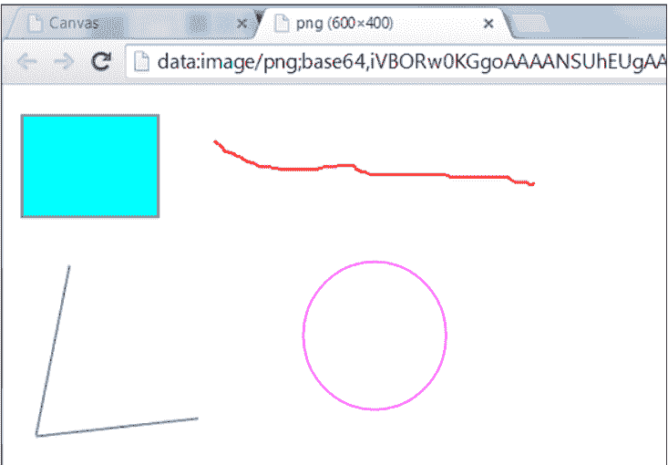

Here, we opened a new browser window with the image data URI directly and we could save it in the represented format. The data URI format shown in the address of the web browser is as follows:

```
data:[<MIME-type>][;charset=<encoding>][;base64],<data>
```

The toDataUrl method has an optional second parameter, `quality`. It represents the image quality in the range of 0.0 to 1.0 when the requesting type is `image/jpeg` or `image/webp`.

## Summary

To summarize, we will discuss the important facts about how to support other HTML5 features in Dart.

The web notification API allows you to display notifications outside the context of the web page. The user agent defines the best presentation of notifications, which depends on the location of the device. The web notification API is available as a part of the `dart:html` package and allows you to send information to a user even if the application is idle. When you build web applications, you can use the notification API in event handlers or polling functions to notify users.

Before you send any notifications to the user, the website must have permissions. Users can let websites send notifications automatically or with the permission request first. All the websites that request access to the notification API are added to the list of the notification exceptions. The constructor of the `Notification` class has optional properties that help you create notifications with the body and icon.

Dragging-and-dropping is a way to convert pointing device movements and clicks to special commands that are recognized by software to provide quick access to common functions of a program. Native drag-and-drop support in a browser means faster and more responsive web applications. Each drag event has a `dataTransfer` property that is used to hold data associated with a drag operation. The drop target is very important because most areas of the web page are not permitted to drop.

The geolocation API is a high-level interface used for location information. The API is device-agnostic of the underlying location source and is not affected by how the web browser determines a location. Using the Google Maps API with the geolocation API is very simple.

The HTML5 canvas is a fantastic feature that allows you to code programmatic drawing operations. It has become very popular because it allows you to create and manipulate imagery directly within web pages. It defines a `context` object that users can draw inside.

In the next chapter, we will discuss the different aspects of security. As a best practice, we will focus on validation input and escape and filter output data in our web applications.


