## 12 个安全方面

在本章中，我们将讨论安全的不同方面。你将了解用户数据输入的验证以及我们 Web 应用程序中的安全最佳实践。本章涵盖以下主题：

- Web 安全
- 保护服务器安全
- 保护客户端安全
- 安全最佳实践

### Web 安全

犯罪是一种困扰许多人心灵的疾病。黑客对从个人邮箱凭据到银行账户详情的一切都感兴趣。维护安全的责任在于 Web 开发人员。开发人员应使用 HTTPS 来访问包含敏感数据的网页和资源。

### 传输层安全与安全套接字层概览

安全套接字层（SSL）是当今互联网上最常用的协议之一。SSL 能够保护任何基于 TCP 的传输。传输层安全（TLS）协议是 SSL 的后继者，基于较旧的 SSL 规范。TLS 1.0 版于 1999 年 1 月首次被定义为 SSL 3.0 版的升级版。两者都基于非对称密钥来加密数据，并通过数字证书在不受信任的第三方中进行身份验证。我们在客户端-服务器模型中使用 TLS，但客户端通常不提供证书。相反，服务器负责通过签名证书进行自身身份验证，并通过公钥和私钥进行加密。

用于网页浏览、电子邮件、互联网传真、即时消息和互联网语音传输（VoIP）的协议有多个版本。TLS 具有以下优点：

- 它加密信息
- 它提供身份验证
- 它支持网站上的信用卡支付
- 它防范网络钓鱼
- 它增强品牌力量并提升客户信任

在互联网上提交的信息在到达最终目的地之前会经过网络中的多个节点，因此可能被第三方获取。TLS 证书会将随机字符插入原始信息中，使其变得面目全非，只有正确的加密密钥才能帮助解密。服务器证书是另一种保护类型，当服务器所有者获得 TLS 证书后就会颁发。该证书可供客户端验证 TLS 证书是否是最新的，以及客户端的信息是否被发送到正确的位置。使用信用卡支付的在线企业必须符合支付卡行业标准。这意味着服务器需要具备至少 128 位加密强度的 TLS 证书。在线企业通常提供站点徽章和其他品牌标识，以表明正在使用受信任的加密。这些信息给客户带来额外的保障，并在客户与企业之间建立信任。

### TLS 证书

要在 TCP/IP 协议栈中确定在哪个层级处理 TLS 协议确实非常复杂。TLS 安全协议描述了应如何使用算法以及 TLS 证书如何建立安全连接。要获得证书，你必须在服务器上创建证书签名请求（CSR）。此过程会在服务器上生成一对私钥和公钥。然后，你必须将包含公钥的 CSR 数据文件发送给证书颁发机构（CA），以获取 TLS 证书。CA 会根据 CSR 文件创建一个数据结构，以便将来与私钥匹配。CA 永远不会看到私钥，因此它不会被泄露。一旦收到 TLS 证书，你就可以将其安装到服务器上。Dart 使用 Mozilla 的网络安全服务（NSS）库来处理 TLS。我们需要使用 NSS 安全工具中的证书数据库工具 `certutil` 来操作证书数据库。你可以获取源代码并为你的平台快速构建 `certutil`，但我在我的 Ubuntu 工作站上安装了以下预构建版本的程序：

```
sudo apt-get install libnss3-tools
```

`-S` 命令选项会创建单个证书并将其添加到证书数据库中。`-s` 选项后面的文本提供了标识证书所有者的主题。`-x` 选项告诉 `certutil` 命令所创建的证书是自签名的。`-v` 选项设置新证书的有效月数。`-m` 选项为正在创建的证书设置唯一的序列号。当我们运行 `certutil` 命令时，它会要求我们在键盘上按键以生成随机种子，该种子将用于生成我们的密钥。

3. 我们现在有了 CA 证书，并且需要生成密钥和证书签名请求。让我们使用以下命令来完成：

```
certutil -R -s "CN=localhost, O=Mastering Dart, L=Cape Town, ST=WC, C=CA" -p "+27 21 1234567" -o mycert.req -d sql:/home/akserg/Project/server/bin/pkcert
```

`-R` 命令选项会创建一个证书请求文件，该文件可以提交给 CA 以处理成最终证书。我们指定主题来标识证书所有者；在本例中，所有者是我。其他信息（如你的电话号码）也可以作为输入。输出默认为标有 `-o` 选项的输出文件。当我们运行 `certutil` 命令时，它会要求输入密码，我们可以再次使用随机种子生成密钥。

4. 现在，我们可以使用以下命令查看数据库中的密钥列表：

```
certutil -K -d sql:/home/akserg/Project/server/bin/pkcert
```

结果如下：

```
< 0> rsa e22c881d9eb382ea69257410cf464dfedcd49354   NSS Certificate DB:CACert
< 1> rsa b909266e0d5a14523158bfc7903ea9460fad2da6   (orphan)
```

5. 我们需要使用以下命令对密钥进行签名：

```
certutil -C -m 2345 -i mycert.req -o mycert.crt -c CACert -d sql:/home/akserg/Project/server/bin/pkcert
```

6. 最后，是时候使用以下命令将证书添加到数据库中了：

```
certutil -A -n localhost_cert -t "p,p,p" -i mycert.crt -d sql:/home/akserg/Project/server/bin/pkcert
```

在 `-n` 选项之后，我们的证书名称是 `localhost_cert`。

7. 你可以使用以下命令查看特定证书的信息：

```
certutil -L -n localhost_cert -d sql:/home/akserg/Project/server/bin/pkcert
```

结果如下：

```
Certificate:
    Data:
        Version: 3 (0x2)
        Serial Number: 2345 (0x929)
        Signature Algorithm: PKCS #1 SHA-1 With RSA Encryption
        Issuer: "CN=CA Issuer"
        Validity:
            Not Before: Thu Aug 21 17:15:05 2014
            Not After : Fri Nov 21 17:15:05 2014
        Subject: "CN=Sergey Akopkokhyants,O=Mastering Dart,L=Cape Town,ST=WC, C=CA"
        Subject Public Key Info:
            Public Key Algorithm: PKCS #1 RSA Encryption
...
```

8. 或者，你可以使用以下命令验证特定证书：

```
certutil -V -n localhost_cert -b 9803201212Z -u SR -e -1 -d sql:/home/akserg/Project/server/bin/pkcert
```

结果如下：

```
localhost_cert : Peer’s Certificate has expired.
localhost_cert : Peer’s certificate has been marked as not trusted by the user.
```

既然我们已经完成了自签名证书的创建，是时候回到服务器代码并对其进行安全保护了。

### 保护服务器安全

打开 `server.dart` 文件并输入以下代码：

```
import 'dart:io';

main() {
  var pkcertDB = Platform.script.resolve('pkcert').toFilePath();
  SecureSocket.initialize(database: pkcertDB,
    password: 'changeit');

  HttpServer
    .bindSecure(InternetAddress.ANY_IP_V6, 8443,
      certificateName: 'localhost_cert')
    .then((server) {
      server.listen((HttpRequest request) {
        request.response.write('Hello, world!');
        request.response.close();
      });
    });
}
```

这是著名的“Hello, World!”示例的实现。我仅在演示目的下把证书密码写在代码中。请将你的密码保存在外部加密文件中。服务器代码非常简单。唯一的小区别是引用了 `SecureSocket` 而不是 `Socket` 类。通过调用该类的静态 `initialize` 方法，我们初始化了 NSS 库。现在，我们应该通过 `HttpServer` 的静态 `bindSecure` 方法来组织绑定，以创建 HTTPS 服务器。让我们运行它并在 Dartium 浏览器中打开以下 URL：

```
https://localhost:8443/index.html
```

所有魔法，如 TLS 握手、密钥和消息交换，都在幕后发生。由于我们服务器的证书是自签名的，Web 浏览器会告知我们这一事实，如以下屏幕截图所示：

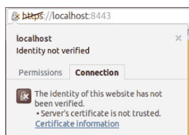


点击**证书**信息链接可查看完整的证书信息，如下面的截图所示：

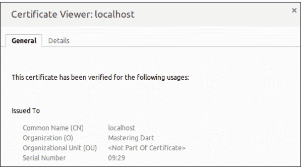

现在，关闭警告消息并点击**仍然继续**按钮，查看 HTTP 请求的结果：

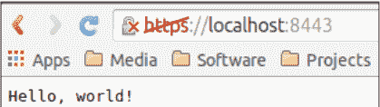

我们成功实现了以下目标：

- 我们生成了自签名证书，并将其注册到 CA 数据库中
- Dart 的 `HttpServer` 接受自签名证书并正常工作
- 网络浏览器显示自签名证书信息
- 允许客户端与服务器之间的通信

## 保护客户端

我们已经准备好服务器端来保护通信安全，现在来讨论 Web 应用客户端的安全性。对于我们的所有内容，我们将开始使用 TLS 安全通信，并开始使用 cookie 更新客户端。

## Cookie 的属性

Cookie 有两个特殊属性：`Secure` 和 `HttpOnly`。Cookie 的 `Secure` 属性允许它仅通过 TLS 连接发送。另一个属性 `HttpOnly` 将 cookie 标记为只能通过 HTTP 或 HTTPS 连接访问。将这两个属性都标记为 `true`，这一小小的改进可以防止网络浏览器通过不安全的连接发送 cookie。每次发送请求时，cookie 都会随请求头一起发送到服务器。让我们看看还可以改进其他哪些头部信息。

## HTTP 严格传输安全（HSTS）

众所周知的 SSL 中间人攻击可以通过服务器在 HTTP 响应头中发送的 **HTTP 严格传输安全（HSTS）** 头来安全修复，该头强制网络浏览器通过安全的 HTTPS 连接与服务器交互。代码如下：

```
Strict-Transport-Security: max-age=31536000; includeSubDomains
```

服务器必须以秒为单位指定 `max-age` 选项；这是页面应通过 HTTPS 提供服务的时间。在我们的示例中，该值等于 365 天。`includeSubDomains` 选项是可选的，它告诉网络浏览器所有子域也必须通过安全连接提供服务。以下浏览器支持此头部：

- Firefox 4
- Chromium 和 Google Chrome 4.0.211.0
- Safari 7
- Opera 12
- IE 11 之后的下一个主要版本的 Internet Explorer

## 内容安全策略（CSP）

Web 应用安全模型基于同源策略原则。源是协议、主机名和端口号的组合。该策略允许我们下载并运行来自同一源的脚本。时间证明，这种策略很容易被**跨站脚本（XSS）**或数据注入攻击破坏。**内容安全策略（CSP）** 是一个额外的安全层。它允许 Web 服务器通过保护网站来定义每个资源的来源，并缓解和报告 XSS 攻击。阻止所有内联脚本和样式可以防止执行注入到评论或帖子中的代码。CSP 向后兼容，因此不支持它的网络浏览器仍然可以使用标准的同源策略工作。

如果没有设置指令，网络浏览器会假定所有源都允许。CSP 可以通过服务器上的 HTTP 响应头或网页上的 HTML meta 标签设置，如下面的代码所示：

```
Content-Security-Policy: policy
```

策略字符串包含描述 CSP 的策略指令，指令以分号分隔，作为白名单的来源。

> 并非所有网络浏览器都支持使用 HTML meta 元素来配置策略。

策略应包含 `default-src` 或 `script-src` 指令。这具有以下优点：

- 限制内联脚本运行
- 阻止使用 `eval` 函数
- 限制从样式元素或元素的样式属性应用内联样式

内联 JavaScript 代码包含 `eval` 函数；因此，JavaScript URL 将不会被执行。你需要稍微改变关于使用 CSP 进行开发的观念。以下是一个示例，限制所有内容仅来自网站自身域名和子域名：

```
Content-Security-Policy: default-src 'self' *.mydomain.com
```

以下示例展示了如何限制所有内容只能通过安全连接加载：

```
Content-Security-Policy: default-src https://ibank.mydomain.com
```

在以下示例中，我们将允许所有资源从我们的网站加载，脚本从 Google API 服务器加载：

```
Content-Security-Policy: default-src: 'self'; script-src: https://apis.google.com;
```

我们创建了 csp 项目来查看 CSP 的工作原理。服务器端代码是上一主题中服务器代码的略微修改版本，并包含路由库，如下面的代码所示：

```
import 'dart:io';
import 'dart:async';
import 'package:route/server.dart';
import 'urls.dart';
```

```
import 'files.dart';

main() {
    var pkcertDB = Platform.script.resolve('pkcert').toFilePath();
    SecureSocket
    .initialize(database: pkcertDB, password: 'changeit');

    HttpServer
    .bindSecure(InternetAddress.ANY_IP_V6, 8443,
        certificateName: 'localhost_cert')
    .then((server) {
        new Router(server)
        ..filter(allUrls, filter)
        ..serve(allUrls).listen(serveDirectory('', as: '/'))
        ..defaultStream.listen(send404);
    });
}

Future<bool> filter(HttpRequest request) {
    HttpResponse response = request.response;
    response.headers.add("Content-Security-Policy",
    "default-src 'self'; style-src 'self'");
    return new Future.value(true);
}
```

我们现在使用 Route 类的 filter 方法来拦截每个请求，并在响应中注入 Content-Security-Policy 头部，如下面的截图所示：

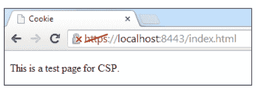

从我们的头部内容可以清楚地看出，来自我们网站的所有脚本和样式都是允许的。让我们想象一个用例：你需要在 Web 应用中添加一个 Google +1 按钮，让用户向他们的圈子推荐内容并为你的网站带来流量，因此只需通过 JavaScript 资源在网页中包含一个 +1 按钮，并添加一个 +1 按钮标签。必须使用 HTTPS 协议加载该脚本。以下是更改后的网页代码：

```
<!DOCTYPE html>
<html>
```

## 安全方面

CSP 在使用得当的情况下非常灵活且实用。以下浏览器支持此头部：

- Chrome 25（从 v14 开始，使用前缀 `webkit`）
- Firefox 23（从 v4 开始，使用前缀 `moz`）
- Safari 7（从 v5 开始，使用前缀 `webkit`）
- Opera 15
- Internet Explorer 10 仅支持带前缀 `ms` 的 sandbox 指令

## 跨源资源共享与 JSON with padding

**填充式 JSON（JSONP）** 是一种客户端技术，用于从不同域名的服务器请求数据。这是可能的，因为网络浏览器不会对 HTML `script` 标签强制执行同源策略。JSONP 请求的参数作为参数传递给脚本。JSONP 结果的格式与 JSON 的格式不同，因此服务器必须知道如何响应它。JSONP 仅支持 `GET` 请求方法，并接受回调函数作为数据的接收者，如下面的代码所示：

```
```html
<script src="http://my.com/data?format=jsonp&callback=cb"></script>
```
```

网络浏览器会在请求结束时调用一个函数。通过此脚本，我们将获得 JavaScript 代码，网络浏览器会将其作为普通脚本文件运行。这可能是一个很大的风险，因为提供此脚本的服务器可能已被入侵，并且容易引发 XSS 攻击。**跨源资源共享（CORS）** 可以作为 JSONP 的现代替代方案，它允许网络浏览器进行跨域通信。与 JSONP 不同，CORS 支持所有 HTTP 方法，并允许你执行以下任务：

- 以跨站点方式发起 AJAX 请求
- 加载 Web 字体以在 CSS 中的 `@font-face` 中使用
- 加载 WebGL 纹理
- 借助 `drawImage` 方法加载绘制在画布上的图像


CORS 头必须在请求的 Web 服务器的头部中返回。为了发起跨域请求，我们需要添加新的 HTTP 头，允许 Web 浏览器自由地与另一个域上的 API 通信。

cors 项目包含两个服务器。第一个位于 server.dart 文件中，是一个 Web 服务器，监听我们之前主题中端口 8443 上的安全连接，如以下代码所示：

```
import 'dart:io';
import 'dart:async';

import 'package:route/server.dart';

import 'urls.dart';
import 'files.dart';

main() {
  var pkcertDB = Platform.script.resolve('pkcert').toFilePath();
  SecureSocket
    .initialize(database: pkcertDB, password: 'changeit');

  HttpServer
    .bindSecure(InternetAddress.ANY_IP_V6, 8443,
        certificateName: 'localhost_cert')
    .then((server) {
      new Router(server)
        ..filter(allUrls, filter)
        ..serve(allUrls).listen(serveDirectory('', as: '/'))
        ..defaultStream.listen(send404);
    });
}

Future<bool> filter(HttpRequest request) {
  HttpResponse response = request.response;
  response.headers.add("Content-Security-Policy",
    "default-src 'self';" +
    "style-src 'self' 'unsafe-inline';" +
    "script-src 'self' https://apis.google.com;" +
    "frame-src https://*.google.com;" +
    "img-src https://*.gstatic.com;"
  );
  return new Future.value(true);
}
```

第二个服务器位于 cors_server.dart 中，是监听端口 8080 且不使用 HTTPS 的 CORS Web 服务器，如以下代码所示：

```
import 'dart:io';
import 'dart:async';

import 'package:route/server.dart';

import 'files.dart';

final allUrls = new RegExp('/(.*)');
final productUrl = new UrlPattern('/product');

main() {
  HttpServer
    .bind(InternetAddress.ANY_IP_V6, 8080)
    .then((server) {
      new Router(server)
        ..filter(allUrls, filter)
        ..serve(productUrl).listen(serverProduct)
        ..defaultStream.listen(send404);
    });
}

Future<bool> filter(HttpRequest request) {
  return new Future.value(true);
}

serverProduct(HttpRequest request) {
  return serveFile('products.json')(request);
}
```

第二个 Web 服务器中的 filter 函数意图设置 CORS 头并允许任何客户端向此服务器发起跨域请求。我们的客户端现在看起来像以下代码：

```
import 'dart:html';
import 'dart:convert';

void main() {
  onloadHandler();
}

onloadHandler() {
  var xhr = new HttpRequest();
  xhr.open('GET', 'http://localhost:8080/product', async: true);
  xhr.onLoad.listen((e) {
      Map repos = JSON.decode(xhr.response);
      var reposHTML = "";
      for (int i = 0; i < repos["repositories"].length; i++) {
          reposHTML += "<p>" +
              repos["repositories"][i]["name"] + "<br>" +
              repos["repositories"][i]["description"] + "</p>";
      }
      document.getElementById("allRepos").setInnerHtml(reposHTML);
  }).onError((e) {
      print('error making the request. ${e.toString()}');
  });
  xhr.send();
}
```

客户端代码发起跨域请求并打印带有结果的标记。让我们同时运行两个服务器并在地址 https://localhost:8443/index.html 上用 Dartium 打开我们的网页。它立即出现跨域违规异常，如以下屏幕截图所示：

> Refused to connect to 'http://localhost:8080/product' because it violates the following Content Security Policy directive: "default-src 'self'". Note that 'connect-src' was not explicitly set, so 'default-src' is used as a fallback. index.html:1

让我们在以下服务器代码中添加 connect-src 以快速修复：

```
Future<bool> filter(HttpRequest request) {
  HttpResponse response = request.response;
  response.headers.add("Content-Security-Policy",
      "default-src 'self';" +
      "style-src 'self' 'unsafe-inline';" +
      "script-src 'self' https://apis.google.com;" +
      "frame-src https://*.google.com;" +
      "img-src https://*.gstatic.com;" +
      "connect-src http://localhost:8080/product"
  );
  return new Future.value(true);
}
```

重启服务器并刷新网页，你将得到以下异常：

> XMLHttpRequest cannot load http://localhost:8080/product. No 'Access-Control-Allow-Origin' header is present on the requested resource. Origin 'https://localhost:8443' is therefore not allowed access. index.html:1

我们的请求无法通过源的边界，所以我们将更改 CORS Web 服务器中的 filter 方法，如下所示：

```
Future<bool> filter(HttpRequest request) {
  HttpResponse response = request.response;
  response.headers.add("Access-Control-Allow-Origin", "*");
  return new Future.value(true);
}
```

前述代码将给出以下结果：

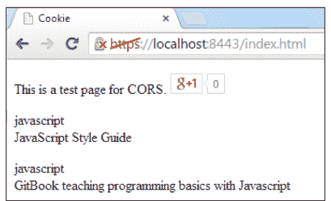

这是一个简单的演示，说明我们如何在使用 CORS 的情况下使用 Web 服务器提供的数据。Dartium 向 CORS 服务器发送初始请求，其中包含与我们的网页源匹配的 Origin HTTP 头，如以下屏幕截图所示：

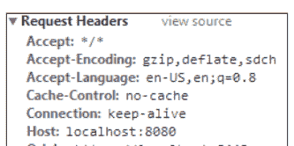

我们意图在 CORS 服务器中指定 Access-Control-Allow-Origin 以允许所有域，并使用星号符号 (*) 发送服务器响应，如以下屏幕截图所示：

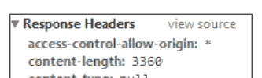

如果需要访问其他头，你必须通过 Access-Control-Expose-Headers 头将其公开，如下所示：

```
Future<bool> filter(HttpRequest request) {
  HttpResponse response = request.response;
  response.headers.add("Access-Control-Allow-Origin", "*");
  response.headers.add("Access-Control-Expose-Headers",
      "session-id");
  response.headers.add("session-id", "123456");
  return new Future.value(true);
}
```

我们按如下方式在网页中添加了一个 sessionId span 元素：

```
<p>This is a test page for CORS. <g:plusone></g:plusone></p>
Session ID: <span id="sessionId"></span>
<div id="allRepos"></div>
```

以下网页源代码也被更新了：

```
var xhr = new HttpRequest();
xhr.open('GET', 'http://localhost:8080/product');
xhr.onLoad.listen((e) {
    var sessionId = xhr.getResponseHeader("session-id");
    document.getElementById("sessionId").text = sessionId;
```

现在，重启 CORS 服务器并重新加载网页以获得以下结果：

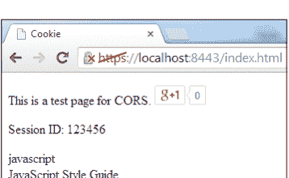

CORS 在以下知名 Web 浏览器中得到支持：

- Chrome 3
- Firefox 3.5
- Opera 12
- Safari 4
- Internet Explorer 8

3. 点击 CREATE 按钮创建新的 API 密钥。服务器将你移动到你的域列表，如以下屏幕截图所示：

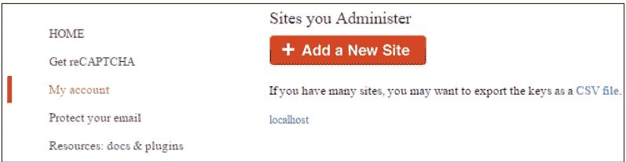

4. 选择你的域以查看以下详细信息：

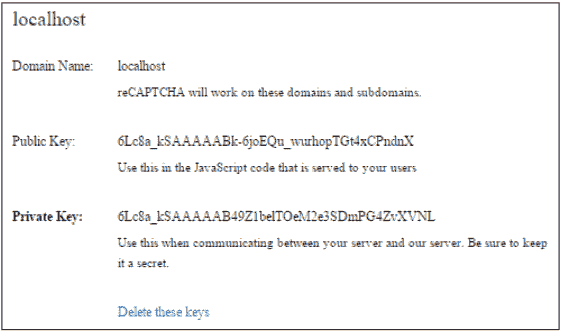

有我们将在解决方案中使用的公钥和私钥。为了在 captcha 项目中集成 reCAPTCHA 解决方案，我们使用了我创建的并且可在 https://pub.dartlang.org/ 服务器上获得的小型库 recaptcha。因此，我们可以在 pubspec.yaml 文件的 dependencies 包下添加它。打开 Dart Editor 中的 captcha 项目并导航到 index.html，其显示在以下代码中：

```
<!DOCTYPE html>
<html>
<head>
<title>Registration</title>
<meta charset="utf-8">
<meta name="viewport"
content="width=device-width, initial-scale=1">
<link type="text/css" href="index.css">
</head>
<body>
    <H1>Registration form with CAPTCHA</H1>
    <form name="captcha_form" method="post" action="/register">
        <label for="username">Username:</label>
        <input type="text" name="username"><br>
        <label for="password">Password:</label>
        <input type="password" name="password">
        <script type="text/javascript"
            src="http://www.google.com/recaptcha/api/challenge?k=6Lc8a_kSAAAAABk-6joEQu_wurhopTGt4xCPndnX">
        </script>
        <noscript>
            <iframe src="http://www.google.com/recaptcha/api/noscript?k=6Lc8a_kSAAAAABk-6joEQu_wurhopTGt4xCPndnX"
                height="300" width="500" frameborder="0"></iframe><br>
            <textarea name="recaptcha_challenge_field" rows="3"
                cols="40"></textarea>
            <input type="hidden" name="recaptcha_response_field"
                value="manual_challenge">
        </noscript>
        <button type="submit" value="Submit">Submit</button>
    </form>
</body>
</html>
```

将 reCAPTCHA 上注册的域的公钥复制并粘贴为 JavaScript 的参数以及 iframe 标签源的参数。你需要为你的公钥更改这些值。现在，让我们打开 server.dart 文件并移动到第 10 行，在那里我们创建了 ReCaptcha 类的实例。再次，将你域的一对私钥和公钥复制并粘贴到此处，以便类实例可以通过免费服务 reCAPTCHA 在 Google 上将它们传递，以确保发送者正确并且拥有注册的域，如以下代码所示：

```
...
    final ReCaptcha reCaptcha = new ReCaptcha(
        '6Lc8a_kSAAAAABk-6joEQu_wurhopTGt4xCPndnX', // public key
        '6Lc8a_kSAAAAAB4921bel1ToEM2e3SDmPG4ZvXVNL'); // private key
```


## 安全方面

然后，创建错误代码和人类可读文本的映射，如下面的代码所示：

```
final Map MESSAGES = {
    'invalid-site-private-key':'Incorrect private key',
    'invalid-request-cookie':'The challenge parameter of the verify script was incorrect',
    'incorrect-captcha-sol':'The CAPTCHA solution was incorrect',
    'captcha-timeout':'The solution was received after the CAPTCHA timed out',
    'recaptcha-not-reachable':'Unknown error in CAPTCHA'};
```

然后，在 serverRegister 函数中读取 POST 方法参数，并将其转换为映射，以便稍后轻松访问。所有参数都通过 Recaptcha 的 checkAnswer 方法遵循 reCAPTCHA 验证，如下面的代码所示：

```
serveRegister(HttpRequest request) {
    HttpResponse response = request.response;
    request.listen((List<int> buffer) {
      String strBuffer = new String.fromCharCodes(buffer);
      Map data = postToMap(strBuffer);
      //
      String userName = data.containsKey('username') ?
          data['username'] : '';
      String password = data.containsKey('password') ?
          data['password'] : '';
      String cptChallenge =
          data.containsKey('recaptcha_challenge_field') ?
          data['recaptcha_challenge_field'] : '';
      String cptResponse =
          data.containsKey('recaptcha_response_field') ?
          data['recaptcha_response_field'] : '';
      reCaptcha.checkAnswer(request.uri.host, cptChallenge,
      cptResponse).then((ReCaptchaResponse cptResponse) {
        response.statusCode = HttpStatus.OK;
        setCORSHeader(response);
        if (cptResponse.valid) {
          response.write("Registration success.");
        } else {
          response.write(MESSAGES[cptResponse.errorCode]);
        }
        response.close();
      });
    });
  }
```

让我们快速返回并输入正确的 CAPTCHA 答案。提交后，您将看到以下成功消息：

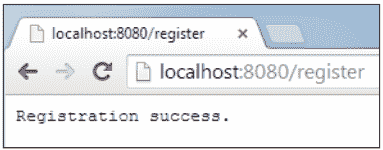

### 安全最佳实践

现在该讨论最佳安全实践了，没有它们，这个故事就不完整：

- **不要保留密码**：HTTP 基本认证已被弃用，因此请使用 OAuth 等其他技术，按照标准构建更安全的应用程序。使用安全的 OAuth 令牌代替密码。
- **执行输入验证**：您应始终净化所有输入数据。您需要检查字符串长度、验证文件类型，并检查最小值和最大值，以确保通过 POST 请求发送到服务器的所有数据都具有正确的格式和长度。
- **过滤输入并净化输出**：您应始终过滤从客户端到 Web 服务器的所有数据，并净化返回给客户端的所有数据。
- **使用安全连接**：使用 TLS 证书在 Web 浏览器和服务器之间建立安全连接，以通过 TLS 提供所有 REST API 或 AJAX 请求。TLS 与 OAuth 结合是一种安全且推荐的解决方案。
- **不要暴露调试信息**：不要忘记关闭调试日志，因为它们可能包含敏感信息。
- **测试边界**：您的测试必须检查所有可能的正面和负面情况及场景。
- **隐藏服务器信息**：不要在任何服务器生成的文档上显示服务器信息，因为这会使黑客能够从网页上免费获得或由黑客自己开发的攻击手段中选择合适的攻击方式。

### 总结

在本章中，您学习了如何使用 NSS 工具创建 TLS 证书。您还看到，无需开发人员额外努力，就可以快速将证书嵌入 Dart Web 服务器。

我们发现了如何使用 cookie 的 `Secure` 和 `HttpOnly` 特殊属性来保护客户端，防止 Web 浏览器通过不安全的连接发送 cookie。

我们使用 HSTS 来防止 SSL 中间人攻击。我们应用 CSP 来确保 Web 浏览器只能加载和使用允许的内容。我们还使用 CORS 来指定可以从我们的 Web 服务器共享哪些资源，以及为什么该解决方案比 JSONP 好得多。最后，我们在项目中嵌入了基于 Google 免费服务 reCAPTCHA 的 CAPTCHA 解决方案。
