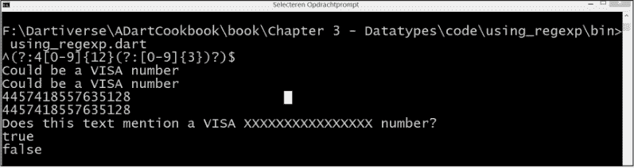
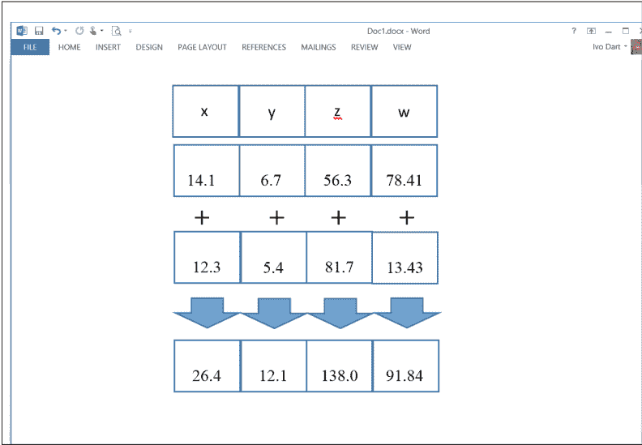

## 3 处理数据类型

在本章中，我们将介绍以下方法：

- 连接字符串
- 使用正则表达式
- 字符串与 Unicode
- 使用复数
- 创建枚举
- 展平列表
- 在指定范围内生成随机数
- 从列表中获取随机元素
- 处理日期和时间
- 提高数值计算性能
- 使用 SIMD 增强性能

### 更多内容...

> 因此，如果你需要将大量字符串拼接在一起，请使用 StringBuffer。避免使用 `+` 进行拼接。这将节省内存，并且执行速度会快得多。

`writeAll` 方法可以接受一个可选的分隔符参数，例如 `sb.writeAll([s1, " ", s2, s3], '-')`；结果得到 `Dart- -Cook-Book`。

## 使用正则表达式

正则表达式是每种编程语言中在字符串中搜索匹配模式不可或缺的工具。Dart 在 `dart:core` 中提供了 `RegExp` 类，其语法和语义与 JavaScript 相同。

### 操作步骤...

我们在以下代码中使用 `RegExp`（参见 `using_regexp.dart`）来快速判断信用卡号码是否看似有效：

```
var visa = new RegExp(r"^(?:4[0-9]{12}(?:[0-9]{3})?)$");
var visa_in_text = new RegExp(r"\b4[0-9]{12}(?:[0-9]{3})?\b");
var input = "4457418557635128";
var text = "Does this text mention a VISA 4457418557635128 number?";

void main() {
  print(visa.pattern);
  // is there a visa pattern match in input?
  if (visa.hasMatch(input)) {
    print("Could be a VISA number");
  }
  // does string input contain pattern visa?
  if (input.contains(visa)) {
    print("Could be a VISA number");
  }
  // find all matches:
  var matches = visa_in_text.allMatches(text);
  for (var m in matches) {
    print(m.group(0));
  }
}
```


## 使用数据类型

```
visa_in_text.allMatches(text).forEach((m) => print(m[0]));
  // let's hide the number:
  print(text.replaceAll(visa_in_text, 'XXXXXXXXXXXXXXX'));
  print(visa.isCaseSensitive);
  print(visa.isMultiLine);
}
```

前面的代码给出了以下输出：



## 它是如何工作的...

信用卡号码只是一串 13 到 16 位数字，其中开头有 1 到 4 位特定数字用于标识发卡公司。正则表达式被指定为原始字符串 `r"..."`，其中 ... 是模式。`hasMatch` 代码告诉你是否有匹配，而 `allMatches` 生成一个可以遍历的集合。在大多数情况下，单次匹配的便捷方法 `firstMatch` 就是你需要的。`allMatches.length` 部分给出匹配的数量。for 循环也可以更函数式地写成 `visa_in_text.allMatches(text).forEach((m) => print(m[0]));`

## 还有更多...

在调用信用卡验证服务之前进一步验证卡号，你应该编码 Luhn 算法 (http://en.wikipedia.org/wiki/Luhn_algorithm)。类 `RegExp` 实现了 Perl 风格的正则表达式。然而，它缺少许多高级功能，例如命名捕获组或条件。

> 有关 Dart 的所有详细信息，请参阅 https://api.dartlang.org/apidocs/channels/stable/dartdoc-viewer/dart:core.RegExp。有关正则表达式语法本身的更多信息，请参阅 http://www.regular-expressions.info/refquick.html。

## 字符串和 Unicode

Dart 字符串是 UTF-16 代码单元的不可变序列。UTF-16 结合了代理对，如果你解码这些，你会得到 Unicode 代码点。Unicode 术语很简洁，但 Dart 在暴露不同部分方面做得很好。

### 如何做....

我们将在 `unicode.dart` 中看到使用特殊字符的字符串的不同操作方法：

```
```dart
String country = "Egypt";
String city = "Zürich";
String japanese = "日本語"; // nihongo meaning 'Japanese'

void main() {
  print('Unicode escapes: \\uFE18'); // the � symbol
  print(country[0]);                 // E
  print(country.codeUnitAt(0));      // 69
  print(country.codeUnits);          // [69, 103, 121, 112, 116]
  print(country.runes.toList());     // [69, 103, 121, 112, 116]
  print(new String.fromCharCode(69)); // E
  print(new String.fromCharCodes([69, 103, 121, 112, 116])); // Egypt
  print(city[1]);                    // ü
  print(city.codeUnitAt(1));         // 252
  print(city.codeUnits);             // [90, 252, 114, 105, 99, 104]
  print(city.runes.toList());        // [90, 252, 114, 105, 99, 104]
  print(new String.fromCharCode(252)); // ü
  print(new String.fromCharCodes([90, 252, 114, 105, 99, 104])); // Zürich
  print(japanese[0]);                // 日
  print(japanese.codeUnitAt(0));     // 26085
  print(japanese.codeUnits);         // [26085, 26412, 35486]
  print(japanese.runes.toList());    // [26085, 26412, 35486]
  print(new String.fromCharCode(35486)); // 語
  print(new String.fromCharCodes([26085, 26412, 35486]));
  // 日本語
}
```
```

## 使用数据类型

## 它是如何工作的...

在字符串中，Unicode 字符可以通过使用 `\u` 转义。字符串上的索引运算符 `[]` 给你 UTF-16 代码单元的字符串表示。这些也可以作为整数表示代码点（也称为 runes）通过 `codeUnitAt()` 或 `codeUnits` 方法访问。静态成员 `charCode(s)` 可以接受 UTF-16 代码单元或 runes。它们的工作方式如下；如果 char-code 值是 16 位（单个 UTF-16 代码单元），它会被原样复制。否则，它的长度为 2，代码单元形成代理对。

## 还有更多...

`dart:convert` 代码包含一个 UTF-8 编码器/解码器，可在字符串和字节之间转换。`utf8encoding.dart` 文件展示了如何使用这些方法，如以下代码所示：

```
import 'dart:convert' show UTF8;

String str = "Acción"; // Spanish for 'Action'

void main() {
  List<int> encoded = UTF8.encode(str);
  print(encoded); // [65, 99, 99, 105, 195, 179, 110]
  // The UTF8 code units are reinterpreted as
  // Latin-1 code points (a subset of Unicode code points).
  String latin1String = new String.fromCharCodes(encoded);
  print(latin1String); // Acción
  print(latin1String.codeUnits);
  // [65, 99, 99, 105, 195, 179, 110]
  var string = UTF8.decode(encoded);
  print(string); // Acción
}
```

## 使用复数

Dart 没有内置的复数类型，但很容易构建自己的。`complex_numbers` 库（基于 Tiago de Jesus 和 Adam Singer 的类似库）提供了构造函数、实用方法以及作为运算符和静态方法定义的四种算术运算。

### 如何做...

我们现在定义一个 ComplexNumber 类，包含正常使用的所有实用方法：

```
library complex_numbers;

import 'dart:math' as math;

class ComplexNumber {
  num _real;
  num _imag;

  // 1- Here we define different ways to build a complex number:
  // constructors:
  ComplexNumber([this._real = 0, this._imag = 0]);
  ComplexNumber.im(num imag) : this(0, imag);
  ComplexNumber.re(num real) : this(real, 0);

  // 2- The normal utility methods to get and set the real and
  // imaginary part, to get the absolute value and the angle, to
  // compare two complex numbers:
  num get real => _real;
  set real(num value) => _real = value;

  num get imag => _imag;
  set imag(num value) => _imag = value;

  num get abs => math.sqrt(real * real + imag * imag);

  num get angle => math.atan2(imag, real);

  bool operator ==(other) {
    if (!(other is ComplexNumber)) {
      return false;
    }
    return this.real == other.real && this.imag == other.imag;
  }

  String toString() {
    if (_imag >= 0) {
      return '${_real} + ${_imag}i';
    }
    return '${_real} - ${_imag.abs()}i';
  }
```

## 使用数据类型

```
```text
// 3- operator overloading:
// The basic operations for adding, multiplying, subtraction and      //
// division are defined as overloading of the operators +, *, - and /
    ComplexNumber operator +(ComplexNumber x) {
        return new ComplexNumber(_real + x.real, _imag + x.imag);
    }

    ComplexNumber operator -(var x) {
        if (x is ComplexNumber) {
            return new ComplexNumber(this.real - x.real, this.imag - x.imag);
        } else if (x is num) {
            _real -= x;
            return this;
        }
        throw 'Not a number';
    }

    ComplexNumber operator *(var x) {
        if (x is ComplexNumber) {
            num realAux = (this.real * x.real - this.imag * x.imag);
            num imagAux = (this.imag * x.real + this.real * x.imag);

            return new ComplexNumber(realAux, imagAux);
        } else if (x is num) {
            return new ComplexNumber(this.real * x, this.imag * x);
        }
        throw 'Not a number';
    }

    ComplexNumber operator /(var x) {
        if (x is ComplexNumber) {
            num realAux = (this.real * x.real + this.imag * x.imag) / (x.real *
            x.real + x.imag * x.imag);
            num imagAux = (this.imag * x.real - this.real * x.imag) / (x.real +
            x.real + x.imag * x.imag);
            return new ComplexNumber(realAux, imagAux);
        } else if (x is num) {
            return new ComplexNumber(this.real / x, this.imag / x);
        }
        throw 'Not a number';
    }

// 4- Here we define the same operations as methods:
    static ComplexNumber add(ComplexNumber c1, ComplexNumber c2)    {
```

```
num rr = c1.real + c2.real;
    num ii = c1.imag + c2.imag;
    return new ComplexNumber(rr, ii);
}

static ComplexNumber subtract(ComplexNumber c1, ComplexNumber c2)
{
    num rr = c1.real - c2.real;
    num ii = c1.imag - c2.imag;
    return new ComplexNumber(rr, ii);
}

static ComplexNumber multiply(ComplexNumber c1, ComplexNumber c2)
{
    num rr = c1.real * c2.real - c1.imag * c2.imag;
    num ii = c1.real * c2.imag + c1.imag * c2.real;
    return new ComplexNumber(rr, ii);
}

static ComplexNumber divide(ComplexNumber c1, ComplexNumber c2)
{
num real = (c1.real * c2.real + c1.imag * c2.imag) / (c2.real *
c2.real + c2.imag * c2.imag);
num imag = (c1.imag * c2.real - c1.real * c2.imag) /  (c2.real *
c2.real + c2.imag * c2.imag);
    return new ComplexNumber(real, imag);
}
}
```

## 它是如何工作的...

`ComplexNumber` 类是使用标准 Dart 功能构建的：

- 私有 getter 用于实部和虚部以返回其值，以及用于更改它们的 setter
- 具有两个可选参数的构造函数和两个命名构造函数，分别用于没有实部或虚部的复数
- 一些实用方法，例如 `toString()` 和 `==` 的重载
- 对 +, -, *, / 的运算符重载
- 作为静态方法实现的相同运算，接受两个复数


# 处理数据类型

## 还有更多...

请关注 Frederik Leonhardt 的 pub 包 `math-expressions`，因为使用复数求值表达式是其目标之一。

## 创建枚举

Dart 中没有内置类型的枚举。枚举提供额外的类型检查，从而有助于增强代码可维护性。那么我们有什么替代方案呢？请查看项目 enum 中的代码，我们希望区分向我们报告的问题的严重程度（我们区分以下级别：TRIVIAL、REGULAR、IMPORTANT 和 CRITICAL）。

### 如何做...

实现创建枚举功能的第一种方式显示在 `enum1.dart` 中：

```
class IssueDegree {
  final _value;
  const IssueDegree(this._value);
  toString() => 'Enum: $_value';

  static const TRIVIAL = const IssueDegree('TRIVIAL');
  static const REGULAR = const IssueDegree('REGULAR');
  static const IMPORTANT = const IssueDegree('IMPORTANT');
  static const CRITICAL = const IssueDegree('CRITICAL');
}

void main() {
  var issueLevel = IssueDegree.IMPORTANT;
  // Warning and NoSuchMethodError for IssueLevel2:
  // There is no such getter ALARM in IssueDegree
  // var issueLevel2 = IssueDegree.ALARM;

  switch (issueLevel) {
    case IssueDegree.TRIVIAL:
      print("Ok, I'll sort it out during lunch");
      break;
    case IssueDegree.REGULAR:
      print("We'll assign it to Ellen, our programmer");
      break;
    case IssueDegree.IMPORTANT:
```

## 还有更多...

Ecma TC52 Dart 标准委员会已调查了将在 2014 年 9 月讨论的枚举提案（请参阅 http://www.infoq.com/news/2014/07/ecma-dart-google），因此为枚举提供内置支持可能将在未来的 Dart 版本中实现。

## 展平列表

列表可以包含其他列表作为元素。这有效地是一个二维列表或数组。展平意味着创建一个包含所有子列表项的单个列表。请查看 flatten_list.dart 中的不同可能性。

### 如何做...

我们在以下代码中展示了三种展平列表的方法：

```
List lst = [[1.5, 3.14, 45.3], ['m', 'pi', '7'], [true, false, true]];
// flattening lst must give the following resulting List flat:
// [1.5, 3.14, 45.3, m, pi, 7, true, false, true]

void main() {
  // 1- using forEach and addAll:
  var flat = [];
  lst.forEach((e) => flat.addAll(e));
  print(flat);
  // 2- using Iterable.expand:
  flat = lst.expand((i) => i).toList();
  // 3- more nesting levels, work recursively:
  lst = [[1.5, 3.14, 45.3], ['m', 'pi', '7'], "Dart", [true, false, true]];
  print(flatten(lst));
}
```

### 它是如何工作的...

最简单的方法使用 forEach 和 addAll 的组合。第二种方法利用了 List 实现 Iterable，因此具有 expand 方法。这里 expand 方法使用其参数作为恒等函数；每个元素都按原样返回，而不应用函数。

如果列表包含作为单个列表元素的 int（或 String、double 等），或存在多级嵌套，则使用 expand 不起作用。在这种情况下，我们必须递归工作，如 flatten 方法中实现的：

```
Iterable flatten(Iterable iterable)
  => iterable.expand((e) => e is List ? flatten(e) : [e]);
```

## 还有更多...

为什么要展平列表的列表？可能有应用需求要这样做，例如，当你在游戏逻辑中使用二维列表或矩阵时，但一个明显的原因是，与列表的列表相比，使用列表的列表在性能上要昂贵得多。

## 在范围内生成随机数

你可能经常想知道如何从某个范围内生成随机数。这正是我们在本配方中要看的内容；我们将获得一个位于最小值 min 和最大值 max 之间的区间内的随机数。

### 如何做...

这很简单；请查看 random_range.dart 中的实现方式：

```
import 'dart:math';

var now = new DateTime.now();
Random rnd = new Random();
Random rnd2 = new Random(now.millisecondsSinceEpoch);

void main() {
  int min = 13, max = 42;
  int r = min + rnd.nextInt(max - min);
  print("$r is in the range of $min and $max"); // e.g. 31
  // used as a function nextInter:
  print("${nextInter(min, max)}"); // for example: 17

  int r2 = min + rnd2.nextInt(max - min);
  print("$r2 is in the range of $min and $max"); // e.g. 33
}
```

## 另请参阅

- 咨询前一个配方以获取有关 Random 用法的更多信息

## 处理日期和时间

几乎在每个数据上下文中都需要适当的日期时间处理。Dart 为我们提供了哪些便利来处理日期和时间？Dart 在 dart:core 中具有出色的内置类 DateTime 和 Duration。作为其众多用途中的几个，你可以执行以下操作：

- 比较和计算日期时间
- 获取日期时间的每个部分
- 使用不同的时区
- 使用 Stopwatch 测量时间段

然而，DateTime 类不提供国际化；为此目的，你需要使用 Dart 团队的 intl 包。

### 如何做...

以下是一些有用的技术（在 date_time.dart 中尝试它们）：

- 将日期格式化（从 DateTime 到字符串）为标准格式，但也可以使用 intl 包格式化为任何格式，如以下代码所示：

```
import 'package:intl/intl.dart';
import 'package:intl/date_symbol_data_local.dart';

    print(now.toIso8601String()); // 2014-05-08T14:03:21.238
    print(now.toLocal());           // 2014-05-08 14:03:21.238
    print(now.toString());          // 2014-05-08 14:03:21.238
    print(now.toUtc());             // 2014-05-08 12:03:21.238Z
    // using intl to format:
    var formatter = new DateFormat('yyyy-MM-dd');
    String formatted = formatter.format(now);
    print(formatted); // 2014-05-08
    print(new DateFormat("EEEEEE").format(now)); // Thursday
    print(new DateFormat("yMMMMEEEEd").format(now)); // Thursday, May 8, 2014
    print(new DateFormat("y-MM-E-d").format(now)); // 2014-05-Thu-8
    print(new DateFormat("jms").format(now)); // 2:19:08 PM
```

```
print(new DateFormat('dd/MMM/y HH:mm:ss').format(now));   // 08/May/2014 14:39:07
// locale data:
initializeDateFormatting("fr_FR", null).then(formatDates);
// ...
}
```

```
formatDates (var d) {
    print(new DateFormat("EEEE", 'fr_FR').format(now));   // jeudi
    print(new DateFormat("yMMMEEEEd", 'fr_FR').format(now)); // jeudi 8 mai 2014
    print(new DateFormat("y-MM-E-d", 'fr_FR').format(now));   // 2014-05-jeu.-8
}
```

解析日期（从字符串到 DateTime），当给定的字符串不在可接受的日期格式之一时；抛出异常并在以下代码中捕获：

```
try {
    DateTime dt = DateTime.parse("2014-05-08T15+02:00");
} on FormatException catch(e) {
    print('FormatException: $e');
}
```

使用时区信息工作：

```
print(now.toLocal());// time in local timezone
print(now.toUtc()); // time in Coordinated Universal Time
print(now.timeZoneName);   // Romance (zomertijd)
print(now.timeZoneOffset); // 2:00:00.000000
```

可以按如下方式找到月份的最后一天：

```
var date = new DateTime(2014,6,0);
print(date.day); // 31
// more general:
var lastDayDateTime = (now.month < 12) ? new DateTime(now.year, now.month + 1, 0) : new DateTime(now.year + 1, 1, 0);
print(lastDayDateTime.day); // 31
```

## 处理数据类型

### 它是如何工作的...

格式化 `DateTime` 实例可以使用来自 `dart:core` 的几个 to... 方法来完成，例如 `toLocal()` 来获取本地时区（由你的机器定义）中的时间。然而，`intl` 为你提供了更大的灵活性；使用特定的格式字符串作为参数创建一个 `DateFormat` 对象，然后调用 `format` 方法以获取格式化的字符串。

例如，`d` 给出天数，`E` 给出缩写的星期几，`EE` 给出完整的星期几名称，`M` 给出月份数字，`y` 给出年份，`H` 给出小时（0-24），`j` 给出小时（0-12）带 AM 或 PM，`m` 给出分钟，等等。许多格式组合是可能的（你也可以构建自己的）。

> 要获得格式组合的完整概述，请参阅
> https://api.dartlang.org/apidocs/channels/stable/dartdoc-viewer/intl/intl.DateFormat。

如果你想要特定语言环境的格式化（例如 `be_NL`、`cs_CZ`、`de_DE` 等），你必须先通过导入 `date_symbol_data_local.dart` 然后调用 `initializeDateFormatting` 来加载特定语言环境数据。第一个参数是特定语言环境。如果你将其值设为 `null`，将加载所有可用的语言环境数据，如以下代码所示：

```
initializeDateFormatting("fr_FR", null).then(formatDates);
```

接下来，在构造 `DateFormat` 对象时，语言环境（例如 `'fr_FR'`）必须作为第二个参数给出：

```
new DateFormat("yMMMMEEEEd", 'fr_FR')
```

`formatDates` 方法展示了以下代码的运行情况：

```
formatDates (var d) {
    print(new DateFormat("EEEEE", 'fr_FR').format(now)); // jeudi
    print(new DateFormat("yMMMMEEEEd", 'fr_FR').format(now)); // jeudi 8 mai 2014
    print(new DateFormat("y-MM-E-d", 'fr_FR').format(now)); // 2014-05-jeu.-8
}
```

将格式良好的字符串解析为 `DateTime` 字符串是通过静态 `DateTime.parse` 方法完成的，该方法接受字符串并生成 `DateTime`。输入格式必须符合 ISO 8601 格式。如果输入格式无法解析，将抛出 `FormatException`，因此使用 try/catch 来处理此问题。


`toUTC` 选项为你提供**协调世界时（UTC）**格式的时间，这在所有实际用途上都与**格林尼治标准时间（GMT）**相同。使用 `timeZoneName` 获取 `DateTime` 对象的时区缩写名称。UTC 与 `DateTime` 对象时区之间的差异通过调用 `timeZoneOffset` 计算。

要查找一个月的最后一天，为下一个月传入日期值 0，将返回上个月的最后一天。

## 更多内容...

请注意，`DateTime` 对象始终处于本地时区，除非使用 `DateTime.utc` 构造函数显式地在 UTC 时区创建；可以如下操作：

```
DateTime moonLanding = new DateTime.utc(1969, DateTime.JULY, 20);
```

在此构造函数中，只有年份是必需的，所有其他日期和时间部分都是可选的。

如果你有其他 `Datetime` 问题，请查阅 API 文档：`https://api.dartlang.org/apidocs/channels/stable/dartdoc-viewer/dart-core.DateTime`。

## 提高数值计算的性能

与 Java 和 C# 不同，它们拥有专门的 8、16、32 和 64 位有符号和无符号整数类型，以及 32 位和 64 位浮点数，而 Dart 没有有界整数类型或 32 位浮点数类型；它只有两种数值类型：`int`（任意大小的整数）和 `double`（符合 IEEE-754 规范），以及它们的超类型 `num`。这样做是为了让语言更具动态性，更容易学习和使用。然而，Dart VM 在推断整数范围方面做得很好，并尽可能进行优化。在这里，我们提供一些讨论和技巧，让你的代码在涉及数值计算时获得尽可能高的性能。

## 如何做到...

VM 内部使用三种整数类型，并在数字大小增大或缩小时在后台自动切换。它们如下：

- `smi`（小整数）：你可以认为这种整数类型在 32 位机器上是 32 位，在 64 位机器上是 64 位
- `mint`（中整数）：这种整数类型始终是 64 位
- `bigint`（大整数）：机器 RAM 是这种整数类型的限制

## 处理数据类型

你不能在 Dart 代码中使用这些类；VM 会自动将整数从 smi 提升为 mint，并在必要时提升为 bigint。然而，如果你确保整数值保持在较小的范围内，可以获得更好的性能。例如，请参考 integer_promotion.dart 文件：

```
import 'dart:math';

void main() {
  int points = 42; // starts as a smi
  print(points);  // 42
  points = pow(points, 10); // becomes a mint
  print(points); // 17080198121677824
  points = pow(points, 3); // becomes a bigint
  print(points);  // 49828603059827911309997192674768286219621357322
}
```

> 除非确实有必要，否则不要使用 bigint 范围，因为这会导致性能下降。如果可能，请保持在 smi 范围内；如果不行，则使用 mint 范围。

对于数字列表，数字可以存储在对象 List() 中，或者存储在泛型类型 List<int> 或 List<double> 中。虽然后者比前者好，但最好使用 Dart 类型化列表，它可以在 dart:typed_data 包中获得，例如 Uint8List、Int64List 或 Float32List。因此，不要使用总是较慢的 List<double>，而应使用 Float32List 或 Float64List。在使用 Web 应用时要小心；并非所有浏览器都支持 typed_data。例如，Internet Explorer 10 支持它，但版本 9 不支持。

> 计算时使用类型化列表；计算将运行得更高效。

考虑到这些因素，建议对你的应用进行基准测试，使用不同数量的类型用法（例如，比较 Float32List 与 Float64List，甚至与普通列表进行比较），以查看在你的应用的特定上下文中哪一个性能最佳。

## 工作原理...

这些建议主要源于 Dart VM 优化处理不同数值类型的方式。由于 JavaScript 无法使用完全相同的优化，dart2js 有时会表现出不同的行为；请参阅下一节以获取针对这种情况的特别建议。

小型机器整数（smi）可以放入寄存器，并且可以直接加载和存储到字段中，而无需从内存中获取，因为它们永远不需要内存分配。这就是它们速度快的原因。然而，它们的范围取决于 CPU 架构，因此除非你需要更多位数，否则可以假定为 31 位范围。VM 无法优化 bigint 的运算。处理 double 非常高效，因为它们是未装箱的，即不需要放入堆中。

Dart 类型化列表只能存储数字，不能存储 null 值。它们表现得像一个有界整数和浮点值数组，每个条目包含其值，VM 会优化它们的使用。类型化列表在大多数时候更加紧凑，提供更好的内存和 CPU 缓存使用；例如，如果你只需要 8 位精度，请使用 Int8List。当发生垃圾回收（GC）时，它们也处理得更快，因为它们从不存储对象引用，因此 GC 不必扫描它们。

## 更多内容...

从语言设计的角度来看，使用 int 和 num 类型是最好的；Dart VM 专家可能希望我们只使用 double，因为那是大多数优化可以发挥作用的地方。

## 使用 JavaScript

在 JavaScript 中，每个数字都以 double 表示（它只知道 IEEE-754 类型）。


> 如果你的应用将以编译后的 JavaScript 形式使用，最好只使用 num 类型。另外，使用 is num 而不是测试 is int 或 is double，因为 Dart VM 和 dart2js 在这里也有不同的行为。如果你坚持使用 int 类型，请保持在 smi 范围内。
> 在任何情况下，都使用 Dart 类型化列表，因为它们可以简单地映射到 JavaScript 类型化数组。但是，请避免使用 Int64List 或 Uint64List，因为由于 Internet Explorer 9 不支持类型化数据，dart2js 不支持 64 位整数（如果使用会导致运行时异常）。

## 解析数字

避免大量使用 double.parse(String s) 甚至 int.parse(String s)，因为在撰写本文时，它们的性能尚未优化。

## 另请参阅

- 请参阅 http://dartogreniyorun.blogspot.be/2013/05/performance-optimization-and-dart.html，其中使用类型化数据可使性能提升两倍
- 你可能还想参阅第 2 章 *结构化、测试和部署应用* 中的 *对你的应用进行基准测试* 方法

## 使用 SIMD 提升性能

许多现代 CPU 和 GPU 提供**单指令多数据（SIMD）**支持。借助 128 位特殊寄存器，可以并行处理四个 32 位数据值（整数或浮点数）。这为图像处理、3D 图形、音频处理和其他数值计算算法提供了潜在 400% 的加速。此外，使用**高斯混合模型（GMM）**的机器学习算法（例如用于自动语音识别）也能从 SIMD 中受益。

## 如何做到...

Dart 允许你使用 `typed_data` 库中的特殊 SIMD x 类型来处理这一特性。它提供以下四种类型：

- `Int32x4`，表示四个 32 位整数值
- `Float32x4`，表示四个单精度浮点值
- 用于包含 32 位整数值的列表结构，例如 `Int32x4List`
- `Float32x4List`，用于包含 32 位浮点值的列表结构

让我们看看 simd.dart 中 SIMD 操作的一些示例；以下代码片段中突出显示了不同的类型：

```
import 'dart:typed_data';

void main() {
  var a = new Float32x4(14.1, 6.7, 56.3, 78.41);
  var b = new Float32x4(12.3, 5.4, 81.7, 13.43);
  Float32x4 sum = new Float32x4.zero(); //
  print(sum); // [0.000000, 0.000000, 0.000000, 0.000000]
  sum = a + b;
  print(sum); // [26.400002, 12.100000, 138.000000, 91.840004]
  print(sum.z); // 138.0
  // b.y = 3.14;  // --> NoSuchMethodError
  b = b.withY(3.14);
  print(b); // [12.300000, 3.140000, 81.699997, 13.430000]
  b = b.shuffle(Float32x4.WYXZ);
  print(b); // [13.430000, 3.140000, 12.300000, 81.699997]
  // a < b; // There is no such operator in Float32x4
  Int32x4 mask = a.greaterThan(b);  // Create selection mask.
  Float32x4 c = mask.select(a, b);   // Select.
  print(c); // [14.100000, 6.700000, 56.299999, 81.699997]
  // selectively applying an operation:
  Float32x4 v = new Float32x4(22.0, 33.0, 44.0, 55.0);
  // mask = [0xFFFFFFFF, 0xFFFFFFFF, 0xFFFFFFFF, 0x0]
  mask = new Int32x4.bool(true, true, false, true);
  // r = [4.0, 9.0, 16.0, 25.0].
  Float32x4 r = v - v;
  v = mask.select(r, v);
  print(v); // [0.000000, 0.000000, 44.000000, 0.000000]
}
```

如果你的应用需要 Float32 对象列表，并且可以将它们部署到 SIMD 平台上，那么务必使用 Float32x4List 而不是 List<Float32x4> 以获得更好的性能。


### 工作原理...

`Float32x4` 对象提供了一整套标准算术运算及更多功能。实际上，`Float32x4` 对象是一个不可变对象，其操作会创建新的不可变 `Float32x4` 对象。`Int32x4` 对象的功能较为有限，主要用于比较、分支和选择。在针对这些类型优化的代码中，值会被直接映射到 SIMD 寄存器，对它们的操作会编译成单条 SIMD 指令，零开销。你可以把 SIMD 值想象成一个被细分为四个通道的水平隔间，分别称为 **x**、**y**、**z** 和 **w**，如下图所示：



对两个 SIMD 值的操作会同时作用于所有通道。通过 `.x` 和其他值，你可以读取各个通道的值，但请注意，这样做速度较慢。由于 SIMD 值是不可变的，`b.y = value` 这样的语句是非法的。不过，`withX` 方法可以让你做到这一点，但同样地，这也是慢速操作。对单个 SIMD 中的值进行重新排序是通过多个 `shuffle` 方法完成的，其中通道顺序（WXYZ）表示新顺序。一个 SIMD 实例包含四个数字，因此无法定义 `<` 或 `>=` 这类比较操作。如果你想将 `c` 设为 `a` 和 `b` 中较大的值，你必须先用 `greaterThan` 操作创建一个掩码，然后对它执行 `select` 操作。如果你只想对部分通道执行操作，也会使用类似的掩码技术。

目前，你可以在所有 IA32/X64 平台上获得这种性能加速，而在 ARM 上，只有当处理器支持 NEON 技术时才能实现，并且它的 JavaScript 实现仍在推进中。得益于 John McCutchan 的工作，Dart 成为第一个使用 SIMD 处理技术的 Web 技术。

### 另请参阅

- 有关 SIMD 的更多信息，请参阅 `http://en.wikipedia.org/wiki/SIMD`
- Dart 在使用 SIMD 时甚至能超越 Java VM；更多信息请参阅 `http://dartogreniyor.blogspot.be/2013/05/dart-beats-java-in-numerical-computing.html`
