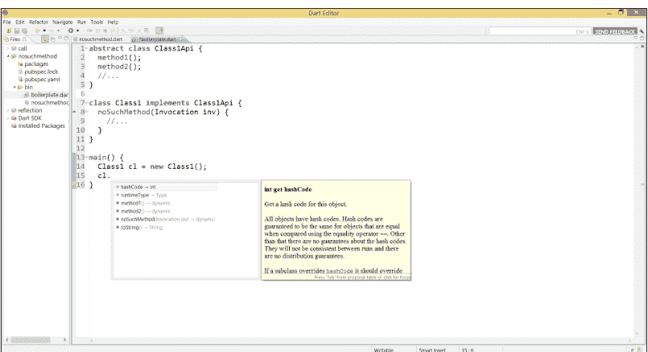
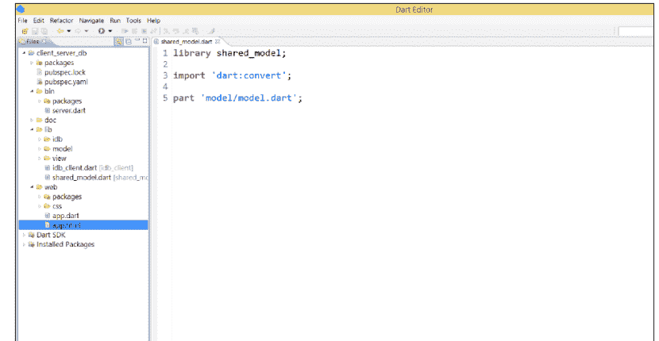

## 4 面向对象

在本章中，我们将介绍以下内容：

- 测试和转换类型
- 比较两个对象
- 使用工厂构造函数
- 构建单例
- 使用反射
- 使用 mixins
- 使用注解
- 使用 call 方法
- 使用 noSuchMethod
- 在你的类中创建 toJSON 和 fromJSON 方法
- 为客户端和服务端应用创建公共类

### 引言

Dart 虽然是可选类型，但它和 Ruby 一样是一种面向对象语言，因此一切都是对象。这与 JavaScript 形成对比，在 JavaScript 中，面向对象并非语言固有的特性，而是在后来以各种临时方式添加进来的。我们可以预期，使用真正的面向对象语言来构建客户端 Web 应用会带来巨大的好处。那么，让我们更深入地探究 Dart 的面向对象本质，并发现一些新的技巧和见解。

- 要将 `double` 转换为 `int`，请使用 `toInt()`，但会发生小数部分的截断
- 要将字符串转换为 `DateTime`，请使用带 `try / catch` 的 `DateTime.parse(str)`
- 当 `str` 不是可识别的日期和时间格式时，处理可能的 `FormatException`
- 要将 `DateTime` 转换为字符串，请使用 `toLocal()`、`toUtc()` 或 `DateFormat` 对象（请参阅 *第 3 章，使用数据类型* 中的 *处理日期和时间* 一节）
- 要将 `bool` 转换为 `int`，请使用 `int toInt(bool val) => val ? 1 : 0;` 函数

### 工作原理...

要测试对象 p 是否属于某个类型，请使用 `is`（或其否定形式 `is!`）运算符。由于 Dart 中的类型是可选的，你只能查询对象的 `runtimeType`，其类型为 `Type`。`p is Object` 的测试始终为真，而 `null is T`（其中 T 为某个类型）仅在 `T == null` 时才为真。

`toString()` 方法是 `Object` 的一个方法，默认返回 **Instance of Type**，其中 **Type** 是对象的类名。在你的类中重写此方法可以获得更具体的行为。在 Dart 中，`bool` 和 `int` 是两种不同的类型，但你可以通过在 `toInt(bool)` 中使用三元运算符来模拟类 C 的行为。

> 类型之间的转换并不总是安全的；如果发生 `FormatException`，请使用 `try/catch`。

### 扩展...

还有一个更简短的版本：`if (p is Person) { p.name = 'Bob'; }` 测试可以缩写为 `(p as Person).firstName = 'Bob';`，这里使用了 `as` 运算符，将 `p` 强制转换为 `Person`。但是，只有在你确定 `p` 可能是该类型时，才能使用这种形式；当 `p` 为 null 或不是 `Person` 时，Dart 会抛出异常。

### 另请参阅

- 有关日期和时间转换，请参阅 *第 3 章，使用数据类型* 中的 *处理日期和时间* 一节

```dart
String ssn; // 社会安全号码
DateTime birthdate;

Person(this.name, this.ssn, this.birthdate);
toString() => 'I am $name, born on $birthdate';
operator ==(Person other) => this.ssn == other.ssn;
int get hashCode => birthdate.millisecondsSinceEpoch;
}
```

### 工作原理...

Object 超类有一个定义对象相等性的 `==(other)` bool 方法。只有当 `this` 和 `other` 是同一个对象时（即它们引用（堆）内存中的同一个对象），该方法才返回 true。除非你在自己的类中重写它，否则这是默认行为。`!=` 运算符是该方法的否定。另一种测试方式是 `dart:core` 中顶层的 `identical` 函数：`bool identical(Object a, Object b)`。

每个对象都有一个由 getter `int get hashCode` 返回的整数哈希码。相等的两个对象具有相同的哈希码，但这在程序的两次运行之间可能有所不同。任何子类都可以有自己的版本来定义其对象之间的相等性。


### 扩展...

如果你想将类的实例用作映射中的键，那么你必须重载 `==` 运算符和 `hashCode` 方法。

### 另请参阅

- 有关日期和时间转换，请参阅 *第 3 章，使用数据类型* 中的 *处理日期和时间* 一节

## 使用工厂构造函数

Dart 通过构造函数为我们提供了许多灵活而简洁的构建对象方式：

- 使用可选参数，例如在 Person 构造函数中，salary 是可选的：

```dart
class Person {
  String name;
  num salary;
  Person(this.name, {this.salary});
}
```

- 使用命名构造函数（可读性强的自文档化代码的一大优势），例如，为与 acc 相同所有者的 BankAccount 创建实例：

```dart
BankAccount.sameOwner(BankAccount acc): owner = acc.owner;
```

- 使用 const 构造函数，如下面的代码所示：

```dart
class ImmutableSquare {
  final num length;
  static final ImmutableSquare ONE = const ImmutableSquare(1);
  const ImmutableSquare(this.length);
}
```

然而，现代模块化软件应用需要更灵活的方式来构建和返回对象，通常需要引入工厂设计模式（更多信息请参阅 http://en.wikipedia.org/wiki/Factory_(object-oriented_programming)）。Dart 通过工厂构造函数直接将这种模式内建到了语言中。

### 具体操作...

在工厂程序中，我们来探索一些使用示例，如下所示：

1. 从缓存中返回对象，如下面的代码所示：

```dart
main() {
  var sv = new Service('Credit Card Validation');
  sv.serve('Validate card number');
  Person p = new Person("S. Hawking");
  print(p); // S. Hawking
}
```

```dart
class Service {
  final String name;
  bool mute = false;

  // _cache 是库私有的，这得益于其名称前的 _。
  static final Map<String, Service> _cache = <String, Service>{};

  Service._internal(this.name);

  factory Service(String name) {
    if (_cache.containsKey(name)) {
      return _cache[name];
    } else {
      final serv = new Service._internal(name);
      _cache[name] = serv;
      return serv;
    }
  }

  void serve(String msg) {
    if (!mute) {
      print(msg); // Validate card number
    }
  }
}
```

2. 从子类型创建对象，如下面的代码所示：

```dart
class Person {
  factory Person(name) => new Teacher(name);
}

class Teacher implements Person {
  String name;
  Teacher(this.name);
  toString() => name;
}
```

使用抽象类，abstract_factory1-3 展示了如何将工厂构造函数与抽象类一起使用：

- 工厂构造函数可以与抽象类一起使用，如下面的代码所示：

```dart
void main() {
  // 工厂作为抽象类的默认实现：
  Cat cat = new Animal();
  var catSound = cat.makeNoise();
}
```


```dart
print(catSound); // Meow
}

abstract class Animal {
  String makeNoise();
  factory Animal() => new Cat();
}

class Cat implements Animal { String makeNoise() => 'Meow'; }
class Dog implements Animal { String makeNoise() => 'Woof';}
```

使用工厂构造函数与抽象类结合的另一个示例在以下代码中展示：

```dart
import 'dart:math';

void main() {
  Cat an = new Animal();
  print(an.makeNoise());
}

abstract class Animal {
  // simulates computation:
  factory Animal() {
    var random = new Random();
    if (random.nextBool())
      return new Cat();
    else
      return new Dog();
  }
}

class Cat implements Animal { String makeNoise() => 'Meow'; }
class Dog implements Animal { String makeNoise() => 'Woof'; }
```

下一个示例也说明了如何使用工厂构造函数与抽象类：

```dart
void main() {
  Cat cat = new Animal("cat");
  Dog dog = new Animal("dog");
  print(cat.makeNoise());
}

abstract class Animal {
  String makeNoise();
  factory Animal(String type) {
    switch(type) {
      case "Cat":
        return new Cat();
      case "Dog":
        return new Dog();
      default:
        throw "The '$type' is not an animal";
    }
  }
}

class Cat implements Animal { String makeNoise() => 'Meow'; }
class Dog implements Animal { String makeNoise() => 'Woof'; }
```

### How it works...

在第一个示例中，我们有一组收集在 _cache 中的服务，但每个服务只能通过私有的 _internal 构造函数创建一次；每个命名服务都是唯一的。

在第二个示例中，我们展示了具有工厂构造函数的类不能直接被扩展；相反，子类型必须实现该类。在第三个示例中，我们展示了使用抽象类与工厂构造函数的三种变体。

为什么以及何时想要使用工厂构造函数？有时，我们不希望构造函数总是创建它所在类的新对象。以下是工厂构造函数的一些用例；代码示例向您展示了所有这些的用法示例：

- 为了从缓存中返回对象以便重用它
- 为了从构造函数所在类的子类型创建对象
- 为了将实例限制为一个唯一对象（单例模式）
- 即使是抽象类也可以包含工厂构造函数来返回具体类的默认实现（这是抽象类可以拥有构造函数的唯一方式）

工厂构造函数与任何其他构造函数一样通过 new 调用。类的使用者不知道构造函数实际上是一个工厂，因此您可以将常规构造函数重构为工厂构造函数以增强灵活性，而无需强制客户端更改其代码。工厂还可能涉及更多准备和计算，而类的使用者可能并不知情；使用者可能只是创建一个新实例。通过工厂调用私有构造函数也是一个常见模式，正如我们在第一个示例中所看到的。

### How it works...

`Immortal` 类包含其自身类型的一个对象，该对象通过调用私有 `_internal` 构造函数自行实例化。因为它将是唯一的，我们将其声明为 static。工厂构造函数始终返回此实例；执行隔离区中永远只能存在一个 `Singleton` 类的实例（此处命名为 `Immortal`）。它必须是一个工厂构造函数，因为只有这种类型可以返回值。代码甚至可以缩短，如下所示：

```dart
class Singleton {
  factory Singleton() => const Singleton._internal();
  const Singleton._internal();
}
```

## Using reflection

Dart 基于镜像的反射 API（包含在 `dart:mirrors` 库中）提供了一套强大的工具来反射代码。这意味着可以检查程序的完整结构并发现所有对象的全部属性。通过这种方式，可以反射性地调用方法。它甚至将能够动态评估尚未在源代码中字面指定的代码。一个例子是调用方法名作为参数提供的方法，因为它在数据库表中查找。

### Getting ready

使用反射的代码部分应具有以下导入代码：

```dart
import 'dart:mirrors';
```

### How to do it...

为了执行反射，我们执行以下操作：

- 在 `reflection` 项目中，我们使用类 `Embrace` 来进行反射：

  ```dart
  void main() {
    var embr = new Embrace(5);
    print(embr);  // Embraceometer reads 5
    embr.strength += 5;
    print(embr.toJson()); // {strength: 10}
    var embr2 = new Embrace(10);
    var bigHug = embr + embr2;
    // Start reflection code:
  ```

- 使用 MirrorSystem，如以下代码所示：

  ```dart
  final MirrorSystem ms = currentMirrorSystem();
  // Iterating through libraries
  ms
    .libraries
    .forEach((Uri name, LibraryMirror libMirror){
      print('$name $libMirror');
    });
  ```

- 使用 InstanceMirror 和 ClassMirror，如以下代码所示：

  ```dart
  InstanceMirror im = reflect(embr);
  InstanceMirror im2 = im.invoke(#toJson, []);
  print(im2.reflectee); // {strength: 10}
  ClassMirror cm = reflectClass(Embrace);
  ClassMirror cm2 = im.type;
  printAllDeclarationsOf(cm);
  InstanceMirror im3 = cm.newInstance(#light, []);
  print(im3.reflectee.strength);
  im3.reflectee.withAffection();
  }

  printAllDeclarationsOf(ClassMirror cm) {
    for (var k in cm.declarations.keys)  print(MirrorSystem.
  getName(k));
    print(MirrorSystem.getName(m.simpleName));
  }

  class Embrace {
    num _strength;
    num get strength => _strength;
    set strength(num value) => _strength=value;
    Embrace(this._strength);
    Embrace.light(): _strength=3;
    Embrace.strangle(): _strength=100;
    Embrace operator +(Embrace other) =>
        Embrace(strength + other.strength);
    String toString() => "Embraceometer reads $strength";
    Map toJson() => {'strength': '$_strength'};

    withAffection() {
      for (var no=0; no <= 3; no++) {
        for (var s=0; s <=5; s++) { strength = s; }
      }
    }
  }
  ```

运行前面的程序会产生以下输出：

```text
Embraceometer reads 5
{strength: 10}
dart:core LibraryMirror on 'dart.core'
dart:mirrors LibraryMirror on 'dart.mirrors'
dart:nativewrappers LibraryMirror on ""
dart:typed_data LibraryMirror on 'dart.typed_data'
dart:async LibraryMirror on 'dart.async'
dart:convert LibraryMirror on 'dart.convert'
dart:collection LibraryMirror on 'dart.collection'
dart:_internal LibraryMirror on 'dart._internal@0x1f109d24'
dart:isolate LibraryMirror on 'dart.isolate'
dart:math LibraryMirror on 'dart.math'
dart:builtin LibraryMirror on 'builtin'
dart:io LibraryMirror on 'dart.io'
file:///F:/Dartiverse/ADartCookbook/book/Chapter 4 - Object orientation/code/reflection/bin/reflection.dart LibraryMirror on ""
{strength: 10}
_strength
strength
strength=
+
toString
toJson
withAffection
Embrace
Embrace.light
Embrace.strangle
3
```

### How it works...

currentMirrorSystem 类返回当前隔离区上的 MirrorSystem 对象；libraries getter 为您提供当前代码范围内库的列表。

InstanceMirror 子类是对象实例的表示，ClassMirror 是类定义的表示。

使用顶层 reflect 方法对对象进行操作以获取 InstanceMirror。这允许您动态地在对象上调用代码产生另一个 InstanceMirror；使用其 reflectee 属性可以访问实际实例。

请注意，invoke 方法的第一个参数是方法名的符号（可从其 # 前缀识别）。符号是在 Dart 中引入的，因为它们在压缩后仍然存在。

顶层 reflectClass 方法对类进行操作会产生 ClassMirror；通过对该类的 InstanceMirror 调用 type 也会给出相同类型的对象。ClassMirror 类具有 declarations getter，它返回从声明名称到其镜像的映射。可以在 ClassMirror 上调用静态方法。

对于 Dart 中的每种对象类型，都存在一个对应的镜像对象。因此我们有 VariableMirror、MethodMirror、ClassMirror、LibraryMirror 等。在 ClassMirror 类上使用构造函数名称作为符号调用 newInstance 会产生 InstanceMirror；然后您可以通过 reflectee 在真实对象上调用方法。

### There's more...

在使用反射时，我们应该注意一些事情：

- 镜像 API 仍在演进中，因此请期待未来的一些增添和调整。实现在 Dart VM 中运行的代码时最为完整。
- dart2js 中的镜像功能稍显滞后。dart2js 对您的应用执行的压缩和树摇过程通常无法检测到反射代码。因此，运行时使用反射可能会失败，导致 noSuchMethod() 错误。为了防止这种情况发生，请使用 Mirrors 注解，如以下代码所示，这有助于 dart2js 编译器生成更小的代码：

  ```dart
  @MirrorsUsed(override: '*')
  import 'dart:mirrors';
  ```

- 其中一个限制是跨隔离区的反射。在撰写本书时，反射仅在反射代码和被反射对象在同一隔离区运行时才有效。

```dart
@MirrorsUsed(override: '*')
import 'dart:mirrors';
```

假设你有一个未记录的方法，它返回一个 Future 值，而你想在不深入查看源代码的情况下知道该对象的属性和方法。请运行以下代码片段：

```
import 'dart:mirrors';

undocumentedMethod().then((unknown){
    var r = reflect(unknown).type;  // ClassMirror
    var m = r.declarations;
    for (var k in m.declarations.keys) print(MirrorSystem.getName(k));
});
```

## 另请参阅

- 当你希望在代码中使用反射，而这些代码必须经过压缩和 tree shaking 时，请阅读*第1章，使用Dart工具*中的*缩小应用体积*一节。

## 使用 mixin

在 Dart 中，就像在 Ruby 中一样，你的类可以使用 mixin 来为你的类分配特定行为。假设一个对象必须能够保存自身，那么它的类可以混入一个名为 `Persistable` 的类，该类定义了 `save()` 和 `load()` 方法。从那时起，原始类就可以自由使用这些混入的方法。这种机制不用于特化子类或“is-a”关系，因此它不使用继承。这很好，因为 Dart 使用单一继承，所以你需要谨慎选择唯一的直接超类。

## 如何做...

- 查看 `mixins` 项目；上一个配方中的 Embrace 类需要持久化自身，因此它混入抽象类 `Persistable`，从而注入保存和加载行为。然后，我们可以对 `embr` 对象应用 `save()` 方法，从而执行 mixin 的代码，如下所示：

```
void main() {
    var embr = new Embrace(5);
```

- 使用 mixin 的方法，如下代码所示：

```
print(embr.save(embr.strength));
print(embr is Movement);  // true
print(embr is Persistable); // true
}
```

- 混入 Persistable，如下代码所示：

```
class Embrace extends Movement with Persistable {
    // code omitted, see previous recipe
}

class Movement {
    String name;
    Movement();
}
```

- 定义 Persistable，如下代码所示：

```
abstract class Persistable {
    save(var s) {
        // saving in data store
        return "You are saved with strength $s!";
    }
    load() => "You are loaded!";
}
```

上述程序产生输出 **你已保存，强度为 5！**

## 工作原理

抽象类 Persistable 使用关键字 with 混入。类 Embrace 是类 Movement 的子类，即 Embrace is Movement；如果你没有直接超类，如下代码所示：

```
class Embrace extends Object with Persistable
```

所以这意味着，为了使用 mixin，你总是需要继承一个类。类 Embrace 的对象同时也是混入类型 Persistable 的实例。

## 更多...

被混入的类通常是抽象类，但并非必须如此。你也可以混入多个类，以体验多重继承，如下代码所示：

```
class Developer extends Person with Intellectual, Addicted
```

混入的类必须遵守以下限制：

- 它不能声明构造函数
- 它的超类是 Object
- 它不能包含对超类的调用

mixin 概念非常类似于许多其他语言中存在的接口机制的实现。然而，它更加强大，因为混入的类可以包含可执行的实际代码，而接口不能包含代码，只能包含方法的定义。这就是为什么使用 mixin 是一种良好实践。

> 始终检查你的继承关系，看看用 mixin 是否比用超类更能描述它。

在 Dart 中，你还可以使用 implements 关键字；一个类可以实现一个或多个其他类。实现和混入有什么区别？实现意味着该类为其实现的类中的公共方法提供自己的代码，而混入意味着该类可以使用 mixin 类本身的代码。

## 使用注解

Dart 与 Java 和 C# 等其他语言一样，能够为变量、类、函数、方法以及其他 Dart 程序结构附加（或注解）以 @ 符号开头的元数据词。这样做是为了提供有关该结构的更多信息，或表明它具有特殊特征或行为。例如 @override、@deprecated 和 @observable（用于 Polymer），Dart 团队大量使用它们。此外，Angular.dart 也大量使用它们。而且，你还可以定义自己的注解。

## 如何做...

在 annotations 项目中，我们为 Embrace 类添加了元数据 @ToFix。strangle 方法用 @deprecated 标记，我们在 Embrace 中用 @override 表示要覆盖从 Movement 继承的 consumedCalories 方法，如下代码所示：

```
const Anno = "Meta";

void main() {
  var embr = new Embrace(5);
  print(embr);
  var str = new Embrace.strangle();
}

@Anno
@ToFix("Improve the algorithms", "Bill Gates")
class Embrace {
// code ommitted, see previous recipes
```

```
@deprecated
  Embrace.strangle(): _strength = 100;

@override consumedCalories() { } //      warning!
}

class Movement {
  String Name;
  Movement();
  consumedCalories() {
    // calculation of calories
  }
}

class ToFix {
  final String note, author, date;
  const ToFix(this.note, this.author, {this.date});
}
```

## 工作原理

@deprecated 实例用于表示你不再希望库的用户使用的东西，并且它可能会在未来的版本中停止工作。当 Dart Editor 中的分析器看到这个注解时，它会在后面的代码组件（以及使用它的任何地方）上画一条删除线。此外，它还会给出警告：'...' 已弃用。@override 实例也是一个很好的（但不是必需的）指示，表明你想覆盖继承的行为。在这里，编辑器也会使用这个实例来指出可能的 bug；如果你写了 @override consumedcalories()，那么你会得到警告：方法未覆盖继承的方法；因此可以消除拼写错误。

要创建自己的注解，必须确保它被定义为一个以标识符开头的常量表达式，例如示例中的 const Anno，可以用作 @Anno。更具体地说，它必须是对编译时常量变量的引用，或对常量构造函数的调用。我们使用 ToFix 类为我们的类添加注解 @ToFix("Improve the algorithms")。

## 更多...

在 Dart 中，注解通过 analyzer 库中的 Annotation 类定义。借助反射镜像库（参见“使用反射”一节），可以在运行时提取元数据，并使用其值来影响程序执行。

## 另请参阅

- 参见*第11章，Angular Dart 实战*中 `Angular.dart` 使用的注解。

## 使用 call 方法

这是 Dart 中一个隐藏的瑰宝。它允许你向对象传递一个参数，从而调用对象类中的 `call` 方法。

## 如何做...

在 `call` 项目中查看它的用法，如下代码所示：

```
var u = "Julia";

void main() {
  var embr = new Embrace(5);
```

The call method can be used in the following ways:

- 1. 调用 `call`，如下代码所示：

```
embr(u); // callable method!
var m = new Mult();
print(m(3, 4));
}

class Embrace {
  // see code in recipe: Using reflection
```

- 2. 定义 `call` 方法，如下代码所示：

```
call(var user) { print("$user is called, and hugged with
strength $strength!"); }
}

class Mult{
  call(int a, int b) => a * b;
}
```

我们在屏幕上得到以下输出：

```
Julia is called, and hugged with strength 5!

12
```

## 工作原理

我们在 embr(u) 调用中将值 u 传递给 embr 对象，这会调用 call 方法。该方法定义了你的类的实例在通过 () 语法作为函数调用时的行为。在普通类中使用它的优势可能并不那么明显。当创建一个实际上想要模拟函数的类（例如 Mult 类）时，它更有用。这种调用对象可以接收两个整数并返回它们的乘积。这个示例很简单，不值得为它专门写一个类，但在某些情况下，这种能力是可以利用的。

## 更多...

Mult 类只包含一个函数。我们也可以将它写成一个 Multi 函数，如下代码所示：

```
int Multi(int a, int b) => a * b;
```

我们甚至可以用 print(Multi(3, 4)); // 12 来调用它。

Dart 中的所有函数都是 Function 类型，但我们可以通过定义 typedef 来指定得更具体。typedef 是一种为函数签名命名的方式，即其参数类型和返回类型。typedef IntOp 概括了 Multi 的类型，如下代码所示：

```
typedef int IntOp(int a, int b);
```

然后，例如当 f 被定义为 Function 时，我们可以这样写：

```
assert(Multi is IntOp);
f = Multi;
print(f(3, 4)); // 12
assert(f is IntOp);
```

## 使用 noSuchMethod

当在一个对象上调用某个方法，而该方法不存在于其类或其继承树中的任何超类时，就会调用 Object 的 noSuchMethod()。noSuchMethod 的默认行为是抛出 NoSuchMethodError，提示找不到方法：'methodname'。然而，Dart 可以做得更多；与其他一些动态语言一样，每个类都可以实现 noSuchMethod，使其行为更具适应性和灵活性。这是因为 Dart 是动态类型的，所以有可能调用一个在动态变量中不存在的方法。在 Java 中，这会导致编译时错误。在 Dart 中也会抛出错误，但发生在运行时。通过使用 noSuchMethod()，我们可以避开这个问题并加以利用。


## 如何操作...

在 nosuchmethod 项目中查看 noSuchMethod 的实际效果：

```
void main() {
  var embr = new Embrace(5);
  print(embr.missing("42", "Julia")); // is a missing method!
}

@proxy
class Embrace {
  // see code in previous recipes
  @override
  noSuchMethod(Invocation msg) => "got ${msg.memberName} "
      "with arguments ${msg.positionalArguments}";
}
```

此脚本的输出为 **got Symbol("missing") with arguments [42, Julia]**。

## 其工作原理...

当 missing 被调用且未找到时，noSuchMethod 会被找到并执行。方法的确切签名是 noSuchMethod(Invocation msg)。当它被调用时，一个类型为 Invocation 的对象 msg 会被传递给它，其中包含方法名称及其参数。如果 noSuchMethod 返回一个值，该值将成为原始 Invocation 的结果。Invocation 还具有布尔型 getter isMethod、isAccessor、isGetter 和 isSetter，用于判断被调用的方法是普通方法、getter 还是 setter。有了这些传递的信息，我们可以做比仅仅打印它更有用的事情，如以下代码所示：

```
noSuchMethod(Invocation msg) =>
  msg.memberName == #meth1 ? Function.apply(meth2,
                              msg.positionalArguments,
                              msg.namedArguments)
                          : super.noSuchMethod(msg);
```

这里，我们检查被调用的方法是否为 meth1（注意 memberName 的类型为 Symbol），如果是，我们通过传递提供的参数调用 meth2 方法。调用 meth2 是通过 Function 类中的静态方法 apply() 完成的，该方法允许以通用方式调用函数。使用 @override 注解来表示你是有意覆盖一个成员。在类头本身上使用 @proxy 注解，以避免在使用 noSuchMethod() 为类实现所有可能的 getter、setter 和方法时出现分析器警告。

## 还有更多...

使用 noSuchMethod 的另一个好理由是在编写大量相似方法时减少样板代码。为了确保代码补全仍然有效，请使用以下结构：

```
abstract class Class1Api {
  method1();
  method2();
  //...
}
```

```
class Class1 implements Class1Api {
  noSuchMethod(Invocation inv) {
    //...
  }
}
```

```
main() {
  Class1 cl = new Class1();
  // cl.  // remove comment and type cl. to see method1()
          // and so on in code completion
}
```

所有将在 noSuchMethod 中实现的方法都汇总在抽象类 Class1Api 中，然后代码补全列表会呈现它们。参见 boilerplate.dart 文件中的代码和以下截图：



## 如何操作...

- 以下代码为我们的类提供 JSON 功能：
```
import 'dart:convert';

class Job {
    String type;
    int salary;
    String company;
    Job(this.type, this.salary, this.company);
```
- 以下代码用于编码或序列化数据：
```
String toJson() {
    var jsm = new Map<String, Object>();
    jsm["type"] = type;
    jsm["salary"] = salary;
    jsm["company"] = company;
    var jss = JSON.encode(jsm);
    return jss;
}
```
- 以下代码用于解码或反序列化数据：
```
Job.fromJson(String jsonStr) {
    Map jsm = JSON.decode(jsonStr);
    this.type = jsm["type"];
    this.salary = jsm["salary"];
    this.company = jsm["company"];
}
```

```
void main() {
    var job = new Job("Software Developer", 7500, "Julia Computing LLC");
    var jsonStr = job.toJson();
    print(jsonStr);
    var job2 = new Job.fromJson(jsonStr);
    assert(job2 is Job);
    assert(job2.toJson() == jsonStr);
}
```

jsonStr 的输出为 {"type":"Software Developer","salary":7500,"company":"Julia Computing LLC"}。

断言语句确认解码后的对象是 Job 类型并且等于我们开始时的 JSON 字符串。

## 其工作原理...

JSON 字符串可以存储在文件或数据库中，或通过网络发送到服务器。因此我们的类需要能够：

- 以 JSON 格式写出其对象，这也称为序列化或编码；我们方便地将此方法称为 `toJson()`
- 读取 JSON 字符串并从中构造对象（或多个对象）；这称为反序列化或解码，我们将制作一个方法 `fromJson()` 来执行此操作

部分工作由导入的 `dart:convert` 库中的函数完成，该库分别生成和消费 JSON 数据：

- `JSON.encode()`：将 Dart 对象序列化为 JSON 字符串，准备存储或通过网络发送
- `JSON.decode()`：从包含 JSON 数据的字符串构建 Dart 对象，该字符串刚从存储中读取或通过网络接收

这些 JSON 上的函数（它是 `JSONCodec` 类的对象）可以自动处理 `null`、`num`、`bool`、`String`、`List` 和 `Map` 类型的数据，以及这些类型的组合（map 的键需要是字符串）。在我们的 `Job` 类中，数据按以下几点处理：

- `toJson()` 从对象创建 map，然后对其调用 `JSON.encode()` 以返回 JSON 字符串
- `fromJson()`（方便地实现为命名构造函数）接收 JSON 字符串，调用 `JSON.decode()` 返回 map，并构建对象

## 还有更多...

如果你的数据不那么复杂，你可以在代码中自己构建 JSON 字符串，可能作为 getter，如以下片段所示：

```
String get toJson => '{"type": "$type", "salary": "$salary", "company": "$company" }';
```

> 如果你必须在代码中逐字构造 JSON 字符串，请确保始终使用双引号来表示字符串；Dart 单引号在此处不能使用。

当一个对象包含其他对象（组合或关联，例如包含所有者 `Person` 对象的 `BankAccount` 对象）时，外层对象的 `fromJson()` 和 `toJson()` 方法将对所有包含的对象调用同名对应方法。

如果你想要一个更复杂的解决方案来支持任意对象的编码和解码，请在 pub 上查找由 Man Hoang 提供的 jsonx 包。此库可以将 JSON 字符串解码为强类型对象，从而获得类型检查和代码补全支持，或将任意对象编码为 JSON 字符串。在处理 JSON 时，首选对其进行验证；这可以在 http://jsonlint.com/ 在线完成。

## 为客户端和服务器应用创建通用类

在客户端-服务器模式等分布式应用中，你通常希望在两端使用相同的模型类。为什么？因为客户端输入需要在客户端进行验证，为此我们需要在客户端应用中使用模型。数据在存储前必须经过模型，因此如果我们希望将数据同时存储在客户端数据库（indexed_db）以及服务器数据存储中，我们需要在两边都使用模型。

## 如何操作...

你可以在 client_server_db 应用中看到如何为客户端和服务器应用创建通用类。这是一个待办事项应用；客户端从 web/app.html 启动，服务器从 bin/server.dart 启动。客户端将待办数据存储在 indexed_db 中，而服务器将数据存储在内存中。客户端和服务器都需要模型类。

项目的结构如以下截图所示：



通用库

## 其工作原理...

如果你希望能够从另一个包导入你的通用模型库，文件必须位于 `lib` 目录下。在此示例中，我们从 `pubspec.yaml` 看到应用的名称是 `client_server`。模型（包含 Task 和 Tasks 类）有自己的文件夹 `lib/model`，其中在 `lib/shared_model.dart` 内的 `shared_model` 库中定义了模型类。客户端应用 web/app.dart 使用 `indexed_db`；因此它导入一个库 `idb_client` 来操作 indexed_db，如以下代码所示：

```
import 'package:client_server/idb_client.dart';
```

`idb_client` 库在 `lib/idb_client.dart` 中定义，它导入了 `shared_model` 库，如以下代码所示：

```
library idb_client;

import 'package:client_server/shared_model.dart';
import 'dart:async';
import 'dart:html';
import 'dart:indexed_db';
import 'dart:convert';

part 'idb/idb.dart';
part 'view/view.dart';
```

这样，客户端应用就知道了模型。服务器应用也通过导入它来了解模型（参见 `bin/server.dart`）：

```
import 'dart:io';
import 'dart:convert';
import 'package:client_server/shared_model.dart';
// rest of code
```


## 面向对象

### 还有更多...

以下是共享模型的一个常见用例；假设该类有一个执行 HTTP 请求的方法；在客户端，你将使用 `dart:html` 库中的 `HttpRequest`，而在服务器端，你将使用 `dart:io` 中的那个。 出于安全原因，`dart:io` 和 `dart:html` 不能在同一个库中导入，因此常见的做法是将共享类定义为抽象类，然后将 `HttpRequest` 方法的具体实现委托给同时扩展共享抽象类的客户端和服务器类。

### 另请参阅

- 请参阅 *第 2 章，Structuring, Testing, and Deploying an Application* 中关于你的应用的 *Structuring an application* 和 *Making and using a library* 配方
