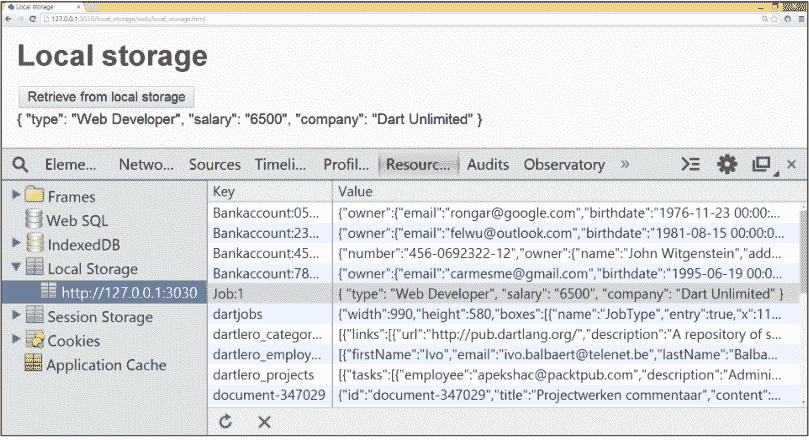
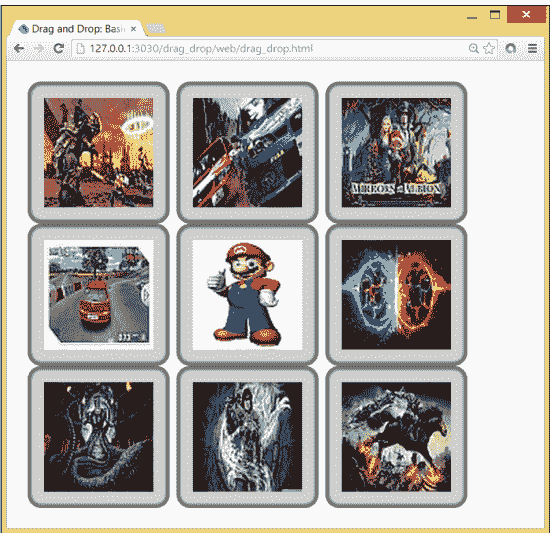
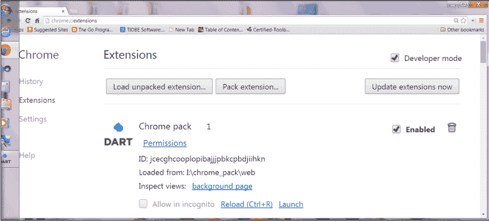
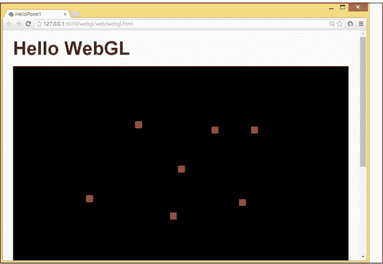
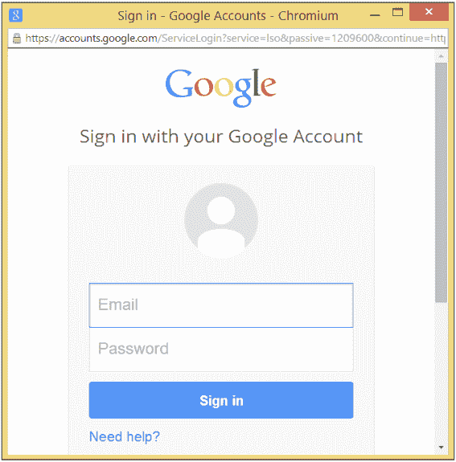
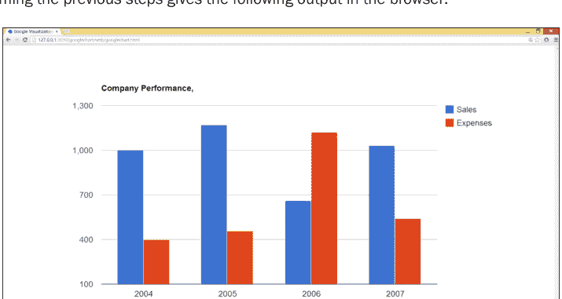

## 5 处理 Web 应用

在本章中，我们将介绍以下配方：

- 响应式设计
- 清理 HTML
- 使用浏览器的本地存储
- 使用应用程序缓存以离线工作
- 防止 onSubmit 事件重新加载页面
- 在 HTML 表格中动态插入行
- 使用 CORS 头
- 使用键盘事件
- 启用拖放
- 启用触摸事件
- 创建 Chrome 应用
- 构建游戏项目
- 在你的应用中使用 WebGL
- 授权 OAuth2 访问 Google 服务
- 与 JavaScript 通信
- 使用 JavaScript 库

### 引言

Web 应用正是 Dart 所打造的，因此毫不奇怪，我们在这一领域有很多问题需要处理。 Dart 作为客户端语言，呈现为 JavaScript 的替代品（它会编译为 JavaScript），同时也是 CoffeeScript 和 TypeScript 的替代品。 由于该语言是更高层次且更稳健的语言，Dart 使开发人员能够达到更高的生产率。 其结构和工具使得能够使用大型团队构建复杂的软件系统。 在其虚拟机中运行，Dart 提供非常缩短的应用启动时间，并在执行期间提供更高的性能。 所有这些增强使 Dart 成为开发浏览器应用的首选。 你将在本章找到涉及安全、浏览器存储、各种交互事件、WebGL 以及当然与 JavaScript 协同工作的主题。

### 响应式设计

如今，用户必须与各种尺寸的计算机屏幕交互，从智能手机和平板电脑到笔记本电脑、台式显示器和电视。 以一种使页面布局能够智能地适应用户屏幕宽度分辨率的方式设计 Web 应用称为响应式设计；例如，一个 1292 像素宽的高级四列布局，在 1025 像素宽的屏幕上，查看平板电脑或智能手机时会自动简化为两列。 其意义现在已扩展到涵盖能够智能响应用户环境的 Web 应用，同时也使 Web 应用适应用户的行为。 如果你只做一件事来使你的应用的响应式设计感知，请应用你在本主题中阅读的内容。

### 如何做...

在你的 HTML 页面的 <head> 部分添加以下 <meta> 标签（所谓的视口标签）：

```
<meta name="viewport"
    content="width=device-width, initial-scale=1.0">
```

### 它是如何工作的...

这将为你提供跨设备布局的安心。 `viewport` 是屏幕宽度的另一个词，这个标签最初是由 Apple 设计的。 将 content 设置为 `"width=device-width"` 将查询你的设备以获取其标准宽度并相应地设置你的布局宽度。 为了更确信你的布局将按你的意图显示，你也可以使用 `content="initial-scale=1"` 设置缩放级别。 这将确保在打开页面时，你的布局将以 1:1 的比例正确显示；不会应用缩放。 你甚至可以通过添加第三个属性值 `"maximum-scale=1"` 来防止任何缩放。 然而，你必须确保一切对每个人都是可读的；使用它可能会妨碍视力有问题的人。

### 另请参阅

- 如果你想开始了解更多关于响应式设计的内容，一个不错的教程可在 `http://www.adamkaplan.me/grid/` 获取

### 清理 HTML

我们都听说过（或也许经历过）**跨站脚本 (XSS)** 攻击，其中恶意的攻击者试图将客户端脚本或 SQL 语句注入 Web 页面。 这可能是为了获取会话 cookie 或数据库数据，或获取对敏感页面内容的提升访问权限。 验证 HTML 文档并生成一个仅保留被指定为安全的标签的新 HTML 文档称为清理 HTML。

### 如何做...

查看 Web 项目 `sanitization`。 运行以下脚本并查看文本内容和默认清理是如何工作的：

1. 使用以下代码查看默认清理是如何工作的：

```
var elem1 = new Element.html('<div class="foo">content</div>');
document.body.children.add(elem1);
var elem2 = new Element.html('<script class="foo">evil content</script><p>ok?</p>');
document.body.children.add(elem2);
```

elem1 和 elem2 的文本内容和 ok? 被显示，但控制台给出消息 **Removing disallowed element <SCRIPT>**。 因此脚本在造成危害之前被移除。

2. 使用 HtmlEscape 进行清理，主要用于用户生成的内容：

```
import 'dart:convert' show HtmlEscape;
```

在 main() 中，使用以下代码：

```
var unsafe = '<script class="foo">evil  content</script><p>ok?</p>';
var sanitizer = const HtmlEscape();
print(sanitizer.convert(unsafe));
```

这会在控制台打印以下输出：

```
&lt;script class=&quot;foo&quot;&gt;evil  content&lt;&#x2F;script&gt;&lt;p&gt;ok?&lt;&#x2F;p&gt;
```

3. 使用节点验证进行清理。 以下代码禁止在 node1 中使用 <p> 标签；只允许 <a> 标签：

```
var html_string = '<p class="note">a note aside</p>';
var node1 = new Element.html(
    html_string,
    validator: new NodeValidatorBuilder()
      ..allowElement('a', attributes: ['href'])
);
```

控制台打印以下输出：

Removing disallowed element <p>

Breaking on exception: Bad state: No elements

4. 用于无验证的 NullTreeSanitizer 如下使用：

```
final allHtml = const NullTreeSanitizer();
class NullTreeSanitizer implements NodeTreeSanitizer {
    const NullTreeSanitizer();
    void sanitizeTree(Node node) {}
}
```

它也可以如下使用：

```
var elem3 = new Element.html('<p>a text</p>');
elem3.setInnerHtml(html_string, treeSanitizer: allHtml);
```

### 使用浏览器的本地存储

### 如何做...

查看以下示例，local_storage.dart 文件：

```
import 'dart:html';

Storage local = window.localStorage;

void main() {
  var job1 = new Job(1, "Web Developer", 6500, "Dart Unlimited");

```

执行以下步骤以使用浏览器的本地存储：

1. 使用以下代码使用键 Job:1 写入本地存储：

```
local["Job:${job1.id}"] = job1.toJson;
ButtonElement bel = querySelector('#readls');
bel.onClick.listen(readShowData);
```

2. 单击按钮会检查本地存储中是否可以找到键 Job:1，如果可以，则读取数据。 然后在 data <div> 中显示：

```
readShowData(Event e) {
  var key = 'Job:1';
  if(local.containsKey(key)) {
    // read data from local storage:
    String job = local[key];
    querySelector('#data').appendText(job);
  }
}

class Job {
  int id;
  String type;
  int salary;
  String company;
  Job(this.id, this.type, this.salary, this.company);
  String get toJson => '{ "type": "$type", "salary": "$salary", "company": "$company" } ';
}
```

以下截图描述了数据如何存储在本地存储中以及如何从中检索：



### 它是如何工作的...

你可以使用以下方式使用 Window 类将数据存储在本地存储中，使用特定键

```text
window.localStorage[key] = data;  (both key and data are Strings).
```

你可以使用以下方式检索它

```text
var data = window.localStorage[key];
```

在我们的代码中，我们使用了缩写

```text
Storage local = window.localStorage;
```

因为 local 是一个 map。 你可以使用 containsKey(key) 检查这段数据是否存在于本地存储中；在 Chrome（也在其他浏览器中通过 **Developer Tools**）。 你可以通过导航到 **Extra | Tools | Resources | Local Storage**（如前一截图所示）来验证这一点。 window.localStorage 还有一个 length 属性；你可以使用 isEmpty 查询它是否包含内容，并且你可以使用以下代码遍历所有存储的值：

```text
for(var key in window.localStorage.keys) {
  String value = window.localStorage[key];
  // more code
}
```


### 还有更多...

本地存储可能会被禁用（由用户操作，或通过已安装的插件或扩展程序），因此当需要启用时，我们必须提醒用户；我们可以通过捕获此情况下发生的异常来实现：

```dart
try {
    window.localStorage[key] = data;
} on Exception catch (ex) {
    window.alert("Data not stored: Local storage is disabled!");
}
```

本地存储是一个简单的键值存储，并且具有良好的跨浏览器覆盖率。然而，它只能存储字符串，并且是阻塞的（同步）API；这意味着在它执行存储或读取大量数据（如图像）的工作时，它可能会暂时使你的网页停止响应。此外，它有 5 MB 的空间限制（因浏览器而异）；你无法检测何时接近此限制，也无法申请更多空间。当达到限制时，会发生错误，以便用户可以得到通知。

> 这些属性使得本地存储仅作为临时数据存储工具有用；这意味着它比 cookie 更好，但不适合可靠的、数据库类型存储。

Web 存储还有另一种存储数据的方式，称为 sessionStorage，使用方式相同，但它将数据的持久性限制为仅当前浏览器会话。因此，当浏览器关闭或在同一浏览器窗口中启动另一个应用程序时，数据会丢失。

### 另请参阅

- 有关 JSON 格式的更多信息，请参阅第 4 章《面向对象编程》中你的类中的 Making toJSON and fromJSON methods 配方
- 比简单本地存储更好的替代方案是 IndexedDB；请参阅第 9 章《使用数据库》中 Storing data locally in IndexedDB 配方

## 使用应用程序缓存离线工作

当由于某种原因，我们的用户无法访问网络或网站因维护（甚至损坏）而无法使用时，我们基于 Web 的应用程序也应离线工作。浏览器缓存不足以做到这一点，因此 HTML5 为我们提供了 ApplicationCache 机制。此缓存告诉浏览器应使哪些文件可离线使用。其效果是，即使用户离线，应用程序也能加载并正常工作。要保存在缓存中的文件在清单文件中指定，该文件具有 `.mf` 或 `.appcache` 扩展名。

### 如何做...

查看 appcache 应用程序；它有一个名为 `appcache.mf` 的清单文件。

1. 清单文件可以在每个需要缓存的网页中指定。这是通过 `<html>` 标签的 manifest 属性完成的：

   ```html
   <html manifest="appcache.mf">
   ```

   如果一个页面需要被缓存但没有 manifest 属性，则必须在清单文件的 CACHE 部分中指定。清单文件具有以下（最小）内容：

   ```text
   CACHE MANIFEST
   # 2012-09-28:v3

   CACHE:
   Cached1.html
   appcache.css
   appcache.dart
   http://dart.googlecode.com/svn/branches/bleeding_edge/dart/client/dart.js

   NETWORK:
   *

   FALLBACK:
   / offline.html
   ```

2. 运行 cached1.html。这会显示 **This page is cached, and works offline!** 文本。将文本更改为 This page has been changed! 并重新加载浏览器。你看不到更改后的文本，因为页面是从应用程序缓存创建的。

3. 当清单文件被更改（将版本 v1 更改为 v2）时，缓存变得无效，并且带有 **This page has been changed!** 文本的新版本页面将被加载。

4. 页面的 Dart 脚本 `appcache.dart` 应包含以下最小代码以访问缓存。

   ```dart
   main() {
     new AppCache(window.applicationCache);
   }

   class AppCache {
     ApplicationCache appCache;

     AppCache(this.appCache) {
       appCache.onUpdateReady.listen((e) => updateReady());
       appCache.onError.listen(onCacheError);
     }
   }

   void updateReady() {
       if (appCache.status == ApplicationCache.UPDATEREADY) {
           // The browser downloaded a new app cache. Alert the user:
           appCache.swapCache();
           window.alert('A new version of this site is available. Please reload.');
       }
   }

   void onCacheError(Event e) {
       print('Cache error: ${e}');
       // Implement more complete error reporting to developers
   }
   ```

### 它是如何工作的...

清单文件中的 CACHE 部分枚举了所有需要缓存的条目。`NETWORK:` 和 `*` 选项意味着要使用所有其他资源，用户必须在线。FALLBACK 指定如果用户离线且资源无法访问，则会显示 offline.html。一个页面在以下任一条件为真时会被缓存：

- 它的 HTML 标签具有指向清单文件的 manifest 属性
- 页面在清单文件的 CACHE 部分中指定

当清单文件被更改时，浏览器会收到通知，并且用户将被强制刷新其缓存资源。添加时间戳和/或版本号如 `# 2014-05-18:v1` 效果很好。更改日期或版本号会使缓存失效，并且更新的页面将再次从服务器加载。

要从代码中访问浏览器的应用缓存，请使用 window.applicationCache 对象。创建一个 AppCache 类的对象，并在应用程序缓存变得无效时（状态为 UPDATEREADY）提醒用户，通过定义 onUpdateReady 监听器。

### 还有更多...

应用程序缓存的其他已知状态是 UNCACHED、IDLE、CHECKING、DOWNLOADING 和 OBSOLETE。要记录所有这些缓存事件，你可以在 appCache 构造函数中添加以下监听器：

```dart
appCache.onCached.listen(onCacheEvent);
appCache.onChecking.listen(onCacheEvent);
appCache.onDownloading.listen(onCacheEvent);
appCache.onNoUpdate.listen(onCacheEvent);
appCache.onObsolete.listen(onCacheEvent);
appCache.onProgress.listen(onCacheEvent);
```

使用以下代码提供一个 onCacheEvent 处理程序：

```dart
void onCacheEvent(Event e) {
    print('Cache event: ${e}');
}
```

## 防止 onSubmit 事件重新加载页面

网页上包含 HTML 表单的提交按钮的默认操作是将所有表单数据发布到应用程序运行的服务器上。如果我们不希望发生这种情况怎么办？

### 如何做...

通过执行以下步骤来尝试 submit 应用程序：

1. 我们的网页 `submit.html` 包含以下代码：

   ```html
   <form id="form1" action="http://www.dartlang.org" method="POST">
     <label>Job:<input type="text" name="Job" size="75"></input>
     </label>
     <input type="submit" value="Job Search">
   </form>
   ```

   注释掉 `submit.dart` 中的所有代码。运行应用程序，输入一个工作名称，然后单击 Job Search 提交按钮；Dart 网站会出现。

2. 当以下代码添加到 `submit.dart` 时，单击提交按钮不再使 Dart 网站出现：

   ```dart
   import 'dart:html';

   void main() {
     querySelector('#form1').onSubmit.listen(submit);
   }

   submit(Event e) {
     e.preventDefault();
     // code to be executed when button is clicked
   }
   ```

### 它是如何工作的...

在第一步中，当按下提交按钮时，浏览器会看到方法为 POST。此方法收集输入字段中的数据和名称并将其发送到 action 中指定的 URL 以执行，在我们的例子中它只显示 Dart 网站。

为了防止表单发布数据，为表单的 onSubmit 事件制作一个事件处理程序。在此处理程序代码中，`e.preventDefault();` 作为第一条语句将取消默认的提交操作。然而，提交事件处理程序的其余部分（甚至父控件的相同处理程序，如果存在的话）仍将在客户端执行。

## 动态在 HTML 表格中插入行

当显示来自数据库的数据时，你通常不知道会有多少数据记录。我们的网页及其中的 HTML 表格必须动态适应。以下配方描述了如何做到这一点。

### 如何做...

查看 html_table 应用程序。网页包含两个 `<table>` 标签：

```html
<table id="data"></table>
<table id="jobdata"></table>
```


+   4. 在索引 0 处插入一个单元格，将该单元格赋给一个变量，并为其提供内容，代码如下所示：

```
cell = row.insertCell(0);
cell.text = 'cell 0-0';
```

+   5. 使用消息级联方式插入更多单元格，并使用以下代码为它们设置样式：

```
row.insertCell(1)
  ..text = 'cell 0-1'
  ..style.background = 'lime';
row.insertCell(2)
  ..text = 'cell 0-2'
  ..style.background = 'red';
```

+   6. 在表格末尾插入一个新行：

```
row = table.insertRow(-1);
    row.insertCell(0).text = 'cell 1-0';
```

以下是使用与上述相同方法显示 List 数据的代码：

```
var job1 = new Job("Software Developer", 7500, "Julia Computing LLC") ;
var job2 = new Job("Web Developer", 6500, "Dart Unlimited") ;
var job3 = new Job("Project Manager", 10500, "Project Consulting Inc.") ;
jobs = new List<Job>();
jobs
  ..add(job1)
  ..add(job2)
  ..add(job3);
table = querySelector('#jobdata');
// insert table headers:
InsertHeaders();
// inserting data:
InsertData();
```

```
InsertHeaders() {
    row = table.insertRow(-1);
    cell = row.insertCell(0);
    cell.text = "Jobtype";
    cell.style.background = 'lightblue';
```

```
```dart
cell = row.insertCell(1);
cell.text = "Salary";
cell = row.insertCell(2);
cell.text = "Company";
cell.style.background = 'lightblue';
}

InsertData() {
  for (var job in jobs) {
    row = table.insertRow(-1);
    cell = row.insertCell(0);
    cell.text = job.type;
    cell = row.insertCell(1);
    cell.text = (job.salary).toString();
    cell = row.insertCell(2);
    cell.text = job.company;
  }
}
```
```

+   7. 上述代码从指定单元格获取内容：
+   
+      `print(table.rows[1].cells[1].text); // prints 7500`

## 工作原理

我们分别使用 `TableElement` 和 `TableRowElement` 的 `insertRow()` 和 `insertCell()` 方法，以及 `TableCellElement` 的属性。行和列从 0 开始编号。如代码最后一行所示，可以通过在特定行和单元格上使用索引器 `[]` 来检索特定单元格的内容。

## 另请参阅

+   - 位于 <https://api.dartlang.org/apidocs/channels/stable/dartdoc-viewer/dart-dom-html.TableElement> 的 API 文档将向您展示更多有用的方法

## 使用 CORS 头

在 Web 应用程序安全模型中，同源策略是一个重要概念。其基本原则是，来自无关网站的内容必须在客户端严格分离；否则，机密性或数据完整性可能会受到损害，也许是通过跨站脚本攻击。换句话说，网页或页面上运行的脚本只能访问与其来源相同域名的脚本或页面；不允许访问其他站点。例如，`http://www.example.com/dir/page2.html` 不能访问 `http://en.example.com/dir/other.html`。然而，在许多情况下，这过于严格，例如在使用 `HttpRequest` 进行 AJAX 调用时，我们必须从另一台服务器加载数据（参见*第 7 章，使用 Web 服务器*）。为了实现这一点，开发了 CORS 机制（跨源资源共享），大多数现代 Web 浏览器都支持该机制。本教程将通过以下步骤使您轻松实现这一点。

### 操作步骤

以下步骤展示了如何配置您的 Web 服务器以添加 CORS 头：

+   1. 当 Web 服务器在响应中发回 CORS 头时，客户端也被允许向其他域名的服务器发送请求。因此，在每个请求处理代码中，我们必须添加对诸如 `addCorsHeaders` 之类方法的调用，如下面的代码所示：

```
void handleGet(HttpRequest request) {
    HttpResponse res = request.response;
    addCorsHeaders(res);
    // other code to prepare the response
    // ...
    res.write(content);
    res.close();
}
```

+   2. 现在我们需要定义 `addCorsHeaders` 方法；它包含以下代码：

```
void addCorsHeaders(HttpResponse response) {
    response.headers.add('Access-Control-Allow-Origin', '*');
    response.headers.add('Access-Control-Allow-Methods', 'POST, OPTIONS');
    response.headers.add('Access-Control-Allow-Headers', 'Origin, X-Requested-With, Content-Type, Accept');
}
```

### 工作原理

所有与 CORS 相关的头都以 `Access-Control-` 为前缀。`Access-Control-Allow-Origin` 选项必须包含在所有有效的 CORS 响应中。值 `*` 表示允许来自所有域名的访问。在开发中，这很有用，因为您可以运行来自 Dart Editor 的应用程序，其内部服务器默认使用 3030 端口。然而，对于生产环境应用程序，您应该汇总允许的来源，如下所示：

+   - `Access-Control-Allow-Origin` 位于 `http://www.example-social-network.com`
+   - `Access-Control-Allow-Origin` 位于 `http://www.snapshot.com`

因此，实际上，我们列出了所有允许访问的网站。在我们的代码中，允许来自任何来源的 `POST` 和 `OPTIONS` 请求。当客户端从不同来源运行时，会发送 `OPTIONS` 请求以获取服务器发布数据的权限。因此，在 `POST` 请求之前，会发送一个所谓的预检 `OPTIONS` 请求，以确定实际请求是否被允许。

> 一般来说，使用 CORS 头并不安全，应该汇总允许的来源。然而，出于开发目的，允许它们是很有用的。

### 更多内容

有关在不同平台上使用 CORS 的更详细信息，请参阅 `http://enable-cors.org/server.html`。

## 使用键盘事件

在普通 Web 应用程序中处理键盘事件并不常见。然而，如果您正在编写 Web 游戏，您几乎肯定想要捕获箭头键输入等。本教程向我们展示了如何处理这些事件。

### 操作步骤

查看 keyboard 项目。网页是 *防止 onSubmit 事件* 教程中使用的页面的副本，但现在提交保持启用状态。假设我们还希望确保按 *Enter* 键触发 `submit`，就像单击 **submit** 按钮一样。

+   1. 为此，我们在 `main()` 中添加以下事件监听器：
+      ```
+      document.onKeyPress.listen(_onKeyPress);
+      ```

2. `_onKeyPress` 方法如下：

```
```dart
_onKeyPress(KeyboardEvent e) {
  if (e.keyCode == KeyCode.ENTER) submit(e);
}
```
```

现在，按 *Enter* 将导致表单被提交。

### 工作原理

来自 `dart:html` 的 document 对象有三个用于处理键盘输入的事件：`onKeyPress`、`onKeyDown` 和 `onKeyUp`。它们都会生成一个 `KeyboardEvent` 对象流，捕获用户与键盘的交互。然而，这些事件也定义在 `window`（document 的父对象）以及页面上的任何 `Element` 上，因此您可以在特定的 `InputElement` 或 `<div>` 区域上非常具体地使用它们。

事件的 `keyCode` 是一个来自常量列表的整数，它为每个键指定一个值，例如 `KeyCode.A`、`KeyCode.SPACE`，以及用于左箭头键的 `KeyCode.LEFT` 等等。这非常容易用于 `switch/case` 结构，如下所示：

```
```dart
_onKeyPress(KeyboardEvent e) {
  e.preventDefault();
  print('The charCode is ${e.charCode}');
  if (e.keyCode == KeyCode.ENTER) submit(e);
  if (e.ctrlKey) return;

  switch(e.keyCode) {
    case KeyCode.DOWN:
      // move sprite down
      break;
    case KeyCode.UP:
      // move sprite up
      break;
    case KeyCode.F1:
      // show help
      break;
  }
}
```
```

该事件还有一个名为 `charCode` 的整数字符代码 getter。如果按键是特殊键，还可以使用 `e.ctrlKey`、`e.altKey`、`e.metaKey`、`e.ShiftKey` 和 `e.altGraphKey` 进行测试：

```
```dart
if (e.ctrlKey) return;
```
```

### 更多内容

用于键盘处理的 Dart 类试图最小化跨浏览器差异（通常与特殊键有关），并尽可能多地支持国际键盘布局。

## 启用拖放

想象一下开发一个棋盘游戏，玩家必须使用键盘移动棋子；这已经不可接受了。在 HTML5 之前，使用鼠标进行拖放是一项必须通过外部库（如 Dojo 或 jQuery）实现的功能。然而，HTML5 提供了原生浏览器支持，使网页上几乎每个元素都可拖动，从而允许更友好的 Web 应用程序。本教程向您展示如何使用 Dart 实现拖放（缩写为 DnD）。

### 操作步骤

运行 `drag_drop` 项目。结果是一个图像面板，如下面的截图所示，其中图像是可拖动的，您可以将一个图像与任何其他图像交换，如下面的截图所示：



拖放图像


# 处理 Web 应用程序

执行以下步骤以启用拖放

+   1. 我们想要拖放的元素必须在 HTML 中获得 `draggable` 属性，因此在 `drag_drop.html` 中，我们对棋盘的 `<div>` 元素进行了如下指示：
+   
+   ```html
+   <div id="tiles">
+       <div id="tile1" class="pict" draggable="true"></div>
+           <div id="tile2" class="pict" draggable="true"></div>
+           ...
+       </div>
+   ```

+   2. 在配套脚本 `drag_drop.dart` 中，我们创建一个类 `Drag nDrop`，以整合所有拖放事件处理。我们的所有 `<div>` 瓷砖都有 CSS 类 `pict`，因此被捕获在 `cols` 集合中。`main()` 函数创建一个对象 `dnd`，并在其上调用 `init()` 方法：
+   
+   ```dart
+   void main() {
+       var dnd = new Drag nDrop();
+       dnd.init();
+   }
+   
+   class Drag nDrop {
+       Element dragSource;
+       Map tiles;
+       var rand = new Random();
+       var cols = document.querySelectorAll('.pict');
+       // ...
+   }
+   ```

+   3. `init()` 函数在 `generateMap()` 中构造一个包含 img 文件夹中图像的映射。它为我们的瓷砖设置所有 Dnd 事件的监听器，并且通过调用 `getRandomTile()`，图像通过 `style.setProperty` 设置为瓷砖的背景图像：
+   
+   ```dart
+   void init() {
+       generateMap();
+       for (var col in cols) {
+           col
+               ..onDragStart.listen(_onDragStart)
+               ..onDragEnd.listen(_onDragEnd)
+               ..onDragEnter.listen(_onDragEnter)
+               ..onDragOver.listen(_onDragOver)
+               ..onDragLeave.listen(_onDragLeave)
+               ..onDrop.listen(_onDrop)
+               ..style.setProperty("background-image", getRandomTile(),
+                   "")
+   ```

```
..style.setProperty("background-repeat", "no-repeat", "")
..style.setProperty("background-position", "center", "");
}
}

void generateMap() {
    tiles = new Map();

    for (var i = 1; i <= 9; i++) {
        tiles[i] = "url(img/tiles_0$i.jpg)";
    }
}

String getRandomTile() {
    var num = rand.nextInt(10);
    var imgUrl = tiles[num];
    while (imgUrl == null) {
        num = rand.nextInt(10);
        imgUrl = tiles[num];
    }
    tiles.remove(num);
    return imgUrl;
}
```

4. 每个 Dnd 事件处理程序的代码如下：

```
void _onDragStart(MouseEvent event) {
    Element dragTarget = event.target;
    dragTarget.classes.add('moving');
    dragSource = dragTarget;
    event.dataTransfer.effectAllowed = 'move';
    // event.dataTransfer.setData('text/html', dragTarget.innerHtml);
}

void _onDragEnd(MouseEvent event) {
    Element dragTarget = event.target;
    dragTarget.classes.remove('moving');
    for (var col in cols) {
        col.classes.remove('over');
    }
}

void _onDragEnter(MouseEvent event) {
```

+   - 数据负载是我们试图放置的内容
+   - 目标元素是用于捕获放置或放置区域的区域，它接受用户试图放置的数据

几乎所有东西都可以启用拖动，包括图像、文件、链接或其他 DOM 节点。然而，并非所有元素都可以作为目标，例如图像，但我们的示例表明，很容易绕过这一点。

伴随拖放的视觉效果是通过 CSS 实现的。每个瓷砖都有 CSS 类 `pict`，其中包含属性 `cursor: move`，这为用户提供了视觉提示，表明某些东西可以移动。

当拖动操作开始时，会执行 `_onDragStart`，为我们的瓷砖添加 CSS 类 `moving`。该类可以在 `drag_drop.css` 中找到：

```
.pict.moving {
  opacity: 0.25;
  -webkit-transform: scale(0.8);
  -moz-transform: scale(0.8);
  -ms-transform: scale(0.8);
  transform: scale(0.8);
}
```

我们看到不透明度降低到 0.25，大小按 0.8 的因子缩放，这正是我们在拖动操作开始时看到的效果。在本示例中我们不需要它，但如果拖动涉及 HTML 文本，`_onDragStart` 应包含以下代码行：

```
event.dataTransfer.setData('text/html', dragTarget.innerHtml);
```

前面的代码指示在拖放过程中将传输哪些数据。`dataTransfer` 属性是所有操作发生的地方；它存储在拖动操作中发送的数据片段。`dataTransfer` 选项在 `DragStart` 事件中设置，并在 `Drop` 事件中读取/处理。调用 `e.dataTransfer.setData(format, data)` 将设置对象的 MIME 类型内容，并将数据负载作为参数传递。

当我们悬停在另一块瓷砖上时，会执行 `_onDragEnter` 函数；这会添加 CSS 类 `over`，使边框线变为虚线：

```
.column.over {
  border: 2px dashed #000;
}
```

最后，`_onDrop` 事件交换瓷砖图像。如果需要交换 HTML 文本，应添加以下行：

```
dragSource.innerHtml = dropTarget.innerHtml;
dropTarget.innerHtml = event.dataTransfer.getData('text/html');
```

Eric Bidelman 在 http://www.html5rocks.com/en/tutorials/dnd/basics/ 的文章是一个很好的资源，但它使用 JavaScript 来解释 DnD 事件模型。为了更轻松地在 Dart 中使用 DnD，Marco Jakob 开发了可在 pub 上获取的库 dart-html5-dnd。有关这个不错的包的更多信息，请参阅 http://code.makery.ch/dart/html5-drag-and-drop/。DnD 功能也在 dart:svg 库中实现。

## 另请参阅

+   - 请参阅本章中 *启用触摸事件* 的配方，了解如何使用触摸实现拖放

## 启用触摸事件

在没有连接鼠标的移动设备上，拖放非常方便；我们只有手指与屏幕交互。本配方将向您展示如何通过触摸事件为您的 Web 应用添加交互性。实现方法与上一配方非常相似。我们将重用拖放示例。

### 如何操作...

让我们按照以下步骤查看触摸项目：

+   1. 使用 touch.html 中的以下 <meta> 标签防止缩放：

```
<meta name="viewport"
content="width=device-width, initial-scale=1.0, user-scalable=no">
```

我们使用相同的 <div> 结构，每个都具有 class = "draggable"，如上一配方所示。

+   2. 在 touch.dart 中，我们创建一个类 Touch，用于包含特定于触摸事件的代码。创建一个对象 touch 并调用 init() 方法，该方法准备棋盘（每个瓷砖获得不同的背景图像）并将触摸事件绑定到事件处理程序：

```
void main() {
  var touch = new Touch();
  touch.init();
}

class Touch {
```

```
Element dragSource;
Map tiles;
var rand = new Random();
var cols = document.querySelectorAll('.pict');

void init() {
    generateMap();
    for (var col in cols) {

col
    ..onTouchStart.listen(_onTouchStart)
    ..onTouchEnd.listen(_onTouchEnd)
    ..onTouchMove.listen(_onTouchMove)
    ..style.setProperty("background-image", getRandomTile(), "")
    ..style.setProperty("background-repeat", "no-repeat", "")
    ..style.setProperty("background-position", "center", "");  }
    }
```

3. 以下是 TouchStart 事件的代码：

```
void _onTouchStart(TouchEvent event) {
    event.preventDefault(); //stop scrolling by default
    Element dragTarget = event.target; //capture drag target
    //add style to element to indicate its moving
    dragTarget.classes.add('moving');
    dragSource = dragTarget;
}
```

4. 以下是 TouchMove 的代码：

```
void _onTouchMove(TouchEvent event) {
    event.preventDefault();
    Element dropTarget = event.target;
    dragSource.classes.add('moving');
    // Get the current x,y position of the first finger touch  //
    and find the element it is over
    dropTarget = document.elementFromPoint(event.touches[0].page.x, event.touches[0].page.y);
    // If the finger is over an element indicate that in the UI
    if (dropTarget != null) {
        dropTarget.classes.add('over');
    }
}
```


## 处理 Web 应用程序
### 操作步骤...

执行以下步骤来创建一个 Chrome 应用。本操作指南的代码可以在项目 `chrome_pack` 中找到：

- 1. 首先创建一个新的 Dart 项目，并选择 **Chrome 打包应用**模板。
- 2. Pub Get 命令会自动启动，并从 pub 安装 Chrome 包。
- 3. 你首先会注意到出现了一个新文件 `manifest.json`，其初始内容如下：

```
{
  "name": "Chrome pack",
  "version": "1",
  "manifest_version": 2,
  "icons": {"128": "dart_icon.png"},
  "app": {
    "background": {
      "scripts": ["background.js"]
    }
  }
}
```

我们无需在这里更改任何内容，但如果你愿意，可以添加一个“description”标签。

- 4. `background.js` 文件指示应用程序应从哪个页面启动：

```
chrome.app.runtime.onLaunched.addListener(function(launchData) {
  chrome.app.window.create('chrome_pack.html', {
    'id': '_mainWindow', 'bounds': {'width': 800, 'height': 600 }
  });
});
```

- 5. `chrome_pack.html` 文件包含一个 ID 为 `text_id` 的 `<p>` 标签，并引用了脚本 `chrome_pack.dart`。该脚本首先必须导入 Chrome 包：

```
import 'dart:html';
import 'package:chrome/chrome_app.dart' as chrome;

int boundsChange = 100;
var txtp = querySelector("#text_id");
int n = 0;
```

- 6. 在 main() 中，我们获取应用运行平台的信息；在本例中，这会显示 {arch: x86-32, nacl_arch:x86-64, os: win}，并将 rewriteText 注册为 Click 事件处理程序：

```
void main() {
    chrome.runtime.getPlatformInfo().then((var m) {
        txtp.text = m.toString();
    });
    txtp.onClick.listen(rewriteText);
}
```

- 7. 在每次点击事件中，我们在 `<p>` 标签中显示点击次数消息，并调整窗口大小：

```
void rewriteText(MouseEvent e) {
    txtp.text = "Hey, you clicked ${n++} times on a Chrome packaged app!";
    resizeWindow(e);
}
```

```
void resizeWindow(MouseEvent e) {
chrome.ContentBounds bounds = chrome.app.window.current().
getBounds();
    bounds.width += boundsChange;
    bounds.left -= boundsChange ~/ 2;
    chrome.app.window.current().setBounds(bounds);
    boundsChange *= -1;
}
```

- 8. 我们不能原样从 Dart Editor 运行此应用；如果你尝试运行，会得到异常 Unsupported operation: 'chrome.runtime' is not available。

- 9. 相反，我们必须将其编译为 JavaScript。打开命令窗口，进入应用的 web 文件夹。最简单的方法是在 Dart Editor 中选择 web 文件夹，点击鼠标右键，然后选择“复制文件路径”。你可以在命令行中将该路径粘贴到 cd 后面，然后按回车键。接着，输入命令 dart2js chrome_pack.dart -o chrome_pack.dart.js。

- 10. 选项 -o 允许你指定输出文件名。或者，在 Dart Editor 中，在 Dart 文件上导航到“工具”|“Pub Build”。

## 处理 Web 应用程序
- 11. 现在，我们需要配置 Chrome，将我们的应用作为打包应用安装。在 Chrome 浏览器中打开 `chrome://extensions`，并勾选**开发者模式**。然后，点击**加载已解压的扩展程序**按钮，浏览到包含 `manifest.json` 文件的文件夹，应用即会安装到 Chrome 中，如下图所示：



在 Chrome 中加载应用

- 12. 点击**启动**链接来启动应用，如下图所示：


运行中的 Chrome 打包应用

## 另请参阅
- - Chrome 包的文档位于 http://dart-gde.github.io/chrome.dart/index.html#chrome/chrome_app。
- - 在 https://developer.chrome.com/apps/about_apps 了解更多关于 Chrome 打包应用的信息。
- - 有关 dart2js 的更多信息，请参阅第 1 章“使用 Dart 工具”中的 *将应用编译为 JavaScript* 操作指南。

## 构建游戏项目

棋盘游戏在很大程度上具有相同的结构；用户所看到的（视图）是一个包含网格单元（模型类）的表面，这些单元可以有不同的形状。再加上一些用于随机选择颜色的工具类，这构成了构建棋盘游戏的坚实基础。Dzenan Ridjanovic 凭借其在构建游戏项目方面的经验，将这个游戏结构提取到了 boarding 项目中，该项目可在 https://github.com/dzenanr/boarding 找到。

### 操作步骤...

从前面的网址下载游戏项目的 zip 压缩包，解压后，在 Dart Editor 中打开。新棋盘游戏的起始代码位于 lib 文件夹中；名为 boarding 的库（在 boarding.dart 中）导入了视图类 Surface 和 Shape：

```
library boarding;

import 'dart:html';
import 'dart:math';

import 'package:boarding/boarding_model.dart';

part 'view/shape.dart';
part 'view/surface.dart';
```

脚本 boarding_model.dart 声明了库 boarding_model，它导入了模型类 Grid、Cell、Cells 和一些工具方法：

```
library boarding_model;

import 'dart:math';

part 'model/cell.dart';
```

```
part 'model/grid.dart';

part 'util/color.dart';
part 'util/random.dart';
```

通过在这些类的基础上进行构建，你可以创建你想要的特定棋盘游戏。具体的实现可以在 example 文件夹中找到，其中包含一个记忆游戏和一个井字棋游戏（ttt）。例如，记忆游戏的启动脚本导入了两个库，并添加了它自己的特定 Memory 类，该类继承自 Grid 和 Board 类，而 Board 类又扩展了 Surface：

```
library memory;

import 'dart:async';
import 'dart:html';
import 'package:boarding/boarding_model.dart';
import 'package:boarding/boarding.dart';

part 'model/memory.dart';
part 'view/board.dart';

playAgain(Event e) {
  window.location.reload();
}

main() {
  new Board(new Memory(4), querySelector('#canvas')).draw();
  querySelector('#play').onClick.listen(playAgain);
}
```

### 工作原理...

Surface 类有一个 draw() 方法，用于绘制线条（如果需要）和单元：

```
draw() {
  clear();
  if (withLines) lines();
  cells();
}
```

shape.dart 中的 Circle、Rectangle、Square、Line 和 Tag（用于文本）类知道如何绘制自身。model 文件夹中的 Grid 类知道如何使用 Cell 类的对象来构造自身。cell.dart 文件包含 Cell 类的代码，该类可以判断两个单元是否相交，并且还有一个单元集合。将这个项目作为起点，来构建你自己的游戏吧！

### 更多内容...

另一种方法是使用 `window` 类中的 `animationFrame` 方法。使用这种技术，我们在 `main()` 函数中启动 `gameLoop`，并让它递归调用自身，如下代码所示：

```
main() {
  // redraw
  window.animationFrame.then(gameLoop);
}

gameLoop(num delta) {
  // animation code;
  window.animationFrame.then(gameLoop);
}
```

## 另请参阅
- - 看看 John McCutchan 的 pub 包 `game_loop`（https://github.com/johnmccutchan/game_loop）。另一个流行的包是 Bernhard Pichler 开发的 StageXL（www.stagexl.org）。它面向那些希望将项目和技能迁移到 HTML5 的 Flash/ActionScript 开发者；视觉效果、动画、声音——一应俱全。

## 在你的应用中使用 WebGL

HTML5 Canvas API 仅允许你在二维空间中绘图。使用 **Web 图形库（WebGL）**，你可以在任何现代 Web 浏览器中（Internet Explorer 11 仅部分支持 WebGL）显示交互式 2D 图形和 3D 图形，而无需使用插件。WebGL 元素绘制在 canvas 元素上，并可以与其他 HTML 元素组合。使用 WebGL 的程序由用于控制的 Dart（或 JavaScript）代码和特定的 WebGL 着色器代码混合组成。这些着色器代码在计算机的**图形处理单元（GPU）**上执行，使得物理效果和图像处理作为网页画布的一部分获得 GPU 加速，因此这里实现了真正的并行处理！

WebGL 提供了一个底层 3D API；掌握它需要的不止一篇操作指南，可能需要专门的课程或一本书。不过，本操作指南将在 `webgl` 项目中为你提供基础知识，并提供一些链接以供进一步了解。


查看项目 webgl 的代码。执行时，我们会看到黑色表面上有一个矩形红点。点击该表面时，会显示新的点：



## 如何实现...

按照以下步骤开始使用 WebGL：

- 1. 首先，访问 http://get.webgl.org/ 以确定你的浏览器和 GPU 是否支持 WebGL；你应该会看到一个旋转的立方体。
- 2. webgl.html 页面简单地定义了一个 `<canvas>` 标签，我们将在这个标签上绘图，代码如下：

    ```
    <canvas id="webgl" style="border: none;" width="500" height="500"></canvas>
    ```

- 3. 要在代码中使用 WebGL，请导入 dart_webgl 包：

    ```
    import 'dart:web_gl';
    ```

- 4. 现在定义绘图所需的着色器代码：

    ```
    // Vertex shader program
    var VSHADER_SOURCE = 'attribute vec4 a_Position;\n void main() {\n gl_Position = a_Position;\n gl_PointSize = 10.0;\n }\n';
    ```

    ```javascript
    // Fragment shader program
    var FSHADER_SOURCE = 'void main() {\n
    gl_FragColor = vec4(1.0, 0.0, 0.0, 1.0);\n // Set the point color
    }';
    ```

    要将点的顶点坐标设置为固定值，请使用以下代码：

    ```
    gl_Position = vec4(0.0, 0.0, 0.0, 1.0);
    ```

- 5. `main()` 函数首先获取 canvas 的引用以及 3D 渲染上下文：

    ```
    void main() {
        // Retrieve <canvas> element
        var canvas = querySelector("#webgl");
        if (canvas == null) {
            print('Failed to retrieve the <canvas> element');
        }
        // Get the rendering context for WebGL
        RenderingContext gl = canvas.getContext3d();
        if (gl == null) {
            print('Failed to get the rendering context for WebGL');
            return;
        }
    }
    ```

- 6. 然后，必须编译着色器代码并将其链接到程序中：

    ```
    // compiling the GPU code
    Shader fragShader = gl.createShader(FRAGMENT_SHADER);
    gl.shaderSource(fragShader, FSHADER_SOURCE);
    gl.compileShader(fragShader);

    Shader vertShader = gl.createShader(VERTEX_SHADER);
    gl.shaderSource(vertShader, VSHADER_SOURCE);
    gl.compileShader(vertShader);

    Program program = gl.createProgram();
    gl.attachShader(program, vertShader);
    gl.attachShader(program, fragShader);
    gl.linkProgram(program);

    if (!gl.getProgramParameter(program, LINK_STATUS)) {
        print("Could not initialise shaders");
        return;
    }
    gl.useProgram(program);
    ```

- 7. 然后，我们获取程序中名为 a_Position 的属性变量的位置索引：

    ```
    var a_Position = gl.getAttribLocation(program, 'a_Position');
    if (a_Position < 0) {
        print('Failed to get the storage location of a_Position');
        return;
    }
    ```

- 8. 我们注册鼠标点击时要调用的事件处理程序：

    ```
    canvas.onMouseDown.listen((ev) => click(ev, gl, canvas, a_Position));
    ```

- 9. 指定用于清除 `<canvas>` 的颜色。清除画布并绘制点：

    ```
    gl.clearColor(0.0, 0.0, 0.0, 1.0);
    gl.clear(COLOR_BUFFER_BIT);
    gl.drawArrays(POINTS, 0, 1);
    ```

- 10. 点击处理程序使用数组 g_points 来记录鼠标点击的位置：

    ```
    List<num> g_points = new List<num>();

    void click(ev, RenderingContext gl, canvas, a_Position) {
        var x = ev.clientX; // x coordinate of a mouse pointer
        var y = ev.clientY; // y coordinate of a mouse pointer
        var rect = ev.target.getBoundingClientRect();

        x = ((x - rect.left) - canvas.width / 2) / (canvas.width / 2);
        y = (canvas.height / 2 - (y - rect.top)) / (canvas.height / 2);

        // Store the coordinates to g_points array
        g_points.add(x);
        g_points.add(y);

        gl.clear(COLOR_BUFFER_BIT);

        var len = g_points.length;
        for (var i = 0; i < len; i += 2) {
            // Pass the position of a point to a_Position variable
            gl.vertexAttrib3f(a_Position, g_points[i], g_points[i + 1], 0.0);
            gl.drawArrays(POINTS, 0, 1);
        }
    }
    ```

## 工作原理...

第四步中的着色器代码包括顶点着色器程序（用于绘制形状边界）和片段着色器程序（用于颜色、纹理和光照）；它们被硬编码为分配给常量 VSHADER_SOURCE 和 FSHADER_SOURCE 的字符串。

第六步中的代码看起来有些吓人，但不用担心，这段代码可以直接在其他绘图场景中复用。

第七步是必要的，用于在着色器代码中的 a_Position 变量与 Dart 中同名的变量之间建立联系。请注意，第 8 步和第 10 步中的点击事件处理程序需要将 GL 上下文和 canvas 作为第二和第三个参数。

## 更多内容...

WebGL 本身没有内置支持来加载普通 3D 文件格式中定义的 3D 场景。要显示 3D 场景，需要使用查看器代码或诸如 three.dart 之类的库（它是 Three.js 的一个移植版本，可从 pub 中以 three 名称获取）。要创建内容，请使用普通的内容创建工具，并将内容导出为查看器可读取的格式。

## 另请参阅

- 查看并研究 Dart 团队制作的精美 3D 太阳系可视化示例，地址为 https://github.com/dart-lang/dart-samples/tree/master/html5/web/webgl/solar3
- http://www.learnwebgl.com 上的教程由 John Thomas McDole 为 Dart 重写；你可以在 https://github.com/jtmcdole/dart-webgl 找到它
- 想了解更多 WebGL 信息，请访问 http://www.khronos.org/webgl/wiki/Main_Page
- 如果你想进一步了解着色器（Shader），请访问 http://aerotwist.com/tutorials/an-introduction-to-shaders-part-1/

## 对 Google 服务进行 OAuth2 授权

你一定见过一些网站，可以使用 Google、Facebook 或 Twitter 账号登录，而无需重新输入个人信息。这种服务很可能是由 OAuth2 驱动的，OAuth2 是开放（网络）授权标准的（第二版）。它为已获得第三方 OAuth2 授权服务器发放访问令牌的客户端，提供对你应用服务端的安全访问。凭据保证由令牌验证，并且不会交给你这个网站所有者。Dart 团队和社区为我们提供了一些不错的包，可以轻松实现这一功能。

- 4. 要查看认证返回的内容，我们添加以下代码：

    ```
    void oauthReady(Token token) {
      print(token);
    }
    ```

- 5. 假设我们要使用该令牌访问 Google+ 个人资料数据并显示用户的完整姓名。进入项目控制台（参考第 2 步），选择 **用 Google API 增强你的应用**，然后选择 **启用 API**，并启用 Google+ API。进入 API 访问界面，创建一个 **公共 API 访问密钥**。你需要在第 8 步中将该值填入 **plus.key**。

- 6. 现在将 google_plus_v1_api 添加到 pubspec.yaml 文件中，并添加以下导入行：

    ```
    import "package:google_plus_v1_api/plus_v1_api_browser.dart" as plusclient;
    ```

- 7. 在 auth 变量中的 e-mail 作用域之后添加 plusclient.Plus.PLUS_ME_SCOPE。

- 8. 现在将以下代码添加到 oauthReady：

    ```
    // get the users full name
    var plus = new plusclient.Plus(auth);
    // set the API key
    plus.key = "Axxxxxxxxxxxxxxxxxxxx-x-xxxxxxxxx-x";
    plus.oauth_token = auth.token.data;
    plus.people.get("me").then((person) {
      // log the users full name to the console
      print("Hello ${person.name.givenName} ${person.name.familyName}");
    });
    ```

## 工作原理...

第 3 到第 5 步说明了如何使用 OAuth 客户端。点击 **登录** 按钮将显示 Google 登录界面，用户必须在其中输入电子邮件地址和密码，如下面的截图所示：



Google 账号登录界面

接下来会出现一个屏幕，根据你在 auth 变量 `["openid", "email"]` 中指定的作用域，授权访问你的应用程序。之后，tokenLoaded 事件被触发，返回一个 OAuth 令牌，其回调函数 oauthReady 可以将其打印出来；格式如下（敏感数据用 x 代替）：

```
[Token type=Bearer,
data=xxx.xxxx-xxxxxxxxxxxxxxxxxxxx,
expired=false,
expiry=2014-05-24 15:46:19.445,
email=xxxxxxxxxxxxxx@gmail.com,
userId=xxxxxxxxxxxxxxxxxxxxxx]
```

该令牌将被发送到服务器上的 Web 应用程序。总之，用户通过 OAuth2 协议，以现有 Google 账号的身份在你的应用程序中得到认证。

从第 7 步开始，我们使用令牌登录 Google+。在第 9 步中，auth.token 被交给 Google+ 客户端，它会从 Google+ 服务中打印出 givenName 和 familyName，例如：Hello John Doe。


## 处理 Web 应用

通常，如果你想通过 OAuth2 访问某个 URL `urlxyz`，并且你已经拥有一个 auth token，请使用以下代码：

```
var request = new HttpRequest();
request.onLoad.listen(...);
request.open(method, urlxyz);
auth.authenticate(request).then((request) => request.send());
```

### 还有更多...

Dart 团队制作了 oauth2 客户端库，它允许你从非 Google 服务器获取 OAuth2 授权。有了它，用户可以为你的应用进行身份验证，而无需在你的网站上存储密码。用户通过身份验证后，你的应用将拥有该用户的 oauth2 token，可用于访问其他服务。要在代码中开始使用它，将 oauth2 添加到你的 pubspec.yaml 依赖项中，让 Dart Editor 中的 pub 安装它，或在命令行上调用 pub get。然后，在你的脚本中添加以下内容：

```
import 'package:oauth2/oauth2.dart';
```

这样做的方式稍微复杂一些，但有了你现在所学的内容，你将能够理解 http://pub.dartlang.org/packages/oauth2 上给出的示例代码。

要在服务器端应用中通过 Facebook、Windows Live 或 Google 进行 OAuth2 身份验证，请使用 Christophe Hurpeau 的 pub 包。

### 另请参阅

- 有关 OAuth2 和 Google 的更详细信息，请参阅文章 *Using OAuth2 to access Google APIs*，网址为 `https://developers.google.com/accounts/docs/OAuth2?csw=1`
- 如果你想了解更多关于 OAuth2 的信息，请参考 `http://oauth.net/2/`

## 与 JavaScript 通信

如果我们考虑到存在的庞大 JavaScript 代码和库的数量，并且仍在不断开发中，那么我们非常需要一种简单的方式从 Dart 应用中使用 JavaScript 代码，特别是为了让 Dart 访问在同一网页中运行的 JavaScript 代码。最早的尝试使用了 `window.postMessage`，然后构建了一个名为 js 的包。由于这个主题的重要性极大，Dart 团队现在为我们提供了一个核心库，`dart:js`，用于与 JavaScript 互操作。这提供了更好的性能，减少了编译后的 JavaScript 文件大小，并且也更容易使用。一旦 `dart:js` 就绪，js 包已被重写以在内部使用 `dart:js`。

### 如何操作...

请查看项目 `js_interop`，按以下步骤说明：

- 1. 要在我们的项目中使用 `dart:js`，我们必须在代码中导入它：
  
  ```dart
  import 'dart:js';
  ```

- 2. 在 `js_interop.html` 中，我们声明一个 Dart 脚本，并且 JavaScript 程序 `js_interop.dart` 将查看 `interact.js` 的代码：
  
  ```html
  <script type="application/dart" src="js_interop.dart"></script>
  <script type="application/javascript"
    src="interact.js"></script>
  ```

- 3. `interact.js` 文件包含以下代码：一个变量 `jsvar`，一个具有属性 name 和 gender 的类 `Person`，以及方法 greeting 和 sayHello：
  
  ```javascript
  var jsvar = "I want Dart";

  function Person(name, gender) {
      this.name = name;
      this.gender = gender;
      this.greeting = function(otherPerson) {
          alert('I greet you ' + otherPerson.name);
      };
  }

  Person.prototype.sayHello = function () {
      alert ('hello, I am ' + this.name );
  };
  ```

- 4. 首先，我们获取 JavaScript 变量的内容：
  
  ```dart
  var dart = context['jsvar'];
  print(dart);  // I want Dart
  ```

- 5. 然后，我们创建一个 `Person` 对象：
  
  ```dart
  var pers1 = new JsObject(context['Person'], ['An', 'female']);
  var pers2 = new JsObject(context['Person'], ['John', 'male']);
  ```

- 6. 我们使用以下代码访问和设置属性：

```dart
print(pers1['name']); // An
print(pers2['gender']); // male
pers1['gender'] = 'female';
print(pers2['gender']); // female
```

- 7. 我们在 Person 对象上调用方法：

```dart
pers1.callMethod('sayHello', []);
pers2.callMethod('greeting', [pers1]);
```

前面的步骤会显示带有消息 **hello, I am An** 和 **I greet you An** 的 alert 窗口。

- 8. 现在我们通过 `context` 获取 JavaScript 中的全局对象（通常是 window），并使用 `callMethod` 显示一个 alert 窗口：

```dart
context.callMethod('alert', ['Hello from Dart!']);
```

- 9. 使用 `jsify` 创建 JavaScript 对象和数组：

```dart
var jsMap = new JsObject.jsify({'a': 1, 'b': 2});
print(jsMap); // [object Object]
var jsArray = new JsObject.jsify([1, 2, 3]);
print(jsArray); // [1, 2, 3]
```

### 其工作原理...

`dart:js` 库为 Web 应用中的 Dart 提供对 JavaScript 对象的访问，而非服务器应用。更具体地说，它公开了你访问的任何 JavaScript 对象的包装或代理版本。这使得 Dart 能够安全地将 JavaScript 沙箱化，并防止其问题泄漏到 Dart 应用中。你可以获取和设置属性并在 JavaScript 对象上调用 JavaScript 函数和方法，同时在 Dart 和 JavaScript 之间的转换尽可能自动完成。此时，桥接并非完全双向；JavaScript 无法访问 Dart 对象，但可以调用 Dart 函数。

> 在 HTML `<script src="packages/browser/interop.js"></script>` 代码中包含 `script` 标签已不再需要。

主要的对象类型是 `JsObject`，我们可以用它来访问 JavaScript 对象；换句话说，我们为 JavaScript 对象创建一个 Dart 代理对象。要获取 JavaScript 中的全局对象（大多数情况下是 window），请使用顶级 getter 函数 `context`；这在步骤 8 中使用。然而，`context` 也用于获取 JavaScript 变量的值，如步骤 4 所示。

你可以按步骤 5 所示创建 JavaScript 对象。使用 JsObject() 构造函数。它接受一个 JavaScript 构造函数函数的名称和它需要的参数列表作为参数。如步骤 6 所示，我们可以使用 [] 索引运算符获取属性的值，使用 [] = 设置它们；而不是数字索引，我们使用属性名称字符串作为键。第七和第八步演示了我们可以使用 callMethod 在对象上调用 JavaScript 方法，参数为方法名称及其参数列表。最后，在步骤 9 中，我们看到 JsObject.jsify 将 Dart map 转换为 JavaScript 对象，使用键作为属性；相同的方法也将 Dart 列表转换为 JavaScript 数组。

### 还有更多...

为了能够进行比较，我们现在将展示相同的代码，但使用 js 包重写。在 js_interop2.html 中，我们有相同的 JavaScript，但与 Dart 脚本 js_interop2.dart 一起运行。我们将 js 包添加到 pubspec.yaml 文件中作为 js:any，并让 pub get 发挥其魔力。为了使该包对我们的 Dart 脚本可用，我们在 js_interop2.dart 中添加以下代码：

```
import 'package:js/js.dart' as js;
```

重写 js_interop.dart 中的 Dart 代码，我们得到以下输出：

```
void main() {
  // getting a variable:
  var dart = js.context['jsvar'];
  print(dart); // I want Dart
  // making objects:
  var pers1 = new js.Proxy(js.context.Person, ['An', 'female']);
  var pers2 = new js.Proxy(js.context.Person, ['John', 'male']);
  // accessing and setting properties:
  print(pers1.name); // prints the whole object: [An, female]
  pers1.name = 'Melissa'; // change name property
  print(pers1.name); // Melissa
  // calling methods:
  pers1.sayHello.call(); // window: hello, I am Melissa
  pers2.greeting.call(pers1); // window: I greet you Melissa
  // getting the global object in JavaScript via context
  js.context.alert('Hello from Dart via JavaScript');
  // using jsify:
  var jsMap = js.map({'a': 1,'b': 2});
  print(jsMap); // [object Object]
  var jsArray = js.array([1, 2, 3]);
  print(jsArray); // [1, 2, 3]
}
```


这个语法比 dart:js 稍微容易一些，但由于 js 包中的名称不能被压缩（因为它使用了 dart:mirrors 和 noSuchMethod），使用这个库在编译为 JavaScript 时可能会导致代码体积明显增加。如果这对你来说是一个很大的缺点，那就改用 dart:js。我们将在下一个食谱中使用 js 包来与 Google Visualizations API 进行交互。

### 参见

- 关于如何使用 JavaScript 库的更多信息，请参阅“使用 JavaScript 库”食谱
- 一个可让你轻松从 Javascript 调用 Dart 的小型库位于 https://github.com/jptrainor/js_bridge，它是围绕 dart:js 的一个薄封装层。

## 使用 JavaScript 库

在本食谱中，我们将 js 包作为 Dart 脚本与 Google Chart JavaScript API 之间的接口。这为我们提供了丰富且高度可定制的方式来在 Dart Web 应用中图形化表示数据，并且由于它是基于 HTML5/SVG 构建的，因此它可以在跨浏览器（甚至包括旧版 IE）和跨平台（也包括 iOS 和 Android）的环境中工作。

### 如何实现...

看一下 googlechart 项目：

1. 在 HTML 文件的 `<body>` 标签中，放置以下内容：

   ```
   <div id="chart" style="width: 900px; height: 500px;"></div>
   <script type="text/javascript"
     src="https://www.google.com/jsapi"></script>
   <script type="application/dart"
     src="googlechart.dart"></script>
   ```

   带有 ID 为 chart 的 `<div>` 标签是图表将被绘制的地方；执行此操作的代码包含在 googlechart.dart 中。

2. 以下是我们想要在图表中表示的数据：

   ```
   var listData = [
     ['Year', 'Sales', 'Expenses'],
     ['2004', 1000, 400],
     ['2005', 1170, 460],
     ['2006', 660, 1120],
     ['2007', 1030, 540]
   ];
   ```

3. 导入 js 包之后，我们从 Google API 加载 corechart 包，并告诉我们的代码在完成时执行 drawChart 方法：

   ```
   import 'dart:html';
   import 'package:js/js.dart' as js;
   main() {
       js.context.google.load('visualization', '1', js.map(
           { 'packages': ['corechart'],
             'callback': drawChart,
           }));
   }
   ```

4. 调用 drawChart 方法然后加载数据并绘制图表：

   ```
   void drawChart() {
       var gviz = js.context.google.visualization;
       var arrayData = js.array(listData);
       var tableData = gviz.arrayToDataTable(arrayData);
       var options = js.map({
           'title': 'Company Performance, ',
           'hAxis': {'title': 'Year', 'titleTextStyle': {'color': 'red'}}
       });
       var chart = new js.Proxy(gviz.ColumnChart, querySelector('#chart'));
       chart.draw(tableData, options);
   }
   ```

执行上述步骤会在浏览器中给出以下输出：



使用 js 的 Google Charts

另外，注意当鼠标悬停在柱子上时，会显示一个工具提示，包含该柱子的确切数据。

### 工作原理...

在第一步中，高亮的 script 标签指向在线 Google 可视化库，这些库必须在你使用它们绘制图表之前动态加载。第二步定义数据；这些数据可以从文件或数据库中加载。在第四步中，我们通过 `js.context` 获取对 JavaScript Google Visualizations 对象的引用 `gviz`。然后，数据通过 `js.array` 转换为 JavaScript 数组；图表选项（如标题、x 轴、颜色等）通过 `js.map` 传递。然后，我们构造一个代理 `chart` 指向 JavaScript 对象，并在其上调用 `draw` 方法。

所以基本上，创建一个图表有四个步骤：

1. 加载 `jsapi` 库。
2. 列出数据。
3. 配置选项。
4. 创建图表。

### 参见

- 想了解更多关于 Google Charts 的信息？请访问 `https://google-developers.appspot.com/chart/interactive/docs/`，在那里你可以找到大量的示例。这些示例是用 JavaScript 编写的，但凭借你现在所掌握的知识，你可以轻松地将它们转换为 Dart。
