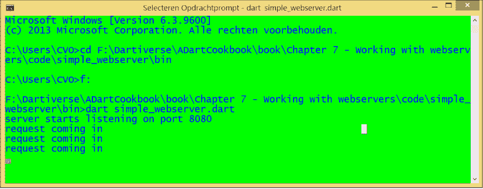
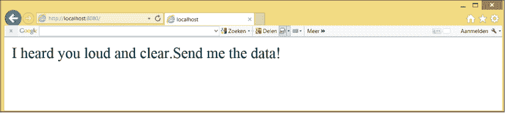
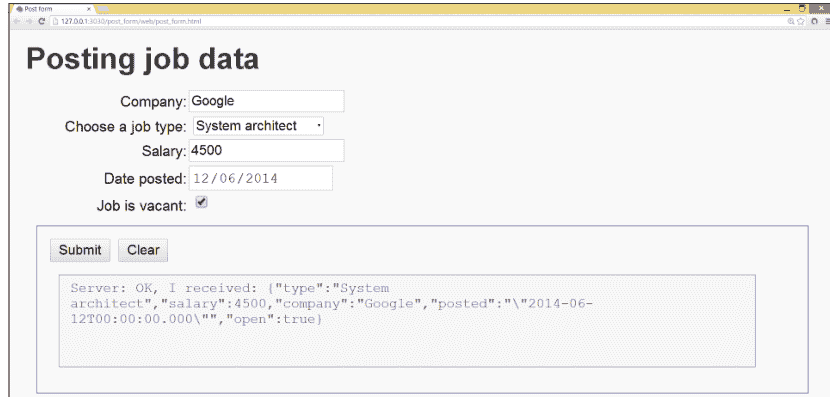
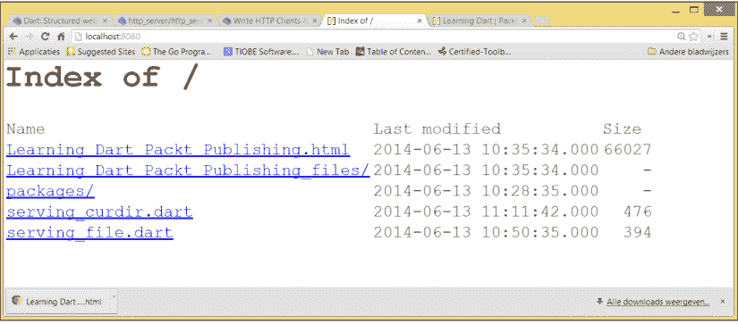
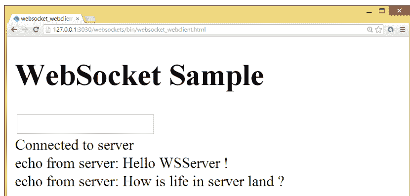
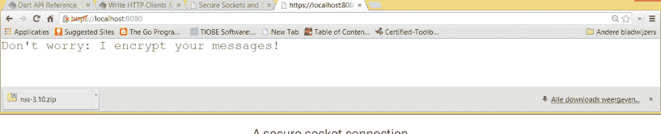

## 6 使用文件和流

在本章中，我们将介绍以下食谱：

- 逐行读取和处理文件
- 写入文件
- 在文件中搜索
- 连接文件
- 下载文件
- 使用 Blob
- 转换流

### 引言

在每种编程语言中，处理文件都是与环境中的数据进行交互的基本操作。处理此功能的类和方法可以在 dart:io 包中找到，该包还支持网络（套接字和 HTTP）。这个包只能在 Dart 命令行应用程序中使用，不能在浏览器应用中使用，所以我们的代码运行在 Dart VM 中。

在处理文件以及一般的 I/O 操作时，有两种操作模式：

- 同步操作，代码执行等待 I/O 结果
- 异步操作，代码执行不会被阻塞，在 I/O 进行期间继续运行

由于 Dart VM 是单线程的，同步调用会阻塞应用程序。因此，出于可扩展性的原因，异步方式是使用 `dart:async` 包中的 `Future` 和 `Stream` 类的最佳实践。文件的大多数方法都是成对出现的，包括异步和同步版本，例如 copy 和 copySync。除非你真的必须等待结果，否则请使用异步方式，这样屏幕和应用看起来不会阻塞，并且仍然可以响应。

> 如果你需要回顾，请访问教程 https://www.dartlang.org/docs/tutorials/futures/ 和 https://www.dartlang.org/docs/tutorials/streams/。在本章中，我们将重点介绍处理文件的食谱。

### 逐行读取和处理文件

包含 **逗号分隔值（csv）** 格式数据的文件的结构是每一行包含一个对象的数据，所以我们需要一种逐行读取和处理文件的方法。作为示例，我们使用数据文件 `winequality-red.csv`，其中包含 1,599 条样本测量结果，每条样本有 12 个数据列，例如 **pH** 和 **alcohol**，以分号（;）分隔，你可以在下面的截图中看到前 20 行：

| # | fixed acidity | volatile acidity | citric acid | residual sugar | chlorides | free sulfur dioxide | total sulfur dioxide | density | pH | sulphates | alcohol | quality |
|---|---:|---:|---:|---:|---:|---:|---:|---:|---:|---:|---:|---:|
| 1 |  |  |  |  |  |  |  |  |  |  |  |  |
| 2 | 7.4 | 0.7 | 0 | 1.9 | 0.076 | 11 | 34 | 0.9978 | 3.51 | 0.56 | 9.4 | 5 |
| 3 | 7.8 | 0.88 | 0 | 2.6 | 0.098 | 25 | 67 | 0.9968 | 3.2 | 0.68 | 9.8 | 5 |
| 4 | 7.8 | 0.76 | 0.04 | 2.3 | 0.092 | 15 | 54 | 0.997 | 3.26 | 0.65 | 9.8 | 5 |
| 5 | 11.2 | 0.28 | 0.56 | 1.9 | 0.075 | 17 | 60 | 0.998 | 3.16 | 0.58 | 9.8 | 6 |
| 6 | 7.4 | 0.7 | 0 | 1.9 | 0.076 | 11 | 34 | 0.9978 | 3.51 | 0.56 | 9.4 | 5 |
| 7 | 7.4 | 0.66 | 0 | 1.8 | 0.075 | 13 | 40 | 0.9978 | 3.51 | 0.56 | 9.4 | 5 |
| 8 | 7.9 | 0.6 | 0.06 | 1.6 | 0.069 | 15 | 59 | 0.9964 | 3.3 | 0.46 | 9.4 | 5 |
| 9 | 7.3 | 0.65 | 0 | 1.2 | 0.065 | 15 | 21 | 0.9946 | 3.39 | 0.47 | 10 | 7 |
| 10 | 7.8 | 0.58 | 0.02 | 2 | 0.073 | 9 | 18 | 0.9968 | 3.36 | 0.57 | 9.5 | 7 |
| 11 | 7.5 | 0.5 | 0.36 | 6.1 | 0.071 | 17 | 102 | 0.9978 | 3.35 | 0.8 | 10.5 | 5 |
| 12 | 6.7 | 0.58 | 0.08 | 1.8 | 0.097 | 15 | 65 | 0.9959 | 3.28 | 0.54 | 9.2 | 5 |
| 13 | 7.5 | 0.5 | 0.36 | 6.1 | 0.071 | 17 | 102 | 0.9978 | 3.35 | 0.8 | 10.5 | 5 |
| 14 | 5.6 | 0.615 | 0 | 1.6 | 0.089 | 16 | 59 | 0.9943 | 3.58 | 0.52 | 9.9 | 5 |
| 15 | 7.8 | 0.61 | 0.29 | 1.6 | 0.114 | 9 | 29 | 0.9974 | 3.26 | 1.56 | 9.1 | 5 |
| 16 | 8.9 | 0.62 | 0.18 | 3.8 | 0.176 | 52 | 145 | 0.9986 | 3.16 | 0.88 | 9.2 | 5 |
| 17 | 8.9 | 0.62 | 0.19 | 3.9 | 0.17 | 51 | 148 | 0.9986 | 3.17 | 0.93 | 9.2 | 5 |
| 18 | 8.5 | 0.28 | 0.56 | 1.8 | 0.092 | 35 | 103 | 0.9969 | 3.3 | 0.75 | 10.5 | 7 |
| 19 | 8.1 | 0.56 | 0.28 | 1.7 | 0.368 | 16 | 56 | 0.9968 | 3.11 | 1.28 | 9.3 | 5 |
| 20 | 7.4 | 0.59 | 0.08 | 4.4 | 0.086 | 6 | 29 | 0.9974 | 3.38 | 0.5 | 9 | 4 |


## 使用文件和流

## 如何实现...

使用以下方法检查命令行项目 processing_lines 的代码：

- 1. 使用 readAsLines 方法，如下面的代码所示：

```dart
import 'dart:io';
// for step 3:
import 'dart:async';
import 'dart:convert';

main() {
  File data= new File("../winequality-red.csv");
  data.readAsLines().then(processLines)
    .catchError((e) => handleError(e));
}

processLines(List<String> lines) {
  // process lines:
  for (var line in lines) {
    print(line);
  }
}

handleError(e) {
  print("An error $e occurred");
}
```

上述代码输出如下：

```text
"fixed acidity","volatile acidity","citric acid","residual sugar","chlorides","free sulfur dioxide","total sulfur dioxide","
7.4;0.7;0;1.9;0.076;11;24;0.9978;3.51;0.56;9.4;5: 48 bytes
7.8;0.88;0;2.6;0.098;25;67;0.9968;3.2;0.68;9.8;5: 48 bytes
7.8;0.76;0.04;2.3;0.092;15;54;0.997;3.26;0.65;9.8;5: 51 bytes
11.2;0.28;0.56;1.9;0.075;17;60;0.998;3.16;0.58;9.8;6: 52 bytes
7.4;0.7;0;1.9;0.076;11;34;0.9978;3.51;0.56;9.4;5: 48 bytes
7.4;0.66;0;1.8;0.075;13;40;0.9978;3.51;0.56;9.4;5: 49 bytes
7.9;0.6;0.06;1.6;0.069;15;59;0.9964;3.3;0.46;9.4;5: 50 bytes
7.3;0.65;0;1.2;0.065;15;21;0.9946;3.39;0.47;10;7: 48 bytes
7.8;0.58;0.02;2;0.073;9;18;0.9968;3.36;0.57;9.5;7: 49 bytes
```

- 2. 将每行数据提取到一个对象中，如下面的代码所示：

```dart
processLines(List<String> lines) {
  // process lines:
  for (var line in lines) {
    print(line);
    // when not header line, split line on separator:
    if (!header) {
List<String> fields = line.split(",");
Wine wn = new Wine();
wn.fixed_acidity = fields[0];
wn.volatile_acidity = fields[1];
// extracting remaining properties
wn.alcohol = fields[10];
wn.quality = fields[11];
print(wn);
}
header = false;
}
}
class Wine {
    var fixed_acidity;
    var volatile_acidity;
    // other properties
    var alcohol;
    var quality;

    toString() => "This wine has $fixed_acidity fixed acidity,"
    "alcohol % of $alcohol and quality $quality.";
}
```

上述代码给出的输出是 **这款葡萄酒的固定酸度为 6.8，酒精含量为 11.3%，质量为 6**。

- 3. 使用 openRead 方法作为替代方案，如下面的代码所示：

```dart
main() {
  File data= new File("../winequality-red.csv");
  // using openRead:
  Stream<List<int>> input = data.openRead();
  input
  .transform(UTF8.decoder) // Decode to UTF8.
  // Convert stream to individual lines.
  .transform(const LineSplitter())
  .listen((String line) { // Callback to process results.
    print('$line: ${line.length} bytes');
    // Further processing of line, e.g. as in processLines
  }, onDone: () {
    print('File is now closed.');
  }, onError: (e) {
    print(e.toString());
  });
}
```

```dart
print(data);
// [228, 189, 160, 229, 165, 189, 228, 184, 150, 231, 149, 140]
print(UTF8.decode(data)); // prints '你好世界'.
});
```

- 4. 我们可以使用 openWrite 写入文件，如下面的代码所示：

```dart
var file = new File('out3.txt');
var sink = file.openWrite();
sink.write('File was written to at ${new DateTime.now()}\n');
// close the IOSink to free system resources!
sink.close();
}
```

## 工作原理...

第 1 步使用异步的 writeAsString 方法将一个（大的）字符串写入文件，然后该文件会自动关闭。在由 then 调用的回调函数中，例如，你可以通过网络发送该文件。第 2 步展示了如何使用 writeAsBytes 将原始字节写入文件。当文件包含不可读字符或 Unicode 字符时，这是必需的。

## 更多内容...

如果我们想要分块写入文件，该怎么办？这时，我们使用第 3 步中所示的 openWrite 方法。当在 File 对象上调用此方法时，它会为该文件创建一个 IOSink 对象，你可以使用以下任意方法向其写入：write、writeln、writeCharCode、writeAll。与前几步的 write 方法相比，IOSink 对象在不再需要时必须显式关闭。openWrite 方法接受两个可选参数，如下面的代码所示：

```dart
file.openWrite(mode: FileMode.APPEND, encoding: ASCII);
```

默认模式是 FileMode.WRITE。

## 在文件中搜索

在本节中，我们演示如何搜索文本文件中的特定词语。你可以在项目 searching_file 的 search.dart 脚本中找到相关代码。我们使用 taoprog.txt 作为示例文本文件。

-n 标志是可选的；如果包含该标志，我们会看到行号打印在该行的前面。

以下是脚本中的代码：

```dart
import 'dart:io';
import 'package:args/args.dart';

const HOWTOUSE = 'usage: dart search.dart [-n] search-pattern file';
const LINENO = 'line-number';
ArgResults argResults;
var searchTerms = "";
File file;
```

执行以下步骤在文件中搜索：

- 1. 我们可以使用 args 包搜索文件，如下面的代码所示：

```dart
void main(List<String> args) {
  final parser = new ArgParser()..addFlag(LINENO, negatable:
  false, abbr: 'n');
  argResults = parser.parse(args);
  if (argResults.rest.length < 2) {
    print(HOWTOUSE);
    exit(1);
  }
}
```

- 2. 我们可以通过获取文件名和搜索词来搜索文件，如下面的代码所示：

```dart
final strFile = argResults.rest.last;
File file = new File(strFile);
searchTerms = argResults.rest.sublist(0,
argResults.rest.length - 1);
searchFile(file, searchTerms);
}
```

- 3. 我们可以通过读取文件并搜索来搜索文件，如下面的代码所示：

```dart
searchFile(File file, searchTerms) {
  file.readAsLines().then(searchLines).catchError(print);
}

searchLines(lines) {
  for (var i = 0; i < lines.length; i++) {
    for (var j = 0; j < searchTerms.length; j++) {
      if (lines[i].contains(searchTerms[j])) {
        printMatch(lines[i], i);
      }
    }
  }
}
```

- 4. 我们可以通过打印找到的匹配行来搜索文件，如下面的代码所示：

```dart
void printMatch(String line, int i) {
    StringBuffer sb = new StringBuffer();
    if (argResults[LINENO]) sb.write('${i + 1}: ');
    sb.write(line);
    print(sb.toString());
}
```

## 工作原理...

在第 1 步中，我们看到使用 args 包解析命令行参数。选项 -n 要么存在，要么不存在（开或关，是一个布尔值），这就是为什么它作为标志添加到解析器对象中；negatable:false 防止你将 no-n 作为参数写入。我们进行解析，然后检查是否至少有两个参数（一个搜索词和一个文件名）。如果没有，则显示常量 HOWTOUSE 中的字符串作为帮助选项。第 2 步准备场景；最后一个参数是文件名，由 sublist 方法给出的其余参数是搜索词列表。

实际的搜索发生在第 3 步；我们使用 readAsLines 方法读取文件。当读取完成后，回调函数 searchLines 在嵌套的 for 循环中被调用，其中每一行依次针对所有搜索词进行测试，看它是否包含该词。因此 printMatch 会打印该行，并且如果指定了 -n，还会在该行前面打印行号。

## 另请参阅

- 有关使用 args 包的更多信息，请参阅第 2 章“构建、测试和部署应用程序”中的“解析命令行参数”一节，网址为 https://pub.dartlang.org/packages/args
- 你可以在 https://code.google.com/p/dart/source/browse/branches/bleeding_edge/dart/samples/dgrep/bin/dgrep.dart 找到一个递归搜索文件夹结构的示例。

## 拼接文件

假设我们有一些文本文件，想要将它们拼接成一个大文件。本节中的代码位于项目 concat_files 中，展示了如何实现这一点。

## 如何实现...

该程序在 `bin` 文件夹中从命令行启动（或者在 Dart Editor 中使用 Managed Launch 并设置脚本参数 `file1.txt file2.txt file.txt`），命令为 `dart concat.dart file1.txt file2.txt file.txt`，其中 `file1.txt` 和 `file2.txt` 是要拼接（可以有两个或更多文件）到 `file.txt` 中的文件。以下是执行此操作的代码：

```dart
import 'dart:io';
import 'package:args/args.dart';

ArgResults argResults;
File output;

void main(List<String> arguments) {
  final parser = new ArgParser();
  argResults = parser.parse(arguments);
  final outFile = argResults.rest.last;
  List<String> files = argResults.rest.sublist(0, argResults.rest.length - 1);
  if (files.isEmpty) {
    print('No files provided to concatenate!');
    exit(1);
  }
  output = new File(outFile);
  if (output.existsSync()) {
    output.delete();
  }
  concat(files);
}

concat(List<String> files) {
  for (var file in files) {
    var input = new File(file);
    try {
      var content = input.readAsStringSync();
      content += "\n";
      output.writeAsStringSync(content, mode: FileMode.APPEND);
    } catch (e) {
      print("An error $e occurred");
    }
  }
}
```


## 使用文件和流

### 它是如何工作的...

我们使用 args 包来获取输出文件名和要连接的文件。开始时输出文件为空，我们在它已存在时删除它。然后，我们遍历所有输入文件，依次读取输入文件并以追加模式写入输出。我们以同步模式执行所有这些操作，因为我们不希望文件内容混杂。

### 更多内容...

在 concat_files 文件夹内的 concat2.dart 中，我们看到一个异步版本也适用于这里——只有 concat 方法中的代码需要更改。请看以下代码：

```
IOSink snk;

Future concat(List<String> files) {
  snk = output.openWrite(mode: FileMode.APPEND);
  return Future.forEach(files, (file) {
    Stream<List<int>> stream = new File(file).openRead();
    return stream.transform(UTF8.decoder)
      .transform(const LineSplitter())
      .listen((line) {
        snk.write(line + "\n");
      }).asFuture().catchError((_) => _handleError(file));
  });
}

_handleError(String file) {
  FileSystemEntity.isDirectory(file).then((isDir) {
    if (isDir) {
      print('error: $file is a directory');
    } else {
      print('error: $file not found');
    }
  });
}
```

我们使用 openWrite 方法以追加模式向 IOSink 对象 snk 写入。Future.forEach 方法异步地对每个文件运行提供的回调。forEach 方法按顺序为每个元素运行回调，仅在回调返回的 Future 完成时才移动到下一个元素。流被转换；这里使用转换器将数据转换为 UTF-8 并将字符串值拆分为单独的行。

### 另请参阅

- 请参阅第 2 章 *Structuring, Testing, and Deploying an Application* 中的 *Parsing command-line arguments* 食谱，了解有关使用 `args` 包的更多信息，以及本章中的 *Transforming streams* 食谱。

## 下载文件

本食谱向您展示了通过代码下载文件的最简单方法，首先在命令行应用程序中，然后从 Web 应用程序中。作为示例，我们从 http://learningdart.org 下载 Learning Dart 网站的首页。

### 准备工作

客户端程序（无论是 Web 还是命令行）使用 HTTP 协议从 Web 服务器接收内容，例如文件或网页。`dart:html` 和 `dart:io` 包为我们提供了执行此操作所需的基本类，分别是：

- `Uri` 类（来自 `dart:core`）具有解析、编码和解码 Web 地址所需的一切；方法 `Uri.parse` 常被使用
- `HttpRequest` 类（来自 `dart:html`）具有 `getString` 方法来从 URL 获取文件
- `HttpClient` 类（来自 `dart:io`）具有各种方法，例如 `get` 和 `post`，用于向 Web 服务器发送请求（类 `HttpClientRequest`）并获取响应（类 `HttpClientResponse`）

### 如何操作...

1. 对于 Web 应用，这在 `download_string.dart` 中显示，该文件从 `download_string.html` 启动（这些文件可以在 `download_file` 项目中找到），如下所示的代码：

```
import 'dart:html';

main() {
  HttpRequest.getString('http://learningdart.org')
    .then(processString)
    .catchError(print);
}

processString(str) {
  print(str);
}
```

对于命令行应用，首先我们使用静态方法 parse 将 Web 地址字符串转换为 Uri 对象。然后我们创建一个 HttpClient 对象并在 URL（Uri 对象）上调用 getUrl 请求。这分为两个步骤，每个步骤都返回一个 Future，分别是：

- 第一个 .then 完成时得到一个已创建但尚未发送的请求对象。在回调中，您仍可以更改或添加请求头或正文。调用 close 会将请求发送到服务器。此步骤用于创建请求并发送它。
- 第二个 .then 在从服务器接收到响应对象时完成，您可以访问头和正文（正文作为流可用）。此步骤用于处理响应；在这里，我们调用 writeToFile。

> 如果有正文，必须对其进行处理。通过调用 drain() 方法避免内存泄漏。

在 writeToFile 中，我们读取响应数据，将其从 UTF-8 转换为字符串（由将列表转换为字符串的 join 方法帮助），并使用 writeAsString 将其写入文件。当此操作完成时，HttpClient 对象被关闭；这会释放已建立的网络连接。

### 更多内容...

以下是用于命令行应用以实现相同功能的某些变体：

### 使用管道

命令行中的 .then 变量可以简化为以下内容：

```
.then((HttpClientResponse resp) => resp.pipe(new
  File('dart.txt').openWrite()));
```

响应对象上的 pipe 方法可以将流立即发送到要写入的文件。这在下载较大文件时性能更好。

### 使用 http 包

使用 Dart 团队提供的 http 包可以采取更简化的方式，该包旨在便于编码请求和响应（参见 download_file2.dart）。请看以下代码：

```
import 'dart:io';
import 'package:http/http.dart' as http;

main() {
  var url = Uri.parse('http://learningdart.org');
```

```
http.get(url).then((response) {
new File('dart.txt').writeAsBytes(response.bodyBytes);
});
}
```

### 另请参阅

- 请参阅 *Writing to a file* 食谱，了解有关 `writeAsBytes` 方法的信息

## 使用 blob

在上一食谱的步骤 1 中，我们使用了客户端 `HttpRequest` 对象及其方法 `getString`。在本食谱中，我们想要下载一个 blob（二进制大对象）文件，例如大型图像、音频或视频文件。但首先，如果您需要做的不仅仅是从 URL 资源下载字符串在客户端处理它，则需要为此做好准备。您需要执行以下步骤（代码请参见 `request_prep.dart`，位于项目 `request_blob` 中）。

### 准备工作

1. 创建一个 `HttpRequest` 对象，如以下代码所示：
```
import 'dart:html';

void main() {
var path = 'http://learningdart.org';
var request = new HttpRequest();
```
2. 打开它（这里使用 HTTP GET 方法），如以下代码所示：
```
request
..open('GET', path)
```
3. 在此阶段，我们也可以使用 `setRequestHeader()` 方法配置其头，例如 `request.setRequestHeader('Content-type','application/json')` 当您发送 JSON 字符串时。
4. 定义一个回调函数，例如 `requestComplete`，在响应返回时执行；这是在 `onLoadEnd` 事件中完成的，如以下代码所示：
```
..onLoadEnd.listen((e) => requestComplete(request))
```
5. 使用 `send` 方法发出请求，如以下代码所示：
```
..send();
}
```

这里，我们发送一个空字符串，因为它是一个 GET 请求，但对于 POST 请求，我们可以发送数据，例如 request.send(JSON.encode(data));。

在回调中，我们测试请求的状态是否为 200；如果一切正常，我们可以处理 responseText。请看以下代码：

```
requestComplete(HttpRequest request) {
  if (request.status == 200) {
    print('headers: ${request.responseHeaders}');
    print('type: ${request.responseType}');
    print('text: ${request.responseText}');
  }
  else {
    print('Request failed, status=${request.status}');
  }
}
```

### 如何操作...

现在，我们向您展示如何对 blob 执行相同的操作，在 request_blob.dart 中（从 request_blob.html 运行）使用以下代码：

```
import 'dart:html';
```

1. 要创建 FileReader 对象，请使用以下代码：

```
FileReader flr = new FileReader();
ImageElement img;

void main() {
  img = document.querySelector('#anImage');
  // var path = 'stadium.jpg';
  var path =
    'https://farm1.staticflickr.com/2/
1418878_1e9228336_m.jpg';
```

2. 要为 blob 构建请求，请使用以下代码：

```
var request = new HttpRequest();
request
..open('GET', path)
..responseType = 'blob'
..overrideMimeType("image/jpg")
..onLoadEnd.listen((e) => requestComplete(request))
..send('');
```


3. 要处理响应，请使用以下代码：

```
requestComplete(HttpRequest request) {
  if (request.status == 200 && request.readyState == HttpRequest.DONE) {
    Blob blob = request.response;
    flr.onLoadEnd.listen( (e) {
      img.src = flr.result;
    });
    flr.readAsDataUrl(blob);
  }
  else {
    print('Request failed, status=${request.status}');
  }
}
```

使用 5 MB 的文件 stadium.jpg 试试。

## How it works...

要读取 blob，我们需要一个 FileReader 对象；我们在步骤 1 中构造了它。在步骤 2 中，我们构建请求对象，它相当通用，只是我们设置了 responseType 和 mimeType。在步骤 3 的回调函数中，我们使用 request.readyState == HttpRequest.DONE 进行测试，以确保请求已完全处理。然后，我们执行了以下步骤：

- 我们从 dart:html 中的 Blob 类创建了一个 Blob 对象并将其设置为响应
- 我们使用 readAsDataUrl 方法读取 blob
- 当此操作完成时（由 onLoadEnd 事件发出信号），图像标签的源被设置为 FileReader 对象的结果

## Transforming streams

监听流会捕获来自类似事件的操作的结果序列，例如在网页上单击按钮或使用 openRead 方法打开文件。这些结果是可以处理的数据，但发生的错误也是流的一部分。Dart 可以以非常函数式的方式处理流，例如使用 where 过滤结果或将结果映射到新流（有关这些方法的完整列表，请参阅 https://api.dartlang.org/apidocs/channels/stable/dartdoc-viewer/dart:async.Stream）。要修改传入的结果，我们还可以使用转换器；本食谱向您展示如何执行此操作（请参阅项目 transforming_stream）。

## How to do it...

在我们的脚本中，我们有一个列表 persons，其中项目本身是包含姓名和性别的列表。我们想遍历列表并根据人员的性别发出问候消息，但如果性别未知，则跳过该人员。以下代码向我们展示了如何使用转换器执行此操作：

```
```dart
import 'dart:async';

var persons = [
  ['Carter', 'F'],
  ['Gates', 'M'],
  ['Nuryev', 'M'],
  ['Liszt', 'U'],
  ['Besançon', 'F']
];

void main() {
```
```

我们需要执行以下步骤来转换流：

- 1. 要从列表制作流，请使用以下代码：
  
      ```dart
      var stream = new Stream.fromIterable(persons);
      ```
  
- 2. 要定义流转换器，请使用以下代码：
  
      ```dart
      var transformer = new
          StreamTransformer.fromHandlers(handleData: convert);
      ```
  
- 3. 要过滤和转换流并监听其输出以进一步处理，请使用以下代码：
  
      ```dart
      stream
        .where((value) => value[1] != 'U')
        .transform(transformer)
        .listen((value) => print("$value"));
      }
      ```

```
```dart
convert(value, sink) {
  // Create a new value from the original value
  var greeting = "Hello Mr. or Mrs. ${value[0]}";
  if (value[1] == 'F') {
    greeting = "Hello Mrs. ${value[0]}";
  }
}
```
```

```
else if (value[1] == 'M') {
    greeting = "Hello Mr. ${value[0]}";
}
    sink.add(greeting);
}
```

执行上述步骤后，我们得到以下输出：

Hello Mrs. Carter

Hello Mr. Gates

Hello Mr. Nureyev

Hello Mrs. Besançon

## How it works...

要将列表转换为流，我们使用了步骤 1 中的 fromIterable 方法。丢弃流中的某些值可以使用 where 来完成；请参阅步骤 3 中的第一个子句。

步骤 2 详细说明了如何转换流。此方法采用一个对象（此处称为 transformer）属于 StreamTransformer 类，它允许您更改流的内容。名为 fromHandlers 的构造函数采用可选的 handleData 参数，该参数为流中传递的每个值调用我们的回调函数 convert。convert 选项基于旧值的 content 构建新值并将其添加到 sink 变量的旧值位置。只有这些转换后的值才会输出到流，传递给 listen，并在那里处理。sink 选项是抽象类 StreamSink 的实例，它是数据的通用目的地，可以由任何数据接收器实现。

## There's more...

我们已经在本章中使用 transform 读取文件，其中使用 openRead，如以下代码所示：

```
Stream<List<int>> input = file.openRead();
input
.transform(UTF8.decoder)
.transform(const LineSplitter())
```

## Creating a web server

类 `HttpServer` 用于编写 Web 服务器；该服务器侦听（或绑定到）特定主机和端口以接收传入的 HTTP 请求。它提供事件处理程序（在本例中更恰当地称为 `request` 处理程序），当从 Web 客户端接收到带有传入数据的请求时触发。

## How to do it...

我们从模板命令行应用程序开始创建一个名为 `simple_webserver` 的项目并按如下方式导入 `dart:io`：

```
import 'dart:io';
//Define host and port:
InternetAddress HOST = InternetAddress.LOOPBACK_IP_V6;
const int PORT = 8080;

main() {
  // Starting the web server:
  HttpServer.bind(HOST, PORT)
    .then((server) {
      print('server starts listening on port ${server.port}');
      // Starting the request handler:
      server.listen(handleRequest);
    })
    .catchError(print);
}

handleRequest(HttpRequest req) {
  print('request coming in');
  req.response
    ..headers.contentType = new ContentType("text", "plain",
      charset: "utf-8")
    ..write(' I heard you loud and clear.')
    ..write(' Send me the data!')
    ..close();
}
```

## Working with Web Servers

这会产生以下服务器控制台输出：



来自 Web 服务器的控制台输出

然后，使用 URL `http://localhost:8080` 启动任何浏览器，以查看响应文本出现在客户端，如以下屏幕截图所示：



浏览器客户端显示响应

## There is more...

`HttpRequest` 对象还具有提供有关客户端请求的信息的属性；其中最重要的如下：

- `method`：这是从 Web 表单提交方式派生的。在 `<form action="http://localhost:4041" method="GET">` 代码中，其值可以是 **GET, POST, PUT,** 或 **DELETE**。
- `headers`：这提供了有关请求的一般信息，例如内容类型、内容长度和日期。
- `uri`：这给出了请求源自的位置。

## Posting JSON-formatted data

这是一个客户端 Web 应用的食谱，它向 Web 服务器发送请求。请求包含以 JSON 格式发布的表单数据。

## How to do it...

查看项目 post_form 以获取代码。

- 1. 我们的表单（参考下图）将发布 IT 工作的数据；我们重用类 Job 在您的类食谱中从第 4 章《面向对象》中的 Making toJSON 和 fromJSON 方法。我们保持示例简短简单，但添加了两个新属性 posted 和 open。请看以下代码：
  ```
  class Job {
      String type;
      int salary;
      String company;
      DateTime posted; // date of publication of job
      bool open = true; // is job still vacant ?
      Job(this.type, this.salary, this.company, this.posted);
      // toJSON and fromJSON methods
  }
  ```
- 2. 模型类通过以下代码在 post_form.dart 中的代码中可用：
  ```
  import '../model/job.dart';
  ```
- 3. 我们使用以下代码为提交按钮添加自己的事件处理程序：
  ```
  void main() {
      querySelector("#submit").onClick.listen(submitForm);
  }
  ```
- 4. 方法 submitForm 按如下方式制作并发送请求：
  ```
  submitForm(e) {
      e.preventDefault(); // Don't do the default submit.
      // send data to web server:
      req = new HttpRequest();
      req.onReadyStateChange.listen(onResponse);
      // POST the data to the server.
      var url = 'http://127.0.0.1:PORT';
      req.open('POST', url);
      req.send(_jobData()); // send JSON String to server
  }
  ```


以下截图展示了发送数据后我们屏幕的样子：


客户端发送任务数据

在前一张截图中，没有显示服务器，因为没有Web服务器来处理请求。

### 工作原理...

在第1步中，我们添加了一个 `DateTime` 属性。这种类型不能原生地序列化为JSON；encode方法不知道如何处理这种情况。我们必须自己定义，并提供 `toEncodable` 闭包作为 `JSON.encode` 的第二个可选参数；这会返回一个恰当的DateTime序列化。以下是 `Job` 类中修改后的 `toJson` 方法：

```
String toJson() {
  var jsm = new Map<String, Object>();
  jsm["type"] = type;
  jsm["salary"] = salary;
  jsm["company"] = company;
  jsm["posted"] = JSON.encode(posted, toEncodable: (p) {
    if(p is DateTime)
      return p.toIso8601String();
    return p;
  });
  jsm["open"] = open;
  var jss = JSON.encode(jsm);
  return jss;
}
```

2. `acceptRequests` 函数描述了Web服务器如何基于请求方法处理传入的请求，如下所示：

```
void acceptRequests(server) {
    server.listen((HttpRequest req) {
        switch (req.method) {
            case 'POST':
                handlePost(req);
                break;
            case 'GET':
                handleGet(req);
                break;
            case 'OPTIONS':
                handleOptions(req);
                break;
            default: defaultHandler(req);
        }
    },
    onError: handleError, // Listen failed.
    onDone: () => print('Web server shuts down.'));
    print('Listening for GET and POST on http://$HOST:$PORT');
}
```

3. 不同的请求处理器在以下代码中展示：

```
void handlePost(HttpRequest req) {
    HttpResponse res = req.response;
    addCorsHeaders(res);
    res.statusCode = HttpStatus.OK;
    req.listen(processData, onError: handleError);
}

processData(List<int> buffer) {
    res.write('OK, I received: ');
    res.write(new String.fromCharCodes(buffer));
    // process incoming data
    res.close();
}

handleGet(HttpRequest req) { // not needed here }

void handleOptions(HttpRequest req) { // not needed here }

void addCorsHeaders(HttpResponse res) {
    res.headers.add('Access-Control-Allow-Origin', '*');
    res.headers.add('Access-Control-Allow-Methods', 'POST, OPTIONS');
    res.headers.add('Access-Control-Allow-Headers',
    'Origin, X-Requested-With, Content-Type, Accept');
}

void defaultHandler(HttpRequest req) {
    res = req.response;
    res.statusCode = HttpStatus.METHOD_NOT_ALLOWED;
    res.write('Unsupported request: ${req.method}.');
    res.close();
}

handleError(e) {
    print(e);
    // other error handling
}
```

运行上一个技巧中的客户端（启动 `web\post_form.html`）并以JSON格式向服务器提交一个任务。Web服务器会回传确认信息并将数据返回给客户端。客户端显示以下响应：



Web服务器的响应

### 更多内容...

如果服务器需要为响应设置内容类型，请在 `handlePost` 中首次写入响应之前执行以下操作：

```
res.headers.contentType =
new ContentType("application", "json", charset: 'utf-8');
```

在这里，我们明确表示将使用UTF-8字符集发送JSON数据。

### 将数据写入服务器上的文件

如果我们想把从客户端接收到的数据写入文件，可以这样做：

- 在 `handlePost` 的 `req.listen` 之前添加以下代码行：

  ```
  BytesBuilder builder = new BytesBuilder();
  ```

- 在以下代码中，我们看到 `processData`：

  ```
  processData(List<int> buffer) {
    builder.add(buffer);
  }
  ```

- builder 对象通过 add 方法分块收集缓冲数据，直到所有数据传递完毕。然后，调用 `acceptRequests` 中的 `onDone` 回调，例如 `onDone: writeToFile`）。在以下代码中，我们看到 `writeToFile`：

  ```
  writeToFile(builder) {
    var strJson = UTF8.decode(builder.takeBytes());
    var filename = "jobs.json";
    new File(filename).writeAsString(strJson, mode:
      FileMode.APPEND).then((_) {
      res.write('Job data was appended to file');
      res.close();
    });
  }
  ```

### 另请参阅

- 有关CORS的更多信息，请参阅*第5章，处理Web应用程序*中的*使用CORS头*技巧。

## 使用 http_server 提供文件服务

Web服务器的基本功能之一，也是我们视为理所当然的功能，就是提供静态文件服务。我们可以完全使用 dart:io 中的类来编写这种功能，但Dart团队编写了一个名为 http_server 的pub包，旨在简化Web服务器编程以提供Web内容。在本技巧中，我们将使用 http_server 来编写一个提供文件服务的Web服务器。你可以在 serving_files 项目中找到相关代码。

### 操作步骤...

执行以下步骤来构建一个提供文件服务的Web服务器：

1. 在第一个示例 `serving_file.dart` 中，你会看到一个Web服务器的代码，它提供名为 `Learning Dart Packt Publishing.html` 的文件：

   ```dart
   import 'dart:io';
   import 'package:http_server/http_server.dart';

   InternetAddress HOST = InternetAddress.LOOPBACK_IP_V6;
   const PORT = 8080;

   void main() {
     VirtualDirectory staticFiles = new VirtualDirectory('.');
     HttpServer.bind(HOST, PORT).then((server) {
       server.listen((req) {
         staticFiles.serveFile(new File('Learning Dart Packt Publishing.html'), req);
       });
     });
   }
   ```

   通过运行 `bin\serving_file.dart` 启动服务器，并在浏览器中打开URL `localhost:8080`。你将看到**学习Dart**网页。

2. 若要提供当前目录及其所有子文件夹中的所有文件，请扩展代码，如下所示（参见 `serving_curdir.dart`）：

   ```dart
   import 'dart:io';
   import 'dart:async';
   import 'package:http_server/http_server.dart';

   InternetAddress HOST = InternetAddress.LOOPBACK_IP_V6;
   const PORT = 8080;
   VirtualDirectory staticFiles;

   void main() {
     staticFiles = new VirtualDirectory('.')
       ..allowDirectoryListing = true;

     runZoned(() {
       startServer();
     }, onError: handleError);
   }

   startServer() {
     HttpServer.bind(HOST, PORT).then((server) {
       server.listen(staticFiles.serveRequest);
     });
   }

   handleError(e, stackTrace) {
     print('An error occurred: $e $stackTrace');
   }
   ```

   通过运行 `bin\serving_curdir.dart` 启动服务器，并在浏览器中打开URL `localhost:8080`。你将看到 bin 文件夹中的内容列表，如下图所示：

   

   Web服务器的目录列表

### 工作原理...

在第1步中，我们首先将 `http_server` 包添加到项目中（将其添加到 `pubspec.yaml` 并在代码中导入）。然后，我们通过从 `VirtualDirectory` 类创建一个 `staticFiles` 对象来定义提供服务的文件夹，这里指定它将在当前目录下提供文件。我们在这个对象上调用 `serveFile` 方法，并将文件的引用作为参数。

在第2步中，`serveRequest` 方法处理对当前目录中任何文件的单个请求（`allowDirectoryListing` 属性使内容可查看）。请注意，服务器请求处理器被包裹在对 `dart:async` 中 `runZoned` 方法的调用中。这并非是为了使其工作所必需的，但它展示了一种使我们的代码更加健壮的方法。

使用 `runZoned` 时，作为其第一个参数给定的函数像是在沙箱中执行，而第二个可选参数 `onError` 会处理所有未捕获的异常，无论同步还是异步。你可以在 https://www.dartlang.org/articles/zones/ 找到有关zone使用的更多详细信息。

### 更多内容...

- 如果你需要当前执行脚本的路径，请使用以下代码：

  `var path = Platform.script.toFilePath();`

- 如果你需要web文件夹的路径，请使用以下代码：

  `final HTTP_ROOT_PATH = Platform.script.resolve('web').toFilePath();`

- 你可以将虚拟目录指向该路径，以使用以下代码从该文件夹开始提供文件：

  `final virDir = new VirtualDirectory(HTTP_ROOT_PATH);`

`HttpServer`、`VirtualDirectory` 和 `Platform` 这些类共同足以实现一个基本的Web服务器。当需要根据URL提供不同响应时，`Router` 类（参见*使用WebSockets*技巧）可以简化代码。

> 如果你需要操作某些文件夹或文件的路径，请使用pub包 `path` 及其跨平台方法，例如 `join` 和 `split`。尤其是，在URI和路径之间转换时，`toUri()` 和 `fromUri()` 非常有用。

## 使用 Socket

在OSI模型中，我们可以在比HTTP客户端和服务器稍低的层次上找到套接字。它们还实现了网络中客户端和服务器之间的进程间通信，并在TCP/IP之上实现。提供该功能的类同样可以在 `dart:io` 中找到，如下所示：

- `Socket`：客户端使用它与服务器建立连接
- `ServerSocket`：服务器使用它接受客户端连接


```dart
'${socket.remoteAddress.address}:${socket.remotePort}');
socket.destroy();
});
// prints: Connected to: 173.194.65.101:80

Socket.connect(HOST, PORT).then((socket) {
  print(socket.runtimeType);
  // data to server:
  socket.write('Hello, World from a client!');
  // data from server:
  socket.listen(onData);
});
}

onData(List<int> data) {
  print(new String.fromCharCodes(data));
}
```

- 3. 通过运行 `bin\socket_client.dart` 启动一个（或多个）客户端。

以下是服务器控制台的输出：

**serversocket is ready**

**Connection from: ::200:0:8017:7b01%211558873:6564**

**Hello, World from a client!**

以下是客户端控制台的输出：

**_Socket**

**Hello from Simple Socket Server!**

**Connected to: 74.125.136.139:80**

我们可以看到存在双向通信。

### How it works...

在步骤 1 中，通过将 `ServerSocket` 绑定到它将监听的特定 TCP 端口，创建了一个用于处理客户端套接字连接的服务器。此绑定方法返回一个 `Future<ServerSocket>`。同样，我们将使用 `Future.then` 方法来注册我们的回调，以便我们知道套接字何时已绑定到端口。然后，服务器开始监听并为每个传入连接调用 `handleClient`。此回调打印来自客户端的远程地址，打印客户端发送的数据，向客户端写入消息，然后关闭连接。

在步骤 2 中，客户端首先连接到 www.google.com 的端口 80（提供网页的端口）。套接字连接到服务器后，IP地址和端口会打印到屏幕上。然后，使用 socket.destroy 关闭套接字。在此步骤的第二部分中，我们连接到本地套接字服务器，使用 socket.write 向其写入消息，并使用 socket.listen 开始监听服务器。我们将作为整数列表传入的数据转换为打印出来的字符串。

### There's more...

套接字通信通常会被防火墙阻止；如果这是问题，请查看以下配方中的 WebSockets。

Dart 也支持 UDP 套接字编程；James Slocum 的文章提供了详细的讨论，网址为 http://jamesslocum.com/post/77759061182。

## Using WebSockets

本配方将向您展示如何在客户端-服务器应用程序（包括 Web 和命令行客户端）中使用 WebSockets，以及它的优势。您可以在项目 websockets 中找到代码。

### Getting ready

HTTP 是一种简单的基于请求-响应的协议，然后从应用程序的角度来看，连接会在下一次请求之前断开。在现代 Web 应用程序中（例如在线多人游戏中），客户端和服务器同等重要；应用程序状态的更改可以在双方发生。因此，我们需要在客户端和服务器之间建立一个双向通信通道，允许双向实时更新和更多交互；这正是 WebSockets 所提供的。浏览器和服务器之间的 WebSocket 连接是通过握手请求建立的。这是一个带有头部中升级标志的常规 HTTP 客户端请求，还包含一个 Sec-WebSocket-Key，这是一个经过 base64 编码的随机值。为了完成握手，服务器会响应 Sec-WebSocket-Accept。

WebSockets 已在所有现代浏览器中实现（Internet Explorer v10 及以上版本），也可以在非 Web 应用程序中使用。通信通过 TCP 端口 80 进行，因此可以不受阻碍地通过防火墙。

### How to do it...

执行以下步骤使 WebSockets 服务器工作：

- 1. 使用以下代码设置 WebSockets 服务器（参见 `websocket_server.dart`）：

```dart
import 'dart:io';
import 'dart:async';

InternetAddress HOST = InternetAddress.ANY_IP_V6;
const PORT = 8080;

main() {
  runZoned(startWSServer, onError: handleError);
}

startWSServer() {
  HttpServer.bind(HOST, PORT)
    .then((server) {
      print('Http server started on $HOST $PORT');
      server.listen(handleRequest);
    });
}

handleError(e, stackTrace) {
  print('An error occurred: $e $stackTrace');
}

handleRequest(HttpRequest req) {
  if ((req.uri.path == '/ws') // command-line client
      || WebSocketTransformer.isUpgradeRequest(req) // web-client
     ) {
    // Upgrade a HttpRequest to a WebSocket connection.
    WebSocketTransformer.upgrade(req).then(handleWebSocket);
  }
  else {
    print("Regular ${req.method} request for: ${req.uri.path}");
    serveNonWSRequest(req);
  }
}

handleWebSocket(WebSocket socket) {
  print('Client connected!');
  socket.listen((String msg) {
    print('Message received: $msg');
});

ws.onError.first.then((_) {
    print("Failed to connect to ${ws.url}. "
    "Please rerun bin/websocket_server.dart and try again.");
});
}

void outputMessage(Element e, String message){
    print(message);
    e.appendText(message);
    e.appendHtml('<br/>');
    //Make sure we 'autoscroll' the new messages
    e.scrollTop = e.scrollHeight;
}
```

服务器运行时，通过打开 websocket_webclient.html 启动 Web 客户端，并输入一些文本。Web 服务器接收到的文本会被回显，并在页面和编辑器控制台中显示如下：



一个 WebSocket Web 客户端

### How it works...

在步骤 1 中，服务器在 runZoned() 子句中运行，以添加额外的异常处理功能（参见 Serving files with http_server 配方）。我们像往常一样启动 Web 服务器。在 handleRequest 中，我们检查请求的路径是否以 /ws 结尾。如果是，则表示命令行客户端发出 WebSocket 请求。Web 客户端发出 WebSocket 请求时会将升级标志添加到头部。对于此，我们可以使用 WebSocketTransformer 类的 isUpgradeRequest 方法进行测试。如果是这种情况，我们在同一类上调用 upgrade 方法，并在完成后调用 handleWebSocket 方法。这开始监听客户端连接，在服务器控制台中打印任何客户端消息，并将此回显给客户端。如果消息是 JSON 字符串，我们可以在开始监听客户端连接之前使用 socket.map((string)=> JSON.decode(string)) 对其进行解码。

对于普通 HTTP 请求，使用 serveNonWSRequest 来阻止它，但当然，我们也可以进行正常的 Web 请求处理。

步骤 2 中的命令行客户端使用来自 dart:io 的 WebSocket 类。它使用 ws:// URL 作为 connect 方法的参数连接到 WebSocket 服务器。然后，它可以使用 add 向套接字写入并使用 listen 在套接字上接收消息。

步骤 3 中的 Web 客户端使用来自 dart:html 的 WebSocket 类。使用其构造函数并传入服务器的 URI 打开 Web 套接字连接。对此实例调用的 send 方法将客户端数据（此处为输入字段的文本）发送到服务器。当可以从套接字读取服务器的响应时，会触发 onMessage 事件并显示响应。WebSocket 实例的其他有用事件有：

- onOpen: 连接建立时调用
- onClose: 当套接字不再可用时调用（因为服务器已关闭或网络连接失败）
- onError: 客户端-服务器对话期间发生错误时调用

### There's more...

pub 包 route 可用于将回调与 URL 模式关联。在本配方中，我们可以改用 route 包中的 Router 来测试 /ws 模式。我们导入此包，然后 startWSServer 将包含以下代码：

```dart
import 'package:route/server.dart' show Router;

startWSServer() {
  HttpServer.bind(HOST, PORT).then((server) {
  print('Http server started on $HOST $PORT');
  Router router = new Router(server);
```


```
router.serve('/ws').transform(new WebSocketTransformer()).
    listen(handleWebSocket);
});
}
```

作为路由如何有用的一个更一般的例子，考虑以下示例。假设我们的客户端搜索以 /stocks 和 /stocks/GOOG 结尾的 URL 的股票数据。然后，我们可以将 pattern1 和 pattern2 定义为 UrlPattern 类的实例，其正则表达式包含以下模式：

```
// Pattern for all stocks(plural).
final stocksUrl = new UrlPattern(r'/stocks\/?');
// Pattern for a single stock('/stock/GOOG', for example).
final stockUrl = new UrlPattern(r'/stock/(\d+)\/?');
```

然后，我们的路由器实例将通过 serve 方法将回调函数 serveStocks 和 serveStock 绑定到这些模式：

```
var router = new Router(server)
..serve(stocksUrl, method: 'GET').listen(serveStocks)
..serve(stockUrl, method: 'GET').listen(serveStock)
    // all other possible patterns and method combinations
..defaultStream.listen(serveNotFound);
```

如第一个示例所示，模式也可以是简单的字符串，如 /stockdata。

## 另请参阅

- 有关 runZoned 的更多信息，请参阅使用 http_server 的“提供文件服务”指南。
- Dart 网站提供了一个关于使用 WebSockets 和 Dartiverse Search 实现的搜索应用的非常好的教程，网址为 https://www.dartlang.org/docs/dart-up-and-running/contents/ch05.html

## 使用安全套接字和服务器

在本指南中，我们将介绍如何使您的 Web 服务器使用 HTTPS 协议上的安全套接字层（SSL）加密与客户端的通信。

## 准备工作

Dart 使用 SSL/TLS 安全机制；它依赖 X.509 证书来验证服务器和（可选）客户端。服务器提供一个证书，向客户端证明自己是受信任的服务器。当客户端接受该证书时，将交换对称会话密钥，用于加密服务器与客户端之间的通信。因此，为了让您的服务器提供安全连接，它必须安装由证书颁发机构（CA）提供的安全证书。

Dart 使用网络安全服务（NSS）数据库来存储服务器的私钥和证书。在我们的示例中，我们将使用子文件夹 pkcert 中的测试证书数据库，该数据库也作为示例在 https://www.dartlang.org/docs/tutorials/httpserver/ 的教程中提供。

您可以自行设置 NSS 密钥数据库来创建用于测试目的的证书。James Locum 在 http://jamesslocum.com/post/70003236123 提供了如何执行此操作的详细说明。

## 操作步骤...

程序 secure_server.dart 向我们展示了启动安全服务器所需的代码；执行以下步骤以使用安全套接字和服务：

+   1. 导入 dart:io 包，如下所示：

```
import 'dart:io';

InternetAddress HOST = InternetAddress.LOOPBACK_IP_V6;
const int PORT = 8080;

main() {
```

+   2. 使用以下代码读取证书：

```
var testcertDb =
  Platform.script.resolve('pkcert').toFilePath();
SecureSocket.initialize(database: testcertDb, password:
  'dartdart');
```

+   3. 使用以下代码使用证书启动 HTTP 服务器：

```
HttpServer.bindSecure(HOST, PORT, certificateName:
  'localhost_cert').then((server) {
  print('Secure Server listening');
  server.listen((HttpRequest req) {
    print('Request for ${req.uri.path}');
    var resp = req.response;
    resp.write("Don't worry: I encrypt your messages!");
```

```
resp.close();
    });
  });
}
```

4. 如果我们现在在浏览器中使用 URL https://localhost:8080，首先会看到一个警告屏幕，提示此连接不受信任（因为这只是测试证书）。如果我们继续，我们会在浏览器屏幕上看到服务器的响应，如下面的截图所示：



以下是安全命令行客户端（secure_client.dart）的代码：

```
import 'dart:io';

InternetAddress HOST = InternetAddress.LOOPBACK_IP_V6;
const int PORT = 4777;
SecureSocket socket;

void main() {
  SecureSocket.connect(HOST, PORT, onBadCertificate:
      (X509Certificate c) {
    print("Certificate WARNING: ${c.issuer}:${c.subject}");
    return true;
  }).then(handleSecureSocket);
}

handleSecureSocket(SecureSocket ss) {
  // send to server:
  ss.write("From client: can you encrypt me server?");
  // read from server:
  ss.listen((List data) {
    String msg = new String.fromCharCodes(data).trim();
    print(msg);
  });
}
```

客户端控制台给出以下输出：

**证书警告：CN=myauthority:CN=localhost**

## 工作原理...

在步骤 1 中，我们读取证书。带有 `Platform.script` 的第一行找到文件夹 `pkcert` 的路径，证书数据库位于该文件夹中。然后我们在 `SecureSocket` 类上调用 `initialize` 方法，提供证书。在步骤 2 中，通过绑定到主机和端口并提供证书名称来启动安全服务器。步骤 3 向我们展示了浏览器连接到安全服务器。

在步骤 4 中，我们看到了命令行客户端如何通过调用 `SecureSocket.connect()` 连接到安全服务器。这需要一个 `onBadCertificate` 回调，该回调必须返回一个布尔值，指示是接受还是拒绝无效证书。测试证书将触发此回调，因此我们需要返回 `true` 才能使用此证书。对于 `SecureSocket` 的 `write` 和 `listen` 方法，让我们向安全服务器写入和读取。

## 另请参阅

- 有关 `Platform` 类的更多详细信息，请参阅第 1 章 *使用 Dart 工具* 中的 *从操作系统获取信息* 指南。
- 有关证书及其创建的更多信息，请参阅 https://help.ubuntu.com/12.04/serverguide/certificates-and-security.html

## 使用 JSON Web 服务

在本指南中，我们让一个浏览器应用以 JSON 格式从 Web 服务（Yahoo 股票数据）请求数据，解码该数据，并动态构建显示数据的网页。

## 准备工作

我们将使用的 URL 如下所示：http://query.yahooapis.com/v1/public/yql?q=SELECT。

为了获取数据，我们使用 **Yahoo 查询语言（YQL）**，q= 表示由 SELECT 表示的查询的开始。假设我们要查找 Yahoo、Google、Apple 和 Microsoft 的股票数据，所选查询将采用以下形式：

```
select * from yahoo.finance.quotes where symbol
in(YHOO,AAPL,GOOG,MSFT)
&env=http://datatables.org/Falltables.env&format=json
```

## 使用 Web 服务器

## 操作步骤...

查看 `stockviewer.dart` 中的代码：

```
import 'dart:html';
import 'dart:convert';

main() {
  LoadData();
}
```

+   1. 使用以下代码异步调用 Web 服务器：

```dart
void LoadData() {
  var stock = "GOOG";
  var request =
      "http://query.yahooapis.com/v1/public/"
      "yql?q=select%20*%20from%20yahoo.finance.quotes%20"
      "where%20symbol%20in%20(%22$stock%22)%0A%09%09"
      "&env=http%3A%2F%2Fdatatables.org%2Falltables."
      "env%3A%3A%20json";
  var result =
      HttpRequest.getString(request).then(OnDataLoaded);
}
```

+   2. Web 服务响应回调，如下面的代码所示：

```dart
void OnDataLoaded(String response) {
  String json = response.substring(response.indexOf("symbol")
      - 2, response.length - 3);
  Map data = JSON.decode(json);
  var table = CreateTable();
  var props = data.keys;
  props.forEach((prop) => ProcessStockEntry(prop, data,
      table));
  document.body.nodes.add(table);
}
```

3. 使用数据创建 HTML 表格，如下面的代码所示：

```
TableElement CreateTable() {
    TableElement table = new TableElement();
    var tBody = table.createTBody();
    return table;
}

void ProcessStockEntry(String prop, Map data, TableElement table) {
    String value = data["$prop"];
    var row = table.insertRow(-1);  // Add new row to our table
    var propCell = row.insertCell(0); // Add new cell for property
    String prophtml = '$prop:';
    propCell.setInnerHtml(prophtml);
    var valueCell = row.insertCell(1); // Add new cell for the value
    String valuehtml = '$value';
    valueCell.setInnerHtml(valuehtml);
}
```

浏览器显示股票数据，如下面的截图所示：


来自 JSON Web 服务的股票数据


## 它是如何工作的...

在步骤 1 中，请求字符串会被 URI 编码，并插入我们想要的股票代码。然后，使用 `HttpRequest` 中的 `getString` 方法调用 Web 服务器。步骤 2 显示了响应到达时分析响应的代码。我们提取了以代码开头的股票数据的 map，并将该 JSON 字符串解码为 map 数据。然后我们创建了一个 HTML 表格，并在步骤 3 中，对于股票数据中的每个属性（`Ask`、`AverageDailyVolume`、`Bid` 等），插入一行表格，其中包含键和数据。

## 另请参阅

- 有关 `getString` 方法的更多信息，请参阅 *Downloading a file* 配方
