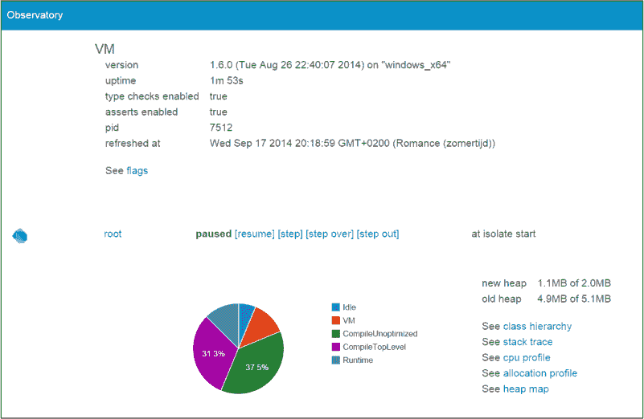
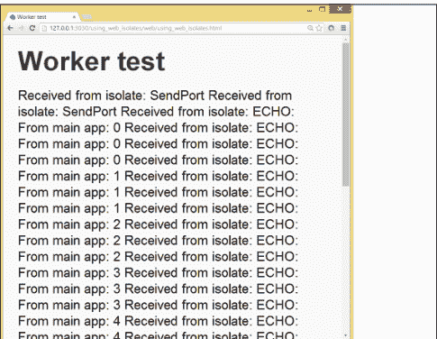
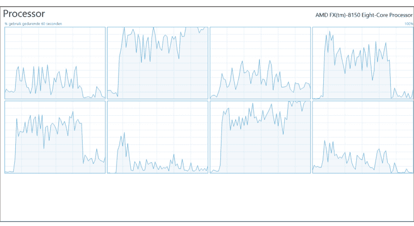

## 使用 Futures、Tasks 和 Isolates

在本章中，我们将介绍以下配方：

- 编写游戏循环
- 使用 Futures 进行错误处理
- 使用 Futures 调度任务
- 运行重复函数
- 在 Dart VM 中使用 isolates
- 在 Web 应用中使用 isolates
- 使用 isolates 使用多个核心
- 使用 Worker Task 框架

### 引言

来自 `dart:async` 的 Future 类是 Dart 中所有异步编程的基础。实际上，Future 是一种被延迟的计算；它表示一个对象，其值将在未来的某个时间可用。它不是立即可用的，因为返回其值的函数依赖于某种输入/输出，因此本质上是不可预测的。以下是一些示例：耗时的计算、读取大型数据集、以及搜索多个网站。

## 使用 Futures、Tasks 和 Isolates

在前两章中，相当多的配方使用了 Futures；在 *Chapter 6, Working with Files and Streams* 中，我们有以下使用 Futures 的配方：

- 逐行读取和处理文件
- 以异步方式连接文件
- 下载文件

在上一章中，我们在以下配方中使用了 Futures：

- 制作 Web 服务器
- 在 Web 服务器上接收数据
- 使用套接字

在本章中，我们将集中讨论如何为 Futures 编写优雅的代码，并将它们的可能性与任务和 isolates 的执行相结合，以增强我们应用的性能。

Dart 以单线程运行，因此默认情况下只使用多核机器上的一个 CPU；如果您想要并发，必须使用 isolates。在本章的第二部分，您将找到有关 isolates 的配方，isolates 是 Dart 提供应用程序并发和并行性的机制。

## 编写游戏循环

在游戏应用中，屏幕的刷新率至关重要；它必须足够高，以确保令人愉快和逼真的游戏体验。刷新意味着定期重绘屏幕。本配方向您展示如何在应用中构建此功能。它在 `gameloop` 的代码中进行了说明，`gameloop` 是使用 Dzenan Ridzanovic 的 boarding 包的著名记忆游戏的简单版本。目标是足够快地点击以获得彩色方块的相同配对。通过运行 `game.html` 启动它（不要使用 pub serve 启动，选择 **Run** 然后 **Manage Launches**，在 **Pub Settings** 中取消选中 **use pub serve to serve the application**）。

## 如何做...

1. 游戏在 `game.dart` 的 `main()` 中开始（此处仅显示代码的相关部分）：

```
import'dart:async';
import'dart:html';
// ... other code
part'model/memory.dart';
part'view/board.dart';

main() {
  new Board(new Memory(4), querySelector('#canvas')).draw();
}
```

2. 在 Board 类的构造函数中，通过调用 window.animationFrame 启动游戏循环：

```
class Board extends Surface {
    // code left out

    Board(Memory memory, CanvasElement canvas) :
        this.memory = memory,
    super(memory, canvas) {
        // code left out
        querySelector('#canvas').onMouseDown.listen((MouseEvent e) {
        // code left out
        if (memory.recalled) { // game over
        new Timer(const Duration(milliseconds: 5000), ()
            =>memory.hide());
        }
        else if (cell.twin.hidden) {
        new Timer(const Duration(milliseconds: 800), ()
            =>cell.hidden = true);
        }
    });

    window.animationFrame.then(gameLoop);
}
```

3. 这是 gameLoop 方法本身：

```
void gameLoop(num delta) {
    draw();
    window.animationFrame.then(gameLoop);
}

void draw() {
    super.draw();
    if (memory.recalled) { // game over
    // code left out
    }
}
```

## 它是如何工作的...

在步骤 1 中，游戏通过实例化 Board 类的对象（来自 view/board.dart）并在其上调用 draw 方法来启动。在步骤 2 中，最重要的语句是构造函数中的最后一句，window.animationFrame.then(gameLoop);。

dart:html 中 Window 类的此方法返回一个 Future，该 Future 在窗口即将重绘之前完成，因此这是重绘屏幕的正确时间。

> 使用 `animationFrame` 来执行此操作，因为动画然后使用一致的帧率，因此看起来更流畅，并且它也在屏幕的刷新率下工作。不要使用 `Future` 或 `Timer` 来绘制帧；只有在必须为不支持 `animationFrame` 的浏览器编码时才使用 `Timer`！

这是在步骤 3 的回调方法 `gameloop` 中完成的；首先执行 `draw()`，然后执行 `window.animationFrame`，然后执行 `(gameLoop)`。因此，这递归地再次调用 `gameloop`。这样，我们可以确保动画会继续。

## 还有更多...

我们还看到 `dart:async` 中的类 `Timer` 是如何使用的。例如，在游戏结束条件（memory is recalled）下，彩色图案在 5 秒后通过以下 `Timer` 对象从视线中隐藏：

```
new Timer(const Duration(milliseconds: 5000), () =>memory.hide());
```

在此时间段之后，匿名回调函数 `() =>memory.hide()` 被执行。使用命名构造函数 `Timer.periodic` 并使用相同的参数来定期执行回调函数。

## 另请参阅

- 请参阅本章中的 *Running a recurring function* 配方以了解有关 `Timer` 类的更多信息

## 使用 Futures 进行错误处理

本配方向您展示了在处理 Futures 时如何全面处理错误。随附的代码 `future_errors.dart`（位于 `future_errors` 项目的 bin map 内）说明了不同的可能性；然而，这不是一个真正的项目，因此不打算按原样运行。

## 准备工作

当返回 `Future` 值的函数成功完成（在代码中由 `then` 信号表示回调）时，会执行回调函数 `handleValue`，它接收返回的值。如果发生错误条件，则回调 `handleError` 会处理它。假设此函数是 `getFuture()`，其结果为 `Future`，返回值为类型 `T`，那么这等同于以下代码：

```
Future<T> future = getFuture();
future.then(handleValue)
.catchError(handleError);

handleValue(val) {
    // processing the value
}

handleError(err) {
    // handling the error
}
```

有时高亮的代码也会写成如下形式，只是为了使返回值明确：

```
future.then( (val) =>handleValue(val) )
.catchError( (err) =>handleError(err) );
```

当没有返回值时，这也可以写成如下代码所示：

```
future.then( () =>nextStep() )
```

当返回值在代码中无关紧要时，可以用 `_` 代替该值，如以下代码所示：

```
future.then( (_) =>nextStep(_) )
```

但在任何情况下，我们更喜欢写简洁的代码，如下所示：

```
future.then(nextStep)
```

`then` 和 `catchError` 对象在被调用时被链接，但这并不意味着它们都会被执行。只有其中一个完全执行；将其与同步代码中的 try-catch 块进行比较。`catchError` 对象甚至可以捕获在 `handleValue` 中抛出的错误。

这是一个相当优雅的机制，但当代码变得稍微复杂一些时我们该怎么办？


```dart
print('happy end');
}
```

输出如下：

**happy end**

a

c

d

**Error occurred in b!**

- 下面的代码有助于捕获特定错误或多个错误：

  ```dart
  firstStep()
      .then((_) => secondStep())
      // more .then( steps )
      .catchError(handleArgumentError,
          test: (e) => e is ArgumentError)
      .catchError(handleFormatException,
          test: (e) => e is FormatException)
      .catchError(handleRangeError,
          test: (e) => e is RangeError)
      .catchError(handleException, test: (e) => e is Exception);
  ```

- 通常，你希望在异步处理无论成功还是出错后都执行一个清理方法。在这种情况下，使用 `whenComplete`：

  ```dart
  firstStep()
      .then((_) => secondStep())
      .catchError(handleError)
      .whenComplete(cleanup);
  ```

关于同步和异步错误的处理，假设我们想要调用一个函数 `mixedFunction`，其中包含对可能抛出异常的同步调用 `synFunc` 以及可能同样抛出异常的异步调用 `asyncFunc`，如下代码所示：

```dart
mixedFunction(data) {
  var var2 = new Var2();
  var var1 = synFunc(data);        // Could throw error.
  return var2.asyncFunc().then(processResult);  // Could throw error.
}
```

如果我们调用此函数 `mixedFunction(data).catchError(handleError);`，那么 `catchError` 无法捕获 `synFunc` 抛出的错误。为了解决这个问题，他们在 `Future.sync` 函数中调用，如下代码所示：

```dart
mixedFunction(data) {
  return new Future.sync(() {
    var var1 = synFunc(data);        // Could throw error.
    return var1.asyncFunc().then(processResult);  // Could throw error.
  });
}
```

这样，`catchError` 就可以捕获同步和异步错误。

### How it works...

在变体 1 中，`catchError` 将处理在任何已执行的步骤中发生的全部错误。对于变体 2，我们使用一个列表列出所有步骤。`Future.wait` 选项会正如其名称所示：它会等待所有步骤完成。但它们执行的顺序并不特定，因此可以并发运行。所有函数都在不等待任何特定函数完成的情况下被触发。当全部完成时，它们的返回值会被收集到一个列表中（此处称为 `val`）并可进行处理。同样，`catchError` 处理在任何步骤中可能发生的错误。

在发生错误的情况下，List 值不会被返回；我们看到，在 `wait_error` 的示例中，happy end 首先被打印，然后 a、c 和 d 完成，然后 b 的错误被捕获；如果 d 也抛出错误，则只会捕获 b 的错误。`catchError` 函数不知道错误发生在哪个步骤，除非该信息在错误中被明确传达。

与 catch 块中相同，我们也可以在 `catchError` 中使用其第二个可选的 `test` 参数来测试何时发生特定异常，在其中测试异常的类型。这在变体 3 中展示；请务必将对一般异常的测试作为最后一条子句。如果可能发生多种不同的异常并且我们希望对每种异常进行特定处理，此场景肯定会很有用。

类似于 try 语句中的可选 `finally` 子句，异步处理可以有一个 `whenComplete` 处理程序，如变体 4 中所示，无论是否有错误都会始终执行。将其用于清理和关闭文件、数据库、网络连接等。

最后，在变体 5 中，普通的 `catchError` 函数不起作用，因为它只能处理异步代码执行产生的异常。在这里使用 `Future.sync`，它能够返回同步和异步方法调用的结果或错误。

## Scheduling tasks using Futures

Dart VM 是单线程的，因此应用程序的所有代码都在一个线程中运行，也称为主 isolate。这是因为 `main()` 是 Dart 代码开始执行 isolate 的函数，因为 Dart 的并发模型基于作为独立进程的 isolate 之间交换消息。我们将在接下来的配方中深入讨论 isolate，但如果你的代码没有启动新的 isolate，则所有代码都在一个 isolate 中运行。但是，在这个 isolate 中，你可以同时运行大量异步代码片段（我们称之为任务）；它们以什么顺序执行，我们能否影响该顺序？事实证明，更好地理解 Dart 的事件循环和任务排队机制使我们能够做到这一点。本配方将阐明 Dart 的调度机制，并为任务的有序执行提供提示和建议。

### How to do it...

查看程序 `tasks_scheduling.dart`（任务按连续编号并按启动顺序编号）：

```dart
import 'dart:async';

main() {
  print('1) main task #1');
  scheduleMicrotask(() => print('2) microtask #1'));
  new Future.delayed(new Duration(seconds: 1),
      () => print('3) future #1 (delayed)'));
  new Future(() => print('4) future #2'));
  print('5) main task #2');
  scheduleMicrotask(() => print('6) microtask #2'));
  new Future(() => print('7) future #3'))
    .then((_) => print('8) future #4'))
    .then((_) => print('9) future #5'))
    .whenComplete(cleanup);
  scheduleMicrotask(() => print('11) microtask #3'));
  print('12) main task #3');
}

cleanup() {
  print('10) whenComplete #6');
}
```

以下屏幕截图显示了程序的输出，其顺序在下一节中解释：

```text
1) main task #1
5) main task #2
12) main task #3
2) microtask #1
6) microtask #2
11) microtask #3
4) future #2
7) future #3
8) future #4
9) future #5
10) whenComplete #6
3) future #1 (delayed)
```

### How it works...

主 isolate 按如下方式进行：

1. 首先按行逐行同步执行 `main()` 中的代码。
2. 然后事件循环机制启动，它按以下顺序查看系统中的两个队列：
   - 首先，它查看微任务队列。此队列用于需要在事件队列之前执行的所有任务，例如在 DOM 开始渲染修改后的屏幕之前必须内部完成的变化。此队列中的所有任务在进入下一步之前都会被执行。
   - 然后，处理事件队列。这里安排了所有外部事件的任务，例如鼠标事件、绘制事件、I/O、Dart isolate 之间的消息等。当然，在每个队列中，任务都按先进先出顺序逐一处理。

> 在事件循环处理微任务队列时，事件队列不会被处理，因此应用程序无法绘制或响应用户事件，看起来实际上被阻塞了。因此，请尽可能保持微任务队列尽可能短。最好将你的任务放在事件队列上。

原则上，当两个队列都为空时，应用程序可以退出。任务（这些是要稍后异步运行的代码片段）可以使用来自 `dart:async` 的以下类和方法进行调度：

1. 使用函数创建一个新的 `Future` 对象以执行；这会附加到事件队列。
2. 使用 `Future.delayed`，你可以指定在特定持续时间后执行函数；这也进入事件队列。
3. 调用顶级 `scheduleMicrotask()` 函数，该函数将项目附加到微任务队列。

> 不要使用 `Timer` 类来调度任务；此类没有捕获异常的设施，因此计时器任务中的错误会使你的应用程序崩溃。

在 `then` 语句系列中链接 Futures 有效地确保它们按该顺序执行（参见上一配方步骤 1）。此外，`whenComplete` 子句将在所有之前的 `then` 语句之后立即执行。

因此执行顺序是：`main()`，然后是微任务队列，然后是事件队列，然后是延迟任务。

> 作为一般最佳实践，不要将计算密集型任务放在任一队列上，而是在单独的 isolate 中创建该任务（或 Web 应用程序的工作线程）。

### See also

- 查看本章中关于 isolate 的后续配方，例如 *Using isolates in web apps* 和 *Using multiple cores with isolates*

## Running a recurring function

假设你的代码需要以一定的间隔定期运行某个函数。本配方展示了如何非常轻松地做到这一点。

### How to do it...

查看以下 `recurring_function.dart` 的代码：

```dart
import 'dart:async';
var count = 0;
```


```
const TIMEOUT = const Duration(seconds: 5);
const MS = const Duration(milliseconds: 1);

void main() {
  // 1. Running a function repeatedly:
  const PERIOD = const Duration(seconds:2);
  newTimer.periodic(PERIOD, repeatMe);
  // 3. Running a function once after some time:
  const AFTER70MS = const Duration(milliseconds:70);
  new Timer(AFTER70MS, () => print('this was quick!'));
  // 4. Running a function asap:
  Timer.run(() => print('I ran asap!'));
  // 5. Calculating a period and provoking a timeout:
  startTimeout(500);
}

repeatMe(Timer t) {
  print("I have a repetetive job, and I'm active is ${t.isActive}!");
  count++;
  // 2. Stop the repetition:
  if (count==4 &&t.isActive) {
    t.cancel();
    print("I'm active is ${t.isActive} now");
  }
}

startTimeout([int variableMS ]) {
  var duration = variableMS == null ? TIMEOUT : MS * variableMS;
  return new Timer(duration, handleTimeout);
}

handleTimeout() {
  print('I was timed out!');
}
```

The following is the output from this code; if you need help figuring out the order, read the next section:

**I ran asap!**

**this was quick!**

**I was timed out!**

**I have a repetetive job, and I'm active is true!**

I have a repetitive job, and I'm active is true!

I have a repetitive job, and I'm active is true!

I have a repetitive job, and I'm active is true!

I'm active is false now

## How it works...

The `Timer` class from `dart:async` gives us this functionality through the `periodic` named constructor as shown in comment 1. This takes two arguments, a `Duration` object and a function (here `repeatMe`) to run, which has the timer as the single parameter. This comes in handy to stop the repetition, which is shown in comment 2 with the `cancel()` method after 4 repetitions. The `isActive` property can be used to test whether the repetition is still going on. Comment 3 shows how to run a function only once after a time interval; just use the normal `Timer` constructor with the same arguments, but the callback doesn't have a `Timer` parameter. To run a function as soon as the event-loop mechanism permits, use the static `run` method as shown in comment 4. A negative or zero duration is equivalent to calling `run`. Comment 5 shows that a `Timer` class can also be useful to stop a running function or even the entire app.

## There's more...

The durations or periods don't have to be constant from the start; they can be calculated before starting the `Timer`. Timers can also be used in web applications, but for drawing purposes, use `window.animationFrame`. When your app is compiled to JavaScript, the finest time granularity that the browser can give you is 4 milliseconds.

## See also

- Refer to the *Writing a game-loop* recipe in this chapter for more information on `window.animationFrame`
- Refer to the *Exiting from an app* recipe in *Chapter 2, Structuring, Testing, and Deploying an Application*, for other alternatives to stop a running app

## Using isolates in the Dart VM

Dart code runs in a single thread, in what is called a single process or isolate. In the standalone Dart VM, all code starts from `main()` and is executed in the so-called `root` isolate. To make an app more responsive or to increase its performance, you can assign parts of the code to other isolates. Moreover, because there are no shared resources between isolates, isolating third-party code increases the application's overall security. A Dart server app or command-line app can run part of its code concurrently by creating multiple isolates. If the app runs on a machine with more than one core or processor, it means these isolates can run truly in parallel. When the root isolate terminates the Dart VM exits and, with it, all isolates that are still running. Dart web apps currently can't create additional isolates, but they can create workers by adding instances of the `dart:html Worker` class, thereby adding JavaScript Web workers to the web app. In this recipe, we show you how to start up a new isolate from the main isolate and how to communicate with it using ports.

## How to do it...

Examine the code in `using_spawn.dart` to create isolates with `spawn`, as shown in the following code:

```
import 'dart:async';
import 'dart:isolate';

main() {
  // 1- make a ReceivePort for the main isolate:
  var recv = new ReceivePort();
  // 2- spawn a new isolate that runs the code from the echo
  // function
  // and pass it a sendPort to send messages to the main isolate
  Future<Isolate> remote = Isolate.spawn(echo, recv.sendPort);
  // 3- when the isolate is spawned (then), take the first message
  remote.then((_) => recv.first).then((sendPort) {
    // 4- send a message to the isolate:
    sendReceive(sendPort, "Do you hear me?").then((msg) {
      // 5- listen and print the answer from the isolate
      print("MAIN: received $msg");
      // 6- send signal to end isolate:
      return sendReceive(sendPort, "END");
    }).catchError((e) => print('Error in spawning isolate $e'));
  });
}

// the spawned isolate:
```

```
```dart
void echo(sender) {
  // 7- make a ReceivePort for the 2nd isolate:
  var port = new ReceivePort();
  // 8- send its sendPort to main isolate:
  sender.send(port.sendPort);
  // 9- listen to messages
  port.listen((msg) {
    var data = msg[0];
    print("ISOL: received $msg");
    SendPort replyTo = msg[1];
    replyTo.send('Yes I hear you: $msg, echoed from spawned isolate');
    // 10- received END signal, close the ReceivePort to save
    // resources:
    if (data == "END") {
      print('ISOL: my receivePort will be closed');
      port.close();
    }
  });
}

Future sendReceive(SendPort port, msg) {
  ReceivePort recv = new ReceivePort();
  port.send([msg, recv.sendPort]);
  return recv.first;
}
```
```

This script produces the following output:

**ISOL: received [Do you hear me?,SendPort]**

**MAIN: received Yes I hear you: [Do you hear me?,SendPort], echoed from spawned isolate**

**ISOL: received [END, SendPort]**

**ISOL: my receivePort will be closed**

From the output, we see that the main isolate receives its message echoed back from the second isolate. Examine the code in `using_spawnuri.dart` to create isolates with `spawnUri`:

```
```dart
import 'dart:async';
import 'dart:isolate';

main() {
  var recv = new ReceivePort();
  Future<Isolate> remote =
```

```
Isolate.spawnUri(Uri.parse("echo.dart"),
["Do you hear me?"], recv.sendPort);
remote.then((_) =>recv.first).then((msg) {
print("MAIN: received $msg");
});
}
```

The following is the code from echo.dart:

```
import 'dart:isolate';

void main(List<String>args, SendPort replyTo) {
  replyTo.send(args[0]);
}
```

The following is the output:

**MAIN: received Do you hear me?**

## How it works...

Isolates are defined in their own library called dart:isolate. They conform to the well-known actor-model: they are like separate little applications that only communicate with each other by passing asynchronous messages back and forth; in no way can they share variables in memory. The messages get received in the order in which you send them. Each isolate has its own heap, which means that all values in memory, including global variables, are available only to that isolate. Sending messages, which comes down to serializing objects across isolates, has to obey certain restrictions. The messages can contain only the following things:

- Primitive values (null, bool, num, double, and String)
- Instances of SendPort
- Lists and maps whose elements are any of these

When isolates are created via spawn, they are running in the same process, and then it is also possible to send objects that are copied (currently only in the Dart VM).

An isolate has one ReceivePort to receive messages (containing data) on; it can listen to messages. Calling the sendport getter on this port returns SendPort. All messages sent through SendPort are delivered to the ReceivePort they were created from. On SendPort, you use the send method to send messages; a ReceivePort uses the listen method to capture these messages.

For each ReceivePort port there can be many SendPort. A ReceivePort is meant to live for as long as there is communication, don't create a new one for every message. Because Dart does not have cross-isolate garbage collection, ReceivePort is not automatically garbage-collected when nobody sends messages to them anymore.


Isolates 开始时通过交换 SendPort 来实现通信。两种方法都返回一个包含 isolate 的 Future，或者类型为 IsolateSpawnException 的错误，必须捕获。这可以通过链式调用 catchError 子句或使用 spawn 的可选 onError 参数来完成。然而，在已启动的 isolate 中发生的错误无法被主 isolate 捕获，这很合理，因为两者都是独立执行的代码集。你可以通过运行 isolates_errors.dart 来自行验证。使用 spawn 和 spawnUri 时请注意以下限制：

- Spawn 在服务器应用中有效，但在 Dart Web 应用中无效。浏览器的主 isolate，DOM isolate，不允许这样做。这是为了防止对 DOM 的并发访问。
- 然而，spawnUri 在 Dart Web 应用和服务器应用中都有效，并且由此产生的 isolate 本身也可以启动其他 isolate。Dart VM 将这些 isolate 转换为 Web Worker（请参阅 http://www.html5rocks.com/en/tutorials/workers/basics/）。

### There's more....

因此，如果你需要在应用内运行一个计算密集型任务，为了保持应用的响应性，你应该将该任务放入自己的 isolate 或 worker 中。如果有许多此类任务，那么应该部署多少个 isolate？一般来说，当任务是计算密集型时，你应该使用与预期可用的核心或处理器数量一样多的 isolate。纯计算的额外 isolate 是冗余的。但如果其中一些还执行异步调用（例如 I/O），那么它们不会使用太多处理器时间。在这种情况下，拥有比处理器更多的 isolate 是有意义的；一切都取决于你的应用架构。在极端情况下，你可以为每个功能使用一个单独的 isolate，或确保数据不被共享。


> 始终对你的应用进行基准测试，以检查 isolate 数量是否已针对任务进行了优化。你可以按如下方式进行：在 Run Manage Launches 工具中，勾选 VM 设置中的选项，pause isolate on start，以及 pause isolate on exit。然后，通过 Dart Editor 左侧的图像按钮打开 observatory 工具到终止的红色方块，在那里你可以找到有关分配和性能的有趣信息。



如第二个示例所示，`spawnUri` 提供了一种在运行时动态加载和执行代码（甚至可能是整个库）的方法。不要混淆 Futures 和 isolates；它们是不同的，并且应用方式也不同。

- Isolate 用于你希望某些代码真正并行运行的情况，例如一个迷你程序与你的主程序分开运行。你向 isolate 发送消息，并且可以从 isolate 接收消息。每个 isolate 都有自己的事件循环。
- Future 用于你希望在事件循环中稍后某个值可用时得到通知的情况。仅仅要求 Future 运行一个函数并不会使该函数并行运行。它只是将函数安排到事件循环中以便在稍后时间运行。

目前，isolates 在 Erlang 进程的意义上并不非常轻量级，在 Erlang 中，每个进程仅消耗少量内存（数量级为 Kb）。将 isolates 演进到这一理想状态是 Dart 团队的长期目标。此外，isolates 内的异常处理和调试有点粗糙或困难；预计这种情况会改变。isolates 如何映射到操作系统实体（如线程或进程）也没有指定；这可能取决于环境和平台。isolates 尚未扩展到跨 VM 通信。

> 当服务器上运行两个 Dart VM 时，最好使用 TCP sockets 进行通信。你可以启动 ServerSocket 来监听传入请求，并使用 Socket 连接到另一台服务器。

### See also

- 请参阅 *Using isolates in web apps* 配方，了解另一个使用 `spawnUri` 的示例。在 *Using multiple cores with isolates* 配方中可以找到另一个 isolates 的示例。
- 请参阅下一章的 *Using Sockets* 配方，了解有关 `Sockets` 和 `ServerSockets` 的更多信息。
- 请参阅 *Chapter 2, Structuring, Testing, and Deploying an Application* 中的 *Profiling and benchmarking your app* 配方，了解有关基准测试的更多信息。

## Using isolates in web apps

在本配方中，你将学习如何在项目 `using_web_isolates` 的 Web 应用中使用 isolates。此示例在嵌入浏览器的 Dart VM 中运行，以及编译为 JavaScript。在后一种情况下，它使用 HTML5 Web workers，在后台独立于其他脚本运行，而不影响页面的性能。

### How to do it...

`using_web_isolates.dart` 中的主 isolate 运行以下代码：

```dart
import 'dart:isolate';
import 'dart:html';
import 'dart:async';

main() {
  Element output = querySelector('#output');
  SendPort sendPort;
  ReceivePort receivePort = new ReceivePort();
  receivePort.listen((msg) {
    if (sendPort == null) {
      sendPort = msg;
    } else {
      output.text += 'Received from isolate: $msg\n';
    }
  });

  String workerUri = 'worker.dart';
  int counter = 0;
  // start 3 isolates:
  for (int i = 1; i <= 3; i++) {
    Isolate.spawnUri(Uri.parse(workerUri), [], receivePort.sendPort).
      then((isolate) {
        print('isolate spawned');
        new Timer.periodic(const Duration(seconds: 1), (t) {
          sendPort.send('From main app: ${counter++}');
          if (counter == 10) {
            sendPort.send('END');
            t.cancel();
          }
        });
      });
  }
}
```

以下是 isolate worker.dart 的代码：

```dart
import 'dart:isolate';

main(List<String> args, SendPort sendPort) {
  ReceivePort receivePort = new ReceivePort();
  sendPort.send(receivePort.sendPort);

  receivePort.listen((msg) {
    if (msg == 'END') receivePort.close();
    sendPort.send('ECHO: $msg');
  });
}
```

以下是 Web 页面上显示的输出：



Isolates in a web app

我们看到来自三个 isolates 的消息传入。在计数到 10 时，计时器停止，并且 isolates 收到关闭消息。

### How it works...

主 isolate 首先设置一个 ReceivePort 和对 isolates 的监听器。此监听器首先捕获 isolate 的 sendPort，然后将每条消息附加到 Web 页面上。Web 应用中的 isolate 必须使用 spawnUri 启动；代码位于脚本 worker.dart 中。然后根 isolate 启动一个计时器，并每秒发送已过去的秒数。10 秒后，计时器被取消，并发送 END 消息。

我们启动了三个 isolate，每个都执行相同的代码。isolates 代码中的 main 方法将其第一个参数接收为 List<String> args。这来自 spawnUri 的第二个参数；这是主 isolate 向 isolate 发送初始数据的一种方式，但这里它是空列表。每个 isolate 首先设置其 ReceivePort，并将其 sendPort 发送给主 isolate，以便建立通信线路。然后，它开始监听并回显收到的内容。isolate 在收到 END 消息时退出。使用 dart2js 编译为 JavaScript 时，.js 会自动添加到脚本名称 worker.dart 的末尾。

### See also

- 请参阅 Using isolates in the Dart VM 配方，了解有关 isolates 的一般解释。

## Using multiple cores with isolates

在本配方中，我们向你展示 Dart VM 在无需向 VM 指定任何内容的情况下使用处理器上的多个核心。这比 Dart 应用只能使用一个处理器时能提供更好的性能和吞吐量。

### How to do it...

查看以下项目 using_isolates 中 many_cores.dart 的代码：

```dart
import 'dart:isolate';

main() {
  int counter = 0;
  ReceivePort receivePort = new ReceivePort();
  receivePort.listen((msg) {
    if (msg is SendPort) {
      msg.send(counter++);
    } else {
      print(msg);
    }
  });

  // starting isolates:
  for (var i = 0; i < 5; i++) {
    Isolate.spawn(runInIsolate, receivePort.sendPort);
  }
}

// code to run isolates
runInIsolate(SendPort sendPort) {
  ReceivePort receivePort = new ReceivePort();
  // send own sendPort to main isolate:
  sendPort.send(receivePort.sendPort);

  receivePort.listen((msg) {
    var k = 0;
    var max = (5 - msg) * 50000000;
    for (var i = 0; i < max; ++i) {
      i = ++i - 1;
      k = i;
    }
  }
}
```


## 使用 Future、任务与 Isolate

```
sendPort.send("I received: $msg and calculated $k");
});
}
```

过了一段时间后，计算结果如下所示：

**我收到：4 并计算出 499999999**

**我收到：3 并计算出 999999999**

**我收到：2 并计算出 1499999999**

**我收到：1 并计算出 1999999999**

**我收到：0 并计算出 2499999999**

以下是在一台八核机器上 CPU 活动情况的截图。可以清楚地看到，有四个核心正忙于运行与前文 for 循环中派生的四个 isolate 对应的 isolate：



使用 isolate 进行多核处理

### 工作原理...

主 isolate 和其他 isolate 做的第一件事是创建自己的 ReceivePort。这些 isolate 运行 runInIsolate 中的代码，并获取用于发送结果的端口。请看以下命令：

```
Isolate.spawn(runInIsolate, receivePort.sendPort);
```

这些 isolate 将自己`sendPort`发送给`main`。主 isolate 在其端口上监听；当它收到`sendPort`时，它向该 isolate 发送一个整数计数器：

```
if (msg is SendPort) {
  msg.send(counter++);
  // other code
}
```

这些 isolate 会持续监听，直到收到计数器值，然后开始长时间运行的计算。计算完成后，结果被发送到根 isolate 并显示出来。程序永远不会停止，因为 `main` 中的 `ReceivePort` 从未被关闭。

## 使用 Worker Task 框架

`isolate` 库只为我们提供了底层的基本构建模块，因此在真实的应用环境中使用 isolate 可能会很有挑战性。正是为此目的，Diego Rocha 开发了 worker 并发任务执行器框架，可通过 pub 包管理器获取。它旨在抽象所有 isolate 管理和消息传递，使 Dart 中的并发尽可能简单。Worker 还内置了错误处理，因此你也无需担心这方面。本小节将展示如何使用此框架，以便你可以专注于更高级别的应用程序细节。

### 操作步骤...

在项目 `using_worker` 中，你可以找到多个程序（`using_worker1` 到 `using_worker4`），它们演示了此框架的用法。脚本 `using_worker.dart` 演示了主要步骤，即创建任务、创建 worker、将任务交给 worker 并处理结果：

```
import 'package:worker/worker.dart';

Worker worker;

void main() {
  // 1- Make a Task object:
  Task task = new HeavyTask();
  // 2- Construct a Worker object:
  worker = new Worker();
  // specifying poolSize and spawning lazy isolates or not:
  // worker = new Worker(poolSize: noIsol, spawnLazily: false);
  // 3- Give a task to the worker
  // 4- when the results return, process them
  worker.handle(task).then(processResult);
}

// 5- Task custom class must implement Task interface
class HeavyTask implements Task {
  execute() {
    return longRunningComputation();
  }

  bool longRunningComputation() {
    var stopWatch = new Stopwatch();
    stopWatch.start();
    while (stopWatch.elapsedMilliseconds < 1000);
    stopWatch.stop();
    return true;
  }
}

processResult(result) {
  print(result);
  // process result
  // 4- Close the worker object(s)
  worker.close();
}
```

### 工作原理...

首先，将包 `worker` 添加到 `pubspec.yaml`，并在代码中导入它。任务（Task）是需要执行的事情。它是库中的一个抽象类，为任务提供接口，并规定你的自定义 Task 类必须实现 `execute` 方法，该方法返回一个结果。在我们的脚本中，自定义 Task 是 `HeavyTask`，`execute` 使用 `Stopwatch` 类模拟长时间运行的计算。

worker 对象会创建并管理一个包含若干（`poolSize` 个）isolate 的池子，为你提供一种并发执行阻塞任务的简便方式。它会在需要执行任务时惰性派生 isolate；这些派生出的 isolate 存在于名为 `isolates` 的队列中。当前活跃的 isolate 存储在名为 `workingIsolates` 的可迭代对象中，而空闲的 isolate 可以从名为 `availableIsolates` 的可迭代对象中获取。

用 isolate 的语言来说，会发生以下情况：当创建一个 `Worker` 实例时，它会开始监听当前 isolate 的 `ReceivePort`，并创建一个 isolate 池。该池中的 isolate 用于处理交给 worker 的任何任务。当任务被交给 worker 处理时，它会返回一个 `Future`。这个 `Future` 只有在任务执行完成或执行失败时才会完成。
