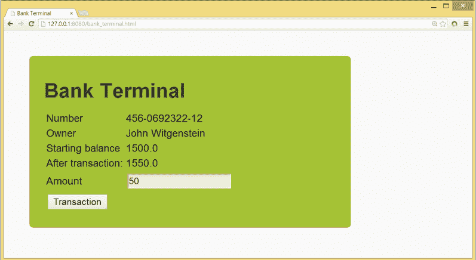
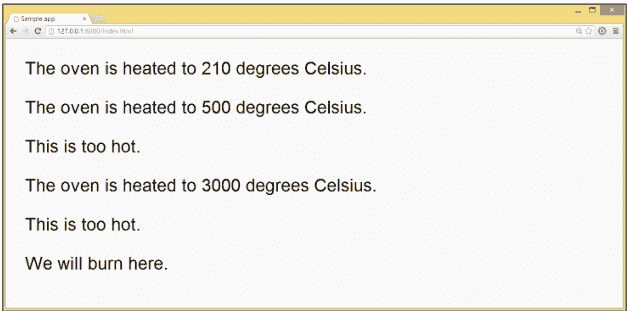
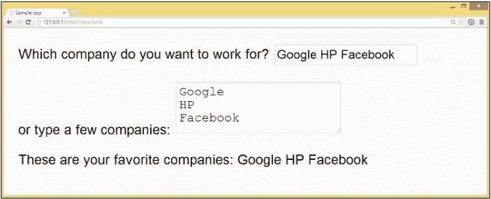
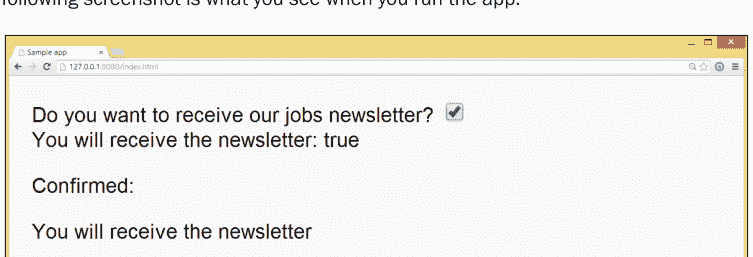
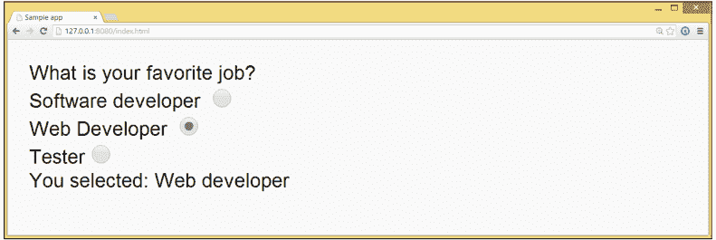
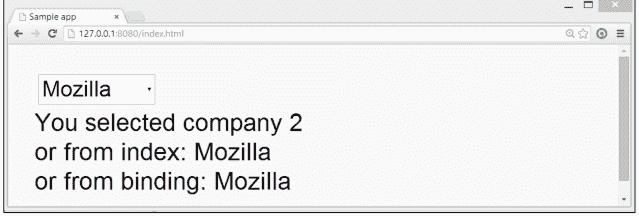
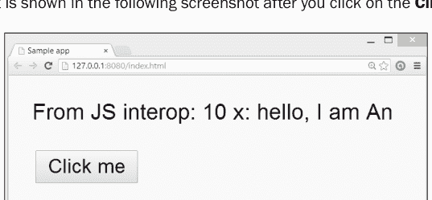
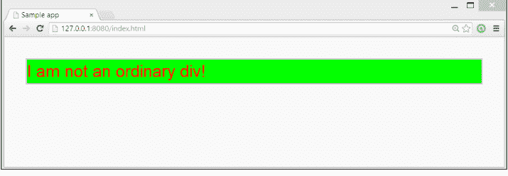
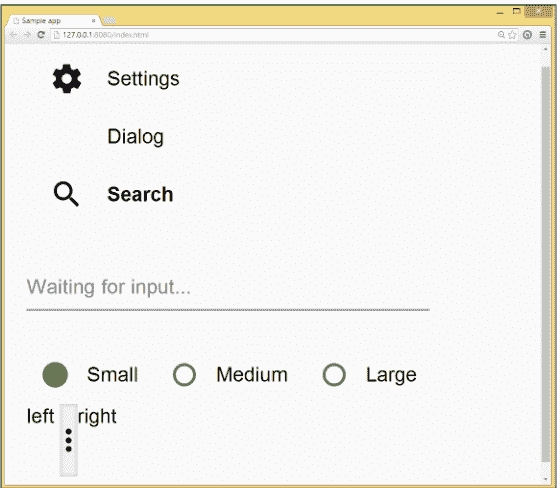
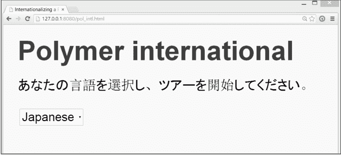

## 10

## Polymer Dart 菜谱

在本章中，我们将介绍以下内容：

- 使用 polymer.dart 进行数据绑定
- 绑定并重复列表
- 绑定到映射
- 使用自定义属性和模板条件
- 绑定到输入文本框或文本区域
- 绑定到复选框
- 绑定到单选按钮
- 绑定到所选字段
- 事件处理
- 使用 JavaScript 互操作的 Polymer 元素
- 扩展 DOM 元素
- 使用自定义元素
- 自动节点查找
- 国际化 Polymer 应用



## 操作步骤...

执行以下步骤，使用 polymer.dart 进行数据绑定：

- 1. 首先，在 pubspec.yaml 文件中添加 polymer: ">=0.11.0 <0.12.0" 依赖，安装 polymer 包。在编辑器中保存文件，并在命令行中运行 pub get。这需要搭配一个 import 语句；在 web\bank_app.dart 中，我们使用 import 'package:polymer/polymer.dart'; 但也要在 web\bank_app.html 中，以 <link rel="import"> 标签作为第一行。
- 2. 另外，在该文件中，你必须在 transformers 部分指定一个或多个应用执行起点，如下面的代码所示：
```
transformers:
  - polymer:
    entry_points:
      - web/bank_terminal.html
      - web/index.html
```
- 3. 应用的根目录包含一个 build.dart 文件，内容如下：

```dart
import 'package:polymer/builder.dart';

main() {
  build(entryPoints: ['web/bank_terminal.html']);
}
```

- 4. 入口点 bank_terminal.html 必须在 <head> 区域中包含 <script> 和 <link> 标签，顺序如下：

```html
<script src="packages/web_components/platform.js"></script>
<script src="packages/web_components/dart_support.js"></script>
<!-- import the bank-app custom element -->
<link rel="import"href="bank_app.html">
<script type="application/dart">export 'package:polymer/init.dart';</script>
<script src="packages/browser/dart.js"></script>
```

- 5. 在同一个入口文件的 <body> 区域中，实例化名为 bank-app 的 Polymer 组件：

```html
<bank-app></bank-app>
```

- 6. 该组件在 bank_app.html 中定义如下：

```html
<link rel="import"href="packages/polymer/polymer.html">
<polymer-element name="bank-app">
<style>
.auto-style1 {
  width: 25%;
  border: 1px solid #0000FF;
}

.auto-style2 {
  width: 107px;
}

.btns {
  width: 127px;
}

.red {
  color: red;
}
</style>
<template>
```


```
attached() {
  super.attached();
  var jw = new Person("John Witgenstein");
  bac = newBankAccount(jw, "456-0692322-12", 1500.0);
  balance = bac.balance;
}

transact(Event e, var detail, Node target) {
  InputElement amountInput = shadowRoot.querySelector("#amount");
  if (!checkAmount(amountInput.value)) return;
  bac.transact(amount);
  balance = bac.balance;
}

enter(KeyboardEvent e, var detail, Node target) {
  if (e.keyCode == KeyCode.ENTER) {
    transact(e, detail, target);
  }
}

checkAmount(String in_amount) {
  try {
    amount = double.parse(in_amount);
  } onFormatException catch(ex) {
    return false;
  }
  return true;
}
```

## 它是如何工作的...

步骤 1 中聚合物依赖项的实际数字可能会有所不同，但由于版本之间的变化仍然可能很显著，因此最好在此处使用明确的版本而不是其他任何版本，以免破坏你的应用；你可以在充分测试后准备好时再升级它。步骤 3 中的 build.dart 脚本可确保在项目中的文件被保存时项目会被构建。步骤 4 中的 <link> 标签导入了位于 bank_app.html 中的 Polymer 元素 bank-app。platform.js 和 dart_support.js 文件包含所谓的平台 polyfill；这是使诸如自定义元素、shadow DOM、template 元素和 HTML imports 等新网络标准得以工作的 JavaScript 代码。它们被称为 polyfill，因为在后期阶段浏览器应该为这些标准提供原生代码。init.dart 脚本启动 polymer.dart，而 dart.js 会检查是否有可用于直接运行代码的 Dart VM。如果不是这种情况，应用将从编译后的 JavaScript 代码运行。步骤 5 使用 Polymer 元素的名称作为 HTML 标签。

步骤 6 包含 Polymer 组件的 HTML 代码。它在 <polymer-element> 标签之间定义其样式（在 <style> 标签中）和结构（在 <template> 标签内）；其起始标签将组件的名称作为属性，即 name="bank-app"。我们可以看到如何通过 polymer 表达式的 {{ ... }} 语法实现单向数据绑定，例如 <td>{{bac.number}}</td> 或 <td>{{bac.owner.name}}</td>。花括号之间的点代表代码中的一个变量，其值会在网页的该位置显示。在代码中，这些变量用 @published.Event 进行注解。交互是通过声明式的 on-event = "{{ ... }}" 处理器实现的，例如按钮中的 on-click="{{transact}}"。这里，点代表当事件发生时要执行的代码中的方法名称。在 <template> 之后，伴随的 Dart 脚本 bank_app.dart 通过 <script> 标签引用。

最后，在步骤 7 中，我们得到了为我们的 Polymer 组件提供支持的 Dart 类，并看到 BankApp 类扩展了 PolymerElement；其类继承自 PolymerElement。类声明必须以 @CustomTag('bank-app') 注解为前缀，以将其与 Polymer 组件关联。需要在网页上可视化的变量用 @observable 进行注解。

重写自定义元素生命周期方法，例如 attached，以执行组件特定的代码。该方法在元素插入 DOM 时执行；因此它是初始化应用的好地方。必须为你的组件提供 created 命名构造函数。构造函数或任何重写的方法必须首先调用超类构造函数或方法。transact 或 enter 方法展示了事件处理程序的签名，enter(KeyboardEvent e, var detail, Node target)。transact 方法展示了如何在我们的 Polymer 组件中获取输入元素的值；使用 shadowRoot.querySelector 方法。在检查输入金额的格式后，bank_terminal 库中类 BankAccount 的 transact 方法会更改 bac 对象的状态。

Polymer 组件的名称必须包含至少一个连字符（-）。注意命名方案；如果 Polymer 组件的名称是 pol-comp1：

- 然后它在 HTML 代码中被引用为 < pol-comp1>
- 它在文件 pol_comp1.html 和 pol_comp1.dart 中定义
- 其类名是 Polcomp1

## 还有更多...

Polymer 组件也可以通过代码动态添加，而不是在页面的 HTML 中静态声明。假设你想在 ID 为 add-comp1 的 <div> 标签中添加一个名为 pol-comp1 的组件。你可以用以下代码实现：

```
querySelector('#add-comp1').children.add(new Element.tag('pol-comp1'));
```

在步骤 3 中，你可以通过替换该行来调用 linter 而不是普通的构建，如以下代码所示：

```
main(args) {
  lint(entryPoints: ['web/index.html'], options: parseOptions(args));
}
```

这将在你的代码中显示更广泛的语法或使用警告。

## 绑定和对列表进行重复

在本教程中，我们展示了如何将列表的数据显示在 Polymer 组件中。因此，我们在此处以及以下教程中也执行了从代码到 UI 的数据绑定。你可以在项目 databinding_list 中找到本教程的代码。

## 如何操作...

- 1. 脚本从 web\index.html 开始，其中一个名为 pol-list 的组件通过以下行导入：
  <link rel="import"href="pol_list.html">
  
  由此我们知道组件在 pol_list.html 中定义，其背后的代码在名为 pol_list.dart 的文件中。对于其他标签的讨论，请参阅之前的教程。

- 2. 我们在文件 pol_list.dart 中定义了一个我们想要显示的公司列表：

```
import 'dart:html';
import 'package:polymer/polymer.dart';

@CustomTag('pol-list')
class Pollist extends PolymerElement {
  final List companies = toObservable(['Google', 'Apple', 'Microsoft', 'Facebook']);

  Pollist.created() : super.created() {
    companies.add('HP');
  }

  addcompanies(Event e, var detail, Node target) {
    companies.add('IBM');
    companies.add('Dell');
  }
}
```

## 它是如何工作的...

我们希望在页面上查看列表的内容；这在步骤 2 中通过使用 `polymer` 包中的 `toObservable` 函数成为可能。该函数将字面量 List 转换为 ObservableList（`@observable` 不适用于列表或映射）。然而，列表在 created 事件中被更改，该事件在组件实例化时被调用。此外，`companies` 在按下按钮时也会被更改，该按钮调用方法 `addcompanies`。

步骤 3 展示了如何创建模板循环。`<template repeat="{{item in list}}"> content </template>` 语法意味着对于列表中的每个项目，模板内部的内容（这里是 `<li>` 标签）都会被渲染。

从上一个截图中显示的运行应用中，我们可以看到每当被观察的列表被更改时，这些更改都会反映在网页上。它还显示数据绑定语法 {{ }} 可以显示对象的属性（这里是列表的长度）。

## 还有更多...

相同的重复模板可以应用于每种集合类型，即实现 `Iterable` 的类型。

## 绑定到映射

在本教程中，我们展示了如何将映射的数据显示在 Polymer 组件中。你可以在项目 `databinding_map` 中找到代码。

## 如何操作...

- 1. 脚本从 web\index.html 开始，其中一个名为 pol-map 的组件通过以下行导入：

```
<link rel="import"href="pol_map.html">
```

从这段代码我们知道组件在 pol_map.html 中定义，其背后的代码在名为 pol_map.dart 的文件中。对于其他标签的讨论，请参阅第一个教程。

- 2. 我们在文件 pol_map.dart 中定义了一个我们想要显示的映射 companies：

```
import 'dart:html';
import 'package:polymer/polymer.dart';

@CustomTag('pol-map')
class Polmap extends PolymerElement {
Map companies = toObservable({1: 'Google', 2: 'Microsoft'});
```


## 工作原理...

我们想要在页面上查看 Map 的内容。在步骤 2 中，我们使用了 polymer 包中的 `toObservable` 函数来实现这一点。该函数将一个字面量 map 转换为 Observable map。然而，`Map companies` 在 `created` 事件中被修改，该事件在组件实例化时被调用。此外，点击按钮会调用 `addCompanies` 方法，从而修改 `companies`。

步骤 3 展示了如何使用 `<template repeat="{{key in companies.keys}}"> content </template>` 创建模板循环。

这意味着对于列表 `companies.keys` 中的每个键，都会渲染模板内的内容（此处为 `<p>{{key}}: {{companies[key]}}</p>`）。

我们同样可以使用 `companies.values`，或其他 map getter 和方法，如 `companies.length`。从运行中的应用（如前一个截图所示）可以看到，每当被观察的 map 发生变化时，这些变化都会反映在网页上。

## 另请参阅

- 请参阅本章中的“绑定并循环列表”方案，了解如何使用重复模板结构。

## 使用自定义属性和模板条件

在本方案中，我们将探讨 polymer.dart 的两个特性：

- **自定义属性**：类似于普通标签的 HTML 属性，这些属性用于你的 Polymer 组件，并且可以在代码中修改。
- **模板条件**：UI 可以通过 `<template if={{condition}}></template>` 形式的声明式条件来控制，其中条件是一个涉及被观察或已发布变量的表达式。

你可以在项目 `custom_attrib` 中找到相关代码。

## 如何操作...

在本例中，我们模拟一个烤箱，以温度作为其属性。我们以文本形式显示温度，并测试温度以显示相应的提示信息，如下面的截图所示：



自定义属性和模板条件

- 1. 脚本从 `web\index.html` 开始，其中通过以下行导入名为 `pol-oven` 的组件：
```
<link rel="import"href="pol_oven.html">
```
该组件在页面上使用了三次：
```
<body>
<pol-oven temperature="210"></pol-oven>
<pol-oven temperature="500"></pol-oven>
<pol-oven temperature="3000"></pol-oven>
</body>
```
从这段代码可知，组件定义在 `pol_oven.html` 中，其背后的代码位于名为 `pol_oven.dart` 的文件中。关于其他标签的讨论，请参阅第一个方案。

- 2. `pol-oven` 的代码定义在 `pol_oven.dart` 中：
```
import 'package:polymer/polymer.dart';

@CustomTag('pol-oven')
class Poloven extends PolymerElement {
  @published int temperature = 0;

  Poloven.created() : super.created() { }
}
```

- 3. 组件的结构在 `pol_oven.html` 中概述：
```
<link rel="import"href="packages/polymer/polymer.html">
<polymer-element name="pol-oven">
<template>
<p>The oven is heated to {{temperature}} degrees Celsius.  </p>
<template if="{{temperature > 400}}">
<p>This is too hot. </p>
</template>
<template if="{{temperature > 1000}}">
<p>We will burn here. </p>
</template>
</template>
<script type="application/dart" src="pol_oven.dart"></script>
</polymer-element>
```

## 工作原理...

在步骤 1 中，我们看到同一个组件 `pol-oven` 可以在同一页面上多次使用；每次出现都是该组件的不同实例。当然，也可以组合不同的组件，每次组件都包含具有不同值的 `temperature` 属性。

在步骤 2 中，展示了自定义属性必须使用 `@published` 注解；这意味着它不仅会被显示（并在更改时更新，这一点由 `@observable` 表示），而且是用于 polymer 标签的属性。

最后，在步骤 3 中，我们看到属性值被显示，同时还会根据求值条件的真假来显示一段 UI 代码。如果属性值在代码中发生变化，条件模板会自动重新求值，这可能会改变 UI。

## 另请参阅

- 请参阅本章中的“绑定到复选框”方案以获取另一个示例。

## 绑定到输入文本字段或文本区域

在本方案中，我们将向你展示如何将文本字段或文本区域中的输入值绑定到一个变量；因此，实际上我们现在从 UI 到代码执行数据绑定，并且拥有双向数据绑定。你可以在项目 `pol_text` 中找到相关代码。

## 如何操作...

- 1. 脚本从 `web\index.html` 开始，其中通过以下行导入名为 `pol-text` 的组件：
```
<link rel="import"href="pol_text.html">
```
由此可知，组件定义在 `pol_text.html` 中，其背后的代码位于名为 `pol_text.dart` 的文件中。关于其他标签的讨论，请参阅第一个方案。

- 2. `pol-text` 的代码定义在 `pol_text.dart` 中：
```
import 'package:polymer/polymer.dart';

@CustomTag('pol-text')
class Poltext extends PolymerElement {
  @observable String comps;

  Poltext.created() : super.created() { }
}
```

- 3. 组件的结构在 `pol_text.html` 中概述：
```
<link rel="import"href="packages/polymer/polymer.html">
<polymer-element name="pol-text">
<template>
<div>
Which company do you want to work for?
<input type="text" value="{{comps}}">
<p> or type a few companies:
<textarea value="{{comps}}"></textarea>
</p>
</div>
<div>
These are your favorite companies: {{comps}}
```
```
</div>
</template>
<script type="application/dart" src="pol_text.dart"></script>
</polymer-element>
```



## 工作原理...

简单文本字段或文本区域的输入（内容）通过表达式 `value = {{variable}}` 绑定到变量。它会显示在页面上的简单 `{{variable}}` 表达式中，同时也会立即反映在另一个输入字段中，这证明我们实现了双向数据绑定。

## 绑定到复选框

在本方案中，我们将向你展示如何将复选框的输入值绑定到变量；因此，实际上我们现在从 UI 到代码执行数据绑定，并拥有双向数据绑定。你可以在项目 `pol_check` 中找到相关代码。

## 如何操作...

- 1. 脚本从 `web\index.html` 开始，其中通过以下行导入名为 `pol-check` 的组件：

```html
<link rel="import" href="pol_check.html">
```

由此可知，组件定义在 `pol_check.html` 中，其背后的代码位于名为 `pol_check.dart` 的文件中。关于其他标签的讨论，请参阅第一个方案。

- 2. `pol-check` 的代码定义在 `pol_check.dart` 中：
```
import 'package:polymer/polymer.dart';
@CustomTag('pol-check')
class Polcheck extends PolymerElement {
  @observable bool receive = false;

  Polcheck.created() : super.created();
}
```

- 3. 组件的结构在 `pol_check.html` 中概述：
```
<link rel="import" href="packages/polymer/polymer.html">
<polymer-element name="pol-check">
<template>
<div>
Do you want to receive our jobs newsletter?
<input type="checkbox" checked="{{receive}}">
</div>
<div>
You will receive the newsletter: {{receive}}
<p>Confirmed:</p>
<template if="{{receive}}">You will receive the newsletter</template>
<template if="{{!receive}}">You will not receive the newsletter</template>
</div>
</template>
<script type="application/dart" src="pol_check.dart"></script>
</polymer-element>
```

运行应用时，你会看到以下截图：



复选框的双向绑定


# 工作原理...

在步骤3中，复选框的`checked`属性的值通过表达式`checked="{{receive}}"`绑定到变量`receive`。通过步骤2，该值会显示在页面上的简单`{{receive}}`表达式中，但同时也用于此处的模板条件判断。

## 另请参阅

- 有关模板条件判断的更多信息，请参阅本章中的*使用自定义属性和模板条件判断*小节。

## 绑定单选按钮

在本节中，我们将向你展示如何将单选按钮的输入值绑定到一个变量；因此，实际上我们现在执行从UI到代码的数据绑定，并实现双向数据绑定。你可以在项目`pol_radio`中找到相关代码。

## 操作步骤...

- 1. 脚本从`web\index.html`开始，通过以下行导入名为`pol-radio`的组件：

```html
<link rel="import"href="pol_radio.html">
```

由此可知，该组件定义在`pol_radio.html`中，其背后的代码位于名为`pol_radio.dart`的文件中。关于其他标签的讨论，请参阅第一个小节。

- 2. `pol-radio`的代码定义在`pol_radio.dart`中：

```dart
import 'dart:html';
import 'package:polymer/polymer.dart';

@CustomTag('pol-radio')
class Polradio extends PolymerElement {
  @observable String favoriteJob = '';

  Polradio.created() : super.created();

  void getFavoriteJob(Event e, var detail, Node target) {
    favoriteJob = (e.target as InputElement).value;
  }
}
```

3. 组件的结构在`pol_radio.html`中概述：

```
<link rel="import"href="packages/polymer/polymer.html">
<polymer-element name="pol-radio">
<template>
<div on-change="{{getFavoriteJob}}">
What is your favorite job?
<div>
<label for="sd">Software developer <input name="job" type="radio" id="sd" value="Software developer"></label>
</div>
<div>
<label for="wd">Web Developer <input name="job" type="radio" id="wd" value="Web developer"></label>
</div>
<div>
<label for="tt">Tester<input name="job" type="radio" id="tt" value="Tester"></label>
</div>
</div>
<div>
You selected: {{favoriteJob}}
</div>
</template>
<script type="application/dart" src="pol_radio.dart"></script>
</polymer-element>
```

运行应用时，你将看到以下截图：



## 工作原理...

在网页上（步骤3），我们看到三个单选按钮通过给它们的name属性赋予相同的值`name="job"`而被分组在一起。它们的值是字面字符串，可以将这些值传递给代码。这种连接之所以成立，是因为这些单选按钮被封装在一个带有change事件处理器的`<div>`标签中：

```html
<div on-change="{{getFavoriteJob}}">
```

步骤2中的`getFavoriteJob`方法将提取所选单选按钮的值，并将其赋值给变量`favoriteJob`：

```dart
favoriteJob = (e.target as InputElement).value;
```

该变量被定义为一个@observable，因此它会通过`{{favoriteJob}}`显示在页面上。

## 绑定选中的字段

在本节中，我们将向你展示如何将`<select>`标签中的选定值绑定到一个变量；因此，实际上我们现在执行从UI到代码的数据绑定，并实现双向数据绑定。我们展示一个公司列表。你可以在项目`pol_select`中找到相关代码。

## 操作步骤...

- 1. 脚本从`web\index.html`开始，通过以下行导入名为`pol-select`的组件：

```html
<link rel="import" href="pol_select.html">
```

由此可知，该组件定义在`pol_select.html`中，其背后的代码位于名为`pol_select.dart`的文件中。关于其他标签的讨论，请参阅第一个小节。

- 2. `pol-select`的代码定义在`pol_select.dart`中：

```dart
import'package:polymer/polymer.dart';

@CustomTag('pol-select')
class PolSelect extends PolymerElement {
  final List companies = toObservable(['Google', 'Apple',
    'Mozilla', 'Facebook']);
  @observable int selected = 2; // Make sure this is not null;
  // set it to the default selection index.
```

```
@observable String value = 'Mozilla';

    Polselect.created() : super.created();
}
```

- 3. 组件的结构在`pol_select.html`中概述：

```
<link rel="import"href="packages/polymer/polymer.html">
<polymer-element name="pol-select">
<template>
<select selectedIndex="{{selected}}" value="{{value}}">
<option template repeat="{{comp in companies}}"> {{comp}} </
option>
</select>
<div>
You selected company {{selected}} <br/>
or from index:  {{companies[selected]}} <br/>
or from binding: {{value}}
</div>
</template>
<script type="application/dart" src="pol_select.dart"></script>
</polymer-element>
```

运行应用时，你将看到以下截图：



使用select字段进行绑定

## 工作原理...

步骤2定义了要显示的公司列表。它还声明了要在List中选择的索引以及作为变量的value。步骤3展示了可以使用本章中“绑定并在列表上重复”小节中的重复模板来填充`<select>`标签。它还展示了selectedIndex属性是从代码中设置的。当选择另一家公司时，这也会改变selected和value的值。

## 事件处理

在本节中，我们将向你展示如何在Polymer组件中处理事件。你可以在项目`event_handling`中找到相关代码。

## 操作步骤...

- 1. 脚本从`web\index.html`开始，通过以下行导入名为`pol-select`的组件：

```html
<link rel="import" href="pol_events.html">
```

由此可知，该组件定义在`pol_events.html`中，其背后的代码位于名为`pol_events.dart`的文件中。关于其他标签的讨论，请参阅第一个小节。

- 2. `pol-events`的代码定义在`pol_events.dart`中：

```
import 'package:polymer/polymer.dart';

@CustomTag('pol-events')
class PolEvents extends PolymerElement {
  @observable String which_event = "no event";
  @observable String thing = "";
  @observable String message = "";

  PolEvents.created() : super.created();

  enter(KeyboardEvent e, var detail, Node target) {
    if (e.keyCode == KeyCode.ENTER) {
      which_event = "you pressed the ENTER key";
    }
  }

  btnClick(MouseEvent e, var detail, Node target) {
    message = (target as Element).attributes['data-msg'];
    which_event = "you clicked the button";
  }

  txtChange(Event e, var detail, Node target) {
    var inp = (target as InputElement).value;
    which_event = "you entered $inp in the text field";
  }

  cbClick(Event e, var detail, Node target) {
```

## 工作原理...

在步骤3中，我们看到许多事件处理器定义在不同的HTML元素中。它们都具有相同的形式，即`on-event={{nameOfHandler}}`。

在Dart Editor和大多数插件中，你可以通过按`Ctrl + Space bar`（在HTML标签内）来了解哪些标签可以处理哪些事件。记住在`on`和事件名称之间加连字符；`onevent`会在运行时抛出`ReferenceError`错误。

在步骤2中，我们看到许多不同的处理器；它们都具有相同的签名：

```
nameOfHandler(Event e, var detail, Node target) {
  // code to be executed when event occurs
}
```

`target`节点是触发事件的HTML节点。如果是`InputElement`，你可以用`varinp = (target as InputElement).value;`获取输入值；注意如何通过`message = (target as Element).attributes['data-msg'];`读取按钮的`data-msg`属性。

## 与JavaScript互操作的Polymer元素

在本节中，我们将向你展示如何在Polymer组件中使用JavaScript对象。你可以在项目`pol_js`中找到相关代码。

## 操作步骤...

- 1. 脚本从`web\index.html`开始，其中通过`<link rel="import"href="pol_js.html">`导入名为`pol-js`的组件，并通过`<pol-js></pol-js>`实例化。
由此可知，该组件定义在`pol_js.html`中，其代码位于名为`pol_js.dart`的文件中。关于其他标签的讨论，请参阅第一个小节。

- 2. `index.html`文件还包含一个JavaScript对象`person.js`：

```
function Person(name, gender) {
  this.name = name;
  this.gender = gender;
  this.greeting = function(otherPerson) {
    alert('I greet you ' + otherPerson.name);
  };
}
```

```
Person.prototype.sayHello = function(times) {
```


## Polymer 与 JavaScript 的互操作

```js
return times + ' x: hello, I am ' + this.name;
};
```

3. 组件的结构在 `pol_js.html` 中概述：

```html
<link rel="import" href="packages/polymer/polymer.html">
<polymer-element name="pol-js">
<template>
<p>From JS interop: {{result}} </p>
<p>
<button on-click="{{btnClick}}">Click me</button>
</p>
</template>
<script type="application/dart" src="pol_js.dart"></script>
</polymer-element>
```

4. `pol-js` 的代码在 `pol_js.dart` 中定义：

```dart
import 'dart:html';
import 'dart:js';
import 'package:polymer/polymer.dart';

@CustomTag('pol-js')
class PolJs extends PolymerElement {
  @observable String result;

  PolJs.created() : super.created();

  btnClick(Event e, var detail, Node target) {
    var pers1 = new JsObject(context['Person'], ['An', 'female']);
    result = pers1.callMethod('sayHello', [10]);
  }
}
```

点击 Click me 按钮后，你将得到以下截图中显示的内容：



### 如何工作...

在步骤 2 中 JavaScript 中（网页已知），定义了一个类 `Person`，其中包含方法 `sayHello`。参数 `times` 表示问候语重复的次数。在步骤 3 中，变量 `result` 被绑定以显示，并且在按钮中定义了事件 `btnClick`。步骤 4 向我们展示了执行此操作的的代码；创建了一个对象 `pers1`，并在上面调用方法 `sayHello` 并将其分配给 `result`。请注意，我们必须导入 `'dart:js'`；以使 Dart-JavaScript 交互成为可能。

### 另请参阅

- 要了解有关 Dart 和 JavaScript 交互的更多信息，请参阅第 5 章《处理 Web 应用程序》中的 *Talking with JavaScript* 配方

## 扩展 DOM 元素

与其像我们在之前的配方中所做的那样从头开始制作新的 Polymer 组件，你也可以从原生 HTML 元素开始并在此基础上构建。这是因为我们的组件由一个可以继承现有 HTML 元素类的属性和行为的类支持。对于我们的示例，我们将扩展一个 `Div` 元素。你可以在项目 `dom_extend` 中找到代码。

### 如何操作...

1. 脚本从 `web\index.html` 开始，其中通过以下行导入了名为 `dom-extend` 的组件：

   ```html
   <link rel="import" href="dom_extend.html">
   ```

   从中，我们知道组件在 `dom_extend.html` 中定义，其背后的代码在名为 `dom_extend.dart` 的文件中。对于其他标签的讨论，请参阅第一个配方。因为我们制作了一个专门的 `<div>` 标签，所以我们必须使用 `is` 属性来指示，如下所示：

   ```html
   <body>
   <div is="dom-extend">Initial div content </div>
   </body>
   ```

2. `dom-extend` 的代码在 `dom_extend.dart` 中定义：

   ```dart
   import 'dart:html';
   import 'package:polymer/polymer.dart';

   @CustomTag('dom-extend')
   class DomExtend extends DivElement with Polymer, Observable {
     DomExtend.created() : super.created() {
       polymerCreated();
       text = "I am not an ordinary div!";
     }
   }
   ```

3. 组件的结构在 `dom_extend.html` 中概述：

   ```html
   <link rel="import" href="packages/polymer/polymer.html">
   <polymer-element name="dom-extend" extends="div">
   <template>
   <style>
   :host {
     background: lime;
     color: red;
     font-size: 12px;
     font-weight: bold;
     font-style: italic;
     border: 1px solid #ccc;
   }
   </style>
   <content>Initial dom-extend content</content>
   </template>
   <script type="application/dart" src="dom_extend.dart"></script>
   </polymer-element>
   ```

运行此应用后，我们将得到以下输出：



### 如何工作...

在步骤 1 中，你可以读取 `is="dom-extend"` 属性的意思是这是一个 `<div>`，但它继承了 `dom-extend` Polymer 组件的样式、结构和行为。步骤 2 向我们展示了类 `DomExtend` 扩展 `DivElement` 并使用 `Polymer`、`Observable`，并且 `DomExtend` 本身继承自类 `DivElement` 并混合了 `Polymer` 和 `Observable` 类。将此与我们对普通 Polymer 组件的情况进行比较（来自本章的 Binding and repeating over a list 配方），它只继承自 `PolymerElement` 类；类 `PolList` 扩展 `PolymerElement`。

Polymer 类是 Polymer 元素的混入类；它在自定义 Web 元素标准之上提供实用功能。如果以这种方式使用，你必须在构造函数内部调用 `polymerCreated()`。构造函数还更改了 `<div>` 标签中的文本。

在步骤 3 中，我们有一个第二个但必要的语句，`<polymer-element name="dom-extend" extends="div">`，其中 `extends="div"` 使 DomExtend 完全继承自 DivElement。

我们还使用了主机选择器来设置阴影 DOM 的样式 `<style>:host { ... } </style>`。此样式可以被嵌入的网页覆盖。如果这不是你想要的，只需使用正常的样式选择器，例如类、ID 等。`<content></content>` 区域用于内容插入；当组件有子元素时，这些子元素会出现在 `<content>` 标签所在的位置。在这里，初始文本被 Polymer 组件 `dom-extend` 覆盖。

## 使用自定义元素

与其像我们在之前的配方中所做的那样从头开始制作新的 Polymer 组件，或从现有 HTML 元素开始并在此基础上构建，你也可以直接使用自定义制作的 Polymer 元素。

本配方将实现 Polymer 项目的核心和纸质元素（http://www.polymer-project.org/docs/elements/）。`paper_elements` 项目是 Polymer 对 Google Material Design UI 小部件的实现（有关更多信息，请参阅 http://www.polymer-project.org/docs/elements/material.html）。会有越来越多的这些元素，要么用 JavaScript 编写并使用自定义 Dart 包装器来使用它们，要么纯粹用 Dart 编写，你也可以将它们与自己的 Polymer 组件结合使用。你可以在项目 `pol_custom` 中找到代码。

运行此应用将为你提供以下输出：



核心和纸质元素

### 如何工作...

`core_elements` 和 `paper_elements` pub 包是 Polymer 元素集合的包装器和端口，其名称相同。它们将元素打包成单个 pub 包，以便能够将其添加为 pubspec 依赖项。大多数核心元素都用 Dart 代理类包装，以便更轻松地与 Dart 脚本交互。

在步骤 2 中，这些元素中的随机选择被导入并在页面中实例化。大多数属性都可以通过属性（如图标、标签等）进行更改。`<body>` 标签需要 `unresolved` 属性，以确保在 Polymer 就绪之前不会显示任何 Polymer 自定义元素。由于这些是自定义元素，因此与之前的配方中步骤 3 和 4 不同！

### 还有更多...

`index.html` 文件还展示了如何使用核心和纸质图标；使用以下代码导入它们：

```html
<link rel="import" href="packages/paper_elements/paper_icon_button.html">
<link rel="import" href="packages/core_elements/src/core-icons/iconsets/social-icons.html">
```

在前面的代码中，你根据要加载的集合选择名称，例如 social icons。然后，通过设置 `icon` 属性来使用图标；该值由图标集 ID 组成，后跟冒号和图标名称。此图标例如显示 +1 值：

```html
<paper-icon-button id="bookmark-button" icon="social:plus-one" style="fill:steelblue;"></paper-icon-button>
```

## 自动节点查找

就像 jQuery 具有其 `$` 函数一样，Polymer 也有一种非常方便的方法来定位页面 DOM 中的节点。本配方向你展示如何使用它。你可以在项目 `find_nodes` 中找到代码。

### 如何操作...

1. 脚本从 `web\index.html` 开始，其中通过以下行导入了名为 `find-nodes` 的组件：

   ```html
   <link rel="import" href="find_nodes.html">
   ```

   从中，我们知道组件在 `find_nodes.html` 中定义，其背后的代码在名为 `find_nodes.dart` 的文件中。对于其他标签的讨论，请参阅第一个配方。

2. `find-nodes` 的代码在 `find_nodes.dart` 中定义：

   ```dart
   import 'dart:html';
   import 'package:polymer/polymer.dart';

   @CustomTag('find-nodes')
   class FindNode extends PolymerElement {
     FindNode.created() : super.created();

     btnClick(MouseEvent e, var detail, Node target) {
       // making the paragraph visible:
   ```


### 工作原理...

在步骤 2 中，我们看到当按钮被点击时，ID 为 `show` 的段落会显示出来，这是因为事件处理器中的 `$('show').style.display = 'inline';` 这一行。同样，通过 `$('findme')` 可以获取到 ID 为 `findme` 的 `<div>` 元素的引用。该代码使用了自动节点查找（Polymer 的一个特性）来获取每个 HTML 元素的引用。自定义元素（即 shadow DOM 内部！）中带有 `id` 属性的每个节点，都可以使用语法 `$('ID')` 通过其 ID 引用。

> 此示例要求 Polymer dart 0.8.0 或更高版本。

## 实现 Polymer 应用的国际化

如果你希望 Web 应用能够根据 Web 客户端用户的语言，以多种语言显示信息，该怎么办？本方法将向你展示如何实现这一点。你可以在项目 `pol_intl` 中找到相关代码。

#### 操作步骤...

1. 通过 `pubspec.yaml` 将 pub 包中的 `intl` 包添加到你的应用中。

2. 脚本以 `web/pol_intl.html` 开头，其中通过以下代码行导入名为 `localized_text` 的组件：

   ```html
   <link rel="import" href="localized_text.html">
   ```

   由此可知，该组件定义在 `localized_text.html` 中，其背后的代码位于名为 `localized_text.dart` 的文件中。关于其他标签的讨论，请参阅第一个方法。

3. 组件结构在 `localized_text.html` 中概述如下：

   ```html
   <link rel="import" href="packages/polymer/polymer.html">
   <polymer-element name="localized-text">
   <template>
   <p>{{startMsg}}</p>

   <select value="{{selectedLocale}}">
   <option value="en_US">English</option>
   <option value="fr">French</option>
   <option value="nl_NL">Dutch</option>
   <option value="de">German</option>
   <option value="it">Italian</option>
   <option value="jp">Japanese</option>
   </select>

   </template>
   <script type="application/dart"
   src="localized_text.dart"></script>
   </polymer-element>
   ```

4. `localized-text` 的代码定义在 `localized_text.dart` 中：

   ```dart
   import 'package:polymer/polymer.dart';
   import 'package:intl/intl.dart';
   import 'messages_all.dart';

   @CustomTag('localized-text')
   class LocalizedText extends PolymerElement {
     @observable String selectedLocale;
     @observable String startMsg;

     LocalizedText.created() : super.created() {
       updateLocale(Intl.defaultLocale);
     }

     void selectedLocaleChanged() {
       initializeMessages(selectedLocale).then(
         (succeeded) => updateLocale(selectedLocale));
     }

     void updateLocale(localeName) {
       Intl.defaultLocale = selectedLocale;
       startMsg = start();
     }

     start() => Intl.message("Please choose your language and then start the tour.",
       name: 'startMsg',
       desc: "Starting the tour",
       args: [], // needed if arguments.
       examples: {"" : 0});
   }
   ```

运行应用时，你将看到以下截图：



将 intl 与 Polymer 结合使用

#### 工作原理...

`intl` 包在步骤 1 中导入；它由 Dart 团队维护，提供了国际化和本地化功能，例如消息翻译、复数与性别、日期/数字格式化和解析，以及双向文本。在步骤 3 中，提供了一个语言下拉列表供你选择语言。所选选项的值会绑定到变量 `selectedLocale`。其余代码的目的是将 `startMsg` 的内容翻译成该语言。

在步骤 4 中，当选择一种语言时，会触发 `selectedLocaleChanged()` 方法。该方法以 `selectedLocale` 为参数调用 `updateLocale` 方法，后者将该值设置为 `defaultLocale`，并将 `startMsg` 设为 `start()` 函数的结果。这会为我们要翻译的消息执行 `Intl.message`，并以所选语言返回该消息。所有需要本地化的消息都被编写为函数，返回 `Intl.message` 调用的结果。

在内部，`intl` 的工作方式如下：

- 需要翻译的消息存储在名为 `intl_messages.json` 的文件中，包含它们的名称和默认语言的消息。这些消息是从程序源码中提取的，可以手动提取，也可以通过运行 `dart extract_json.dart localized_text.dart` 来生成 JSON 文件。
- 根据该文件，生成不同的 `translation_locale.json` 文件；每种要使用的语言对应一个文件。这些文件包含一个映射，其中包含语言环境、每条消息的名称和翻译。例如，以下是意大利语版本 `translation_it.json`：

  ```json
  {"_locale" : "it",
      "startMsg" : "Scegliere la lingua e poi iniziare il tour."}
  ```

然后，运行 `dart generate_from_json.dart localized_text.dart translation_fr.json translation_nl.json`。这将生成 `messages_all.dart`、`messages_fr.dart`、`messages_nl.dart` 等文件。

现在在主 Dart 脚本中导入 `messages_all.dart`，机制就准备好了。如果消息数量较少，你可以直接使用 `messages_` 文件本身，而不必从 JSON 文件生成它们。

#### 更多内容...

关于 `intl` 的更详细信息，请参阅其文档：http://www.dartdocs.org/documentation/intl/0.11.3/index.html#intl。

如果你不想让用户选择语言，而是想从浏览器提供的信息中获取语言，则可以使用以下代码：

```dart
import "package:intl/intl_browser.dart";
...
findSystemLocale().then(runTheRestOfTheProgram);
```
