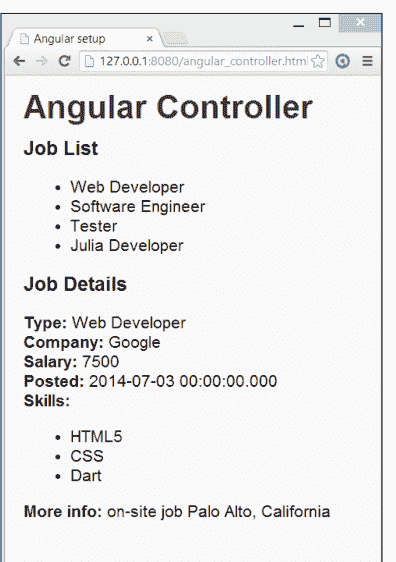
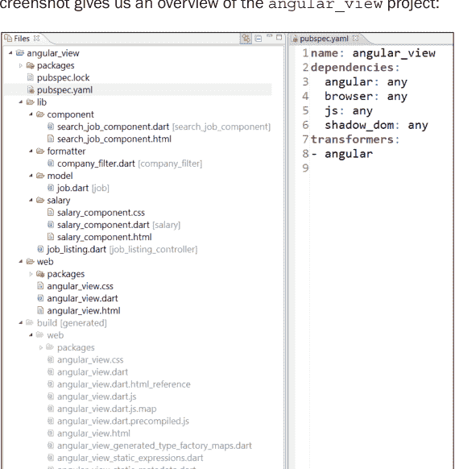

## 11 使用 Angular Dart

本章包含以下方法：

- 设置 Angular 应用
- 使用控制器
- 使用组件
- 使用格式化器作为过滤器
- 创建视图
- 使用服务
- 部署你的应用

### 简介

在本章中，我们将使用 Angular Dart 来构建客户端 Web 应用。Angular Dart (https://github.com/angular/angular.dart) 是 AngularJS 到 Dart 的移植版本。AngularJS，或简称为 Angular（参阅 www.angularjs.org），是一个由 Google 维护的流行开源 JavaScript 框架，用于开发单页动态 Web 应用。它的目标是创建具备**模型-视图-控制器（MVC）**或**模型-视图-视图模型（MVVM）**能力的基于 Web 的应用，从而使开发和测试都更加容易。

它通过声明式编程来构建 UI 并连接软件组件，从而使你可以专注于应用逻辑，而不是 DOM 操作。它使用一个带有许多所谓指令（以 ng- 开头）的模板系统，来指定可定制且可复用的 HTML 标签和表达式，以控制特定元素的行为：实际上，你可以用自定义元素和属性来扩展 HTML。Google 使用 Angular Dart 构建内部应用。本章探讨的每个方法都会展示 Angular 的一个主要组件。最新文档可以在 https://docs.angulardart.org/ 找到。

### 设置 Angular 应用

本方法是本章中所有其他方法所必需的预备步骤。它将展示如何让 Angular Dart 功能在你的应用中可用。

#### 操作步骤...

1. Dart Editor 中还没有 `angular` 模板，因此请从 Web 应用（移动友好）启动你的应用，并将其命名为，例如，`angular_setup`。清除 `html` 和 `dart` 文件中的示例代码。

2. 在 `pubspec.yaml` 的依赖中添加 `angular`。保存后将启动 `pub get` 过程。

3. 同时将 `js` 和 `shadow_dom` 添加到 `pubspec.yaml`。

4. 将 shadow DOM 脚本添加到 `html` 文件中：

   ```html
   <script
     src="packages/shadow_dom/shadow_dom.min.js"></script>
   ```

5. 同时，包含 Angular 转换器：

   ```yaml
   transformers:
     - angular
   ```

6. 在 `<html>` 元素中提供 `ng-app` 属性。

7. 在主 Dart 脚本的顶部添加以下语句：

   ```dart
   import 'package:angular/angular.dart';
   import 'package:angular/application_factory.dart';
   ```

8. 在 `main()` 中插入代码 `applicationFactory().run();`。

9. 在 `<body>` 元素中提供 `ng-cloak` 属性。

10. 将以下部分添加到你的 CSS 文件中：

    ```css
    [ng-cloak], .ng-cloak {
      display: none !important;
    }
    ```


## 工作原理...

步骤2下载基本的 Angular Dart 框架以及它所依赖的包。注意它使用了 `web_components` 包。步骤3和4为那些尚未原生支持 Shadow DOM 的旧浏览器启用该特性；在这种情况下，需要 `js` 包来实现 JavaScript 互操作。

Shadow DOM 是浏览器在渲染标签时包含一个 DOM 元素子树的能力，这个子树称为影子根（shadow root）。例如，`<input type="date">` 元素隐藏了整个 HTML 表格，以创建一个精美的日历，该日历突出显示日期范围并对点击事件做出反应。Web 组件正是基于此构建的。更多详细信息，请参阅 http://www.html5rocks.com/en/tutorials/webcomponents/shadowdom/ 。

当你将应用转换为 JavaScript 时，步骤5对于部署应用是必需的（请参阅“部署你的应用”方法）。步骤6中的 `ng-app` 指令告诉 Angular 哪个元素是应用的根元素：该元素内部的所有内容都是 Angular 管理的页面模板的一部分。在大多数情况下，这是最外层的 `<html>` 标签；该元素内的任何内容都是 Angular 管理的页面模板的一部分。页面加载后，Angular 会查找 `ng-app` 指令。找到后，它会引导应用启动，应用 DOM 的根元素即为定义了 `ng-app` 指令的元素。

步骤7使 Angular 可用于你的代码，步骤8启动 Angular 的事件循环来处理每个浏览器事件。如果在此事件处理过程中模型有任何变化，视图中所有对应的绑定都将更新。

步骤8和9是必要的，以避免在插入模型中正确的值之前显示 { { ... } }。发生这种情况是因为加载 HTML 与 Angular 完成引导、编译 DOM 并替换数据绑定表达式的真实值之间存在一小段时差。

## 更多内容...

如果你需要 `mirrors` 库（`dart:mirrors`）来使用 Dart 的反射功能，可以使用 `mirrors` 注解提供一个临时修复：

```
@MirrorsUsed(override:'*')
import 'dart:mirrors';
```

`dart2js` 编译器执行的压缩和 tree-shaking 过程通常不会检测被反射的代码，因此运行时使用反射可能会失败，导致 `noSuchMethod()` 错误。为防止这种情况，请使用 `mirrors` 注解，它可以帮助 `dart2js` 编译器生成更小的代码。

更多关于 `mirrors` 的信息，请参阅*第4章 面向对象*中的*使用反射*方法，以及 https://www.dartlang.org/articles/reflection-with-mirrors/。

## 使用控制器

在 MVC 模式中，网页就是我们的视图。控制器对象负责显示模型中的数据（将它们绑定到视图中的 DOM 元素），并在响应事件时可能改变模型数据并显示这些变化。控制器的所有公共字段都可以显示，所有公共方法都可以在视图内调用。数据绑定使用与 Polymer 相同的双花括号语法 {{ ... }}。控制器应只包含单个应用或视图所需的业务逻辑；它不应操作 DOM。

在本方法中，我们将逐步向您展示如何使用 Angular 控制器。您可以参照项目 `angular_controller` 中的代码进行操作。

## 如何操作...

我们的应用将在列表中显示工作类型数据，当选中某个工作时，会显示其详细信息，如下图所示：



控制器运行效果

其工作原理如下：

- 作为模型的 `Job` 类定义在 `angular_controller.dart` 中，如下所示：
```
class Job {
  String type;
  int salary;
  String company;
  DateTime posted; // date of publication of job
  bool open = true; // is job still vacant?
  List<String> skills;
  String info;
  Job(this.type, this.salary, this.company, this.posted, this.skills, this.info);
}
```
- 控制器是同一个文件中的单独类 `JobListingController`：
```
@Controller(
    selector: '[job-listing]',
    publishAs: 'ctrl')
class JobListingController {
  Job selectedJob;
  List<Job> jobs;
  
  JobListingController() {
    jobs = _loadData();
  }
  
  void selectJob(Job job) {
    selectedJob = job;
  }
  
  // model data:
  List<Job> _loadData() {
    return [
      new Job('Web Developer',7500, 'Google', DateTime.parse('2014-07-03'),
      ["HTML5", "CSS", "Dart"], "on-site job Palo Alto, California"),
      // other job data
    ];
  }
}
```

## 工作原理...

步骤2中的控制器包含要显示的工作列表；它在构造函数中通过 `loadData()` 加载这些工作。它还保存选中的工作（如果有）。该控制器使用 `@` 注解进行标记。请看以下代码：

```text
@Controller(
    selector: '[job-listing]',
    publishAs: 'ctrl')
```

在 `selector` 之后、方括号之间的字符串是页面中 CSS 选择器的名称（此处为 `job-listing`）。在步骤3中，我们看到有一个 `<div>` 元素使用该名称作为选择器。这个 `<div>` 元素定义了一个作用域，控制器在其中处于活动状态并为人所知。当 Angular 看到这个 `<div>` 元素时，它会实例化控制器类，使其内容可用。`publishAs` 代码给出了控制器在视图中的 `<div>` 作用域内所使用的名称（此处为 `ctrl`）：这就是为什么我们在整个 HTML 代码中看到这个名称出现的原因。

在 `<ul>` 中，通过指令 `ng-repeat="job in ctrl.jobs"` 显示控制器中所有的工作列表；这会遍历模型（`JobListingController` 中的 `job` 属性），并在编译后的 DOM 中为列表中的每个工作克隆一个 `<li>`。更具体地说，只显示类型，因为 `<li>` 标签包含 `{{job.type}}`。

同一个标签还包含一个 `ng-click` 指令，它为列表项上的点击事件注册一个事件处理器：`ng-click="ctrl.selectJob(job)"`。该指令可以附加到任何 HTML 元素上，在这里它调用控制器中的 `selectJob` 方法，并传入被点击的工作。在步骤2中，我们看到这个方法将该工作传递给 `selectedJob`。由于这个变量现在有了值，视图会更新，所有 `{ ctrl.selectJob. }` 表达式都会被求值并显示，包括技能列表，其中使用了 `ng-repeat="skill in ctrl.selectedJob.skills"` 指令。

为了使这在 Angular 中生效，我们需要将控制器包装在继承自 `Module` 的 `AppModule` 类中。要实例化这个新模块，必须通过 `addModule()` 方法将其添加到 Angular 引擎中，这是一种依赖注入技术，也用于其他 Angular 项目，我们将在接下来的方法中看到。通常，一个 Angular 应用会有一个模块列表，并使用这些模块工作。

## 更多内容...

当满足特定条件时，可以通过添加以下 HTML 属性来禁用视图中的控件：`ng-disabled="ctrl.condition"`，其中 `condition` 是控制器中的一个布尔属性或函数。要使控件可见或隐藏，可使用 `ng-show` 或 `ng-hide`。

其工作原理如下：

- 以下是启动脚本 `angular_component.dart`：
```
import 'package:angular/angular.dart';
import 'package:angular/application_factory.dart';
import 'package:angular_component/salary/salary_component.dart';
import 'package:angular_component/job_listing.dart';

void main() {
  applicationFactory()
    .addModule(new AppModule())
    .run();
}

class AppModule extends Module {
  AppModule() {
    bind(JobListingController);
    bind(SalaryComponent);
  }
}
```

- 在网页中，我们会看到用于组件的新的 HTML 元素 `<x-salary>`，如下所示：
```
<x-salary max-sal="10" salary="job.rate_salary"></x-salary>
```
这也出现在工作详情部分，该部分现在被以下代码包围：
```
<div ng-if="ctrl.selectedJob != null">
...
<x-salary max-sal="10" salary="ctrl.selectedJob.rate_salary"></x-salary>
...
</div>
```
该组件定义在 `lib\salary` 文件夹中，其中包含一个定义其结构的 HTML 文件 `angular_component.html`、一个描述其行为的 Dart 文件，以及一个用于设置其样式的 CSS 文件。

- 以下是 Dart 代码：
```
import 'package:angular/angular.dart';

@Component(
  selector: 'x-salary',
```


# 使用 Angular Dart

```
templateUrl: 'packages/angular_component/salary/salary_component.html',
    cssUrl: 'packages/angular_component/salary/salary_component.css',
    publishAs: 'cmp')
class SalaryComponent {
    static const String _STAR_ON_CHAR = "\\u2605";
    static const String _STAR_OFF_CHAR = "\\u2606";
    static const String _STAR_ON_CLASS = "star-on";
    static const String _STAR_OFF_CLASS = "star-off";

    static final int DEFAULT_MAX = 5;

    List<int> stars = [];

    @NgOneWay('salary')
    int salary;

    @NgAttr('max-sal')
    void set maxSal(String value) {
        var count = (value == null)
            ? DEFAULT_MAX
            : int.parse(value, onError: (_) => DEFAULT_MAX);
        stars = new List.generate(count, (i) => i + 1);
    }

    String starClass(int star) =>
        star > salary ? _STAR_OFF_CLASS : _STAR_ON_CLASS;

    String starChar(int star) => star > salary ? _STAR_OFF_CHAR :
_STAR_ON_CHAR;
}
```

以下是该组件的 HTML 代码：

```
<span class="stars"
      ng-repeat="star in cmp.stars"
      ng-class="cmp.starClass(star)">
        {{cmp.starChar(star)}}
</span>
```

# 工作原理

在步骤 1 中，你可以看到我们将 `JobListingController` 的代码重构到了它自己的库 `lib\job_listing.dart` 中。一个名为 `SalaryComponent` 的组件现在也绑定到了 `AppModule`。步骤 2 演示了该组件如何在 HTML 中作为一种新标签 `<x-salary>` 使用，并带有属性 `max-sal` 和 `salary`。为什么用 `x-`？为了符合 W3C 规范，自定义组件名称中应包含连字符（-）。

此外，我们看到了如何通过 `ng-if="condition"` 控制 Angular 中 HTML 区块的包含。如果条件为 false，则该 `<div>` 区块会从 DOM 中移除。

在步骤 3 中，我们看到 `SalaryComponent` 类的定义前面有 `@Component` 注解。它的 `selector` 部分指定了实例化该组件的 HTML 元素，这也定义了它的作用域。注意，`templateUrl` 和 `cssUrl` 指向组件的定义，而 `publishAs` 是组件在其作用域中的名称，在步骤 4 中使用。组件如何表示薪资？星号字符来自 Unicode `"\u2605"`，通过 `{{cmp.starChar(star)}}` 显示。当组件被实例化时，它的属性会被设置，尤其是 `salary="job.rate_salary"`。`rate_salary` 是 `Job` 类中的一个 getter：该属性设置为 `int get rate_salary => salary~/1000`。因此，组件中的薪资是职位薪资的千位数。注意，`salary` 由 `@NgOneWay` 注解，这意味着它是一个单向属性，其值从对象流向 UI，但 UI 不能在代码中更改它。注意，`max-sal` 作为一个属性，由 `@NgAttr` 注解。字段上的 `NgAttr` 注解将其映射为 DOM 属性。`stars` 列表通过 `List.generate()` 设置为由 `max-sal` 个数字组成的列表：`[1,2,3,4,5,6,7,8,9,10]`。`ng-class` 指令会在组件上动态设置 CSS 类；其表达式是要添加到组件上的类名，即 `"star-on"` 或 `"star-off"`。当 star 仍小于或等于 salary 时，星号显示为黄色。因此，对于薪资中的每一千美元，`ng-repeat` 会显示一颗黄色星号，而 `max-sal` 决定未着色星号的数量。

# 更多内容...

如果用户需要能够通过网页更改属性（例如更改薪资），则必须在代码中将其声明为 `@TwoWay`。在我们的示例中，可以通过为组件定义一个 `ng-click="event-handler"` 来实现。

# 另请参阅

- 有关组件的另一个示例，请参阅本章中的“Creating a view”（创建视图）配方。

```
ng-model="ctrl.typeFilterString">
</div>
<div> Filter jobs by company:
  <span ng-repeat="company in ctrl.companies">
    <label>
      <input type="checkbox"
        ng-model="ctrl.companyFilterMap[company]">{{company}}
    </label>
  </span>
</div>
<input type="button" value="Clear Filters" ng-click="ctrl.clearFilters()">
</div>
```

- 2. 实际过滤发生在同一文件中；不再是简单的 `ng-repeat = "job in ctrl.jobs"`，我们现在有了以下内容：
- 

```html
ng-repeat="job in ctrl.jobs
  orderBy:'type'
    filter:{type:ctrl.typeFilterString}
    companyfilter:ctrl.companyFilterMap"
```

这里为了可读性，我们将不同的过滤部分分行显示，但在 HTML 中，它们必须写在一行内。

在控制器代码（`lib\job_listing.dart`）中，我们现在有两个列表：

```
List<Job> jobs;
List companies = [];
```

`_loadData()` 选项现在返回 jobs，在构造函数中，通过以下方式填充 companies：

```
for (job in jobs) {
    companies.add(job.company);
}
```

过滤器需要以下代码：

```
final companyFilterMap = <String, bool>{};
String typeFilterString = "";

void clearFilters() {
    companyFilterMap.clear();
    typeFilterString = "";
}
```

此外，我们将模型代码（`Job` 类）重构到了它自己的文件 `lib\model\job.dart` 中。

公司过滤器是一个必须编码的自定义格式化器。我们可以在 `lib\ formatter\company_filter.dart` 中找到它，如下所示：

```
library company_filter;

import 'package:angular/angular.dart';

@Formatter(name: 'companyfilter')
class CompanyFilter {
  List call(JobList, filterMap) {
    if (JobList is Iterable && filterMap is Map) {
      // If there is nothing checked, treat it as "everything is checked"
      bool nothingChecked = filterMap.values.every((isChecked) => !isChecked);
      return nothingChecked
        ? JobList.toList()
        : JobList.where((i) => filterMap[i.company] == true).toList();
    }
    return const [];
  }
}
```

- 3. 在 `angular_formatter.html` 的 `<div job-listing>` 中，我们现在将职位类型格式化为 `{{job.type | uppercase}}`。

- 4. 在 `lib\formatter` 中，我们按如下方式编写这个大写格式化器：

```
import 'package:angular/angular.dart';

@Formatter(name: 'uppercase')
class UppercaseFormatter {
  call(String name) {
    if (name == null || name.isEmpty) return '';
    return name.toUpperCase();
  }
}
```

- 5. `angular_formatter.dart` 脚本有两个额外的 import 语句和两个用于格式化器的 bind 语句，如下所示：

```
import 'package:angular_formatter/formatter/company_filter.dart';
import 'package:angular_formatter/formatter/uppercase_formatter.dart';

class AppModule extends Module {
  AppModule() {
```

# 使用 Angular Dart

# 具体做法

我们在本技巧中所做的更改对用户是透明的；网页保持不变，但项目代码被重构了。

- 1. 在我们的主网页 `angular-view.html` 中，`<div id="filters">` 部分现在被组件的 HTML 代码所替代。请看下面的代码：

  ```html
  <search-job
      type-filter="ctrl.typeFilter"
      company-filter-map="ctrl.companyFilterMap">
  </search-job>
  ```

- 2. 在 `JobListingController` 的构造函数中，添加了以下代码：

  ```dart
  for (var company in companies) {
      companyFilterMap[company] = false;
  }
  ```

- 3. 组件的行为在 `search_job_component.dart` 中编码如下：

```
```dart
import 'package:angular/angular.dart';

@Component(
    selector: 'search-job',
    templateUrl: 'packages/angular_view/component/search_job_component.html',
    publishAs: 'cmp')
class SearchJobComponent {
  Map<String, bool> _companyFilterMap;
  List<String> _companies;

  @NgTwoWay('type-filter')
  String typeFilter = "";

  @NgTwoWay('company-filter-map')
  Map<String, bool> get companyFilterMap => _companyFilterMap;
  void set companyFilterMap(values) {
    _companyFilterMap = values;
    _companies = companyFilterMap.keys.toList();
  }

  List<String> get companies => _companies;

  void clearFilters() {
```
```


## 如何操作...

本食谱中我们所做的更改对用户几乎是透明的；网页保持不变，但由于发出 HTTP 请求是异步的，我们将使用 Future 进行操作，并且必须在请求执行期间提供一条消息，例如 "Loading data..."。

- 1. 在我们的 JobListingController 控制器类 lib\job_listing.dart 中，我们定义了一个新的 Http 类型变量：final Http _http;。构造函数现在变为如下所示：

```
JobListingController(this._http) {
  _loadData();
}
```

大部分更改发生在其 _loadData() 方法中，如以下代码所示：

```
static const String LOADING_MESSAGE = "Loading jobs listing...";
static const String ERROR_MESSAGE = "Sorry! The jobs database cannot be reached.";
String message = LOADING_MESSAGE;

void _loadData() {
  jobsLoaded = false;
  _http.get('jobs.json')
    .then((HttpResponse response) {
      jobs = response.data.map((d) => new Job.fromJson(d)).toList();
      jobsLoaded = true;
      for (var job in jobs) { // extract companies:
        companies.add(job.company);
      }
    })
    .catchError((e) {
      print(e);
      message = ERROR_MESSAGE;
    });
}
```

在类 Job 中，我们有一个新的命名构造函数，如下所示：

```
Job.fromJson(Map<String, dynamic> json) : this(json['type'], json['salary'], json['company'], DateTime.parse(json['posted']), json['skills'], json['info']);
```

## 其工作原理...

在步骤 1 中，我们看到 Angular 在实例化控制器时使用依赖注入为其提供一个 `Http` 对象。步骤 2 显示了如何使用 `Http` 服务中的 `get` 方法发出 GET 请求并从服务器获取数据（此处数据是本地的，但也可以从远程站点获取）。该方法在请求完成后返回一个 Future `<HttpResponse>`。这就是为什么我们必须使用 `.then` 构造来注册回调函数并使用 `.catchError` 来处理异常。在回调函数中，我们在 `response.data` 中拥有数据。通过 map，我们为每个作为 JSON 字符串的 job 调用。类 Job 中的命名构造函数 `fromJson` 在步骤 3 中将其转换为 Job 对象。最后，使用所有 job 数据创建一个列表，并以与之前食谱相同的方式将其绑定到视图。

## 另请参阅

- 有关 Futures 的更多信息，请参阅 *Chapter 8, Working with Futures, Tasks, and Isolates*
- 有关 JSON HTTP 请求的更多详细信息，请参阅 *Chapter 6, Working with Files and Streams* 中的 *Downloading a file* 食谱

## 部署你的应用

要在任何现代浏览器中运行，你的 Angular 应用必须编译为最小的 JavaScript。最小意味着 tree-shaken（未使用的代码被排除在外）并且 minified（名称缩短且空格使用最少）。

但首先，通过执行以下步骤在其他浏览器中测试你的应用：

- 1. 首先，通过右键单击启动网页并选择 **Run as JavaScript** 在默认浏览器中进行测试。这将编译为 JavaScript 并在浏览器中执行应用，但编译后的代码将保留在内存中且不会写入磁盘。
- 2. 要更改浏览器，请转到菜单项并导航到 **Tools | Preferences | Run | Debug**，取消选中 **Use system default browser**，并选择其他浏览器。你也可以直接启动该浏览器并从默认浏览器中的应用复制 URL。

## 如何操作...

- 1. 将 Angular transformer 包含到应用的 `pubspec.yaml` 文件中：
  
      ```yaml
      transformers:
        - angular
      ```
- 2. 同时，将 `js` 和 `shadow_dom` 包添加到你的 `pubspec.yaml` 文件中。

## 其工作原理...

3. 将 shadow DOM 脚本添加到启动 HTML 文件中，如下所示：

```
<script src="packages/shadow_dom/shadow_dom.min.js"></script>
```

4. 使用 pub build 从命令行或 Dart Editor 执行构建。

步骤 2 将确保 Angular 可以在所有浏览器中使用 Shadow DOM（有关 Shadow DOM 的更多信息，请参阅本章中 Setting up an angular app 食谱的 How it works 部分）。

> 而不是 shadow_dom.min.js，在调试时你可以使用 shadow_dom.debug.js。

步骤 3 将在你的应用目录的子文件夹 build/web 中生成所有可部署文件。例如，如果我们将其应用于 angular_view 应用，我们将得到一个约 1.7 MB 的 JavaScript 文件 angular_view.dart.js 与 angular_view.html 一起启动。以下截图向我们展示了 angular_view 项目的概览：



项目布局概览

## 另请参阅

- ▸ 你可以在 `https://www.dartlang.org/tools/pub/assets-and-transformers.html` 了解更多关于 transformers 的信息。有关编译为 JavaScript 的更多信息，请参阅 *Chapter 1, Working with Dart Tools* 中的 *Compiling your app to JavaScript* 食谱和 *Chapter 2, Structuring, Testing, and Deploying an Application* 中的 *Publishing and deploying your app* 食谱。
