## 第 1 部分：
现代数据
工程与工具

本部分将介绍数据工程的世界。它让您了解数据工程概念和架构。此外，它还教育您如何有效地利用 Microsoft Azure 云服务进行数据工程。

本部分包含以下章节：

- 第 1 章，数据工程与分析的故事
- 第 2 章，发现存储和计算数据湖架构
- 第 3 章，Microsoft Azure 上的数据工程

### 1
数据工程与分析的故事

每个字节的数据都有一个故事可讲。真正的问题是，这个故事是否被准确、安全、高效地叙述出来。在现代世界中，数据有自己的旅程——从创建点到用户为其分析需求消费它的点。

但是什么让今天的数据旅程如此特别和不同，与过去相比？毕竟，**提取、转换、加载 (ETL)** 并不是最近才发明的。事实上，我记得自从 25 多年前加入**信息技术 (IT)** 世界以来，我就一直在收集和转换数据。

在本章中，我们将讨论一些有效的数据工程实践对数据分析产生深远影响的原因。

在本章中，我们将涵盖以下主题：

- 数据的旅程
- 探索数据分析的演变
- 数据的货币力量

> **记住：**
> 通往有效数据分析的道路，必经有效的数据工程。

#### 数据的旅程

**数据工程**是使数据旅程成为可能、安全、持久且及时的载体。**数据工程师**是这辆载体的驾驶员，他在沿途安全地绕过各种障碍，同时不损害乘客的安全。等待在道路尽头的有**数据分析师**、**数据科学家**和**商业智能 (BI) 工程师**，他们渴望接收这些数据并开始讲述**数据的故事**。您可以在以下屏幕截图中看到这一点：

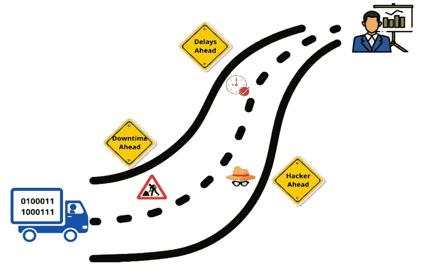

图 1.1 – 数据通往有效数据分析的旅程

传统上，数据的旅程围绕典型的 ETL 流程展开。不幸的是，在现代时代，传统的 ETL 流程已远远不够。由于人类对数据的巨大依赖，迫切需要使用尖端架构、框架和工具来简化数据的旅程。

您可能也在想，为什么数据的旅程甚至是必需的。数据集有限、计算能力稀缺、数据分析范围非常有限的时代已经一去不复返了。我们现在生活在一个快节奏的世界，决策需要在闪电般的速度下进行，使用每秒都在变化的数据。让我们看看数据分析的演变如何影响了数据工程。

##### 探索数据分析的演变

数据分析随着时间的推移而不断发展，使我们能够做得更大、更好。多年以来，数据分析的重点仅限于**描述性分析**，重点是从数据中获得有用的**业务洞察**，以报告的形式呈现。这种类型的分析有助于回答诸如“*发生了什么？*”这样的问题。一个假设的场景是，公司在上个季度销售额急剧下降。

很快，每个人都开始意识到，有很多其他指标可用于找出*发生了什么*，但大家真正想要的是*为什么会发生*。核心分析现在转向**诊断分析**，重点是识别数据中的异常，以确定某些结果的原因。一个示例场景是，公司在上个季度销售额急剧下降，因为库存水平严重下降，这是由于供应商制造单位发生了洪水所致。这种形式的分析进一步增强了用户决策支持机制，如下图所示：

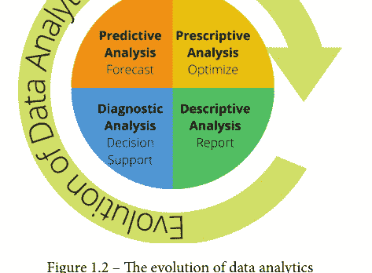

图 1.2 – 数据分析的演变

**重要说明**
描述性分析和诊断分析都试图仅使用事实数据来影响决策过程。

自古以来，展望未来并尝试预测未来一直是人类核心的渴望。如果我们能预测未来的结果，我们就能做出很多更好的决策，因此**预测分析**的时代来临，其重点围绕“未来会发生什么？”。预测分析可以使用**机器学习 (ML)** 算法进行——让机器以重复的方式从现有和未来数据中学习，以便它能够识别出一种模式，使其能够准确预测未来趋势。

现在我们已经很好地准备好预测未来的结果，我们必须使用并优化这种预测分析的结果。基于预测分析的结果，**规范分析**的目标是提供一套规定的行动，以帮助实现业务目标。

**重要说明**
与描述性和诊断分析不同，预测和规范分析试图使用事实和统计数据来影响决策过程。

但现代分析的梦想如何才能有效地实现？毕竟，数据分析师和数据科学家并不具备足够的技能来收集、清理和转换庞大且不断增加和变化的数据集。

数据工程实践通常被称为现代数据分析需求的**主要支持**。

以下是一些主要原因，说明为什么强大的数据工程实践正成为当今企业绝对不可忽视的必需品：

- 计算和存储资源的核心能力
- 各类数据集的可用性
- 向分布式计算的范式转变
- 云计算的采用
- 数据讲故事

我们将在以下小节中分别探讨这些内容。

> **重要说明**
> 拥有强大的数据工程实践可确保现代分析在耐久性、性能和可扩展性方面得到满足。

## 存储和计算资源的核心能力

25 年前，我有机会购买一台 Sun Solaris 服务器——128 **兆字节 (MB)** **随机存取存储器 (RAM)**，2 **千兆字节 (GB)** 存储——价格接近 25K 美元。该服务器的预期用途是在生产环境中运行客户端/服务器应用程序并连接 Oracle 数据库。鉴于存储和计算资源价格高昂，我必须采取严格的对策来适当平衡用户 **联机事务处理 (OLTP)** 和 **联机分析处理 (OLAP)** 的需求。其中一项限制就是为这些程序的运行实施严格的时间限制；否则，它们会占用所有可用资源并拖慢其他人的速度。

如今，你可以用五分之一的价格买到一台拥有 64 GB RAM 和数 **太字节 (TB)** 存储的服务器。额外的算力对我们大有裨益。现在可以专门为数据分析工作负载采购多个存储和计算单元。额外的算力使用户能够随时随地按自己的方式运行工作负载。事实上，如今使用数据流持续运行分析工作负载已非常普遍，也称为 **流处理**。

安装、管理和监控多个计算和存储单元需要一个设计良好的数据管道，这通常通过数据工程实践来实现。

## 各类数据集的可用性

几年前，数据分析的范围极其有限。执行数据分析仅仅意味着从数据库和/或文件中读取数据，对连接进行反规范化，并使其可用于描述性分析。数据的结构在很大程度上是已知的，并且很少随时间变化。

我们现在生活在一个不同的世界；我们不仅产生更多数据，而且数据的种类也随时间增加。除了从数据库和文件中收集常规数据外，如今通常还会从社交网络、网站访问、基础设施日志媒体等收集数据，如以下屏幕截图所示：

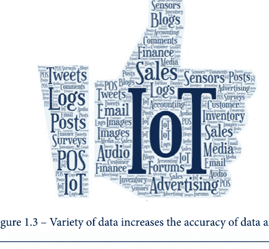

图 1.3 – 数据种类多样化提高了数据分析的准确性

**重要说明**
数据种类越多，意味着数据分析师有多个维度可进行描述性、诊断性、预测性或规范性分析。

自然地，数据集的不同程度给数据收集和处理过程带来了复杂性。另一方面，它也极大地影响了决策过程的准确性以及对未来趋势的预测。一个设计良好的数据工程实践可以轻松应对这种复杂性。

## 向分布式计算的范式转变

过去几年使用的传统数据处理方法在很大程度上是单一的。要处理数据，你必须创建一个程序来收集所有所需的数据进行处理——通常来自数据库——然后在单线程中处理。这种类型的处理也称为 **数据到代码** 处理。不幸的是，这种方法存在几个缺点，如下所述：

- 由于大量数据需要传输到代码进行处理，有时会导致网络严重拥塞。由于网络是共享资源，当前活跃的用户可能会开始抱怨网络变慢。
- 作为单线程操作，执行时间与数据量成正比。因此，数据量的增长通常意味着处理需要更长时间才能完成。这可能会显著影响和/或延迟决策过程，有时甚至使数据分析变得毫无用处。
- 像网络故障或机器故障这样微小的问题就需要整个程序周期重新启动，如下图所示：

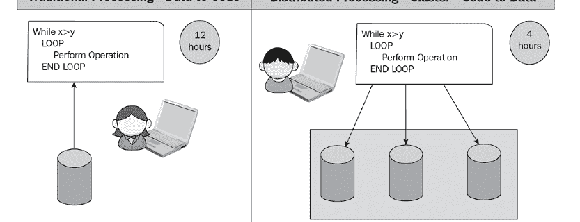

图 1.4 – 分布式计算的兴起

我将之称为范式转变的分布式处理方法在很大程度上解决了上述问题。不是采用传统的数据到代码路线，而是将范式逆转为代码到数据。

在分布式处理方法中，多个资源共同作为集群的一部分协同工作，共同实现一个目标。简单来说，这种方法可以与团队模式相比较，其中每个团队成员承担一部分负载并并行执行，直至完成。
如果一名团队成员生病无法完成其工作份额，其他成员会自动接管其工作份额。

分布式处理相对于传统处理方法有几个优势，概述如下：

- 代码到数据的范式转变确保网络不会被堵塞。分布式处理的整个理念严重依赖于数据以分布式方式存储在多台机器上，也称为节点。处理时，只有代码部分（通常与实际数据相比占用空间要小得多）会被发送到存储待处理数据部分的每个节点。这确保了处理在存储数据的节点本地进行。
- 由于多个节点共同参与数据处理，整体完成时间大幅缩短。
- 程序执行不受网络和节点故障的影响。如果遇到节点故障，则集群中另一台可用节点会被分配该部分工作。

> **重要说明**
> 分布式处理使用众所周知的框架实现，例如 Hadoop、Spark 和 Flink。现代 **大规模并行处理 (MPP)** 风格的数据仓库，如 Amazon Redshift、Azure Synapse、Google BigQuery 和 Snowflake 也实现了类似的概念。

由于分布式处理是多机技术，它需要复杂的设计、安装和执行流程。这使得在组织内部建立良好的数据工程实践成为一个令人信服的理由。

## 云计算的采用

云计算的广泛采用使组织能够抽象化管理自有数据中心的复杂性。将资源迁移到云端可提供更快的部署、更大的灵活性，以及一种定价模式，如果使用正确，可带来大幅成本节约。

在上一节中，我们谈到了分布式处理作为多个机器作为一个集群协同工作来实现。对于这个原因，部署分布式处理集群是昂贵的。

在云之前的分布式处理时代，集群是使用部署在本地数据中心内的硬件创建的。在尝试部署集群之前需要非常仔细的规划（否则结果会不尽如人意）。你可能会争辩为什么需要如此程度的规划。让我来解释一下：

- 由于硬件需要在数据中心部署，你需要实际采购它。真正的问题是你会采购多少台，这正是使该过程如此复杂的原因。
- 采购的单元多于所需，你将拥有未使用的资源，浪费金钱。
- 采购的单元少于所需，你将资源不足，作业失败，性能下降。

为了订购正确数量的机器，你从对所需数据处理作业进行基准测试开始规划过程。

- 基准测试过程的结果是判断多少台机器能够承担负载并在期望时间内完成处理的良好指标。你现在需要从硬件供应商开始采购流程。考虑到采购和运输周期，这可能需要数周到数月才能完成。
- 一旦硬件到达，你需要有一支管理员团队准备好连接服务器、安装操作系统、配置网络和存储，最后安装分布式处理集群软件——这需要很多步骤和很多规划。

我希望你现在完全同意我之前所说的 *仔细规划* 也许是轻描淡写了。本地部署的复杂性在服务器初始安装完成后并未结束。你仍然需要负责定期的软件维护、硬件故障、升级、增长、保修等。

这正是云采用理念被广泛接受的原因。云上的资源使组织免受许多运营问题的困扰。此外，云提供了自动化部署、按需扩展、资源负载均衡和安全性的灵活性。

> **重要说明**
> 云的许多方面特别是按需扩展，以及为未使用资源提供低价的能力，对许多组织来说是改变游戏规则的。
> 如果使用正确，这些功能最终可能会节省大量成本。设计良好的云基础设施可以为组织的 数据工程和数据分析实践带来奇迹。

## 数据叙事

我以 *每一字节数据都有故事可讲* 开始本章。数据叙事是为非技术人员提供的新替代方案，通过叙述数据故事来简化决策过程。传统上，决策者严重依赖条形图、饼图、仪表盘等可视化手段来获得有用的业务洞察。这些可视化通常使用数据分析的最终结果创建。问题在于并非每个人都以相同的方式查看和理解数据。让我举个例子来进一步说明这一点。

这里有一位 BI 工程师向高级管理层分享上一季度的股票信息：

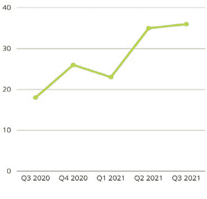

图 1.5 – 使用简单图形可视化数据

而下面是以数据故事的形式提供的相同信息：

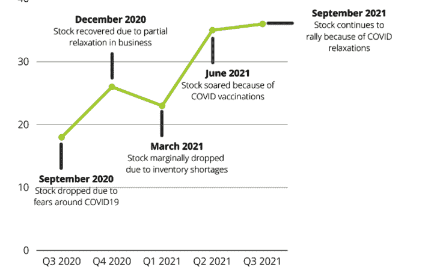

图 1.6 – 数据可视化的讲故事方法

> **重要说明**
> 可视化在传达某事为何发生方面很有效，但讲故事的叙述支持其发生的原因。

数据故事试图通过用自然语言为其提供数据的叙述，将分析洞察传达给普通人。这并不意味着数据故事只是一个叙述。它是叙述性数据、相关数据和可视化的结合。把这些结合起来，一个有趣的故事就出现了——一个每个人都能理解的故事。

随着数据驱动决策的不断增长，数据故事正在迅速成为向关键利益相关者传达关键业务洞察的标准。

获取和理解数据还有另一个好处：*财务*方面的。让我们接下来看看数据的货币力量。

## 数据的货币力量

现代组织极其专注于收入加速。传统上，组织主要专注于增加销售作为收入加速的方法……但有没有更好的方法？

处于技术前沿的现代组织已利用 **收入多元化** 使其成为可能。以下是当今组织使用的一些方法，所有这些都得益于 *数据的力量*。

## 有机增长

在我从事数据工程的最初几年，我参与了多个项目，这些项目的重点超出了通常的范围。在其中多个项目中，目标是通过传统的增加销售、精简库存、定向广告等方法来增加收入。这意味着从各种来源收集数据，然后采用老式的描述性、诊断性、预测性或规范性分析技术。

但当销售和营销的极限已被耗尽时还能做什么？收入增长从何而来？

一些有远见的组织意识到，增加销售并不是收入多元化的唯一方法。他们开始意识到，多年来积累的真实数据财富在很大程度上尚未被利用。为什么不利用数据的力量，找到创新的有机增长方法，而不仅仅是完全专注于销售增长呢？

这种创新思维催生了被称为 **有机增长** 的收入多元化方法。随后，组织开始以多种方式利用数据的力量。让我们看几个例子。

## 客户保留

数据科学家可以使用现有数据创建 **预测模型**，以预测某些客户是否因投诉而有终止服务的危险。根据此列表，客户服务可以开展有针对性的活动来留住这些客户。通过留住忠实客户，不仅让客户满意，还能保护你的底线。

## 欺诈预防

银行和其他机构现在正在使用数据分析来打击金融欺诈。基于关键财务指标，他们建立了预测模型，可以在欺诈交易发生前检测并防止其发生。这些模型已集成在用于发行信用卡、抵押贷款或贷款申请的案例管理系统内。

使用相同的技术，信用卡清算机构会持续监控实时的金融流量，并能够在欺诈交易发生前标记并阻止其发生。检测和预防欺诈在防止长期损失方面大有裨益。

## 问题检测

我参与过一个 **物联网 (IoT)** 项目，一家在北美拥有多家制造工厂的公司在数千台机械部件上安装了 **电子传感器** 来收集指标。所有制造工厂的传感器指标都被流式传输到一个公共位置进行进一步分析，如下图所示：

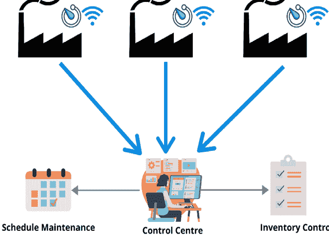

图 1.7 – 物联网正在推动数据的大幅增长

这些指标有助于确定某个易耗组件，例如橡胶皮带是否已达到或接近其使用寿命结束 (EOL) 周期。收集这些指标对公司有多种帮助，包括以下几点：

- 数据指示了组件已达到其 EOL 且需要更换的机器。手头有这些数据使公司能够在组件损坏（导致停机和延误）之前安排机器的预防性维护。
- 组件接近其 EOL 的机器的数据对于备用组件的库存控制很重要。在此系统实施之前，公司必须根据估算采购库存。买得太少可能会导致延误；买太多会浪费钱。在任何时候，数据管道都有助于更准确地预测备用组件的库存。

物联网和数据分析的综合力量正在重塑公司做出及时和明智决策的方式，以防止停机、减少延误并精简成本。

## 数据货币化

创新思维永不停止或放弃。他们不断寻找创新的方法来应对挑战，例如收入多元化。组织很快意识到，如果他们的数据的正确使用对自己如此有用，那么同样的数据对他人也可能有用。

根据维基百科，**数据货币化** 是 "*从可用数据源产生可衡量的经济利益的行为*"

下图描绘了使用 **应用程序编程接口 (APIs)** 进行数据货币化：

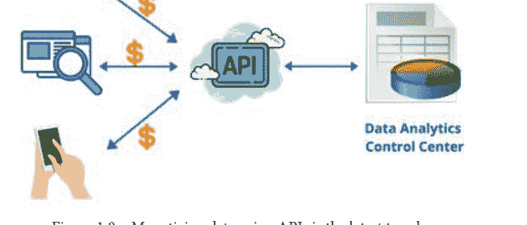

图 1.8 – 使用 API 货币化数据是最新趋势

在最新趋势中，组织正在以不仅对自己有益而且对他人也有利可图的方式使用数据的力量。在最近一个涉及健康行业的项目中，一家公司创建了一个创新产品，使用 **光学字符识别 (OCR)** 和 **自然语言处理 (NLP)** 来执行医疗编码。

在项目开始之前，该公司确保我们理解项目背后的真正原因——收集的数据不仅会内部使用，还会（收费）分发给他人。事先了解需求帮助我们为内部和外部数据分发设计了事件驱动的 API 前端架构。在后端，我们使用 Spark、Kubernetes、Docker 和微服务等创新技术创建了一个复杂的数据工程管道。管道的设计如下：

- 几个微服务以自助服务模式设计，由来自内部用户以及外部（公众）的请求触发。
- 对于外部分发，系统仅对具有有效付费订阅的用户开放。一旦订阅到位，就会公开多个前端 API，使他们能够按请求模式使用服务。
- 每个微服务都能够与后端分析功能进行交互，后者最终执行描述性和预测性分析并返回结果。

数据的力量不容低估，但数据的货币力量只有在组织建立了能够在正确的时间提供正确数据的坚实基础后才能实现。数据工程在实现这一目标方面发挥着极其重要的作用。

##### 总结

在本章中，我们回顾了几个场景，突出了几个重要观点。

首先，数据驱动分析的重要性是最新趋势，未来将继续增长。数据驱动分析赋予决策者做出关键决策的能力，同时也能用充分的理由来支持这些决策。

其次，数据工程是所有数据分析运营的支柱。如果没有设计良好、安全、可扩展、高可用且性能调优的数据存储库——**数据湖**，数据分析中的任何魔力都无法实现。

在接下来的几章中，我们将深入讨论数据湖。我们将首先强调有效数据的构建模块——存储和计算。我们还将介绍一些知名架构模式，帮助你创建一个有效的 **数据湖**——一个能够有效处理不同用例的分析需求的数据湖。

### 2
发现存储与计算数据湖

在上一章中，我们讨论了数据所拥有的巨大力量，但巨大的力量也伴随着更大的责任。过去，组织关注的重点是利用数据发现趋势，以实现收入加速。然而，它们通常较少关注由不一致的数据管理和交付造成的安全漏洞。

在本章中，我们将讨论数据湖如何有效应对分析世界不断增长的需求。

本章将涵盖以下主题：
- 介绍数据湖
- 在数据湖中分离存储与计算
- 发现数据湖架构

#### 介绍数据湖

在过去几年里，有效的数据工程和数据分析的衡量标准发生了变化。迄今为止，组织的数据分散在多个内部系统（信息孤岛）中，每个系统对其自己的数据集进行分析。

此外，与外部数据集进行交互以扩展分析工作负载的范围也变得困难。因此，这些组织很难获得数据的**统一**视图并获得**全局洞察**。

在组织通过优化现有流程和产生有机增长来实现收入多元化的世界中，全球统一的数据存储库已成为核心需求。数据湖通过为用户提供数据的统一视图来解决这一需求，用户可以利用这些数据为人类福祉设计创新技术。

下图概述了数据湖的特征：

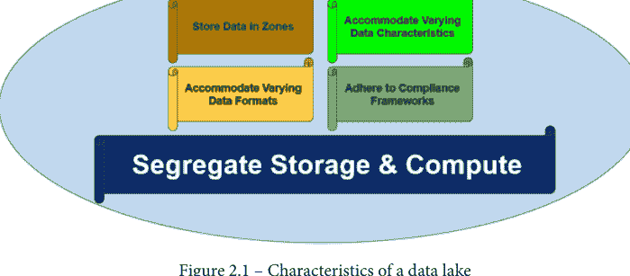

图 2.1 – 数据湖的特征

你在互联网上会找到数据湖的多种定义。与其定义数据湖是什么，不如关注现代组织拥有数据湖的好处。

我们还将看到数据湖中的存储和计算过程与传统数据存储解决方案（如数据库和数据仓库）有何不同。

> **重要说明**
> 在现代世界中，典型的**抽取、转换、加载（ETL）**流程（收集、转换和分析）已远远不够。围绕 ETL 流程的其他方面——如安全、编排和交付——也需要同等考虑。

##### 探索数据湖的优势

除了仅仅是一个简单的存储库之外，数据湖还提供了多种优势，使其成为现代数据分析需求的强大数据管理解决方案。

###### 容纳不同的数据格式

数据湖最广为人知的优势是其能够大规模存储结构化、半结构化和非结构化数据。参与数据分析流程的数据源种类日益增多，带来了新的挑战。由于数据交换格式没有统一的标准，数据提供方几乎可以自行决定格式。一些常用的数据交换格式及其常见用途如下：
- 结构化—数据库行
- 半结构化—逗号分隔值（CSV）、可扩展标记语言（XML）和 JavaScript 对象表示法（JSON）。
- 非结构化—物联网（IoT）、日志和电子邮件

这些可以更好地表示如下：

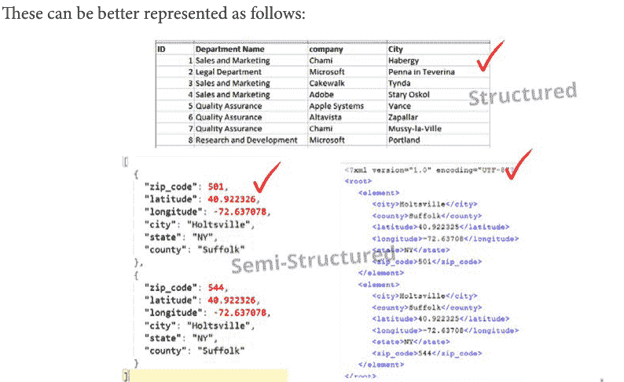

图 2.2 – 数据湖对不同格式的支持

> **重要说明**
> 数据湖不会根据数据的结构、格式或大小来区分数据。

数据湖存储和处理不同数据格式的**灵活性**使其成为能够在一个地方处理各种数据源的数据分析操作的“一站式商店”。如果没有数据湖，你将需要处理数据孤岛，导致分析分散，无法获得数据的统一视图。

###### 按区域存储数据

数据湖是存储数据在各个区域的存储库。虽然没有关于理想需要多少个区域的限制或规则，但通常认为三个区域是最佳实践：**原始**、** curated **和**转换**，如下图所示：

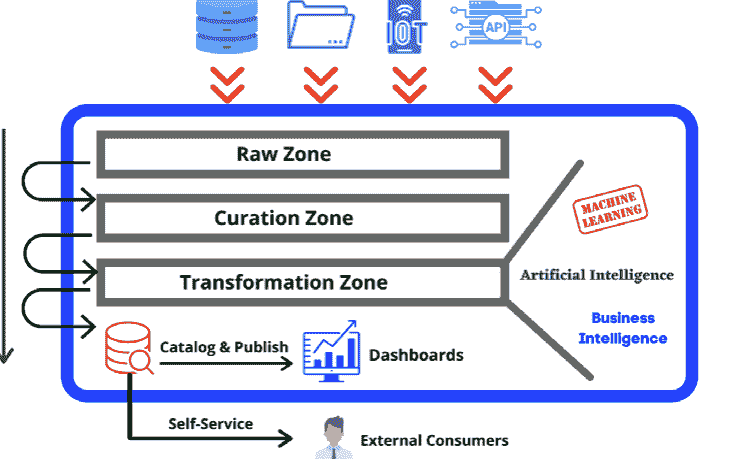

图 2.3 – 数据湖区域与数据成熟度

随着数据在每个区域中移动，其成熟度不断提高，变得更加干净，最终实现其最初收集的真正目的：**数据分析**。

一旦数据从数据库、文件、**应用程序编程接口（APIs）**和 IoT 等各种来源被摄取到原始区域，它就会经过整理（清洗）流程以进行验证、标准化和协调——简而言之，将所有数据在格式和组织标准方面提升到同一水平。清洗后，数据保存到 curated 区域。

下一个处理阶段采用**自助服务模式**进行。分析团队内的各个子组——如数据分析师、数据科学家、**机器学习（ML）**工程师和**人工智能（AI）**工程师——开始根据需求转换数据。

> **重要说明**
> 每个子组有不同的需求，对数据的看法也略有不同，但数据湖为每个人提供了使用统一数据集（在 curated 区域）的机会，但得出不同的结论。

典型的转换操作包括数据集连接、数据聚合和数据建模的组合。最后，转换的结果存储在转换区域。现在，数据已准备好进行最后一段旅程。

一旦数据进入转换区域，就需要对其进行适当的编目和发布。数据经常发布到**数据仓库**中，**商业智能（BI）**工程师可以在其中查询数据以创建可视化——仪表盘、图表和报告。数据现在已达到其最终目的。

###### 容纳不同的数据特征

数据湖可以支持以下概述的数据特征：
- **Volume**—在大数据的早期阶段，每个人都专注于处理数据规模的增长。由于数据的巨大增长，数据库和处理平台的资源限制被推到了极限。正是此时，**Hadoop** 作为分布式存储（**Hadoop 分布式文件系统**，或 **HDFS**）和分布式处理（**MapReduce**）平台诞生，能够大规模处理大量数据。
- **Variety**—一旦组织开始使用 Hadoop，存储和处理大量数据的需求开始慢慢减弱。这是处理大量数据种类——结构化、半结构化和非结构化——成为首要任务的阶段。Hadoop 框架能够快速应对这一挑战，因为它能够在 HDFS 中存储任何格式的数据，而 MapReduce 能够使用各种**序列化/反序列化器（SerDes）**读写数据。
- **Velocity**—物联网、日志和社交网络等现代数据源的兴起带来了以高速处理传入数据的挑战。在此阶段，Hadoop 框架由于无法有效处理流数据而开始不足，其他框架如 Spark、Kafka 和 Flink 开始取而代之。我们似乎仍处于这一阶段，大量工作正在投入到能够适应批处理和流式工作负载的框架的采用中。
- **Veracity**—随着我们继续摄取、存储和处理大数据，许多组织开始关注数据质量，提出问题：*我的数据精确、过时还是有偏见？* 这里强调的其他数据特征都有明确定义，而这一特征则更复杂。组织正在寻找创新方法来在技术和运营层面修复数据质量。

> **重要说明**
> 虽然*数据湖*是一个全球公认的术语/概念，但它可能使用一系列工具、服务和框架来实现。它可以使用本地硬件创建，但当数据湖在云中创建时，其真正威力才得以实现。

###### 遵守合规框架

将安全纳入数据湖的每一层已成为标准做法。如今可以安全地假设，典型的组织很可能至少受一个合规框架的约束，例如**通用数据保护条例（GDPR）**、**健康保险流通与责任法案（HIPAA）**、**支付卡行业（PCI）**或**萨班斯-奥克斯利法案（SOX）**。

数据安全的三大支柱如下图所示：

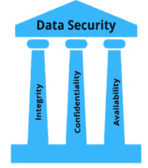

Figure 2.4 – The three pillars of data security

在职业生涯的短暂时期里，我高度专注于数据安全审计。我至今仍记得15多年前一位客户开玩笑时说的话，因为他的话此后多次引起我的共鸣。他手里拿着一份销售报告说：

> “总有一天，人们会更少关心数据的正确性，而更关心它是否被安全处理。”

说实话，当时这句话对我来说意义不大，但今天，我完全能理解。

Important note
对于任何处理数据的组织而言，安全已不再是奢侈品——而是核心要求。

根据 CIA 三要素，安全的关键支柱是完整性、保密性和可用性。遵循这些原则，数据湖中的安全应分层实施：层数越多，保护越强。数据湖可通过以下技术满足大多数合规框架的核心要求，以覆盖 CIA 三要素的关键支柱：

- Perimeter security—可通过站点到站点虚拟专用网络（VPN）、过滤 Internet 协议（IP）地址以及阻止访问互联网的组合来限制对数据湖资源的访问。
- Access control—数据湖中的用户访问可通过基于角色的访问控制（RBAC）、策略、访问控制列表（ACL）、多因素认证（MFA）和单点登录（SSO）的组合进行控制。
- **Encryption**—保护**数据在传输中**（从一个点到另一个点）和**静态数据**（存储中）的关键方法是使用加密。加密不仅可以在存储的文件级别实施，而且文件内的任何**个人身份信息（PII）**数据都可以被加密。
- **Authorization**—数据分发时需要格外谨慎。如果数据分发包含外部用户，则任务变得更加复杂。数据湖可以通过实施基于角色的访问机制（RBAC）来满足授权需求，该机制结合了基于表、行和列的安全以及数据屏蔽。

> **Important note**
> CIA 三要素只是组织安全计划的指导方针。
> 安全的强度与其中实施的层数成正比。

接下来，我们将了解存储和计算如何在数据湖中分离。

## Segregating storage and compute in a data lake

我们把最好的留到最后。数据湖能够分离（解耦）存储和计算层的能力，也许是其最受欢迎的功能之一。但为什么解耦存储和计算如此重要？要理解原因，我们首先需要了解存储和计算层。

## Storage

存储的基本功能是存储数据。简而言之，存储在过去几年中的演进如下：

- **Direct-attached storage (DAS)**—顾名思义，存储设备（**硬盘驱动器/固态驱动器**，或 **HDD/SSD**）物理连接到计算机。这种类型的存储主要存在于个人电脑和笔记本电脑中。
- **Network-attached storage (NAS)**—使用多个硬盘作为阵列连接的集中式存储。NAS 允许计算机通过普通以太网快速轻松地共享数据。
- **Storage area network (SAN)**—使用光纤连接的高性能共享存储。SAN 允许计算机之间快速共享数据。
- **Cloud storage**—云存储是该列表中相对较新的补充。在这种情况下，存储物理上存在于云提供商的服务器上。云存储使用户能够从任何地方灵活访问它，并且由于后端维护多个副本，因此可以保证数据高度可用且安全。

> **Important note**
> Azure Blob storage、Amazon Simple Storage Service（S3）和 Google Cloud Storage 是一些最知名的云存储解决方案。

## Block storage

前述列表中的所有存储类型（除云存储外）均归类为文件和块存储。这意味着数据以小块的形式存储在存储设备上，通常大小为 512 字节。一组连续的块被视为一个文件，人类就是这样理解数据的。

## Object storage

云存储归类为对象存储。对象存储的工作方式不像传统文件系统。与块存储不同，每个对象都包含以下内容：

- **Identifier (id)**—存储中每个对象的全局唯一标识符（GUID）
- **Data**—存储为 blob，全部存储在一个位置（不拆分为多个块）
- **Metadata**—关于数据的数据，例如作者、权限和时间戳

块存储与对象存储之间的差异可更好地说明如下：

### Block Storage

### Object Storage

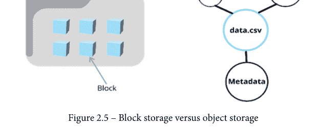

Figure 2.5 – Block storage versus object storage

由于某些关键优势，对象存储正迅速成为数据工程和分析操作的标准，列举如下：

- 对象存储具有高度可扩展性，这意味着存储可以根据组织内不断增长的数据需求而增长。
- 您节省了资金，因为无需提前预订存储容量。
- 在对象中嵌入元数据的功能有助于数据分类和分析工作负载。
- 数据可通过 **HyperText Transfer Protocol (HTTP)** 或 API 轻松访问。
- 非常适合存储视频、音频、图像和数据备份等大型文件。
- 适用于一次写入、多次读取的场景，例如数据分析。

然而，也存在一些缺点，如下所述：

- 与块存储相比，对象存储的性能较慢，特别是写入。
- 数据不能**追加**到对象；对数据的任何更改都相当于删除现有对象并重新创建它。
- 适用于需要相对静态数据的工作负载。

**Important note**
由于对对象的每次更改都相当于删除它并创建新版本，因此对象存储不适合数据更改非常频繁的**在线事务处理（OLTP）**操作。然而，它非常适合**在线分析处理（OLAP）**操作，因为数据很少更改。

## Compute

在数据湖的上下文中，计算是指处理（读取和写入）数据以进行分析操作（如整理、连接和聚合）的能力。在分析计算中，有两个资源对于顺利运行至关重要，概述如下：

- **Central processing unit (CPU)**—在任何给定计算机上，所有计算都在 CPU 中执行。CPU 的速度以时钟速度衡量，例如 2.8 **gigahertz (GHz)**。这意味着该 CPU 每秒可执行 28 亿次计算。CPU 速度越快，计算能力越强。在虚拟化世界中，该术语称为 **virtual CPU (vCPU)**。
- **Random-access memory (RAM)**—RAM 存储正在进行的计算所需的活动数据。这是为了防止重复从硬盘读取和写入操作，而硬盘的响应速度通常比 RAM 慢得多（比例为 1:50）。因此，通常更喜欢拥有尽可能多的 RAM。

## Containers

在分析处理术语中，资源以容器单元分配给作业。容器的概念是在 **Yet Another Resource Negotiator (YARN)** 中引入的，YARN 是 Hadoop 中的分布式处理框架。

简单来说，容器是两种关键物理资源——vCPU 和 RAM 的逻辑分组。由于 YARN 在集群中工作，它维护集群中 RAM 和 vCPU 的总计。

在处理时，YARN 根据作业的需求分配容器。如果集群有足够的资源满足作业需求，则立即启动作业，否则将其置于等待模式，直到资源释放为止。不同大小的容器在以下屏幕截图中显示：

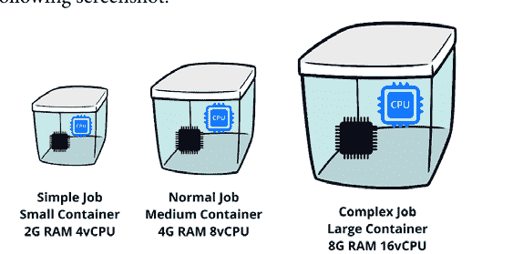

Figure 2.6 – Varying container sizes

现代时代的分布式框架极其消耗资源。Apache Spark 和 Apache Flink 在内存中执行计算，因此有时你需要大量的内存。在大数据世界中，了解作业资源在集群中如何分配和管理的内部机制，对于提高作业的完成时间和性能大有裨益。

> **重要说明**
> 为作业分配最佳所需资源的平衡行为，是每位数据工程师都应具备的核心技能。

你可能会想，*为什么我要为此操心？云计算允许我们使用几乎无限的资源……* 然而，我向你保证，我确实有道理，而且是一个很大的道理……就等着吧。

## 存储便宜；计算昂贵

这里就是：*存储便宜，但计算昂贵。* 这到底是什么意思？

几页前，我在这一节开头指出，数据湖能够分离（解耦）存储和计算层的能力，也许是其最理想的功能之一——特别是如果组织的<|message|> 基础设施在云中。

我将通过对 **Microsoft Azure** 进行一个非常高层次的估算来支持这一理论。请注意，我在这里要展示的估算是仅作为一个例子来突出前述观点。

假设如下：

- **存储**—东美地区每月 10 **太字节（TB）** 的热层 Data Lake Storage Gen2
- **计算**—东美地区每月 500 **数据仓库单元（DWU）** 的 Azure Synapse Analytics

我们将使用 Microsoft Azure 计算器 https://azure.microsoft.com/en-ca/pricing/calculator/ 来进行此估算，如以下屏幕截图所示：

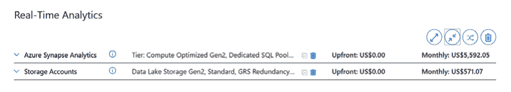

我希望这能证明我一直在试图表达的观点——**计算的成本几乎是存储的 10 倍。**

现在，让我问你一个问题。把自己放在数据工程师的 shoes 里。你会尝试优化哪一层来控制成本？如果你的答案是 *计算*，那么我已经成功地传达了我的观点。

> **重要说明**
> 作为数据工程师，在选择存储和计算资源时，牢记成本优化非常重要。这是一种罕见的技能，但却是你的客户最会感谢你的地方。

在云计算之前，大数据平台如 Hadoop 通常安装在物理机器/**虚拟机（VM）**上。在这种情况下，存储层与计算层紧密耦合，如下图所示：

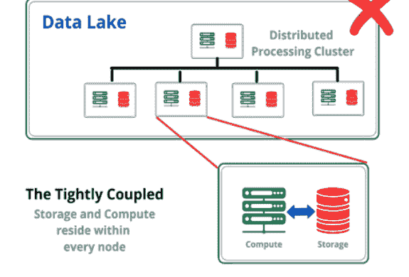

图 2.8 – 紧密耦合的数据湖

这种设置有几个缺点，概述如下：

- 计算和存储所需的容量需要 **预先购买**。购买的容量通常基于最复杂作业的需求。假设最复杂的作业一天中只有很小一部分时间运行，其余时间未使用的容量就会被闲置。
- 你需要集群 24/7 保持运行（无论你是否积极使用）。保持集群运行的成本，如空调、房地产、电力和行政成本，都会累积。

简而言之，你为未使用的东西付费……而没有人喜欢这样做。

在许多方面，转向云计算是一场变革。云中的数据湖让我们实现了以前不可能实现的事情：我们终于可以解耦存储和计算！

下图显示了一个松耦合的数据湖：

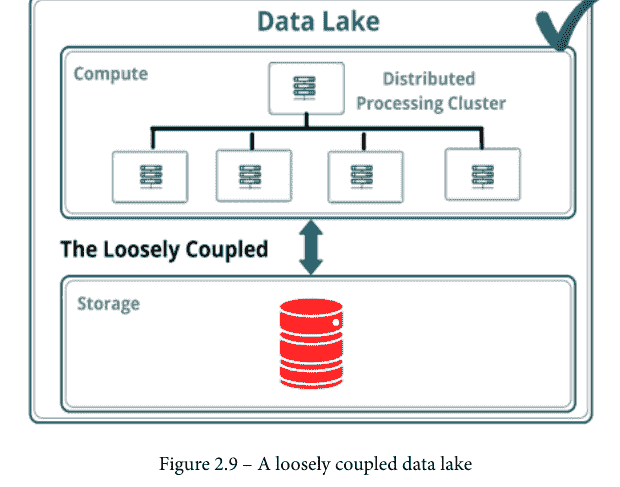

图 2.9 – 松耦合的数据湖

将存储与计算解耦提供了几个优势，概述如下：

在松耦合的数据湖中，便宜的（存储）层是永久的，而昂贵的（计算）层是临时的。它是如何工作的？

通常，在批处理期间，计算只在每天的短暂时间内执行（通常只有几个小时）。将基础设施放在云中可以让你每天在批处理开始前创建一个分布式处理集群（Hadoop/Spark/Flink）；然后运行所有作业，最后在所有作业完成后立即删除集群。由于存储部分存在于计算集群之外，即使集群被销毁也不会丢失数据。此过程在下图中描述：

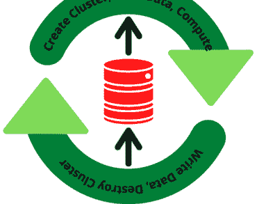

图 2.10 – 保留计算成本

通过这样做，你确保计算成本得到完全优化……你 **只为所使用的付费**。

在 *第 1 章，数据工程与分析的故事* 中，我们讨论了数据的旅程以及为什么数据工程实践正成为对数据分析认真对待的组织的核心需求。问题是，他们应该如何开始这段旅程？在下一节中，我们将深入探讨创建数据湖的规划阶段，从了解一些知名的数据湖架构开始。

## 发现数据湖架构

在开始数据湖创建的旅程之前，了解我们在现实生活中如何进行一次正常的旅程很重要。例如，在进行一次旅程——比如度假——之前，我们通常会做一些准备工作，例如：

- **计划**—列出我们希望在旅行期间访问的目的地。
- **预订**—预订最适合我们 **预算** 的航空公司和酒店。
- **访问**—希望我们的准备能使旅行既 **舒适** 又 **安全**。

为数据湖创建之旅做准备也并无不同，我们可以注意到这里：

- **计划**—选择符合组织分析需求目标的正确数据湖架构（**目的地**）。
- **预订**—在财务限制内采购创建数据湖所需资源（计算机和人力）（**预算**）。
- **创建**—根据所选架构创建必要的<|message|> 基础设施和数据管道，帮助决策者（**舒适**）并按个人许可进行分发（**安全**）。

我希望从这种比较中可以明显看出，如果没有正确的数据湖架构选择，后续所有步骤都无法满足组织的目标。

一个设计良好的架构应该能够满足数据存储和数据处理的多样化需求，包括聚合、连接和查询——不仅在批处理模式下，更重要的是在流处理模式下。

> **重要说明**
> 在批处理中，使用收集并存储了很长时间（通常几个小时）的数据进行分析，而在流处理中，使用数据一收集就进行分析。处理后，这些数据可能被永久存储，也可能不被永久存储。

在本节中，我们将重点关注数据湖世界中非常常用的四种知名数据湖架构，列出如下：

- 传统架构
- Lambda 架构
- Kappa 架构
- Lakehouse 架构

在了解各种架构类型之前，我们应该了解一个适用于分布式计算平台的著名定理。

## CAP 定理

在分布式计算成熟之前，系统的 **可扩展性** 是通过添加更多硬件资源来提高的。这可能是通过为现有节点添加更多内存、磁盘和 CPU（或组合）来实现的。这种类型的扩展通常称为 **垂直可扩展性**，如图 2.11 所示。但这种类型的扩展有几个巨大的缺点，详细说明如下：

- 添加新硬件受限于节点的最大可扩展性——例如，主板上用于扩展内存的插槽数量有限。

- 现有的节点最终会达到其过期周期，可能需要完全替换。因此，增加新硬件的成本可能无法证明其合理性。

在通常被称为 **分布式计算** 的现代计算时代，系统的可扩展性是通过横向实现的，如 *Figure 2.12* 所示。这种类型的扩展通常被称为 **水平可扩展性**。它遵循 *不断添加节点* 的原则。

垂直可扩展性可以描述如下：

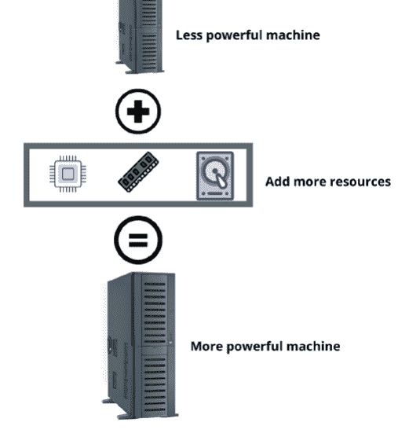

Figure 2.11 – Vertical scalability

**Important note**
水平扩展并不是通过向现有节点添加硬件来实现的，而是在需要更多算力时添加新节点。

水平可扩展性可以描述如下：

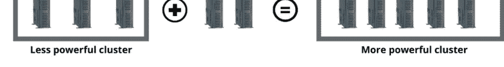

Figure 2.12 – Horizontal scalability

CAP 定理基于分布式计算系统的三个关键特性，概述如下：

- **Consistency**—所有节点应包含相同的数据。这意味着写请求应在数据对读请求可用之前成功将数据传播到所有其他复制节点。换句话说，无论由哪个节点提供服务，读请求都应接收相同的数据。
- **Availability**—用户即使节点宕机也应能够访问系统。这意味着他们应始终对其读/写请求获得 **success** 响应。然而，这并不意味着所读取的数据确实是最新的。
- **Partition tolerance**—系统应能够容忍网络延迟和中断。这意味着分布式系统中的数据复制安排应考虑到网络故障。在 Hadoop 中，这一概念是通过机架感知实现的。

根据 CAP 定理，分布式计算系统不可能同时提供全部三个保证。它最多只能提供其中两个——你需要牺牲第三个。该概念在以下图表中说明：

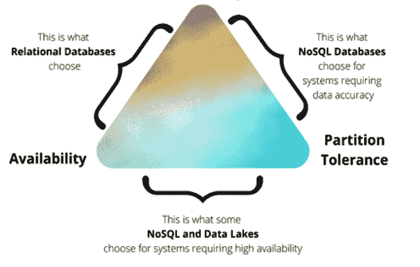

Figure 2.13 – The CAP theorem

了解 CAP 定理在数据湖领域很重要，因为它让你意识到在你的案例场景中可能需要做出的权衡。

## The trade-offs

根据 Figure 2.13，对于数据湖操作，我们通常选择 AP（可用性和分区容错性）并牺牲一致性。这种选择涵盖了大多数数据分析场景，在这些场景中，可以为了更大的利益而牺牲数据准确性。如果数据是在较长时期内聚合的，几个不一致/不正确的值不会在很大程度上影响正确性。

然而，考虑物联网分析中的一个案例，我们试图使用传感器监控房间的温度以防火灾事件。在这种情况下，传感器缺失或错误的读数可能是灾难性的。因此，对于这种情况，选择 CP（一致性和分区容错性）可能是明智的。这就是为什么使用 NoSQL 数据库对于关键任务的流式分析是一个更好的选择。

## Traditional architecture

几年前，Hadoop 是分布式数据存储和处理系统的最流行引擎——那是 **批处理** 的时代。使用 Hadoop，典型的批处理工作流是这样运行的：

- **Orchestration**—使用预配置的工具如 **Oozie** 来调用工作流（管道），执行以下操作。
- **Batch collection**—每隔几小时收集和摄取数据。最初，24 小时的窗口是常态，但由于对实时数据的需求不断增长，窗口开始变小。数据收集使用各种 Hadoop 生态系统工具如 **Sqoop** 和 **Flume** 执行。传入数据存储在 HDFS 中以便进一步处理。每次收集新数据时，它都会附加到之前的数据集，通常通过创建时间戳分区。
- **Batch processing**—一旦数据保存到 HDFS，就使用 **MapReduce** 引擎（分布式处理框架）进行处理。这是通过多种方法完成的，例如使用 **Java**、**Python** 或 **Perl** 等语言编写程序，或使用 **Pig** 和 **Hive** 等框架。

我必须承认，在那个时候，我的客户仅仅因为我设法从各种来源将他们的数据摄取和处理到 Hadoop 中就感到非常兴奋，尽管它带来了 **高延迟**。

以下图表表示 **SALES** 数据相隔 24 小时的状态：

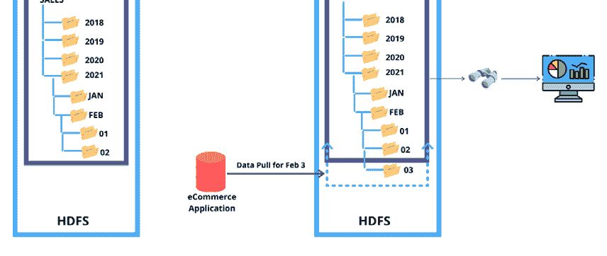

Figure 2.14 – State of data 24 hours apart

**Sales report created on February 2**—包括从开始（2018 年）到 2021 年 2 月 2 日的所有数据。

**Sales report created on February 3**—包括从开始（2018 年）到 2021 年 2 月 3 日的所有数据。

现在，传统架构的问题是：

如果销售报告在 2 月 2 日和 2 月 3 日之间通常的定期报告生成时间之间生成，报告将缺少 2 月 3 日发生的销售。换句话说，无论在中间期间生成的报告是什么，这始终只会部分不准确。为了解决这个问题，我们开始将批处理窗口缩短到 12/8/4 小时，但无论如何，报告中总会有部分数据缺失。

随着时间的推移，客户开始要求对接近实时的数据进行数据分析，为能够满足他们日益增长需求的更好架构铺平了道路。

> **Important note**
> MapReduce 无法实时处理数据的能力为其他分布式框架如 Spark 和 Flink 的出现铺平了道路。

## Lambda architecture

Lambda 架构应运而生，以解决同时处理批处理和流数据混合处理的需求。Lambda 架构由 **Nathan Marz** 引入，他创建了著名的实时处理引擎 **Apache Storm**。Lambda 架构由三个层组成，接下来详细介绍。

## Batch layer

批处理层存储主数据集。主数据集包括自收集过程开始以来收集的所有历史数据。在我们之前介绍的示例中，屏幕截图中的数据集代表 **SALES** 主数据集。

主数据集的一些特征是：

- 它是不可变的。数据的不可变性意味着现有数据不能被更改，新数据只能被追加。
- 它可以被服务层用来发布数据。
- 它可以定期增量合并更改的数据。

你可以在这里看到主数据集的文件结构：

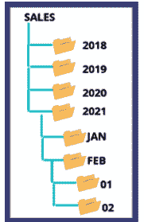

Figure 2.15 – Master dataset

让我们现在简要介绍一下变更数据捕获，即 CDC 的术语。成功捕获和处理随时间变化的数据使它成为我职业生涯中遇到的三大挑战之一。我们将在未来的章节中专门讨论 CDC，标题为 Solving Data Engineering Challenges。

创建批处理层的一些知名工具是 Apache Hadoop、Apache Flink 和 Apache Spark。

### Serving layer

服务层使用批处理视图使主数据可用于查询过程。批处理视图通常是预计算聚合的结果。由于数据在很大程度上是预先计算的，这些视图为用户提供了低延迟访问。

以下屏幕截图显示了一个按季度聚合 SALES 的批处理视图。在此视图中，2018 年至 2020 年各季度的聚合将是准确的，因为这些分区的数据不再发生变化。然而，2021 年 > Q1 的数据仍在不断演变和变化，因为销售仍在进行中：

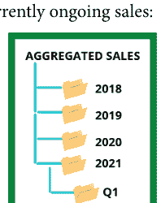

Batch View

Figure 2.16 – Aggregated batch view

以下是我们如何为 2021-Q1 实现准确结果：

## 2021-Q1 from batch view + Aggregate（February 3 SALES）

后者的汇总数据缺失，而这正是速度层将帮助我们的地方。

服务层的常用工具是 Apache Hive 和 Presto。

## Speed layer

速度层存储尚未因合并过程的延迟而合并到批处理视图中的最新数据集（增量）。该数据作为实时视图提供给查询过程，通常使用流处理创建。你可以在这里看到实时视图的示意图：

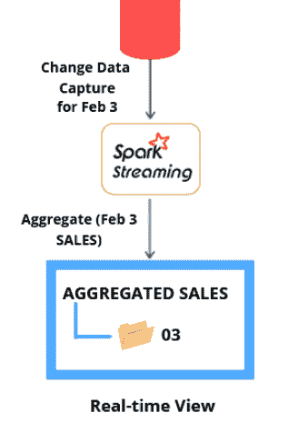

Figure 2.17 – Aggregated real-time view

在传统架构中，这正是 Hadoop MapReduce 无法处理的层，因此需要推进到更新的框架。

速度层的常用工具是 Apache Spark Streaming、Apache Storm 和 Apache Flink。

Lambda 架构中所有内容是如何结合起来的：

- 增量数据从源并发推送到批处理层和速度层。
- 批处理层在特定时期内持续累积数据，并在该时期到期后刷新批处理视图。

你可以在这里看到 Lambda 架构的各个层：

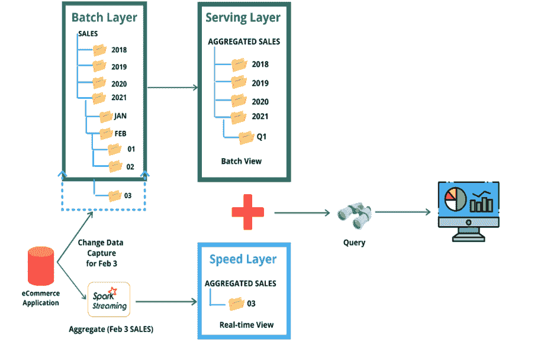

Figure 2.18 – Various layers of a Lambda architecture

- 增量数据被推送到速度层，在那里以流式方式聚合为实时视图。
- 在查询时，批处理视图的结果与实时视图的结果合并，以获得最新且准确的数据。

Lambda 架构有多个优点，包括由于预计算视图而延迟低，以及由于接近实时访问数据而数据准确。

以下是一些使用 Lambda 架构取得巨大成功的案例场景：

- **访问接近实时数据**——在某些情况下，如果无法访问最新数据，决策过程会受到不利影响。
- **大型历史数据集**——在某些情况下，历史数据极大，因此聚合可能需要很长时间才能完成，并且不能频繁执行。
- **分析的动态性（临时）**——在某些情况下，数据分析的案例场景非常动态且变化频繁。在这种情况下，批处理和实时视图可以在不影响底层主数据的情况下创建或调整。

> **重要说明**
> Lambda 架构的一个特别优势是其易于从传统架构迁移。我过去曾成功完成了其中几个迁移。

Lambda 架构提供了性能和数据新鲜度的良好平衡。但在最近，流式分析的需求急剧增长。物联网监控和异常检测等用例需要能够支持每秒数百万个传入请求的快速实时分析引擎。

尽管 Lambda 架构具有所有优势，但也有一些缺点，如下所述：

- 在某些情况下，由于层数多，实现起来有时很复杂。更多的层也意味着更多的成本，包括资源、管理和监控。
- 每层都需要不同的工具、服务和编程。因此，基础设施和代码管理变得具有挑战性。
- 在某些场景中，由于分析的性质，实现 Lambda 架构可能矫枉过正。

最近，一种更简单的架构被引入，即 Kappa 架构，许多人称其为 Lambda 架构的简化版本。

## Kappa architecture

**Kappa 架构**由 **Jay Kreps** 于 2014 年引入。该架构完全消除了对批处理层的需要。相反，所有数据都存储在实时层中，该层在流处理平台中维护一个不可变的事件流。

Kappa 架构的主要组件在以下小节中描述。

### Streaming layer

**流式层**以按创建时间戳排序的顺序事件（消息）形式存储所有原始数据。由于数据不存储在常规文件系统上，所选的流式平台应包含内置功能，例如 **容错 (FT)** 和 **高可用性 (HA)**。

流式层存储的常用工具是 **Apache Kafka**、**Azure Event Hubs**、**Amazon Kinesis** 和 **Google Pub/Sub**。

流处理引擎读取事件数据，执行所需计算，并将转换后的数据作为视图发布到服务层。

流式层处理的常用工具是 **Apache Spark Streaming**、**Apache Flink** 和 **Kafka Streams**。

### Serving layer

服务层使用预计算视图使事件数据可供查询过程使用。这些视图可以通过重新启动视图构建代码在定期间隔重新计算。

服务层的常用工具是 **关系数据库** 和 **数据仓库**、**云数据仓库** 和 **云数据存储**。

Kappa 架构的工作方式如下：

流处理引擎执行聚合并将结果作为预计算视图发布到服务层。根据图 2.19，在时间 t，流处理代码从 2018 年计算到 sales 主题中的最新事件。

计算后的数据作为 **AGGREGATED SALES** 视图发布，然后用于分析查询。

你可以在这里看到该过程的图表：

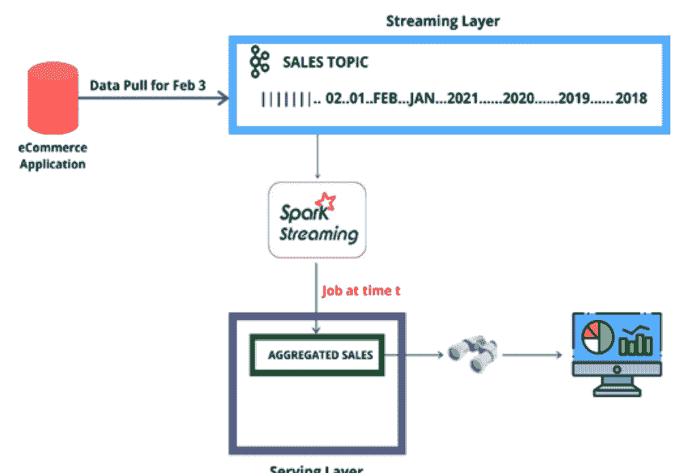

Figure 2.19 – State of aggregate view at time t

在时间 t + 1，流处理代码重新计算从 2018 年到 sales 主题内最新事件的数据。请注意，自上次执行计算以来，已有新事件添加到队列中。重新计算的数据按如下方式发布：

- 之前的 AGGREGATED SALES 视图版本被删除。
- 计算新的 AGGREGATED SALES 视图版本以取代其位置。
- 查询指向重新计算的视图。

你可以在这里看到该过程的图表：

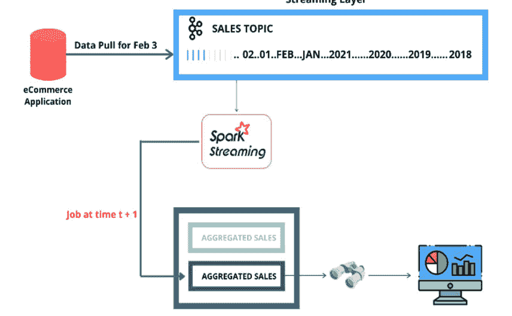

Figure 2.20 – State of aggregate view at time t+1

现在我们知道了 Kappa 架构的一般工作原理，让我们概述一下其优缺点如下：

- Kappa 架构对于物联网监控和实时分析用例以及对历史数据依赖有限的情况工作得非常好。
- 与 Lambda 架构不同，单一代码库足以进行数据处理。这极大地简化了基础设施部署和管理要求。
- 由于 Kappa 将所有数据存储在流式层中，对于较大数据集，通常在 TB 范围内，架构变得极其昂贵。

让我们从非常高层次比较成本，如下：

- 在 Microsoft Azure Premium SSD Managed Disks 上存储 32 TB 数据，每月大约花费你 4,194 美元。
- 在 Microsoft Azure Blob 存储上存储 32 TB 数据，每月仅花费你 682 美元。

许多专家认为 Kappa 架构是 Lambda 架构的替代品，尽管我对这一点看法不同。对我来说，每种架构解决的是不同的目的。以下是一些我使用 Kappa 架构取得巨大成功的案例场景：

- **实时监控**——物联网传感器的监控是 Kappa 架构的完美用例。在几乎所有监控案例中，访问历史数据并不是必需的。
- **实时仪表板**——我相信你已经看到以实时方式可视化数据的仪表板。视觉效果根据传入数据每隔几秒刷新一次。
- **实时 ML**——许多公司现在将 ML 模型作为微服务公开，用于欺诈检测等用例。
- **实时数据货币化**——我们之前讨论过数据货币化作为收入多元化的手段。现在越来越多的公司将数据实时暴露给外部公司进行消费。

**重要说明**
在选择合适的架构之前，数据工程师应根据客户需求、近实时分析的紧迫性以及资源成本仔细评估每个架构的优势。

Lambda 和 Kappa 架构都是分层的——数据在存储/流式层收集，经过处理，最后发布到仓库。我过去曾使用这些架构完成了多个项目，但说实话，实现其中任何一个都伴随着一些挑战，例如以下几点：

- 在每个层级保持数据新鲜和最新是困难的。不断变化的数据需要精心设计的合并过程。
- 在两种架构中，基础设施成本有时会很高。
- 更多的层意味着更多的故障机会。处理故障不仅成本高，而且不及时，因为它会延迟正在进行的数据分析。
- 如果数据被发布到外部用于数据货币化目的，任何故障或不准确都可能导致收入损失和客户不满。

Lambda 和 Kappa 架构之前提到的一些缺陷迫使专家们寻找新的思考方式。

一般来说，在任何数据湖操作中，我们都会将数据摄取到存储中，根据需求对其进行处理，最后将聚合数据发布到仓库，以便用于分析。

最近，一种新的架构正在快速被采用，它将数据湖和数据仓库的强大功能结合在一起，如下图所示：

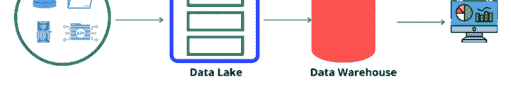

## 数据湖与数据仓库是解耦的

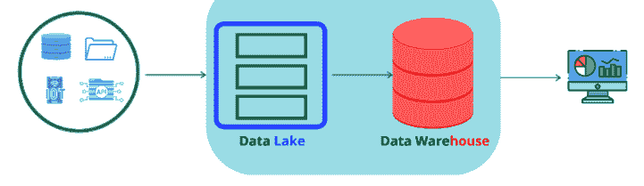

## 数据湖与数据仓库是合并的

图 2.21 – Lakehouse 架构的兴起

在本节中，我们学习了 Kappa 和 Lambda 架构，以及 Lakehouse 架构的兴起。

## Lakehouse 架构

在讨论 Lakehouse 架构之前，了解我所指的传统与现代数据处理系统之间的权力斗争非常重要。

## 权衡之争

我年轻时玩过一种卡牌游戏。在这个游戏中，要进入下一关，你需要牺牲你的最佳卡牌。

在数据处理领域多年，我看到传统数据处理方法（数据库/数据仓库）与现代方法（数据湖）之间存在同样的取舍斗争。

你可以在下面的图表中看到这种权力斗争的描绘：

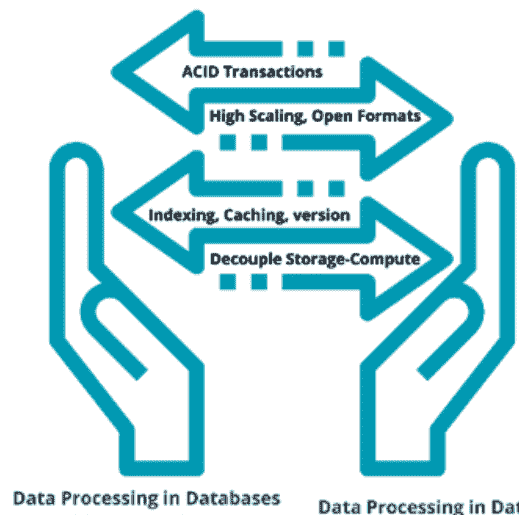

图 2.22 – 权力斗争

转向现代数据处理平台的决定迫使我们做出一些牺牲；你得到一些，也失去一些。让我强调一下从传统方法转向现代方法时必须面临的以下取舍情况：

- 牺牲耐用性和一致性特性，例如 **原子性、一致性、隔离性和持久性（ACID）** 事务，但获得在高度可扩展平台上处理数据的能力。
- 牺牲性能特性，例如索引和缓存，但获得以多种格式处理数据的能力。
- 牺牲安全性特性，例如版本控制和审计，但获得解耦存储和计算的能力。

Lakehouse 架构，如下图所示，将数据湖的低成本存储与仓库的 **大规模并行处理（MPP）** 能力相结合，以满足现代分析多样化且不断演变的各种需求：

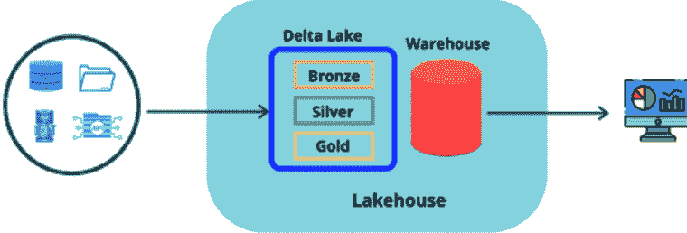

图 2.23 – Lakehouse 架构

以下是 Lakehouse 架构的几个重要特性：

- **支持低成本存储**——Lakehouse 架构延续了对使用低成本存储的支持。数据可以是结构化、半结构化或非结构化，并以 Parquet 等开放格式存储。
- **支持 ACID 事务**——这一点非常重要。缺乏事务支持会极大地影响数据湖中的数据完整性和质量。多年来，处理重复和删除数据一直是一个巨大的挑战。我记得在早期，需要在 Hive 中进行多步骤处理来应对这个问题。几年后，Spark 取代了它，但挑战依然存在。但斗争终于结束了……万岁 **Databricks Delta Lake**！
- **元数据管理**——Lakehouse 架构提供强大的元数据管理功能，例如模式强制和演进。同样，过去缺乏此类功能迫使我们使用代码执行类似检查。

**重要说明**
自推出以来，Delta Lake 已证明是数据工程师的救星，不仅解决了 CDC 挑战，还解决了许多其他问题，例如模式演进和时间旅行。Lakehouse 架构假定使用 Delta Lake 等开源存储引擎来实现 ACID 事务、元数据管理、治理以及许多其他功能。

- **存储与计算分离**——Lakehouse 架构保留了解耦存储和计算以实现大规模扩展和成本节约的理念。
- **支持 BI 工具**——Lakehouse 架构通过标准的 **Java 数据库连接（JDBC）/开放数据库连接（ODBC）** 连接支持与所有主要 BI 工具的连接。
- **原生支持结构化查询语言（SQL）**——用户可以轻松利用 SQL 语言的强大功能进行分析。

> **重要说明**
> 在 Azure 中，Lakehouse 架构使用 Synapse Analytics 实现。
> 除了使用 Synapse SQL 进行分析外，它还提供对 Apache Spark 的支持。

- **支持流式工作负载**——Lakehouse 架构支持使用流式数据进行实时分析和报告。

Lakehouse 架构的常用工具包括 **Azure Synapse Analytics**、**Amazon Redshift Spectrum**、**Google BigQuery** 和 **Snowflake**。

这些章节应解释 Lakehouse 架构如何提供传统、Lambda 和 Kappa 架构的良好融合。我认为，Lakehouse 是创建数据湖的正确配方——它不仅可行，而且在 **用户体验（UX）**、可扩展性和成本之间提供了正确的平衡。

## 摘要

在本章中，我们学习了数据湖及其各种特性，例如多个区域、处理多种格式的能力、治理，以及最重要的——解耦存储和计算的能力。

我们还学习了四种关键的数据湖架构：传统、Lambda、Kappa 和 Lakehouse。我们从其在特定案例场景中的适用性、成本和整体管理等方面分析了每一种架构。

在下一章中，我将重点介绍在 Microsoft Azure 中构建使用 Lakehouse 架构的数据湖所需的各种工具和服务。

### 3

#### Microsoft Azure 上的数据工程

在上一章中，我们讨论了云采用如何为数据工程和分析工作负载提供更大的灵活性和更快的部署。在本章中，我们将讨论 Microsoft Azure 中的主要工具和服务，这些工具和服务可以帮助我们实现此类解决方案。

在本章中，我们将涵盖以下主题：

- Azure 数据工程简介
- 在 Azure 中执行数据工程
- 如何在 Azure 中开设免费账户

##### 在 Azure 中介绍数据工程

近年来，Microsoft Azure 已在其产品组合中增加了多个强大的服务，这些服务可无缝收集、存储、处理和发布批处理和流式工作负载的数据。过去在云服务提供商之间存储和计算选择严重受限的时代已经一去不复返了。作为用户，你只需遵循提供的工具和服务即可；现在，你的选择更加广泛。

今天，云生态系统与过去大不相同。云服务的增长使用户可以选择各种存储、计算和部署选项。例如，如果我想运行一个 Spark 程序，我可以在 Microsoft Azure 中至少选择四种不同的选项。真正的问题是，如果这四种选项都在运行 Apache Spark，那么为什么还需要这些选项呢？

> **重要说明**
> 云上可用的选项种类不仅限于计算：数据收集、基础设施部署和管道编排服务也存在同样的多样性。

以下是 Microsoft Azure 上提供多种执行类似数据工程操作选项的一些原因：

- **易用性**：服务的易用性是决定使用哪个选项的关键因素。作为数据工程师，你可以自己编写整个 **ETL** 程序，也可以选择在创建可视化工作流后自动生成并调用代码的服务。
- **数据工程团队技能**：数据工程团队的技能水平在决定选择哪个选项时起着非常重要的作用。拥有熟练数据工程师的团队通常倾向于选择需要从头开始编码数据工作流的服务。这样做可以让工程师完全控制其程序以及任何其他依赖项。
- **所需的管理和监控级别**：拥有熟练的数据工程团队并不自动意味着同一团队将参与管理和监控操作。根据谁将在生产环境中管理它，可能需要调整服务选择。
- **自助式分析**：如今，自助式分析的概念正在兴起。这意味着最终用户越来越多地参与创建 ETL/ELT 工作流。对于这组特定用户来说，能够在几次点击中创建拖放式工作流的能力极具吸引力。

> **重要说明**
> 自助式分析的理念如今越来越受欢迎。
> 自助式分析能够快速实现最终用户分析目标的交付。

- **对基础设施的期望控制水平：** 期望对基础设施的控制水平是影响服务选择的重要因素。在某些情况下，云提供的服务可能缺少某些期望的功能，并且不允许更改底层基础设施。在这种情况下，数据工程师可能希望选择提供对基础设施完全控制的服务。
- **完全数据隔离：** 某些严格的合规框架不允许使用多租户服务。在这种情况下，完全数据隔离是强制性的，从而影响可能合适的选择。

> **重要说明**
> 关于云服务是否真正符合众所周知的框架，例如 HIPAA，存在持续的争论。云存储的多租户特性是做出该断言时的一大障碍。可以公平地说，云存储支持合规框架，但并不真正合规。

- **对某些框架的先前熟悉程度：** 这是组织将分析从本地迁移到云时极其重要的因素。由于他们已经熟悉某种工具或框架，因此他们倾向于选择云中可用的最接近的选项。
- **成本：** 最后，服务的成本是影响应做出何种选择的主要因素。通常，使用和管理特定服务越容易，其成本越高。因此，在选择服务之前，进行仔细的成本分析是必要的。

> **重要说明**
> 作为一名数据工程师，倾向于特定工具、语言和框架是可以理解的。但一旦你离开，就成为客户的责任来管理这些。尽量将你的偏见放在一边，并为客户提供使用客户感到舒适的技术解决方案。

## 在 Microsoft Azure 中执行数据工程

数据工程在 Microsoft Azure 中可使用以下三种选项执行：

- 自托管数据工程服务（IaaS）
- Azure 管理的数据工程服务（PaaS）
- 数据工程即服务（SaaS）：

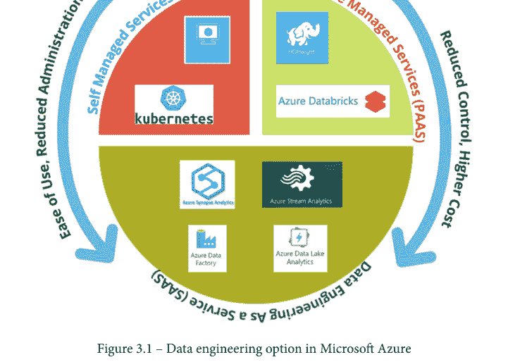

图 3.1 – Microsoft Azure 中的数据工程选项

## 自托管数据工程服务（IaaS）

在数据工程的早期阶段，使用 Hadoop、Spark 和 Kafka 等知名分布式框架大幅上升。因此，许多组织使用本地基础设施部署 Hadoop/Spark/Kafka。由于 Hadoop/Spark/Kafka 是多节点框架，这意味着安装使用物理和虚拟机在组织自有或托管数据中心中托管。

然后是云开始成为现实的时期，组织开始将 Hadoop/Spark/Kafka 集群迁移到云。在云演进的非常早期阶段，使用自托管服务可能是数据工程唯一可用的选项。

## IaaS 用例

以下是使用 IaaS 层是合理的几个用例：

- 一个组织拥有大量 **定制** 的 Hadoop/Spark/Kafka 集群。这意味着它们绑定到特定版本，这些版本在云 PaaS 等效服务上不可用。
- 该组织已为数据工程和数据科学开发了自己的库，这些库无法轻松部署在云上的 PaaS 或 SaaS 方案上。
- 一个组织的安全法规不允许使用多租户云服务。这迫使它们使用单租户专用云资源。
- 一个组织无法容忍使用共享服务时计算能力的变异性。

让我们看看如何使用 Microsoft Azure 上的 **基础设施即服务（IaaS）** 层，使用自托管服务执行典型的 Hadoop/Spark/Kafka 部署。

**Azure 虚拟机（Azure VMs）** 允许您创建按需计算资源用于数据处理。以下列表描述了使用 Azure VMs 可用的一些功能：

- 清点本地 Hadoop/Spark/Kafka 节点 – 节点总数、汇总 CPU 和汇总内存。
- 筛选 Microsoft Azure 上的虚拟机，其提供的汇总 CPU 和内存与本地清单相似。此步骤需要仔细规划和计算。没有必要在 Microsoft Azure 上采购相同数量的节点，只要汇总 CPU 和内存满足或超过本地部署即可。在分布式计算中，节点的水平可扩展性是优选的。强烈建议比较 Microsoft Azure 上的不同类别的虚拟机；在许多情况下，您可能能够采购较小的类别虚拟机，其价格比较高类别的便宜，两者提供的汇总 CPU 和内存相同。
- 在 Microsoft Azure 上采购虚拟机。
- 配置节点之间的网络，开放所需的防火墙端口，并安装操作系统先决条件。
- 安装和配置 Hadoop/Spark/Kafka 以及任何其他生态系统工具，例如 Sqoop、Oozie、Hive 等。这些步骤需要在多个节点上执行。
- 安装和配置管理和监控软件。

以下是自托管服务的几个优缺点：

- 使用虚拟机执行部署可为数据工程师提供完全自由选择任何框架和任何版本，并完全控制其依赖项的自由。
- 从之前概述的部署过程可以明显看出，选择自托管服务需要仔细的规划、设计和执行。
- 由于触点种类繁多，负责部署的数据工程团队需要在多个领域具备技能，包括云部署、网络、管理和监控。请注意，所有这些技能都超出了数据工程团队通常的期望，后者通常涉及诸如管道开发和数据编排等事项。
- 使用自托管服务扩展集群可能成为一个挑战。

正如我们之前提到的，使用自托管服务部署 Hadoop/Spark/Kafka 集群并非可选项。然而，有一些方法可以最大程度地减少我们刚刚讨论的局限性的影响。

## Hadoop/Spark/Kafka 分发版

使用 VM 部署 Hadoop/Spark/Kafka 集群的过程涉及多个节点。处理这些集群的安装、升级、管理和监控的一种更简单的方法是使用 **Cloudera**、**Hortonworks** 和 **MapR** 等分发版。这些分发版均包含可使用最小设置进行集群配置的软件。**Ambari** 使用户能够轻松创建、管理和监控 Hadoop 集群，而 **Cloudera Manager** 使用户能够配置 **Hadoop** 和 **Spark** 集群。

## 基础设施即代码

**基础设施即代码（IaC）** 是使用配置文件部署云资源例如 VM 的实践。使用此实践，您可以创建整个基础设施或对其进行修改。使用 IaC 可显著减少重复性任务的手动工作，同时保持高水平的一致性和准确性。我们将在 *第 11 章，基础设施配置* 中更详细地讨论此实践。

Azure 资源管理器（ARM）使用资源模板集中 IaC 部署。

## 容器化

**容器化** 是将应用程序代码与底层基础设施抽象开来的实践。使用容器化提供若干好处，包括隔离主机环境、选择软件版本和依赖项管理。这意味着集群节点现在可以在称为容器的独立环境中运行。这些容器可以使用众所周知的编排引擎 **Kubernetes** 进行编排。**Azure Kubernetes Service（AKS）** 允许您轻松部署和管理容器化应用程序。

> **重要说明**
> 在云时代，许多组织正在采用使他们保持云中立的技术。谁知道哪个供应商会降价以及何时？将应用程序容器化使他们能够在云供应商之间按需移动。

## Azure 管理的数据工程服务（PaaS）

大数据浪潮开始获得动力后，云供应商例如 Microsoft Azure 开始创建托管服务，为客户提供快速部署和易于管理。在我们深入了解服务的具体细节之前，让我们先关注使用 Azure 上的 **平台即服务（PaaS）** 层的一个 Azure 管理服务意味着什么：

- 资源使用最少的配置和用户输入进行部署。
- Azure 会监控资源是否宕机，并在检测到故障时自动恢复。
- 全球可用。
- 与其他 Azure 服务集成良好。
- 自动提供数据冗余。
- 包含用于数据保护的内置安全机制。

### PaaS 用例

以下是使用 PaaS 层是合理的一些用例：

- 一个组织拥有本地 Hadoop/Spark/Kafka 集群，并希望快速迁移到云端。
- 一个组织云技能有限，因此希望使用运维要求低的服务。
- 一个组织的安全法规允许使用多租户云服务，并且可以容忍计算能力的波动。

以下是一些 Azure 管理的 PaaS 服务。

### Microsoft Azure 中的数据存储服务

在大数据浪潮期间，包括 Microsoft Azure 在内的云厂商开始推出专门针对存储海量数据和多样化数据的存储解决方案。为了满足大规模存储大文件的需求，对象级存储已成为所有云厂商的共识选择。让我们来看看 Microsoft Azure 中被认为适合数据湖的存储类型。

#### Azure Blob 存储

**Azure Blob storage** 是一种对象存储解决方案，针对存储大量文本和二进制数据进行了高度优化。Azure Blob storage 在可扩展性、高可用性和安全性方面投入巨大。它将数据存储在三个层级：热层、冷层和归档层。热层用于频繁访问的数据，冷层用于不频繁访问的数据，归档层用于很少访问的数据。根据使用情况，您可以在标准和高级两种性能层级之间进行选择。

Azure Blob storage 中的数据通过多种身份验证机制受到保护，例如 **Azure Active Directory**、共享密钥和 **共享访问签名 (SASes)**。您还可以使用 **基于角色的访问控制 (RBAC)** 来保护 blob。您可以为防止意外更改和删除而启用版本控制。此功能会在需要恢复时保留 blob 的先前版本。

Azure Blob storage 中的 blob 会自动加密并实现冗余。数据会被存储多个副本——默认情况下，三个副本存储在单个物理位置内，并且存在跨区域和跨区域存储副本的多种选项。

Azure Blob storage 按如下方式组织数据：

- **存储帐户**：存储帐户保存您的数据。Azure 中会为您的帐户分配一个唯一命名空间。示例命名空间地址为 `https://mydatanalytics.blob.core.windows.net`。
- **容器**：容器组织一组 blob。容器应具有有效的 DNS 名称，例如 `https://mydatanalytics.blob.core.windows.net/mydatacontainer`。
- **Blob**：实际存储在容器中的数据：

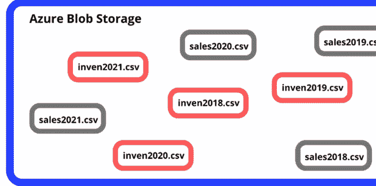

图 3.2 – 在 Azure Blob storage 中存储 blob

> **重要说明**
> 对象存储的一个特定缺点是其搜索性能缓慢。
> 在 Azure Blob storage 中，您可以使用索引标签来加快搜索速度。

#### Azure Data Lake Storage Gen2

就分析工作负载的适用性而言，Azure Data Lake Storage 相对于 Azure Blob storage 具有显著优势。但在继续说明原因之前，让我先做一个澄清：Azure Data Lake Storage 是构建在 Azure Blob storage 之上的一个层。

Azure Data Lake Storage 与 Apache 生态系统工具（如 Hadoop 和 Spark）兼容。它将 Azure Blob storage 提供的所有优秀功能汇集在一起，并提供更多功能：

- **分层命名空间**：与具有扁平命名空间的 Azure Blob storage 相比，Azure Data Lake Storage 将 blob 组织在目录层次结构中。这种 blob 组织方式极大地提高了搜索操作的性能。
- **访问控制列表**：Azure Data Lake Storage 通过使用 **POSIX** 风格的权限来支持 blob 的细粒度安全。
- **专为分析而设计**：Azure Data Lake Storage 为 Hadoop 和 Spark 等主要开源平台提供出色的支持。使用 Azure Blob 文件系统驱动程序，开源平台可以轻松访问对象存储而无需显式代码：

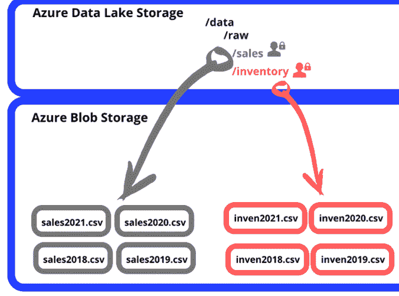

图 3.3 – 在 Azure Data Lake Storage 中以层次结构存储 blob

- **与 Azure 服务紧密集成**：Azure Data Lake Storage 可与 Azure Data Factory、Azure HDInsight 和 Azure Stream Analytics 等 Azure 服务无缝集成。

#### Azure Event Hubs

**Azure Event Hubs** 是一个数据流平台，用于摄取事件数据。收集的事件数据的来源通常是应用程序日志、点击流和 IoT。Azure Event Hubs 可以以最少的配置进行部署。

您可以使用 Azure Event Hubs 进行批处理和实时处理。对于批处理，Event Hubs 中的数据可以捕获到 Azure Blob storage 或 Azure Data Lake Storage 中，以便稍后处理。对于实时处理，您可能需要将数据发送到 Azure Functions，后者可以根据事件采取进一步行动：

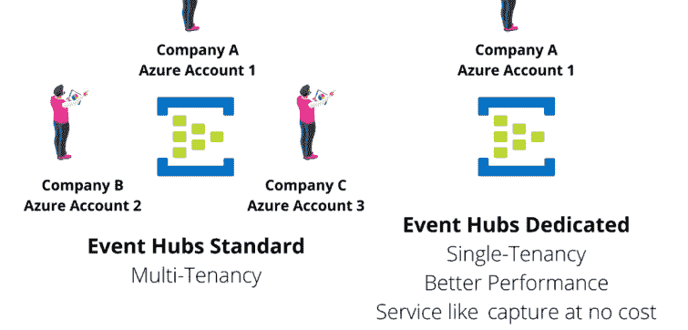

图 3.4 – Azure Event Hubs 中的多租户和单租户

Azure Event Hubs 中的数据不会永久存储。默认情况下，队列为 1 天，但在标准版中可增加至 7 天，在专用版中可增加至 90 天。

事件数据存储在分区中——分区数量越高，读写吞吐量越高。Azure Event Hubs 的容量是通过吞吐量限制预先购买的，一旦吞吐量限制等同于写入进程（1 MB/1,000 个事件）或读取进程（2 MB/4,096 个事件）。可使用自动扩展功能根据峰值需求自动扩展您的吞吐量单元。

Azure Event Hubs 在主数据中心内复制数据，并启用了 **自动故障检测** 和恢复功能。为了获得额外的保护，还可以启用跨可用区复制。

#### Azure Cosmos DB

Azure Cosmos DB 是一种高可用性和低延迟的 NoSQL 类数据库。作为托管服务，安装、修补和升级等通常的管理员挑战都由 Azure 负责。Cosmos DB 将数据存储在 SSD 上，并且数据默认加密。

Azure Cosmos DB 具有全球分布性，使其非常适合需要高响应性的应用程序。在全球分布式部署中，Azure Traffic Manager 可以成功将应用程序请求路由到最近的 Azure 区域，而无需对代码进行任何更改。这样，应用程序即可在读写操作中实现快速响应时间：

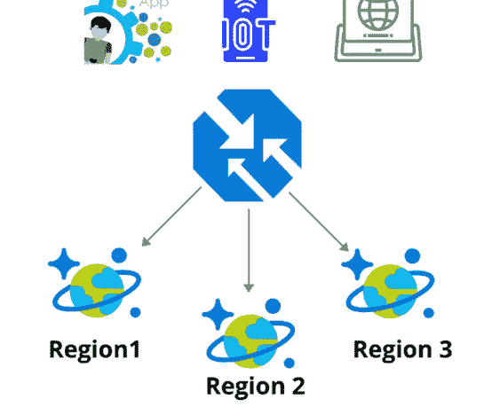

图 3.5 – 使用 Azure Cosmos DB 实现全球分发

由于其无模式设计，因此可以轻松地大规模存储半结构化和非结构化数据。以下是 Azure Cosmos DB 资源模型的外观：

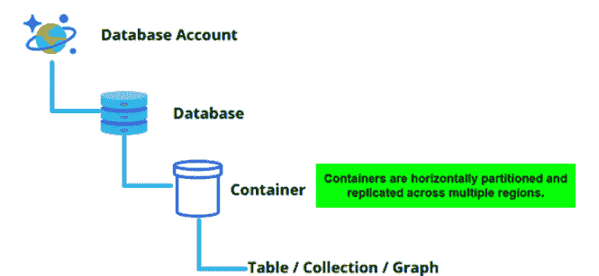

图 3.6 – Azure Cosmos DB 资源模型

在 Azure Cosmos DB 帐户下，您可以创建数据库、容器和项目。Azure Cosmos DB 支持多种 API，您选择的 API 会影响项目的类型。项目将数据存储在容器中，并根据以下映射具有可变模式：

- **Table API 和 SQL API**：表
- **Cassandra API**：行
- **MongoDB API**：文档
- **Gremlin API**：节点

分区是充分发挥 Azure Cosmos DB 性能的重要方面。基于分区键，数据存储在称为 **逻辑分区** 的子集中。将数据存储在分区中可极大地提高性能，因为逻辑分区中的所有项目都具有相同键值。

> **重要说明**
> 选择正确的分区键对于数据工程师来说是一项极其重要的技能，因为它会以负面和正面两种方式影响应用程序的性能。

### Microsoft Azure 中的数据处理服务

大数据浪潮开始势头强劲后，云厂商开始将 Hadoop、Spark 和 Kafka 等流行的开源框架打包并作为厂商托管服务提供。让我们来看几个 Azure 管理的数据处理服务。

#### Azure HDInsight

**Azure HDInsight** 是一个用于 Hadoop 及其生态系统的云分布式托管服务。它集成了流行的开源框架，如 **Hadoop**、**Spark**、**Kafka**、**Hive** 和 **Storm**。Azure HDInsight 让你能够轻松高效地创建集群。Azure HDInsight 嵌入了流行的 **Hortonworks Data Platform (HDP)**。与自管 Hadoop/Spark/Kafka 集群相比，它具有以下列表中概述的诸多优势：

- **完全托管**：Azure HDInsight 集群由 Azure 完全托管。这意味着部署周期无缝且高度加速。新的集群可以在几分钟内轻松启动，部署步骤最少。
- **托管资源**：Azure HDInsight 保护用户免受底层基础设施问题的影响。底层硬件和软件组件会定期监控并具备自愈能力。
- **Azure 云原生安全**：Azure HDInsight 可以利用 Azure 云原生安全服务，如 VNETs、透明加密以及 **Azure Active Directory** 集成用于 RBAC。
- **Azure 云原生监控**：Azure HDInsight 可以利用 Azure 云原生监控工具，如 **Azure Monitor**。
- **与其它 Azure 服务无缝集成**：Azure HDInsight 可以与 Azure 服务如 **Azure Data Lake Storage Gen 2**、**Azure Data Factory**、**Azure CosmosDB** 和 **Azure Synapse** 无缝集成。
- **解耦存储与计算**：Azure HDInsight 通过提供将数据存储在集群外部的选项，真正将存储与计算分离，例如存储在 **Azure Blob Storage** 和 **Azure Data Lake Storage Gen 2** 等服务上。
- **自动扩展**：Azure HDInsight 可以根据预设触发器自动上下扩展节点，这些触发器基于计划或更可能基于性能指标。
- **Azure 市场扩展性**：Azure HDInsight 可以使用多个市场扩展，进一步扩展其功能和能力。

#### Azure Databricks

对于不熟悉的人来说，**Databricks** 是一家由 **Apache Spark**、**Delta Lake** 和 **MLFlow** 的原始创建者创立的公司。Databricks Spark 只能在部署在云上的集群上运行。

**重要说明**
**Databricks Community Edition** 提供了一个免费版本，如果你正在学习 Spark，这将非常有用。以下是链接：https://community.cloud.databricks.com。

**Azure Databricks** 是在 Microsoft Azure 上执行大规模分布式计算的数据工程和分析平台。Azure Databricks 使用 Apache Spark 框架进行高性能数据处理。你可能想知道 Azure Databricks 版本的 Spark 有什么特别之处，使其被广泛认可为分布式计算的领导者。以下是几个原因：

- **性能增强运行时**：Azure Databricks 在开源版 Apache Spark 之上添加了多个性能增强。根据一些基准测试，Databricks Spark 的性能比开源版本高出多达八倍。
- **协作环境**：Azure Databricks 支持数据工程、数据分析和数据科学团队之间的协作环境。数据工程师可以轻松共享资源，如工作区和作业。
- **交互式开发**：Azure Databricks 提供使用笔记本的 **交互式开发环境 (IDE)**。数据工程师可以使用 GitHub 和 Bitbucket 等流行的源代码控制工具管理其 Spark 代码（笔记本）。
- **解耦存储与计算**：Azure Databricks 通过将数据存储在 Azure Blob Storage 和 **Azure Data Lake Storage Gen2** 上，将存储与计算解耦。
- **与其它 Azure 服务无缝集成**：Azure Databricks 可以与其它 Azure 服务无缝集成，包括 **Azure Data Factory**、**Azure Event Hub** 和 **Azure Synapse**。
- **Active Directory 集成**：Azure Databricks 与 **Azure Active Directory** 集成良好。
- **自动扩展**：Azure Databricks 支持自动扩展，可根据工作负载添加或删除工作节点。
- **支持 GPU 实例**：Azure Databricks 支持使用 **图形处理单元 (GPU)** 进行深度计算所需的高性能计算。

Azure Databricks 为数据工程和分析工作负载提供了几种环境。

#### Azure Databricks SQL Analytics

Azure Databricks SQL Analytics 是一个用于使用 SQL 执行数据分析的平台。Azure Databricks 使用 **SQL 端点** 进行计算。SQL 端点根据安装开始时选择的集群大小而有所不同。除了大规模数据处理之外，该服务还包括一些其它有用功能，如警报，可根据已配置的条件向 Slack 和 **PagerDuty** 等工具触发消息。此外，你可以创建可视化，如条形图和饼图。

#### Azure Databricks 工作区

Azure Databricks 工作区是数据工程师、数据科学家和机器学习工程师协作处理批处理和实时数据的交互式环境。Azure Databricks 工作区包含可供团队成员共享的对象，如笔记本、库和实验。

尽管 Azure 和 Databricks 是两家独立的公司，但它们通过以无缝且安全集成的方式构建服务，提供了一个协作统一的数据平台。Azure Databricks 使用 **控制平面** 和 **数据平面** 运行：

- **控制平面**：由 Azure 管理的后端服务。单点登录与 Azure Active Directory 集成。该平面由集群管理器、元数据和 Web UI 等管理层组件组成。
- **数据平面**：该平面位于客户的 Azure 账户中。对于数据处理，计算资源在客户的 VNET 内创建。该平面还存储从外部来源、流和物联网收集的客户数据。

> **重要说明**
> 将数据放在数据平面中可确保你完全控制并访问你的数据。重要的是，它赋予你未来使用任何云厂商或服务的灵活性。

## 数据工程即服务 (SaaS)

在现代，组织希望更少地担心维护基础设施，而更专注于做重要的事情。这就是提供 **软件即服务 (SaaS)** 的概念变得极其流行的原因。在典型的 SaaS 解决方案基础设施部署中，负载均衡、高可用性和可扩展性由厂商处理。这让客户安心使用服务，而无需担心底层硬件或软件。

## SaaS 用例

以下是使用 SaaS 层是合理的几个用例：

- 一个希望专注于数据工程和分析，而无需经历管理基础设施或代码的麻烦的组织。
- 一个安全法规允许使用多租户云服务并且可以容忍计算能力变化的组织。

Microsoft Azure 通过按需付费模式提供多个 SaaS 产品。由于 Azure 提供的 SaaS 产品列表很长，我们将重点关注在数据工程和分析领域常用的产品。

## Azure Data Factory

**Azure Data Factory** 是一个托管的数据集成和转换服务。你可以使用 90 多个内置连接器从各种各样的数据源收集数据，包括数据库（关系型和非关系型）、API、文件系统和其它 SaaS 应用。

Azure Data Factory 构建用于使用经典的 **提取、转换、加载 (ETL)** 方法或现代的 **提取、加载、转换 (ELT)** 方法处理数据集成工作流。Azure Data Factory 工作流被称为 **管道**。管道是一组活动集合，活动是执行数据集操作的工作单元。活动使用 **链接服务** 连接到外部源，如存储、数据库和集群：

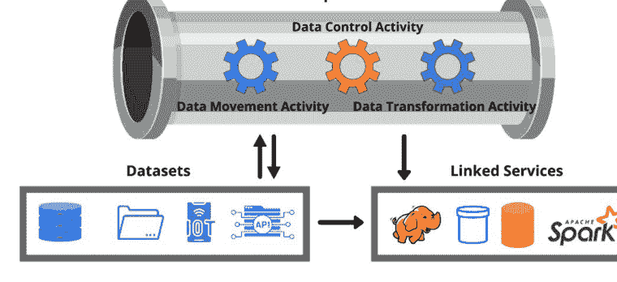

图 3.7 – Azure Data Factory 组件之间的交互

Azure Data Factory 中的活动可以是以下三种类型之一：

- **数据移动活动**：数据移动活动用于将数据从源数据存储复制到接收器数据存储。数据移动活动在 **集成运行时** 上执行，该运行时充当便于运行活动的计算环境。集成运行时可以是 Azure托管（在 Azure 基础设施上运行）、自托管（在客户基础设施上运行）或 Azure-SSIS（在 Azure 管理的 SSIS 集群上运行）。
- **数据转换活动**：数据转换活动允许数据工程师构建整理和转换逻辑，并在各种计算环境上执行，例如 **Azure HDInsight** 和 **Azure Databricks**。
- **数据控制活动**：数据控制活动允许数据工程师使用 if-else、参数化和迭代等编程操作构建数据工作流。

使用 Azure Data Factory，您可以构建、运行和监控数据驱动的工作流，而无需编写代码。以下是 Azure Data Factory 服务的组件：

- **摄取**：您可以从本地、Azure 云或其它云厂商的 90 多个数据源摄取数据。
- **控制流**：您可以使用编程操作生成无代码流来控制工作流的执行。
- **数据流**：您可以生成在 Spark 中执行或使用现有 Spark 集群的无代码转换。
- **调度**：您可以使用手动、基于事件或计划的触发器调度管道。
- **监控**：您可以查看管道的运行历史并创建警报/通知。

Azure Data Factory 跨配对区域复制管道元数据以防止故障。它还为管道的编写、编辑和监控实施 RBAC。

## Azure Data Lake Analytics

**Azure Data Lake Analytics** 是一种用于大规模数据处理的完全托管分析作业服务。它可以运行大规模并行数据转换作业。Azure Data Lake Analytics 根据需求动态配置资源。

Azure Data Lake Analytics 使用提交为作业的 **U-SQL** 运行时引擎。Azure Data Lake Analytics 中的作业按以下四个阶段执行：

- **准备**：在此阶段，U-SQL 脚本上传到 Azure 并针对进一步执行进行优化。
- **排队**：作业排队等待可运行作业的资源可用。
- **运行**：作业已启动。
- **完成**：作业已完成。

Azure Data Lake Analytics 将作业划分为多个子作业，也称为 **顶点**。顶点代表在相同数据上并行执行作业的一部分。并行度以 **分析单元** 为单位衡量。1 AU = 1 台 Azure VM，配备 2 个 vCPU 和 6 GB RAM：

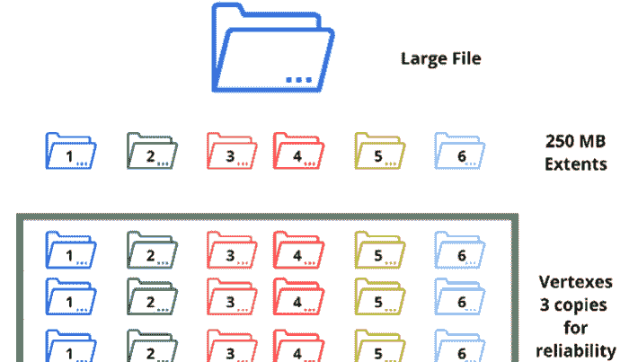

图 3.8 – 使用顶点分布 Azure Data Lake Analytics 作业

## Azure Stream Analytics

**Azure Stream Analytics** 是一种完全托管的实时数据分析服务。它用于处理来自物联网传感器、日志和社交媒体等数据源的高速度流数据。以下是 Azure Stream Analytics 的一些用例场景：

- 实时决策，例如欺诈检测和预测分析
- 物联网传感器数据的物联网异常检测
- 监控基础设施和应用程序日志
- 以促进仪表板显示
- 基于条件调用工作流
- 在多个数据源之间识别模式和聚合数据
- 基于阈值值的警报
- 对社交媒体帖子执行情感分析

Azure Stream Analytics 作业使用 **输入**、**查询** 和 **输出** 设置。作业输入可以从 Azure Event Hubs、Azure IoT Hub 或 Azure Blob 存储流式传输数据。

查询引擎基于 SQL，可以与 **JavaScript** 和 **C#** 用户定义函数结合使用以执行过滤、排序和聚合等操作。最后，输出可以发送到多个位置，包括 Power BI、Azure Synapse 和 Azure Data Lake Storage。

在输入和输出操作期间，Azure Stream Analytics 作业可能会连接到您 Azure VNET 之外的源。这可以通过使用专用终结点或设置受信任的网络服务安全地完成。

默认情况下，Azure Stream Analytics 是一种 **多租户** 服务。对于极其注重安全的组织，还有另一种称为 **Azure Stream Analytics 集群** 的选项。Azure Stream Analytics 集群以 **单租户** 模式工作，使用隔离和专用硬件。

Azure Stream Analytics 集群的容量以 **流单元 (SU)** 为单位衡量。您可以根据流量需求向上或向下扩展 SU：

> **重要说明**
> SaaS 和 PaaS 的多租户特性可能成为受严格监管组织的障碍，因为与共享基础设施相关的合规问题。在这些情况下，使用专用的 IaaS 层可能是唯一选择。

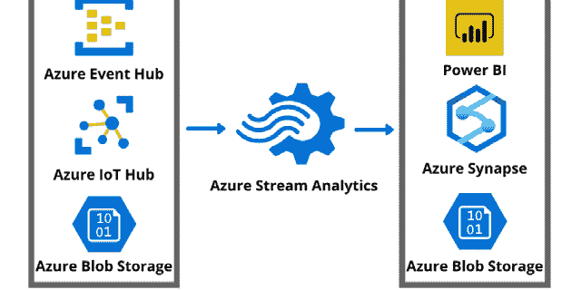

图 3.9 – Azure Stream Analytics 的输入和输出

由于 Azure Stream Analytics 是一种完全托管的服务，因此它具有内置的容错恢复机制。它遵循至少一次传递的原则，因此在发生故障时事件永远不会丢失。Azure Stream Analytics 对所有传入/传出通信进行加密，并在内存中执行所有计算。

## Azure Synapse Analytics

Azure Synapse Analytics 是一种企业级数据工程和分析服务。Synapse Analytics 通过嵌入独特的数据处理服务混合体来实现湖仓架构，如下所示：

- **Synapse SQL**：它实现了一个基于 SQL 的大规模并行处理数据仓库。Synapse SQL 采用几种模型：

  - **专用 SQL 池**：在专用模型中，根据选择的 **数据仓库单元 (DWU)** 配置一组资源。专用 SQL 池使用基于节点的架构进行计算。在最低单位，DW100c（单节点集群）在单个节点上存储 60 个数据分布。在最高单位，DW30000c（60 节点集群）在每个节点上存储一个数据分布。随着添加更多 DWU，查询的 **性能** 和 **并发性** 线性增加，成本也随之增加。存储成本根据使用情况单独收取。

计算节点以分布式方式在 Azure 存储中存储表，并使用 **数据移动服务 (DMS)** 并行运行查询。表分布可以有三种类型：**哈希**、**轮询** 和 **复制**。

计算层和存储层完全解耦。为了节省成本，您可以暂停计算层，此时已分配 DWU 的计费停止。另一方面，存储成本是永久性的，无论计算层是否处于活动状态或已暂停。

- **无服务器 SQL 池**：在无服务器模型中，无需配置资源或将数据复制到计算节点。相反，您可以使用外部数据源查询 Azure Blob 存储中的数据。使用此方法，您可以查询多种格式的数据，包括 **CSV**、**JSON** 和 **parquet**。对于 parquet 格式的文件，可以自动推断模式。使用 **Azure Synapse Link** 也支持从 Azure Cosmos DB 查询数据。

无服务器 SQL 池根据查询需求自动扩展资源。为了更快执行，它们利用 **分布式查询处理 (DQP)** 引擎将查询拆分为多个较小的查询。无服务器 SQL 池的成本基于查询处理的数据。

> **重要说明**
> 专用池和无服务器池遵循不同的计费方法。虽然专用池按 DWU 数量收费，但无服务器模型基于处理的数据。一般来说，无服务器池的成本低于专用池。但在涉及大量数据扫描的情况下，您可能更适合使用专用池。强烈建议数据工程师在选择合适的池之前执行基准测试。

- **Synapse Spark**：Synapse Spark 实现 Apache Spark 引擎用于分布式计算。此过程涉及在 Azure Synapse 中创建 Spark 池。Spark 池只是资源的定义，例如节点大小、自动缩放行为和节点数量。实际的 Spark 实例在作业提交到池时创建。为了节省成本，您可以使用 **自动暂停** 机制，该机制可以在可配置的空闲时间后释放 Spark 资源。

使用 Synapse Studio 笔记本，数据工程师可以管理数据 **整理**、**转换** 和 **可视化**。Azure Synapse Analytics 与 Delta Lake 框架兼容，后者充当实现湖仓架构的核心存储组件。

> **重要说明**
> Azure Synapse 在计算引擎之间共享表元数据的能力，即无服务器 SQL 池和 Spark 池，极大地简化了数据工程任务。一次编目数据，多次使用的原则也建立了强大的主数据管理策略。

## Microsoft Azure 中的数据编目和数据共享服务

数据目录和数据共享服务正在重新定义现代组织的数据分发策略。数据目录代表了被认为值得供内部和外部用户消费的数据的可信视图。将此与一种简单且安全的数据共享方法相结合，您就可以为用户提供自助式分析平台。

## Azure Purview

**Azure Purview** 是一种完全托管的服务，用于以统一的方式发现、编目和消费数据。Azure Purview 帮助生产者为消费者在下游流程中使用的的数据定义单一事实来源。重要的是要理解，一旦数据源已注册，只有元数据存储在数据目录中；实际数据仍保留在其原始位置。Azure Purview 并不会让您访问数据本身；它只是帮助用户发现数据源及其相关信息，以便用户能够评估其对自身使用的实用性。

> **重要说明**
> Azure Purview 还支持诸如数据分类和端到端数据血缘等功能，这对于数据治理目的来说至关重要。

Azure Purview 使用数据源注册工具提取以下元数据信息：

- 数据源位置的详细信息。
- 模式；即表的结构。
- 数据概要（对象和列）；即行数、是否包含空值、表的大小以及最后更新时间戳。

除了发现的元数据外，用户还可以手动添加自己的元数据。

Azure Purview 支持多种数据源，包括 Azure Blob、Azure Synapse、Hive、MySQL、Oracle 等。

## Azure Data Share

在第 1 章《数据工程与分析的故事》中，我们有一个名为《数据的货币力量》的部分。在该部分中，我们谈到了现代的收入多元化方法，包括通过共享数据实现数据货币化。组织可以通过使用 Azure Data Share 实现这一梦想。Azure Data Share 促进了向其他方（包括客户和合作伙伴）安全地共享数据。传统上，使用 SFTP 或 API 等媒介安全地共享数据非常昂贵。

使用 Azure Data Share，组织可以添加数据集并邀请客户/合作伙伴安全地访问您共享的数据。Azure Data Share 可以通过以下几种方式进行：

- **基于快照的共享**：共享后，数据会移动到消费者的 Azure 订阅中。
- **原地共享**：共享后，会创建一个数据链接，消费者可以访问该链接。

Azure Data Share 访问通过 Azure Active Directory 使用托管标识进行保护。除此之外，数据共享还受到通常的数据静态和数据传输中保护机制的保护。

> **重要说明**
> 对于正在迁移到云的组织来说，突然采用 SaaS 的想法有时显得过于遥远。并非每个人都喜欢失去对基础设施和一次性定制的控制。

## 开通 Microsoft Azure 免费账户

在接下来的章节中，我们将使用您刚刚阅读过的服务来构建一个使用湖仓架构的数据湖。因此，是时候开通一个免费的 Azure 账户了，该账户可为您提供 12 个月的免费服务，外加一次性 260 美元的积分。请注意，并非所有——但大多数——服务都是免费的。要开通免费账户并浏览免费服务，请访问以下链接：https://azure.microsoft.com/en-ca/free/。

以下是一些宝贵的建议：

- 使用完计算资源后，始终最好将其删除。
- 您可免费获得 5 GB 的 **本地冗余数据（LRS）** 数据。在未来的练习中存储的数据无需删除，因为我们不会超过此限制。
- 在使用 Azure 免费服务时，请务必通过以下链接严格关注您的账单：https://portal.azure.com/#blade/Microsoft_Azure_Billing/BillingMenuBlade/Overview。

始终最好对账单格外谨慎。您还可以在 Azure 中设置预算以随时间监控成本。如果设定的预算被超出，Azure 会向您发送通知：https://docs.microsoft.com/en-us/azure/cost-management-billing/costs/tutorial-acm-create-budgets。

##### 总结

在本章中，我们了解了 Azure 中可帮助数据工程师构建数据湖的 IaaS、PaaS 和 SaaS 服务。我们还讨论了云厂商提供许多不同的选项来执行类似操作。数据工程师需要根据使用模式、内部技能和预算选择最合适的服务，为客户带来好处。

现代数据管道需要仔细的规划、设计、开发和部署。在下一章中，我们将学习数据管道的生命周期以及数据管道创建每个阶段的有效策略。
