## 第 2 部分：
数据管道
和数据工程的阶段

本部分为您提供有关数据管道和数据工程各个阶段的先进知识。我们将重点学习湖仓架构。

本部分包含以下章节：

- 第 4 章，理解数据管道
- 第 5 章，数据收集阶段 – 青铜层
- 第 6 章，理解 Delta Lake
- 第 7 章，数据整理阶段 – 白银层
- 第 8 章，数据聚合阶段 – 黄金层

### 4
理解数据管道

在上一章中，我们讨论了可在 Microsoft Azure 中用于构建数据湖的各种服务。我们现在将重点关注如何使用数据管道启动构建数据湖的过程。

作为一名数据工程师，规划数据管道的过程应得到极其周密的计划。本章将向数据工程师介绍数据管道创建的各个阶段，并列出在每个阶段需要考虑的推荐操作和任务。更好的规划带来更好的执行。

在本章中，我们将涵盖以下主题：

- 探索数据管道
- 创建数据管道的过程
- 运行数据管道
- 示例湖仓项目

#### 探索数据管道

在第 1 章《数据工程与分析的故事》中，我们谈到了数据的旅程。我们将数据工程等同于一辆使数据旅程成为可能的车辆，它能够通过急转弯和障碍物，最终尽可能安全、及时地到达目的地。如果数据工程是一辆车辆，那么数据管道就是使旅程成为可能的引擎。引擎只是一系列组件，每个组件执行专门的操作。最终，所有零件和组件协同工作，可以将车辆引导到所需方向。

简单来说，数据管道是一种能够将数据通过收集、整理和聚合的各个阶段移动到其分析目的地的引擎。与引擎的各个零件和组件一样，数据管道使用一系列操作来完成其工作。每个操作执行专门的任务（一次或重复）以实现最终目标。

数据工程师负责以最有效的方式将操作组装成一系列步骤，以最终满足分析需求。以下图表中所示的这一系列步骤统称为数据管道：


图 4.1 – 数据管道中的一系列操作

重要说明
这是一个选择丰富的时代。数据工程师的工作是选择最合适的工具/服务，以最有效地解决该操作。

#### 数据管道的组件

数据管道是一系列组件的集合。每个组件执行专门的操作，有助于数据旅程的整体成功。常见的是，数据工程师通常非常关注管道的整体开发，但常常忽视运营方面。虽然关注各个组件的实际构建很重要，但同样重要的是关注这些组件将来如何组装、部署和监控。为了更好地理解数据管道，让我们接下来关注数据管道的核心组件。


##### 源

数据源是存储数据分析所需数据的存储位置。以下是一些知名的数据源：

- 数据库和数据仓库
- 文件
- **应用程序编程接口 (APIs)**
- 来自 **物联网 (IoT)** 设备的传感器数据
- 社交网络和其他 **软件即服务 (SaaS)** 网站

##### 摄取

典型的管道首先从一个或多个数据源摄取数据。多年来，数据工程师已采用推送和拉取机制来实现此操作。根据数据源的不同，数据工程师可能需要在批量摄取或流式摄取之间进行选择。

从数据源摄取的复杂性直接取决于数据的性质是静态还是动态。从静态数据源摄取是简单的——数据工程中的真正复杂性出现在处理动态数据源时。数据工程师需要采用有效的 **变更数据捕获 (CDC)** 技术以增量的方式摄取数据。

> **重要说明**
> **Azure Data Factory (ADF)** 使用水印技术加载增量（delta）数据。水印是上一次迭代中获取的数据的最后更新时间戳。

##### 转换

在摄取的数据投入实际使用之前，它需要经过多个成熟度提升的操作，例如 **策展**, **标准化**, **去分类**, **去重**, 以及最后的 **聚合**。这一过程统称为 **数据转换**。换句话说，数据转换过程使数据成熟到可以方便、轻松地用于分析操作。

根据用例的不同，数据转换可能是一个非常复杂的操作。复杂性取决于多个因素，包括以下内容：

- 数据源的数量和种类
- 清理、去分类和聚合操作所需的业务逻辑的复杂性
- 数据摄取的频率以及随后的数据转换
- 摄取数据的大小以及数据聚合回溯的时间有多远——天、周、月或年

##### 目的地

数据目的地是存储转换结果的位置。数据目的地可以是以下两种类型之一：

- **最终**——此目的地类型存储转换的最终结果。在传统架构中，它被称为转换层，在湖仓架构中，它被称为金层。
- **中间**——此目的地类型存储转换的中间结果。在传统架构中，它被称为原始或策展层，在湖仓架构中，它被称为青铜层或银层。

##### 工作流

工作流最好被描述为具有一系列操作的工作单元。工作流的设计方式使其能够以可重复的方式运行，通常由预定义的时间表或基于事件触发。典型的工作流是一组以下操作：

- **输入和输出 (I/O) 操作**——执行从数据源摄取数据并将数据存储到目的地的操作
- **转换操作**——执行数据转换的操作
- **控制操作**——控制工作流的异常，包括链式、分支、合并、决策和循环

##### 监控

在工作流被触发后，工作流中的每个操作都需要密切监控。监控应设置和配置为以日志的形式存储每次管道运行中每个操作的状态。如果任何操作失败，运营团队应收到警报，以便执行纠正措施。

监控数据管道有几个好处，包括以下内容：

- 它有助于建立数据管道运行的整体健康状况，以及成功或失败。
- 它有助于建立数据管道的总运行时间。此信息对于计算 **服务等级协议 (SLAs)** 的错过率至关重要。
- 它有助于识别性能瓶颈。拥有此信息有助于数据工程师微调代码和管理资源。

> **重要说明**
> 在数据管道监控系统中，需要关注的一些关键指标是延迟、吞吐量和错误。

了解每个组件在孤立情况下的作用，以及它如何为数据管道的整体成功做出贡献，有助于数据工程师以极高的效率概念化、设计和开发组件。

在以下章节中，我们将描述数据管道创建过程的各个阶段。除了对每个阶段的整体理解外，我们还将了解需要考虑的推荐任务和操作。这份清单有望为读者提供一个坚实的基础，可以在实际项目中进一步增强和构建。

#### 创建数据管道的过程

在以分析为中心的组织中，通常会有多个数据管道，每个管道解决不同的用例。更糟糕的是，每个用例可能由组织内的不同子组拥有并需要不同的数据集。在这种情况下，仔细规划和设计数据管道操作变得极其重要，以便发现效率并避免重复工作。数据管道的创建是分阶段进行的。在后续章节中，我们将分别学习每个阶段。

在深入细节之前，以下图表很重要，突出显示每个阶段如何层层叠加。需要注意的最重要的一点是，如果数据工程师认真遵循每个阶段的推荐操作，每个阶段的工作量会显著减少，并且成功几乎是确定的：

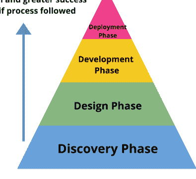

图 4.2 – 数据管道创建的各个阶段

让我们探索可以帮助数据工程师启动管道设计过程的步骤。

##### 发现阶段

创建数据管道的过程应从发现阶段开始。此阶段不仅为数据工程师提供了了解团队、识别关键利益相关者并筛选用例的机会，更重要的是，使他们能够识别可能对项目整体成功造成不利影响的潜在障碍和漏洞。

###### 识别产品负责人

产品负责人是拥有项目整体成功最终权威的人。产品负责人应能够直接访问高级管理层，以处理目标设定相关事宜并让他们了解整体进展。此外，产品负责人应能够回答或收集有关以下领域的一些关键问题的信息：

- 与云连接的当前和未来状态连接性
- 组织需要遵守的安全法规
- 需要满足的任何 SLAs
- 终端用户位置——本地、远程或两者结合
- 基础设施和代码部署希望实现多少自动化
- 部署是否需要云厂商无关

###### 筛选用例

通过与组织内每个子组分别交谈，创建需要解决的单个用例列表。确保每个用例都有指定的负责人，该负责人将担任指定的 **知识冠军** 并对数据访问相关事宜拥有权威。

###### 进行发现会议

数据工程师应与每个子组进行发现会议，以收集以下信息：

- 用例描述和最终目标。
- 数据源识别——位置、连接信息、建立连接的任何挑战，例如 **多因素身份验证 (MFA)**、令牌和防火墙问题。
- 数据集识别——表、文件或 API 的列表以及相应的数据类型和模式。
- 模式变更的频率是多少？
- 每个数据源的历史数据和增量数据的近似数据大小。
- 增量数据的近似大小是多少？
- **在线事务处理 (OLTP)** 和 **在线分析处理 (OLAP)** 之间可容忍的数据延迟是多少？是一天、几个小时还是接近实时？
- 有关数据消费者——数据分析师/数据科学家的详细信息。
- 预期用例是全新的还是 **提取、转换、加载 (ETL)** 代码之前就已存在？
- 如果用例之前就已存在，请索取现有的 ETL 代码。另请索取任何支持的仪表板和报告。
- 如果用例是全新的，请索取一份书面文档，解释预期的连接、聚合和过滤。
- 是否需要对 **个人身份信息 (PII)** 进行屏蔽？


- 是否存在任何数据分类规则？
- 表级、行级和列级安全性的要求是什么？
- 数据将使用云厂商加密密钥还是客户提供的加密密钥进行加密？
- 团队目前具备哪些**信息技术 (IT)** 技能？团队是否愿意投入时间学习 Spark 等现代框架？
- 用户是否偏好任何数据科学、临时报表和**商业智能 (BI)** 工具？

我知道你一定在想需求收集清单实在太长了。我向你保证，这一切都是物有所值的。准备得越充分，设计、开发和部署的效果就越好。我强烈建议养成在启动任何数据湖项目之前先处理前面清单中各项内容的习惯。随着你在职业生涯中积累更多经验，你可以不断向清单中添加更多项目。

发现阶段的交付成果应如下：

- 理解文档（每个用例一份），详细汇总收集到的每一条信息
- 列出差距、漏洞和障碍并指定负责人

建议在继续下一步之前，由产品负责人审阅并接受理解文档。然而，在未解决所有差距、漏洞和障碍的情况下继续进行也是可以接受的，但前提是理解这些问题将在数据管道开发开始前得到解决。

> **重要说明**
> 发现过程不仅建立了基线，还为你提供了清晰的未来方向。最重要的是，这一阶段让你有机会发现差距、指出漏洞并识别障碍。这是数据工程师在这些问题演变成日后严重问题之前妥善解决它们的良机。

#### 设计阶段

现在发现阶段已经完成，是时候设计数据管道了。数据工程师在发现阶段收集的信息应被用来制定设计的基线。管道设计过程应解决接下来讨论的各项内容。

#### 筛选常用数据集

收集在发现阶段创建的所有用例文档并筛选出常用数据集。这是极其重要的一步，因此需要特别关注。识别所有子组中的常用数据集有助于促进数据复用并执行主数据管理 (MDM) 策略。

下图突出显示了一种多管道设计方法。之前发现的每个用例都被表示为一个独立的管道，且与其他管道没有任何依赖关系。其结果是，同一数据集可能会在不同管道中被多次摄取。不幸的是，尽管这种方法看起来简单可行，但由于不必要的重复，它会显著增加组织的存储和计算成本。因此，不建议采用多管道设计方法策略：

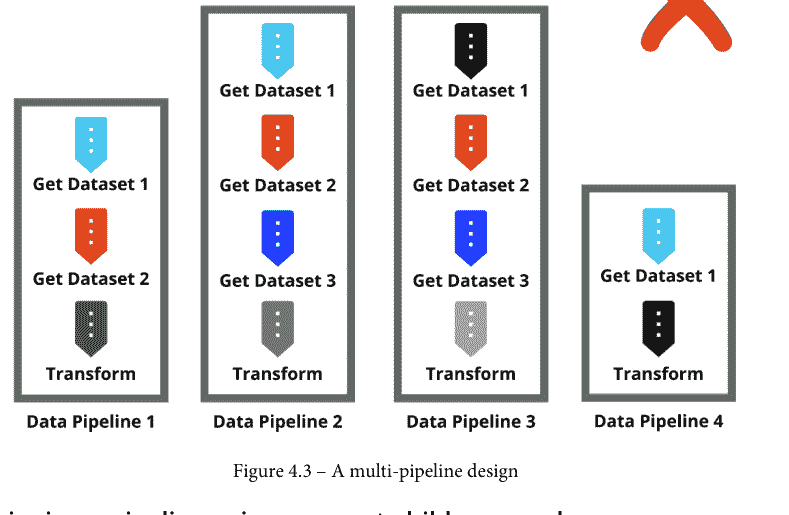

图 4.3 – 多管道设计

#### 使用父子方法设计管道 – 常用数据集

你可能还记得在第 1 章《数据工程与分析的故事》中我们学到，存储很便宜，而计算很昂贵。这里有一个机会可以把你之前学到的知识派上用场。通过在设计阶段投入一些额外的工作，数据工程师可以提供一个遵循最佳实践、促进复用并最大限度降低计算和成本的解决方案。

请注意下图中所有数据集如何被移至父管道中，而之前发现的每个用例都被创建为子管道。这种方法相比多管道方法具有多项优势，因此强烈推荐：

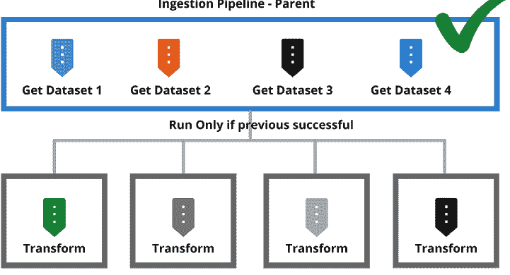

图 4.4 – 父子管道设计

父子管道设计提供多项优势，包括以下内容：

- 每个数据集仅被摄取一次，随后的每个子管道都可以使用它。
- 节省存储和计算成本。
- 通过强制与父管道的依赖关系，提供对子管道更好的执行控制。

> 重要说明
> 有些数据工程师认为以低价设计出架构良好的解决方案是不可能的。我认为这是可能的——你只需要多走那一段路。

#### 设计云架构

基于已达成一致的发现文档，数据工程师应创建一份可视化图表，概述将用于构建数据管道的云资源。这应包括网络、与本地和外部位置的连接、存储、计算和编排等服务。

#### 设计自动化和监控

基于期望的自动化程度，数据工程师应为基础设施和代码在云上的部署设计**持续集成/持续部署 (CI/CD)** 管道。此外，数据工程师还应设计数据管道的监控和通知机制。

#### 成本估算

一旦完成高层设计，数据工程师应按如下方式创建云资源的粗略估算：

- 估算开发期间各环境云资源的月度成本。请记住，开发环境中存储和计算成本的需求通常低于生产环境，因此相应调整资源非常重要。
- 估算生产环境所需的云资源月度成本。该估算应考虑高峰需求期间因自动扩展而产生的成本。

> **重要说明**
> 在创建成本估算时，数据工程师应妥善研究基于按需和预留资源的成本可变性。如果资源被预留数年，可以实现显著的成本节约。

设计阶段的交付成果是一份总结以下内容的文档：

- 云架构
- 关于父管道和子管道的详细描述
- 管道设计如何解决关键合规要求？
- 管道设计如何处理增量数据、数据延迟和模式演进？
- 最终数据将如何发布给终端用户？
- 终端用户将如何被通知管道运行情况？
- 开发策略——开发语言、工具和环境
- 将使用哪一层云：**基础设施即服务 (IaaS)**、**平台即服务 (PaaS)** 或 SaaS？
- 基础设施和代码管道将如何部署？
- 管道在生产环境中将如何被监控？
- 成本信息

数据工程师应向客户提交设计文档并安排几次讲解会议。这些会议应与参与发现会议的每个子组以及将负责部署和管理管道的 IT 团队一起进行。

建议在继续下一步之前，由产品负责人审阅并正式接受设计文档。

> **重要说明**
> 与 IT 团队进行讲解会议并获得他们的信任极其重要。最终他们将部署和管理管道，因此他们必须认可所提出的设计。

#### 开发阶段

如果你已走到这一步，很可能设计文档已由产品负责人正式接受。恭喜！我可以放心地告诉你，到目前为止工作已完成一半以上。现在是开始开发阶段的时候了，具体如下：

- 首先关注**父**管道。
- 首先测试对每个数据源的**连接性**并熟悉数据格式和模式。
- 了解**增量**数据将如何提供。
- 制定在数据湖中**合并**增量数据的策略。
- 制定处理数据湖中模式**演进**的策略。
- 规划中间和最终存储**目标**。
- 开发父管道。
- 在每一步都特别注意数据**安全**。
- 父管道完成后，再关注各个**子**管道。
- 对于每个子管道，以最小化计算**重复**并促进数据集**复用**的方式开发转换。


## 部署阶段

假设采用敏捷开发方法，新创建的数据管道代码会合并到共享代码仓库中，并立即部署到不同的环境。由于在开发生命周期中此过程可能会发生多次，因此需要一个可重复且自动化的流程。

这正是 CI/CD 的用武之地。使用这种方法，管道代码可以无缝合并、测试并自动部署。我们将在第 11 章《基础设施配置》和第 12 章《数据管道的持续集成与部署（CI/CD）》中更详细地讨论这些主题。

###### 重要说明
如今，部署被视为开发生命周期不可或缺的一部分。与在项目开发完成后才处理部署问题不同，采用 CI/CD 在短周期内进行部署已成为标准做法。

## 运行数据管道

开发和部署成功后，就该编排数据管道了。数据管道运行通常使用以下三种方法实例化：

- **手动**—调用数据管道最简单的方式是手动操作。这意味着需要通过控制面板、命令行工具或 **表述性状态转移（REST）** API 进行操作。这种方法适用于开发/测试或一次性执行，但不适用于生产环境。例如，数据工程师在进行单元测试时可能会选择手动运行管道，或因计划运行失败而需要执行管道的一次性运行。
- **计划**—在此方法中，数据管道使用调度器调用。调度器可以基于操作系统——使用编排工具中的调度器——或内置于 ETL 工具本身。这是生产环境中最常见的数据管道调用方式。根据具体情况，数据管道可安排每天或每小时运行，以实现更频繁的数据刷新。在金融系统中，您还可能安排每月运行以处理会计批次。

###### 重要说明
多年来，数据管道主要使用 Linux 中的 `cron` 和 Windows 中的任务计划程序等操作系统调度器调用。在过去几年中，Oozie 和 Apache Airflow 等编排工具已接管这些工作。这些工具自带内置调度器。

- **基于事件**—在某些情况下，基于计划的调用并不适用。这在数据管道依赖于其他事物时为真，例如数据的可用性或另一条管道的完成。在许多情况下，管道在数据完全摄取之前无法运行。由于难以确定此类过程的完成时间，因此基于事件的机制更合适。非常频繁地，整理管道在摄取管道成功完成后会使用基于事件的机制触发。同样，聚合管道在整理管道发出完成信号后触发。

###### 重要说明
父子管道是理解合适的调用机制的一个很好的例子。通常，父管道应使用 **计划** 调用，而子管道则在 **基于事件** 机制下运行，仅在父管道成功时才运行子管道。

最后，一旦管道运行，数据工程师需要确保数据管道监控已启用并正常运行。在最初的几天，让数据工程师加入管道通知组是个好主意。很多时候，仅通过查看运行日志，数据工程师就能发现他人可能忽略的问题。本阶段的最终交付物是运行手册，它将帮助团队在以下方面解决运营和行政问题：

- 运行 CI/CD 管道
- 监控数据管道
- 如何处理故障以及在故障后重新触发数据管道
- 更改数据管道计划
- 禁用数据管道

## 示例湖仓项目

到目前为止，我们讨论了数据工程的理论方面。理论通常教我们 *为什么会发生*；现在，是时候将重点转向 *如何发生* 的实践方面了。在接下来的章节中，我们将使用湖仓架构构建一个数据湖。

我们将把实践学习过程当作参与一个真实项目一样进行。你受聘于一家名为 **Electroniz** 的领先大型连锁商店担任数据工程师，该店销售电子商品。Electroniz 希望通过简化其数据工程和分析运营来制定现代商业战略，以多元化收入。在入职的第一天，**首席技术官（CTO）** 以以下图表的形式分享了他们对未来的愿景：

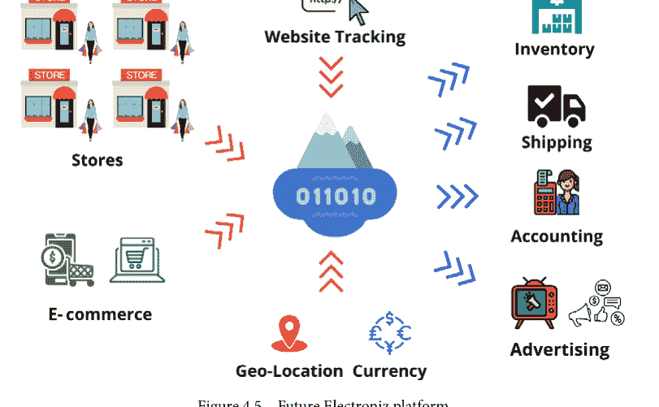

图 4.5 – 未来 Electroniz 平台

他还提供了一些有助于你启动流程的高层细节，如下：

- Electroniz 在美国各地多个实体店以及其电子商务网站上销售电子商品。通过电子商务网站销售的商品可以运往加拿大、英国（UK）和德国。
- 运输由 DHL、Purolator 和联合包裹服务（UPS）等外部供应商处理。
- Electroniz 当前的分析平台使用的是本地 SQL Server 数据库。
- Electroniz 计划利用销售数据来优化其库存、运输、会计和广告。
- Electroniz 必须遵守支付卡行业（PCI）法规，因此所有个人身份信息数据都需要正确掩码和加密。
- 目前，ETL 每天执行一次，这导致更新运输和库存存在 24 小时的滞后。在某些情况下，互联网上售出的商品已缺货，但由于滞后，网站并不知情。这导致运输严重延迟并造成大量订单取消。由于客户不满，Electroniz 的销售额有所下降。
- Electroniz 旨在构建一个近实时销售分析平台，以更快、更好地满足客户需求。最大允许的数据滞后为 1 小时。
- Electroniz 希望利用其电子商务网站上的用户流量进行智能分析，从而优化广告和营销的预算分配。

在未来的章节中，我们将踏上数据之旅。在这段旅程中，你将坐在驾驶座上，带领 Electroniz 排除所有障碍，抵达目的地。

##### 总结

在本章中，我们了解了数据管道生命周期。希望我能强调出发现会话和管道设计比开发本身更重要。同样，保持利益相关者了解正在发生的一切也很重要。数据工程师应与利益相关者定期进行检查点、演示和代码评审会议。

是时候将我们在第 3 章《Microsoft Azure 上的数据工程》中学到的云服务付诸实践了。在下一章中，我们将开始使用 Azure 服务并突出数据工程的各个阶段。

### 5
#### 数据收集阶段 – 青铜层

在之前的章节中，我们讨论了涉及数据湖、其架构以及作为创建数据湖的方法的管道的许多理论。现在你对这些主题有了一定的了解，是开始创建我们实际的数据湖仓的完美时机。

在本章中，我们将涵盖以下主题：

- 设计 Electroniz 数据湖
- 了解青铜层
- 配置数据源
- 配置数据目的地
- 构建摄取管道
- 测试摄取管道


## 设计 Electroniz 数据湖

在上一章 *第 4 章，理解数据管道* 中，我们介绍了为一家名为 **Electroniz** 的领先大型连锁店的示例湖仓项目，该店销售电子产品。我们将假设最终合同已授予，因此下一步是开始构建数据湖仓。现在，是时候将我们在 *第 4 章，理解数据管道* 中学到的技能派上用场了。由于我们公司非常注重遵循最佳实践，数据工程团队决定严格遵循 *创建数据管道流程* 部分中的所有步骤。

作为高效的数据工程师，我们将通过与客户群体进行发现会议来启动流程。通常，进行发现会议并从客户那里提取有用信息可能非常具有挑战性。有时，你应该预期会遇到不同的性格和阻力，因为并非每个人都认同管理层的全球性想法。此外，还要考虑客户方的团队成员可能参与与其正常工作相关的其他活动，或者他们可能需要为其他团队成员提取所需信息。重要的是，你要学会预见到一些延迟并将其纳入项目时间表。

> **重要**
> 减少阻力、延迟和后续跟进的一个简单方法是让产品负责人参与流程的每个阶段。

在某些情况下，你可能需要进行多次发现会议并多次跟进，然后才能提取所需信息。我理解这有时可能会令人沮丧。但由于多种原因，发现阶段对于项目的整体成功至关重要。

> **重要**
> 在开始发现会议之前，请让产品负责人知道预计的会议次数，以便他们能够适当规划其方面的任何时间表和资源。

此时，我们将假设发现会议取得了巨大成功。虽然存在一些挑战，但你最终能够充分从客户那里提取所有所需信息。作为流程的一部分，你已将发现结果记录在文档中，该文档已由 **Electroniz** 审核并最终确定。

以下是这些会议期间发现的几个重要发现列表：

- 需要摄取的五个数据源如下：
  - **销售数据库**：该数据库存储美国各地实体店发生的销售数据。销售数据库是托管在 **Azure SQL** 上的 **Microsoft SQL Server**。
  - **电子商务交易**：**Electroniz** 也在线销售其产品。每当在线商店发生交易时，一个事件将被流式传输到中央资源。销售数据采用结构化格式。
  - **货币转换数据**：**Electroniz** 在在线商店以不同货币销售产品。需要货币转换数据将所有销售额转换为美元。转换数据可通过 **REST API** 调用获得。货币转换数据采用半结构化格式。
  - **电子商务网站跟踪**：所有访问 **Electroniz** 在线商店的访客都在 Web 服务器上进行跟踪。此信息有助于按国家/地区跟踪用户，并帮助广告团队进行有针对性的广告投放。网站日志可作为文件从 **Azure Blob 存储** 下载。网站跟踪数据采用非结构化格式。
  - **地理位置数据**：地理位置数据对于将 Web 服务器日志中的 IP 地址映射到原产国是必要的。此数据可以从 **HTTP** 源下载。地理位置数据采用结构化格式。
- 销售数据库和在线商店中的交易在全天频繁发生。湖仓需要在最大延迟 1 小时的情况下保持最新。
- 数据消费者是数据分析师、商业智能开发人员和数据科学家。数据分析师和商业智能组的首选分析工具是 **SQL**，而数据科学家更喜欢使用 **Apache Spark**。
- 所有 PII 数据，包括信用卡、地址和电话号码，都需要进行掩码处理。
- 所有数据在静态和传输中都需要加密。
- 使用新的湖仓，**Electroniz** 团队正在寻找销售和库存的聚合指标。他们希望根据可用指标简化其运输运营和广告预算的智能分配。

> **重要**
> 任何项目成功的关键配方之一是让客户参与所有重大决策。毕竟，在你离开后，他们将负责管理该解决方案。

到目前为止，一切顺利。基于上述发现，我们需要设计数据湖仓的一些关键组件：

- 云架构
- 管道设计
- 部署策略

### 云架构

仔细审查需求后，很明显 **Electroniz** 将真正受益于数据湖仓。回想一下，我们在 *第 2 章，发现存储和计算数据湖架构* 中讨论了湖仓的好处。湖仓提供了低成本存储和计算层的良好平衡，原生支持 ACID 事务、SQL、模式演进以及许多其他功能。

**Electroniz** 湖仓的架构如下所示。

#### 原始数据 – 青铜层

来自五个数据源的原始数据将按如下方式摄取到青铜层：

- 来自销售数据库、货币转换、地理位置和网站跟踪的数据集将使用 **Azure Data Factory** 摄取到 **Azure Data Lake Storage** 中。
- 电子商务交易将作为事件流式传输到 Azure Event Hubs。Azure Event Hubs Capture 将在 **Azure Data Lake Storage** 中保存事件。

> **重要**
> 通常，青铜层中的数据以从源摄取的确切形状和形式存储。这不仅有助于保留摄取时数据的确切状态，而且在建立清晰的数据血缘方面也大有裨益。

#### 精炼数据 – 白银层

在数据摄取到青铜层后，它将使用 Azure Databricks 进行整理和标准化。该层将使用 Delta Lake 合并来自数据源的增量数据。整理后的表将通过 Azure Synapse 对用户可见。整理后的 Delta 表可以方便地用于数据分析、机器学习和人工智能目的。访问整理后的表使用户能够选择分析/聚合数据，而不仅仅是金层提供的标准聚合。

> **重要**
> 为批处理和流式数据提供统一层是湖仓架构的关键组成部分。白银层是“整合一切”的区域，来自不同类型、来源和格式的数据在此统一到一个单一位置并采用通用格式，即 delta。

#### 聚合数据 – 黄金层

最后，来自白银层的数据将使用 Azure Synapse 进行聚合。聚合结果将存储在 Azure Data Lake Storage 中。聚合表将通过 Azure Synapse 对用户可见。金层中的聚合表可用于数据分析、机器学习和人工智能目的。这在以下图表中得到了更好的说明：

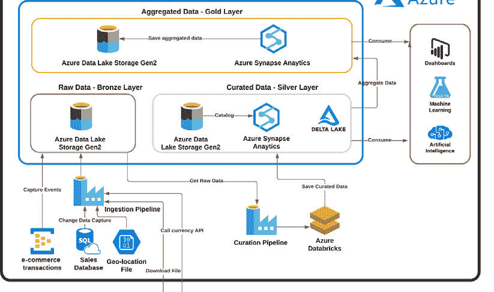

图 5.1 – Electroniz 云架构

> **重要**
> 自动化基础设施配置有助于组织快速可靠地启动云基础设施。数据工程师的推荐职业发展路径是获得 DevOps 技能。


### 管道设计

这就是 Electroniz lakehouse 的数据管道设计。 我们将拥有四个管道，如下所示：

- 批处理摄取管道 – 青铜层
- 流式摄取管道 – 青铜层
- 治理管道 – 白银层
- 聚合管道 – 黄金层

这些管道可以在以下图表中查看：

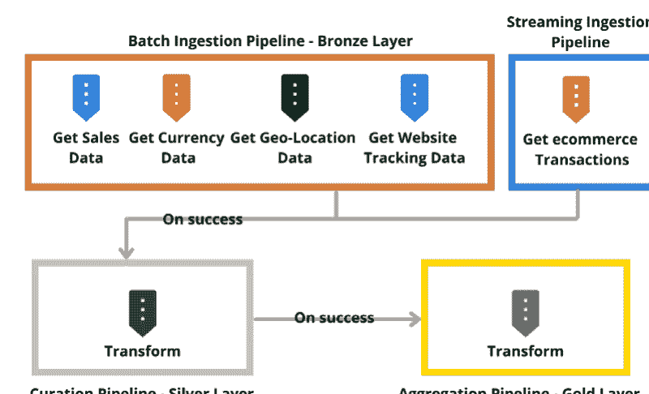

图 5.2 – Electroniz 管道设计

我们将按如下方式更详细地探索上述所有组件：

- 批处理摄取管道：批处理管道将摄取四个数据源的数据 – 销售数据库、货币转换、地理位置和网站跟踪。 该管道使用 Azure Data Factory 创建和调用。
- 流式摄取管道：流式管道是一个持续运行的管道，持续监视消息层中的新事件。 新事件会通过捕获事件每 2 分钟及时保存到 Azure Data Lake Storage 中。 该管道使用 Azure Event Hubs 创建和调用。
- **治理管道：** 治理管道将根据批处理摄取管道的成功情况自动触发。 调用时，它将从批处理和流式管道中合并过去一小时收集的数据到 delta 表中。 在同一过程中，将对数据应用 **数据标准化** 和数据屏蔽规则，以使其可用于消费目的。 **数据屏蔽** 对于满足 **PCI** 合规性要求至关重要。
- **聚合管道：** 聚合管道将根据治理管道的成功情况自动触发。 调用时，它将聚合白银层中用于销售和库存目的的数据。

### 部署策略

遵循最佳实践，**Electroniz** lakehouse 的部署将使用 CI/CD 管道执行。 部署使用 **Azure Pipelines** 和 **Azure Resource Manager** 模板完成。 在高层次上，CI/CD 流程将按如下方式运行：

- 开发人员将在各自的功能分支中编写并单元测试数据工厂管道。
- 编码完成后，开发人员将为团队的代码审查生成拉取请求。
- 在团队审查和批准后，开发人员的代码分支将与主分支合并。
- 准备部署时，主分支将部署到开发环境。 这会启动 Azure Data Factory 工件分支 (`adf_publish`) 的创建。 该分支由 **Azure Data Factory** 服务自动创建。
- 要在 UAT 中部署代码，将使用 `adf_publish` 分支在 Azure Pipelines 中创建 **发布**。 该发布部署在 UAT 环境中。
- 在成功验证和测试后，同一发布将被推送到生产环境。

从目前的情况来看，在过去几天里，我们取得了相当不错的进展。 在此阶段，我们将假设 Electroniz 已审查了提交给他们的所有设计和架构文档。 产品负责人已告知我们，Electroniz 对 lakehouse 的拟议设计和架构感到满意。 他们渴望继续推进 lakehouse 创建生命周期的下一步。 这意味着我们已准备好启动开发周期。

数据的旅程已经开始。 我们面前有大量严肃的工作要做，让我们开始吧。

> **重要**
> 在等待客户对设计和架构文档的最终批准的同时，利用这段时间设置代码存储库、测试云连接并设置开发环境是很好的时间利用。

在我们启动开发之前，我想确保我们清楚地理解在 lakehouse 架构中青铜层意味着什么。

### 了解青铜层

在 lakehouse 内部，青铜层以从数据源收集时的完全相同形状、形式和格式存储原始数据。 以下是青铜层中数据的一些特征列表：

- **未清理且非标准化：** 这被认为不适合由分析工作负载消费。
- **支持多种格式和类型：** 青铜层中的数据可能是结构化、半结构化或非结构化。 它也可以是文本和二进制类型的组合。
- **不可变：** 根据定义，青铜层中的数据不应可编辑。 如果数据随时间变化，则会以重复副本的形式存储。
- **永久存储：** 青铜层中的数据永远不会被删除。 由于存储成本低，这不是什么大问题。 然而，为了节省成本，部分数据可能会被归档。

以原生格式存储数据具有以下几个优势，如下所示：

- **可重放：** 通常，分析师和数据科学家会在编码中发现错误和疏忽。 这需要从头开始重建白银层和黄金层中的数据。 由于原始数据可用，未来转换可以通过从头到尾重放数据来重新生成。
- **可再利用：** 随着新需求的不断涌现，访问原始数据有助于数据工程师创建新的转换。
- **审计：** 以原生格式存储数据对于数据血缘和准确性至关重要。

> **重要**
> 在这里，血缘指的是数据随时间所经历的旅程的可追溯性。 许多合规框架将数据血缘视为组织是否遵循关于数据使用的最佳实践的可靠证明。

现在我们已经了解了 lakehouse 的不同层，让我们继续配置将用于摄取数据的源。

### 配置数据源

我们已准备就绪，可以开始了！ 我们将一次构建一个层来构建 Electroniz lakehouse，从青铜层开始。 问题是我们没有任何数据。 由于这是一次学习练习，我们将生成自己的数据； 然而，最有可能的是，当您在实际客户项目中工作时，数据已经存在。

### 数据准备

为了继续进行 lakehouse 创建，我们将使用示例数据创建以下数据源：

- **商店数据库**：存储在 Microsoft SQL Server 中。
- **电子商务交易**：推送到 Azure Event Hubs。
- **电子商务网站跟踪**：从 Azure Blob 存储位置下载。

由于以下数据集是从外部源实时下载的，因此无需为其生成数据：

- **货币转换数据**：从 REST API 下载。
- **地理位置数据**：从 HTTP 源下载。

### 为商店数据库准备源数据

我们将使用以下步骤开始准备源数据：

1. 使用 URL https://portal.azure.com/ 登录到 Azure 门户。
2. 要创建新的 SQL 数据库，请浏览至 https://portal.azure.com/#create/Microsoft.AzureSQL，如下所示：

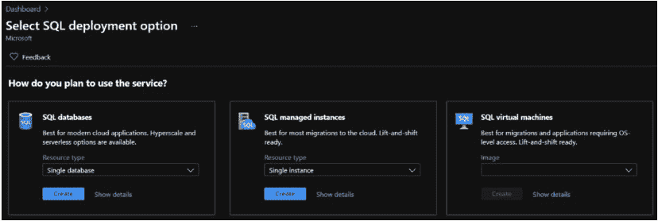

图 5.3 – Azure SQL 部署选项

单击 SQL 数据库下方的创建按钮：

- 在订阅中，选择免费层或付费订阅。
- 在资源组中，单击创建新链接。
- 对于资源组的名称，输入 training_rg。
- 在数据库名称中，输入 salesdb。
- 在服务器中，单击创建新链接。

一个新的窗口将打开，标题为新服务器：

- 在服务器名称中，输入一个全局可用的唯一名称，例如 salesdb100。
- 在服务器管理员登录名中，输入 salesadmin。
- 在密码和确认密码中，输入符合策略的密码并记住以备后续步骤使用。
- 在位置中，选择 (US) 东部美国。

单击配置数据库。


选择 **Standard S0, 10 DTUs**，以及最大数据大小为 **250 GB**：

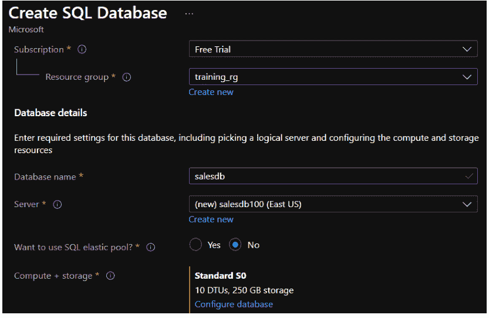

图 5.4 – Azure SQL 创建选项

3. 点击 **Apply**。然后，点击 **Next: Networking**：

- 选择 **Public endpoint**。
- 要允许 Azure 服务和资源访问此服务器，请选择 **Yes**。
- 要添加当前客户端 IP 地址，请选择 **Yes**。
- 点击 **Review + create**。

点击 **Create**。你应该能够看到 **Deployment is in progress** 窗口，如下所示：

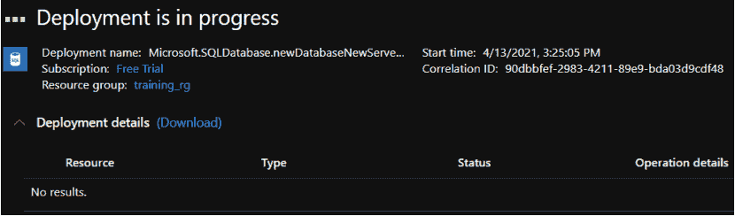

图 5.5 – Azure SQL 部署进度

4. 部署完成后，点击 Go to resource。你现在应该可以看到新创建的 SQL 数据库：

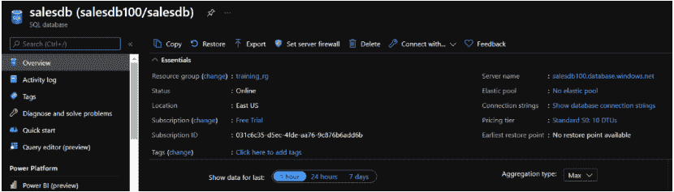

图 5.6 – Azure SQL 数据库部署确认

5. 要连接到新创建的数据库，请在左侧窗格中点击 Query editor (preview)。以 salesadmin 身份登录：

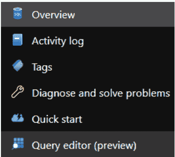

图 5.7 – Azure SQL 数据库部署确认

6. 复制训练 Git 仓库中以下文件的内容：
https://raw.githubusercontent.com/PacktPublishing/Data-Engineering-with-Apache-Spark-Delta-Lake-and-Lakehouse/main/project/prep/stores/sql/history/storedb_history.sql.

7. 将内容粘贴到 Query editor 窗口中。点击 Run：

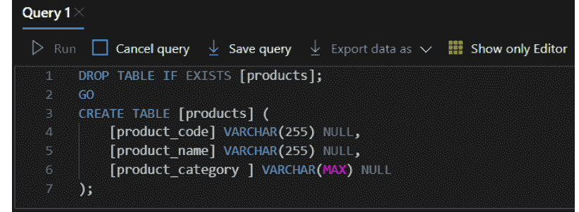

图 5.8 – Azure SQL 查询编辑器

8. 经过几秒钟后，Messages 窗格应显示类似以下内容的成功消息：

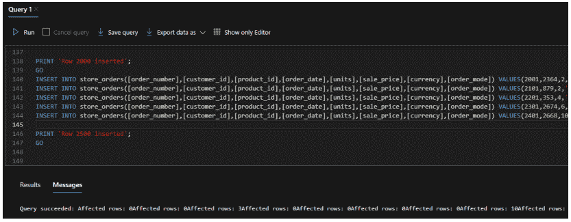

图 5.9 – Azure SQL 查询编辑器成功消息

9. 在左侧窗格中，选择刷新图标（圆形箭头），然后点击 Tables。现在点击三个点并选择 Select Top 1000 Rows：

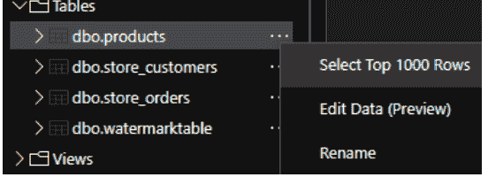

图 5.10 – 在 Azure SQL 查询编辑器中选择行

10. 你应该能够查看 products 表中的行，如下所示：

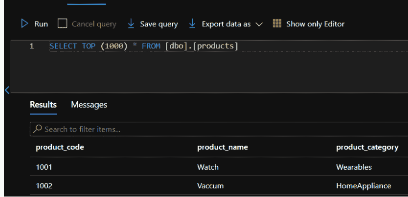

图 5.11 – Azure SQL 查询编辑器结果

全部完成。你已准备好继续下一步。

### 为电子商务交易准备源数据

为了生成电子商务交易，我们将注册一个 Azure 事件网格并创建 Azure 事件中心。这次，Azure 门户将不会用于创建资源。相反，我们将调用 shell 命令来为我们创建资源。对于此练习，我们将使用 Azure Cloud Shell。Cloud Shell 是交互式的，可以通过浏览器访问。Shell 体验可作为 Bash 或 PowerShell 使用：

**Important**
在创建 Azure 资源时，数据工程师不应仅限于 Azure 门户。他们应学习如何使用命令行工具（如 Azure CLI）进行部署。与使用门户的交互式方法相比，使用 shell 命令创建资源更快且出错率更低。

1. 使用 Azure 门户顶部菜单中可用的 **Cloud Shell** 图标打开 Cloud Shell：

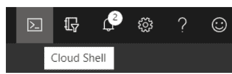

图 5.12 – Azure 门户中的 Cloud Shell 图标

2. 将打开一个欢迎窗口，要求你选择两个选项之一：**Bash** 或 **PowerShell**。选择 **Bash**：

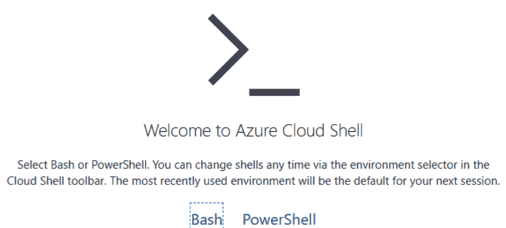

图 5.13 – Azure Cloud Shell 中的 shell 选择

3. 在下一个窗口中，选择 **Create storage**。请不要将 Cloud Shell 存储与 Azure Data Lake Storage 混淆。Cloud Shell 使用此存储帐户来持久化内部文件。我们**不会**使用此存储来存储 Electroniz lakehouse 数据：

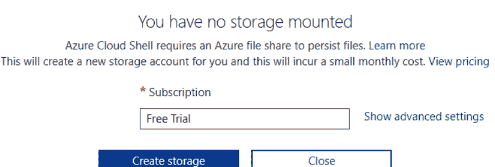

图 5.14 – Cloud Shell 存储

4. 你现在应该已连接到 Bash shell，窗口显示如下：

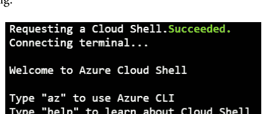

图 5.15 – Cloud Shell 屏幕

5. 在整本书中，我们将使用 **Packt Publishing** Git 仓库来下载代码文件和示例数据。现在是克隆 Git 仓库以便访问所需文件的合适时机。在 Bash shell 中调用以下命令：

```
git clone https://github.com/PacktPublishing/Data-Engineering-with-Apache-Spark-Delta-Lake-and-Lakehouse.git
```

如果克隆成功，你应该会看到类似以下内容的输出：

```
Azure> git clone https://github.com/PacktPublishing/Data-Engineering-with-Apache
Cloning into 'Data-Engineering-with-Apache-Spark-Delta-Lake-and-Lakehouse'...
remote: Enumerating objects: 22, done.
remote: Counting objects: 100% (22/22), done.
remote: Compressing objects: 100% (17/17), done.
remote: Total 22 (delta 2), reused 9 (delta 0), pack-reused 0
Unpacking objects: 100% (22/22), done.
```

图 5.16 – Git 克隆输出

6. 现在，让我们创建一个 Azure 事件网格。Azure Event Grid 允许你轻松构建基于事件驱动架构的应用程序。Azure Event Grid 将事件源连接到事件处理程序。事件网格主题提供了一个源发送事件的端点。电子商务网站跟踪日志存储在 Azure Blob 存储帐户中：

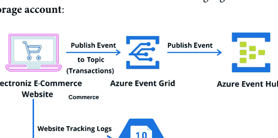

图 5.17 – 发布事件到 Azure Event Hubs

逐行复制以下每个命令并粘贴到 Cloud Shell 窗口中。然后，按 Enter：

```
RESOURCEGROUPNAME="training_rg"
LOCATION="eastus"
TOPIC="esales"
EVENTHUB_NAMESPACE="esalesns"
EVENTHUB_NAME="esaleshub"
EVENT_SUBSCRIPTION="esalesevent"
az provider register --namespace Microsoft.EventGrid
az provider show --namespace Microsoft.EventGrid --query "registrationState"
az eventgrid topic create --name $TOPIC -l $LOCATION -g $RESOURCEGROUPNAME
```

7. 创建 Azure 事件中心和 Azure 事件中心命名空间。Azure Hub 命名空间提供 DNS 集成的网络端点。最后，你需要订阅我们之前创建的事件网格主题。这告诉事件网格将跟踪哪些事件以及将这些事件发送到何处。逐行复制以下每个命令并粘贴到 Cloud Shell 窗口中。然后，按 Enter：

```
az eventhubs namespace create --name $EVENTHUB_NAMESPACE --resource-group $RESOURCEGROUPNAME
```

```
az eventhubs eventhub create --name $EVENTHUB_NAME --namespace-name $EVENTHUB_NAMESPACE --resource-group $RESOURCEGROUPNAME
```

```
sh Data-Engineering-with-Apache-Spark-Delta-Lake-and-Lakehouse/project/prep/ecommerce/eventhub/eventhub.sh -e $EVENTHUB_NAME -n $EVENTHUB_NAMESPACE -r $RESOURCEGROUPNAME -s $EVENT_SUBSCRIPTION -t $TOPIC
```

如果上述命令成功，你可以通过导航到 Azure 门户来确认是否已创建 Azure 事件中心。

导航到 Home | All Resources | esalesns，你将被重定向到以下内容：

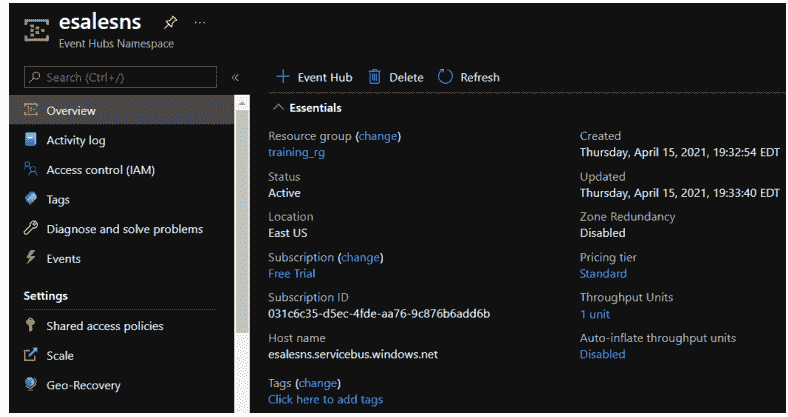

图 5.18 – 发布事件到 Azure Event Hubs

8. 接下来，创建电子商务网站跟踪日志的数据源并上传示例网站跟踪文件。逐行复制以下每个命令并粘贴到 Cloud Shell 窗口中。然后，按 Enter：

```
LOGSTORAGEACCOUNTNAME="ecommercetracking"
LOGSCONTAINER="ecommercelogs"
RESOURCEGROUPNAME="training_rg"
LOCATION="eastus"
az storage account create --name $LOGSTORAGEACCOUNTNAME --resource-group $RESOURCEGROUPNAME --kind StorageV2 --location $LOCATION --sku Standard_LRS --tags owner=data engineering project=lakehouse environment=development
KEY=`az storage account keys list -g $RESOURCEGROUPNAME -n $LOGSTORAGEACCOUNTNAME | jq .[0].value`
az storage container create -n $LOGSCONTAINER --account-name $LOGSTORAGEACCOUNTNAME --account-key $KEY
az storage blob upload --container-name $LOGSCONTAINER --account-name $LOGSTORAGEACCOUNTNAME --name electroniz_access_log_1.json --file ~/Data-Engineering-with-Apache-Spark-Delta-Lake-and-Lakehouse/project/prep/ecommerce_logs/electroniz_access_log_1.log --account-key $KEY
```

> Note
> Azure 中的存储帐户名称需要在全球范围内唯一。如果收到 The storage account named ecommercetracking is already taken 错误，你需要在下一节的说明中更改帐户名称。

我们现在已成功为商店数据库和电子商务交易创建了数据源。现在我们将使用下一节中概述的步骤创建数据目的地。


## 配置数据目标

一旦批处理和流式摄取管道被调用，它们将从数据源获取数据并将结果转储到数据目标。青铜层的 数据目标是 Azure Data Lake Storage Gen2：

+   1. 我们现在将使用 Azure 客户端创建一个 Azure Data Lake Storage 账户。逐行复制以下每个命令，并将其粘贴到 Cloud Shell 窗口中。然后，按 Enter：

```
STORAGEACCOUNTNAME="traininglakehouse"
RESOURCEGROUPNAME="training_rg"
LOCATION="eastus"
az storage account create --name $STORAGEACCOUNTNAME --resource-group $RESOURCEGROUPNAME --kind StorageV2 --location $LOCATION --hns true --sku Standard_LRS --tags owner=data engineering project=lakehouse environment=development
```

如果前面的命令成功，您应该会看到如下输出：

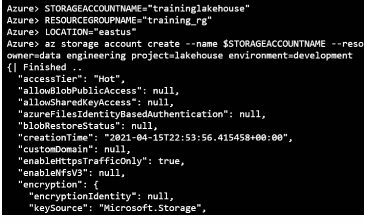

图 5.19 – Data Lake Storage 账户的创建输出

+   2. 您可以通过转到 Azure 门户来确认是否已创建 Azure Data Lake Storage 账户。

导航到 Home | All Resources | traininglakehouse：

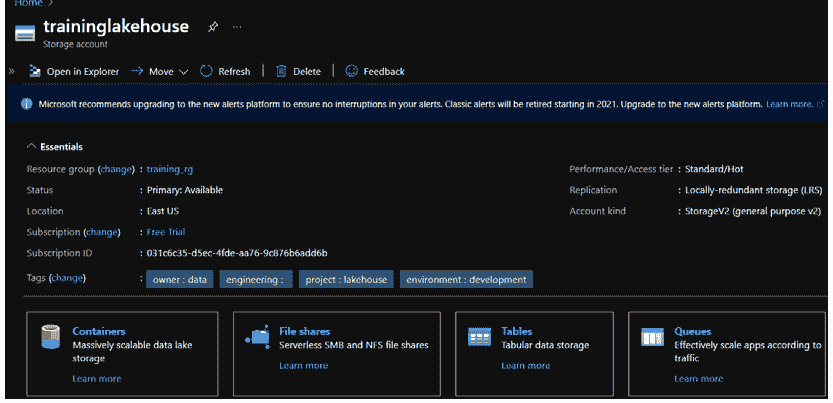

图 5.20 – Azure 门户上的 Azure Data Lake Storage 账户

3. Azure Data Lake Storage 将以 blob 的形式存储数据。在 Azure Data Lake Storage 中，blob 组织在文件系统层次结构中。为了启用层次结构，我们需要为青铜层创建一个命名空间。逐行复制以下每个命令，并将其粘贴到 Cloud Shell 窗口中。然后，按 Enter：

```
NAMESPACE="bronze"
az storage fs create -n $NAMESPACE --account-name $STORAGEACCOUNTNAME --metadata project=lakehouse environment=development layer=bronze --only-show-errors
```

如果前面的命令成功，您应该会看到如下输出：

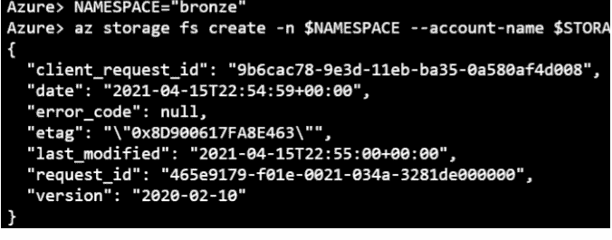

图 5.21 – Data Lake Storage 命名空间的创建输出

至此，我们已成功为 Electroniz 湖仓的青铜层准备了数据源和数据目标。在下一节中，我们将开始构建摄取管道，该管道将从源获取数据并将其存储到目标中。

### 构建摄取管道

您可能还记得，在之前的章节中我们决定创建两个摄取管道——批处理摄取和流式摄取。这两个管道中的每一个都将使用不同的 Azure 服务集构建。对于批处理摄取，我们将使用 Azure Data Factory，对于流式摄取，我们将使用 Azure Event Hubs Capture。因此，让我们开始吧，因为我们还有很长的路要走。

### 构建批处理摄取管道

在继续实际创建批处理管道之前，让我提醒您 Electroniz 湖仓的一个关键要求。之前，Electroniz 表示销售数据库和在线商店中的交易在一天中非常频繁地发生。他们希望湖仓能够在最多 1 小时的延迟内保持最新数据。

为了满足这一要求，我们需要使用水印方法来构建管道。简单来说，水印是一个可以用来标识上一次摄取运行中已摄取数据的最后一点的列。通常，水印列的选择是在自增键列或时间戳列之间：

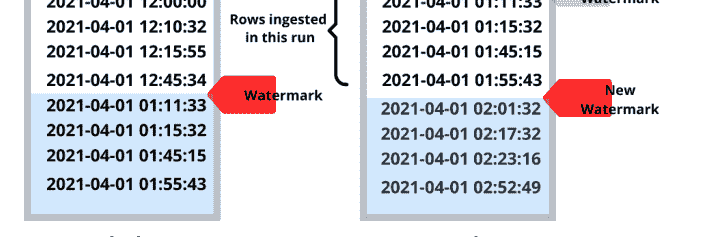

图 5.22 – 水印在每次摄取运行时更新

批处理管道需要以能够加载旧水印和新水印之间更改数据的方式创建。在每次摄取运行时，将创建一个新的水印，该水印将用作下一次运行的标记：

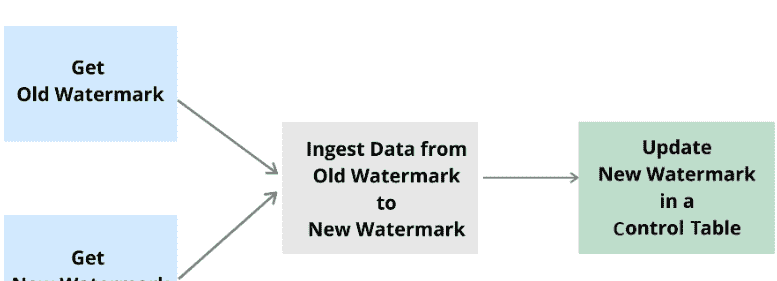

图 5.23 – 用于增量数据摄取的水印方法

考虑到增量摄取方法，让我们开始构建批处理摄取管道：

+   1. 我们将从创建 Azure 数据工厂开始。浏览到 Azure 门户上的 Home。使用屏幕顶部的搜索框，搜索数据工厂。单击服务下的 Data factories：

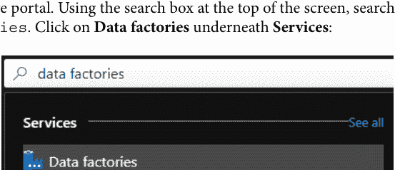

图 5.24 – 在 Azure 门户上搜索 Data Factory 服务

+   2. 单击 Create data factory 按钮并输入以下内容：

-   Resource group: training_rg
-   Region: East US
-   Name: traininglakehousedf
-   Version: V2

然后，单击 Next: Git configuration：

-   Configure Git later: Checked
-   单击 Review + create。您应该会收到 Validation passed 消息。

最后，单击 Create。部署完成后，单击 Go to resource：

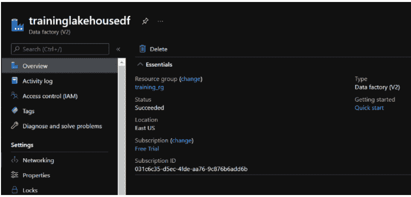

图 5.25 – Azure 门户上的 Data Factory 服务

3. 在管道创建过程中，其中一个步骤需要您连接到 REST API，该 API 将从互联网下载货币转换数据。为此，我们将使用一个免费服务。您可以从 https://free.currencyconverterapi.com/ 获取 API。选择 Get Your Free API 按钮。一旦收到电子邮件，请用它替换 API_KEY 中 XXXXXXXXXXX 的值。

此外，我们还将把 Azure Data Lake 账户密钥存储在 Azure Key Vault 的密钥管理器中。在 Azure Cloud Shell 上调用以下命令。请确保将 ADLS_KEY 的值替换为您之前获取的 key1 的值：

```
RESOURCEGROUPNAME="training_rg"
LOCATION="eastus"
KEYVAULTNAME="trainingkv100"
ADLS_SECRETNAME="ADLSKEY"
```

```
ADLS_KEY="XXXXXXXXXXXXXXXXXXXXXXXXXXXXXXXXXXXX"
API_SECRETNAME="CURRAPIKEY"
API_KEY="XXXXXXXXXXXXXXXXXXXXXXXXXXXXXXXXXXXX"
az config set extension.use_dynamic_install=yes_without_prompt
az keyvault create --location $LOCATION --name $KEYVAULTNAME --resource-group $RESOURCEGROUPNAME
az keyvault secret set --name $ADLS_SECRETNAME --vault-name $KEYVAULTNAME --value $ADLS_KEY
az keyvault secret set --name $API_SECRETNAME --vault-name $KEYVAULTNAME --value $API_KEY
```

这会产生以下输出：

```
Azure> RESOURCEGROUPNAME="training_rg"
Azure> LOCATION="eastus"
Azure> KEYVAULTNAME="trainingkv100"
Azure> SECRETNAME="ADLS_KEY"
Azure> ADLS_KEY="+QpX+DYXC6qJXcAIXmUsWk+WYhV+43WaqVM+Nxi9SO3UQSJ+VDwXi
Azure>
Azure> az config set extension.use_dynamic_install=yes_without_prompt
Command group 'config' is experimental and under development. Referenc
Azure>
Azure> az keyvault create --location $LOCATION --name $KEYVAULTNAME --
{\ Finished ..
"id": "/subscriptions/0b35426c-85f3-45e8-9f96-577a13b738d5/resourceG
"location": "eastus",
"name": "trainingkv100",
"properties": {
  "accessPolicies": [
    {
      "applicationId": null,
      "objectId": "39ea52c6-0ad8-4736-b35a-da3222e579d0",
      "permissions": {
        "certificates": [
          "get",
```

图 5.26 – Azure Key Vault 创建

+   4. 要验证 Azure key vault 的创建，请导航到 Azure 门户。
+   导航到 Home | All Resources | trainingkv100。
+   然后，单击 Secrets | ADLSKEY。现在单击 CURRENT VERSION 下方的条目。

单击 **Show Secret Value** 并验证它是否显示 Azure Data Lake Storage 密钥：

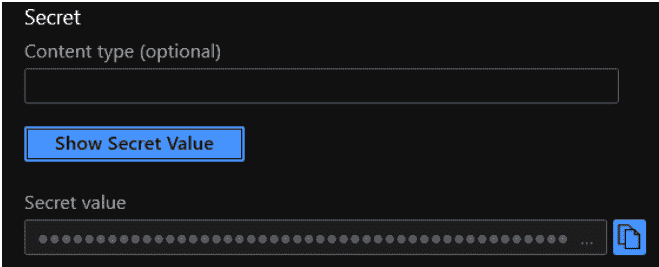

图 5.27 – 在 Azure Key Vault 中创建新密钥

记下 **secret identifier** 的值。您稍后需要它。

5. 最后，我们希望为 Azure Data Factory 提供读取密钥的访问权限。

导航到 **Home | All Resources | trainingkv100 | Access Policies.**

然后，单击 **Add Access Policy.**

对于 Key permissions，选择 **Get** 和 **List.**

对于 Secret permissions，选择 **Get** 和 **List.**

对于 Select Principal，单击 **None Selected.** 对于 **Principal**，查找您之前创建的 Azure 数据工厂的名称：

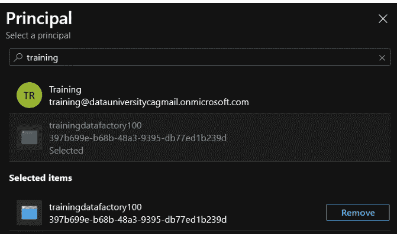

图 5.28 – 为新密钥的访问选择主体


点击 **Select**。然后，点击 **Add**。最后，点击 **Save**：

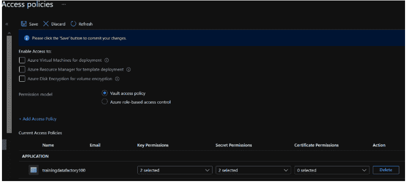

图 5.29 – 为数据工厂提供新密钥的访问权限

6. 现在是构建摄取管道的时候了。点击 **Open Azure Data Factory Studio** 部分下方的 **Open**。在某些情况下，你可能会看到以下窗口。如果是这样，点击 **Continue**：

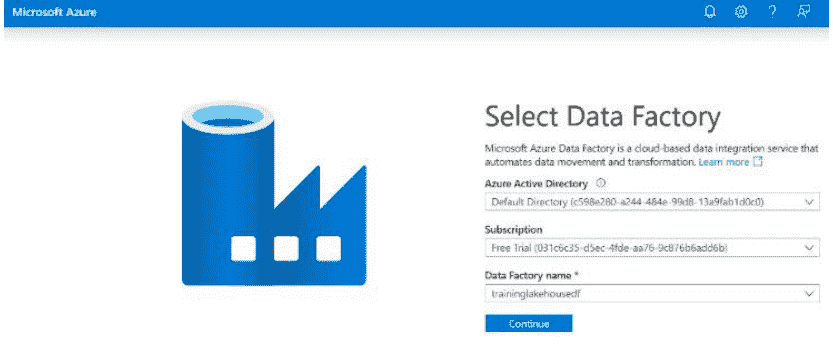

图 5.30 – 选择数据工厂屏幕

7. 使用左侧面板，点击 **Manage**。我们将从创建源和目标链接服务开始。

8. 要创建源链接服务，点击 **Create linked service**。在 **New linked service** 窗口中，选择 **Azure SQL Database** 的图标。然后，点击 **Continue**。一个新的窗口将打开，标题为 **New linked service (Azure SQL Database)**：

- Name: `salesdbsource`
- Account selection method: **From Azure subscription**
- Azure subscription: **Free Tier or Paid Subscription**
- Server name: `salesdb100`
- Database name: `salesdb`
- Authentication type: **SQL authentication**
- Username: `salesadmin`
- Password: **<PASSWORD SET PREVIOUSLY>**

最后，点击 **Test connection**。如果连接成功，点击 **Create**：

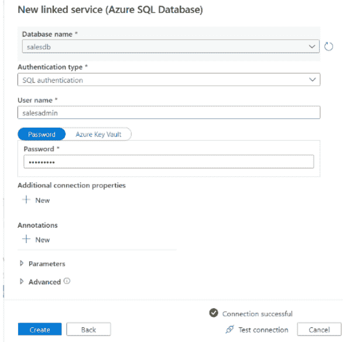

图 5.31 – Azure SQL 的数据工厂链接服务选项

9. 要创建目标链接服务，点击 New。在 New linked service 窗口中，选择 Azure Data Lake Storage Gen2 的图标。然后，点击 Continue。一个新的窗口将打开，标题为 New linked service (Azure Data Lake Storage Gen2)：

- Name: traininglakehouse
- Account selection method: From Azure subscription
- Azure subscription: Free Tier or Paid Subscription
- Storage account name: traininglakehouse

最后，点击 Test connection。如果连接成功，点击 Create：

## New linked service (Azure Data Lake Storage Gen2)

图 5.32 – Azure Data Lake Storage 的数据工厂链接服务选项

10. 两个链接服务现已准备就绪。它们应如下所示出现在 Azure 门户中：

## Linked services

Linked service defines the connection information to a data store or compute. Learn more

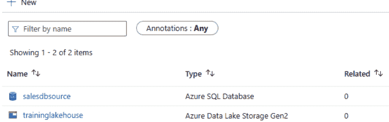

图 5.33 – 关于两个链接服务创建的确认

11. 使用左侧面板，从菜单中点击 Author。从 Factory resources 面板中，点击 Pipelines 右侧的三点并选择 New pipeline。

在 Properties 面板中，输入以下内容：

- Name: electroniz_batch_ingestion_pipeline
- Description: This pipeline will ingest data from sales database, currency conversion, geo-location, and ecommerce website tracking

12. 在 Activities 面板中，搜索 Web。现在，将 Web activity 拖到右侧面板：

- Name: Get Secret.
- Click on Settings.
- For the URL, enter the secret identifier from the Azure Key Vault secret that we created previously. You can find this by navigating to Home | trainingkv100 | CURRAPIKEY.
- Add ?api-version=7.0 to the end of the URL, as follows: https://trainingkv100.vault.azure.net/secrets/CURRAPIKEY/f167b5ebb4f440ca93421610dbe731aa?api-version=7.0.
- Authentication: **Managed Identity**.
- Resource: https://vault.azure.net:

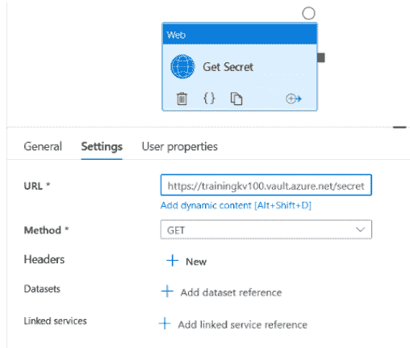

图 5.34 – 在 electroniz_ingestion_pipeline 中创建 Get Secret 活动

13. 我们现在将创建用于下载 **Geo-location** 数据的活动。

在左侧窗格中，点击 **Manage**。

现在，点击 **New**。

从 **New linked service** 窗格中，点击 **File**。然后，点击 **HTTP**。

点击 **Continue**。输入以下内容：

- Name: httpsource
- Base URL: https://raw.githubusercontent.com/PacktPublishing/Data-Engineering-with-Apache-Spark-Delta-Lake-and-Lakehouse/main/project/prep/iplocation/IP2LOCATION-LITE-DB1.CSV
- Authentication type: Anonymous

点击 **Test connection**。如果收到 **Connection successful** 消息，点击 **Create**：

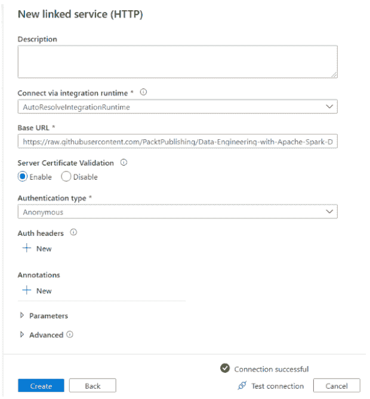

## 图 5.35 – 用于地理位置数据的新的链接服务

在 Activities 窗格中，搜索 Copy data。

将 copy data activity 拖到右侧窗格。输入以下内容：

- Name: Get Geo-location Mapping

点击 Source。对于源数据集，点击 New。在 New dataset 窗格中，点击 File。现在点击 HTTP。

点击 Continue。然后，点击 DelimitedText。输入以下内容：

- Name: GeoDelimitedTextSource
- Linked service: httpsource

点击 OK。然后，点击 Sink。

对于 Sink 数据集，点击 New。

在新数据集窗格中，点击 Azure data Lake storage Gen 2。

点击 Continue。然后，点击 DelimitedText。输入以下内容：

- Name: GeoDelimitedTextSync
- Linked service: traininglakehouse
- File path: bronze

点击 OK。然后，点击 Sink 数据集旁边的 Open。输入以下内容：

- Directory: geolocation/@{formatDateTime(utcnow(), 'yyyy')}/@{formatDateTime(utcnow(), 'MM')}/@{formatDateTime(utcnow(), 'dd')}/@{formatDateTime(utcnow(), 'HH')}

使用选项卡，点击 electroniz_batch_ingestion_pipeline 选项卡。通过将箭头从 Get Secret 拖到 Get Geo-location Mapping 来将两个活动链接在一起。

14. 现在从顶部菜单点击 Publish all，然后点击 Publish 按钮。

发布后，管道应如下所示：

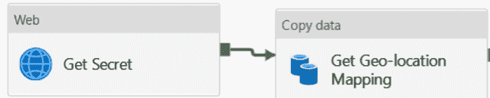

图 5.36 – 地理位置管道

15. 现在，让我们继续进行下载商店销售数据的活动。

在 Activities 面板中，搜索 Lookup。现在，将 Lookup activity 拖到右侧面板。选择以下内容：

- Name: Find SalesDB Tables
- Click on Settings.

在 Source dataset 中，点击 New。在 New dataset 面板中，点击 Azure SQL Database。点击 Continue。在 Set properties 面板中，输入以下详细信息：

- Name: salesdbds
- Linked service: salesdbsource

点击 **OK**。你现在应该回到 **Find SalesDB Tables** 的 **Settings** 选项卡。输入以下内容：

- Use query: **Choose Query**
- Query: SELECT QUOTENAME(table_schema)+'.'+QUOTENAME(table_name) AS Table_Name FROM information_Schema.tables WHERE table_name not in ('watermarktable', 'database_firewall_rules')

请注意，前面的动态 select 语句生成将在 lakehouse 中摄取的表列表。如果你想从列表中排除某些表，可以使用 **NOT IN** 子句。

对于第一行，取消选中复选框。

16. 从顶部菜单点击 **Publish all**。你应该有两个准备发布的更改。点击 **Publish**：

## Publish all

You are about to publish all pending changes to the live environment. Learn more

Pending changes (2)

| NAME | CHANGE | EXISTING |
|---|---|---|
| Pipelines |  |  |
| electroniz_batch_ingestion... (Edited) |  | electroniz_batch_ingestion_pipeline |
| Datasets |  |  |
| salesdbds (New) |  | - |

图 5.37 – 批量摄取管道的 Publish all 屏幕

17. 在 **Activities** 面板中，搜索 **ForEach**。现在，将 **ForEach** activity 拖到右侧面板。

**ForEach** activity 将遍历由 **Find SalesDB Tables** activity 提供的表列表。对于每次迭代，它将执行以下操作：

查找旧水印并设置新水印，从旧水印到新水印摄取表，最后在控制表中更新水印。

- Name: **For Each Table**
- Click on **Settings**. Input the following:
- Items: `@activity('Find SalesDB Tables').output.value`

请注意使用 **@activity**。在运行时，每个活动都会返回一个通用响应 JSON，其中包含 output 和 status 等项目。你可以使用前述约定读取项目的响应。在前面的示例中，我们读取的是 **Find SalesDB Tables** 活动的输出。这将输出表列表，而该列表又是前一个 SQL 的输出。

通过将箭头从 **Find SalesDB Tables** 拖到 **For Each Table** 将两个活动链接在一起。链接可确保前一个活动的输出成为下一个活动的输入：

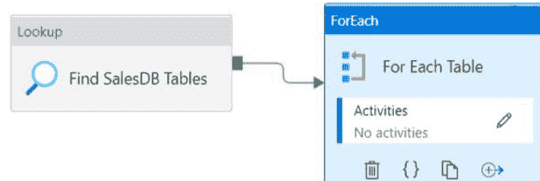

图 5.38 – 将两个销售活动链接在一起

18. 点击 **For Each Table** 的 **Activities** 部分中的 **pencil** 图标。

在 **Activities** 面板中，搜索 **Lookup**。现在，将 **Lookup** activity 拖到右侧面板。

Name: `Lookup Old Watermark`

Click on **Settings.**

对于 **Source** 数据集，选择 **salesdbds.**

Use Query: **Query**

```
Query: SELECT * FROM [dbo].[watermarktable] AS WatermarkValue WHERE table_name='@{item().Table_Name}'
```

请注意，动态 select 语句从上一次摄取运行的迭代中选择正在摄取的表的旧水印。


在 **Activities** 面板中，搜索 **Lookup**。现在，将 **Lookup** 活动拖到右侧面板。

Name: `Lookup New Watermark`

点击 **Settings.**

对于 **Source** 数据集，选择 **salesdbds.**

Use Query: **Query**

```
Query: SELECT MAX(updated_at) as NewWatermarkvalue FROM @{item().Table_Name}
```

请注意，动态创建了正在摄取的表的新的水印。

19. 在 **Activities** 面板中，搜索 **Copy data**。现在，将 **Copy data** 活动拖到右侧面板。

Name: `Copy Table Data`

点击 **Source.**

对于 **Source** 数据集，选择 **salesdbds.**

Use query: **Query**

```
Query: SELECT * FROM @{item().Table_Name} WHERE updated_at > '@{activity('Lookup Old Watermark').output.firstRow.watermark_value}'
```

请注意，此 SQL 选择的记录大于正在摄取的表的旧水印。我们选择了 **updated_at** 作为水印列。

点击 **Sink.**

Sink 是前一个 SQL 输出将被存储的目的地。

在 **Sink** 数据集中，点击 **New**。然后，点击 **Azure Data Lake Storage Gen 2**。最后，点击 **Continue.**

在 Select Format 中，点击 **DelimitedText**。然后，点击 **Continue.**

在 **Set properties** 窗格中，输入以下内容：

Name: `SalesDelimitedText`

Linked service: **traininglakehouse**

在 **File path** 中，输入以下内容：

Filesystem: `bronze`

点击 **OK**。在 **Sink** 数据集旁边，点击 **Open.**

```
Directory: sales/@{activity('Lookup Old Watermark').output.firstRow.table_name}/@{formatDateTime(utcnow(),'yyyy')}/@{formatDateTime(utcnow(),'MM')}/@{formatDateTime(utcnow(),'dd')}/@{formatDateTime(utcnow(),'HH')}
```

请注意，我们将输出存储在日期和小时文件夹中，如下所示：

```
File: @concat(dataset().FileTime,'.',dataset().FileExt)
```

点击 **Parameters**。然后，添加以下参数：

```
Name: FileExt    Type: String    Value: csv
```

```
Name: FileTime    Type: String    Value: @pipeline().TriggerTime
```

20. 使用选项卡，点击 **electroniz_batch_ingestion_pipeline** 选项卡。将三个活动链接在一起。

你可以通过从 **Lookup Old Watermark** 拖动箭头到 **Copy Table Data**，并从 **Lookup New Watermark** 拖动箭头到 **Copy Table Data** 来实现。

21. 在 **Activities** 面板中，搜索 **Stored procedure**。现在，将 **Stored procedure** 活动拖到右侧面板。

```
Name: Update Watermark
```

点击 **Settings**。输入以下内容：

Linked Service: **salesdbsource**

Stored procedure name: [dbo].[usp_write_watermark]

在 **Stored procedure** 参数下方，添加两个参数。然后，点击 **New**。输入以下内容：

```
Name: LastModifiedtime    Type: Datetime
```

```
Value: @{activity('Lookup New Watermark').output.firstRow.NewWatermarkvalue}
```

```
Name: TableName    Type: String
```

```
Value: @{activity('Lookup Old Watermark').output.firstRow.table_name}
```

### Figure 5.39 – The parameters for the stored procedure

现在将 Copy Table Data 链接到 Update Watermark。

22. 使用顶部菜单，点击 Publish all。然后，点击 Publish。

发布后，管道应如下所示：

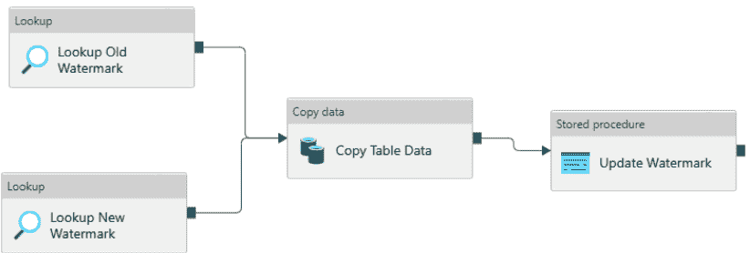

### Figure 5.40 – The pipeline for the sales database incremental ingestion

23. 我们已完成 sales 数据库的增量摄取管道。管道现在应如下所示：

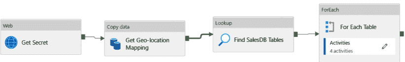

### Figure 5.41 – The pipeline for the store sales ingestion

24. 我们已完成 **store sales** 数据的摄取。让我们继续进行我们列表中的下一个数据源，即 **currency conversion**。首先为货币转换数据创建一个链接服务。

在左侧窗格上，点击 **Manage**。

接下来，点击 **New**。

从 **New linked service** 窗格中，点击 **Generic Protocol**。现在点击 **REST**。

点击 **Continue**。输入以下内容：

Name: `restsource`

Base URL: `https://free.currconv.com/api/v7/convert?`

Authentication type: **Anonymous**

点击 **Test connection**。如果收到 **Connection successful** 消息，点击 **Create**：

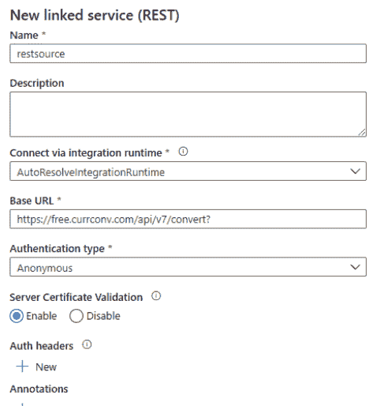

Figure 5.42 – New linked service for currency conversion data

25. 现在点击顶部菜单中的 **Publish all**，然后点击 **Publish** 按钮。

26. 使用左侧窗格，点击 **Author**。点击先前创建的管道，**electroniz_batch_ingestion_pipeline**，在 **Pipelines** 下方。你现在应该处于 **Find SalesDB Tables** 的级别。

在 **Activities** 面板中，搜索 **Lookup**。现在将 **Lookup** 活动拖到右侧面板。

Name: `Find Currencies`

点击 **Settings**。

对于 **Source** 数据集，选择 **salesdbds**。

Use Query: **Query**

```
Query: SELECT DISTINCT currency FROM [dbo].[store_orders] WHERE currency <> 'USD'
```

在第一行仅选择 **Uncheck** 框。

在 **Activities** 面板中，搜索 **ForEach**。现在将 **ForEach** 活动拖到右侧面板。

**ForEach** 活动将遍历 **Find Currencies** 活动提供的表列表。对于每次迭代，它将执行以下操作：

Name: `For Each Currency`

点击 **Settings**。

Items: `@activity('Find Currencies').output.value`

通过从 **Find Currencies** 拖动箭头到 **For Each Currency** 将两个活动链接在一起。链接可确保前一个活动的输出成为下一个活动的输入：

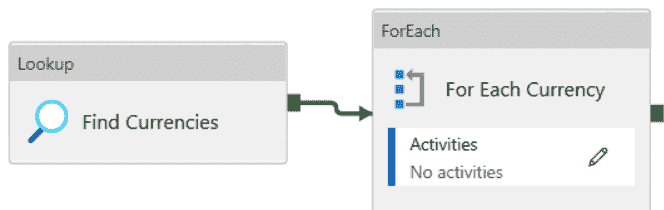

Figure 5.43 – Chaining two currency activities together

27. 点击 For Each Currency 的 Activities 部分中的铅笔图标。

在 Activities 面板中，搜索 Copy data。现在，将 Copy data 活动拖到右侧面板。

Name: Get Currency Value

点击 Source。点击 New。在 New dataset 面板中，点击 Generic Protocol。

点击 REST。然后，点击 Continue。在 Source 数据集旁边，点击 Open。

在 Connection 中，输入以下内容：

Linked service: restsource

Relative URL: convert?q=USD_@{item().Currency}&compact=ultra&apiKey=XXXXXXXXXXX

点击先前创建的管道，electroniz_batch_ingestion_pipeline，在 Pipelines 下。点击 Sink。

在 Sink 数据集中，点击 New。然后，点击 Azure Data Lake Storage Gen 2。最后，点击 Continue。

在 Select Format 中，点击 DelimitedText。然后，点击 Continue。

在 Set properties 窗格中，输入以下内容：

Name: CurrencyDelimitedText

Linked service: traininglakehouse

在 File path 中，输入以下内容：

Filesystem: bronze

点击 OK。在 Sink 数据集旁边，点击 Open。

Directory: currency/@{item().Currency}/@{formatDateTime(utcnow(), 'yyyy')}/@{formatDateTime(utcnow(), 'MM')}/@{formatDateTime(utcnow(), 'dd')}/@{formatDateTime(utcnow(), 'HH')}

请注意，我们将输出存储在日期和小时文件夹中。

28. 点击先前创建的管道，electroniz_batch_ingestion_pipeline，在 Pipelines 下方。你现在应该处于 Find Currencies 的级别。

通过从 **For Each Table** 拖动箭头到 **Find Currencies** 将活动链接在一起。

现在，从顶部菜单点击 **Publish all**，然后点击 **Publish** 按钮。

发布后，管道应如下所示：

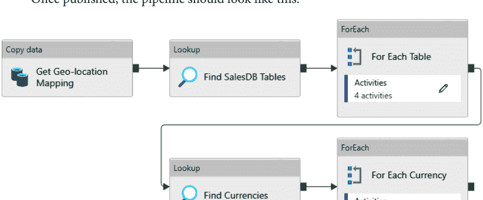

Figure 5.44 – The Electroniz batch ingestion pipeline with currency data

29. 现在要处理的最后一个数据源是 **ecommerce website tracking**。要创建电子商务网站跟踪源链接服务，请执行以下步骤：

在左侧窗格上，点击 **Manage.**

现在，点击 **New.**

在新的链接服务窗格中，点击 **Azure Blob Storage**。现在，点击 **Continue**：

Name: websitetrackinglogs

Account selection method: **From Azure subscription**

Azure subscription: **Free Tier or Paid Subscription**

Storage account name: **ecommercetracking**

最后，点击 **Test connection**。如果连接成功，点击 **Create.**

30. 使用左侧窗格，点击 **Author**。点击先前创建的管道，**electroniz_batch_ingestion_pipeline**，在 **Pipelines** 下方。你现在应该处于 **Find SalesDB Tables** 的级别。


在 **Activities** 面板中，搜索 **Copy data**。现在，将 **Copy data** 活动拖到右侧面板：

Name: `Copy Website Tracking Data`

点击 **Source**。

在 **Source** 数据集中，点击 **New**。然后，点击 **Azure Blob Storage**。最后，点击 **Continue**。

选择 **Format**。点击 **JSON**。然后，点击 **Continue**。

在 **Set properties** 窗格中，输入以下内容：

Name: `TrackingJSON`

Linked service: **websitetrackinglogs**

File path: `ecommercelogs`

点击 **OK**。返回到 **Copy Website Tracking Data** 活动。

对于 **File path type**，执行以下操作：

选择 **Prefix**。

Prefix: `electroniz_access`

点击 **Sink**。

在 **Sink** 数据集中，点击 **New**。然后，点击 **Azure Data Lake Storage Gen 2**。最后，点击 **Continue**。

选择 **Format** 并点击 **JSON**。然后，点击 **Continue**。

在 **Set properties** 窗格中，输入以下内容：

Name: `TrackingJSONSync`

Linked service: **traininglakehouse**

在 **File path** 中，输入以下内容：

Filesystem: `bronze`

点击 **OK**。在 **Sink** 数据集旁边，点击 **Open**。

选择以下目录：`logs/@
{formatDateTime(utcnow(), 'yyyy')}/@
{formatDateTime(utcnow(), 'MM')}/@
{formatDateTime(utcnow(), 'dd')}/@
{formatDateTime(utcnow(), 'HH')}`

31. 在 **Pipelines** 下，点击之前创建的管道 **electroniz_batch_ingestion_pipeline**。通过将箭头从 **For Each Currency** 拖到 **Copy Website Tracking Data** 来连接活动。此外，将箭头从 **Copy website tracking data** 拖到 **Delete Website Tracking Logs**。

最后，我们希望清理已成功摄取的电子商务网站跟踪日志。在 **Activities** 面板中，搜索 **Delete**。现在，将 **Delete** 活动拖到右侧面板：

Name: `Delete Website Tracking Logs`

点击 **Source**：

Dataset: **TrackingJSON**

File path type: **File path in dataset**

在日志设置中，在 Enable logging 中，选择 **Unchecked**。

32. 现在从顶部菜单点击 **Publish all**，然后点击 **Publish** 按钮。

发布后，管道应如下所示：

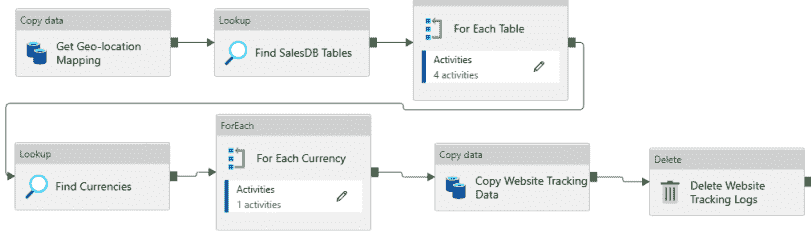

Figure 5.45 – The final Electroniz batch ingestion pipeline

全部完成！现在是时候检查新创建的 **electroniz_batch_ingestion_pipeline** 管道是否正常工作了。继续执行以下步骤对管道进行单元测试。

### Testing the ingestion pipelines

我们现在将测试 **electroniz_batch_ingestion_pipeline** 管道。你可能还记得，Electroniz 希望其销售数据库与湖仓之间最大延迟为 1 小时。将来，我们将配置一个触发器，每小时运行一次 **electroniz_batch_ingestion_pipeline** 管道。现在，我们将手动多次调用此管道以测试结果。

### Testing the batch ingestion pipeline for historical data

执行以下步骤：

- 1. 要调用管道，请在 Azure Cloud Shell 上执行以下命令：

```
PIPELINENAME="electroniz_batch_ingestion_pipeline"
DATAFACTORYNAME="trainingdatafactory100"
RESOURCEGROUPNAME="training_rg"
az datafactory pipeline create-run --factory-name $DATAFACTORYNAME --name $PIPELINENAME --resource-group $RESOURCEGROUPNAME
```

- 2. 现在点击 Pipeline runs。过一段时间后，Status 将变为 Succeeded。这表示运行成功：

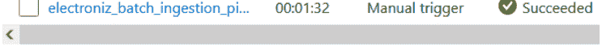

Figure 5.46 – The status of the Electroniz batch ingestion pipeline on completion

- 3. 在 Pipeline name 下方，点击 electroniz_batch_ingestion_pipeline 管道。注意每个活动都已成功。如果将光标悬停在活动名称上，你将能够看到每个活动的输入和输出日志。花尽可能多的时间熟悉这些输出。如果管道出现错误，将在 Error 列下报告：

### Activity runs

Pipeline run ID 119153a8-cc5d-4a2e-a3fe-da350c297099

All status

Showing 1 - 22 of 22 items

| Activity name | Activity type | Run start | Duration | Status | Integration runtime |
|---|---|---|---|---|---|
| Delete Website Tracking Logs | Delete | 4/28/21, 2:16:29 PM | 00:00:13 | Succeeded | DefaultIntegrationRuntime (East US) |
| Copy Website Tracking Data | Copy data | 4/28/21, 2:16:18 PM | 00:00:07 | Succeeded | DefaultIntegrationRuntime (East US) |
| Get Currency Value | Copy data | 4/28/21, 2:16:04 PM | 00:00:06 | Succeeded | DefaultIntegrationRuntime (East US) |
| Get Currency Value | Copy data | 4/28/21, 2:16:04 PM | 00:00:06 | Succeeded | DefaultIntegrationRuntime (East US) |
| Get Currency Value | Copy data | 4/28/21, 2:16:04 PM | 00:00:06 | Succeeded | DefaultIntegrationRuntime (East US) |
| For Each Currency | ForEach | 4/28/21, 2:16:03 PM | 00:00:14 | Succeeded |  |
| Find Currencies | Lookup | 4/28/21, 2:15:57 PM | 00:00:04 | Succeeded | DefaultIntegrationRuntime (East US) |
| Update Watermark | Stored procedure | 4/28/21, 2:15:46 PM | 00:00:02 | Succeeded | DefaultIntegrationRuntime (East US) |
| Copy Table Data | Copy data | 4/28/21, 2:15:37 PM | 00:00:05 | Succeeded | DefaultIntegrationRuntime (East US) |
| Update Watermark | Stored procedure | 4/28/21, 2:15:35 PM | 00:00:02 | Succeeded | DefaultIntegrationRuntime (East US) |
| Update Watermark | Stored procedure | 4/28/21, 2:15:34 PM | 00:00:12 | Succeeded | DefaultIntegrationRuntime (East US) |
| Copy Table Data | Copy data | 4/28/21, 2:15:28 PM | 00:00:05 | Succeeded | DefaultIntegrationRuntime (East US) |

Figure 5.47 – The Electroniz batch ingestion pipeline run details

### Important

从运营角度来看，数据工程师应非常熟悉管道日志记录机制。由于多种原因，你应该预期你的管道总有一天会在生产环境中失败，而那一天，你的调试技术将派上用场。

4. 让我们验证数据是否已正确摄取。在 Azure 门户中，导航到 Home | All resources | traininglakehouse。

点击 Containers | Bronze。你应该会看到以下四个文件夹：

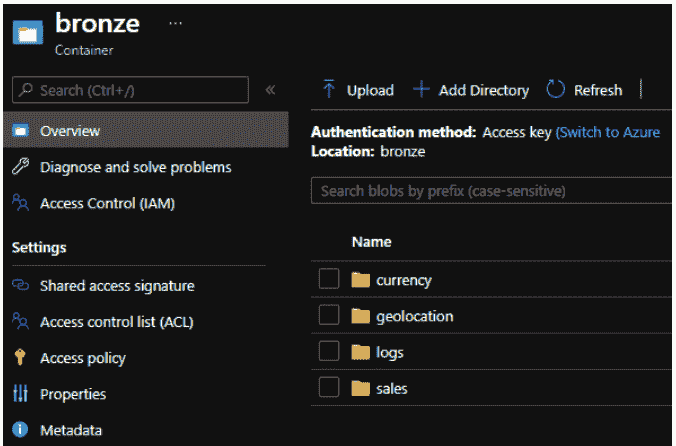

Figure 5.48 – The data ingested using the Electroniz batch pipeline

5. 花一些时间点击上述文件夹，并验证数据是否符合预期。

由于你将在与管道运行时不同的数据上运行，因此各个文件夹的日期和小时可能与以下屏幕截图不完全匹配：

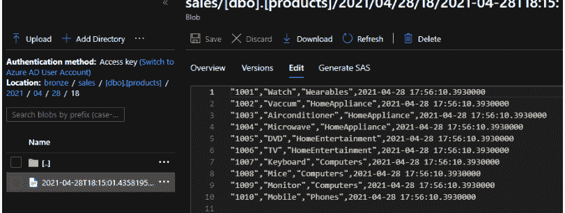

Figure 5.49 – Delimited data for the sales.product table as ingested by the Electroniz batch pipeline

从目前来看，electroniz_batch_ingestion_pipeline 管道在第一次运行中按预期工作。

### Testing the batch ingestion pipeline for incremental data

我们现在将检查管道对商店数据库中增量数据的反应。为此，我们将模拟对数据库的更改，包括插入、更新和删除。之后，我们将重新触发 electroniz_batch_ingestion_pipeline 三次，并验证新添加的数据是否已成功传输到湖仓。

### The second run of the pipeline – inserts

目前，初始摄取后的第一个小时正在进行。我们假设此时，sales 数据库已完全运行，并且正在插入新客户和订单。为了模拟插入活动，让我们在 sales 数据库中插入一些数据：

- 1. 返回 Azure SQL 数据库并检查最新的水印。

导航到 Home | All Resources | salesdb | Query Editor。运行以下查询：

```
SELECT TOP (1000) * FROM [dbo].[watermarktable]
```

注意每个表的 watermark 值。此时间戳代表 electroniz_batch_ingestion_pipeline 最后一次摄取数据的时刻：

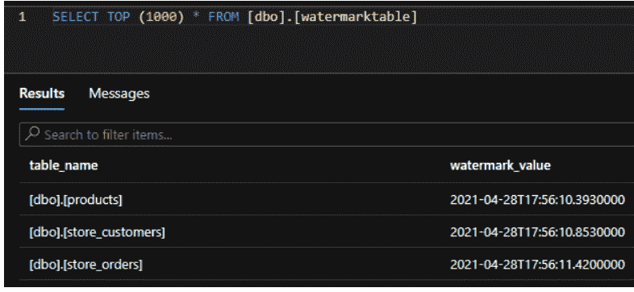

Figure 5.50 – The watermark values after the first run of the batch ingestion pipeline


2. 复制训练 Git 仓库中以下文件的内容：
https://raw.githubusercontent.com/PacktPublishing/Data-Engineering-with-Apache-Spark-Delta-Lake-and-Lakehouse/main/project/prep/stores/sql/incremental/1/storedb_incremental_1.sql。

将内容粘贴到查询编辑器窗口中。选择运行。这将在 store_customers 表中插入 100 条新行，并在 store_orders 表中插入 200 行：

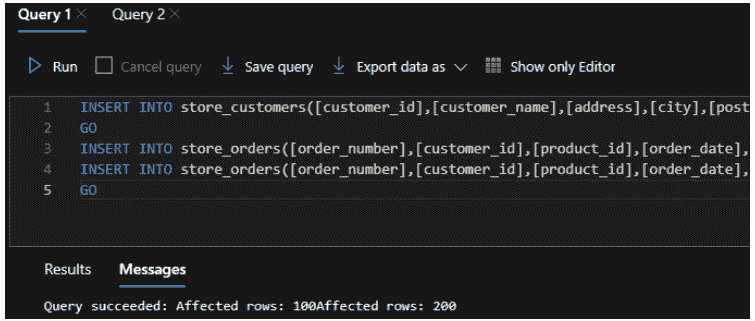

3. 此外，我们收到了需要摄取的新网站跟踪日志。逐行复制以下每个命令，并将其粘贴到 Cloud Shell 窗口中。然后，按 Enter：

```
LOGSTORAGEACCOUNTNAME="ecommercetracking"
```

```
LOGSCONTAINER="ecommercelogs"
```

```
RESOURCEGROUPNAME="training_rg"
```

```
LOCATION="eastus"
```

```
KEY=`az storage account keys list -g $RESOURCEGROUPNAME -n $LOGSTORAGEACCOUNTNAME | jq .[0].value`
```

```
az storage container create -n $LOGSCONTAINER --account-name $LOGSTORAGEACCOUNTNAME --account-key $KEY
```

```
az storage blob upload --container-name $LOGSCONTAINER --account-name $LOGSTORAGEACCOUNTNAME --name electroniz_access_log_2.json --file ~/Data-Engineering-with-Apache-Spark-Delta-Lake-and-Lakehouse/project/prep/ecommerce_logs/electroniz_access_log_2.log --account-key $KEY
```

4. 返回 Azure Data Factory 并等待当前小时结束。在下一次迭代中，管道将仅从销售数据库中提取增量数据。当下一个小时到来时，使用以下命令重新运行管道：

```
PIPELINENAME="electroniz_batch_ingestion_pipeline"
DATAFACTORYNAME="trainingdatafactory100"
RESOURCEGROUPNAME="training_rg"
az datafactory pipeline create-run --factory-name $DATAFACTORYNAME --name $PIPELINENAME --resource-group $RESOURCEGROUPNAME
```

5. 现在，单击管道运行。过一段时间后，状态将更改为已成功。这表示运行成功：

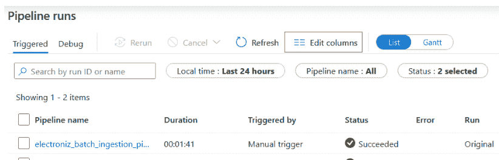

图 5.52 – 第二次迭代的 Electroniz 批处理摄取管道状态

6. 从前面的屏幕截图来看，管道似乎已成功完成第二次迭代。让我们检查一下水印是否已更新。再次运行以下水印查询：

```
SELECT TOP (1000) * FROM [dbo].[watermarktable]
```

请注意，store_customers 和 store_orders 表的水印值已更新：


图 5.53 – 批处理摄取管道第二次运行后编辑的水印值

7. 验证增量数据是否正确摄取。从 Azure 门户导航到主页 | 所有资源 | traininglakehouse。

然后，导航到容器 | Bronze | sales。浏览上一个小时创建的新文件夹。

您应该在 [dbo].[store_customers] 和 [dbo].[store_orders] 文件夹中看到如下所示的新小时文件夹：


图 5.54 – 第二次迭代的新小时文件夹

8. 单击新的小时文件夹。它应包含一个新文件，其中 store_customers 表有 100 行，store_orders 表中有 200 行：


图 5.55 – 批处理摄取管道增量数据运行的结果

### 管道的第三次运行 – 更新

目前，初始摄取后的第二个小时正在进行。再次，我们假设此时销售数据库仍完全运行，但在这一小时内，数据库活动为五位客户致电帮助台**更新**他们的订单：

- 1. 在下一次运行之前，让我们在销售数据库中显示一些更新活动。复制训练 Git 仓库中以下文件的内容：
https://raw.githubusercontent.com/PacktPublishing/Data-Engineering-with-Apache-Spark-Delta-Lake-and-Lakehouse/main/project/prep/stores/sql/incremental/2/storedb_incremental_2.sql。

将内容粘贴到查询编辑器窗口中。单击运行。这将更新 store_orders 表中的五个订单：


图 5.56 - 在 stores_orders 表中更新数据

- 2. 在下一次迭代中，管道将仅从销售数据库中提取增量数据。当下一个小时到来时，使用以下命令重新运行管道：

```
PIPELINENAME="electroniz_batch_ingestion_pipeline"
DATAFACTORYNAME="trainingdatafactory100"
RESOURCEGROUPNAME="training_rg"
az datafactory pipeline create-run --factory-name $DATAFACTORYNAME --name $PIPELINENAME --resource-group $RESOURCEGROUPNAME
```

- 3. 现在单击管道运行。过一段时间后，状态将更改为已成功。这表示运行成功：


图 5.57 – 第三次迭代的 Electroniz 批处理摄取管道状态

4. 从前面的屏幕截图来看，管道似乎已成功完成第三次。让我们验证增量数据是否正确摄取。从 Azure 门户导航到主页 | 所有资源 | traininglakehouse。

然后，导航到容器 | Bronze | sales。浏览上一个小时创建的新文件夹。

您应该在 [dbo].[store_customers] 和 [dbo].[store_orders] 文件夹中看到如下所示的新小时文件夹：


图 5.58 – 第三次迭代的新小时文件夹

5. 单击 store_orders 的新小时文件夹。它应包含一个新文件，其中有五行。请注意，每一行都被标记为 EDIT，表示已更新的行：


图 5.59 – 批处理摄取管道增量数据运行的结果

### 管道的第四次运行 – 插入

目前，初始摄取后的第三个小时正在进行。在本次运行中，我们假设一些客户已致电取消（删除）他们的订单：

- 1. 在下一次计划运行发生之前，让我们在销售数据库中显示一些活动。复制以下文件在训练 Git 仓库中的内容： https://raw.githubusercontent.com/PacktPublishing/Data-Engineering-with-Apache-Spark-Delta-Lake-and-Lakehouse/main/project/prep/stores/sql/incremental/3/storedb_incremental_3.sql。

将内容粘贴到查询编辑器窗口中。选择运行。请注意，order_mode 显示订单已被删除：


图 5.60 – stores_orders 表中的已删除数据

- 2. 在下一次迭代中，管道将仅从销售数据库中提取增量数据。当下一个小时到来时，使用以下命令重新运行管道：

```
PIPELINENAME="electroniz_batch_ingestion_pipeline"
DATAFACTORYNAME="trainingdatafactory100"
RESOURCEGROUPNAME="training_rg"
az datafactory pipeline create-run --factory-name $DATAFACTORYNAME --name $PIPELINENAME --resource-group $RESOURCEGROUPNAME
```

3. 现在单击 **管道运行**。过一段时间后，**状态**将更改为 **已成功**。这表示运行成功：


图 5.61 – 第四次迭代的 Electroniz 批处理摄取管道状态

4. 让我们验证增量数据是否正确摄取。从 Azure 门户导航到 **主页 | 所有资源 | traininglakehouse。**

导航到 **容器 | Bronze | sales**。浏览上一个小时创建的新文件夹。

您应该在 **[dbo].[store_orders]** 文件夹中看到如下所示的新小时文件夹：


图 5.62 – 第四次迭代的新小时文件夹

5. 单击 **store_orders** 的新小时文件夹。它应包含一个新文件，其中有五行。请注意，每一行都被标记为 **DELETE**，表示已更新的行：


图 5.63 – 批处理摄取管道增量数据运行的结果

一切似乎都按预期工作。重建和测试管道几次以积累实践是个好主意。但是，在开始构建 **Electroniz** 流式摄取管道之前，还有一件最后的事情要做。一旦您确信 **electroniz_batch_ingestion_pipeline** 按预期工作，请从 **Azure Data Factory** 导出管道代码，以便您可以将其签入源代码控制系统，例如 **Git**。

6. 返回 **Azure data factory** 窗口。使用顶部菜单，单击 **另存为模板。**

现在单击 **导出模板**。这将下载一个名为 **electroniz_batch_ingestion_pipeline.zip** 的文件到您的计算机。您可以将此文件检查到您的源代码控制系统中。我在训练 Git 仓库中提供了同一文件的示例：

```
https://github.com/PacktPublishing/Data-Engineering-with-Apache-Spark-Delta-Lake-and-Lakehouse/tree/main/project/ingestion/batch
```


### 构建流式摄取管道

现在我们将继续进行 **Electroniz** 的流式摄取管道。在发现会议期间，我们了解到 **Electroniz** 电子商务网站会持续向 **Azure Event Hubs** 发送新的销售交易。在前一节中，我们已成功创建了 **Electroniz** 流式源组件——一个 **Azure 事件网格**、一个 **Azure 事件中心** 和一个 **Azure 事件中心命名空间**：

+   1. 让我们开始向之前创建的 Azure 事件中心发送一些数据。请查看以下文件：https://github.com/PacktPublishing/Data-Engineering-with-Apache-Spark-Delta-Lake-and-Lakehouse/blob/main/project/prep/ecommerce/eventhub/ecomm_orders_1.txt。

这里有几笔交易，可以让我们使用 Azure Event Hubs Capture 测试事件向存储的交付。逐行复制以下每个命令，并将其粘贴到 Cloud Shell 窗口中。然后，按 Enter：

```
RESOURCEGROUPNAME="training_rg"
LOCATION="eastus"
TOPIC="esales"
EVENTHUB_NAMESPACE="esalesns"
EVENTHUB_NAME="esaleshub"
EVENT_SUBSCRIPTION="esalesevent"
sh Data-Engineering-with-Apache-Spark-Delta-Lake-and-Lakehouse/project/prep/ecommerce/eventhub/sendevent_1.sh -e $EVENTHUB_NAME -n $EVENTHUB_NAMESPACE -r $RESOURCEGROUPNAME -s $EVENT_SUBSCRIPTION -t $TOPIC
```

调用前述命令后，您的 Azure Cloud Shell 应如下所示：


图 5.64 – 确认已向 Azure Event Hubs 发送的示例事件

+   2. 为确保我们收到了示例事件，请导航到 **Home | All Resources | esalesns。**

使用左侧窗格，单击 **Event Hubs**。在右侧窗格上，单击 **esaleshub。**

为确保 Azure Event Hubs 正在接收事件，请单击 **Process data**。使用 Azure Event Hubs 进程生成的数据，您可以预览流中的数据：


图 5.65 – 显示进程数据和捕获事件的 Azure Event Hubs 屏幕

+   3. 单击 **Explore**。从 **Query** 窗口，注意有关权限的消息。单击 **Create：**


图 5.66 – Azure Event Hubs 进程数据权限屏幕

窗口现在应自行刷新。或者，您也可以选择 Test query：


图 5.67 – Azure Event Hubs 进程数据权限屏幕

4. 关闭 Query 窗口。使用左侧窗格，单击 Capture。输入以下内容：

+   - Capture: On
+   - Time window: 2 minutes
+   - Size Window: 10 MB

在捕获时间窗口内未发生事件时不要发出空文件：已勾选

单击 Select Container。导航到 traininglakehouse | bronze。然后，单击 Select。

最后，单击 Save changes：


图 5.68 – Azure Event Hubs 捕获数据屏幕

+   5. 要检查事件是否成功捕获到 Azure Data Lake Storage，请导航到 Home | All Resources | traininglakehouse。

然后，单击 Containers。最后，单击 bronze。几分钟后，您应该会在此容器中看到捕获的事件。浏览目录将带您进入以 Avro 格式存储的事件：


图 5.69 – 保存为 Avro 文件的示例电子商务交易

**Important**
Avro 格式使用 JSON 来定义模式并以紧凑的二进制行格式序列化数据。Avro 以无缝的模式演进而闻名——随着时间的推移适应模式更改。

如果您看到前述 Avro 文件，这意味着您已成功测试了批处理和流式管道。从之前的测试来看，数据管道似乎对现有数据反应良好，但这还不是全部。

6. 最后，让我们推送一些更多电子商务交易。逐行复制以下每个命令，并将其粘贴到 Cloud Shell 窗口中。然后，按 Enter：

```
RESOURCEGROUPNAME="training_rg"
LOCATION="eastus"
TOPIC="esales"
EVENTHUB_NAMESPACE="esalesns"
EVENTHUB_NAME="esaleshub"
EVENT_SUBSCRIPTION="esalesevent"
sh Data-Engineering-with-Apache-Spark-Delta-Lake-and-Lakehouse/project/prep/ecommerce/eventhub/sendevent_2.sh -e $EVENTHUB_NAME -n $EVENTHUB_NAMESPACE -r $RESOURCEGROUPNAME -s $EVENT_SUBSCRIPTION -t $TOPIC
```

根据前述测试用例的结果，我们可以安全地推断 Electroniz 的批处理和流式摄取管道按预期工作。我们现在已在 bronze 层中拥有原始数据，这意味着我们已准备好将重点转移到 silver 层。

下一章因多种原因非常重要。在开始创建 silver 层之前，我们需要了解湖屋架构所建立的基础框架——Delta Lake。

**Cost-saving tip**
尽管 Azure 资源的成本应由您的免费套餐覆盖，但最好还是删除任何非必需资源。此时，请随意删除除存储帐户之外的所有资源。检查当前正在运行的资源的一种快速方法是转到 Home | Resource groups | training_rg。选择您想要删除的资源，然后按菜单中的 Delete 按钮。再次强调，不要删除存储帐户，因为我们将在下一章中使用存储在其中的数据。

## Summary

在本章中，我们学习了如何通过以云架构图和管道设计文档的形式反思用户需求来启动数据管道开发。在管道设计文档中，我们决定创建摄取、整理和聚合管道，以构建湖屋的 bronze、silver 和 gold 层。

我们还更详细地了解了 bronze 层以及它与整体湖屋架构的关系。我们通过实际开发 **Electroniz** 批处理和流式摄取管道来跟进对 bronze 层的理解。现在我们已在 bronze 层中拥有来自各种数据源的原始数据，我们将继续进行 *Chapter 6, Understanding Delta Lake*，并了解 **Delta Lake**。了解 Delta Lake 的工作原理对于构建湖屋的 silver 层至关重要。

### 6
理解 Delta Lake

在上一章中，我们创建了湖屋的 bronze 层。bronze 层以从数据源收集的原生形式存储原始数据。问题是原始数据并不处于可直接用于分析操作的形状。

作为一名数据工程师，您有责任将原始数据转换为可供分析工作负载使用的形状和形式。在本章中，我们将进一步学习如何清理原始数据。清理数据的过程涉及应用清理和标准化数据的逻辑，然后将其写入湖屋的 silver 层。

但这还不是全部——silver 层应以支持 **ACID（原子性、一致性、隔离性和持久性）** 事务的开放格式存储数据。这是通过使用 **Delta Lake** 引擎完成的。在开始构建 silver 层之前，我们需要完全了解 Delta Lake 的一些关键功能以及它们与湖屋架构的关系。

在本章中，我们将涵盖以下主题：

+   - 理解 Delta Lake 如何实现湖屋
+   - 理解 Delta Lake
+   - 创建 Delta Lake 表
+   - 执行数据的 upsert
+   - 理解隔离级别
+   - 理解并发控制

#### 理解 Delta Lake 如何实现湖屋

在 *Chapter 2, Discovering Storage and Compute Data Lake Architectures* 中，我们谈到了传统仓库系统与数据湖之间的取舍斗争。在过去几年中，许多组织通过远离传统数据仓库转向数据湖来现代化其数据工程和分析平台。转向数据湖无疑赋予了他们以大规模存储和计算任何格式数据的灵活性。然而，这些优势并非没有付出一些代价。最大的代价是数据的可靠性。与数据仓库一样，数据湖中没有可用的事务保证。这种需求导致了名为 Delta Lake 的开源存储层的推出。

推出后，专家们提出了将弹性数据仓库的强大功能与数据湖的灵活性相结合的想法，并将其称为 **lakehouse**。数据湖和数据仓库的结合提供了独特而强大的功能组合，如下所示：

+   - 数据可以以多种格式进行分析——结构化、半结构化或非结构化。
+   - 保留按需低成本存储和计算的理念。
+   - 支持包括分析、数据科学、机器学习和人工智能在内的各种用例。
+   - 通过整理、标准化和去重等有效技术保持数据的完整性。
+   - 提供安全存储和共享数据的方式，同时保持合规性。


以下图表显示了数据层：


图 6.1 – Lakehouse 数据层

在第 5 章《数据收集阶段 – Bronze 层》中，我们更详细地讨论了 lakehouse 的 bronze 层。现在我们将重点转向 silver 层。虽然 bronze 层以原生格式存储不断从各种数据源 trickle 而来的数据，但 silver 层在 curation 阶段后以通用开放格式存储来自所有数据源的数据。

**Data curation** 是对数据的 **cleanup**、**sanitization**、**standardization** 和 **deduplication** 的统称。根据前述图表，Delta Lake 引擎位于 silver 层的核心。它负责管理和公开一个不仅干净而且最重要的是可信赖的数据层。这是一个通用层，数据消费者如数据分析师、科学家和机器学习工程师可以放心地自由访问和使用。

#### Understanding Delta Lake

如前所述，现代数据湖缺乏一些关键特性，例如 **ACID transactions**、**indexing** 和 **versioning**，这会负面影响数据的可靠性、质量和性能。

**Important Note**
在数据仓库术语中，ACID 是 atomicity、consistency、isolation 和 durability 的缩写。这些属性旨在使数据库事务准确、可靠且永久。

以下图表描述了这些属性：


图 6.2 – Delta Lake 中的 ACID 属性

Delta Lake 作为分布式计算框架 Apache Spark 的上层运行。按设计，Apache Spark 缺少以下事务管理的关键原则：

- 它在编辑事务期间不会锁定先前的数据，这意味着在覆盖期间数据可能在很短时间内变得不可用。
- 在数据覆盖期间，存在旧数据被删除而新数据保存操作失败的可能性。这可能导致数据处于不一致状态。
- Apache Spark 不会防止两个单独的事务同时向同一位置写入数据。

我们将通过一系列实时示例学习 Delta Lake 的一些关键特性。让我们先通过准备本次练习将使用的环境开始。

## Preparing Azure resources

在深入了解 Delta Lake 的工作原理之前，我们需要按如下方式启动一些资源：

- 1. 为了以 delta 格式保存数据，本次练习我们将使用一个临时的 Azure 数据湖存储命名空间。在 Azure Cloud Shell 中调用以下命令。

我之前提到过 Azure 中存储账户名称是全局唯一的。在本次练习中，我们使用存储账户名称 traininglakehouse。你需要根据你创建的账户名称进行编辑：

```
SCRATCH_NAMESPACE="scratch"
STORAGEACCOUNTNAME="traininglakehouse"
```

```
RESOURCEGROUPNAME="training_rg"
LOCATION="eastus"
az storage fs create -n $SCRATCH_NAMESPACE --account-name $STORAGEACCOUNTNAME --metadata project=lakehouse environment=development layer=bronze --only-show-errors
```

这会产生以下输出：

```
training@Azure>SCRATCH_NAMESPACE="scratch"
training@Azure>STORAGEACCOUNTNAME="traininglakehouse"
training@Azure>RESOURCEGROUPNAME="training_rg"
training@Azure>LOCATION="eastus"
training@Azure>az storage fs create -n $SCRATCH_NAMESPACE --account-name $
{
  "client_request_id": "b3a9a6c6-ac1e-11eb-a5c9-0a580af459e5",
  "date": "2021-05-03T14:49:02+00:00",
  "error_code": null,
  "etag": "\"0x8D90E4297ED9BCC\"",
  "last_modified": "2021-05-03T14:49:02+00:00",
  "request_id": "4362a4cd-a01e-0058-4c2b-407462000000",
  "version": "2020-02-10"
}
```

图 6.3 – Delta Lake 练习的容器

- 2. 如果前一个命令成功，你应该能够在 Azure 门户中通过浏览至 Home > All Resources > traininglakehouse 来看到新创建的容器：


图 6.4 – traininglakehouse 中的 Scratch 命名空间

3. 对于本次练习，我们将使用 Azure Databricks 从之前创建的 Azure 数据湖存储中读取和写入数据。为了读取和写入数据，Azure Databricks 需要 Azure Data Lake 存储的存储账户密钥。在 Azure Cloud Shell 上调用以下命令：

```
STORAGEACCOUNTNAME="traininglakehouse"
az storage account keys list --account-name $STORAGEACCOUNTNAME
```

如果前一个命令按预期工作，你应该会看到两个存储密钥如下。请注意命令输出中 key1 的值。我们稍后在 Databricks 工作区配置中需要它。


4. 由于 Delta Lake 运行在 Apache Spark 之上，我们需要使用下一代码示例中所示的说明创建 Azure Databricks 工作区。在 Azure Cloud Shell 上调用以下命令。Azure Databricks 工作区名称是全局唯一的，因此请相应地编辑 WORKSPACE 名称：

```
RESOURCEGROUPNAME="training_rg"
LOCATION="eastus"
WORKSPACE="trainingdatabricks"
az config set extension.use_dynamic_install=yes_without_prompt
az databricks workspace create --resource-group $RESOURCEGROUPNAME --name $WORKSPACE --location $LOCATION --sku trial
```

如果你没有 Azure 试用账户，你需要使用 sku standard。

```
training@Azure>RESOURCEGROUPNAME="training_rg"
training@Azure>LOCATION="eastus"
training@Azure>WORKSPACE="trainingdatabricks"
training@Azure>az config set extension.use_dynamic_install=yes_without_prompt
Command group 'config' is experimental and under development. Reference and support le
training@Azure>az databricks workspace create --resource-group $RESOURCEGROUPNAME --na
{|
Finished ..
"authorizations": [
{
"principalId": "9a74af6f-d153-4348-988a-e2672920bee9",
"roleDefinitionId": "8e3af657-a8ff-443c-a75c-2fe8c4bcb635"
},
],
"createdBy": {
"applicationId": "c44b4083-3bb0-49c1-b47d-974e53cbdf3c",
"oid": "09a48665-df3d-42cd-b4d4-5b314a4cc3d4",
"puid": "000300003AA12A41"

```

图 6.6 – Azure Databricks 工作区创建

5. 为了验证 Azure Databricks 工作区的创建，导航到 Azure 门户。

点击 Home > All Resources > trainingdatabricks。

点击 Launch Workspace：


图 6.7 – Azure 门户上的 Azure Databricks 工作区

6. 我们现在准备创建 Azure Spark 集群。使用左侧菜单，点击 **Compute**，然后点击 **Create Cluster**。

- Cluster name: `trainingcluster`。
- Cluster mode: `Single node`。
- 保留其他所有默认设置并按下 **Create Cluster** 按钮。这将启动一个小型 Apache Spark 集群，我们将用它来调用 Spark 和 Delta Lake 命令。集群创建完成后，你应该会看到如下窗口：


图 6.8 – Azure Databricks 集群创建

如果集群创建因以下错误意外失败：

**Cluster terminated Reason: Cloud Provider Launch Failure**

按如下方式完成故障排除步骤：

- 在 Azure 门户上，导航至 **Home > Subscriptions > <Your Subscription Name>**。
- 使用左侧菜单，点击 **Resource Providers**。

- 在列表中搜索 **Microsoft.Compute** 并确保提供者已 **Registered**。如果没有，选择它并点击搜索栏顶部的 **Register**。


图 6.9 – 在你的 Azure 订阅中注册 Microsoft.Compute

7. 我们现在需要一个笔记本，它将作为本次练习的 **interactive development environment (IDE)**。笔记本是一个基于 Web 的界面，用于输入和运行 **PySpark** 代码，以及创建可视化。现在我们有两个开发笔记本的选择：

- 第一个选择是使用加载在 **Packt Git repo** 上的现有笔记本。如果你之前接触过 PySpark 和 **SQL** 并希望省去输入命令的麻烦，请使用此选项。

- 在 Databricks 工作区上，点击 **Workspace**，然后点击 **Users**。

- 点击你用户名旁边的箭头，然后点击 **Import**。


图 6.10 – 在 Azure Databricks 工作区中导入笔记本


+   - 选择 **URL** 并使用以下 URL：https://github.com/PacktPublishing/Data-Engineering-with-Apache-Spark-Delta-Lake-and-Lakehouse/blob/main/project/curation/delta_lake/sales_orders_notebook.ipynb。
+   - 点击 **Import**。
+   - 现在，点击集群下拉菜单并选择 **trainingcluster**。


Figure 6.11 – Choose a spark cluster for the notebook

在运行笔记本单元之前，请确保根据您的 Azure 账户编辑 STORAGE_ACCOUNT 和 ADLS_KEY。对于 ADLS_KEY，请使用 key1（之前获取的）。

第二个选择适合初学者，因为它强制您输入命令并仔细查看每条代码指令。这有助于更好的学习。

使用左侧菜单，点击位于 Home 上方的 **Databricks** 图标。现在点击 **New Notebook**：

+   - Name: `sales_orders_notebook`。
+   - Default language: Python。
+   - Cluster: `trainingcluster`。
+   - 点击 **Create**。您现在将看到如下创建的新笔记本：


Figure 6.12 – Azure Databricks notebook

如果您是笔记本的新手，强烈建议访问以下链接以熟悉一些常见的笔记本命令。

https://docs.microsoft.com/en-us/azure/databricks/notebooks/notebooks-use

从这里开始，我们假设您选择了第二个选项来开发笔记本。如果您选择了第一个选项，则无需手动输入以下命令。

+   8. 在笔记本的第一个单元中，复制以下命令。第一行导入 Delta Lake 模块，第二行导入 PySpark SQL Types 类。

```
from delta.tables import *
from pyspark.sql.types import StructType, StructField, IntegerType, StringType, array, ArrayType, DateType, TimestampType, FloatType
```

按 Shift + Enter 在笔记本中运行上述命令。

9. 在笔记本的第二个单元中复制以下命令。用 Xs 替换为 Azure 数据湖中 key1 的值（之前获取的），并确保其他参数与您在第 5 章 数据收集阶段 – 青铜层 中创建的 Azure 数据湖中的青铜层相匹配。

ADLS_FOLDER 是 electroniz_batch_ingestion_pipeline 第一次运行时的时间。例如，当我们在第 5 章 数据收集阶段 – 青铜层 中运行管道时，文件夹结构如下所示截图。小时 2021/04/28/18 文件夹是第一次迭代。


Figure 6.13 – Folder structure of the sales_orders table in the bronze layer

我们现在运行以下命令：

```
STORAGE_ACCOUNT="traininglakehouse"
ADLS_KEY="XXXXXXXXXXXXXXXXXXXXXXXXXXXXX"
BRONZE_LAYER_NAMESPACE="bronze"
SCRATCH_LAYER_NAMESPACE="scratch"
STORE_SALES_FOLDER="sales"
TABLE="store_orders"
ADLS_FOLDER="2021/04/28/18"
BRONZE_TABLE_PATH="wasbs://"+BRONZE_LAYER_NAMESPACE+"@"+STORAGE_ACCOUNT+".blob.core.windows.net/"+STORE_SALES_FOLDER+"/[dbo].["+TABLE+"/]"+ADLS_FOLDER
spark.conf.set("fs.azure.account.key."+STORAGE_ACCOUNT+".blob.core.windows.net", ADLS_KEY)
```

按 Shift + Enter 运行命令。

10. 我们现在准备好从 Azure 数据湖存储中读取 store_orders 表。您可能还记得我们之前使用 electroniz_batch_ingestion_pipeline 导入了此表。将以下命令复制到笔记本的第三个单元中：

```
ORDERS_SCHEMA = [
    ('order_number', IntegerType()),
    ('customer_id', IntegerType()),
    ('product_id', IntegerType()),
    ('order_date', StringType()),
    ('units', IntegerType()),
    ('sale_price', FloatType()),
    ('currency', StringType()),
    ('order_mode', StringType()),
    ('updated_at', TimestampType())
]
fields = [StructField(*field) for field in ORDERS_SCHEMA]
schema = StructType(fields)
df_read_data_hour1 = spark.read.csv(BRONZE_TABLE_PATH, schema=schema)
display(df_read_data_hour1)
```

注意在读取其数据到 Spark DataFrame 之前是如何为 store_orders 表定义模式的。

这会产生以下输出：

```
ORDERS_SCHEMA = [
    ('order_number', IntegerType()),
    ('customer_id', IntegerType()),
    ('product_id', IntegerType()),
    ('order_date', StringType()),
    ('units', IntegerType()),
    ('sale_price', FloatType()),
    ('currency', StringType()),
    ('order_mode', StringType()),
    ('updated_at', TimestampType())
]
fields = [StructField(field) for field in ORDERS_SCHEMA]
schema = StructType(fields)
df_read_data_hour1 = spark.read.csv(BRONZE_TABLE_PATH, schema=schema)
display(df_read_data_hour1)
```


Figure 6.14 – DataFrame of the sales_orders table in the bronze layer

如果您看到显示 store_orders 数据的输出，那么我们看起来不错。如果没有，请重新验证您的设置并再次重新调用此单元。我们现在将继续创建 Delta Lake 表以了解其工作原理。

#### Creating a Delta Lake table

环境设置完成后，我们准备好了解 Delta Lake 的工作原理。在我们的 Spark 会话中，我们有一个 Spark DataFrame，其中存储了在 electroniz_batch_ingestion_pipeline 第一次运行时摄取的 store_orders 表的数据：

> Important Note
> A Spark DataFrame is an immutable distributed collection of data. It contains rows and columns like a table in a relational database.

+   1. 此时，您应该能够舒适地在笔记本单元中运行指令。可以使用 Ctrl + Alt + N 创建新单元。每次命令后，您需要按 Shift + Enter 运行命令。

从这里开始，我将简单地要求您运行指令，假设您知道如何创建新单元并运行命令。调用以下指令来写入 store_orders delta 表：

```
SCRATCH_LAYER_NAMESPACE="scratch"
DELTA_TABLE_WRITE_PATH="wasbs://"+SCRATCH_LAYER_NAMESPACE+"@"+STORAGE_ACCOUNT+".blob.core.windows.net/"+STORE_SALES_FOLDER+"/"+TABLE
PARTITION_COLUMN="currency"
df_read_data_hour1.write.format("delta").option("path", DELTA_TABLE_WRITE_PATH).partitionBy(PARTITION_COLUMN).saveAsTable(TABLE)
```

注意使用 format=delta。Delta Lake 使用版本化的 Parquet 文件来存储数据。使用 partitionBy 子句，我们要求数据按 currency 列分区写入文件夹。

此外，我们要求表以 store_orders 的名称保存在 Delta Lake 元存储中。

> **Important Note**
> All Databricks deployments include a built-in Hive metastore to persist table definitions.

2. 要检查 Delta Lake 表是否已写入存储，请点击以下内容：

**Home > All Resources > traininglakehouse > scratch > sales > store_orders**

表的目录结构应如下所示：


Figure 6.15 – Checking the sales_orders table folder structure using the Azure portal

3. 或者，您也可以直接从笔记本本身调用以下命令来查看目录结构：

```
display(dbutils.fs.ls(DELTA_TABLE_WRITE_PATH))
```

这会产生以下输出：


Figure 6.16 – Checking the sales_orders table folder structure using the notebook

在前面的输出中，请注意以下几个关键项目：

+   - _delta_log 文件夹被称为 Delta Lake 事务日志（DeltaLog）。DeltaLog 是存储和跟踪表上发生的每个事务的中央存储库。通过在发布任何新更改之前每次检查事务日志，Delta Lake 可以确保用户会话中的数据与存储的数据之间的一致性。
+   - DeltaLog 使用的原则是 如果事务不存在于日志中，您可以假设它从未发生过。使用此原则可以确保原子性。
+   - 仅在 DeltaLog 中注册成功的事务可在数据中建立信任级别。成功的事务以 Parquet 文件的形式持久化在存储中以确保耐用性。
+   - Delta Lake 以串行且相互隔离的方式执行并发事务。

实际数据已按 currency 列分区写入存储。column=key 是 Hive 分区约定，将文件夹与分区相关联。


**重要说明**
在 Hive 中，分区列不会存储在数据文件中。相反，它作为一个虚拟列存在，在运行时使用文件夹结构进行解析。分区列的正确选择可以极大地提升查询性能。

- 1. 返回 Azure 门户并点击 _delta_log 文件夹。点击 00000000000000000000.json，然后点击 **编辑。**

Delta Lake 将已提交的事务写入以 00000000000000000000.json 开头的 **JSON** 文件。请注意 operation=CREATE TABLE AS SELECT。第一次事务在我们写入 store_orders 表时被写入到事务日志中。在 bronze 层，store_orders 文件中有 2,500 条记录。请注意，对于具有相同值的各个分区，numrecords 如何变化。


图 6.17 – sales_orders 表的事务日志

- 2. 进一步深入文件夹结构。浏览至 **scratch > sales > store_orders > currency=EURO:**


图 6.18 – sales_orders 表以 Parquet 格式存储的数据

`currency=EURO` 分区的数据有 623 条记录，但在存储中以单个 Parquet 文件存储。

> **重要说明**
> Apache Parquet 是一种开源的列式存储格式。由于其更小的占用空间和高效的 I/O 利用率，Parquet 对于查询来说极其高效。

- 3. 返回笔记本。现在，让我们从存储中读取 delta 表。调用以下指令直接从笔记本读取 `store_orders` delta 表。以下命令读取 delta 表：

```
spark.read.format("delta").load(DELTA_TABLE_WRITE_PATH).
show()
```

这会产生以下输出：


图 6.19 – 使用 PySpark 检查 sales_orders 表中的数据

或者，你也可以使用以下指令通过 SQL 命令读取 delta 表：

```
%sql
SELECT * FROM store_orders;
```

这会产生以下输出：

```
%sql
SELECT * FROM store_orders
```

| order_number | customer_id | product_id | order_date | units | sale_price | currency | order_mode | updated_at |
| 13 | 2681 | 1 | 05/12/2017 | 3 | 7.69 | CAD | NEW | 2021-04-28T17:56:11.053+0000 |
| 15 | 2550 | 6 | 08/14/2020 | 4 | 5.51 | CAD | NEW | 2021-04-28T17:56:11.053+0000 |
| 19 | 1819 | 2 | 02/26/2021 | 2 | 52.88 | CAD | NEW | 2021-04-28T17:56:11.053+0000 |
| 21 | 1031 | 6 | 12/21/2019 | 8 | 15.68 | CAD | NEW | 2021-04-28T17:56:11.053+0000 |
| 26 | 311 | 8 | 07/12/2019 | 6 | 94.06 | CAD | NEW | 2021-04-28T17:56:11.053+0000 |
| 29 | 827 | 9 | 06/29/2019 | 8 | 50.45 | CAD | NEW | 2021-04-28T17:56:11.053+0000 |
| 37 | 988 | 2 | 06/12/2020 | 2 | 8.03 | CAD | NEW | 2021-04-28T17:56:11.053+0000 |

图 6.20 – 使用 SQL 检查 sales_orders 表中的数据

- 4. 请记住，Delta Lake 将事务历史存储在以 00000000000000000000.json 开头的 JSON 文件中。你可以使用以下 SQL 指令检查 store_orders 表的事务历史：

```
%sql
DESCRIBE HISTORY store_orders;
```

这会产生以下输出：

```
%sql
DESCRIBE HISTORY store_orders;
```

| version | timestamp | userId | userName | operation | operationParameters |
| 0 | 2021-05-03T19:48:24.000+0000 | 218099... |  | CREATE TABLE AS SELECT | {"isManaged": "false", "description": null, "partitionBy": ["currency"]} |

图 6.21 – sales_orders 表的事务历史

使用上述指令，我们成功创建了一个 delta 表。这是一个良好的开端，但数据会随时间演变。让我们看看如何更改现有 delta 表中的现有数据。

#### 在现有 Delta Lake 表中更改数据

在上一节中，我们看到了如何将新数据写入 Delta Lake 表。但 Delta Lake 中的事务不仅仅涉及新数据 – 我们可能还需要更新和删除数据。在本节中，我们将了解数据湖如何对现有数据的更改做出反应：

- 1. 为了突出对 Delta Lake 表的更改效果，我们将按如下方式使用 store_orders 表中的一个示例行：

```
%sql
SELECT * FROM store_orders WHERE order_number=5;
```

这会产生以下输出：


图 6.22 – 检查 sales_orders 表中示例行的数据

- 2. 现在，我们将更新此行并将 sale_price 值从 98.41 更改为 90.50：

```
%sql
UPDATE store_orders SET sale_price=90.50 WHERE order_number=5;
```

- 3. 检查 sale_price 值是否已在 store_orders 表中更新：

```
%sql
SELECT * FROM store_orders WHERE order_number=5;
```

这会产生以下输出：


图 6.23 – 检查 sales_orders 表中示例行的数据

4. 调用以下指令检查 store_orders 表的历史记录：

```
%sql
DESCRIBE HISTORY store_orders;
```

这会产生以下输出：

```
%sql
DESCRIBE HISTORY store_orders;
```

|  | version | timestamp | userId | userName | operation |
|---|---|---|---|---|---|
| 1 | 1 | 2021-05-03T23:48:04.000+0000 | 2180935369918818 |  | UPDATE |
| 2 | 0 | 2021-05-03T23:46:30.000+0000 | 2180935369918818 |  | CREATE TABLE AS SELECT |

图 6.24 – 更新操作后 sales_orders 表的事务历史

注意历史记录如何推进，并且每个事务都被分配一个新版本。版本 1 是因为执行了更新语句而创建的（operation=UPDATE）。对表的原子更新导致创建了一个名为 00000000000000000001.json 的新事务日志文件。

Delta Lake 的美妙之处在于它会随着时间推移存储数据的先前版本。现在，让我们学习如何使用时间旅行检索先前版本。

#### 执行时间旅行

Delta Lake 的一个独特功能是其执行时间旅行的能力。通过使用此功能，你可以查询和恢复表的先前快照。通过使用 versionAsOf 选项授予对先前快照的访问权限。

> 重要说明
> Delta Lake 中的时间旅行功能实现了数据血缘。数据血缘是数据审计和合规目的的极其关键的工具。相同的功能对于试图追踪数据异常的数据工程师也非常有用。

- 1. 这就是你如何查询 delta 表的先前版本的方式。在此示例中，我们正在查询表的版本 0 – 也就是说，它被创建时：

```
%sql
SELECT * FROM store_orders VERSION AS OF 0 WHERE order_number=5;
```

这会产生以下输出：

```
%sql
SELECT * FROM store_orders VERSION AS OF 0 WHERE order_number=5;
```


图 6.25 – 检查 sales_orders 表中示例行在版本 0 的数据

请注意，表的先前版本显示 sale_price 值为 98.41。

- 2. 这次我们将从 store_orders 表中删除此订单：

```
%sql
DELETE FROM store_orders WHERE order_number=5;
SELECT * FROM store_orders WHERE order_number=5;
```

这会产生以下输出：

```
1 %sql
2 DELETE FROM store_orders WHERE order_number=5;
3
4 SELECT * FROM store_orders WHERE order_number=5;
```

(8) Spark Jobs
Query returned no results

图 6.26 – 删除操作后检查 sales_orders 表中的数据

请注意，SELECT 查询返回零结果，表明记录确实已被删除。

- 3. 现在检查 store_orders 表的历史记录会很有趣：

```
%sql
DESCRIBE HISTORY store_orders;
```

这会产生以下输出：

```
%sql
DESCRIBE HISTORY store_orders;
```

| version | timestamp | userid | userName | operation |
| 2 | 2021-05-04T00:07:30.000+0000 | 2180993539918818 |  | DELETE |
| 1 | 2021-05-04T00:06:31.000+0000 | 2180993539918818 |  | UPDATE |
| 0 | 2021-05-04T00:06:25.000+0000 | 2180993539918818 |  | CREATE TABLE AS SELECT |

图 6.27 – 删除操作后 sales_orders 表的事务历史

请注意，表的版本 2 显示 operation=DELETE。

- 4. 我们可能后来发现删除订单的操作员是无意中删除的。幸运的是，Delta Lake 非常宽容，支持将表恢复到任何先前版本。在以下示例中，我们将时间倒回到版本 1 并恢复快照：

```
%sql
RESTORE TABLE store_orders TO VERSION AS OF 1;
SELECT * FROM store_orders VERSION AS OF 0 WHERE order_number=5;
```

这会产生以下输出：

```
%sql
RESTORE TABLE store_orders TO VERSION AS OF 1;
SELECT * FROM store_orders VERSION AS OF 0 WHERE order_number=5;
```

| order_number | customer_id | product_id | order_date | units | sale_price | currency | order_mode | updated_at |
| 5 | 409 | 9 | 07/05/2019 | 5 | 98.41 | INR | NEW | 2021-04-28T17:56:11.053+0000 |

图 6.28 – 恢复操作后检查 sales_orders 表中的数据

- 5. 再次检查 store_orders 表的历史记录现在看起来如何会很有趣：

```
%sql
DESCRIBE HISTORY store_orders;
```


这导致以下输出：

```
%sql
DESCRIBE HISTORY store_orders;
```

| version | timestamp | userid | userName | operation |
|---|---|---|---|---|
| 3 | 2021-05-04T15:09:30.000+0000 | 2160993539918818 |  | RESTORE |
| 2 | 2021-05-04T15:09:14.000+0000 | 2160993539918818 |  | DELETE |
| 1 | 2021-05-04T15:09:09.000+0000 | 2160993539918818 |  | UPDATE |
| 0 | 2021-05-04T15:09:03.000+0000 | 2160993539918818 |  | CREATE TABLE AS SELECT |

显示全部 4 行。

图 6.29 – 还原操作后 sales_orders 表的交易历史

请注意，表的版本 3 显示 operation=RESTORE，表明表已还原到之前的状态。

在计划的摄取过程中，数据会反复插入和更新。Delta Lake 提供了使用 upserts 在现有表中合并数据的一种便捷方式。

#### 执行数据的 upsert

Delta Lake 还支持使用 MERGE 子句的 upsert 操作。upsert 的思想很简单，即将现有表中的数据与源产生的新数据合并。在湖仓中，将增量数据摄取并与 Delta Lake 中预先存在的表合并是很常见的。每次摄取新数据时都会重复 MERGE 过程，并且对于在湖仓的银层中创建数据的单一事实至关重要。

> 重要说明
> UPSERT 操作是同一操作中的更新和插入的混合。使用 MERGE 子句，如果记录在表中不存在则可以执行插入，或者如果记录已存在则简单地更新现有数据。

- 1. 在开始 MERGE 过程之前，让我们先了解 store_orders 表中当前的行数：

```
%sql
SELECT count(*) FROM store_orders;
```

这导致以下输出：

```
%sql
SELECT count(*) FROM store_orders;
```

图 6.30 – 检查 sales_orders 中的行数

- 2. 现在，我们将读取 electroniz_batch_ingestion_pipeline 运行的第二次迭代中增量摄取的数据。例如，当我们在第 5 章《数据收集阶段 – 青铜层》中运行管道时，2021/04/28/19 文件夹结构存储了第二次运行的增量数据。此文件夹包含 sales_orders 表中 200 行新数据，这些数据准备好要合并到 delta 表中：

```
ADLS_FOLDER="2021/04/28/19"
BRONZE_TABLE_PATH="wasbs://"+BRONZE_LAYER_NAMESPACE+"@"+STORAGE_ACCOUNT+".blob.core.windows.net/"+STORE_SALES_FOLDER+"/\[dbo\].\["+TABLE+"\]/"+ADLS_FOLDER
df_read_data_hour2 = spark.read.csv(BRONZE_TABLE_PATH, schema=schema )
display(df_read_data_hour2)
```

这导致以下输出：

```
ADLS_FOLDER="2021/04/28/19"
BRONZE_TABLE_PATH="wasbs://"+BRONZE_LAYER_NAMESPACE+"@"+STORAGE_ACCOUNT+".blob.core.windows.net/"+STORE_SALES_FOLDER+"/\[dbo\].\["+TABLE+"\]/"+ADLS_FOLDER
df_read_data_hour2 = spark.read.csv(BRONZE_TABLE_PATH, schema=schema )
display(df_read_data_hour2)
```

| order_number | customer_id | product_id | order_date | units | sale_price | currency | order_mode | updated_at |
|---|---|---|---|---|---|---|---|---|
| 2501 | 568 | 3 | 04/05/2020 | 10 | 68.07 | USD | EDIT | 2021-04-28T18:25:41.120+0000 |
| 2502 | 825 | 4 | 03/29/2017 | 7 | 50.44 | INR | EDIT | 2021-04-28T18:25:41.120+0000 |
| 2503 | 616 | 10 | 07/27/2019 | 6 | 82.61 | USD | EDIT | 2021-04-28T18:25:41.120+0000 |
| 2504 | 606 | 10 | 12/05/2018 | 9 | 77.29 | EURO | EDIT | 2021-04-28T18:25:41.120+0000 |
| 2505 | 550 | 2 | 06/30/2020 | 8 | 98.87 | INR | EDIT | 2021-04-28T18:25:41.120+0000 |
| 2506 | 848 | 3 | 10/28/2018 | 2 | 41.32 | USD | EDIT | 2021-04-28T18:25:41.120+0000 |
| 2507 | 810 | 8 | 11/08/2020 | 7 | 89.12 | EURO | EDIT | 2021-04-28T18:25:41.120+0000 |

显示全部 200 行。

图 6.31 – electroniz_batch_ingestion_pipeline 第二次迭代的增量数据

请注意，新的 DataFrame，df_read_data_hour2，其中包含 200 行。

3. 此时，我们准备使用以下代码将现有的 sales_orders 表与增量数据合并：

```
deltaTable = DeltaTable.forPath(spark, DELTA_TABLE_WRITE_PATH)
deltaTable.alias("store_orders").merge(
    df_read_data_hour2.alias("store_orders_new"),
    "store_orders.order_number = store_orders_new.order_number"
    .whenMatchedUpdate(set = {"order_number": "store_orders_new.order_number",
    "customer_id": "store_orders_new.customer_id",
    "product_id": "store_orders_new.product_id",
    "order_date": "store_orders_new.order_date",
    "units": "store_orders_new.units",
    "sale_price": "store_orders_new.sale_price",
    "currency": "store_orders_new.currency",
    "order_mode": "store_orders_new.order_mode",
    "updated_at": "store_orders_new.updated_at" } )
    .whenNotMatchedInsert(values =
    {
        "order_number": "store_orders_new.order_number",
        "customer_id": "store_orders_new.customer_id",
        "product_id": "store_orders_new.product_id",
        "order_date": "store_orders_new.order_date",
        "units": "store_orders_new.units",
        "sale_price": "store_orders_new.sale_price",
        "currency": "store_orders_new.currency",
        "order_mode": "store_orders_new.order_mode",
        "updated_at": "store_orders_new.updated_at"
    }
    ).execute()
```

(11) Spark Jobs

Command took 5.56 seconds -- by roop1kakukreja@gmail.com at 5/4/2021, 10:36:17 AM on trainingcluster

图 6.32 – 从 electroniz_batch_ingestion_pipeline 第二次迭代合并数据

注意 PySpark 命令为 upsert 操作所做的结构。

- sales_orders – 现有的 delta 表（2000 行）。
- sales_orders_new – 存储增量数据（200 行）的临时表。
- sales_orders 和 sales_orders_new 使用 order_number 列连接在一起。
- whenMatchedUpdate – 子句指示通过上述连接条件的行，这意味着它们已预先存在于 delta 表中，因此应使用增量数据集中的新数据简单更新。
- whenNotMatchedInsert – 子句指示未通过前述连接条件的行，这意味着它们是新的，因此应使用增量数据集插入。

4. 完成后，让我们了解合并后 store_orders 表中行数的变化：

```
%sql
SELECT count(*) FROM store_orders;
```

这导致以下输出：

图 6.33 – 合并第二次迭代后检查 sales_orders 中的行数

行数增加了 200。我相信你现在已经猜到了，增量行是通过 whenNotMatchedInsert 子句合并的。

5. 由于最近的合并，store_orders 表的历史也将推进：

```
%sql
DESCRIBE HISTORY store_orders;
```

这导致以下输出：

图 6.34 – 第二次迭代合并操作后 sales_orders 表的交易历史

请注意，store_orders 表的版本 4 显示 operation=MERGE。我相信到此时，你已经很好地理解了 delta 表中的 ACID 合规性。

6. 你可能还记得 electroniz_batch_ingestion_pipeline 每小时运行一次。第三次迭代后，又摄取了更多增量数据，这次我的文件夹结构在第三次迭代后看起来像 2021/04/28/20。此文件夹包含源数据库中编辑的五行数据。很可能这是由于价格调整造成的。

为了保持数据的一致性，我们希望商店数据库中调整后的价格能够正确反映在湖仓中。我们可以按如下方式开始读取增量数据：

```
ADLS_FOLDER="2021/04/28/20"
BRONZE_TABLE_PATH="wasbs://"+BRONZE_LAYER_NAMESPACE+"@"+STORAGE_ACCOUNT+".blob.core.windows.net/"+STORE_SALES_FOLDER+"/[dbo].["+TABLE+" ]/"+ADLS_FOLDER
df_read_data_hour3 = spark.read.csv(BRONZE_TABLE_PATH, schema=schema)
display(df_read_data_hour3)
```

这导致以下输出：

```
ADLS_FOLDER="2021/04/28/20"
BRONZE_TABLE_PATH="wasbs://"+BRONZE_LAYER_NAMESPACE+"@"+STORAGE_ACCOUNT+".blob.core.windows.net/"+STORE_SALES_FOLDER+"/[dbo].["+TABLE+" ]/"+ADLS_FOLDER
df_read_data_hour3 = spark.read.csv(BRONZE_TABLE_PATH, schema=schema)
display(df_read_data_hour3)
```

| order_number | customer_id | product_id | order_date | units | sale_price | currency | order_mode | updated_at |
|---|---|---|---|---|---|---|---|---|
| 500 | 856 | 4 | 02/16/2016 | 3 | 93.77 | CAD | EDIT | 2021-04-28T19:38:230+0000 |
| 1254 | 1707 | 8 | 07/26/2016 | 5 | 49.78 | USD | EDIT | 2021-04-28T19:38:217+0000 |
| 1501 | 883 | 0 | 06/23/2017 | 6 | 47.65 | CAD | EDIT | 2021-04-28T19:38:197+0000 |
| 2234 | 2429 | 6 | 03/29/2016 | 6 | 34.40 | USD | EDIT | 2021-04-28T19:38:223+0000 |
| 2345 | 317 | 1 | 10/03/2016 | 1 | 32.10 | USD | EDIT | 2021-04-28T19:38:207+0000 |

图 6.35 – electroniz_batch_ingestion_pipeline 第三次迭代的增量数据

请注意文件包含五行，其中 order_mode=EDIT。

7. 比较 store_orders 表中的相同行。请注意，这些行的 sale_price 值与前一个 Spark DataFrame df_read_data_hour3 中读取的增量数据相比有所不同：

```
%sql
SELECT * FROM store_orders WHERE order_number IN (500, 1254, 1501, 2234, 2345);
```


This results in the following output:

```
%sql
SELECT * FROM store_orders WHERE order_number IN (580, 1254, 1581, 2234, 2345);
```

| order_number | customer_id | product_id | order_date | units | sale_price | currency | order_mode | updated_at |
|---|---|---|---|---|---|---|---|---|
| 1254 | 1797 | 8 | 07/26/2016 | 5 | 33.7 | USD | NEW | 2021-04-28T17:56:11.220+0000 |
| 1501 | 883 | 8 | 06/23/2017 | 6 | 46.69 | USD | NEW | 2021-04-28T17:56:11.273+0000 |
| 2234 | 2429 | 6 | 03/29/2016 | 6 | 72.15 | USD | NEW | 2021-04-28T17:56:11.387+0000 |
| 500 | 855 | 4 | 02/16/2016 | 3 | 99.63 | INR | NEW | 2021-04-28T17:56:11.093+0000 |
| 2345 | 317 | 1 | 10/03/2016 | 1 | 40.1 | INR | NEW | 2021-04-28T17:56:11.410+0000 |

Figure 6.36 – Checking the data in the sales_orders table before the merge operation of the third iteration

- 8. Invoke the merge for the sales_orders table one more time. Notice that this time the Spark DataFrame, df_read_data_hour3, is being merged. You can find the complete code block on GitHub for this chapter.
- 9. You may recall that the rows merged this time are price adjustments, therefore, they should pre-exist in the delta table. This means the number of rows in the store_orders table should remain unaffected after the merge:

```
%sql
SELECT count(*) FROM store_orders;
```

This results in the following output:

```
%sql
SELECT count(*) FROM store_orders;
```

| count(1) |
|---|
| 2700 |

Figure 6.37 – Checking the count of rows in sales_orders after the merge of the third iteration

Surely enough, the count of the store_orders table is the same as before.

10. Check if the rows in the store_orders table have been edited:

```
%sql
SELECT * FROM store_orders WHERE order_number IN (500, 1254, 1501, 2234, 2345);
```

This results in the following output:

```
%sql
SELECT * FROM store_orders WHERE order_number IN (500, 1254, 1501, 2234, 2345);
```


Figure 6.38 – Checking the data in the sales_orders table after the merge operation of the third iteration Notice the sale_price value now reflects the latest prices after adjustments.

11. The history of the store_orders table should have advanced due to the recent merge:

```
%sql
DESCRIBE HISTORY store_orders;
```

This results in the following output:

```
%sql
DESCRIBE HISTORY store_orders;
```


Figure 6.39 – Transaction history of the sales_orders table after the merge operation of the third iteration Notice that version 5 of the store_orders table also shows the operation=MERGE.

Now that we understand upserts, we will deep dive into other important features of Delta Lake.

## Understanding isolation levels

In Delta Lake, the isolation level of a table defines the degree to which the transaction must be isolated from modifications that are being made by concurrent transactions. There are two isolation levels, as follows:

- The Serializable isolation level is strong, which means the write and read operations exist in a serial sequence.
- The WriteSerializable isolation level is the default. In this isolation level, only the write operations exist in a serial sequence.

We will check them out as follows:

- 1. The isolation level can be queried for every transaction in history:

```
%sql
SELECT version, operation, isolationLevel
from (DESCRIBE HISTORY store_orders);
```

This results in the following output:


Figure 6.40 – Transaction history isolationLevel

- 2. Although the default isolation level for delta tables is WriteSerializable, it can be changed as desired. We can alter the isolation of the store_orders table to the Serializable isolation level:

```
%sql
ALTER TABLE store_orders SET TBLPROPERTIES ('delta.isolationLevel' = 'Serializable')
```

This results in the following output:

```
%sql
ALTER TABLE store_orders SET TBLPROPERTIES ('delta.isolationLevel' = 'Serializable')
```

(4) Spark Jobs
OK

Figure 6.41 – Changing the isolation level of the store_orders table

- 3. From here onwards, all transactions on the store_orders table will use isolationLevel=Serializable. We are going to update a row in the table to check if the isolation was appropriately altered:

```
%sql
UPDATE store_orders SET sale_price=100.00 WHERE order_number=500;
```

- 4. Now, check the isolation level for the latest transaction in history:

```
%sql
SELECT version, operation, isolationLevel
from (DESCRIBE HISTORY store_orders);
```

This results in the following output:

```
%sql
SELECT version, operation, isolationLevel
from (DESCRIBE HISTORY store_orders);
```

(2) Spark Jobs

|  | version | operation | isolationLevel |
|---|---|---|---|
| 1 | 7 | UPDATE | Serializable |
| 2 | 6 | SET TBLPROPERTIES | SnapshotIsolation |
| 3 | 5 | MERGE | WriteSerializable |
| 4 | 4 | MERGE | WriteSerializable |
| 5 | 3 | RESTORE | Serializable |
| 6 | 2 | DELETE | WriteSerializable |
| 7 | 1 | UPDATE | WriteSerializable |
Showing all 8 rows.

Figure 6.42 – Transaction history isolationLevel after the override

Notice that the latest transaction was performed using the Serializable isolation level. We will now check out what concurrency control is all about.

> **Important Note**
> The Serializable isolation level offers strong consistency, whereas WriteSerializable offers the correct balance of availability and consistency of data.

## Understanding concurrency control

By now, hopefully, we have a good understanding of ACID compliance in a Delta Lake using the transaction log. Up until now, all operations during this exercise were performed using the same user. However, in a real case scenario, you can have multiple users trying to read and write to the same delta table at the same time. This is how concurrency controls are implemented in Delta Lake.


Figure 6.43 – Concurrency control in Delta Lake

This is better represented as follows:

- Assume User 1 and User 2 perform a write operation to a delta table at the same time.
- Delta Lake records the version of the table before any change has been made to the delta table.
- The write from User 1 commits successfully, and a success message is sent back.
- The write from User 2 does not fail. Instead, Delta Lake tries to silently resolve conflicts from User 2's transaction against the previously committed data. If no conflicts are discovered, the transactions are committed, else an error message is sent back to User 2.

This type of concurrency control is also known as **optimistic concurrency control**. Now that we are done with most of the work here, we will go ahead and clean up the Azure resources that we used in the following section.

## Cleaning up Azure resources

For this training exercise, we created a `scratch` namespace in Azure Data Lake storage. This namespace is not required for the rest of the book, so you may delete i:

- 1. Invoke the following commands in the Cloud Shell to delete the `scratch` namespace:

```
SCRATCH_NAMESPACE="scratch"
```

```
STORAGEACCOUNTNAME="traininglakehouse"
```

```
az storage fs delete -n $SCRATCH_NAMESPACE --account-name $STORAGEACCOUNTNAME --yes
```

- 2. Invoke the following commands in the Cloud Shell to delete the Azure Databricks workspace:

```
RESOURCEGROUPNAME="training_rg"
```

```
WORKSPACE="trainingdatabricks"
```

```
az config set extension.use_dynamic_install=yes_without_prompt
```

```
az databricks workspace delete --resource-group $RESOURCEGROUPNAME --name $WORKSPACE
```

The resources have now been deleted and we should be good to go!

## Summary

In this chapter, we learned about Delta Lake, known to be the driving force behind the modern lakehouse architecture – it truly enables the lakehouse. We learned in detail about some key features of Delta Lake, such as ACID compliance and open standards. After that, we performed common data lake table operations and showed how Delta Lake controls data isolation and concurrency levels.

In Chapter 7, Data Curation Stage - The Silver Layer, we will put the knowledge gained in this chapter to good use. Using Delta Lake, we will create the silver layer of the Electroniz lakehouse. You may recall from previous chapters that the silver layer in the lakehouse stores the curated, deduplicated, and standardized data. The silver layer represents the single source of truth of data, stored in a state that is readily consumable by diverse data analytics workloads.


### 7

#### 数据治理阶段
– 银层

数据的旅程现在已进入一个非常关键的阶段。在此阶段，驾驶员（数据工程师）需要仔细规划并操控车辆（数据管道），绕过若干障碍，以确保数据的健全性、耐久性和安全性得以保留。

在上一章中，我们对 Delta Lake 进行了深入探讨。理解 Delta Lake 的功能是一项关键技能，因为它使数据工程师能够设计和开发湖仓的银层。在本章中，我们将进一步加深对如何清洗原始数据的理解。我们将从学习数据治理的需求开始，然后构建一个能够持续且定期执行清洗工作的数据治理管道。

在本章中，我们将涵盖以下主题：
- 治理原始数据的需求
- 治理原始数据的流程
- 开发数据治理管道
- 为银层运行管道
- 在银层中验证治理后的数据

##### 治理原始数据的需求

青铜层中的数据本质上是原始的，因为它从多个不同且多样的数据源收集而来。由于数据源的多样性，数据自然会以非标准化、无效、不一致、非统一、重复或不安全的形式交付。在某些其他情况下，原始数据可能包含明文的 PII 数据，在分析性消费之前应正确进行掩码处理。

> **重要说明**
> 在大数据中，备受热议的话题之一是可信度——即组织能否信任所收集的数据？如果可以，那么信任程度有多高？

让我们尝试理解一些未清洗数据的特征，以便我们能够正确论证治理数据的理由。

###### 非标准化数据

如今，通常使用 **联机事务处理（OLTP）** 应用来收集数据。问题在于，OLTP 应用，例如在不同国家创建的 Web 应用和移动应用，遵循不同的标准。在用户输入时，一些应用可能将名字和姓氏作为两个独立字段接受，而其他应用可能只有一个字段用于两者。在美国，日期格式通常遵循 MM/DD/YYYY 格式，而许多其他国家更喜欢使用 DD/MM/YYYY。

让我引用一些属于此类范畴的 Electroniz 数据示例。

`store_orders` 数据中有一个名为 `order_date` 的列，使用 MM/DD/YYYY 格式：


而电子商务交易中的 order_date 列使用 DD/MM/YYYY 格式：


图 7.2 – DD/MM/YYYY 日期格式的电子商务交易数据

在另一个场景中，store_customers 数据中有一个名为 email 的列，其中包含大小写混合的字符。理想情况下，电子邮件应以小写存储。


图 7.3 – 混合大小写的客户电子邮件

在将此数据提供给终端用户之前，应根据商定的组织政策对其进行适当标准化。

###### 无效数据

无效数据不符合约束条件。这些约束可以有多种类型：
- **类型**：列应为特定数据类型，例如数值、日期或浮点数。
- **范围**：列中的数据需要在值范围内。
- **唯一性**：列中的数据应具有唯一值。
- **关系**：列不应是孤儿——父表必须存在于父表中。

以下是 Electroniz 商店数据库的实体关系图（ERD）：

> **重要说明**
> ERD 是数据工程师可视化数据库结构并了解所考虑业务领域知识的重要工具。这些图表还包含有关数据类型的重要信息，这将在开发治理代码时很有用。


图 7.4 – 商店数据库的实体关系图

不幸的是，对 ERD 的仔细研究会发现该数据集在许多方面都存在不足。需要强调该数据集的几个问题：
- products 表中的 product_code 列是 store_orders 表中 product_id 列的父列。根据最佳实践，父表和子表中的列名应相同。
- 请注意，products.product_code 列为字符串数据类型，但它本应与 store_orders.product_id 关联，而后者为整数类型。

> **重要说明**
> 具有不同数据类型的列相互关联可能导致查询期间出现严重的性能下降。治理阶段是追踪和修复此类问题的理想阶段。

- 经过对数据的仔细审查，发现以下两个订单引用了 `products` 表中不存在的 `product_id` 行。换句话说，它们是 *孤儿* 行。


图 7.5 – store_orders 中的孤儿行

在将其提供给终端用户之前，我们应排除或修复无效数据。

###### 非统一数据

非统一数据在不同数据集之间以不同的形式存在。我们在青铜层中发现了几个非统一数据的实例：
- 在 Electroniz `stores` 数据库中，`country` 列在 `store_customers` 表中存在如下：


图 7.6 – store_customers 中的国家/地区数据

而在电子商务交易中，它是这样存在的：


图 7.7 – 电子商务交易中的国家/地区数据
- 此外，我们注意到 `store_orders` 和电子商务交易使用不同的货币进行——USD、CAD、EUR 和 INR。理想情况下，我们应将所有交易转换为统一货币。

在将此数据提供给终端用户之前，我们应使其在所有数据消费层中保持统一。

###### 不一致数据

不一致数据意味着同一数据的不同值存在于两个独立的数据集中。例如，Electroniz `stores` 数据库中的以下客户居住在名为 `Crewe` 的城市：

| email | city | postalcode |
|---|---|---|
| lorem@idmagnaet.org | Crewe | C56 3CH |

图 7.8 – 商店数据库中客户的数据

同一客户在电子商务商店购买了产品，但声称居住在名为 `Milton Keynes` 的不同城市。

| email | city | postalcode |
|---|---|---|
| lorem@idmagnaet.org | Milton Keynes | C4T 5H5 |

图 7.9 – 电子商务交易中同一客户的数据

在将此数据提供给终端用户之前，我们应使其在所有数据消费层中保持一致。

> **重要说明**
> 在管道中实现治理逻辑之前，数据工程师应征得组织批准，关于使数据统一、一致、有效和标准化的规则。

###### 重复数据

在瞬息万变的世界中，数据不断演变，从客户更改人口统计数据如地址和电话号码，到订单被购买和退回。捕获和处理更改数据也被称为 **变更数据捕获（CDC）**，一直是数据湖世界中的一个持续挑战。让我用几个例子来解释这一点：
- 2021 年 4 月 4 日 17:56 在 `stores` 数据库中创建了一个新客户。该记录使用在 2021 年 4 月 4 日 18:00 运行的 `electroniz_batch_ingestion_pipeline` 导入到青铜层：

| customer_id | email | customer_name | address | city | updated_at |
|---|---|---|---|---|---|
| 501 | Phasellus.vitae@vitae.co.uk | Prescott Barnes | 960-5386 Vel, Road | Pangnirtung | 2021-04-28T17:56:10.520+0000 |

图 7.10 – 新客户记录被摄取到 electroniz 湖仓

- 客户发现他的名字未正确输入系统，因此于 2021 年 4 月 4 日 18:30 请求店员进行更改。编辑后的记录使用在 2021 年 4 月 4 日 19:00 运行的 `electroniz_batch_ingestion_pipeline` 导入到青铜层：

| customer_id | email | customer_name | address | city | updated_at |
|---|---|---|---|---|---|
| 501 | Phasellus.vitae@vitae.co.uk | Prescott Barnes Jr. | 960-5386 Vel, Road | Pangnirtung | 2021-04-28T18:25:40.927+0000 |

图 7.11 – 编辑后的客户记录被摄取到 electroniz 湖仓造成重复

现在，这里的问题是。在商店数据库中，上述记录 *仅存在一次*，但在数据湖青铜层中，同一个人有 *两条* 记录。这些被称为 *重复* 记录。

- `store_orders` 也存在类似问题。以下订单在商店中下单，并使用在 2021 年 4 月 4 日 18:00 运行的 `electroniz_batch_ingestion_pipeline` 导入到青铜层：

| order_number | order_date | sale_price | order_mode | updated_at |
|---|---|---|---|---|
| 500 | 02/16/2016 | 99.63 | NEW | 2021-04-28T17:56:11.093+0000 |
| 1254 | 07/26/2016 | 33.70 | NEW | 2021-04-28T17:56:11.220+0000 |
| 1501 | 06/23/2017 | 46.69 | NEW | 2021-04-28T17:56:11.273+0000 |
| 2234 | 03/29/2016 | 72.15 | NEW | 2021-04-28T17:56:11.387+0000 |
| 2345 | 10/03/2016 | 40.10 | NEW | 2021-04-28T17:56:11.410+0000 |

图 7.12 – 新订单被摄取到 electroniz 湖仓


+   - 在执行了某些价格调整后，相同的记录于 2021 年 4 月 4 日 20:00 使用 `electroniz_batch_ingestion_pipeline` 运行后以如下方式被摄取到 bronze 层。

| order_number | order_date | sale_price | order_mode | updated_at |
|---|---|---|---|---|
| 500 | 02/16/2016 | 93.77 | EDIT | 2021-04-28T19:38:49.230+0000 |
| 1254 | 07/26/2016 | 49.78 | EDIT | 2021-04-28T19:38:49.217+0000 |
| 1501 | 06/23/2017 | 47.65 | EDIT | 2021-04-28T19:38:49.197+0000 |
| 2234 | 03/29/2016 | 34.40 | EDIT | 2021-04-28T19:38:49.223+0000 |
| 2345 | 10/03/2016 | 32.10 | EDIT | 2021-04-28T19:38:49.207+0000 |

Figure 7.13 – Edited orders ingested into the electroniz lakehouse creating duplicates

与客户类似，订单在 bronze 层中也被重复了。在此数据被使用之前，需要对其进行适当的去重，使得最终用户只能看到记录的最新版本。

## Insecure data

在第 4 章《理解数据管道》中，在发现阶段，Electroniz 提到湖屋必须遵守 PCI 规定，因此所有 PII 数据都需要得到适当的屏蔽和加密。在仔细审查数据后，我们发现所有 PII 列在 bronze 层中都以明文形式可见，如下所示：

| customer_id | email | customer_name | address | phone | credit_card |
|---|---|---|---|---|---|
| 1 | amet.metus@Nullatinciduntneque.net | Ariel Hale | Ap #660-3260 Pellentesque St | 1-973-833-9836 | 5124442517412973 |
| 2 | sollicitudin@enimtempor.ca | Aubrey Norris | Ap #943-1347 Imperdiet Avenue | 07672 321093 | 5103960625359419 |
| 3 | Donec.non@dapibusrutrum.com | Bruno Hebert | 8566 Nisi Avenue | 02794 010514 | 513218470727440 |
| 4 | nec@lectus.net | Ira Lucas | 936-3011 Convallis Road | 1-117-676-2784 | 5164946381862809 |
| 5 | nec@orci luctuset.co.uk | Hannah Ferrell | P.O. Box 755, 7941 Aenean St | 1 (867) 533-2852 | 5256394502723692 |
| 6 | egestas@Sed eu eros.edu | May Bentley | P.O. Box 507, 7752 A Street | 1 (581) 785-4024 | 5553254253392933 |
| 7 | luctus. ut@eiusmod.com | Tario Sindh | P.O. Box 716, 3443 Metus Ave | +61 6777750639 | 5103138625325504 |

Figure 7.14 – Unmasked data in the electroniz lakehouse

在使其可供最终用户使用之前，不安全的数据需要在所有数据消费层中得到适当的屏蔽：

> **Important note**
> 为了保护个人隐私，**《通用数据保护条例》(GDPR)** 强制要求所有收集、存储和处理 PII 数据的组织必须对数据进行屏蔽。

## The process of curating raw data

到目前为止，希望大家能够很容易地想象到数据整理的需求是非常真实的。现在，让我们专注于实现这一目标的实际流程。


## Inspecting data

数据整理的过程始于检查样本数据。通常，这是数据工程师和客户团队成员之间的共同努力。你可以先通过视觉方式检查涵盖多样化数据源的数据，尽管在许多情况下你可能需要实现编程逻辑来发现非标准化、无效、不一致、非统一、重复或不安全的数据。

交付物：详细报告，列出所有需要进行数据整理的情况，并包括修复每种情况的计划。在报告中，欢迎包含用于解决特定情况的业务逻辑的伪代码，如下所示：

```
IF raw_data.country IN ('USA', 'United States', 'United States of America') THEN
    curated_data.country = 'USA'
```

## Getting approval

在检查阶段创建的报告应正式提交给客户团队进行审查和批准。这确保客户同意将实施的业务逻辑来整理数据。

交付物：客户团队的正式批准。

## Cleaning data

一旦获得批准，就该开始实际实施实现数据整理的业务逻辑了。作为数据工程师，你可以自由选择多种框架、语言和工具来使用，尽管最好使用客户熟悉的东西。一般来说，最常用的两种是 Apache Spark 和 SQL。一旦整理逻辑开发完成，它就会集成到整理管道中。

**Deliverable:** Logic that implements the curation.

## Verifying data

数据整理的最后一步是验证整理逻辑是否按预期工作。通常，此活动应由客户团队成员执行，因为他们更接近数据，因此比数据工程师更有可能更好地理解数据。

**Deliverable:** Formal approval by the Customer Team.

> **Important note**
> 从一个项目到另一个项目，数据工程师学会识别需要整理的数据中的常见趋势。在某些情况下，立即开始修复数据很诱人，但同样重要的是遵循定义良好的整理流程。

现在我们对数据整理的需求有了充分的理解，并且对流程有了扎实的理解，让我们构建一个实际的整理管道。为简单起见，我们假设在遵循整理流程后，我们已根据 *Need for Curating Raw Data* 部分概述的发现向 Electroniz 提交了报告。Electroniz 团队已审查了报告并给予我们最终批准继续下一步。因此，我们将使用 Apache Spark 在 **Azure Databricks** 上开始开发整理逻辑。

## Developing a data curation pipeline

我们准备开始开发 Electroniz 整理管道的开发。数据现在将从未清洗的状态转变为更清洗和可用的状态。我之前承诺会让你了解架构图中的哪个区域正在被处理，这里就是：


Figure 7.16 – Electroniz curation pipeline

在下一节中，我们将创建前面图中突出显示的整理管道。

## Preparing Azure resources

我们将首先准备所需资源，如下所示：

+   1. 我们将首先在 Azure 数据湖存储中为 silver 层创建一个新的命名空间。

我之前提到过 Azure 中的存储账户名称在全球范围内是唯一的。在整个练习中，我们使用存储账户名称 traininglakehouse。你需要根据你创建的账户名称进行编辑：

```
SILVER_NAMESPACE="silver"
```

```
STORAGEACCOUNTNAME="traininglakehouse"
```

```
RESOURCEGROUPNAME="training_rg"
```

```
LOCATION="eastus"
az storage fs create -n $SILVER_NAMESPACE --account-name $STORAGEACCOUNTNAME --metadata project=lakehouse environment=development layer=bronze --only-show-errors
```

这会产生以下输出：

```
Azure> SILVER_NAMESPACE="silver"
Azure> STORAGEACCOUNTNAME="traininglakehouse"
Azure> RESOURCEGROUPNAME="training_rg"
Azure> LOCATION="eastus"
Azure> az storage fs create -n $SILVER_NAMESPACE --account-name
show-errors
{
  "client_request_id": "2235bb22-b42e-11eb-8c3c-0a580af46dd2",
  "date": "2021-05-13T20:59:39+00:00",
  "error_code": null,
  "etag": "\"0x8D916520671CA2A\"",
  "last_modified": "2021-05-13T20:59:40+00:00",
  "request_id": "1236c1f0-301e-0024-4f3a-48240f000000",
  "version": "2020-02-10"
}
```

Figure 7.17 – Azure data lake namespace for silver layer

如果上述命令成功，你应该能够通过浏览到 Home > All Resources > traininglakehouse 在 Azure 门户上看到新创建的容器：


Figure 7.18 – Silver namespace in traininglakehouse

+   2. 我们还需要一个 Azure Data Factory 用于此练习。你可能还记得我们在第 5 章《数据收集阶段 – Bronze 层》中之前创建了 traininglakehousedf。希望它仍然在你的 Azure 订阅中。如果不小心删除了它，你将需要按照 Build Building a batch ingestion pipeline 部分的步骤重新创建它。

+   3. 再次，我们将使用 Azure Databricks 来读取、执行整理并以 delta 格式写入数据。为了读取和写入数据，Azure Databricks 需要 Azure 数据湖存储的存储账户密钥。在 Azure Cloud Shell 上调用以下命令：

```
STORAGEACCOUNTNAME="traininglakehouse"
az storage account keys list --account-name $STORAGEACCOUNTNAME
```

如果上述命令按预期工作，你应该会看到两个存储密钥如下。请注意命令中 key1 的值。我们稍后将需要它用于 Databricks 工作区和 Data Factory 配置：


Figure 7.19 – traininglakehouse storage account keys

+   4. 为了整理数据并将其存储在 silver 层，我们将使用以下说明创建一个新的 Azure Databricks 工作区。在 Azure Cloud Shell 上调用以下命令。Azure Databricks 工作区名称在全球范围内是唯一的，因此请相应地编辑 WORKSPACE 名称：

```
RESOURCEGROUPNAME="training_rg"
LOCATION="eastus"
WORKSPACE="trainingdatabricks"
az config set extension.use_dynamic_install=yes_without_prompt
az databricks workspace create --resource-group $RESOURCEGROUPNAME --name $WORKSPACE --location $LOCATION --sku trial
```


如果您没有 Azure 试用帐户，则需要使用 sku standard：

```
training@Azure>RESOURCEGROUPNAME="training_rg"
training@Azure>LOCATION="eastus"
training@Azure>WORKSPACE="trainingdatabricks"
training@Azure>az config set extension.use_dynamic_install=yes_without_prompt
Command group 'config' is experimental and under development. Reference and support
training@Azure>az databricks workspace create --resource-group $RESOURCEGROUPNAME --
{ Finished ..
  "authorizations": [
    {
      "principalId": "9a74af6f-d153-4348-988a-e2672920bee9",
      "roleDefinitionId": "8e3af657-a8ff-443c-a75c-2fe8c4bcb635"
    }
  ],
  "createdBy": {
    "applicationId": "c44b4083-3bb0-49c1-b47d-974e53cbd f3c",
    "oid": "09a48665-df3d-42cd-b4d4-5b314a4cc3d4",
    "puid": "000300003AA12A41"
  }
```

图 7.20 – Azure Databricks 工作区创建

5. 要验证 Azure Databricks 工作区的创建，请前往 Azure 门户：

- 点击 Home > All Resources > trainingdatabricks
- 点击 Launch Workspace：


图 7.21 – Azure 门户上的 Azure Databricks 工作区

6. 我们现在准备创建 Spark 集群。使用左侧菜单，点击 Compute，然后点击 Create Cluster：

- Cluster name: `curationcluster`。
- Cluster mode: `Single node`。
- 根据您的 Azure 存储帐户名称和密钥编辑以下命令：`fs.azure.account.key.<storage-account-name>.blob.core.windows.net <storage-account-access-key>`。
- 点击 **Advanced options**：
- 将上一步编辑后的命令粘贴到 **Spark Config** 字段的最后一行。现在，点击 **Create Cluster** 按钮：


图 7.22 – Azure Databricks 集群创建选项

这将启动一个小型 Apache Spark 集群，我们将用它来调用 Spark 和 Delta Lake 命令。

7. 集群创建完成后，您应该会看到如下窗口：


图 7.23 – Azure Databricks 集群创建

8. 现在我们需要一个笔记本作为我们的交互式开发环境（IDE）。笔记本是一个基于 Web 的界面，用于输入和运行代码以及创建可视化。

9. 在 Databricks 工作区中，点击 Workspace。然后，点击 Users。点击您用户名旁边的箭头，然后点击 Import。

## Workspace


图 7.24 – 将笔记本导入 Azure Databricks 工作区

选择 **URL**。

使用以下 URL：

```
https://github.com/PacktPublishing/Data-Engineering-with-Apache-Spark-Delta-Lake-and-Lakehouse/blob/main/project/curation/delta_lake/electroniz_curation_notebook.ipynb
```

点击 **Import**。

10. 现在，点击集群下拉菜单并选择 **curationcluster**。

### electroniz_curation_notebook (Python)


图 7.25 – 为笔记本选择 Spark 集群

11. 现在我们需要从 Azure Databricks 获取一个访问令牌，以便 Azure Data Factory 可以连接到它。在右上角，找到 Databricks 工作区名称并点击它。


图 7.26 – 在 Azure Databricks 中访问用户设置

12. 点击 User Settings。

在 Access Token 下，点击 Generate New Token 并填写以下字段：

Comment: Data Factory Connections。


图 7.27 – 在 Azure Databricks 中生成访问令牌选项

点击 Generate。将会打开一个新窗口。请注意此令牌，因为您稍后需要它：


图 7.28 – 在 Azure Databricks 中生成访问令牌

现在我们已经创建了所需的 Azure 资源，可以继续创建 curation 管道。

### 创建银层的管道

执行以下步骤以创建银层的管道：

- 1. 使用 Azure 门户，连接到 **Home > All Resources > traininglakehousedf**。在 **Open Azure Data Factory Studio** 下点击 **Open**。这将打开一个新的 Azure Data Factory 工作区窗口。
- 2. 导航到 Azure Data Factory 工作区窗口。使用左侧面板，点击 **Author** 上的菜单。在 **Factory Resources** 面板中，点击 **Pipelines** 右侧的 **三个点** 并选择 **New Pipeline**。
  
  在 **Properties** 面板中，输入以下内容：
  - Name: `electroniz_curation_pipeline`。
  - Description: `This pipeline will curate data for the sales database, currency conversion, geo-location, and e-commerce website tracking logs by fetching from the bronze layer and saving it in the silver layer.`
- 3. 现在，点击 **activities** 部分的空白区域。在下方面板中，在 **Parameters** 下创建以下参数：


图 7.29 – 为 electroniz_curation_pipeline 创建参数

4. 在之前的章节中，我们已将 Azure 数据湖帐户密钥（ADLSKEY）存储在 Azure Key Vault 的密钥管理器中。curation 管道将在运行时动态获取此密钥，以便我们可以从存储中读取数据。这是实现方式：

在 Activities 面板中，搜索 Web。现在，将 Web 活动拖到右侧面板。

- Name: Get Secret。
- 点击 Settings。
- URL: 输入之前创建的 Azure Key Vault 密钥的 Secret Identifier 值。

5. 点击 Home > All Resources > trainingkv100。

- 点击 Secrets > ADLSKEY。现在，点击 CURRENT VERSION 下的条目。
- 注意 Secret Identifier 值。
- 在 URL 末尾添加 ?api-version=7.0，如下所示：https://trainingkv100.vault.azure.net/secrets/ADLSKEY/2d13f6f42ff14e53ae953e42c36c32c0?api-version=7.0。
- Authentication: Managed Identity。
- Resource: https://vault.azure.net。


General Settings User properties

URL * https://trainingkv100.vault.azure.net/secrets/

Method * GET

Headers + New

Datasets + Add dataset reference

Linked services + Add linked service reference

Integration runtime * AutoResolveIntegrationRuntime

Advanced

Authentication None Basic Managed Identity Client Certificate

图 7.30 – 在 electroniz_curation_pipeline 中创建 Get Secret 活动

重要提示
根据最佳实践，绝不要在管道和笔记本中硬编码密钥。很多时候，开发人员会将包含密码和密钥的代码推送到存储库中。这被视为严重的安全漏洞，因此应不惜一切代价避免。

6. 现在我们已经检索到存储密钥，需要将之前获取的参数和密钥传递给将执行数据 curation 的笔记本：

- 在 Activities 面板中，搜索 Notebook。现在，将 Notebook 活动拖到右侧面板。
- Name: Run Curation Notebook。
- 点击 Azure Databricks。点击 New。将会打开一个名为 New linked service (Azure Databricks) 的新窗口。
- Name: `Curation Spark Cluster`。
- Azure subscription: `Free Tier or Paid Subscription`。
- Databricks workspace: `trainingdatabricks`。
- Select cluster: `Existing interactive cluster`。
- Access token: 输入之前创建的 Azure Databricks 访问令牌。
- Choose from existing clusters: `curationcluster`。

点击 **Create**。点击 **Settings**，然后点击 **Browse**。导航到 **electroniz_curation_notebook** 然后点击 **OK**。


图 7.31 – 在 Azure Databricks 中浏览 electroniz_curation_notebook

7. 点击 **Settings**。通过点击 **New** 添加以下基本参数：

- Name: `STORAGE_ACCOUNT`。
- Value: `@pipeline().parameters.STORAGE_ACCOUNT`。
- Name: `BRONZE_LAYER_NAMESPACE`。
- Value: `@pipeline().parameters.BRONZE_LAYER_NAMESPACE`。
- Name: `SILVER_LAYER_NAMESPACE`。
- Value: `@pipeline().parameters.SILVER_LAYER_NAMESPACE`。
- Name: `STORE_SALES_FOLDER`。
- Value: `@pipeline().parameters.STORE_SALES_FOLDER`。
- Name: `ADLS_FOLDER`。
- Value: `@pipeline().parameters.ADLS_FOLDER`。
- Name: `TABLE_LIST`。


- Value: @pipeline().parameters.TABLE_LIST.
- Name: CURRENCY_LIST.
- Value: @pipeline().parameters.CURRENCY_LIST.
- Name: CURRENCY_FOLDER.
- Value: @pipeline().parameters.CURRENCY_FOLDER.
- Name: GEOLOCATION_FOLDER.
- Value: @pipeline().parameters.GEOLOCATION_FOLDER.
- Name: LOGS_FOLDER
- Value: @pipeline().parameters.LOGS_FOLDER
- Name: ECOMM_FOLDER.
- Value: @pipeline().parameters.ECOMM_FOLDER.
- Name: ADLS_KEY.
- Value: @activity('Get Secret').output.value.

注意使用来自 Get Secret 活动的输出值。Get Secret 活动会在运行时动态地从 Azure 密钥库中获取 ADLSKEY 密钥并将其发送到 curation notebook。

通过从 Get Secret 拖动箭头到 Run Curation Notebook 来串联活动。

8. 点击 Publish all。最终的 pipeline 将如下所示：


Figure 7.32 – Final look of electroniz_curation_pipeline

这就完成了——开发 curation pipeline 已全部完成。我们现在可以继续进行下一步，验证其在运行时是否工作良好。

### Running the pipeline for the silver layer

在生产环境中，curation pipeline 将在 ingestion pipeline 成功完成后自动调用。由于我们仍处于单元测试阶段，我们将使用以下步骤手动触发它：

- 1. 要为 silver layer 调用 pipeline，请在 Azure Cloud Shell 上执行以下命令。此 pipeline 运行计为 pipeline 的第一次运行。请注意，我们将 ADLS_FOLDER=2021/04/28/18 作为参数发送给 pipeline。你可能还记得，这是历史数据首次保存在 bronze layer 中的文件夹：

```
RESOURCEGROUPNAME="training_rg"
DATAFACTORYNAME="traininglakehousedf"
PIPELINENAME="electroniz_curation_pipeline"
az datafactory pipeline create-run --factory-name $DATAFACTORYNAME --name $PIPELINENAME --resource-group $RESOURCEGROUPNAME \
--parameters "{\"STORAGE_ACCOUNT\":\"traininglakehouse\",\"BRONZE_LAYER_NAMESPACE\":\"bronze\", \
\"SILVER_LAYER_NAMESPACE\":\"silver\",\"STORE_SALES_FOLDER\":\"sales\", \"ADLS_FOLDER\":\"2021/04/28/18\", \
\"TABLE_LIST\":\"products,store_customers,store_orders\",\"CURRENCY_LIST\":\"CAD,INR,EUR\",\"CURRENCY_FOLDER\":\"currency\", \
\"GEOLOCATION_FOLDER\":\"geolocation\",\"LOGS_FOLDER\":\"logs\",\"ECOMM_FOLDER\":\"esalesns/esaleshub/*/*/*/*/*/*/*/*\" \
}"
```

- 2. 一旦 pipeline 被触发，我们可以通过导航到 Home > All Resources > traininglakehousedf 来检查 pipeline 的状态。

点击 Monitor > Pipeline Runs。


Figure 7.33 – Monitoring electroniz_curation_pipeline for the first invocation

如果 pipeline 成功完成，你应该在 Azure 数据湖存储账户的 silver layer 命名空间中看到以下 delta 表。使用 Azure 门户，导航到以下文件夹：

Home > All Resources > traininglakehouse > Containers > silver:


Figure 7.34 – Folder structure for the silver layer

3. 你可能还记得，`electroniz_curation_pipeline` 使用 `Run Curation Notebook` 活动调用 `electroniz_curation_notebook`。

在我们继续验证 notebook 运行之前，重要的是在高层理解 notebook 逻辑的作用。在数据 curation 过程中，notebook 执行以下步骤：

- 处理并读取由 `electroniz_curation_pipeline` 传递的传入参数。
- 从 lakehouse 的 bronze layer 读取原始数据。
- 调用 PySpark 逻辑来 curation 数据。
- 如果是 pipeline 的第一次运行，则创建新的 delta 表。否则，将增量数据合并到 lakehouse silver layer 中已存在的 delta 表中。
- 在 Hive metastore 中 catalog delta 表。

要检查 notebook 运行的状态，请导航到 Azure Databricks 工作区并点击 Data。由于我们第一次调用了 `electroniz_curation_pipeline`，以下表最近已在 Hive 中创建并 catalog 完成。它们现在已准备好进行查询。


Figure 7.35 – Hive table definitions in Azure Databricks

**Important note**
Azure Databricks 内置了中央 Hive metastore。此 metastore 可以持久化表元数据，并且可供 Azure Databricks 工作区内的所有集群使用。

4. 要检查表的结构和数据，请点击 **products**。请注意表的结构以及示例数据行：

#### Table: products

Size: 2.27 kB

#### Schema:

|  | col_name | data_type | comment |
|---|---|---|---|
| 1 | product_id | int |  |
| 2 | product_name | string |  |
| 3 | product_category | string |  |
| 4 | updated_at | timestamp |  |
| 5 |  |  |  |
| 6 | # Partitioning |  |  |
| 7 | Not partitioned |  |  |

Showing all 7 rows.

#### Sample Data:

| product_id | product_name | product_category | updated_at |
|---|---|---|---|
| 1 | 1 | Watch | Wearables | 2021-06-16T15:40:00.000+0000 |
| 2 | 2 | Vaccum | HomeAppliance | 2021-06-16T15:40:00.000+0000 |
| 3 | 3 | Airconditioner | HomeAppliance | 2021-06-16T15:40:00.000+0000 |
| 4 | 4 | Microwave | HomeAppliance | 2021-06-16T15:40:00.000+0000 |
| 5 | 5 | DVD | HomeEntertainment | 2021-06-16T15:40:00.000+0000 |
| 6 | 6 | TV | HomeEntertainment | 2021-06-16T15:40:00.000+0000 |
| 7 | 7 | Keyboard | Computers | 2021-06-16T15:40:00.000+0000 |

Figure 7.36 – Structure and data of the products table

5. 现在我们知道 electroniz_curation_pipeline 的第一次调用是成功的，我们可以为 bronze layer 中的每小时文件夹调用 pipeline。小时文件夹中包含增量数据。这次我们将发送 ADLS_FOLDER=2021/04/28/19。在 Azure Cloud Shell 上运行以下命令：

```
RESOURCEGROUPNAME="training_rg"
```
```
DATAFACTORYNAME="traininglakehousedf"
```
```
PIPELINENAME="electroniz_batch_curation_pipeline"
```
```
az datafactory pipeline create-run --factory-name $DATAFACTORYNAME --name $PIPELINENAME --resource-group $RESOURCEGROUPNAME \
```
```
--parameters "{\"STORAGE_ACCOUNT\":\"traininglakehouse\",\"BRONZE_LAYER_NAMESPACE\":\"bronze\", \
```
```
\"SILVER_LAYER_NAMESPACE\":\"silver\",\"STORE_SALES_FOLDER\":\"sales\", \"ADLS_FOLDER\":\"2021/04/28/19\", \
```
```
\"TABLE_LIST\":\"products,store_customers,store_orders\",\"CURRENCY_LIST\":\"CAD,INR,EUR\",\"CURRENCY_FOLDER\":\"currency\", \
```
```
\"GEOLOCATION_FOLDER\":\"geolocation\",\"LOGS_FOLDER\":\"logs\",\"ECOMM_FOLDER\":\"esalesns/esaleshub/*/*/*/*/*/*/*/*\" \
```
```
}"
```

6. 现在，使用 ADLS_FOLDER=2021/04/28/20 调用 pipeline。在 Azure Cloud Shell 上运行以下命令：

```
RESOURCEGROUPNAME="training_rg"
```
```
DATAFACTORYNAME="traininglakehousedf"
```
```
PIPELINENAME="electroniz_batch_curation_pipeline"
```
```
az datafactory pipeline create-run --factory-name $DATAFACTORYNAME --name $PIPELINENAME --resource-group $RESOURCEGROUPNAME \
```
```
--parameters "{\"STORAGE_ACCOUNT\":\"traininglakehouse\",\"BRONZE_LAYER_NAMESPACE\":\"bronze\", \
```
```
\"SILVER_LAYER_NAMESPACE\":\"silver\",\"STORE_SALES_FOLDER\":\"sales\", \"ADLS_FOLDER\":\"2021/04/28/20\", \
```
```
\"TABLE_LIST\":\"products,store_customers,store_orders\",\"CURRENCY_LIST\":\"CAD,INR,EUR\",\"CURRENCY_FOLDER\":\"currency\", \
```
```
\"GEOLOCATION_FOLDER\":\"geolocation\",\"LOGS_FOLDER\":\"logs\",\"ECOMM_FOLDER\":\"esalesns\esaleshub\/*\/*\/*\/*\/*\/*\/*\" \
```
```
}"
```

7. 最后，使用 ADLS_FOLDER=2021/04/28/21 调用 pipeline。在 Azure Cloud Shell 上运行以下命令：

```
RESOURCEGROUPNAME="training_rg"
DATAFACTORYNAME="traininglakehousedf"
PIPELINENAME="electroniz_batch_curation_pipeline"
az datafactory pipeline create-run --factory-name $DATAFACTORYNAME --name $PIPELINENAME --resource-group $RESOURCEGROUPNAME \
--parameters "{\"STORAGE_ACCOUNT\":\"traininglakehouse\",\"BRONZE_LAYER_NAMESPACE\":\"bronze\", \
\"SILVER_LAYER_NAMESPACE\":\"silver\",\"STORE_SALES_FOLDER\":\"sales\", \"ADLS_FOLDER\":\"2021/04/28/21\", \
\"TABLE_LIST\":\"products,store_customers,store_orders\",\"CURRENCY_LIST\":\"CAD,INR,EUR\",\"CURRENCY_FOLDER\":\"currency\", \
\"GEOLOCATION_FOLDER\":\"geolocation\",\"LOGS_FOLDER\":\"logs\",\"ECOMM_FOLDER\":\"esalesns\esaleshub\/*\/*\/*\/*\/*\/*\/*\" \
}"
```

重要的是要理解，在每次后续运行 electroniz_curation_pipeline 时，electroniz_curation_notebook 将会把增量数据合并到在 electroniz_curation_pipeline 第一次调用时创建的现有 delta 表中。现在我们有了这种理解，我们可以继续并验证 electroniz_curation_notebook 是否能够令我们满意地 curation 数据。


## 验证银层中的 curated 数据

在上一节中，我们运行了 `electroniz_curation_pipeline` 四次，每次使用不同的小时文件夹。如果一切正常运行，我们可以安全地推断 Electroniz lakehouse 的银层现在是可用的。

根据 curation 流程，最后一步是验证 curated 数据。我们将使用另一个已经包含执行验证的代码的 notebook。你只需按以下步骤逐步运行它：

- 1. 验证代码可在 `curation_verification_notebook.ipynb` 中获得。
- 2. 将 `curation_verification_notebook.ipynb` notebook 导入到 Azure Databricks。步骤与之前为 curation notebook (`electroniz_curation_notebook.ipynb`) 所做的非常相似：
  - 在 Databricks 工作区中，点击 **Workspace**。然后，点击 **Users**。
  - 点击你用户名旁边的箭头并点击 **Import**。
  - 选择 **URL**。
  - 使用以下 URL：https://github.com/PacktPublishing/Data-Engineering-with-Apache-Spark-Delta-Lake-and-Lakehouse/blob/main/project/curation/delta_lake/curation_verification_notebook.ipynb。
  - 点击 **Import**。
- 3. 在下面的各节中，我将引用 curation notebook (`electroniz_curation_notebook.ipynb`) 中嵌入的某些代码块（PySpark 代码）。

### 验证未标准化数据

在检查阶段，我们发现 `store_orders` 数据有一个名为 `order_date` 的列，其格式使用 MM/DD/YYYY。在标题为 **Curate Sales Data - standardize, mask and merge** 的单元格中，注意以下将 `order_date` 转换为标准日期字段的代码：

```
ORDERS_SCHEMA_1 = [('order_number', IntegerType()), ('customer_id', IntegerType()), ('product_id', IntegerType()), ('order_date', DateType()), ('units', IntegerType()), ('sale_price', FloatType()), ('currency', StringType()), ('order_mode', StringType()), ('sale_price_usd', FloatType()), ('updated_at', TimestampType()) ]
fields = [StructField(f) for field in ORDERS_SCHEMA_1]
schema_stores = StructType(fields)
df_table_incremental = spark.read.csv(bronze_table_path, schema=schema_stores )

df_currency=spark.sql('SELECT currency_name AS currency, currency_value from currency')

df_table_curated = df_table_incremental.join(df_currency, on=['currency'])
df_table_curated = df_table_curated.withColumn('sale_price_usd',curate_sales_price_udf('currency_value', 'sale_price'))
df_table_curated=df_table_curated.withColumn('updated_at', f.lit(UPDATE))
df_table_curated = df_table_curated.withColumn('order_date_new', to_date(df_table_curated.order_date, 'MM/dd/yyyy')).drop('order_date').withColumnRenamed('order_date_new', 'order_date')
df_table_curated = df_table_curated.drop('currency_value')
```

图 7.37 – 在 store_orders 中标准化 order_date 的代码

注意 order_date 值已被转换为 Parquet 原生日期类型 YYYY-MM-DD：

#### 验证 Store Orders 中的未标准化数据

```
%sql
SELECT order_date FROM store_orders;
```

Spark Jobs

|  | order_date |
|---|------------|
| 1 | 2017-05-12 |
| 2 | 2020-08-14 |
| 3 | 2021-02-26 |
| 4 | 2019-12-21 |
| 5 | 2019-07-12 |
| 6 | 2019-06-29 |
| 7 | 2020-06-12 |

图 7.38 – 标准化后在 store_orders 中验证 order_date

我们还发现电子商务交易有一个 order_date 列，其格式使用 DD/MM/YYYY。在标题为 Curate Sales Data - standardize, mask and merge 的单元格中，注意以下解决此问题的代码：

```
deltaTable = DeltaTable.forPath(spark, ecomm_path)
bronze_ecomm_path="wasbs://"+BRONZE_LAYER_NAMESPACE+"@"+STORAGE_ACCOUNT+".blob.core.windows.net/"+ECOMM_FOLDER+"/"+ADLS_FOLDER+"/"
try:
  df_ecomm=spark.read.format("avro").load(bronze_ecomm_path)
  df_ecomm_json = df_ecomm.select(df_ecomm.Body.cast("string")).rdd.map(lambda x: x[0])
  df_ecomm_data = spark.read.json(df_ecomm_json.select('data'))
  df_data_values = df_ecomm_data.select('data.customer_name','data.address','data.city','data.country','data.currency','data','data.order_date','data.order_mode','data.order_number','data.phone','data.postalcode')
  df_data_values = df_data_values.withColumn('updated_at', f.lit(UPDATED))
  df_data_values = df_data_values.withColumn('phone_masked',mask_udf('phone')).drop('phone').withColumnRenamed('phone_masked','phone')
  df_data_values = df_data_values.withColumn('address_masked',mask_udf('address')).drop('address').withColumnRenamed('address_masked','address')
  df_data_values = df_data_values.withColumn('order_date', from_unixtime(unix_timestamp('order_date','dd/MM/yyyy')))
  df_data_values = df_data_values.withColumn('order_date_new', to_date(df_data_values.order_date,'yyyy-MM-dd HH:mm:ss')).drop('order_date').withColumnRenamed('order_date_new','order_date')
```

图 7.39 – 在电子商务交易中标准化 order_date 的代码

同样，order_date 值已被转换为 Parquet 原生日期类型 YYYY-MM-DD：

#### 验证 ecommerce Orders 中的未标准化数据

```
%sql
SELECT order_date FROM esalesns;
```

Spark Jobs

|  | order_date |
|---|------------|
| 1 | 2021-05-18 |
| 2 | 2021-05-18 |
| 3 | 2021-05-18 |

图 7.40 – 标准化后在电子商务交易中验证 order_date

此外，我们发现 store_customers 数据有一个名为 email 的列，其中包含大小写混合的字符。在标题为 Define functions 的单元格中，注意用于 curation emails 的 PySpark 函数：

```
def curate_email(email):
    curated_value = email.lower()
    return curated_value
```

###### 重要说明

根据最佳实践，强烈建议为每种特定的 curation 算法添加一个模块化函数。拥有模块化函数可以促进代码重用。

在标题为 Curate Currency Data - standardize, mask and merge 的单元格中，注意以下 curation emails 的代码：

```
if table=="store_customers":
    df_table_incremental = spark.read.csv(bronze_table_path, schema=schema_stores)
    df_table_curated = df_table_incremental.withColumn('email_curated',curate_email_udf('email')).drop('email').withColumnRenamed('email_curated', 'email')
    df_table_curated = df_table_curated.withColumn('country_curated',curate_country_udf('country')).drop('country').withColumnRenamed('country_curated', 'country')
```

图 7.41 – 在 store_customers 中标准化 emails 的代码

请注意，电子邮件地址现在仅以小写形式出现，而非之前的混合大小写：

### 验证 Store Customers Email

```
%sql
SELECT email FROM store_customers;
```


图 7.42 – 标准化后在 store_customers 中验证 emails

## 验证无效数据

你可能还记得，在检查阶段，我们发现了以下关于无效数据的问题：

- products 表有一个 products_code 列，它是 store_orders 表中 product_id 列的父列。
- `products.products_code` 列的数据类型为 `string`，但它本应与 `store_orders.products_id` 关联，而后者的数据类型为 `integer`。

在以下代码中，通过在从 lakehouse 的 bronze 层读取数据时为 Spark DataFrame 提供 schema，两个问题都得到了解决。

> **重要说明**
> schema 在读取数据时将结构（schema）应用于正在读取的数据。这一原则推动了现代分析的发展，使用户能够根据其独特需求定义结构。

让我们来看看这是如何实现的。在标题为 **Define Schemas for all files** 的单元格中，注意以下强制执行 schemas 的代码。我们已为 `orders` 和 `products` 表自行强制执行了一个 schema。这是控制 PySpark 如何解释类型定义的一种常见方式。

```
ORDERS_SCHEMA = [
    ('order_number', IntegerType()),
    ('customer_id', IntegerType()),
    ('product_id', IntegerType()),
    ('order_date', DateType()),
    ('units', IntegerType()),
    ('sale_price', FloatType()),
    ('currency', StringType()),
    ('order_mode', StringType()),
    ('sale_price_usd', FloatType()),
    ('updated_at', TimestampType())
]

PRODUCTS_SCHEMA = [
    ('product_id', IntegerType()),
    ('product_name', StringType()),
    ('product_category', StringType()),
    ('updated_at', TimestampType())
]
```

图 7.43 – 为 products 和 store_orders 强制执行 schemas 的代码


现在父表和子表 delta 表的模式在名称和类型上都匹配：

## 验证 store_orders 的模式

## 验证 products 的模式

```
%sql
DESCRIBE store_orders
```

```
%sql
DESCRIBE products
```

|  | col_name | data_type | comment |
|---|---|---|---|
| 1 | order_number | int |  |
| 2 | customer_id | int |  |
| 3 | product_id | int |  |
| 4 | order_date | date |  |
| 5 | units | int |  |
| 6 | sale_price | float |  |
| 7 | currency | string |  |
Showing all 13 rows.

|  | col_name | data_type |
|---|---|---|
| 1 | product_id | int |
| 2 | product_name | string |
| 3 | product_category | string |
| 4 | updated_at | timestamp |
| 5 |  |  |
| 6 | # Partitioning |  |
| 7 | Part 0 | product category |
Showing all 7 rows.

Figure 7.44 – Confirming the schema for products and store_orders after enforcing it

此外，我们还发现有两笔订单引用了 products 表中不存在的 product_id 行。这就是我们在表中定位孤儿行的方式。

> Important note
> In relational structures, an orphan row is a record that cannot be traced back to a parent. In database terms, this commonly signals data corruption.

在标题为 Find orphan store_orders 的单元格中，注意以下代码块不仅定位孤儿行，还将其保存到 Azure 数据湖存储中的 exceptions 文件夹。

## Find orphan store_orders

```
orphan_path="wasbs://*"+SILVER_LAYER_NAMESPACE+"@"+STORAGE_ACCOUNT+".blob.core.windows.net/exceptions/orphan_orders/"+ADLS_FOLDER
df_store_orders_orphan=spark.sql("SELECT * FROM store_orders WHERE product_id NOT IN (SELECT product_id FROM products)")
df_store_orders_orphan.write.parquet(orphan_path)
```

Figure 7.45 – Finding orphan rows in store_orders

定期应将 exceptions 文件夹的内容发送给组织内的相关团队，例如数据库团队。处理这些类型问题的数据调整应由他们负责。

需要注意的是，最好对数据源进行调整，而不是在 lakehouse 中进行调整。一旦无效数据得到修复，相同的数据可以通过常规渠道作为增量数据重新发送。

> **Important note**
> Dealing with exceptions arising due to invalid data is extremely time-consuming, as well as a painstaking process. A data engineer can easily locate invalid data, but fixing it could take many back-and-forth cycles.

## Verifying non-uniform data

在 *inspection* 阶段，我们发现了与非统一数据相关的以下问题。

`store_customers` 表中的 `country` 列以完整拼写形式存在，例如 United States，而在电子商务交易中则以缩写形式存在。Electroniz 团队决定在他们的 lakehouse 中使用 *abbreviated* 形式标准化 `country`。在标题为 **Define functions** 的单元格中，注意用于整理 `country` 字段的函数：

```
def curate_country(country):
    if (country == 'USA' or country == 'United States'):
        curated_value = 'USA'
    elif (country == 'UK' or country == 'United Kingdom'):
        curated_value = 'UK'
    elif (country == 'CAN' or country == 'Canada'):
        curated_value = 'CAN'
    elif (country == 'IND' or country == 'India'):
        curated_value = 'IND'
    else:
        curated_value = country
    return curated_value
```

在标题为 **Curate Currency Data - standardize, mask and merge** 的单元格中，注意以下整理 `country` 的代码：

```
if tables=="store_customers":
    df_table_incremental = spark.read.csv(bronze_table_path, schema=schema_stores )
    #display(df_table_incremental)
    df_table_curated = df_table_incremental.withColumn('email_curated',curate_email_udf('email')).drop('email').withColumnRenamed('email_curated', 'email')
    df_table_curated = df_table_curated.withColumn('country_curated',curate_country_udf('country')).drop('country').withColumnRenamed('country_curated', 'country')
    df_table_curated = df_table_curated.withColumn('phone_masked',mask_udf('phone')).drop('phone').withColumnRenamed('phone_masked', 'phone')
```

Figure 7.46 – Making country data uniform in store_customers

注意 store_customers 中的国家/地区数据现在以缩写形式存在：

## Verify country in store_customers

```
1   %sql
2   select customer_name,country from store_customers
```

(2) Spark Jobs

|  | customer_name | country |
|---|---|---|
| 1 | Aubrey Norris | UK |
| 2 | Bruno Hebert | UK |
| 3 | Serina Serrano | UK |
| 4 | Ivory Lester | UK |
| 5 | Tad Mcintyre | UK |
| 6 | Carson Gonzales | UK |
| 7 | Carlv Yates | UK |

Figure 7.47 – Verifying the uniform country data in store_customers

注意相同的 PySpark 函数用于整理电子商务交易中的 country 列。在标题为 Curate e-commerce Sales Data - standardize, mask and merge 的单元格中，注意以下整理 country 的代码：

> Important note
> The idea of common functions not only promotes code re-usability but comes in extremely handy if data needs to be replayed from scratch using a modified logic within the function.

```
df_data_values = df_data_values.withColumn('phone_masked',mask_udf('phone')).drop('phone').withColumnRenamed('phone_masked', 'phone')
df_data_values = df_data_values.withColumn('address_masked',mask_udf('address')).drop('address').withColumnRenamed('address_masked', 'address')
df_data_values = df_data_values.withColumn('country_curated',curate_country_udf('country')).drop('country').withColumnRenamed('country_curated', 'country')
```

Figure 7.48 – Verifying the uniform country data in e-commerce transactions

注意电子商务交易中的国家/地区数据现在以缩写形式存在：

## Verify country in ecommerce transactions

```
%sql
select customer_name,country from esalesns
```

(2) Spark Jobs

|  | customer_name | country |
|---|---|---|
| 1 | Vera Russell | UK |
| 2 | Brynn Nelson | USA |
| 3 | Ignacia Price | UK |
| 4 | Beatrice Tucker | UK |
| 5 | Kenyon Daugherty | USA |
| 6 | Linda Pugh | CAN |
| 7 | Brenna Robles | CAN |

Figure 7.49 – Verifying the uniform country data in e-commerce transactions

之前，我们还注意到 store_orders 与电子商务中的交易使用不同的货币进行 – USD、CAD、EUR 和 INR。Electroniz 表示希望将所有交易转换为通用货币 – USD。

在标题为 Define Functions 的单元格中，注意执行适当货币转换的函数。注意该函数使用货币转换因子将销售从本地货币转换为美元。你可能还记得我们每小时作为 Electroniz  ingestion pipeline 的一部分获取货币转换工厂并将其存储在 currency 表中。

```
def curate_sales_price(currency, currency_value, sales_price):
    if (currency != 'USD'):
        curated_value = float(sales_price)/float(currency_value)
        return float(curated_value)
    else:
        return float(sales_price)
```

在标题为 Curate Sales Data - standardize, mask and merge 的单元格中，注意以下创建货币转换新列的代码：

```
fields = [StructField(*field) for field in ORDERS_SCHEMA.1]
schema_stores = StructType(fields)
df_table_incremental = spark.read.csv(bronze_table_path, schema=schema_stores )

df_currency=spark.sql('SELECT currency_name AS currency, currency_value from currency')
columns = ['currency', 'currency_value']
df_currency_usd = spark.createDataFrame([('USD','1')], columns)
df_currency_final=df_currency_usd.union(df_currency)

df_table_curated = df_table_curated.withColumn('sale_price_usd',curate_sales_price_udf('currency', 'currency_value', 'sale_price'))
df_table_curated = df_table_curated.withColumn('order_date_new', to_date(df_table_curated.order_date, 'MM/dd/yyyy')).drop('order_date').withColumnRenamed('order_date_new', 'order_date')
df_table_curated = df_table_curated.drop('currency_value')
```

Figure 7.50 – Converting the sales price in USD

注意下面将销售价格转换为美元的新列：

## Verify currency conversion

```
%sql
select order_number, sale_price, sale_price_usd FROM store_orders WHERE currency='EUR'
```

(2) Spark Jobs

|  | order_number | sale_price | sale_price_usd |
|---|---|---|---|
| 1 | 2495 | 81.95 | 99.44362 |
| 2 | 2482 | 26.99 | 32.751476 |
| 3 | 2481 | 34.29 | 41.609787 |
| 4 | 2477 | 19.58 | 23.759686 |
| 5 | 2459 | 73.89 | 89.66308 |
| 6 | 2452 | 93.84 | 113.87174 |
| 7 | 2451 | 5.2 | 6.3100286 |

Figure 7.51 – Verifying the sales price in USD

Important note
Having uniform data in the silver layer of the lakehouse helps to establish the user's trust in the data.


## 验证重复数据

你可能还记得 `electroniz_batch_ingestion_pipeline` 不仅摄取了源中新增的数据，还摄取了随时间发生变化的数据。在上一章 *理解 Delta Lake* 中，我们学习了如何将新数据和变更数据合并到一个公共的 delta 表中，以建立单一事实来源。

即使数据会随时间演变和变化，最终用户只关心查询最新版本。我们需要非常清楚地理解这个概念，所以让我用以下客户姓名变更的事件序列来演示：

- 1. 一个新客户 `Prescott Barnes` 于 2021 年 4 月 4 日 17:56 在 `stores` 数据库中创建。
- 2. 该客户记录在 2021 年 4 月 4 日 18:00 运行的 Electroniz lakehouse 中被摄取。
- 3. 该客户于 2021 年 4 月 4 日 18:30 请求将姓名更改为 `Prescott Barnes Jr.`。
- 4. 该客户记录在 2021 年 4 月 4 日 19:00 运行的 Electroniz lakehouse 中被重新摄取。

现在我们在 lakehouse 的 bronze 层中为同一客户有两个记录 – *重复项*。嗯，这是一个问题，不是吗？

幸运的是，Delta Lake 的魔力使我们能够轻松处理此类问题并对数据进行去重。在标题为 **Curate Sales Data - standardize, mask and merge** 的单元格中，注意以下 Delta Lake 的 merge 子句：

```
deltaTable.alias("store_customers").merge(
df_table_curated.alias("store_customers_new"),
"store_customers.email = store_customers_new.email") \
.whenMatchedUpdate(set = {"customer_id": "store_customers_new.customer_id", \
"customer_name": "store_customers_new.customer_name", \
"address": "store_customers_new.address", \
"city": "store_customers_new.city", \
"postalcode": "store_customers_new.postalcode", \
"country": "store_customers_new.country", \
"phone": "store_customers_new.phone", \
"email": "store_customers_new.email", \
"credit_card": "store_customers_new.credit_card", \
"updated_at": "store_customers_new.updated_at" } )
.whenNotMatchedInsert(values = {
"customer_id": "store_customers_new.customer_id", \
"customer_name": "store_customers_new.customer_name", \
"address": "store_customers_new.address",
```

Figure 7.52 – Delta Lake merge of store_customers

这意味着如果客户记录在键上匹配（email），只需通过用新版本替换来更新现有客户数据。因此，如果 Delta Lake merge 过程工作正确，我们应该在 silver 层中看到该客户最新的姓名变更：

### 验证客户姓名合并

```
%sql
SELECT customer_name FROM store_customers WHERE email = 'phasellus.vitae@vitae.co.uk'
```

(2) Spark Jobs

|  | customer_name |
|---|---|
| 1 | Prescott Barnes Jr. |

Figure 7.53 – Result of the Delta Lake merge of store_customers

看起来客户姓名合并过程工作完美。

让我们用另一个示例验证相同的过程。你可能还记得有五笔订单的价格被调整。我们应该检查 silver 层中 delta 表的最新版本是否反映了调整后的价格。在标题为 Curate Sales Data - standardize, mask and merge 的单元格中，注意以下 Delta Lake 的 merge 子句：

```
deltaTable.alias("store_orders").merge(
df_table_curated.alias("store_orders_new"),
"store_orders.order_number = store_orders_new.order_number"
whenMatchedUpdate(set = {"order_number": "store_orders_new.order_number", "customer_id": "store_orders_new.customer_id", "product_id": "store_orders_new.product_id", "order_date": "store_orders_new.order_date", "units": "store_orders_new.units", "sale_price": "store_orders_new.sale_price", "sale_price_usd": "store_orders_new.sale_price_usd", "currency": "store_orders_new.currency", "order_mode": "store_orders_new.order_mode", "updated_at": "store_orders_new.updated_at" })
whenNotMatchedInsert(values = {
"order_number": "store_orders_new.order_number",
"customer_id": "store_orders_new.customer_id",
"product_id": "store_orders_new.product_id",
```

Figure 7.54 – Delta Lake merge of store_orders

如果 Delta Lake merge 过程工作正确，我们现在应该在 silver 层中看到这些订单的最新价格调整：

### 验证 store orders 价格调整

```
%sql
SELECT order_number, order_date,sale_price FROM store_orders WHERE order_number in (500, 1254, 1501, 2234, 2345)
```

|  | order_number | order_date | sale_price |
|---|---|---|---|
| 1 | 1254 | 2016-07-26 | 49.78 |
| 2 | 2234 | 2016-03-29 | 34.4 |
| 3 | 500 | 2016-02-16 | 93.77 |

Figure 7.55 – Result of the Delta Lake merge of store_orders

确实，价格已按预期进行了调整。但为什么表格中缺少几笔订单？这是因为这些订单已从 stores 数据库中删除。我们在 electroniz_batch_ingestion_pipeline 的 hour=21 运行中摄取了这两条已删除的记录。以下代码用于删除这些订单：

```
deltaTable.delete("order_mode = 'DELETE'")
```

Figure 7.56 – Delta Lake deletion of store_orders

###### 重要说明

你可以通过提出一个简单问题来进一步理解因变更数据而产生的重复问题：最终用户想要查询什么？毫无疑问，只有最新版本的数据。幸运的是，Delta Lake 允许你存储、检索和恢复数据之前的版本，但默认情况下，它只提供最新版本。

## 验证不安全数据

最后，我们想要验证 silver 层中的数据是否符合安全标准。在发现阶段，一个核心安全要求是对所有 PII 数据进行掩码。在标题为 Define functions 的单元格中，注意以下用于掩码 PII 列的函数：

```
def mask_value(column):
    mask_value = hashlib.sha256(column.encode()).hexdigest()
    return mask_value
```

重要说明
在前面的示例中，我们使用了哈希来掩码值。哈希是一种单向函数，这意味着你无法从掩码值中检索实际数据。

在标题为 Curate Sales Data - standardize, mask and merge 的单元格中，我们使用相同的函数对所有 PII 列进行掩码，如下所示：

```
if table=="store_customers":
  df_table_incremental = spark.read.csv(bronze_table_path, schema=schema_stores )
  #display(df_table_incremental)
  df_table_curated = df_table_incremental.withColumn('email_curated',curate_email_udf('email')).drop('email').withColumnRenamed('email_curated', 'email')
  df_table_curated = df_table_curated.withColumn('country_curated',curate_country_udf('country')).drop('country').withColumnRenamed('country_curated', 'country')
  df_table_curated = df_table_curated.withColumn('phone_masked',mask_udf('phone')).drop('phone').withColumnRenamed('phone_masked', 'phone')
  df_table_curated = df_table_curated.withColumn('credit_card_masked',mask_udf('credit_card')).drop('credit_card').withColumnRenamed('credit_card_masked', 'credit_card')
  df_table_curated = df_table_curated.withColumn('address_masked',mask_udf('address')).drop('address').withColumnRenamed('address_masked', 'address')
```

Figure 7.57 – Masking data for PII columns

如果掩码工作正确，所有 PII 列在 silver 层中都应被正确掩码：

Verify Data Masking

```
select customer_name, address, phone, credit_card from store_customers
```

| customer_name | address | phone | credit_card |
|---|---|---|---|
| 1 Hannah Ferrol | 658076... | 7k... | 049... |
| 7 May Bentley | 0500... | 000... | 0c6... |
| 3 Nellie Frost | 235... | 1e... | 51... |
| 4 Ayanne Morton | 0358... | 1e... | 5b... |
| 5 Faith Hooper | c411... | 727... | 627... |
| 6 Sage Bauer | a42... | fbc... | a0f... |
| 7 Lionel Dillon | 940... | 171... | 205... |

Figure 7.58 – Verifying the results of masking data for PII columns

重要说明
掩码数据的另一种方法是加密存储时 PII 列。使用这种方法，你可以根据访问数据的用户的<|message|>


##### 清理 Azure 资源

为了节省成本，您可能希望清理以下 Azure 资源：

在 Cloud Shell 中执行以下命令以删除 Azure Databricks 工作区。

```
RESOURCEGROUPNAME="training_rg"
WORKSPACE="trainingdatabricks"
az config set extension.use_dynamic_install=yes_without_prompt
az databricks workspace delete --resource-group $RESOURCEGROUPNAME --name $WORKSPACE
```

##### 总结

在本章中，我们学习了如何构建湖屋的银层，该层存储清洗后的版本数据。银层中的数据代表数据的单一事实来源，并且以易于消费的状态提供给最终用户。在本章中，我们深入探讨了一些数据治理所需的原因，讨论了治理流程，并通过代码演示了如何处理每种情况。

在第 8 章《数据聚合阶段 – 金层》中，我们将使用 Electroniz 湖屋银层的数据并利用它进行数据聚合。这些聚合将帮助 Electroniz 用户通过描述性、诊断性和预测性分析的结合来增强其决策过程。
