### 12
#### 数据管道的持续集成和部署（CI/CD）

我们的数据之旅终于接近目的地。随着分析新时代的到来，对数据工程师的需求将继续增长，他们所产生的代码量也会随之增加。对开发、管理和部署大量代码集的需求不断增加，已经在考验现代数据工程师的极限。

幸运的是，一种现代趋势正在迅速兴起，有望减轻可怜数据工程师的许多负担。在本章中，我们将学习使用 CI/CD 管道进行代码交付自动化。简而言之，CI/CD 是一组用于使用小的原子更改更快地集成和交付代码的实践。

在本章中，我们将涵盖以下主题：

+   - 了解 CI/CD
+   - 设计 CI/CD 管道
+   - 开发 CI/CD 管道

##### 了解 CI/CD

数据转换过程是持续的。在每个现代组织中，数据量和种类都在以非常快的速度增长。因此，创建新数据管道或修改现有数据管道的需求非常高。数据管道代码的突然增长正在考验传统软件交付周期的极限。

因此，组织渴望采用可行的加速产品交付的方法，结合最佳实践和自动化。毕竟，简化软件周期为成功提供了清晰的路径。在我们尝试了解 CI/CD 如何工作之前，了解传统软件交付周期是有意义的。

##### 传统软件交付周期

在开始讨论软件交付的现代方法之前，让我们了解传统方法迄今为止是如何工作的：

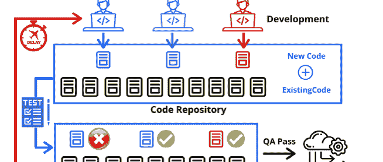

图 12.1 – 传统软件交付周期

数据管道的传统软件开发流程通常经历以下阶段：

+   - **开发**：在此阶段，开发人员（数据工程师）创建新的管道或修改现有管道。现有管道的更改可能归因于模式演变或功能更改。完成后，开发人员将其代码合并到现有代码仓库中。其他处理其他管道的开发人员会重复同样的过程。
+   - **代码打包**：在预先约定的时间表上，可能在敏捷冲刺周期结束时，代码包会发布给 QA 进行测试。
+   - **QA 部署**：发布部署到测试/QA 环境。
+   - **测试/QA**：QA 团队对所有新代码或修改后的代码进行测试。如果成功，代码将被发布用于生产部署；否则，发布将被拒绝并搁置，直到待处理的错误得到修复。
+   - **生产部署**：所有通过 QA 的代码都会部署到生产环境。

虽然本质上**简单**，但此流程存在固有**问题**。在前面的图表中，来自多个开发人员的代码集被合并到仓库中以形成**发布**。在质量保证测试阶段，所有开发人员的代码可能都成功通过单元测试，但其中一个失败。不幸的是，由于只有一个代码组件失败，整个发布都需要被拒绝。像这样的情况可能导致不必要的**延迟**和客户**不满**。毋庸置疑，需要设计更好的方法。

##### 现代软件交付周期

现代软件交付流程的主题非常简单 – 频繁地**开发**、**测试**和**集成**小块代码。使用**持续集成**（CI）实践，鼓励开发人员进行小的代码调整，将其代码合并到主代码分支，并使用自动化测试进行验证。这样可以为开发人员提供关于代码组件之间相互依赖关系的快速而简单的反馈机制。它帮助我们快速检测错误，在许多方面使开发人员的生活更轻松。


一旦代码成功验证，**持续部署 (CD)** 的实践就会自动将代码部署到测试或生产环境中。这样做为开发人员提供了快速且易于使用的反馈机制，以了解代码在特定环境中的**有效性**：

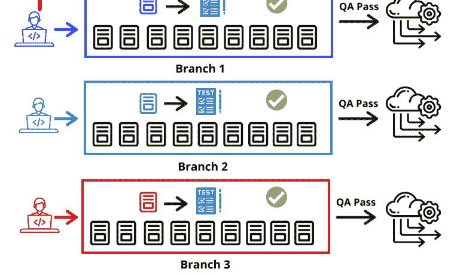

图 12.2 – 现代软件交付周期

**CI/CD** 已被证明可以简化并改善软件交付，同时加快交付速度。如今，组织普遍遵循 **DevOps** 实践。DevOps 促进了一种文化转变，即组织内部开发团队与运维团队之间进行紧密协作。

传统上，创建和管理 CI/CD 管道的工作由 DevOps 团队负责。但随着行业格局的变化，数据工程师正被强烈**鼓励**（更像是强制要求）将这项技能集添加到其现有工作职责中。因此，数据工程师掌握一些 DevOps 技能变得越来越重要。

> **重要**
> DevOps 是 **Developer** 和 **Operations** 的缩写，是一种旨在利用工具组合、最佳实践和自动化来加速软件交付的做法。

有多种 DevOps 工具可用于实现 CI/CD 管道，例如 **Jenkins, Chef, 和 CircleCI**。**Azure DevOps** 是 Azure 中原生的 SaaS 平台，可为现代开发者提供规划、跨团队协作和无缝代码交付方面的支持。在本章中，我们将使用 Azure DevOps 来创建 CI/CD 管道。

##### 设计 CI/CD 管道

在深入实际开发和实施 CI/CD 管道之前，我们应先尝试设计其布局。在典型的<|message|> 数据分析项目中，开发重点围绕两个关键领域：

- **基础设施部署**：如上一章所述，如今建议使用 **基础设施即代码 (IaC)** 实践进行云部署。基础设施代码过去由 DevOps 工程师开发，但最近数据工程师也被要求分担这一责任。
- **数据管道**：数据管道的开发很可能完全由数据工程师负责。所开发的代码包括执行数据收集、摄取、治理、聚合和分发的功能。

遵循持续开发、集成和部署原则，建议的做法是创建两个 CI/CD 管道，我们将其称为 **Electroniz 基础设施 CI/CD 管道** 和 **Electroniz 代码 CI/CD 管道。**

> **重要**
> 采用 CI/CD 更多是一种文化转变而非技术转变。在实施之前，必须获得开发团队和高级管理层的认可。

在高层次上，**Electroniz 基础设施 CI/CD 管道** 将用于部署 Azure 资源，例如 Azure Key Vault、Azure Data Lake Storage 和 Azure Synapse。通常，创建和管理此管道的核心责任在于 DevOps 团队。

**Electroniz 代码 CI/CD 管道** 将用于部署代码片段，例如 SQL 脚本、数据工厂管道和 Spark 笔记本。很可能，创建和管理此管道的核心责任在于数据工程团队。

将这两个管道运行在同一工作区下可促进 DevOps 与数据工程团队之间的协作。两者无需在各自独立的 shell 中工作，而是可以共同协作、分享想法，最重要的是提升其 **技能集**。这两个管道在以下图表中有所展示：

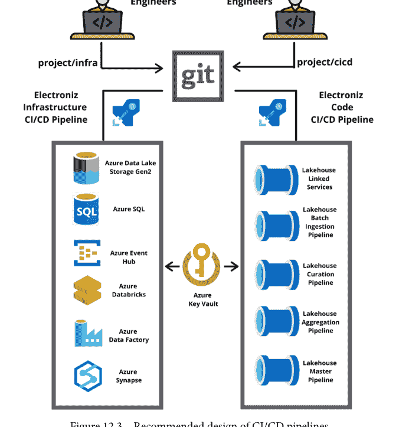

图 12.3 – CI/CD 管道的推荐设计

> **重要**
> 在前面的图表中，注意到两个管道如何从同一个 Azure Key Vault 存储和获取 **密钥**。在创建时安全地存储数据库密码和 API 密钥等密钥，并在运行时动态获取它们，对于控制未经授权的泄露大有裨益。

##### Electroniz 基础设施 CI/CD 管道

DevOps/数据工程师将开发代码以启动 Electroniz lakehouse 所需的 Azure 资源。你可能还记得在第 11 章《基础设施配置》中，我们使用 IaC 启动了基础设施。那是朝着正确方向迈出的一步，但自动化程度仍不够。在本章中，我们将学习如何使用之前创建的同一套代码来自动化部署过程。以下是基础设施管道的代码结构：

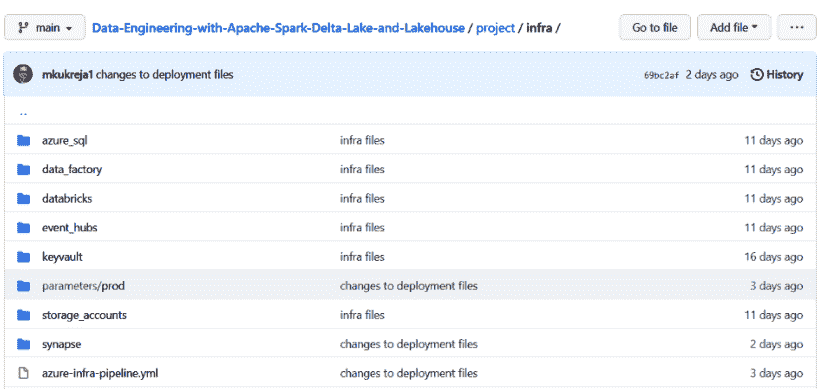

图 12.4 – Electroniz 基础设施 CI/CD 管道的代码结构

让我们更详细地查看此结构：

- **azure-infra-pipelines.yml**：此文件包含按阶段定义的 Azure 资源配置。每个阶段通过引用每个资源文件夹中的 JSON 文件来创建新资源。
- **Azure 资源文件夹**：每个资源文件夹包含以 JSON 文件形式定义的资源定义。
- **参数**：资源名称、位置和环境等全局参数存储在 Azure DevOps 管道库中的 **electroniz_infra_variables** 变量组中。

##### Electroniz 代码 CI/CD 管道

数据工程师开发代码以实现数据管道的各个阶段。这使用多种开发工具完成，包括 Azure Data Factory、Azure Synapse SQL 脚本和 Databricks Spark 笔记本。逐步地，所有这些代码都通过代码 CI/CD 管道集成并部署到不同环境中：

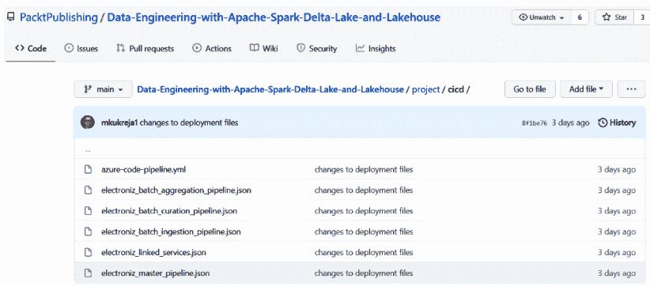

图 12.5 – Electroniz 代码 CI/CD 管道的代码结构

让我们更详细地查看此结构：

- **azure-code-pipelines.yml**：此文件包含按阶段定义的 Azure 数据管道配置。每个阶段使用 JSON 文件部署代码。
- **管道 JSON 文件**：这些文件包含每个管道的定义，作为单独文件以 JSON 格式存储。
- **参数**：资源名称、位置和环境等全局参数存储在 Azure DevOps 管道库中的 **electroniz_code_variables** 变量组下。

这两个管道彼此独立运行。Azure Pipeline 包含使用部署文件中的路径包含开关触发独立管道的功能。采用这种方法，多个团队可以同时并发开发代码，而不会相互干扰或依赖。

有了这一理解，我们现在准备开始开发 CI/CD 管道。

##### 开发 CI/CD 管道

在本节中，我们将学习如何创建和部署前面提到的两个 CI/CD 管道。我们将使用 Azure DevOps 创建这些 CI/CD 管道。Azure DevOps 是一组用于规划、协作、开发和部署代码的开发者服务。虽然 Azure DevOps 支持多种开发者服务，但在本练习中，我们将主要关注 Azure Repos 和 Azure Pipelines。

我知道我们迫不及待地想要开始创建管道，但开始之前需要做一些准备工作。该流程始于创建 Azure DevOps 组织，这可以通过几个简单的步骤完成。然而，要使用 Azure Pipelines 的免费层，你需要为新创建的 Azure DevOps 组织填写免费并行请求表。审批过程可能需要 2-3 天才能完成。

##### 创建 Azure DevOps 组织

按照以下步骤创建 Azure DevOps 组织：

1. 连接到 Azure 门户。搜索 Azure DevOps 并点击 Azure DevOps Organizations：

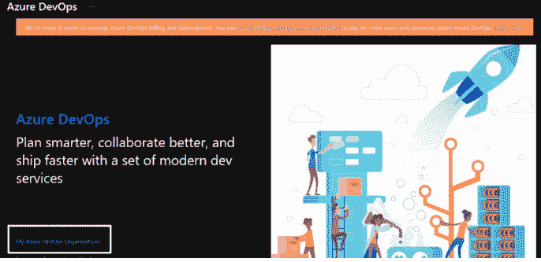


2. 现在，点击 **我的 Azure DevOps 组织**。这将打开一个新浏览器窗口：

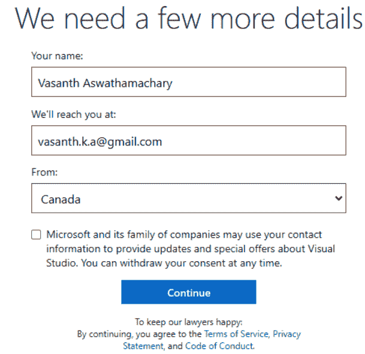

图 12.7 – 新 Azure DevOps 组织的详细信息

填写你的详细信息并按下 **继续**。

3. 点击 **创建新组织**：


## 开始使用 Azure DevOps

计划更好、协同编码、更快交付，使用 Azure DevOps

创建新组织

图 12.8 – 创建新的 Azure DevOps 组织

4. 你将看到 **开始使用 Azure DevOps** 窗口：

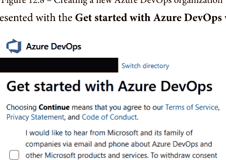

图 12.9 – 开始使用新的 Azure DevOps 组织

点击 **继续。**

5. 在下一个屏幕中，输入 **命名你的 Azure DevOps 组织** 的详细信息并选择离你最近的区域：

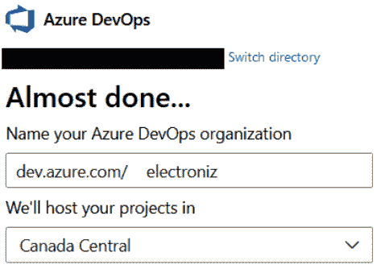

图 12.10 – 为新的 Azure DevOps 组织命名

添加 **验证码** 并点击 **继续。**

6. 提供 **项目名称**

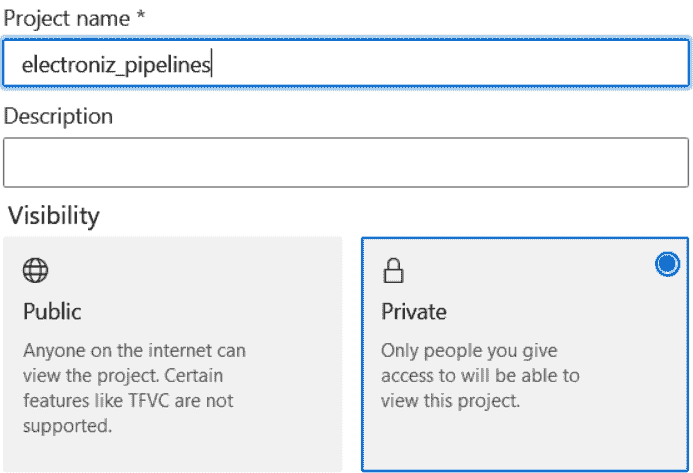

图 12.11 – 在新的 Azure DevOps 组织中创建新项目

点击 + **创建项目。**

7. 新项目的家庭屏幕应如下所示：

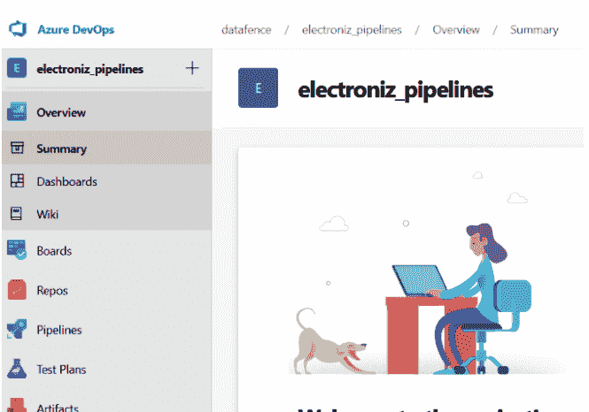

图 12.12 – Azure DevOps 组织家庭屏幕

8. 在屏幕左下角，点击 项目设置 > 服务连接：

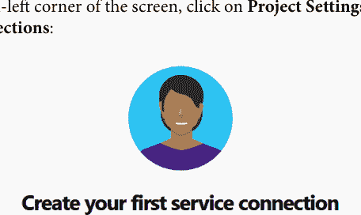

图 12.13 – 创建新的服务连接

点击 创建服务连接。

9. 选择 Azure 资源管理器 并点击 下一步：

图 12.14 – 选择新服务连接的连接类型

10. 在 新建 Azure 服务连接 屏幕上，选择 服务主体（自动） 并点击 下一步：

图 12.15 – 选择新服务连接的身份验证方法

11. 在 新建 Azure 服务连接 页面上，选择 订阅。订阅 框应自动刷新并显示正在使用的 Azure 订阅。提供 服务连接名称 的值并点击 下一步：

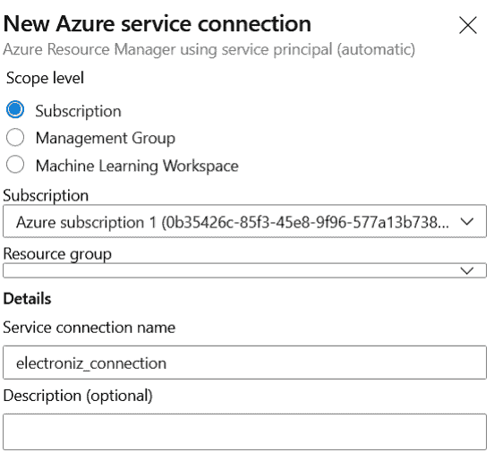

图 12.16 – 为新的服务连接命名

点击 保存。

12. Azure 服务连接确认屏幕应如下所示：

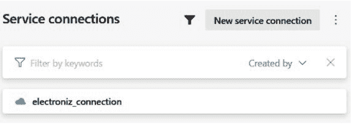

图 12.17 – 新服务连接确认

13. 现在，我们需要导入 Packt Git 仓库。

使用左侧菜单，点击 代码库。

在 **导入仓库** 下，点击 **导入** 按钮。提供以下值：

- **仓库类型：** Git
- **克隆 URL：** https://github.com/PacktPublishing/Data-Engineering-with-Apache-Spark-Delta-Lake-and-Lakehouse：

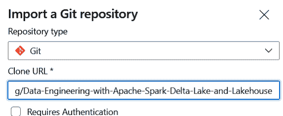

图 12.18 – 导入 Packt Git 仓库

14. 点击 **导入**。几秒钟后，项目的 Packt Git 仓库将被导入，如下所示：

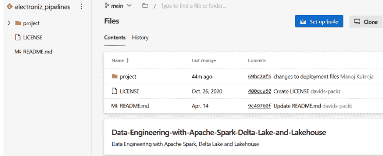

图 12.19 – Packt Git 仓库

15. 你可以为此练习使用 Azure DevOps 的免费层。在创建新的 Azure DevOps 组织后，你需要通过访问填写 **免费并行请求表**

https://aka.ms/azpipelines-parallelism-request：

## Azure DevOps 并行请求

此表单用于用户请求在 Azure DevOps 中增加并行度。

请注意，处理请求可能需要 2-3 个工作日。我们正在改进此流程。抱歉带来不便。

* 必填

1. 你的名字是？ *

输入你的答案

2. 你的电子邮件地址是？ *

输入你的答案

图 12.20 – Azure DevOps 并行请求页面

请注意，Azure 可能需要 2-3 个工作日来审查并回复你的请求。一旦你的请求获批，你将收到一封电子邮件，如下所示：

-------- 转发邮件 --------
发件人：<v-niezz@microsoft.com>
日期：2021 年 6 月 23 日星期三 上午 11:43
主题：免费层请求已完成
收件人：[已隐藏]
抄送：<azpipelines-freetier@microsoft.com>

嗨 [已隐藏]，

我们已收到你增加 Azure DevOps 中免费并行度的请求。

请注意，你的请求已 完成

请求详情：

姓名
电子邮件
组织名称
并行类型
私有

为你的组织请求免费并行度：Azure DevOps 并行请求表单

图 12.21 – Azure DevOps 并行请求确认邮件

一旦你收到此邮件，你就可以开始创建必要的 CI/CD 管道。

## 创建 Electroniz 基础设施 CI/CD 管道

最后，我们可以开始开发我们的第一个 CI/CD 管道。出于明显的原因，我们选择先开发基础设施管道。原因是代码管道直接依赖于由基础设施管道创建的 Azure 资源。让我们开始吧：

1. 你可能还记得，推荐的管道设计包含一个 Azure Key Vault 来存储 CI/CD 管道的密钥。在 Azure Cloud Shell 中运行以下命令来创建一个：

```
RESOURCEGROUPNAME="elz_prod"
LOCATION="eastus"
IAC_ENVIRONMENT=prod
KEYVAULTNAME="deploykvelz"
az group create --name $RESOURCEGROUPNAME --location $LOCATION
az keyvault purge -n $KEYVAULTNAME
az config set extension.use_dynamic_install=yes_without_prompt
az keyvault create --location $LOCATION --name $KEYVAULTNAME --resource-group $RESOURCEGROUPNAME --enabled-for-template-deployment true
```

2. 我们现在将向新创建的 Azure Key Vault 添加几个密钥。使用 Azure 门户，导航到 主页 > 资源组 > elz_prod > deploykvelz。

点击 密钥。然后，使用 生成/导入 创建两个新密钥，如下所示：

- 名称：SQLUSER 值：salesadmin
- 名称：SQLPASSWORD 值：<Azure SQL 管理员的密码>：

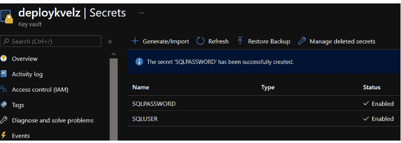

图 12.22 – 在 deploykvelz Azure Key Vault 中创建密钥

> **重要**
> 请注意，在前一步中，我们强制自己手动创建密钥。创建 Azure Key Vault 中的密钥过程很容易被脚本化，但那样你就需要违背最佳实践并将密码存储在配置文件中。

3. 点击左侧的 管道 菜单并选择 库：

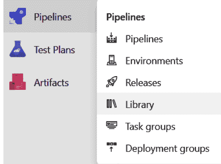

图 12.23 – 在 Azure Pipelines 中导航到库

4. 创建 **新的变量组**：

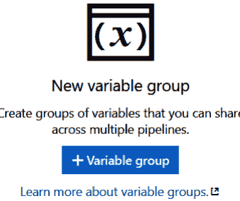

图 12.24 – 在 Azure Pipelines 中创建新的变量组

点击 **+ 变量组**。

5. 使用以下详细信息创建新的变量组：

- **变量组名称**：`electroniz_infra_variables`
- **描述**：`这些变量由基础设施部署文件使用`

现在，每次按下 + 添加 按钮时添加以下变量：

- **名称**：`DATABRICKS_WORKSPACE_NAME` **值**：`elzdbws`
- **名称**：`DATAFACTORY_NAME` **值**：`elzdf`
- **名称**：`ENVIRONMENT` **值**：`prod`
- **名称**：`EVENTHUB_CONTAINER` **值**：`ecomm logs`
- **名称**：`EVENTHUB_NAME` **值**：`esaleshub`
- **名称**：`EVENTHUB_NAMESPACE` **值**：`esalesns`
- **名称**：`EVENTHUB_STORAGE_ACCOUNT` **值**：`elzlogs`
- **名称**：`EVENTHUB_SUBSCRIPTION` **值**：`esalesevent`
- **名称**：`EVENTHUB_TOPIC_NAME` **值**：`esales`
- **名称**：`KEY_VAULT_NAME` **值**：`deploykvelz`
- **名称:** KEY_VAULT_RESOURCE_GROUP **值:** elz_prod
- **名称:** LAKEHOUSE_BRONZE_LAYER **值:** bronze
- **名称:** LAKEHOUSE_SILVER_LAYER **值:** silver
- **名称:** LAKEHOUSE_GOLD_LAYER **值:** gold
- **名称:** LAKEHOUSE_STORAGE_ACCOUNT **值:** elz
- **名称:** PROJECT **值:** dlake

在很多情况下，Azure 资源名称是全局唯一的。尽量使项目名称尽可能唯一。由于很多人会使用相同的说明，具有唯一性将消除与唯一资源名称相关的不必要错误。

现在添加以下变量：

- **名称:** REGION **值:** East US
- **名称:** RESOURCE_GROUP **值:** elz_prod
- **名称:** SERVICE_CONNECTION **值:** electroniz_connection

确保以下条目与你之前创建的 **服务连接** 匹配：

- **名称:** SQL_DB_NAME **值:** salesdb
- **名称:** SQL_PASSWORD_SECRET **值:** SQLPASSWORD

> **重要**
> 请注意，此参数不是实际密码；它只是存储在我们之前创建的 Azure Key Vault 中的密码密钥的名称。

- **名称:** SQL_SERVERNAME **值:** elzsql
- **名称:** SQL_USERNAME_SECRET **值:** SQLUSER
- **名称:** SQL_USERNAME **值:** salesadmin
- **名称:** SUBSCRIPTION_ID **值:** XXXXX-XXX-XXX-XXX-XXXXXXXX

要获取 **SUBSCRIPTION_ID** 的值，请使用 Azure 门户并导航到 **主页 > 订阅**。记下订阅 ID 并在此处使用，如下所示：

- **名称:** SYNAPSE_WORKSPACE_NAME **值:** elzsyn


点击保存：

Library > electroniz_infra_variables

变量组   保存   克隆   安全   管道权限

## 属性

变量组名称

electroniz_infra_variables

描述

这些变量由基础设施部署文件使用

将来自 Azure Key Vault 的机密链接为变量

## 变量

| 名称 | 值 |
|---|---|
| DATABRICKS_WORKSPACE_NAME | elzdbws |
| DATAFACTORY_NAME | elzdf |
| ENVIRONMENT | prod |
| EVENTHUB_CONTAINER | ecomm logs |

图 12.25 – Azure Pipelines 中的 electroniz_infra_variables 变量组

6. 我们现在准备创建基础设施管道。使用左侧菜单，点击 Pipelines：


## 创建你的第一个管道

使用我们的向导自动化你的构建和发布流程，并在几分钟内从代码到云托管。

创建管道

图 12.26 – 创建新的 Azure pipeline

点击 **创建管道。**

7. 此时，你将看到 **你的代码在哪里？** 屏幕：

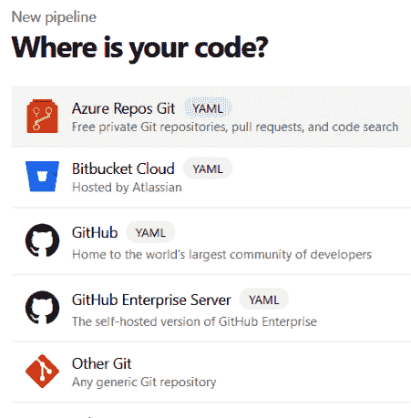

图 12.27 – 为 Azure pipeline 配置代码仓库

选择 **Azure Repos Git。**

8. 你现在将看到 **选择一个仓库** 屏幕：

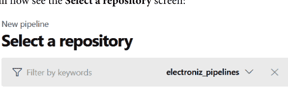

图 12.28 – 为 Azure pipeline 选择代码仓库

点击 **electroniz_pipelines。**

9. 接下来是配置你的管道屏幕：

新管道
配置你的管道

入门管道
从一个可自定义的最小管道开始，用于构建和部署你的代码。

现有 Azure Pipelines YAML 文件
在仓库的任何分支中选择一个 Azure Pipelines YAML 文件。

图 12.29 – 为 Azure pipeline 选择现有的 YAML 文件

选择 现有 Azure Pipelines YAML 文件。

10. 在 选择一个现有 YAML 文件 屏幕上，提供以下值：

- 分支：main
- 点击路径；值将被自动填充：/project/infra/azure-infra-pipeline.yml：

选择一个现有 YAML 文件
在仓库的任何分支中选择一个 Azure Pipelines YAML 文件。
分支
main
路径
/project/infra/azure-infra-pipeline.yml
从下拉列表中选择文件或输入文件路径
electroniz_pipelines

图 12.30 – 为 Azure pipeline 选择基础设施 YAML 文件

点击 继续。

11. 在 查看你的管道 YAML 屏幕上，你应该会看到以下内容：

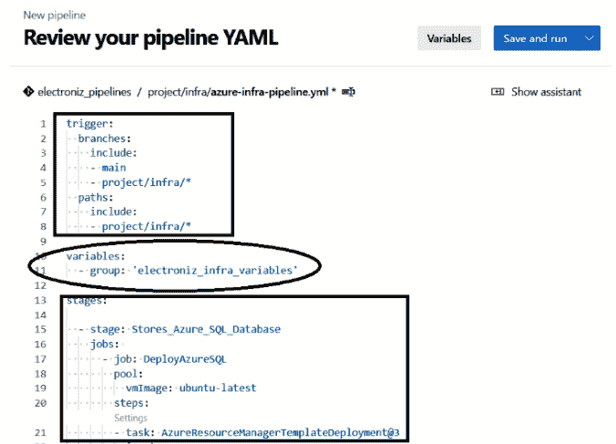

图 12.31 – 基础设施 YAML 文件的解剖结构

让我们简要查看 YAML 文件的结构：

- **触发器**：指定将为 CI/CD 调用的分支。
- **变量**：CI/CD 管道的配置数据。可以指向库中命名的变量组。
- **阶段、作业和步骤**：按顺序运行的一组作业。作业是一系列步骤，而步骤是实际执行特定功能的任务和脚本。

点击 保存并运行 按钮旁边的箭头并点击 保存。

12. 使用左侧菜单，点击 Pipelines。屏幕右手侧，点击三个点并点击 重命名/移动：

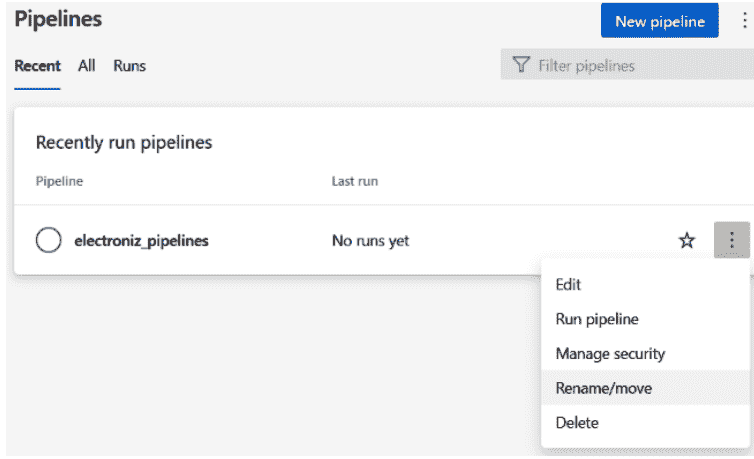

图 12.32 – 重命名基础设施 Azure pipeline

13. 按如下方式更改管道名称：

## 重命名/移动管道

名称

electroniz_infra_cicd_pipeline

选择文件夹

\

取消 保存

图 12.33 – 为基础设施 Azure pipeline 命名

点击 保存。

14. 再次点击三个点，这次点击 运行管道：

## 运行管道

选择下面的参数并手动运行管道

分支/标签

main

选择分支、提交或标签

## 高级选项

变量
此管道未定义变量

要运行的阶段
按配置运行

资源
使用所有资源的最新版本

启用系统诊断

取消

运行

图 12.34 – 运行基础设施 Azure pipeline

点击 运行。

15. electroniz_infra_cicd_pipeline 现在将被触发：

#20210804.4 Updated azure-infra-pipeline.yml
on electroniz_infra_cicd_pipeline

摘要

由 手动运行

查看 73 处更改

仓库和版本
electroniz_pipelines
main e52909fb

开始时间和已用时间
今天下午 12:48
3m 15s

相关
0 个工作项
0 个工件

测试和覆盖率
开始使用

阶段 作业

Stores_Azure_SQL_Da...
1 个作业已完成 2m 44s

Lakehouse_Storage_A...
0/1 已完成 11s
DeployStorageAccount 11s

Lakehouse_Event_Hub
未开始

Lakehouse_Databricks
未开始

Lakehouse_Data
未开始

图 12.35 – 触发基础设施 Azure pipeline

16. 监控管道在基础设施部署的各个阶段进行：

图 12.36 – 监控基础设施 Azure pipeline

17. CI/CD 管道完成后，检查所有阶段的状态，如下所示。每个阶段的绿色勾号意味着作业已完成：

图 12.37 – 完成基础设施 Azure pipeline

18. 在浏览器另一个标签页中，导航到 Azure 门户，前往 Home > Resource Groups > elz_prod。

在管道运行时注意 Azure 资源的创建。你可能需要多次刷新浏览器窗口以检查新项目：

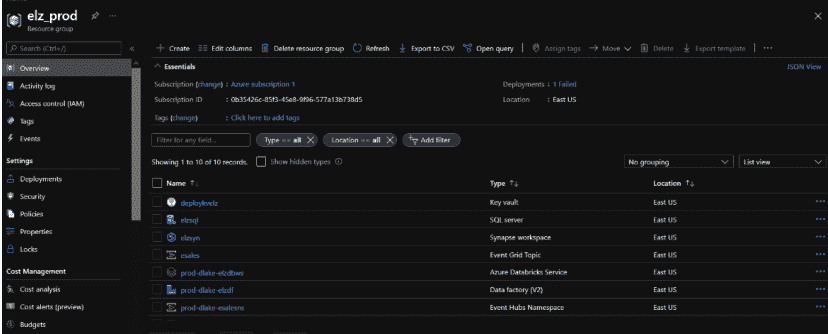

图 12.38 – 基础设施 Azure pipeline 创建的资源确认

19. 最终，管道完成后，管道窗口将如下所示：

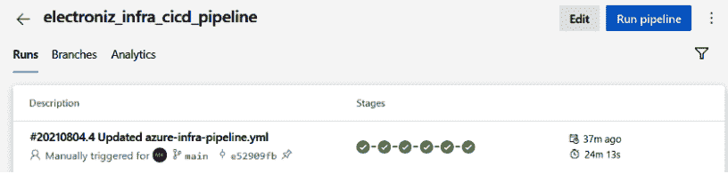

图 12.39 – 基础设施 Azure pipeline 完成确认

20. 到目前为止，一切顺利。然而，你可能已经注意到我们手动触发了此 CI/CD 管道。手动触发管道仅在开发和测试模式下是可以接受的。在生产环境中，我们应旨在自动触发管道。

21. 在接下来的几个步骤中，我们将编辑现有模板，以便代码更改在提交到 main 分支后立即自动应用。

你可能还记得作为 electroniz_infra_cicd_pipeline 的一部分，我们创建了一个 Azure Data Lake 账户。注意最初实现的那三个标签：

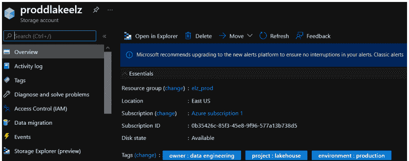

图 12.40 – proddlakeelz Azure Data Lake Storage 账户的标签信息

为了模拟代码更改，我们将编辑 storage_accounts.json 模板文件并添加一个新标签。

导航到 Repos > project > infra > storage_accounts > storage_accounts.json。

添加一个名为 "group": "finance" 的新标签，如下所示：

图 12.41 – 在 storage_accounts.json 中添加新标签

点击 提交：

```
36 },
37 "resources": [
38 {
39 "name": "[variables('storageAccountName')]",
40 "type": "Microsoft.Storage/storageAccounts",
41 "apiVersion": "2021-02-01",
42 "sku": {
43 "name": "Standard_LRS"
44 },
45 "kind": "StorageV2",
46 "location": "[parameters('location')]",
47 "properties": {
48 "isHnsEnabled": true
49 },
50 "tags": {
51 "group": "finance",
52 "owner": "data engineering",
53 "project": "lakehouse",
54 "environment": "production"
55 },
56 },
57 "resources": [
58 {
59 "name": "[concat('default/', parameters('bronzeLayer'))]",
60 "type": "blobServices/containers",
61 "apiVersion": "2019-06-01",
62 "dependsOn": [
63 "[variables('storageAccountName')]
64 ],
65 "properties": {
66 "publicAccess": "None"
```

## 提交

评论
向 storage_accounts.json 添加了一个新标签
分支名称
main
要链接的工作项
按 ID 或标题搜索工作项

图 12.42 – 提交 storage_accounts.json

再次点击 提交。

22. 现在，导航回 Pipelines。这次，electroniz_infra_cicd_pipeline 应该自动触发。CI/CD 管道应仅选取上次以来的增量更改并将其应用到 Azure 资源：

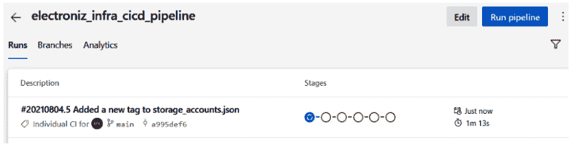

图 12.43 - electroniz_infra_cicd_pipeline 自动触发

然后你将看到部署后新添加标签的确认：

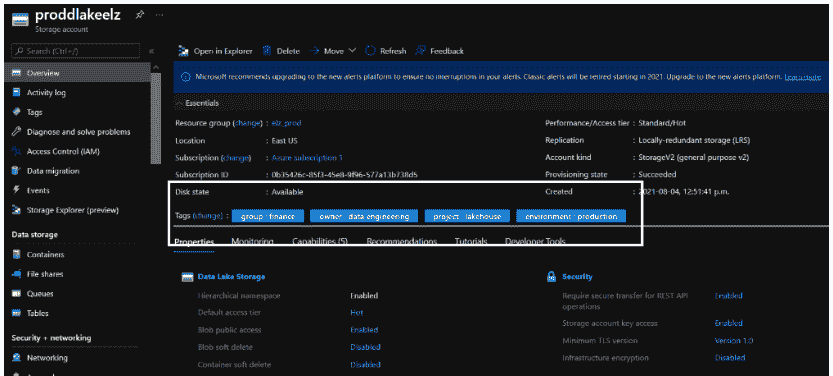

图 12.44 – 部署后新添加标签的确认

至此，我们可以庆祝了——第一个 CI/CD 管道按预期工作！从现在开始，Azure 资源的增量更改可以自动推送到 Azure。我们的重点现在转向第二个管道。


## 创建 Electroniz 代码 CI/CD 管道

现在基础资源已由基础设施管道创建，我们可以启动代码管道的开发。此过程与之前创建的基础设施管道非常相似，但有一个例外：在创建代码管道时，我们将学习代码的 **构建**、**审批**、**部署** 和 **合并** 过程如何工作：

1. 在开发 **Electroniz** 管道期间，我们创建了一些额外的密钥来存储存储账户密钥。我们将首先将它们添加到现有的 Azure Key Vault 中：

```
STORAGEACCOUNTNAME="proddlakeelz"

az storage account keys list --account-name $STORAGEACCOUNTNAME
```

如果前面的命令按预期工作，你应该会看到两个存储密钥。请注意此处 key1 的值：

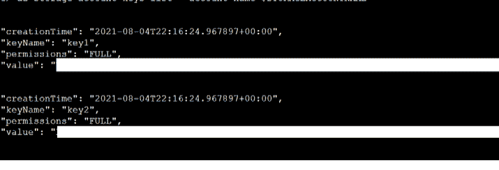

浏览至 **Home** > **All Resources** > proddlakeelz。

使用左侧菜单，点击 **Shared access signature**。

输入以下截图中显示的选项：

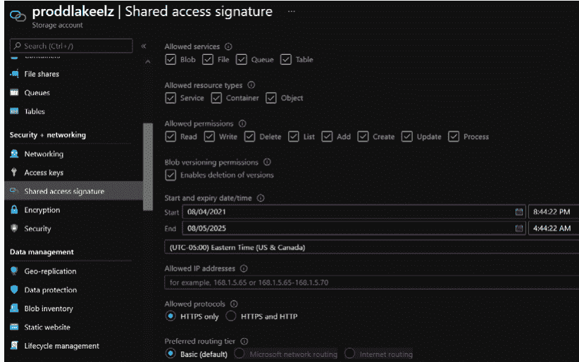

图 12.46 – Azure 存储账户 SAS 令牌的创建选项

点击 Generate SAS and connection string。

请注意 SAS 令牌值，如以下截图所示：

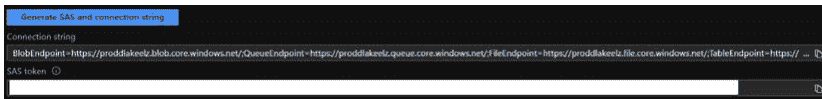

图 12.47 – Azure 存储账户 SAS 令牌

2. 我们现在将密钥添加到新创建的 Azure Key Vault 中。使用 Azure 门户，导航至 Home > Resource groups > elz_prod > deploykvelz。

点击 Secrets。然后，使用 Generate/Import 创建两个新密钥，如下所示：

- Name: ADLSKEY Value: 使用前一个命令中 key1 的值
- Name: ADLSSASKEY Value: 使用前一个命令中 SAS 令牌的值：

图 12.48 – 向 deploykvelz Azure Key Vault 添加新密钥

3. 作为强有力的安全措施，我们希望在代码中引用 Secret Identifier（而不是密钥本身）。为此，我们需要记下 ADLSKEY 和 ADLSSASKEY 的密钥标识符，如下所示：

- ADLSKEY Secret Identifier: 导航至 Home > Resource groups > elz_prod > deploykvelz > elz_prod > ADLSKEY。点击 CURRENT VERSION 下的条目并记下 Secret Identifier 属性：

图 12.49 – 获取 ADLSKEY 的密钥标识符

- **ADLSSASKEY Secret Identifier**: 导航至 **Home** > **Resource groups** > **elz_prod** > **deploykvelz** > **elz_prod** > **ADLSSASKEY**。点击 CURRENT VERSION 下的条目并记下 **Secret Identifier** 属性：

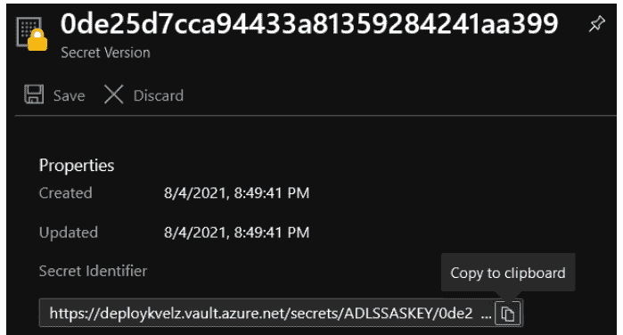

图 12.50 – 获取 ADLSSASKEY 的密钥标识符

4. 点击左侧的 **Pipelines** 菜单并选择 **Library**：

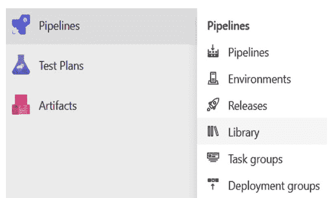

图 12.51 – 在 Azure Pipelines 中导航至 Library

点击 + **Variable group**。

5. 使用以下详细信息创建新的变量组：
- **Variable group name:** `electroniz_code_variables`
- **Description:** `These variables are used by the code deployment files`
现在，每次按下 + **Add** 按钮时添加以下变量：
- **Name:** `ADLS_SAS_SECRET`
- **Value:** `ADLSSASKEY Secret Identifier +?api-version=7.0`
Example:
`https://deploykvelz.vault.azure.net/secrets/ADLSSASKEY/a1a9e84038e548c0a3a03c6d696c4dc3?api-version=7.0`
- **Name:** `ADLS_SECRET`
- **Value:** `ADLSKEY Secret Identifier +?api-version=7.0`
Example:
`https://deploykvelz.vault.azure.net/secrets/ADLSKEY/0de25d7cca94433a81359284241aa399?api-version=7.0`
- **Name:** `CURATION_CLUSTER` **Value:** `Curation Spark Cluster`
- **Name:** `DATABRICKS_CLUSTER` **Value:** `curationcluster`
- **Name:** `DATABRICKS_NAME`
- **Value:** `https://adb-7285613526976736.16.azuredatabricks.net`
此参数的值可以从 Azure Databricks 工作区页面获取。要执行此操作，请转到 **Home > Resource groups > elz_prod > prod-dlake-elzdbws**：
- **Name:** `DATAFACTORY_NAME` **Value:** `prod-dlake-elzdf`
- **Name:** `KEY_VAULT_NAME` **Value:** `deploykvelz`
- **Name:** `LAKEHOUSE_GOLD_LAYER` **Value:** `gold`
- **Name:** `LAKEHOUSE_HTTP_LINK`
- **Value:** `https://raw.githubusercontent.com/mkukreja1/datafenceazure/master/datafactory/prep/iplocation/IP2LOCATION-LITE-DB1.CSV`
- **Name:** `LAKEHOUSE_HTTPSOURCE` **Value:** `httpsource`
- **Name:** `LAKEHOUSE_RESTSOURCE` **Value:** `restsource`

- **Name:** LAKEHOUSE_SALESDBSOURCE **Value:** salesdbsource
- **Name:** LAKEHOUSE_SOURCE **Value:** traininglakehouse
- **Name:** LAKEHOUSE_STORAGE_ACCOUNT **Value:** proddlakeelz
- **Name:** LAKEHOUSE_WEBTRACKING **Value:** proddlakeelzlogs
- **Name:** REGION **Value:** East US
- **Name:** RESOURCE_GROUP **Value:** elz_prod
- **Name:** SERVICE_CONNECTION **Value:** electroniz_connection
- **Name:** SPARK_CLUSTER_TOKEN **Value:** XXXXXXXXXXXXXXXXXXXXXXXX

你可能记得我们在开发银层时创建了此令牌。有关创建访问令牌的更多信息，你可以参考 *Chapter 7, Data Curation Stage – The Silver Layer:*：

- **Name:** SQL_CON_STRING **Value:** elzsql.database.windows.net
- **Name:** SQL_DATABASE **Value:** salesdb
- **Name:** SUBSCRIPTION_ID **Value:** XXXXX-XXX-XXX-XXX-XXXXXXXX

要获取 **SUBSCRIPTION_ID** 的值，请使用 Azure 门户并导航至 **Home > Subscriptions**。记下订阅 ID 并在此处使用：

- **Name:** SYNAPSE_CON_STRING
- **Value:** elzsyn-ondemand.sql.azuresynapse.net

点击 **Save**：

## Library > electroniz_code_variables

Variable group

Save Clone Security Pipeline permissions Approvals and checks Help

## Properties

Variable group name

electroniz_code_variables

Description

These variables are used by the code deployment files

Link secrets from an Azure key vault as variables

## Variables

| Name | Value |
| ADLS_SAS_SECRET | https://deploykvelz.vault.azure.net/secrets/ADLSSASKEY/0de25d7cca94... |
| ADLS_SECRET | https://deploykvelz.vault.azure.net/secrets/ADLSKEY/0de25d7cca94433... |
| CURATION_CLUSTER | Curation Spark Cluster |
| DATABRICKS_CLUSTER | https://adb-7285613526976736.16.azuredatabricks.net |
| DATAFACTORY_NAME | prod-dlake-elzdf |

图 12.52 – Azure Pipelines 中的 electroniz_code_variables 变量组

6. 我们现在准备创建代码管道。使用左侧菜单，点击 Pipelines，然后点击 New Pipeline。

7. 你将看到 Where is your code? 屏幕：

## Where is your code?

New pipeline

Azure Repos Git YAML
Free private Git repositories, pull requests, and code search

Bitbucket Cloud YAML
Hosted by Atlassian

GitHub YAML
Home to the world's largest community of developers

GitHub Enterprise Server YAML
The self-hosted version of GitHub Enterprise

Other Git
Any generic Git repository

Subversion
Centralized version control by Apache

图 12.53 – 为 Azure pipeline 配置代码存储库

选择 Azure Repos Git。

8. 你现在将看到 **Select a repository** 屏幕：

New pipeline

## Select a repository

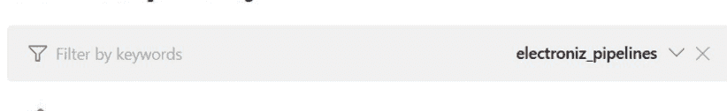

图 12.54 – 为 Azure pipeline 选择代码存储库

点击 **electroniz_pipelines**。

9. 现在，你将被带到 **Configure your pipeline** 屏幕：

New pipeline

## Configure your pipeline

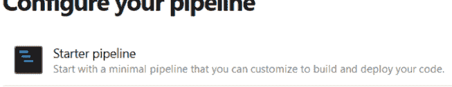

图 12.55 – 为 Azure pipeline 选择现有 YAML 文件

选择 **Existing Azure Pipelines YAML File**。

10. 在 **Select an existing YAML file** 屏幕上，提供以下值：

- **Branch:** `main`
- 点击 **Path**；值将自动填充：`/project/cicd/azure-code-pipeline.yml`

点击 **Continue**。

11. 你现在将看到 Review your pipeline YAML 屏幕：

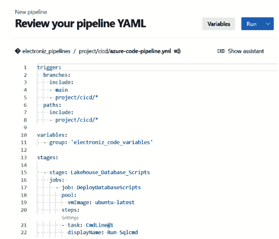

图 12.56 – 代码 YAML 文件的结构

点击 Save 按钮旁边的箭头并点击 Run。然后，点击 Save。

12. 使用左侧菜单，点击 Pipelines，然后 All。在屏幕右侧，点击 electroniz_pipelines 旁边的三个点并点击 Rename/move：

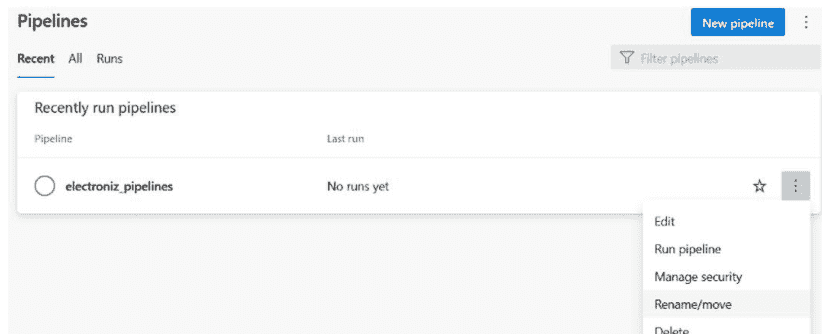

图 12.57 – 重命名代码 Azure pipeline


13. 按如下方式更改管道名称：

## 重命名/移动管道

名称
electroniz_infra_cicd_pipeline
选择文件夹
\

图 12.58 – 为代码命名 Azure 管道

点击保存。

14. 再次点击三个点，然后点击运行管道：

## 运行管道

选择以下参数并手动运行管道

分支/标签
main
选择分支、提交或标签
高级选项
变量
此管道未定义变量
运行阶段
按配置运行
资源
使用所有资源最新版本
启用系统诊断

图 12.59 – 运行代码 Azure 管道

15. electroniz_code_cicd_pipeline 现在将被触发：

## 图 12.60 – 触发代码 Azure 管道

16. 监控管道在代码部署的各个阶段的运行情况。部署完成后，阶段会标记为绿色对号：

## 图 12.61 – 监控代码 Azure 管道

17. 在另一个标签页中，导航到以下 Azure 门户链接：Home > Resource Groups > elz_prod > prod-dlake-elzdf

点击 Open 下的 Open Azure Data Factory Studio：

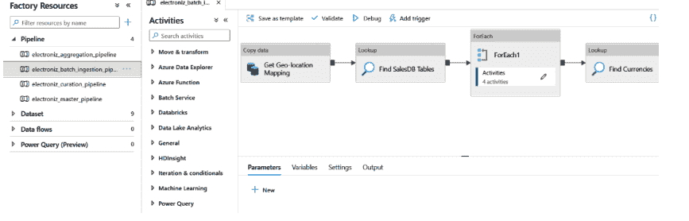

图 12.62 – 确认在 Azure Data Factory 中创建的数据管道

我们可以看到在 Azure Data Factory 中创建的四个数据管道，这足以证明 electroniz_code_cicd_pipeline 运行良好。但工作尚未完全完成。我们刚刚为现有代码创建了一个 CI/CD 管道。现在，我们需要使其适用于未来的更改和新增。

##### 创建 CI/CD 生命周期

希望我们都同意新代码的开发是一个持续的过程。之前，我们讨论了传统方法的弊端，即将若干更改提交到代码仓库，然后进行合并测试。CI/CD 通过持续集成代码并自动部署更改来缓解其中一些问题。在高层面上，CI/CD 管道的代码合并周期如下所示：

- **构建**：更改后，开发人员在共享仓库中提交代码，通常在功能分支下。
- **审批**：开发人员生成拉取请求供团队审批。如果代码未通过审批，评审者会提出修复建议或批准代码合并。
- **合并**：评审成功后，功能分支与主分支合并。
- **部署**：流程自动将代码部署到生产环境：

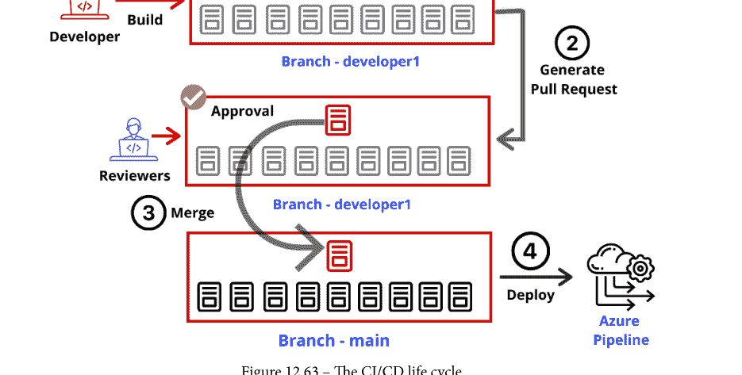

## 图 12.63 – CI/CD 生命周期

在以下步骤中，我们将了解其实际工作原理。以下步骤将带我们了解一个示例场景：

- 1. 开发人员提交代码更改并为评审者创建拉取请求以供审批。
- 2. 评审者审批更改并将其合并到主分支。
- 3. 自动 CI/CD 管道部署代码。

请注意，以下步骤将由多个团队成员执行，因此在每个步骤中都提到了负责人。

##### 构建 – 开发人员

可以通过执行以下步骤完成：

- 1. 导航到 Repos > Branches。点击 New Branch 并创建新分支，如下所示：

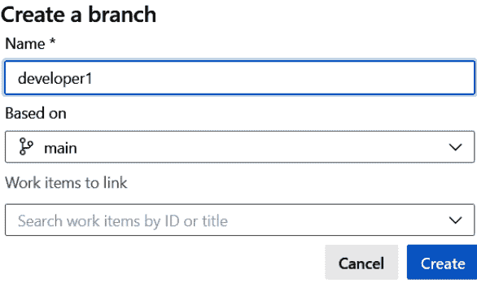

图 12.64 – 创建新的代码分支

点击创建：

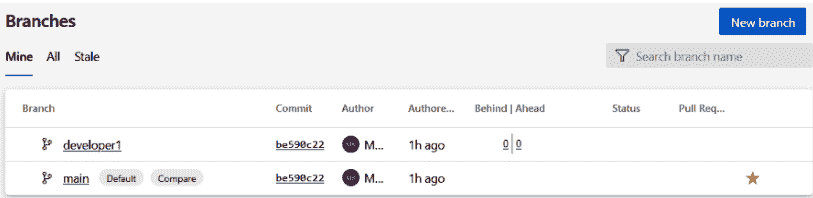

图 12.65 – developer1 分支创建

2. 现在，点击 developer1。你现在已连接到 developer1 分支：

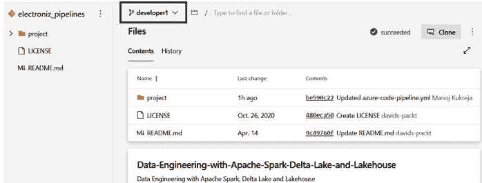

图 12.66 – 确认切换到 developer1 分支

3. 导航到 project/cicd/azure-code-pipeline.yml。点击编辑。现在，将以下代码粘贴到文件末尾：

```
- stage: Lakehouse_Database_Scripts
  jobs:
    - job: DeployDatabaseScripts
      pool:
        vmImage: ubuntu-latest
      steps:
        - task: AzureKeyVault@1
          inputs:
            azureSubscription: '$(SERVICE_CONNECTION)'
            keyVaultName: '$(KEY_VAULT_NAME)'
            secretsFilter: '*'
        - task: CmdLine@1
          displayName: Run Sqlcmd
          inputs:
            filename: sqlcmd
            arguments: '-S $(SYNAPSE_CON_STRING) -U $(SQLUSER) -P $(SQLPASSWORD) -i project/aggregation/sql/create_db.sql'
        - task: CmdLine@1
          displayName: Run Sqlcmd
          inputs:
            filename: sqlcmd
```

```
arguments: '-S $(SYNAPSE_CON_STRING) -U $(SQLUSER) -P $(SQLPASSWORD) -i project/aggregation/sql/create_synapse_creds.sql'
- task: CmdLine@1
displayName: Run Sqlcmd
inputs:
  filename: sqlcmd
arguments: '-S $(SYNAPSE_CON_STRING) -U $(SQLUSER) -P $(SQLPASSWORD) -i project/aggregation/sql/create_silver_views.sql'
- task: CmdLine@1
displayName: Run Sqlcmd
inputs:
  filename: sqlcmd
arguments: '-S $(SYNAPSE_CON_STRING) -U $(SQLUSER) -P $(SQLPASSWORD) -i project/aggregation/sql/drop_gold_tables.sql'
- task: CmdLine@1
displayName: Run Sqlcmd
inputs:
  filename: sqlcmd
arguments: '-S $(SYNAPSE_CON_STRING) -U $(SQLUSER) -P $(SQLPASSWORD) -i project/aggregation/sql/create_gold_tables.sql'
```

确保代码缩进已设置适当。编辑文件后，它应如下所示：

##### azure-code-pipeline.yml

```
106
107   action: 'Create Or Update Resource Group'
108   resourceGroupName: '${RESOURCE_GROUP}'
109   location: '${REGION}'
110   templateLocation: 'Linked artifact'
111   csmFile: 'project/cicd/electroniz_master_pipeline.json'
112   overrideParameters: '-factoryName ${DATAFACTORY_NAME}'
113   deploymentMode: 'Incremental'
114   deploymentName: 'dataFactoryDeployment'
115
116 - stage: Lakehouse_Database_Scripts
117   jobs:
118     - job: DeployDatabaseScripts
119       pool:
120         vmImage: ubuntu-latest
121       steps:
122         - task: AzureKeyVault@1
123           inputs:
124             azureSubscription: '${SERVICE_CONNECTION}'
125             keyVaultName: '${KEY_VAULT_NAME}'
126             secretsFilter: '*'
127         - task: CmdLine@1
128           displayName: Run Sqlcmd
129           inputs:
130             filename: sqlcmd
131             arguments: '-S ${SYNAPSE_CON_STRING} -U ${SQLUSER} -P ${SQLPASSWORD} -i project/aggregation/sql/create_db.sql'
132         - task: CmdLine@1
133           displayName: Run Sqlcmd
134           inputs:
135             filename: sqlcmd
136             arguments: '-S ${SYNAPSE_CON_STRING} -U ${SQLUSER} -P ${SQLPASSWORD} -i project/aggregation/sql/create_synapse_creds.sql'
```

图 12.67 – 向 azure-code-pipeline.yml 添加新阶段

按提交。

在下一个屏幕上，确保分支设置为 developer1。按提交。现在，按创建拉取请求按钮。创建新的拉取请求，如下所示：

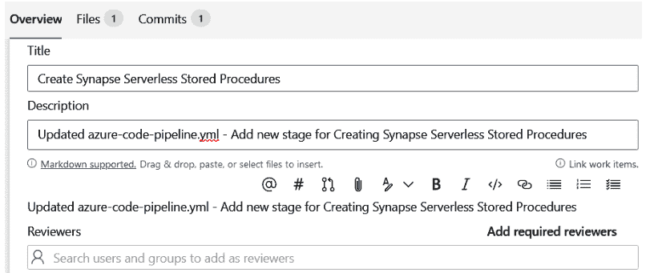

图 12.68 – 创建新的拉取请求

点击创建。

##### 审批 – 评审者

可以通过执行以下步骤完成：

- 1. 评审者会收到新拉取请求的通知（通常通过电子邮件）。评审者可以单独或作为一个组评审更改并添加评论。一旦代码经过评审，请添加新评论，如下所示：

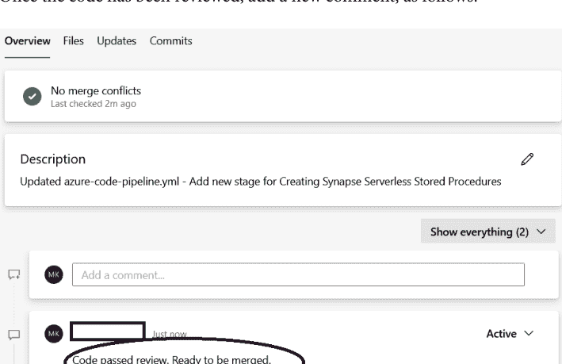

图 12.69 – 评审拉取请求

##### 合并 – 团队负责人

可以通过执行以下步骤完成：

- 1. 一旦所有评审者都发表了评论，团队负责人可以拒绝或批准更改。在我们的案例中，我们假设评审过程是积极的。点击批准：

图 12.70 – 批准拉取请求

2. 注意无合并冲突。这意味着新代码已准备好合并：

图 12.71 – 检查合并冲突

##### 部署 – 自动化

可以通过执行以下步骤完成：

- 1. 从 developer1 分支向主分支合并代码后，YAML 部署文件中的触发器部分会将代码部署到指定环境。点击完成：

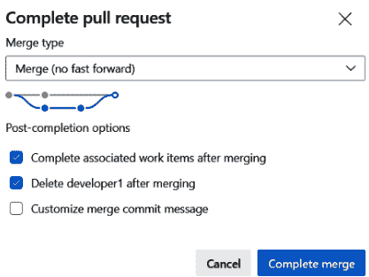

图 12.72 – 将 developer1 分支合并到主分支

- 2. 合并过程成功后会收到以下确认消息：

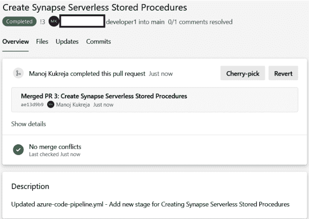

图 12.73 – 代码合并确认


3. 这些代码合并会自动触发 CI/CD 管道。 通过 Azure DevOps 门户返回 Pipelines。 单击 electroniz_code_cicd_pipeline。 现在，单击列表中的最新条目。 您应该会看到有关自动部署的以下确认：

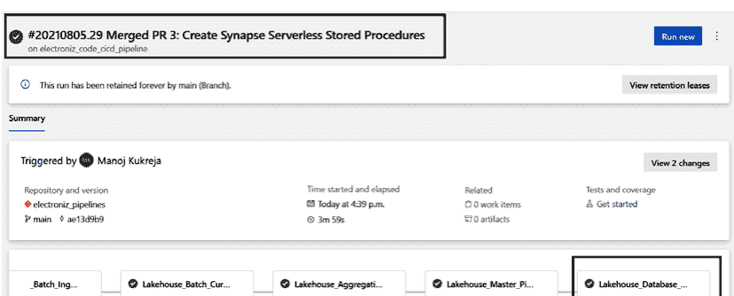

图 12.74 – 自动管道运行的确认

注意自动运行已正确识别、创建并部署了 Lakehouse_Database_Scripts 阶段。

> 重要
> 部署原子代码更改使我们能够更快地发现和修复故障。 CI/CD 促进了一种透明的代码集成和部署方法，已知这种方法可以提高效率并增强客户满意度。

本章就到此为止。 使用前述步骤，我们成功地使用 CI/CD 管道自动化了基础设施创建和代码交付。 我们还学习了如何在团队环境中实施 CI/CD 生命周期。 从现在开始，Electroniz 可以安全地依赖这些管道，以最小的努力和风险交付其环境中的未来代码添加和更改。

## Summary

在组织力求以更少资源做更多事情的时代，自动化正迅速获得大量关注。 随着 CI/CD 的不断发展和壮大，它正成为现代数据工程师最关键的技能之一。 在大多数情况下，数据工程师的高成本只有在他们的技能组合包含自动化时才有意义。

在许多方面，采用 CI/CD 等自动化实践被证明是救命稻草。 不仅自动化减轻了数据工程师的大量工作负担，而且通过可预测地执行重复迭代来降低成本。 除此之外，CI/CD 中内置的审批和快速失败机制可确保团队的责任感和协作性。 如果明智使用，采用自动化可以确保代码和基础设施组件的可预测和无缝交付。

这是本书的最后一章。 我必须承认，在过去的 12 章中，我们涵盖了很多内容。 我们踏上了数据之旅——这是一段充满许多曲折的旅程。 我很高兴的是，最终我们成功克服了这些障碍并顺利走向成功。 我们的旅程始于收集和存储数据，然后在湖屋的各个层中对数据进行策划和聚合。 我们还学习了如何设计、开发、监控和自动部署数据管道。 在最后，我们通过提供一些建议来涵盖数据工程师面临的一些挑战，说明如何克服这些挑战。 但总的来说，最后一切都是值得的。

每一字节的数据都有一个故事要讲，我相信我们准确、安全、高效地讲述了这个故事。

## Packt>

Packt.com

订阅我们的在线数字图书馆，即可完全访问超过 7,000 本书籍和视频，以及帮助您规划个人发展和推进职业生涯的行业领先工具。 有关更多信息，请访问我们的网站。

## Why subscribe?

- 花更少的时间学习，花更多的时间编码，使用来自 4,000 多名行业专业人士的实用电子书和视频
- 使用专为您打造的技能计划来提高学习效果
- 每月免费获得一本电子书或视频
- 完全可搜索，便于快速访问重要信息
- 复制、粘贴、打印和书签内容

您知道 Packt 提供每本出版书籍的电子书版本，文件格式为 PDF 和 ePub 吗？ 您可以在 packt.com 升级到电子书版本，如果您是印刷书籍客户，您有权享受电子书副本的折扣。 如需更多详细信息，请联系 customercare@packtpub.com。

在 www.packt.com，您还可以阅读大量免费技术文章，注册多种免费新闻通讯，并在 Packt 书籍和电子书上获得独家折扣和优惠。

## Other Books You May Enjoy

如果您喜欢这本书，您可能对 Packt 的其他书籍感兴趣：

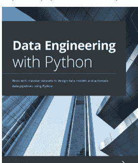

## Data Engineering with Python

Paul Crickard

ISBN: 9781839214189

- 了解数据工程如何支持数据科学工作流程
- 发现如何从文件和数据库中提取数据，然后对其进行清理、转换和丰富
- 为处理不同文件格式以及关系型和 NoSQL 数据库配置处理器
- 了解如何实现数据管道和仪表板以可视化结果
- 使用暂存和验证在数据进入仓库之前检查数据
- 使用执行验证并处理失败的暂存区域构建实时管道
- 掌握在生产环境中部署管道的方法

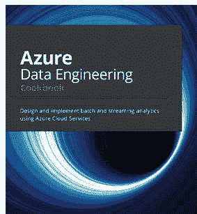

## Azure Data Engineering Cookbook

Ahmad Osama

ISBN: 9781800206557

- 使用 Azure Blob 存储存储大量非结构化数据
- 对 Cosmos Table API 执行 CRUD 操作
- 使用 Azure SQL Database 实现弹性池和业务连续性
- 使用 Azure Synapse Analytics 摄取和分析数据
- 开发 Data Factory 数据流以从多个来源提取数据
- 管理、维护和保护 Azure Data Factory 管道
- 使用 Azure Stream Analytics 和 Data Explorer 处理流数据

## Packt is searching for authors like you

如果您有兴趣成为 Packt 的作者，请访问 authors.packtpub.com 并立即申请。 我们已与数千名开发人员和技术专业人士合作，就像您一样，帮助他们与全球技术社区分享他们的见解。 您可以进行一般申请，申请我们正在招聘作者的特定热门主题，或提交您自己的想法。

## Share Your Thoughts

现在您已经读完，我们很想听听您的想法！ 如果您从 Amazon 购买了本书，请点击此处直接前往本书在 Amazon 的评论页面分享您的反馈，或在您购买的网站上留下评论。

您的评论对我们和技术社区非常重要，将帮助我们确保提供优质内容。
