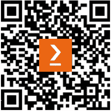

# dbt 数据工程：基于云的、务实且可靠的 SQL 数据平台构建实用指南


献给我日常生活中的四位女性：每天支持我的妻子，让我脚踏实地生活的女儿们，以及每天都传递着爱与幸福光芒的小狗莉莉。

献给我的母亲和已故的父亲，他们的牺牲和支持让我成为了我想成为的人。

我爱你们所有人。

—— Roberto Zagni

## 贡献者

### 关于作者

**Roberto Zagni** 是一位高级领导者，在数据架构、软件开发和敏捷方法论方面拥有丰富的实践经验。Roberto 是电子工程师出身，特别热衷于将软件工程最佳实践引入云数据平台，并培养热爱所从事工作的优秀团队。他一直帮助企业更好地利用数据，现在则致力于以敏捷思维和适当的软件工程工具与流程（如 DataOps）向基于云的自动化过渡。Roberto 还为数据团队提供实践辅导，涵盖实用数据架构以及模式、测试、版本控制和敏捷协作的使用。

自 2019 年以来，他的首选工具一直是 dbt、dbt Cloud 以及 Snowflake 或 BigQuery。

> 我要感谢我的客户和同事们提出的所有问题，以及为了找到可行解决方案而进行的讨论，这些帮助我成为一名更好的软件和数据工程师，并积累了丰富的软件与数据工程经验。
>
> 这本书是我对数据工程社区的一点小贡献。
>
> 我希望能够把我作为数据工程师时希望拥有的核心知识集中在一处，并提供一种简单、有观点的方式，利用现代数据栈和经过验证的模式来构建数据平台，从而扩展和简化日常工作。

*第 2 章，设置你的 DBT Cloud 开发环境，* 通过创建你的 GitHub 和 DBT 账户来开始使用 DBT。你将了解为什么版本控制很重要，以及在使用 DBT 时数据工程工作流是什么。

你还将理解开源 DBT Core 与商业 DBT Cloud 之间的区别。最后，你将体验默认项目，并在 Snowflake 上使用 DBT 运行基础 SQL 来设置环境，同时理解 DBT 的关键函数：`ref` 和 `source`。

*第 3 章，数据工程的数据建模，* 说明了为什么以及如何描述数据，以及如何穿越从业务流程到支撑这些流程的数据存储的不同抽象层级：概念数据模型、逻辑数据模型和物理数据模型。

你将理解实体、关系、属性、**实体-关系（E-R）**图、建模用例与建模模式、Data Vault、维度模型、宽表和业务报表。

*第 4 章，分析工程作为数据工程的新核心，* 展示了完整的数据生命周期，以及从事数据工作的人的不同角色与职责。

你将理解现代数据栈、DBT 的角色以及分析工程。你将学习如何采用软件工程实践来构建数据平台（或 DataOps），以及如何作为团队而不是孤岛来工作。

*第 5 章，使用 DBT 转换数据，* 向我们展示如何在 dbt 中开发一个示例应用，并学习使用 dbt 创建、部署、运行、测试和为数据应用编写文档的所有步骤。

*第 6 章，编写可维护的代码，* 继续上一章开始的示例，我们将指导你配置 dbt，并编写一些基础但功能完整的代码，以构建参考架构的三个层：暂存/存储、细化数据，以及通过数据集市进行交付。

*第 7 章，使用维度数据，* 向你展示如何将维度数据纳入我们的数据模型，并将其用于事实核查和多种其他用途。我们将探索如何创建数据模型、为参考架构编辑数据，以及将维度数据纳入数据集市。我们还将通过一个示例回顾前几章学到的所有内容。

*第 8 章，在你的代码中交付一致性，* 向你展示如何为转换增加一致性。你将学习如何超越基础 SQL，将脚本能力引入代码，编写你的第一个宏，并学习如何在项目中使用外部库。

*第 9 章，为你的数据交付可靠性，* 向你展示如何通过添加测试来验证你的期望并检查转换结果，从而确保代码的可靠性。

*第 10 章，敏捷开发，* 教你如何通过融合哲学与实践提示进行敏捷开发，讨论如何在项目各阶段保持待办事项列表的敏捷性，并深入探讨数据集市的构建。

*第 11 章，协作，* 涉及一些帮助开发者作为团队工作的实践，以及 dbt 为此提供的支持。

*第 12 章，部署、执行和文档自动化，* 帮助你学习如何通过设置环境和作业来自动化数据平台的运维，这些环境和作业按照你的部署设计自动发布和执行代码。

*第 13 章，超越基础，* 帮助你学习如何管理实体的标识，以便应用主数据管理来整合来自不同系统的数据。同时，你将回顾在管道中应用模块化的最佳实践，以简化其演进和维护。你还将发现用于实现模式的宏。

*第 14 章，提升软件质量，* 帮助你发现并应用更高级的模式，在真实项目中提供高质量结果，并且你将体验如何通过重构自信地演进你的代码。

*第 15 章，常见用例模式，* 为你提供一个小型模式库，这些模式常用于从外部文件摄取数据，并将摄取的数据存储在我们所称的历史表中。你还将获得在 Snowflake 中摄取数据的见解和代码。

## 充分利用本书

| 本书涵盖的软件/硬件 | 操作系统要求 |
|---|---|
| dbt | Windows、macOS 或 Linux |

如果你使用的是本书的数字版本，我们建议你自己输入代码，或从本书的 GitHub 仓库中获取代码（下一节中有链接）。这样做将有助于避免任何与复制粘贴代码相关的潜在错误。

## 下载示例代码文件

你可以从 GitHub 的 https://github.com/PacktPublishing/Data-engineering-with-dbt 下载本书的示例代码文件。如果代码有更新，会在 GitHub 仓库中更新。

我们还有来自丰富的图书和视频目录中的其他代码包，可在 https://github.com/PacktPublishing/ 获取。去看看吧！

## 本书使用的约定

全书使用了许多文本约定。

正文中的代码：表示正文中的代码词、数据库表名、文件夹名、文件名、文件扩展名、路径名、虚拟 URL、用户输入和 Twitter 用户名。例如：“使用执行者角色创建新数据库。我们将其命名为 PORTFOLIO_TRACKING。”

## 分享你的想法

一旦你阅读了 *Data Engineering with dbt*，我们非常想听听你的想法！请 `click here` 前往 `straight to the Amazon review page` 为本书分享你的反馈。

你的评论对我们和技术社区都很重要，并将帮助我们确保提供优质的内容。

## 下载本书免费 PDF 副本

感谢购买本书！

你喜欢在移动中阅读，但无法随身携带纸质书吗？
你的电子书购买是否与你选择的设备不兼容？

别担心，现在购买每本 Packt 图书，你都可以免费获得该书的无 DRM PDF 版本。

可在任何地点、任何地方、任何设备上阅读。从你喜爱的技术书中直接搜索、复制并粘贴代码到你的应用程序中。

福利还不止这些，你还可以获得独家折扣、新闻通讯，以及每天发送到收件箱的优质免费内容。

按照以下简单步骤即可获得这些福利：

- 1. 扫描二维码或访问下面的链接

  

  ```
  https://packt.link/free-ebook/9781803246284
  ```

- 2. 提交你的购买凭证
- 3. 大功告成！我们会将免费 PDF 和其他福利直接发送到你的邮箱


