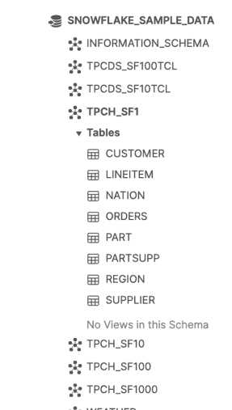
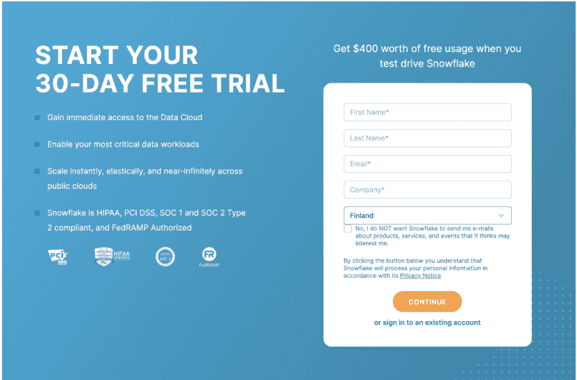
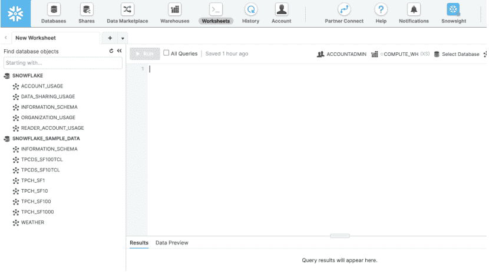
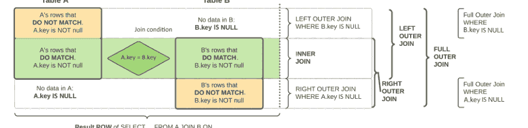
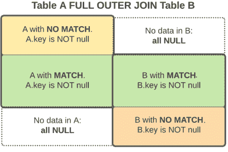
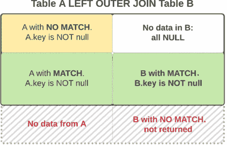

## 使用 SQL 转换数据的基础知识

本书是关于使用 **dbt** 构建工程化数据平台的。在使用 dbt 时，你需要使用**结构化查询语言**（通常称为 **SQL**，发音为“sequel”或按字母读作 S-Q-L）编写代码，并辅以少量 **Jinja** 模板语法。

这意味着，当我们在讨论架构和设计主题之外的内容时，我们会阅读和编写 SQL 代码，因此你需要快速掌握 SQL 才能熟练使用 dbt。

在本章中，你将复习或从零开始学习 SQL 的基础知识，熟悉这种在处理数据时随处可见的强大语言。

首先，我们将介绍 SQL，并带你了解其核心概念，这样即使你是这门语言的新手，也能开始建立自己的能力，并跟上本章和本书其余部分的内容。

作为这一介绍的补充，我们还会按使用类别快速列出所有主要的 SQL 命令。这将确保你了解 SQL 中最相关的部分，并在开始编写代码时可以将本章作为快速参考。

然后，我们将指导你如何在 **Snowflake** 中*创建账户*——Snowflake 是领先的云**数据库**，经常与 dbt 一起使用。你将在云端使用 Snowflake，无需安装任何东西，并且有免费试用期。

一旦你有了 Snowflake 账户，我们就会引导你创建你的第一个角色、用户和数据库。

当你的云数据库准备就绪，并且已经介绍了基本 SQL 命令之后，我们将更深入地学习 `SELECT` 语句和 `JOIN` 子句，因为它们在使用 dbt 时至关重要。

本章末尾会以简单的方式介绍分析函数和窗口函数，既适合初学者，也适合中高级 SQL 用户；这些高级功能将提升你的 SQL 技能，极大地拓展你的能力。

综上所述，本章将涵盖以下主题：

- 介绍 SQL
- SQL 基础——核心概念和命令
- 在 Snowflake 中设置包含用户和角色的数据库
- 在 SQL 中查询数据——语法和运算符
- 在 SQL 中组合数据——JOIN 子句
- 进阶——介绍窗口函数

### 技术要求

本章不假设你具备任何 SQL 知识，内容从基础到中级水平。如果你对 SQL 很熟悉，可以跳过本章，或者只浏览更高级的主题。

本章的所有代码示例都可以在 GitHub 上获取：https://github.com/PacktPublishing/Data-engineering-with-dbt/tree/main/Chapter_01。

要运行这些示例，我们将在本章后面指导你设置 Snowflake 账户和角色，并创建你的第一个数据库。

### 介绍 SQL

SQL 诞生于 70 年代，到 80 年代末已成为与关系数据库（RDB）交互的事实标准，如今它驱动着全球大部分数据管理行业。

由于其巨大的影响力和强大的抽象能力，SQL 已成为任何使用数据库系统的人最终都会熟悉的标准。SQL 的表达能力广为人知，其知识如此普及，以至于它已经超越了关系数据库的范畴，各类数据库管理系统（DBMS）都提供了 SQL 接口，甚至许多非关系型数据库系统之上也有 SQL 接口。

SQL 的一些巨大优势如下：

- SQL 的核心功能在 80 年代就已标准化，但 SQL 至今依然生机勃勃，随着数据管理的发展不断演进并添加强大的新功能，同时保持与先前版本的兼容性。

- 每个数据库都有自己的 SQL 特性，但逻辑是相同的，大多数 SQL 代码可以很少或无需改动地在多种数据库上运行。

- 现在学会，终身受用，并且（几乎）适用于每种数据库。

- 其核心具有*简单、严谨且强大的语法，读起来像英语句子*，因此即使非技术人士也能掌握基本概念，而专业人员则能够精确而简洁地表达他们想要的内容。

大多数人大致能猜出以下 SQL 的作用：

```sql
SELECT ORDER_ID, CUSTOMER_CODE, TOTAL_AMOUNT
FROM ORDERS
WHERE YEAR(ORDER_DATE) = 2021;
```

- 使用 SQL，你是在*逻辑层面*工作，因此不需要处理实现细节，而且*它是一种声明式语言*；你用严谨的方式描述你想达成什么目标，而不是如何实现。数据库引擎可以自由地以自己的方式存储数据、实现和执行请求，只要它能根据 SQL 规范产生正确的结果即可。

- 使用一条简单的 SQL 语句，你既可以*处理一条数据，也可以处理数十亿条数据*，把寻找最有效实现方式的负担交给数据库，同时在一定程度上让你摆脱规模的限制。

### SQL 基础——核心概念和命令

SQL 语言当然庞大而复杂，需要时间才能完全掌握，但令人惊讶的是，仅凭我们将在本书中介绍的有限功能，你就能高效工作，并且在实际用例中需要时，你会逐渐掌握其中的微妙之处。

本章的目标不是让你成为 SQL 专家，而是让你入门，深入了解我们将经常使用的少数几个命令，以便你能够快速高效地使用 dbt。

在这部分介绍中，我们从 SQL 最基本的概念开始，然后按使用类别概述 SQL 命令。在本章其余部分，我们将更深入地讨论使用 dbt 时最常用的命令：`SELECT`、`JOIN` 以及分析函数和窗口函数。

### SQL 核心概念

SQL 的主要目标，正如其名称所示，是允许用户查询数据库中包含的数据；SQL 还提供了全面管理数据库所需的所有命令，允许你添加、转换、删除、组织和管理数据以及其他数据库对象（例如用户和角色）。

SQL 中的核心概念源于关系数据库的组织方式：

- 一个**数据库**包含**表**，表按模式（**schema** 的复数形式为 schemata）组织。

- 表将数据存储在多行（**rows**）中，每一行对应表中定义的每一列（**columns**）有一个值。

- 列有名称，并且只能包含所声明的**数据类型**的数据。

- 为了规范对数据的访问，**权限**被授予**用户**和**角色**。

在 SQL 中，一张表既包含其内容的定义（列及其类型），也包含内容本身（按行组织的数据）：

- **表定义：** 列出构成表的列，每一列提供数据类型和其他可选细节。数据类型是必需的，并声明该列将接受什么值。

- **表内容：** 按行组织，每行包含为表定义的每一列的一个值，如果没有提供值，则为 `null`。

- **数据值：** 列中的所有值必须与该列声明的类型兼容。`null` 是一种特殊值，对应于数据的缺失，并且与所有数据类型兼容。

创建表时，我们必须为表提供名称和定义，定义至少包括列名和每列的类型；数据可以在之后添加。

在以下代码块中，我们有一个订单表的示例定义：

```sql
CREATE TABLE ORDERS (
    ORDER_ID NUMBER,
    CUSTOMER_CODE TEXT,
    TOTAL_AMOUNT FLOAT,
    ORDER_DATE DATE,
    CURRENCY TEXT DEFAULT 'EUR'
);
```

> **提示**
>
> 当我们编写 SQL 时，我们将使用 Snowflake 的 SQL 语法和命令。我们将指导你创建一个免费的 Snowflake 账户，在那里你可以运行这里展示的代码。

在这个示例中，我们看到创建表的命令读起来很像英语，并提供了表名和列的列表，以及每列将要包含的数据类型。

你可以看到，对于类型为 `text` 的 CURRENCY 列，这段代码还提供了 `default` 值 EUR。在 SQL 中，单引号用于界定一段文本，也就是所谓 `string`（字符串）。

### 视图——查看某些数据的一种特殊方式

如果你已有数据，并且希望以某种转换或过滤后的形式将其提供给他人使用，你可以创建一个**视图**。你可以把视图想象成一张表，但其列定义和数据都来自一个查询，该查询从一个或多个表读取数据。


作为示例，如果你想要一份订单金额大于 1,000 的简短清单，你可以编写以下查询来创建 BIG_ORDERS 视图：

```
CREATE VIEW BIG_ORDERS AS
SELECT * FROM ORDERS
WHERE TOTAL_AMOUNT > 1000;
```

在这个示例中，我们看到这个简单的创建视图语句提供了视图的名称，并使用一个查询，即 SELECT 语句，来定义视图提供的数据。

查询提供了数据，即所有总金额大于 1,000 的订单，以及列定义。` * ` 字符 – 称为星号 – 是 SELECT 语句读取的表中所有列的快捷方式。

当然，这是一个天真的示例，但在本书的整个过程中，你会看到，将存储数据的表与过滤和转换来自表和视图的数据的视图结合起来，是使用 dbt 的核心。 在前一个对象之上构建一个对象，使我们能够以原始数据作为输入，并提供作为输出的经过精炼的信息，供用户轻松访问和理解。

> **提示**
> 在使用 dbt 时，你无需编写创建表或创建视图语句，因为 dbt 会为我们创建它们。 尽管如此，熟悉这些基本的 SQL 命令仍然是好的，因为这些是在数据库中执行的命令，如果你查看日志，你会看到它们。

## 数据库和模式

我们已经看到，数据库是表和视图的容器。

数据库可以进一步使用模式对象进行划分和组织。

在现实生活中的数据库中，表的数量可能从几个单位到数千个。 模式在很大程度上就像文件夹，但不能嵌套，因此你始终可以通过其数据库、模式和名称来识别一个表。

在下面的屏幕截图中，我们看到 SNOWFLAKE_SAMPLE_DATA 数据库的部分内容，该数据库在所有 Snowflake 账户中都可用：



图 1.2：SNOWFLAKE_SAMPLE_DATA 数据库的一些模式和表

数据库和模式作为表容器，是组织信息的主要方式，但它们也用于以分层方式应用安全、访问限制和其他功能，从而简化大型系统的管理。

要创建 TEST 数据库及其中的 SOME_DATA 模式，我们可以使用以下命令：

```
CREATE DATABASE TEST;
CREATE SCHEMA TEST.SOME_DATA;
```

database.schema 记法，也称为完全限定名称，使我们能够精确描述要在哪个数据库中创建模式，并在创建后唯一标识该模式。

> 提示
> 在使用 dbt 时，你将为你的项目创建一个数据库或使用现有的数据库； dbt 会为你创建所需的模式对象，如果你尚未创建它们。

在 Snowflake 中的最佳实践是为每个项目或你想要为了管理目的而分开的数据集创建一个数据库。 Snowflake 中的数据库和模式是软边界，因为如果用户具有适当的权限，则可以访问所有数据库和模式中的所有数据。

在某些其他数据库系统中，例如 PostgreSQL，数据库是一个更强的边界。

## 用户和角色

为了控制对 SQL 中数据的访问，你将 GRANT 访问和其他权限授予用户和角色。

用户代表可以访问数据库的一个个人用户或服务，而角色代表可以授予权限的命名实体。

可以将角色授予用户，从而提供与该角色相关的所有权限。

还可以将一个角色授予另一个角色，建立使用简单基本角色构建更复杂角色的层次结构，然后将这些角色分配给用户。

使用角色而不是直接向用户授予权限，可以让你简单一致地管理大量用户。 在这种情况下，角色是权限集的标签，成为管理我们想要授予相同权限的用户组的一种方式。 在任何时候更改授予角色的权限都将更改用户从该角色获得的权限。

在使用 dbt 时，一个典型的模式是为 dbt 用户创建一个角色，然后将其分配给开发人员和 dbt 程序将使用的服务用户。

以下是使用一个角色和几个用户的简单设置的示例：

```
CREATE ROLE DBT_SAMPLE_ROLE;
CREATE USER MY_NAME;          -- 个人用户
CREATE USER SAMPLE_SERVICE;   -- 服务用户
GRANT ROLE DBT_SAMPLE_ROLE TO USER MY_NAME;
GRANT ROLE DBT_SAMPLE_ROLE TO USER SAMPLE_SERVICE;
```

更复杂的设置可能对每个源系统（由包含系统数据的模式表示）、数据仓库（一个或多个处理数据的模式）和每个数据 mart（每个数据 mart 一个模式）具有一个用于读取的角色和一个用于写入的角色。

然后你可以在付出更多努力的代价下，更详细地控制谁可以读取和写入什么。

## 理解 SQL 命令的类别

SQL 命令可以根据其在语言中的用途组织成类别：

- 数据定义语言 (DDL)：DDL 包含用于管理数据库的结构和组织的命令。
- 数据操作语言 (DML)：DML 包含用于操作数据的命令，例如 INSERT、DELETE 和 UPDATE。
- 数据查询语言 (DQL)：DQL 包含 SELECT 命令，是 SQL 的核心部分，允许查询和转换存储在数据库中的数据。
- **数据控制语言 (DCL)**：DCL 包含 `GRANT` 和 `REVOKE` 命令，用于管理控制对数据库资源和对象访问的权限。
- **事务控制语言 (TCL)**：TCL 包含用于管理事务的命令。

在接下来的部分中，我们通过查看 Snowflake 特定的命令来提供这些命令的更多细节，但这些思想和名称在所有数据库系统中都是通用的，使用时几乎没有变化或没有变化。

## 数据定义语言 – DDL

DDL 命令不直接处理数据，但用于创建和维护数据库的结构和组织，包括创建存储数据的表。

它们操作以下对象：

- 账户/会话对象，包含和操作数据，例如用户、角色、数据库和仓库。
- 数据库/模式对象，存储和操作数据，例如模式、表、视图、函数和存储过程。

主要命令如下：

- `CREATE`：用于创建数据库本身和其他对象
- `DROP`：用于删除指定的对象
- `ALTER`：用于修改指定对象的某些属性
- `DESC`：用于描述指定对象的详细信息
- `SHOW`：用于列出指定对象类型的现有对象，并附带元数据
- `USE`：用于选择在未使用完全指定名称时使用的数据库、模式和对象

> **提示**
> 在使用 dbt 时，我们仅在宏中使用 DDL 和 DML 命令。
> 我们不在模型中使用 DDL 和 DML 命令，因为 dbt 将根据附加到模型的元数据为我们的模型生成所需的命令。

## 数据操作语言 – DML

DML 提供了操作数据库中的数据并执行批量数据加载的命令。

Snowflake 还提供了特定的命令来分阶段处理文件，例如在 Snowflake 管理的位置，即 stage 中加载文件。

主要命令如下：

- INSERT：向表中插入行
- DELETE：从表中删除指定的行
- UPDATE：更新表中指定行的某些值
- MERGE：在表中插入、更新或删除行
- TRUNCATE TABLE：清空表，保留定义和权限

对于批量数据加载，Snowflake 提供了以下命令：

- COPY INTO：将数据从 stage 中的文件加载到表中，或将数据从表中卸载到 stage 中的一个或多个文件

为了管理 stage 中的文件，Snowflake 提供了这些文件分阶段命令：

- PUT：将本地文件上传到 Snowflake stage
- GET：将文件从 stage 下载到本地机器
- LIST：列出 Snowflake stage 中存在的文件
- REMOVE：从 Snowflake stage 中删除文件

> **重要说明**
> 在 dbt 中，我们可以使用宏与 COPY INTO 和文件分阶段命令来管理数据管道的数据加载部分，当源数据位于文件存储服务中时，例如 AWS S3、Google Cloud Storage 或 Microsoft Azure Data Lake 文件存储。

## 数据查询语言 – DQL

DQL 是 SQL 存在的理由：查询和转换数据。

用于查询数据的命令是 SELECT，它毫无疑问是所有 SQL 中最重要的和最通用的命令。

目前，认为 SELECT 语句，即查询，可以执行以下所有操作：

- 从一个或多个表中读取数据
- 对检索到的数据应用函数和转换
- 过滤从每个这些表中检索到的数据
- 对一组列（或转换后的值）对检索到的数据进行分组，为每个组生成一行，对分组的行计算函数，并根据这些函数的结果进行过滤


- 对于每一行，基于窗口表达式识别的行组计算一个或多个函数，并根据这些函数的结果过滤结果。

> **重要说明**
> 我们在本章后面的*查询语法和运算符*一节中专门详细分析了Snowflake中的`SELECT`命令，因为你将在每个dbt模型中使用`SELECT`命令。

## 数据控制语言 – DCL

DCL包含`GRANT`和`REVOKE`命令，用于管理控制数据库资源和对象访问或使用的权限和角色。

与用于创建角色、用户和其他数据库对象的DDL命令一起，DCL命令用于管理用户和安全性：

- `GRANT`：向角色（或用户）分配权限或角色
- `REVOKE`：从角色（或用户）撤销权限或角色
- `SHOW GRANTS`：列出授予角色或对象的访问权限

## 事务控制语言 – TCL

TCL命令用于管理数据库中的事务。

**事务**将一组SQL命令分组为一个*单一执行单元*，并保证如果事务成功完成，则应用所有命令的所有效果；如果事务失败，则不应用任何效果。这也可以用**ACID**缩写来描述，它代表**原子性、一致性、隔离性和持久性**。

只有当事务分组的所有命令都成功完成时，事务才会成功结束；在任何其他情况下，事务都会失败，其效果会像从未发生过一样被回滚。

TCL命令如下：

- `BEGIN`：在当前会话中启动事务
- `COMMIT`：提交当前会话中的打开事务，并使事务效果对所有会话可见
- `ROLLBACK`：回滚当前会话中的打开事务，并撤销自`BEGIN`语句以来应用的所有效果

既然我们已经介绍了SQL中的基本概念和命令，现在是时候建立一个数据库来运行它们了。下一节将为你提供对Snowflake数据库的访问。

## 使用用户和角色设置Snowflake数据库

在本节中，你将学习创建自己的Snowflake账户，以便你可以试验上一节中的SQL命令，并在接下来的章节中将其与dbt一起使用。

创建账户后，我们将帮助你快速设置用户和角色，这些将在本书及你后续的项目中非常有用。

## 创建你的Snowflake账户

要注册Snowflake的30天免费试用，你可以访问 https://signup.snowflake.com/ 或在Snowflake主页上查找“免费开始”按钮。

在Snowflake网站上，请按照以下步骤操作：

1. 填写包含你数据的注册表单，然后点击“继续”。




图1.3：Snowflake免费试用注册表单

6. 关闭此介绍菜单后，你就可以探索和使用你的Snowflake账户了，在经典控制台界面中，它看起来像这样：



图1.6：Snowflake工作表用户界面

如果你最终使用的是新的Snowflake界面（称为Snowsight），你可以使用它，或者使用菜单中的**Classic Console**条目切换到旧界面。

## 在Snowflake中设置初始用户、角色和数据库

现在你有了一个Snowflake账户，其中有一个可以登录的用户，并且你的用户已被授予ACCOUNTADMIN这一全能角色。

这很好，但不建议你在日常工作中使用该角色。最佳实践是设置一些用户和角色以提供所需的访问级别，并使用能够完成任务的最低级别。

Snowflake允许你在工作表中执行命令时，在你已被授予的角色之间选择要模拟的角色，这样你无需注销并重新登录即可更改角色。

> **提示**
> 
> 你可以使用工作表编辑区域右上角的选择器更改你的角色、要使用的仓库以及当前数据库和架构。

3. 让我们保持简单，将执行者角色分配给自己：

```
GRANT ROLE DBT_EXECUTOR_ROLE TO USER <your_user>;
```

现在，我们的用户同时拥有账户管理员和执行者角色。为了能够在用户界面下拉菜单中看到并选择该角色，你可能需要刷新页面。

## 授予创建数据库的权限

我们可以在模拟账户管理员角色时创建数据库，但这无助于我们使用执行者角色管理该数据库的计划。因此，我们必须赋予执行者角色创建数据库的能力。要让我们的SQL命令在数据库上执行，我们需要能够使用或创建现有仓库。

> **重要说明**
> 为了管理数据库结构和仓库设置，Snowflake提供了默认的SYSADMIN角色，该角色具有所需的权限。

我们可以通过以下方式之一实现为执行者角色提供这些能力的目标：

- 直接向执行者角色授予所需权限
- 将SYSADMIN角色授予执行者角色，该角色具有所需权限

有什么区别？

如果你直接授予权限，执行者角色与其他角色完全隔离，拥有该角色的用户只能访问该角色允许他们访问的内容。

如果你授予SYSADMIN角色，拥有执行者角色的用户也将能够模拟SYSADMIN角色，因此也能访问它可以访问的任何对象。例如，他们可以访问另一个用户使用sysadmin角色创建的数据库。

让我们直接分配所需权限，以使我们的dbt对象远离SYSADMIN。

要向执行者角色授予权限，我们需要切换到可以授予这些权限的角色，然后授予它们：

1. 切换到SYSADMIN角色：

```
USE ROLE SYSADMIN;
```

2. 授予创建新数据库的权限：

```
GRANT CREATE DATABASE ON ACCOUNT
TO ROLE DBT_EXECUTOR_ROLE;
```

3. 授予使用默认仓库（名为COMPUTE_WH）的权限：

```
GRANT USAGE ON WAREHOUSE COMPUTE_WH
TO ROLE DBT_EXECUTOR_ROLE;
```

## 创建你的第一个数据库

既然我们的执行者角色可以创建数据库，让我们开始吧：

1. 让我们模拟执行者角色，以便它拥有我们创建的内容：

```
USE ROLE DBT_EXECUTOR_ROLE;
```

2. 现在，让我们创建数据库：

```
CREATE DATABASE DATA_ENG_DBT;
-- or pick any name you like for the DB
```

要在Snowflake中看到新数据库，你可能需要使用面板右上角的刷新按钮（形状为循环箭头）刷新用户界面左侧的浏览面板。

> 提示
> 点击新数据库将显示它不是空的。
> 
> 新数据库有两个架构：INFORMATION_SCHEMA，其中包含可用于收集数据库本身信息的视图；以及PUBLIC，它是新数据库的默认架构，并且是空的。

为了减少Snowflake积分消耗，让我们最后将默认仓库配置为在1分钟后暂停，而不是10分钟：

```
USE ROLE SYSADMIN;
ALTER WAREHOUSE "COMPUTE_WH" SET
    WAREHOUSE_SIZE = 'XSMALL'
    AUTO_SUSPEND = 60
    AUTO_RESUME = TRUE
    COMMENT = 'Default Warehouse';
```

> 提示
> 要更改仓库，你必须切换到SYSADMIN用户，因为它是拥有该仓库的角色；我们只授予了执行者角色使用它的权限。

恭喜！你现在已经创建了一个角色，将其分配给了你的个人用户，创建了一个由该角色拥有的数据库，并配置了默认仓库。你几乎已经完成设置了。


## 为 dbt 应用创建用户

让我们通过创建一个新的用户来完成初始设置，我们将使用该用户与 dbt 配合使用，并授予其执行者角色，以便它能够作为所有者管理该数据库。

要创建用户，我们需要切换到具有该能力的角色：

- 1. 切换到 USERADMIN 角色：

```sql
USE ROLE USERADMIN;
```

- 2. 为 dbt 创建新用户；我将其命名为 DBT_EXECUTOR，但您可以选择任何名称：

```sql
CREATE USER IF NOT EXISTS DBT_EXECUTOR
    COMMENT = 'User running DBT commands'
    PASSWORD = 'pick_a_password'
    DEFAULT_WAREHOUSE = 'COMPUTE_WH'
    DEFAULT_ROLE = 'DBT_EXECUTOR_ROLE'
;
```

- 3. 让我们将执行者角色分配给 dbt 用户：

```sql
GRANT ROLE DBT_EXECUTOR_ROLE TO USER DBT_EXECUTOR;
```

- 4. 切回操作角色，我们应该始终使用该角色进行工作：

```sql
USE ROLE DBT_EXECUTOR_ROLE;
```

太好了！您现在已完成新 Snowflake 账户的基础设置；您已学习了用户和角色管理的基础知识，并且已准备好学习更多 SQL 以查询数据。

## 在 SQL 中查询数据 – 语法和运算符

在本节中，您将学习如何使用 SQL 和 Snowflake 示例数据库查询现有数据。

在本章中，以及更广泛地在本书中，您将熟悉 Snowflake 语法，它是现代且非常标准的。我们还将使用一些专有扩展，使您的工作更轻松。

### Snowflake 查询语法

Snowflake 支持使用标准 SELECT 语句查询数据，其基本语法如下：

```sql
WITH ...
SELECT ...
FROM ...
JOIN ...
WHERE ...
GROUP BY ...
HAVING ...
QUALIFY ...
ORDER BY ...
LIMIT ...
```

唯一强制的部分是 SELECT，因此 SELECT 1 是一个有效的查询，只返回值 1。

如果您熟悉来自其他数据库系统的 SQL，您会想知道 QUALIFY 子句是什么。它是一个可选的 SQL 子句，非常适合 Snowflake 所使用的分析型工作，并且并非所有数据库引擎都实现。它将在本节后面描述。

我们经常在指代可执行的 SQL 片段时互换使用查询、命令和语句这几个术语。

严格来说，命令是诸如 SELECT 或 `CREATE <object>` 之类的通用命令，而语句是可运行的某个命令的一个具体且完整的实例，例如 `SELECT 1` 或 `CREATE TABLE my_table ...;`。

查询一词本应仅指 SELECT 语句，因为 SELECT 语句用于从数据库查询数据，但查询经常用于指代与数据相关的任何语句。

您也会经常听到术语子句，例如 FROM 子句或 GROUP BY 子句。非正式地，您可以将其视为语句中遵循特定关键字语法和规则的部分。

### WITH 子句

WITH 子句是可选的，只能在 SELECT 命令之前使用，以定义一个或多个公用表表达式（CTE）。CTE 将名称与另一个 SELECT 语句的结果关联起来，该结果可以在主 SELECT 语句中像其他任何表状对象一样使用。

定义 CTE 有用之处在于：

- **清晰性**：您可以为一段 SQL 提供有意义的名称
- **重用、维护和效率**：您可以定义一个支持查询，其结果您可能在主查询中多次使用，而数据库引擎将只执行一次支持查询
- **创建递归查询**：定义一个查询自身的 CTE 是在 SQL 中使用递归的唯一方法
- 将复杂的转换分解为更小、更简单的步骤，使其更易于编码和理解，并限制未来维护的范围

简化的语法如下：

```sql
WITH [RECURSIVE]
    <cte1_name> AS (SELECT ...)
    [, <cte2_name> AS (SELECT ...)]
SELECT ...
```

我们在这里查看一些示例：

- 1. 检查我们是否仍有待处理的优先订单：

```sql
WITH
high_prio_orders as (
    SELECT *
    FROM "SNOWFLAKE_SAMPLE_DATA"."TPCH_SF1"."ORDERS"
    WHERE O_ORDERPRIORITY IN ('1-URGENT', '2-HIGH')
)
SELECT count(*)
FROM high_prio_orders
WHERE O_ORDERDATE < '1998-01-01'
    and O_ORDERSTATUS = 'O';
```

在这里，您可以看到第一个表达式将高优先级订单的业务定义封装为任何优先级设置为紧急或高优先级的订单。如果没有 CTE，您必须在 WHERE 子句中混合业务定义和其他过滤逻辑。然后，就不清楚状态是定义的一部分还是我们现在应用的过滤器。

- 2. 计算汽车行业客户的一些指标：

```sql
WITH
auto_customer_key as (
    SELECT C_CUSTKEY
    FROM SNOWFLAKE_SAMPLE_DATA.TPCH_SF1.CUSTOMER
    WHERE C_MKTSEGMENT = 'AUTOMOBILE'
),
orders_by_auto_customer as (
    SELECT O_ORDERKEY
    FROM SNOWFLAKE_SAMPLE_DATA.TPCH_SF1.ORDERS
    WHERE O_CUSTKEY in (SELECT * FROM auto_customer_key)
),
metrics as (
    SELECT 'customers' as metric, count(*) as value
    FROM auto_customer_key
    UNION ALL
```

这使我们能够引用没有名称的列，例如从没有标题的 CSV 文件中读取时。这在脚本中也很有用，用于引用我们不知道名称但知道其位置的列：

```sql
SELECT $1 as ORDER_KEY, $2 as CUST_KEY
FROM SNOWFLAKE_SAMPLE_DATA.TPCH_SF1.ORDERS;
```

在这种情况下，我们从具有列名的表中读取，并且始终可以使用列号代替列名。但在从表或视图读取时很少这样做，因为使用数字，结果将取决于对象中列的顺序，如果对象被重新创建，顺序可能会随时间变化。

- 4. 一个表达式，如数学表达式或函数调用，对每一行求值为某个值：

```sql
SELECT
    P_PARTKEY
  , UPPER(P_NAME) as P_NAME
  , P_RETAILPRICE
  , P_RETAILPRICE * 0.9 as P_DISCOUNTED_PRICE
FROM "SNOWFLAKE_SAMPLE_DATA"."TPCH_SF1"."PART";
```

前面的示例显示了两个表达式：一个数学表达式，将列乘以常数以生成新列，以及一个函数调用，将 p_name 列转换为大写，保持相同的列名。

> **重要说明**
>
> 这里强调的能力，即编写任意表达式并为结果分配名称，是 SQL 用于转换数据核心方式之一，也是我们使用 dbt 时最常见的事情之一。

在本节中，我们看到 SELECT 子句提供了四种强大的能力：

- 1. 决定从源表中保留哪些数据在查询结果中
- 2. 使用任意复杂表达式从源数据计算新数据
- 3. 为查询结果中想要的数据提供新名称
- 4. 使用 DISTINCT 关键字在结果中只保留每一行的一份副本

### FROM 子句

FROM 子句引入 SQL 语句中用作数据来源或命令目标的表对象。

对于 SELECT 语句，FROM 子句可以列出零个、一个或多个表对象，每个对象都有自己的别名。SELECT 语句的结果行可能包含 FROM 子句中引用的所有表的所有列。

简化的语法如下：

```sql
SELECT ...
FROM [tableObject1 [AS alias1]]
    [, tableObject2 [AS alias2] ...]
```

**表对象**，在 SELECT 语句的上下文中，是以下内容的组合：

- **表和视图**：表和视图是 SQL 工作的主要数据对象，因此大多数情况下，FROM 子句中会出现这些对象。
- **表函数**：表函数是一类返回一组行、一个或多个列的函数。它们可以是预定义函数或用户定义的函数。
- **VALUES 子句**：此子句允许我们使用常量值构建一组行。这使我们能够创建一个内联表，可用作引用表、映射表或测试输入。
- 少数其他可读取的对象，例如 LATERAL 子查询或分阶段文件。

当未列出表时，SELECT 子句中的列必须使用常量和全局对象，例如 current_date 函数，如以下示例所示：

```sql
SELECT 1 + 1 as sum, current_date as today;
```

当我们使用 VALUES 子句时，我们可以定义一个内联表，如此示例所示：

```sql
SELECT * FROM ( VALUES
    ('IT', 'ITA', 'Italy')
  , ('US', 'USA', 'United States of America')
  , ('SF', 'FIN', 'Finland (Suomi)')
) AS inline_table (code_2, code_3, country_name);
```

当 FROM 子句列出多个表对象时，结果是这些表中元素的**笛卡尔积**。为了避免**笛卡尔爆炸**，重要的是包含一个 WHERE 子句来限制组合，只保留我们想要的组合。

> **重要说明**
>
> 笛卡尔积是将产品中所有对象的行以所有可能的方式配对的结果。这意味着笛卡尔积返回的行数是产品中每个对象行数的乘积。
>
> 术语笛卡尔爆炸通常用于指代笛卡尔积返回的行数会迅速增加，并且很容易造成性能问题这一事实。


得益于 WHERE 子句，以下查询将生成一组更有意义且更紧凑的行，理想情况下等于 LINEITEM 表中的行数：

```
SELECT count(*)
FROM "SNOWFLAKE_SAMPLE_DATA"."TPCH_SF1"."LINEITEM" as l
    ,"SNOWFLAKE_SAMPLE_DATA"."TPCH_SF1"."ORDERS"   as o
    ,"SNOWFLAKE_SAMPLE_DATA"."TPCH_SF1"."CUSTOMER" as c
    ,"SNOWFLAKE_SAMPLE_DATA"."TPCH_SF1"."PART"      as p
WHERE o.O_ORDERKEY = l.L_ORDERKEY
  and c.C_CUSTKEY  = o.O_CUSTKEY
  and p.P_PARTKEY  = l.L_PARTKEY
;
```

在上一个查询中，我们使用 WHERE 子句将真正相关的行保留在结果中。这是通过在相关表的字段之间添加等价约束来实现的。

上一个查询恰好生成 6,001,215 行结果，这与 LINEITEM 表中的行数一致，而不是由各行数相乘得出的天文数字：6,001,215 x 1,500,000 x 150,000 x 200,000，约等于 2.7 x 10^23。

具体结果就留给你计算吧……

这样一来，完整的查询会处理 600 万行数据，并在几秒钟内完成；而不带 WHERE 子句的查询将尝试处理多出 10^18 倍的行数，可能需要数小时甚至数天才能完成，期间白白消耗大量资源，因为最终得到的数据毫无价值。

计数的精确对应源于这样一个事实：每个行项目只有一个订单，每个订单只有一个客户，依此类推。

即使键的匹配并非如此精确，提供相关的 WHERE 子句也有助于将结果集减少多个数量级。我们将在第 3 章讨论数据建模时更详细地探讨这个主题。

这个例子很好地展示了 SQL 的强大之处，也说明了准确表达我们需求的重要性。

> **提示**
> 基本原则是：除非你清楚自己在做什么，并且能够接受将要生成的爆炸性行数，否则绝不要执行无限制的笛卡尔积。

## JOIN 子句

JOIN 是 FROM 子句的一个子句，用于更精确地描述如何组合两个表的行。JOIN 不能脱离 FROM 子句而存在。

以下示例仅返回订单总额大于 500,000 的行：

```
SELECT O_ORDERKEY, O_CUSTKEY, O_TOTALPRICE
FROM "SNOWFLAKE_SAMPLE_DATA"."TPCH_SF1"."ORDERS"
WHERE O_TOTALPRICE > 500000;
```

以下示例不返回任何行，但定义了两个名称和类型与源表中的列相同的列，以及两个采用我们提供的名称和类型的列：

```
SELECT O_ORDERKEY, O_CUSTKEY, 1 as an_int, null::number as a_num
FROM "SNOWFLAKE_SAMPLE_DATA"."TPCH_SF1"."ORDERS"
WHERE false;
```

当你需要定义某些列名和类型时，这可能是一个好技巧。请记住，如果你不想使用现有表中的列，就不需要 FROM 子句……

> **重要提示**
> 当涉及 NULL 时要小心，因为它的行为可能和你预期的不同。
> 例如，NULL = NULL 表达式的结果为 NULL。
> 在 WHERE 子句中，这意味着相应的行会被丢弃。

在前面的示例中，我们看到使用 FROM 子句时，WHERE 子句可用来指定某些类型的 JOIN。我们建议使用 JOIN ... ON ... 语法进行连接，使用 WHERE 子句来过滤行。我们将在“在 SQL 中组合数据——JOIN 子句”一节中查看更多示例。

## GROUP BY 子句

GROUP BY 子句用于对按分组表达式产生相同值的行组计算聚合函数。

简化语法如下：

```
SELECT ...
GROUP BY groupExpr1 [, groupExpr2 ...]
```

分组表达式可以是以下之一：

- **列名：** 表达式的结果是指定名称的列的值。列中具有相同值的所有行将被分组。

以下查询计算每个客户（客户键）所有订单的总和：

```
SELECT O_CUSTKEY, sum(O_TOTALPRICE)
FROM "SNOWFLAKE_SAMPLE_DATA"."TPCH_SF1"."ORDERS"
GROUP BY O_CUSTKEY;
```

- **数字：** 用于分组的值为 `SELECT` 语句结果中指定位置列的值。该值在语句结束时、应用任何函数或表达式之后计算。

以下查询与上一个查询相同，使用序号 1 而不是列名 O_CUSTKEY 来指示要分组的列：

```
SELECT O_CUSTKEY, sum(O_TOTALPRICE)
FROM "SNOWFLAKE_SAMPLE_DATA"."TPCH_SF1"."ORDERS"
GROUP BY 1;
```

- **SQL 表达式：** 使用查询中数据的任意组合构成的任何表达式。用于分组的值是表达式的结果。

以下查询使用 `year()` 函数计算按年份统计的订单总额，该函数从日期中返回年份：

```
SELECT YEAR(O_ORDERDATE), sum(O_TOTALPRICE)
FROM "SNOWFLAKE_SAMPLE_DATA"."TPCH_SF1"."ORDERS"
GROUP BY YEAR(O_ORDERDATE)
ORDER BY YEAR(O_ORDERDATE);
```

我们还添加了与 GROUP BY 表达式相同的 ORDER BY 子句，以便获得排序良好的输出。这是一种非常常见的模式。

当提供多个分组表达式时，将根据所有分组表达式的值对行进行分组。

在前一个示例中，你可以使用 GROUP BY YEAR(O_ORDERDATE), MONTH(O_ORDERDATE) 将订单总额按月（和年）拆分，如下所示：

```
SELECT YEAR(O_ORDERDATE), MONTH(O_ORDERDATE), sum(O_TOTALPRICE)
FROM "SNOWFLAKE_SAMPLE_DATA"."TPCH_SF1"."ORDERS"
GROUP BY YEAR(O_ORDERDATE), MONTH(O_ORDERDATE)
ORDER BY YEAR(O_ORDERDATE), MONTH(O_ORDERDATE);
```

## HAVING 子句

HAVING 子句根据谓词过滤由 GROUP BY 子句产生的行：

```
SELECT …
GROUP BY …
HAVING <predicate>
```

谓词是一个返回布尔值的表达式，并且可以引用：

- 常量
- `GROUP BY` 子句中出现的表达式
- 可以根据 `GROUP BY` 子句计算的聚合函数

例如，我们可以扩展 GROUP BY 主题中的示例，来查看订单量少于 10,000 的月份。

以下查询实现了这一点：

```
SELECT YEAR(O_ORDERDATE), MONTH(O_ORDERDATE), sum(O_TOTALPRICE)
FROM "SNOWFLAKE_SAMPLE_DATA"."TPCH_SF1"."ORDERS"
GROUP BY YEAR(O_ORDERDATE), MONTH(O_ORDERDATE)
HAVING count(*) < 10000
ORDER BY YEAR(O_ORDERDATE), MONTH(O_ORDERDATE);
```

在此查询中，我们使用了 count() 聚合函数来计算一个组中有多少行，每个订单对应一行。

> **提示**
> HAVING 子句之于 GROUP BY，正如 WHERE 子句之于 FROM 子句。
> 我们将在下一个主题中介绍第三个过滤子句 QUALIFY。

## QUALIFY 子句

QUALIFY 子句对窗口函数的结果进行过滤，窗口函数是查询中继表达式和分组之后的第三种数据计算类型。

本章最后一节将专门讨论窗口函数。

QUALIFY 子句是一个可选的 SQL 子句，在分析型工作负载中极其有用，因此 Snowflake 实现了该子句。

简单回顾一下我们所见过的内容，用于过滤数据的三个子句如下：

- WHERE 适用于从 FROM / JOIN 子句指定的源中读取的数据
- HAVING 适用于已按 GROUP BY 子句分组的数据
- QUALIFY 适用于已由窗口函数计算出的数据

QUALIFY 子句与简单的 row_number() 窗口函数一起使用的最常见用途之一是防止出现不需要的重复行，或者在表示同一对象不同版本的其他行中选出特定的一行：

```
SELECT *
FROM "SNOWFLAKE_SAMPLE_DATA"."TPCH_SF1"."LINEITEM"
QUALIFY row_number()
    over(partition by L_ORDERKEY, L_LINENUMBER
    order by L_COMMITDATE desc ) = 1;
```


此查询从表中选择所有字段，仅过滤掉行号窗口函数返回的值不等于 1 的不需要的行。

row_number 窗口函数会按照行顺序，为同一窗口中的所有行从 1 开始分配递增的编号，然后在下一个窗口重新从 1 开始。

选择其值等于 1 的行意味着保留每个窗口的第一行。

窗口由 over (...) 子句定义，其中包含一个 partition by 部分来定义窗口，方式类似于 group by，以及一个 order by 来提供窗口内的排序。我们将在专门介绍窗口函数的章节中更详细地讨论这一点。

## Tip

使用 QUALIFY 子句时，如前一个查询所示，我们避免了创建包含 row_number 窗口函数结果的列然后使用子查询对其进行过滤的需求。这是在不支持 QUALIFY 子句的数据库中进行此类过滤的常规方式。QUALIFY 更简单易读易用。

现在，让我们扩展上一节中的订单示例，以筛选出“好月份”，即当我们某月的总销售额高于其所属年份的平均销售额时：

```sql
WITH
monthly_totals as (
    SELECT
        YEAR(O_ORDERDATE) as year,
        MONTH(O_ORDERDATE) as month,
        sum(O_TOTALPRICE) as month_tot
    FROM "SNOWFLAKE_SAMPLE_DATA"."TPCH_SF1"."ORDERS"
    GROUP BY YEAR(O_ORDERDATE), MONTH(O_ORDERDATE)
)
SELECT year, month, month_tot
    ,avg(month_tot) over(partition by YEAR) as year_avg
FROM monthly_totals
QUALIFY month_tot > year_avg
ORDER BY YEAR, MONTH;
```

这里，我们将迄今为止看到的几个子句组合在一起，使用 WITH 子句定义了一个名为 monthly_totals 的 CTE，其中包含我们之前的查询来计算月度总额。

然后，我们定义了一个从 CTE 读取的查询，并使用 avg 窗口函数为特定月份所属的整年中的每个月计算平均月销售额。然后，我们使用 QUALIFY 子句仅保留月度总额大于年度平均值的行。

## Tip

前一个示例说明了为什么窗口函数也被称为分析函数。

**Important note:** 请注意，窗口函数使用定义的窗口为每一行计算一个值，不会改变行数。相比之下，使用带 GROUP BY 子句的 avg 聚合函数会将行数减少到每个组一行。

## The ORDER BY clause

ORDER BY 子句指定查询或窗口函数按何种顺序排列行。

简化的语法如下：

```sql
SELECT ...
ORDER BY orderExpr1 [ASC|DESC] [NULLS FIRST|LAST] [, orderExpr2 ...]
```

每个 order by 表达式可以由三部分组成：

1. 一个标识排序依据的表达式。它可以是列别名、位置序号或表达式，就像我们在 GROUP BY 子句中所见。请参阅该部分了解更多细节。
2. 一个可选的排序方向：ASC 表示升序，DESC 表示降序。
3. 一个可选的空值排序规范：NULLS FIRST 或 NULLS LAST，自解释。

请查看前面的章节，了解 ORDER BY 在查询和窗口函数定义中 over () 的实际示例。

## The LIMIT/FETCH clause

LIMIT 子句用于限制查询返回的行数。

LIMIT 和 FETCH 是同义词，语法略有不同。

让我们看一下 LIMIT 语法：

```sql
SELECT ...
[ORDER BY ...]
LIMIT <count> [OFFSET <start>]
```

count 参数是一个数字，指定返回的最大行数。

让我们回顾一下运算符的类别以及它们的使用方式：

- **Arithmetic operators:** 这些是传统的 +, -, *, /, 和 %（取模）。

  它们期望一个或多个数值（或可转换为数值）的输入以提供数值结果，具有通常的算术优先级和含义，如以下示例所示：

  ```sql
  SELECT 1 + '2' as three, (3+2) * 4 as twenty
  WHERE twenty % 2 = 0;
  ```

  请注意 '2' 是一个字符串，但可以自动转换为数字 2。还请注意隐式转换会发生，但显式转换更好。

  取模运算符返回第一个操作数除以第二个操作数的余数，val % 2 = 0 模式通常用于识别偶数。

- **Comparison operators:** 这些用于测试两个值是否相等或其他比较，分别是 =（相等）、!=（不相等）、<>（也表示不相等）、<（小于）、<=（小于或等于）、>（大于）和 >=（大于或等于）。

  它们通常用于 WHERE 子句，但可以在任何需要布尔结果的地方使用，如以下示例所示：

  ```sql
  SELECT 2 < 1 as nope, '3' != 'three' as yep
  WHERE 1 != 2;
  ```

  请注意运算符可以比较所有操作已定义的类型。

  我在很多地方看到 WHERE 1 = 2 用于避免返回任何行，因为 1=2 总是返回 FALSE；更清晰的写法是直接写 WHERE false，如果你不需要过滤任何行，可以直接省略 WHERE 子句，或使用 WHERE true 表达式。

- **Logical operators:** 这些是传统的 AND、OR 和 NOT 布尔运算符。

  它们仅对布尔谓词和值操作并返回布尔值。

  它们通常用于 WHERE 子句，但可以出现在任何允许表达式的地方，如以下示例所示：

  ```sql
  SELECT *,
      (C_ACCTBAL > 7500) AND (C_NATIONKEY = 24) as IS_TOP_US_CUST
  FROM "SNOWFLAKE_SAMPLE_DATA"."TPCH_SF1"."CUSTOMER"
  WHERE (C_NAME IS NOT null) AND IS_TOP_US_CUST;
  ```

  在前一个示例中，我们使用逻辑运算符组合两个谓词定义了 IS_TOP_US_CUST 列，就像我们在 WHERE 子句中所做的那样，同时重用了我们创建的新布尔列。

- **Set operators:** 这些运算符用于将多个查询的结果组合在一起，分别是 `INTERSECT`、`MINUS` 或 `EXCEPT`，以及 `UNION [ALL]`。

  简化的语法如下：

  ```sql
  query_1 <set_operator> query_2
  ```

  查询必须兼容，具有相同数量且类型相同的列。

  同样重要的是同一位置列的语义是正确的，因为将人名与州代码组合是可能的，因为它们都是字符串，但通常意义不大。

  让我们描述集合运算符：

  - `INTERSECT` 返回同时出现在两个查询中的行，检查所有列的值是否相同。

  - `MINUS` 或 `EXCEPT` 返回在第一个查询中出现但未出现在第二个查询中的行。

  - `UNION [ALL]` 返回两个查询的行，ALL 保留重复项。

  作为示例，以下查询返回来自印度（8）和美国（24）的客户数据以及 AUTOMOBILE 细分市场的客户且不重复：

  ```sql
  SELECT C_NAME, C_ADDRESS, C_PHONE
  FROM "SNOWFLAKE_SAMPLE_DATA"."TPCH_SF1"."CUSTOMER"
  WHERE C_NATIONKEY IN (8, 24)
  UNION
  SELECT C_NAME, C_ADDRESS, C_PHONE
  FROM "SNOWFLAKE_SAMPLE_DATA"."TPCH_SF1"."CUSTOMER"
  WHERE C_MKTSEGMENT = 'AUTOMOBILE';
  ```

  在这种特殊情况下，由于两个查询都针对同一张表，我们本可以使用一个带有更复杂 WHERE 子句的单个查询，使用 OR 运算符组合两个单独的子句。在实际情况下，你可能想要组合来自不同表的相似数据，集合运算符就是为此而设的。

- **Subquery operators:** 这些运算符允许我们在 WHERE 子句中使用子查询。

  子查询是在另一个查询内部定义的查询。

  子查询可以不带任何运算符作为类似表的对象使用，例如选择我们想要使用数据的表的子集，或如果它返回单个值则作为表达式，如以下示例所示：

  ```sql
  SELECT C_NAME, C_ADDRESS, C_PHONE
  FROM "SNOWFLAKE_SAMPLE_DATA"."TPCH_SF1"."CUSTOMER"
  WHERE C_NATIONKEY = (
      SELECT N_NATIONKEY
  ```


```
FROM "SNOWFLAKE_SAMPLE_DATA"."TPCH_SF1"."NATION"
WHERE N_NAME = 'JAPAN'
);
```

在此示例中，子查询只返回一个值，因此我们可以使用等号运算符。

子查询运算符根据其定义，其用途可扩展到其他情况：

- ALL/ANY：允许你对子查询的所有/任意行应用比较。
- [NOT] EXISTS：如果子查询至少返回一行，则返回 true；如果前面加上 NOT，则返回 false。
- [NOT] IN：如果表达式不包含在子查询结果中，则返回 true。

以下示例将前面的示例扩展到我们想要来自多个国家的客户，并按名称选择国家的情况：

```
SELECT C_NAME, C_ADDRESS, C_PHONE
FROM "SNOWFLAKE_SAMPLE_DATA"."TPCH_SF1"."CUSTOMER"
WHERE C_NATIONKEY IN (
    SELECT N_NATIONKEY
    FROM "SNOWFLAKE_SAMPLE_DATA"."TPCH_SF1"."NATION"
    WHERE N_NAME IN ('JAPAN', 'CANADA')
);
```

我们可以轻松地重写同样的查询，使用 = ANY 代替 IN，并且可能还会对子查询做一些修改，也使用 EXISTS。

现在我们已经熟悉了在 SQL 中查询数据的基础知识，让我们更深入地研究 JOIN 子句，它允许我们将来自多个源的数据组合在一起，这对于将原始数据转化为有用信息至关重要。

## 在 SQL 中组合数据 – JOIN 子句

JOIN 子句以及 FROM 子句与多个表等效的形式，用于组合两个表的行，以创建包含两个表中（你所选择的）列的一行。

当要组合的表彼此相关时，即两个表具有一些表示相同内容的列，并且我们希望组合两个表中的数据时，JOIN 非常有用。

我们通过提供连接子句（通常是 ON 子句）来表达如何组合行，ON 子句将一个表中的行与另一个表中的行进行比较。大多数情况下，关系是对应列的值相同，但 ON 子句中可以使用任何谓词。

### 组合订单和客户

一个如何组合数据的例子可能是 web_order 表和 customer 表。

在这两个表中，通常会有一个包含客户 ID 信息的列，即使这些列可能没有相同的名称。假设在订单表中，有一个列 ORDER_PLACED_BY，其中包含下单客户的 ID；在客户表中，有一个列 CUSTOMER_ID，其中包含客户的 ID。那么，我们可以编写以下查询：

```
SELECT *
FROM web_order
JOIN customer ON ORDER_PLACED_BY = CUSTOMER_ID;
```

该查询使用 *，当存在满足 ON 条件的行时，返回所有具有两个表中所有列的行。

让我们看在订单表中有一个 ORDER_PLACED_BY = 123 的订单，在客户表中有一个 CUSTOMER_ID = 123 的客户时，输入和输出表的相关行。

假设 web_order 表中有一行，其中 ORDER_PLACED_BY = 123，如下所示：

| Order_ID | ORDER_PLACED_BY | ORDER_VALUE |
|---|---|---|
| WEB_0001 | 123 | 225.52 |

表1.2：web_order 表示例

并且我们在 customer 表中有一行 CUSTOMER_ID = 123，如下所示：

| Customer_ID | Customer_Name | Address |
|---|---|---|
| 123 | 大买家LLP | 美景路，00100 某处 |

表1.3：customer 表示例

那么，我们在结果表中得到如下行：

| Order_ID | ORDER_PLACED_BY | ORDER_VALUE | Customer_ID | Customer_Name | Address |
|---|---|---|---|---|---|
| WEB_0001 | 123 | 225.52 | 123 | 大买家LLP | 美景... |

表1.4：上述查询的结果示例

如果没有任何 CUSTOMER_ID = 123 的客户，那么结果表中将不会返回（针对该订单的）任何行。

假设我们有一个与之前相同的订单表，但 customer 表中有三行 CUSTOMER_ID = 123：

| Customer_ID | Customer_Name | Address |
|---|---|---|
| 123 | 大买家LLP | 美景路，00100 某处 |
| 123 | 另一位客户 | 某路，10250 某处 |
| 123 | 第三位客户 | 无名路，20100 无处 |

表1.5：customer 表的另一个示例，包含三行 CUSTOMER_ID = 123

那么，我们将返回三行，每行都包含相同的订单信息并分别与一个特定客户组合，如下表所示：

| Order_ID | ORDER_PLACED_BY | ORDER_VALUE | Customer_ID | Customer_Name | Address |
|---|---|---|---|---|---|
| WEB_0001 | 123 | 225.52 | 123 | 大买家LLP | 美景... |
| WEB_0001 | 123 | 225.52 | 123 | 另一位客户 | 某... |
| WEB_0001 | 123 | 225.52 | 123 | 第三位客户 | 无... |

表1.6：之前的示例 JOIN 查询得到的结果表，包含三个匹配的客户

最后这种情况可能不是你想要的，因为它会“重复”订单，为每个满足条件的客户返回一行具有相同订单信息的数据。在本书后面讨论身份时，我们将看到如何确保这种情况不会发生，以及如何使用 dbt 轻松测试它确实不会发生。

你可能会想到另一个问题：即使客户表中没有匹配项，我们如何将订单信息保留在结果中，以便获得所有订单，并在可用时附带客户信息？这是一个好问题，下一个关于连接类型的主题将为你解答。

### JOIN 类型

在前面的查询语法一节中，我们介绍了 JOIN 子句的简化语法。这里我们用更短的表名和没有别名的方式回顾一下：

```
SELECT ...
FROM t1
[<join type>] JOIN t2 ON <condition_A>
[[<join type>] JOIN t3 ON <condition_B>]
...
```

### JOIN 查询中返回行的可视化表示

下图直观地描述了表 A 和表 B 的两行如何对齐，以形成不同类型连接产生的行：

```
SELECT ...
FROM TableA as A
<type> JOIN TableB as B
ON A.key = B.key
```



图1.7：表 A 与表 B 之间不同 JOIN 类型的可视化表示

每个表被分为两部分：一部分是行在另一个表中有满足连接条件的一个或多个匹配项，另一部分是每一行在另一个表中没有匹配项。

来自两个表且具有匹配项的行位于图的中心，根据匹配条件正确对齐，因此每个结果行都包含满足条件的 A 列和 B 列的值。所有连接都会返回这个中心部分，除非使用 WHERE 子句显式排除其中两个键之一为 NULL。

没有匹配项的行（表 A 的显示在顶部，表 B 的显示在底部）与来自另一个表的列对齐，这些列填充了 NULL 值。这会产生一个有些难以直观理解的结果：带有 ON A.key = B.key 子句的查询可能会生成两键中一个为 NULL 而另一个不为 NULL 的行。

> 提示
> 请记住，NULL 是一个特殊值，并不是所有事情都能按预期进行。例如，表达式 NULL = NULL 产生 NULL，而不是你可能期望的 TRUE。
> 你可以使用这个查询自行尝试：SELECT NULL = NULL as unexpected;。
> 这就是为什么你使用 `field` IS NULL 来测试 NULL 值，而不是使用相等性。

### 全外连接

下图描述了 FULL OUTER JOIN 相对于两个原始表的行的结果：



图1.8：FULL OUTER JOIN 的可视化表示

你可以清楚地识别上一张图片的中心部分，即两个表中的行满足连接约束的部分，以及两个表中一个表在另一个表中没有匹配行的两个部分；在这些行中，另一个表的列填充了 NULL 值。

### 左外连接

下图描述了 LEFT OUTER JOIN 相对于两个原始表的行的结果：



图1.9：LEFT OUTER JOIN 的可视化表示

你可以清晰地看到，结果由来自两侧满足连接约束的行，以及仅来自表 A 中在表 B 中没有匹配项的行组成，其中来自 B 的列填充了 NULL 值。

表 B 中在表 A 中没有匹配项的行不会被返回。


前面的图展示了我们在两种形式下看到的连接类型：

1. 仅使用 ON 子句，展示纯连接的结果
2. 在 ON 子句所用列上使用 WHERE 子句

在图中，这些信息被用来从外连接中排除发生匹配的行，即 A 和 B 重叠的区域，也就是内连接返回的行。

这类查询非常有用且常用，例如，用于检查我们是否拥有引用了客户表中不存在的客户的订单。这被称为订单表中的孤立键。

让我们看一个使用 Snowflake 示例数据的例子：

```sql
SELECT *
FROM "SNOWFLAKE_SAMPLE_DATA"."TPCH_SF1"."ORDERS"
LEFT OUTER JOIN "SNOWFLAKE_SAMPLE_DATA"."TPCH_SF1"."CUSTOMER"
    ON C_CUSTKEY = O_CUSTKEY
WHERE C_CUSTKEY is NULL;
```

此查询应不返回任何行，因为订单引用的所有客户都应存在于客户表中。现在我们已经涵盖了 SQL 中的所有基本函数，让我们来了解一个高级特性：窗口函数。

## 高级——引入窗口函数

窗口函数是一种 SQL 函数，它作用于一组行，称为行窗口。

这些函数也被称为分析函数，因为它们主要用于分析型查询中。

窗口是一组相关行，包含从 0 到查询结果中的所有行的任意数量。

通常，窗口会将结果行划分为不相交的分区。

某些窗口函数还可以作用于窗口框架，这是窗口定义的行中的一个动态子集，基于当前行。

您可以定义一个累计窗口框架，取窗口中当前行之前或之后的行，或者定义一个滑动窗口框架，从当前行之前的若干行延伸到当前行之后的若干行。

窗口函数与使用 GROUP BY 的聚合函数有很多共同点，因为它们都将查询结果划分为组（即分区），然后对每个组中的行计算函数值。

要使用窗口函数，可以使用以下语法：

```
<function_name> ([<arguments>])
    OVER ( [PARTITION BY <part_expr>] [ORDER BY <order_expr>])
```

OVER 子句的存在指定了该函数应用于 OVER 子句内定义的窗口。当然，函数也可以接受自己的参数。

PARTITION BY 子句定义了行如何分区，`<part_expr>` 是一个由列或基于查询数据计算的表达式组成的逗号分隔列表，这与我们之前看到的 group by 表达式类似，如前面的示例所示。

ORDER BY 子句指定了用于计算函数的行的排序方式，且该排序在窗口函数之外不可见。ORDER BY 子句和 `<order_expr>` 的工作方式与 SELECT 语句中对查询结果排序时基本相同。

在语法层面上，PARTITION BY 和 ORDER BY 子句都是可选的，即使某些函数要求或禁止这两者之一。请查阅每个函数的文档以了解更多细节。

ORDER BY 子句对顺序敏感的窗口函数有影响，这些函数分为两种类型：

- **排名相关函数**：这些函数根据行的排名（即行在窗口中的顺序）来计算值。它们用于将行在窗口中的多种可能排序之一显式化，即固化为一个以后可以使用的值。

  一个例子是根据积分或奖牌对锦标赛中的队伍进行排序：当出现相同值时可以有不同的排序风格，具体取决于你如何决定。

  例如，如果两支队伍（A 和 B）得分相同，而另一支队伍（C）得分更高，你可以说 A 和 B 都是第二名，也可以说一支是第二，另一支是第三。

- **窗口框架函数**：这些函数作用于窗口框架，即窗口行的动态子集。如前所述，它们可以使用累计或滑动窗口框架。下一节将深入探讨这些内容。

## 窗口框架定义

某些函数可以使用动态窗口框架，而不是固定窗口。

您在窗口的 OVER 子句中，在窗口的 ORDER BY 子句之后指定窗口框架：

```
<function_name> ([<arguments>])
    OVER ( [PARTITION BY <part_expr>]
            ORDER BY <order_expr>
            <cumulative_frame_def> | <sliding_frame_def>
    )
```

**累计窗口框架**是窗口的一个子集，它根据窗口内的当前行而增长或收缩。框架包含窗口中当前行之前或之后的行。累计框架定义的语法如下两行：

```sql
{ROWS | RANGE} BETWEEN UNBOUNDED PRECEDING AND CURRENT ROW
| {ROWS | RANGE} BETWEEN CURRENT ROW AND UNBOUNDED FOLLOWING
```

第一个表达式取分区中的所有行，或同一排序范围内截至当前行的所有行，而第二个表达式则取从当前行到分区或范围的末尾的所有行。接下来会更详细地描述 ROWS 和 RANGE。

**滑动窗口框架**是一个行子集，它从当前行之前的 N 行延伸到当前行之后的 M 行。一侧或两侧可以固定到分区的开始或结束。

以下是该语法的三种可能形式：

```sql
ROWS BETWEEN <N> { PRECEDING | FOLLOWING }
          AND <M> { PRECEDING | FOLLOWING }
| ROWS BETWEEN UNBOUNDED PRECEDING AND <M> { PRECEDING | FOLLOWING }
| ROWS BETWEEN <N> { PRECEDING | FOLLOWING } AND UNBOUNDED FOLLOWING
```

第一种语法用于当你希望创建一个从当前行之前的 N 行延伸到当前行之后的 M 行的框架时，而另外两种是一侧固定为窗口起点或终点的情况。

### 累计窗口定义中的 ROWS/RANGE

在指定累计窗口框架时，我们可以使用 ROWS 或 RANGE，但它们的区别是什么？

- **ROWS**：表示框架的固定一侧延伸到分区的边界：从分区起点到当前行，或从当前行到分区末尾。
- **RANGE**：表示框架的固定一侧延伸到与当前行在 ORDER BY 值上相同的前行/后行。框架作用于排序中处于相同位置的 precedding/following 行。例如，你可以想象在锦标赛列表中依次经过许多积分相同的队伍。

> **重要说明**
>
> 提供有关窗口函数的广泛信息超出了本 SQL 分析操作入门指南的范围。这也是 SQL 在不同数据库中表现并不总是一致的一个领域。我们建议在您所用数据库的文档中搜索“window functions”。

## 总结

在本章中，您学习了 SQL 的基础知识，并从基础逐步深入到一些相当高级的主题。您还亲身体验了在云端使用 Snowflake 的过程。

您了解了不同的 SQL 命令和类别，在 Snowflake 中开设了账户，并使用用户和角色创建了您的第一个数据库。随后，您详细学习了编写 SELECT 查询时可能用到的各种子句和运算符，并使用 Snowflake 示例数据进行了尝试。然后，您更详细地分析了如何使用 JOIN 子句来混合多个表中的数据。我们在本章结束时介绍了窗口函数，它为我们的查询开辟了新的途径，并使许多复杂的计算变得简单高效。

在下一章《设置您的 dbt Cloud 开发环境》中，我们将创建第一个 dbt 模型，并在云端设置 dbt 和 GitHub。

## 进一步阅读

在本章中，我们描述了最重要的 SQL 主题，但如果您想更深入地学习并精通 SQL，还有更多内容可以阅读。

Snowflake 文档可免费使用，提供了良好的解释和示例，当然也是 Snowflake SQL 方言的参考知识来源。

您可以从以下页面开始：

- SQL 命令参考：https://docs.snowflake.com/en/sql-reference-commands.html
- 命令摘要：https://docs.snowflake.com/en/sql-reference/intro-summary-sql.html
- 查询：https://docs.snowflake.com/en/user-guide/querying.html


