## 设置你的 dbt Cloud 开发环境

在本章中，我们将开始动手使用 dbt。

我们将从设置开发环境开始，首先创建一个带有 dbt 项目仓库的免费 GitHub 账户，然后创建一个免费的 dbt Cloud 账户来托管你的第一个项目。我们会将 dbt 项目连接到我们在第一章中创建的 Snowflake 账户。

一旦我们启动并运行 dbt Cloud，我们将了解 dbt Cloud 与开源版本 dbt Core 之间的区别。在本书的其余部分，我们将使用 dbt Cloud，因为它无需安装，并且无论你的操作系统是什么，都能提供相同的体验，此外还提供一系列额外的服务和功能。

在本章中，你将开始学习使用 dbt 进行数据工程的工作流程，以及为什么版本控制（VC）很重要。

我们将通过试验第一章中看到的一些 SQL 来结束本章，然后查看默认的 dbt 项目，这将让我们介绍 dbt 中的两个核心函数：`ref` 和 `source`。这些函数是 dbt 工作方式的基础，因为它们以最自然、最透明的方式构建你的 ELT 结构。

到本章结束时，你将能够熟练使用 dbt Cloud，并在学习以下主题后构建一个简单的 dbt 项目来转换数据：

- 设置你的 GitHub 账户
- 设置你的 dbt Cloud 账户
- 比较 dbt Core 和 dbt Cloud 的工作流程
- 在 dbt Cloud 中试验 SQL
- 介绍 `source` 和 `ref` dbt 函数

### 技术要求

本章只假设你具备基本的 SQL 知识，如果你是新用户，可以从*第 1 章*获取这些知识。

你只需要一个电子邮件地址即可创建免费的 GitHub 账户和免费的 dbt Cloud 账户。

### 设置你的 GitHub 账户

**GitHub** 是一项在线服务，它基于 **Git 版本控制系统（VCS）** 提供免费和付费的 VC 访问。

在本章中，我们将简要介绍什么是 VCS 以及为什么我们需要它，然后指导你如何在 GitHub 上创建账户，最后指导你设置一个仓库来存放你的第一个 dbt 项目。

#### 介绍版本控制

现代代码开发建立在 VC 的基础上，即能够将源代码存储在中央服务器中，以便多个开发人员可以获取代码、进行修改，并将更新版本发送回去存储。*VC 允许多人协作处理同一代码库。*

VCS 的主要功能是允许按生成顺序存储所有不同版本的代码，并在任何时间点来回切换任何文件的版本。*VC 还允许轻松识别版本之间的更改。*

VCS 的一个关键功能是允许开发人员通过创建分支来处理*并行的代码开发线*。分支是命名的开发线，开发人员可以在其中开发代码一段时间，然后将**分支**的内容合并到另一个分支中，整合所有更改。

另一个关键功能是自动化或促进来自不同开发人员和开发线的更改合并，以便对同一文件的更改按预期工作。

VCS 的好处在于，开发人员能够以非常安全的方式修改代码，因为如果新版本结果不如预期，你总是可以回到之前的版本。

VCS 还允许开发人员创建多个分支以隔离开发线的更改，使他们能够独立地专注于一组特定的更改，同时也很容易将独立开发的结果以基本自动化的方式合并回主开发线——主开发线是所有开发的综合版本。

识别版本之间更改的能力使同事能够审查来自开发分支的更改，并与更改的作者讨论这些更改。这是一项基本的最佳实践，它提供了更好的代码质量，并将更改的知识和代码的功能传播给参与**代码审查**操作的团队中的每个人。

总之，使用 VC 是现代软件工程的关键推动因素，也是高效团队合作的基石。

#### 基于 Git 的版本控制

VCS 有很多种，但在过去 15 年中彻底改变了软件工程格局、实现真正敏捷团队合作的是 git。

Git 是 Linus Torvalds 在 2005 年为支持 Linux 内核的工作而创建的，旨在支持快速管理非线性、分布式的工作。

Git 的核心目标是让分支和合并变得快速简单，其理念与 dbt 相近：让简单的事情易于完成，并让复杂的事情成为可能。

让我们介绍一些基本术语：

- **仓库**（通常简称为 **repo**）是*项目文件的容器*。你的文件位于一个完全普通的文件夹结构中，所有仓库信息都保存在仓库根文件夹下的隐藏 `.git` 文件夹中。
- **提交操作**是保存当前版本的一些文件并为其分配标识符的操作。一次提交操作会将分支指针向前移动一步，从之前的提交移动到正在创建的提交。
- **提交**表示在执行提交时所有文件在特定时间点的状态，并以唯一的 ID 进行标识。你可以把提交想象成存储所选文件（如果它们相对于先前提交发生了变化）以及指向先前提交的指针。一旦创建，提交就是一个不可变的对象，通过沿着先前提交的链条，可以生成项目在提交时的完整快照。
- **分支**用于创建*可独立于其他分支演进的替代开发线*。分支是指向提交的命名指针，可以随时间移动。分支从它被创建时的相同点（提交）开始，但随后独立演进。正如名字所暗示的，分支类似于树的结构：分支从树干或某个已存在的分支上分出。每个分支在其他分支执行合并操作之前独立演进。分支指定的提交序列指示了仓库中每个文件的特定版本，代表项目在该分支中的状态。
- **合并**是将一个分支中文件的更改合并到另一个分支中的操作。合并刚完成后，两个分支的内容是相等的，但它们随后可以继续独立演进。
- **合并冲突**是指在进行合并操作的两个分支中，某个文件都被修改，而系统无法自动确定如何混合这些更改的情况。此时需要简单的手动干预来编辑并保存冲突文件的最终所需版本。

提交和分支之间的交互方式是：你创建提交以冻结项目在特定时刻的状态，而分支则跟随快照的演进以识别其中一个开发线的当前状态。

关于 git 的文献很多，如果你想深入了解更多，可以从 https://git-scm.com/ 开始，那里还有一本很棒的免费书籍解释了 git 的所有细节。我开始使用 git 时从中受益良多。

好消息是，使用 dbt Cloud 时，你不需要对 git 了解太多，因为它有一种由 UI 引导的简化 git 流程，使每个人都能轻松地遵循隐含流程直接工作。我们将在本章稍后的 *dbt Cloud 工作流程* 部分中，在面对 dbt Cloud 时进一步了解这一点。

#### 创建你的 GitHub 账户

让我们注册 GitHub，以便你可以根据需要创建任意数量的 git 仓库：

1. 前往 GitHub 主页 https://github.com/。

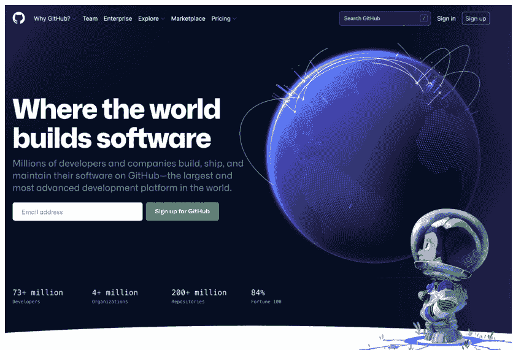

*图 2.1：GitHub 主页*


- 2. 点击右上角的**注册**按钮，或者在框中输入你的电子邮件地址，然后点击页面中央的**注册 GitHub**按钮。

- 3. 在下一页的字段中输入你的信息，然后点击**继续**。

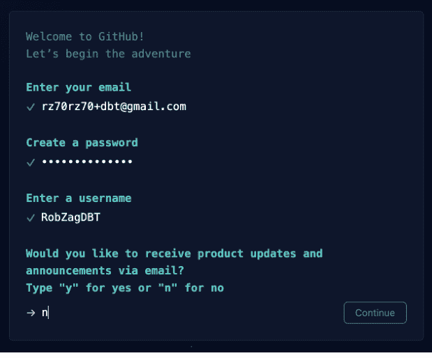

图 2.2：GitHub 输入表单

- 4. 完成拼图以验证你是人类，然后点击**创建账户**。

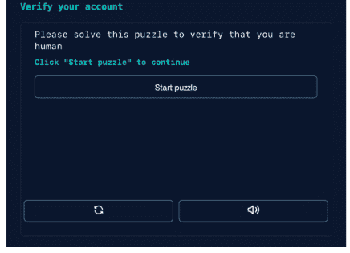

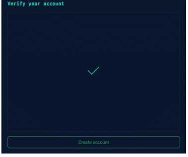

图 2.3：GitHub 拼图表单

- 5. 在出现的下一页上，你需要输入通过电子邮件收到的代码。

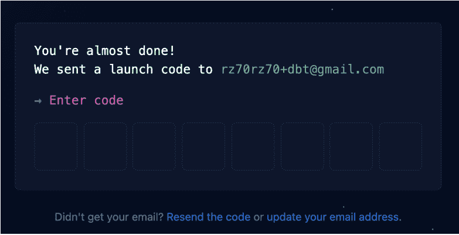

图 2.4：GitHub 验证表单

- 6. 欢迎使用 GitHub！设置已接近完成。选择你将与之协作的人数范围；开始时，**仅本人**即可。

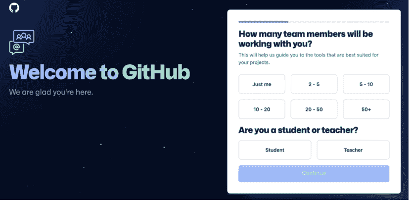

图 2.5：GitHub 欢迎页面

- 7. 在下一页上，选择你想使用的工具，然后继续。目前，协作编码就足够了。

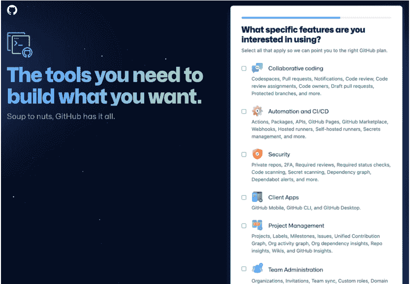

图 2.6：GitHub 功能选择页面

- 8. 最后，选择你想开始使用的方案。免费方案适合起步，因此你可以通过点击页面底部的“免费继续”来继续。

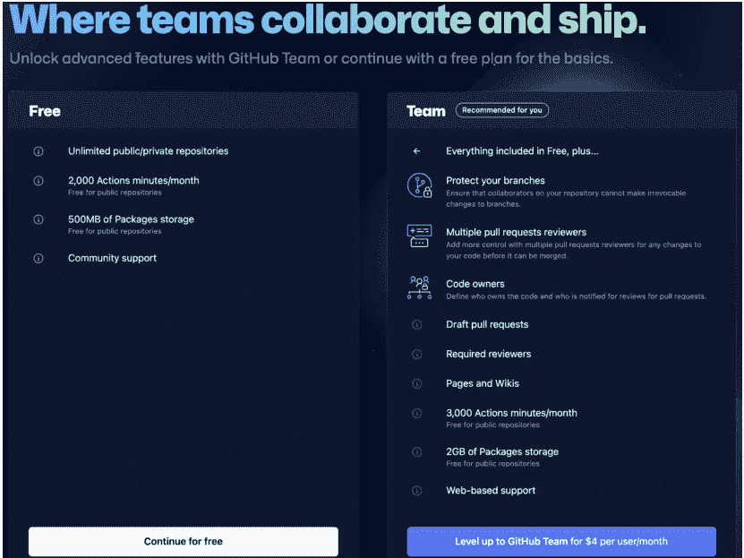

图 2.7：GitHub 方案选择页面

- 9. 现在你真的完成了，你将进入已登录主页。

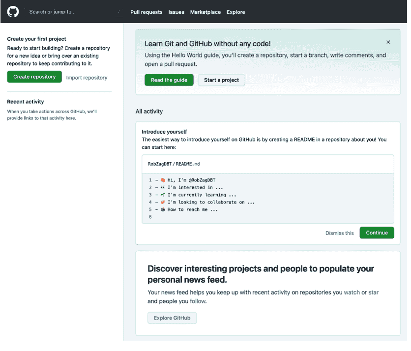

图 2.8：GitHub 已登录主页

在你已登录的主页上，你随时可以创建新的仓库，现在它还会主动建议你创建第一个项目。我们将在下一节中这样做，但现在，如果你愿意，可以花 5 分钟完成 README.md 文件来介绍你自己。

## 为 dbt 设置你的第一个仓库

无论你是刚刚创建了 GitHub 账户，还是已经拥有一个带有很多仓库的长期账户，现在都是时候为你的第一个 dbt 项目创建一个新仓库了：

> **重要说明**
>
> dbt 项目是代码和配置组织的主要单元，这些代码和配置协同工作以实现一个目标，每个 dbt 项目都托管在它自己的基于 git 的仓库中。
>
> 好消息是，你可以在 dbt 中拥有任意数量的项目，也可以在 GitHub 中创建任意数量的仓库。

- 1. 让我们从 `https://github.com/` 的已登录主页开始，我们在上一节结束时停在这里（参见*图 2.8*）。在屏幕左上角区域，点击**创建仓库**按钮，或者如果你已经有其他仓库，则点击**新建**按钮。

- 2. 填写**创建新仓库**页面，提供仓库名称和描述，并选择是公开还是私有。*重要的是让仓库保持为空*（没有文件、没有 README、没有许可证），这样 dbt 会要求你生成默认项目，因此请保持复选框为空并点击**创建仓库**按钮。

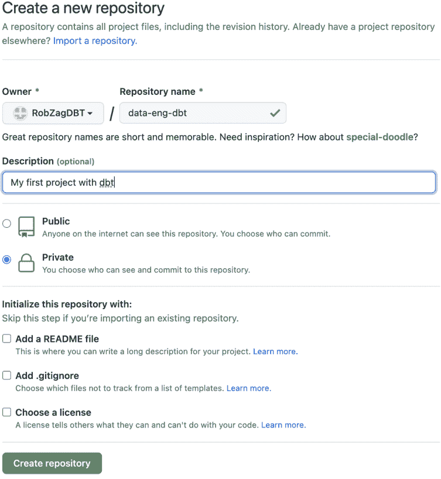

图 2.9：GitHub 仓库创建页面

恭喜，你现在有了一个空仓库，可以托管你的第一个 dbt 项目。由于是一个空仓库，dbt 会询问你是否要生成默认项目，我们将在后面的*将默认项目添加到空仓库*一节中看到。

## 设置你的 dbt Cloud 账户

在本节中，我们将指导你如何创建 dbt Cloud 账户，然后使用你刚刚在 GitHub 上创建的仓库来创建你的第一个 dbt 项目。

在创建第一个 dbt 项目时，我们还将配置 dbt Cloud 与 GitHub 之间的集成，因此该过程会多出一些步骤，而这些步骤只需要执行一次。

### 注册 dbt Cloud 账户

你可以轻松注册免费的 dbt Cloud 试用账户，在最初的 15 天试用期结束后，你将可以在付费的团队计划或永久免费的开发者计划之间进行选择。

让我们开始吧：

- 1. 前往 dbt 主页 https://www.getdbt.com/ ，点击两个**免费开始**按钮之一。

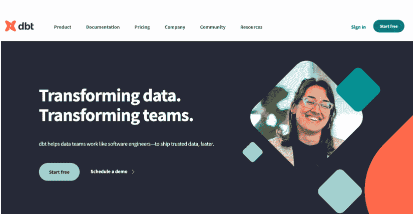

图 2.10：dbt 主页

- 2. 在打开的页面表单中填写你的详细信息，然后点击**创建我的账户**按钮。

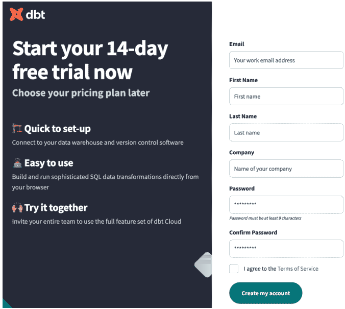

图 2.11：dbt 订阅表单

- 3. 你将进入“欢迎使用 dbt Cloud！”页面，该页面会告知你验证电子邮件正在发送中，如果你没有收到第一封邮件，也可以在这里请求重新发送。

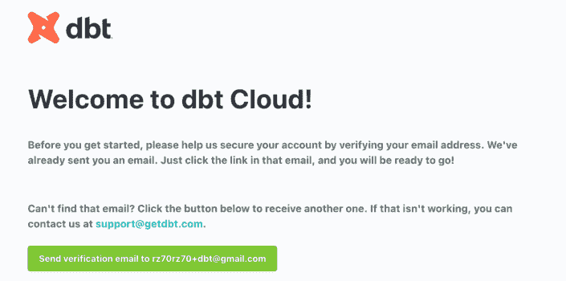

图 2.12：dbt 欢迎页面

- 4. 你将收到一封带有验证电子邮件地址按钮的邮件。点击邮件中的**验证电子邮件地址**按钮，返回 dbt Cloud 网站，完成电子邮件地址验证。

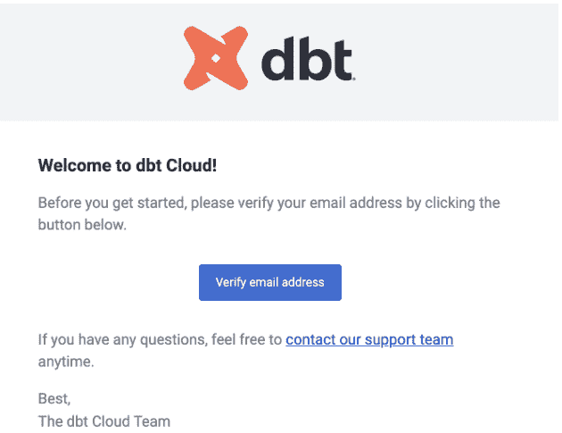

图 2.13：dbt 欢迎邮件

进入 dbt Cloud 网站后，你就可以开始创建你的第一个项目，我们将在下一节中介绍。

### 设置你的第一个 dbt Cloud 项目

要在 dbt Cloud 中设置项目，你必须完成以下步骤：

- 1. 为项目提供一个名称。
- 2. 选择**数据库（DB）**并提供特定于该数据库类型的连接详细信息。
- 3. 设置 dbt Cloud 与你的 git 系统之间的集成。仅当这是你使用该 git 系统设置的第一个项目时才需要此操作。
- 4. 选择一个 git 仓库来托管源代码。
- 5. 可选地，在初始账户设置中，邀请更多用户加入 dbt Cloud 账户。

在本节中，我们假设这是你设置的第一个项目，因此我们还会指导你完成 dbt Cloud 与你的 git 仓库提供商之间的集成设置。对于未来的 dbt Cloud 项目，则无需再进行该设置。

继续上一节，一旦你点击邮件中的链接验证你的电子邮件地址，你将被自动引导创建一个名为**Analytics**的新项目。

如果你已经有 dbt Cloud 账户，或者你创建第一个项目时中途离开了，你可以通过打开左上角的主菜单，然后选择**账户设置**，再选择**项目**（这是新菜单中的第一个元素，也是你默认会进入的页面）来回到你上次离开的位置。然后，如果你之前已经开始创建 **Analytics** 项目，则点击它；或者如果你要开始一个新项目，则点击**新建项目**按钮并提供所需项目名称。

然后，按照以下步骤操作：

- 1. 当你通过确认邮件中的链接进入**设置“Analytics”**页面（如下所示）后，点击**继续**按钮。

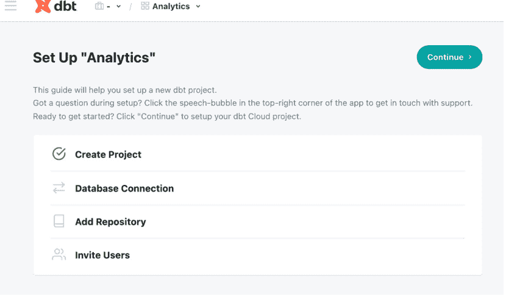

图 2.14：Analytics 项目的 dbt 设置页面

如果你因为正在创建新项目而进入类似的**设置新项目**页面，请点击**开始**按钮，在名为**项目设置**的下一页上提供项目名称，然后点击**继续**按钮。

- 2. 在下一页**设置数据库连接**中，点击你想使用的数据库。

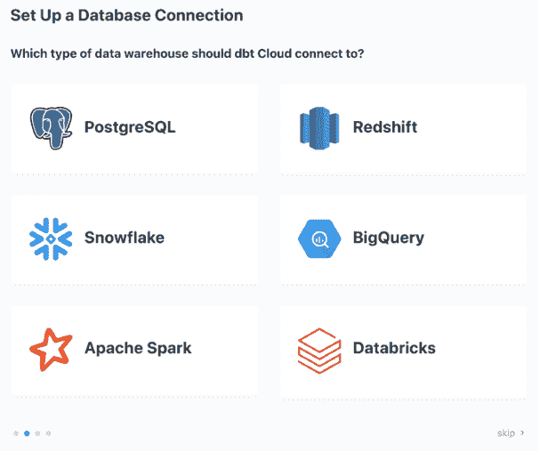

图 2.15：dbt 数据库连接选择页面

- 3. 在下一页（同样名为**设置数据库连接**）中，你需要输入连接名称和连接详细信息，以及用户详细信息，这些信息我们将在*图 2.16*中看到。

**设置数据库连接**

连接测试成功！点击“继续”保存你的连接并进入下一步。

| 字段 | 值 |
| --- | --- |
| 类型 | snowflake |
| 名称 | dbt Book Snowflake |

**Snowflake 设置**

dbt Cloud 将始终从 52.45.144.63、54.81.134.249 或 52.22.161.231 连接到你的数据仓库。请确保在你的防火墙中允许来自这些 IP 的入站流量，并将其包含在数据库授权中。

| 字段 | 值 |
| --- | --- |
| 账户 | op36091.north-europe.azure |
| 角色（可选） | DBT_EXECUTOR_ROLE |
| 数据库 | DATA_ENG_DBT |
| 仓库 | COMPUTE_WH |
| 会话保持活动 | 在 dbt 0.16.0 中添加。使 Snowflake 会话在通常的 4 小时超时限制后仍保持活动。 |

图 2.16：dbt 数据库连接设置页面

对于 Snowflake 连接，重要的是，ACCOUNT 参数只需输入用于访问 Snowflake 服务器的 URL 中的账户部分，省略开头的 http:// 部分和末尾的 .snowflakecomputing.com 部分。

如果你在第 1 章中完成了设置，则可以按所示输入 ROLE、DATABASE 和 WAREHOUSE 参数；否则，请输入你想使用的参数。

- 4. 在同一页面上向下滚动后，你可以为开发环境实例输入身份验证凭据。你将在后面的章节中创建其他环境。


## 开发凭据

在此输入你的个人开发凭据（不是部署凭据！）。dbt 将代表你使用这些凭据连接到你的数据库。当你准备将 dbt 项目部署到生产环境时，你可以单独提供生产凭据。

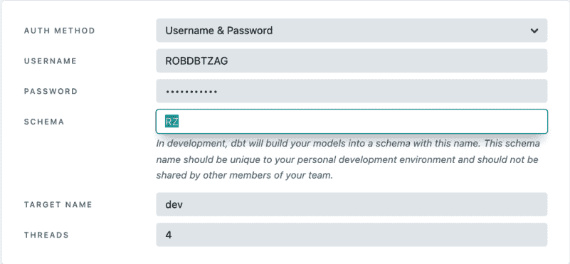

图 2.17：dbt 数据库开发凭据输入页面

为简单起见，我们使用了“用户名和密码”，但你也可以从下拉选项中选择“密钥对”来使用私钥，并可选择输入口令。

你可以保留 SCHEMA 的建议值，或选择一个更短的值，只要它对于参与此项目的每个开发者都是唯一的，因为它将用作开发环境中数据库 schema 的名称或前缀。

对于 TARGET NAME，你可以保留建议的默认值，或将其更改为更能标识开发环境的值，例如 dev，这是我一贯的选择。

为 THREADS 选择一个数字，4 到 8 都是不错的选择。

完成 Snowflake 设置和开发凭据后，点击页面顶部的“测试”按钮以验证连接是否正常（你会得到一条绿色消息，如图 2.16 所示），然后点击“继续”按钮。

- 5. 完成与所选数据库的连接设置后，你将进入仓库设置，以保存项目代码。

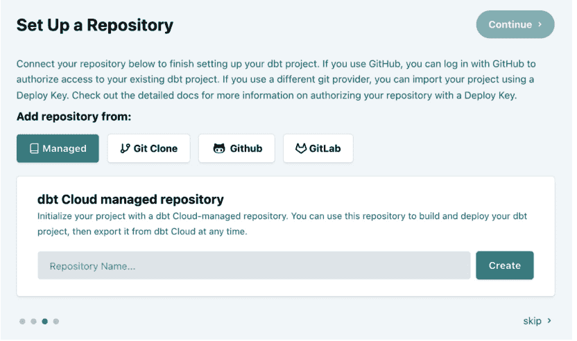

图 2.18：dbt 仓库设置页面

对于仓库的托管位置，你有几种选择。默认是使用 dbt Cloud 管理的仓库，但为了让你了解专业环境中更常用的设置，我们将完成 GitHub 集成设置。

通过选择**Git 克隆**，你可以设置托管在任何其他 git 提供商上的仓库，例如 Azure DevOps 或 Bitbucket；而通过选择**GitLab**，你可以设置 GitLab 集成。

选择**GitHub**按钮开始设置。

- 6. 你将被重定向到 GitHub 登录，因此请输入你的凭据并点击**登录。**

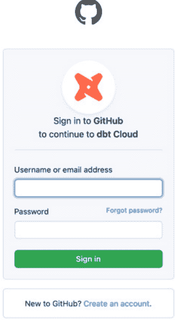

图 2.19：GitHub 登录表单

- 7. 通过点击**授权 dbt Cloud**按钮，允许 dbt Cloud 应用访问你的 GitHub。

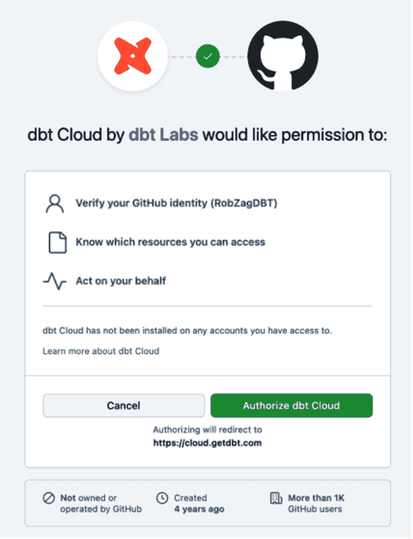

图 2.20：GitHub dbt Cloud 应用访问确认

- 8. 确认后，你将返回 dbt Cloud 的“设置仓库”页面。

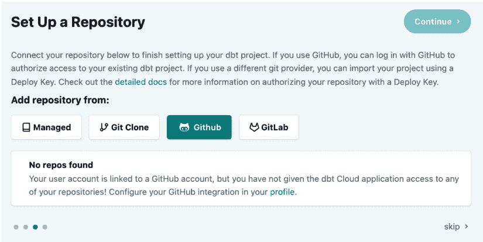

图 2.21：dbt 仓库设置页面

现在，你已经授权 dbt Cloud 访问 GitHub，但尚未配置 dbt Cloud 在你的 GitHub 账户中可以访问哪些内容。该集成作为你个人资料的一部分进行管理，因此让我们点击页面“未找到仓库”部分中提供的个人资料链接。

你也可以通过点击右上角的个人资料图标，从下拉菜单中选择“个人资料”，然后从左侧菜单中选择“集成”来进入该页面。

- 9. 在**集成**页面上，点击**在 GitHub 中配置集成**按钮。

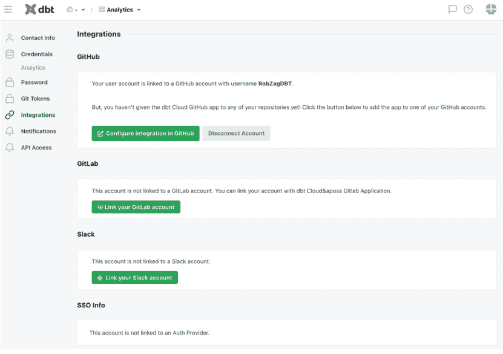

图 2.22：dbt 集成页面

- 10. 如果你有一个或多个仓库，你可以选择要授予 dbt Cloud 访问权限的单个仓库，也可以选择**所有仓库**，如下面的截图所示：

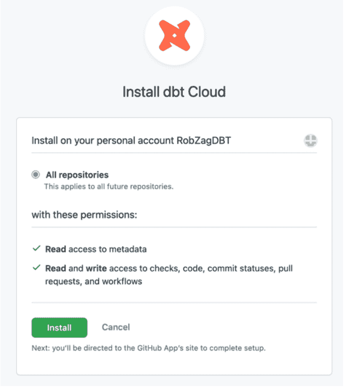

图 2.23：GitHub 仓库选择表单

选择**所有仓库**很方便，因为以后你不必再回到这里授予其他仓库的访问权限，但对于一个拥有许多与 dbt 无关的项目的账户来说，这可能不是最佳选择。

- 11. 一旦你授权 dbt Cloud 访问你在 GitHub 中的仓库，你将回到 dbt Cloud，此时你的 GitHub 集成已配置完成。你无需再次配置。

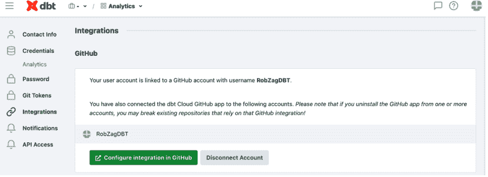

图 2.24：dbt 集成页面

- 12. 现在，我们可以返回完成项目配置：从左上角的菜单 ☰ 中选择**账户设置**，然后选择**Analytics**项目。

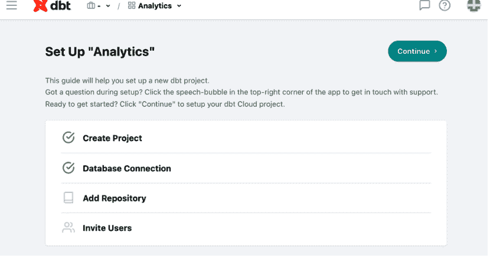

图 2.25：dbt 项目设置封面页

到达此处后，点击**继续**按钮，通过添加仓库来完成设置。

- 13. 现在集成已配置完成，dbt Cloud 可以访问你的仓库，你可以通过点击想要导入的仓库来开始导入过程。

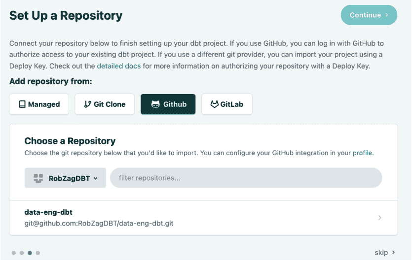

图 2.26：dbt git 仓库设置页面

- 14. 导入完成后，你会看到一条绿色的**成功导入仓库。**消息，然后你可以点击**继续**进入最后一步。

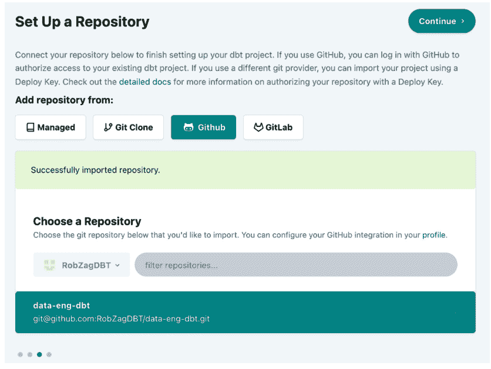

图 2.27：成功认证后的 dbt git 仓库设置页面

- 15. 在完成初始账户设置时，系统还会询问你是否要邀请更多人加入 dbt Cloud 账户。除非你想邀请，否则可以点击“跳过并完成”来结束。

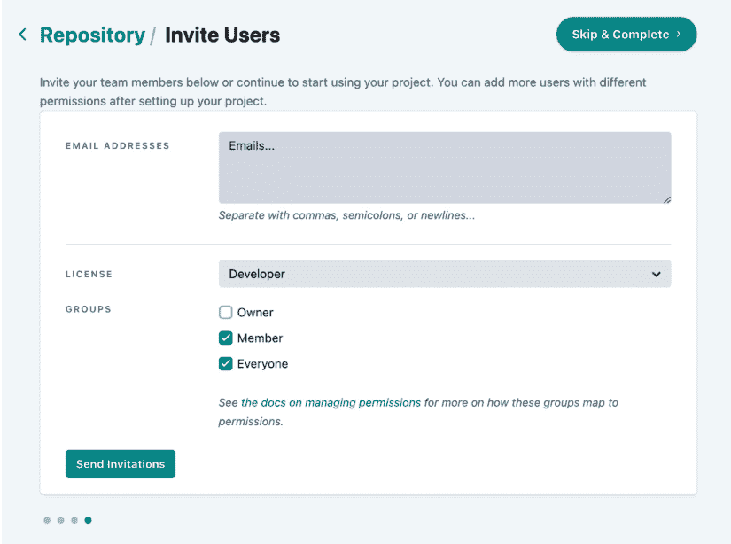

图 2.28：dbt 邀请用户页面

- 16. 然后你将进入 dbt Cloud 中已登录的主页。

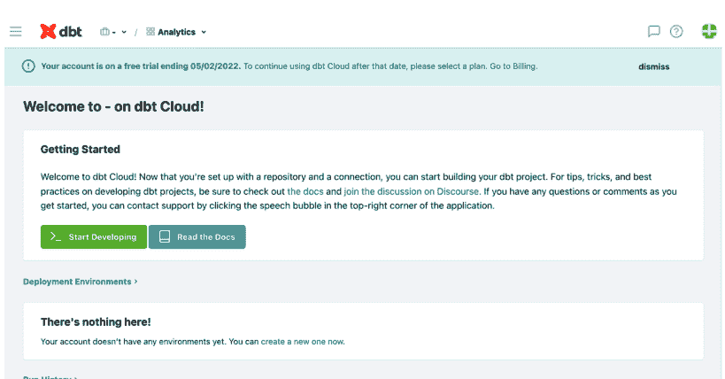

图 2.29：dbt 主页

在这里的截图中，你可以看到我随意地将 `-` 作为公司名称。

恭喜！你现在已经建立了一个功能齐全的专业环境，并使用了顶级组件：Snowflake 作为数据平台，GitHub 作为 git 提供商服务，dbt Cloud 作为数据自动化工具。

目前我们的仓库仍然是空的，因此在下一节中，我们将了解如何在我们自己的仓库中创建默认的 dbt 项目，以便开始探索和测试我们的设置。

## 向空仓库添加默认项目

无论你是刚刚完成初始设置，还是在一个已经拥有多个项目的账户中添加了一个新的空仓库，默认的 dbt 项目都是检查新项目是否按预期工作的好方法。

因此，我建议你在开始新项目时始终让 dbt 生成默认的 dbt 项目，一旦你确认一切正常并准备好开发自己的项目后，再将其删除。这就是我们将在本节以及本章其余部分要做的事情。

从你已登录的主页，点击“>_ 开始开发”按钮或左上角主菜单 ≡ 中的“开发”项，进入集成开发环境（IDE）。然后按照以下步骤操作：

- 1. 在灰显的 IDE 上等待几秒钟，并出现一个显示“正在加载 Analytics”（或你的项目名称）的弹出窗口后，你将进入一个带有空项目的 IDE 页面，如下面的截图所示：

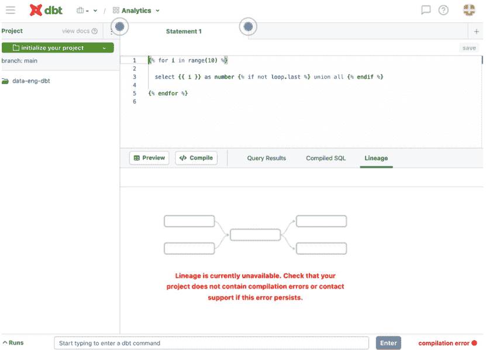

图 2.30：空项目的 dbt IDE 页面

你可以看到仓库是空的，因为左侧区域你的仓库名下没有任何文件，左上角的仓库操作按钮显示“初始化你的项目”。

如果你在右下角看到红色的编译错误，请不要担心；如果项目中没有任何内容，这是正常的。“Lineage”窗口中的消息也是如此。

要创建默认的 dbt 项目，请点击“初始化你的项目”按钮。

- 2. 默认项目的文件夹和文件会添加到你的开发环境中。你可以在文件资源管理器中看到它们，并点击它们的名称将其打开。

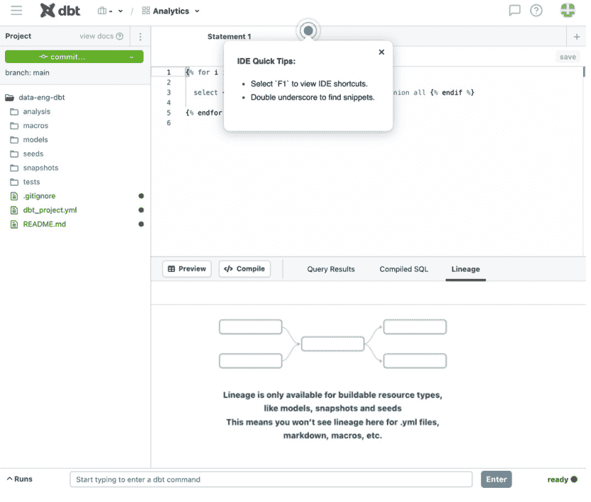

图 2.31：带有默认项目的 dbt IDE 页面

如果你愿意，可以浏览已添加的文件和文件夹，但我们将在本章后面再回来介绍它们。当你准备好将新文件保存到仓库时，点击**提交…**按钮。

- 3. 将出现**编写提交信息**弹出窗口，供你输入提交信息。

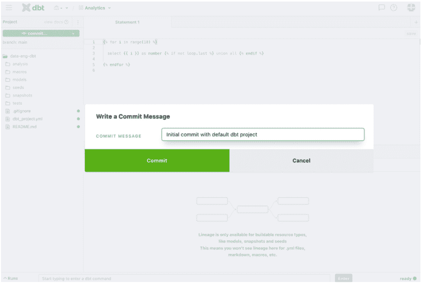

图 2.32：dbt 提交信息窗口

一条好的提交信息应清晰而肯定地说明自上次提交以来所完成的工作。最好以过去分词开头，例如*已添加*或*已修复*，虽然这不是强制性的，重要的是它能清楚地说明做了什么。点击**提交**按钮将更改保存到你的仓库。

- 4. 一旦你的提交被处理并同步到你的 git 仓库，你将回到 IDE，文件和文件夹将显示为黑色，因为它们不再是新的或已更改的状态。


## 设置你的 dbt Cloud 开发环境

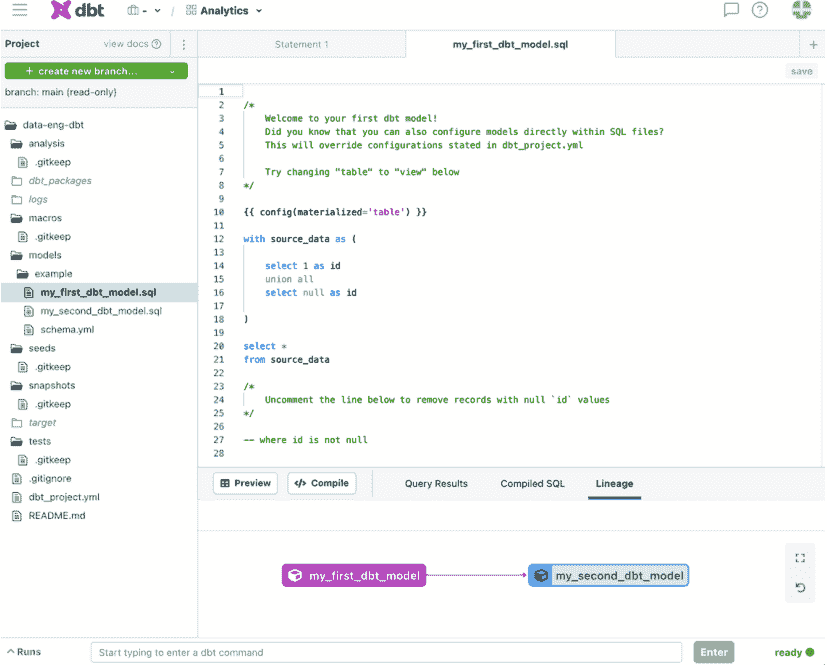

图 2.33：dbt IDE 已打开并正在编辑 SQL 文件

此截图显示大多数文件夹都是空的，只包含 `.gitkeep` 文件。该文件是一个空文件，其唯一作用就是强制 git 创建文件夹（git 会跳过空文件夹）。

唯一包含实际文件的文件夹是 **models** 文件夹，它在 **example** 文件夹下包含两个示例模型。我们将在本章后面详细研究它们。

请注意，你现在位于 **main** 分支上，这是 GitHub 的新默认分支（之前名为 `master`），并且当你处于 **main** 分支时，你处于只读模式，因此无法进行更改。这是引导式 git 工作流的一部分，我们稍后会看到。

恭喜，你现在已经完成了开发环境的设置，包括设置默认的 dbt 项目。在接下来的章节中，我们将通过默认项目来更深入地了解 dbt Cloud 的基础知识。

## 比较 dbt Core 和 dbt Cloud 的工作流

你可以选择使用两个 dbt 版本：

- **dbt Core**：这是由 dbt Labs 创建的开源软件，使用 Python 开发，你可以免费下载，并在许多操作系统（如 Windows、Mac 和 Linux）上从命令行本地使用。它提供了 dbt 的所有核心功能，也可以用于商业项目。
- **dbt Cloud**：这是由 dbt Labs 创建的商业软件，提供**软件即服务**（SaaS）体验，包含 dbt Core 的所有功能，并封装在一个 Web 界面中，使 dbt Core 的功能更易于使用，同时增加了许多在运行实际数据项目时有用的功能。

**dbt Core** 开源产品提供了运行完整 dbt 项目所需的所有功能，其核心功能与 dbt Cloud 产品没有任何差异或限制，以至于你可以在两种产品中的任何一种下执行相同的项目。

**dbt Cloud** 在 **dbt Core** 之上新增的功能旨在让基于 dbt 项目的开发、维护和运营变得更简单、更快速，并且总体上对更广泛的团队来说更具生产力或价值。以下是主要新增功能的列表：

- 强大的基于 Web 的 IDE，支持模型的在线编译和执行
- 引导式 git 工作流，集成在 Web IDE 中，包括对拉取请求的支持
- 开发环境的创建和维护，包括 dbt 版本的选择
- 执行作业的创建，以可靠的方式运行 dbt 命令
- 作业执行的调度、监控和告警
- 数据源新鲜度监控
- 生成文档的发布

在本书中，我们决定使用 dbt Cloud 开发环境，因为它使 dbt 项目的工作更加容易，不需要任何安装，并且对每个人来说外观和操作方式都相同，与你电脑的操作系统无关。

### dbt Core 工作流

使用 dbt Core 时，你需要在项目根文件夹中从命令行发出命令来与 dbt 交互。dbt Core 只查看本地文件和文件夹，不会也不关心你的项目是否也存储在 git 或其他 VCS 中。

使用 dbt Core 开发功能的典型工作流如下所示：

1. 在开始新功能之前，如果你使用 VCS 并遵循在开发分支中进行新工作的最佳实践，请转到命令行，为你的 VCS 运行命令以创建新分支，并将其设置为项目文件夹中的活动分支。

2. 然后，你可以在所选的编辑器中创建或编辑 dbt 模型，并将其保存到 dbt 项目文件夹结构中。

3. 要查看当前版本是否能正常工作，且不将更改应用到数据库，你需要在命令行中运行以下命令，并附带相应的开关以仅编译你更改的内容：

   ```
   dbt compile <eventual switches>
   ```

   这会为 `target` 文件夹下的每个模型生成或更新编译后的 SQL 文件。

4. 如果一切正常且没有编译错误，你会在 `target` 文件夹下找到该模型的编译后 SQL 文件。找到文件后，你需要打开它，复制其内容，并将其粘贴到可以在数据库上运行这些内容的地方。对于 Snowflake，你可以将它们复制到 Snowflake worksheet 中并从那里运行。某些代码编辑器也允许运行 SQL 脚本。

   - 或者，你可以跳过繁琐的第 3 步和第 4 步，像第 6 步那样，使用 `dbt run` 命令运行你想要测试的模型，但一旦运行，你将会更改数据库，并且如果不回退代码并再次运行旧版本，你将无法轻松回到之前的版本。请注意，回退并重新运行不适用于增量模型。

5. 你将会看到模型的结果；如果需要更改，请回到第 1 步，重复编辑、编译、打开、复制、粘贴和执行的过程，直到你满意为止。

6. 当你满意并想要将更改应用到数据库时，请在命令行中运行以下命令，并附带相应的开关以运行与当前开发相关的模型：

   ```
   dbt run <eventual switches>
   ```

   这会为 `target` 文件夹下的每个模型生成或更新编译后的 SQL 文件，然后在数据库上运行它，将 SELECT 查询包裹在用于生成视图或表的代码中。

7. 然后，通过发出以下命令来执行你已经声明或编写的测试，并附带相应的开关以测试与当前开发相关的模型：

   ```
   dbt test <eventual switches>
   ```

8. 当你对开发感到满意并完成了一组想要保存到 VCS 的更改时，回到命令行并发出适当的命令来提交更改。你需要知道相关的命令。

9. 当你准备好完成开发并征求同事的反馈时，在将代码合并到主开发分支之前，请转到你的 VCS 并开始一个新的拉取请求。当拉取请求获得批准后，合并它，你就完成了。

运行 dbt 项目的典型工作流如下所示：

1. 将你想要运行的代码放入 dbt 项目文件夹中。这通常是通过检出所需分支来完成的，但任何你选择的方式对 dbt 产品来说都有效。

2. 从命令行运行一系列 dbt 命令，可能使用 shell 脚本，来执行你想要的操作。一个典型的情况如下：

   - 可选地，运行任何维护数据库、设置数据源访问或将数据导入落地表所需的 `dbt run-operation` 命令。
   - 使用 `dbt source freshness` 命令检查数据源的新鲜度。
   - 在将要读取的源数据或落地表上运行测试。
   - 运行可选的 `dbt snapshot` 命令以存储源中的更改，然后对快照运行可选的测试。
   - 运行 dbt 模型；即发出 `dbt run` 命令。
   - 然后，使用 `dbt test` 命令对模型运行测试。
   - 使用 `dbt docs generate` 命令生成文档。

   这是一个简单的设置，可以让你在实际使用中走得很远。

3. 监控执行期间输出的日志信息，以验证一切正常，并且在每个步骤结束时，你可以决定是否继续执行下一步，直到完成。

   请注意，如果你使用脚本运行这些命令，你应该对输出进行检查，因为如果在某个时刻发生错误，你应该停止运行。

4. 如果你不需要存储日志信息，那么你就完成了；否则，你需要设置一些东西来捕获日志信息并按需存储。

5. 如果你想调度运行，你需要自己设置调度，使用你手头可用的任何技术。在简单的设置中，这通常是通过 `cron` 等调度器来实现的。

6. 如果你想存储或发布数据源新鲜度检查的结果，你需要捕获结果或从执行生成的 JSON 文件中提取结果并发布它。


- 7. 如果你想要发布生成的文档，你需要将已生成且可直接发布的文件复制到某个位置，以便进行发布。一个简单的做法是将它们复制到 Amazon S3 或类似服务的文件桶中，然后发布给你想要触达的受众。

正如你在前面关于 dbt Core 工作流的描述中所看到的，如果你对命令行、代码编辑器和运行 SQL 的工具都比较熟悉，那么对模型进行基本修改并运行它们来执行 ETL 过程并不困难。

如果你不想每次都手动完成所有操作，你还需要知道如何编写一些脚本来实现自动化执行；而如果你希望这些脚本根据每一步的情况做出正确响应，你还需要编写逻辑来决定是否继续执行。

如果你还想执行任何我标记为可选但在专业环境中属于常规操作的步骤，比如调度执行、存储执行结果、发布新鲜度检查或文档，那么你需要掌握的知识和付出的努力就远不止手动运行模型那么简单。

即使你独自在一个项目上工作，使用版本控制（VC）和分支也非常有用，我们对此习以为常。当你的项目扩展到两个或更多开发者或环境时，使用 VCS 是保持环境间同步、促进开发者协作的唯一有效方式。

因此，要想超越“单人表演”的模式，你需要熟悉 VCS。

## dbt Cloud 工作流

让我们再看一遍之前为 dbt Core 介绍过的两个工作流，但这次使用的是 dbt Cloud，以便你了解主要区别。

这是 dbt Cloud IDE 的外观：

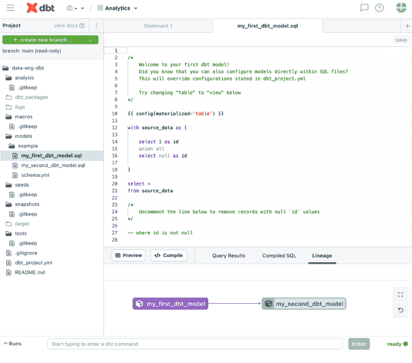

一个使用 dbt Cloud IDE 开发功能的典型工作流可以如下所示：

- 1. 当你想开始一个新功能时，可以点击 IDE 左上角 VCS 区域中的**“创建新分支…”**按钮来创建新分支，或者通过 VCS 操作按钮右侧的下拉菜单选择其他分支。
- 2. 然后，你可以直接在 IDE 中打开、编辑和保存文件。
- 3. 通过点击**“预览”**按钮在 IDE 中测试模型，dbt Cloud 会编译并在你的数据库上执行生成的 SQL，然后在 IDE 中显示结果。你也可以查看编译后的 SQL；如果你只想查看 SQL，可以点击**“编译”**按钮而不是**“预览”**按钮。
- 4. 继续处理你的模型，在 IDE 中编辑、保存并选择**“预览”**或**“编译”**，直到你满意为止。
- 5. 当你想在数据库上应用某个模型时，前往 IDE 页面底部的命令行，输入与你在 dbt Core 中相同的 dbt 命令，如下所示，并可使用`switches`来测试与当前开发相关的模型：

  ```text
  dbt run <eventual switches>
  ```

在较新版本的 dbt IDE 中，你可以直接点击构建按钮，或从按钮的下拉菜单中选择其中一个运行选项。

- 6. 然后，使用与 dbt Core 中相同的命令运行测试，如下所示，并可使用`switches`来测试与当前开发相关的模型：

  ```text
  dbt test <eventual switches>
  ```

- 7. 当你的开发准备就绪后，点击 VCS 区域中的**“提交”**按钮（当你第一次保存模型更改后该按钮会显示），然后在 IDE 顶部弹出的窗口中输入提交信息，即可完成，无需离开 IDE。
- 8. 当你的开发准备好接受反馈并最终发布时，点击 VCS 区域中的**“打开拉取请求”**按钮，这会带你到 GitHub（或你的 VCS）上的拉取请求创建页面，你可以在其中输入描述并邀请需要的审阅者对新拉取请求进行评论。

如果将我们刚刚描述的 dbt Cloud 工作流与之前在 dbt Core 中描述的同一工作流进行比较，我们会发现，虽然逻辑操作和 dbt 命令是相同的，但执行它们所需付出的努力却大不相同。在 dbt Cloud 中，你可以在 IDE 中完成所有操作，无需复制粘贴任何代码、查找编译后的文件，也无需在不同工具中编辑或运行编译后的 SQL 查询。

接下来我们看第二个工作流：如何运行 dbt 项目。在 dbt Cloud 中，你可以在 IDE 中手动运行所有内容（这相当于在开发环境中进行的操作），也可以定义一个可重复的作业在部署环境（如 QA 或生产环境）中运行（这相当于当你希望调度 ETL 管道执行时要做的操作）。

在 dbt Cloud 中运行项目的工作流如下：

- 1. 要选择运行哪个版本的代码，你需要定义一个环境，并将一个 VCS 分支与之关联。
- 2. 要决定在代码上运行哪些 dbt 命令，你需要定义一个作业，按照你希望执行的顺序输入 dbt 命令。这些命令与 dbt Core 中的相同，但某些功能（如检查数据源新鲜度或生成文档）可以通过复选框启用。

在创建或编辑作业时，你还可以定义定时执行，dbt Cloud 将根据你的调度运行该作业。

- 3. 当作业启动时（根据你的指令或计划），命令会按你定义的顺序执行，如果出现错误，作业会停止执行。你可以实时查看日志，也可以让作业继续运行，稍后再回来查看结果，并随时可获得完整日志。

  执行结果和日志会自动存储在 dbt Cloud 中，你无需做任何额外操作来启用它们。

- 4. 如果你想调度运行，只需在作业中编辑调度定义，使用普通的 cron 语法即可。你也可以手动启动作业，或通过 REST 调用启动。
- 5. 如果你想存储或发布源数据新鲜度检查，请在作业中激活相应的复选框，然后选择一个运行该检查的作业，使其发布到项目的数据源新鲜度页面上。
- 6. 如果你想发布生成的文档，只需在作业配置中启用特定的复选框，然后决定从哪个作业发布文档。
- 7. 如果你愿意，你可以启用 dbt Cloud 的通知功能，以便在特定作业运行、被中断或失败时向你发送通知。有一个页面可以控制项目的所有通知。

再次比较 dbt Core 和 dbt Cloud 的这第二个工作流，我们可以看到在这两种情况下，我们都能够获得相同的结果，并且涉及的 dbt 命令也是相同的。但使用 dbt Cloud，你拥有一个简单的基于 Web 的工具，它能为你提供专业环境中所需的所有功能。

dbt Cloud 还让这些以及其他现代数据自动化功能能够方便地提供给那些没有足够技能或时间来自己构建这些功能的小团队。

我们已经看到，无论你使用的是 dbt Core 还是 dbt Cloud，要执行的 dbt 命令都是相同的。在本书的其余部分，我们将使用 dbt Cloud 及其功能，但你可以放心，如果你更喜欢 dbt Core，你也可以运行同样的模型。

现在你已经对 dbt Core 和 dbt Cloud 都有了了解，让我们开始探索如何使用 dbt Cloud 来使用 dbt。

## 在 dbt Cloud 中试用 SQL

现在你已经设置好 dbt Cloud 并连接到你的 Snowflake 数据平台，你可以使用 dbt IDE 发出 SQL 命令并查看结果。“预览”功能让你在开发模型时轻松测试模型，但它也可以用来在数据库上运行任意 SQL。

在本节中，我们将运行前一章中的一些示例，以便你熟悉 dbt 界面；如果你对 SQL 不熟悉，也可以借此尝试一下 SQL。


## 从 dbt IDE 执行 SQL

让我们开始运行 *第 1 章* Select 部分中的一个查询。

在语句标签中输入以下代码：

```sql
-- ** SELECT clause **
-- Sample SELECT with alias
SELECT
    O_ORDERKEY,
    ord.O_CUSTKEY,
    cust.C_NAME as CUSTOMER_NAME
FROM SNOWFLAKE_SAMPLE_DATA.TPCH_SF1.ORDERS as ord
JOIN SNOWFLAKE_SAMPLE_DATA.TPCH_SF1.CUSTOMER as cust
        ON cust.C_CUSTKEY = ord.O_CUSTKEY
limit 100
```

在 IDE 中输入代码并按下 **Preview** 按钮后，你应该在几秒钟后看到查询结果，如下图所示：

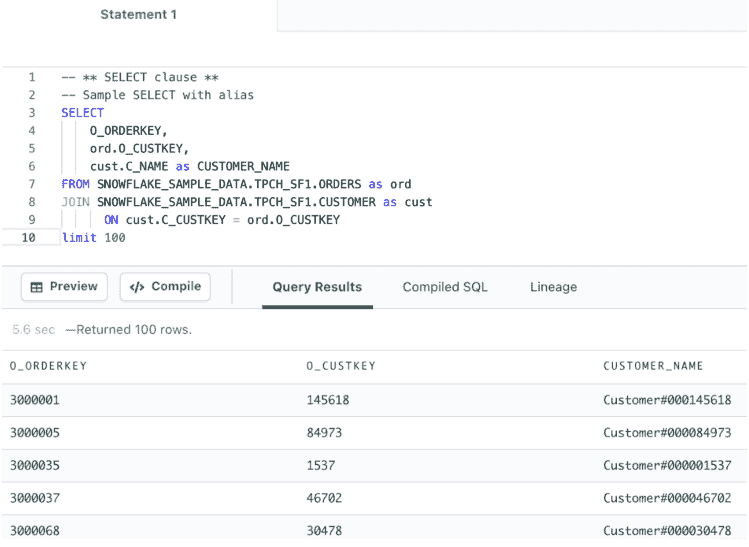

图 2.36：在 IDE 中运行示例查询

## 探索 dbt 默认模型

让我们列出 dbt 默认项目包含的内容：

- `README.md`：这是一个包含一些说明和指向 dbt 文档的指针的文本文件
- `dbt_project.yml`：主要配置文件
- `.gitignore`：一个 git 特定文件，列出要从版本控制中排除的资源，例如 dbt_packages、target 和 logs 文件夹
- 在 `models/example` 文件夹内，我们有两个模型和一个配置文件：
  - `my_first_dbt_model.sql`：顾名思义，这是第一个模型，它只是由纯 SQL 组成，将生成两行硬编码数据
  - `my_second_dbt_model.sql`：这是第二个模型，它读取第一个模型，引入使用 ref 函数引用其他模型
  - `schema.yml`：另一个配置文件，提供模型的元数据，并声明我们希望对这些模型运行的测试

如果你打开/选择两个模型之一并点击编辑面板下部的 **Lineage** 标签，你将看到 lineage 图，它显示了此项目中两个模型之间的依赖关系，如下图所示：

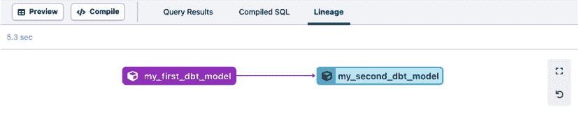

图 2.38：dbt 默认项目的 Lineage

让我们更好地分析模型文件夹的内容。

### Analysis of my_first_dbt_model

第一个模型具有以下源代码（我们删除了一些空行和注释）：

```sql
01    {{ config(materialized='table') }}
02    with source_data as (
03        select 1 as id
04        union all
05        select null as id
06    )
07    select *
08    from source_data
```

我们可以看到第 3 到 5 行使用了两个非常基本的查询，它们只是返回一个值，并使用 `UNION ALL` 操作符生成两行数据，一行 ID 值为 1，另一行值为 `null`，`null` 是 SQL 中表示数据缺失的特殊值。

第 2 到 6 行声明了一个名为 `source_data` 的 CTE，由第 7 和 8 行使用，在那里我们选择该 CTE 生成的所有内容。

可能最有趣的行是第 1 行，因为它不是 SQL 代码，而是一个内联配置，指示 dbt 将此查询的结果物化为表。如果你预览模型，你将在 dbt Cloud IDE 中看到其 SQL 的结果，但你不会在你的数据库上生成任何内容。要影响你的数据库，你需要使用 `dbt run` 或 `dbt build` 命令运行模型。

> **重要说明**
>
> 预览模型将按原样运行模型中的查询，而当 *运行模型* 时，使用 `dbt run` 命令会将 SELECT 查询包装上正确的 DDL，以便以所需的方式将模型物化到数据库中，例如表或视图。

### Analysis of my_second_dbt_model

第二个模型具有以下源代码：

```sql
01    select *
02    from {{ ref('my_first_dbt_model') }}
03    where id = 1
```

如果你在尚未使用 dbt `run` 命令之前尝试预览此模型，你将收到错误，因为你在数据库上引用的第一个模型不存在。很可能，你选择的架构名称对应的 schema 也不存在。

我们将在下一节中使用 dbt `run` 命令，因此目前，我们只需注意到此模型只是从第一个模型中选择所有内容，该模型仅通过其名称使用 dbt `ref` 函数引用。

大括号符号 `{` 和 `}` 用于在我们的模型中开始和结束 Jinja 代码块。我们将在本书的第二部分更详细地介绍 Jinja。目前请注意，双大括号符号 `{{` 用于从 Jinja 表达式中打印值。

我们然后期望 `{{ ref('my_first_dbt_model') }}` 行会打印出引用包含第一个模型的表或视图的正确 SQL 名称。

### Analysis of schema.yml

此配置文件的第一行如下：

```yaml
01
02    version: 2
03
04    models:
05        - name: my_first_dbt_model
06          description: "A starter dbt model"
07          columns:
08              - name: id
09                description: "The primary key for this table"
10                tests:
11                    - unique
12                    - not_null
```

第二行声明了配置文件的版本。

第四行声明在接下来的行中，我们正在配置一些模型。

第五行通过其名称标识一个模型，第五行声明了它的描述。

第七行声明我们开始为所选模型配置列。

第八行标识 ID 列（请记住，在 Snowflake 中，如果未加引号，字段名称不区分大小写），第九行为其提供描述。

第 10 行声明我们将列出希望 dbt 对此模型的此列运行的测试，第 11 行请求唯一性测试，而第 12 行请求测试列不为空。

在此之后，我们有一组类似的行来配置测试并为第二个模型提供描述。

## 使用 ref 和 source 连接模型

我们从 lineage 图中看到，此项目有两个模型，并且 my_second_dbt_model 感谢以下代码片段连接到第一个模型：`{{ ref('my_first_dbt_model') }}`。

ref 函数允许你以简单而灵活的方式 *按名称引用 dbt 模型*。当模型编译为 SQL 时，`ref` 函数将生成正确的完全限定名称，以便根据环境、用户和配置从正确的表或视图中读取。

以非常相似的方式，source 函数允许你引用一个未由 dbt 创建的表或视图。通过在 YAML 文件中定义一个 source 系统，指向某个数据库和 schema，以及其下的一个或多个表对象，我们就可以以灵活的方式使用 source 函数访问它们，如下所示：

```jinja
{{ source('source_system', 'table_object') }}
```

dbt 的卓越之处在于，当我们运行 dbt 模型时，模型中 SQL 和 Jinja 代码的混合会被编译为目标平台的纯 SQL 代码；*dbt 生成部署模型逻辑到数据库所需的所有样板代码*，以便你的逻辑或其结果作为与模型文件名相同的视图或表部署到数据库。

ref 和 source 函数是 dbt 工作方式的基石；通过使用它们，我们为 dbt 提供构建整个项目依赖关系图所需的信息，然后 dbt 能够动态生成 SQL 代码，使得编写一次模型并部署到多个环境变得简单。

在 dbt 项目中编写 SQL 时，你必须始终通过使用 `ref` 或 `source` 函数引用其他数据库对象，具体取决于它们是否由 dbt 管理，以便模型在你更改配置或部署到多个环境时自动生成正确的 SQL 名称。

## 运行你的第一个模型

现在我们已经查看了默认 dbt 项目中的模型以及如何将它们串联起来，是时候在我们的 Snowflake 数据库中创建它们了。为此，我们需要运行 dbt 项目。

要运行项目的全部模型，你只需在命令行中输入以下命令，该命令行可在 dbt Cloud IDE 底部找到，或在 dbt Core 的命令行中使用：

```bash
dbt run
```


在我们的示例中，您在 Snowflake 数据库内部，名为 **DATA_ENG_DBT**，应该有一个架构，其名称在设置期间您所选择，示例中为 **RZ**，并且在该架构内部，您应该有两个模型，如上一张屏幕截图所示。

太好了，我们已成功执行模型并生成了所需的产物！

我们做完了吗？没有，制作可工作的模型是一个重要的步骤，但确保它们按预期工作 arguably 更为重要，所以是时候谈谈测试了！

## 测试你的第一个模型

测试的好坏取决于你对问题的理解以及你投入的努力，因此你应该在测试上投入至少与编写代码相同的努力。

能够以简单的方式向代码添加有用的测试是 dbt 与其他构建数据平台方式相比的关键点，但请注意，测试即代码，过多的测试会带来维护成本，带来一点额外的安全感，而错误或脆弱的测试甚至比不测试某个功能或模型更糟。

我们应该测试什么？如何实现正确的平衡？

我们将在本书的第二部分和第三部分更详细地讨论测试，但现在请注意，测试您对将要转换的数据的假设尤其有用，例如您所依赖的键和字段的唯一性和非空性，以及您认为复杂或不甚了解的业务逻辑的结果。

让我们看看在这个默认项目中我们有哪些测试。

该项目已使用通用 `not_null` 和 `unique` 测试为两个模型中的每一个声明了四个测试。您可以在 `schema.yml` 配置文件中找到它们的声明，我们在本节开头分析过该文件，其中我们重现了前半部分，包括 `my_first_dbt_model` 模型的测试（第 11 行和第 12 行）。

您现在可以使用以下命令运行测试：

```
dbt test
```

如果出现错误，请不要感到惊讶；这是有意为之的，这样您可以看到错误是如何报告的，并且它给了我们学习如何修复错误的机会。

*Figure 2.41: The results of the first test run*

从上一张屏幕截图中，我们可以看到我们有一个错误。您可以打开失败测试的下拉菜单并查看摘要，在本例中它告诉我们只有一个行未能通过测试。查看详细信息视图，您可以看到作为测试运行的实际查询，您甚至可以将其复制并粘贴到 IDE 的新语句面板中以在您的数据库上运行查询。

在本例中，查看模型代码，本节中也曾分析过，我们可以看到它只生成两行，其中一行在 `id` 列的值为 null。

我们找到了错误所在，所以让我们修复它。

首先，由于这是一个脱离上下文的示例，我们需要就正确情况达成一致：

- 正确的逻辑是 `id` 字段不能为空，因此我们需要修复模型。
- 正确的逻辑是 `id` 字段可以为空，因此我们需要删除测试。
- 这是一个测试未遵循正确逻辑导致的工作量比不进行测试更大的例子。

让我们假设正确的逻辑是第一种，因此我们想要修复模型。我们将在下一节中这样做。

## 编辑你的第一个模型

在 dbt Cloud 中，您不能在主分支上编辑，因此我们将这样做：

1. 创建一个新分支。
2. 在分支中编辑 `my_first_dbt_model` 模型。
3. 运行并测试修改后的项目以检查它现在是否正常工作。
