## 数据工程的数据建模

在本章中，我们将介绍数据模型是什么以及为什么我们需要数据建模。

在关系型 **数据库** 的基础上，有 **实体-关系（E-R）** 模型。因此，您将学习如何使用 E-R 模型来表示描述您拥有或想要收集的数据的数据模型。

我们将介绍 E-R 记法、基数、可选性，以及数据模型中可以拥有的不同抽象级别和键，并将在我们讨论的不同示例中介绍行业中常用的两种不同记法。

我们将解释数据模型的一些特殊用例，例如弱实体或层次关系，讨论它们的特殊性或通常如何实现。

我们还将向您介绍您在数据中会遇到的一些常见问题，如何在可能的情况下避免它们，以及如果无法避免如何识别它们。

到本章结束时，您将对数据工程项目中使用的最重要的建模风格和架构有一个概述，讨论其优缺点。

最后，我们简要讨论了本书的总体方法，并参考我们讨论过的风格和架构。

在本章中，您将学习以下主题：

- 什么是数据建模以及为什么我们需要它？
- 概念、逻辑和物理数据模型
- E-R 建模
- 建模用例和模式
- 数据模型中的常见问题
- 建模风格和架构

### 技术要求

本章不需要对 E-R 模型主题的任何先验知识。

本章的所有代码示例均可在 GitHub 上获取，网址为 https://github.com/PacktPublishing/Data-Engineering-with-dbt/tree/main/Chapter_03。

### 什么是数据建模以及为什么我们需要它？

数据并不存在于真空中。没有周围知识的纯数据很少有任何价值。

当您可以将数据置于上下文中并将其转化为信息时，数据才具有很大的价值。

### 理解数据

纯数字 1.75，如您在数据库列中找到的那样，本身并不能说明太多。你认为它代表什么？它可能是 1.75 米、千克、加仑、秒，或您想附加的任何单位。

如果不是纯数字 1.75，而是 1.75 米或 1.75 秒，您已经更好地理解它了，但您仍然不能说您真正知道这些数据是关于什么的。

如果您在名为 width 的列中有 1.75 米，那么您知道得更多一些，但祝您好运猜出那个数字真正代表什么。如果您还知道它在名为 car、product 或 road 的表中，您可能就能更好地理解它真正代表什么。

通过这个非常简单的例子，您应该开始看到，要真正理解数据意味着什么，仅靠数据是不够的；您需要一些周围的信息来将数据置于正确的视角。

### 什么是数据建模？

**数据建模** 涵盖了为数据提供清晰上下文的活动，在多个层面上进行。

在最常见的解释中，数据模型是数据的视觉表示，在您分析的上下文中。

数据建模的一个重要部分是命名，如我们之前看到的示例中所示，它提供了语义的基础层，而另一个重要方面是解释不同数据片段如何相互关联。

为了有效地传达信息，数据模型必须易于阅读，这意味着将信息量限制在特定细节级别，该级别通常与所考虑的域的大小成反比。因此，通常会提到我们将在本章后面看到的三个细节级别：概念、逻辑和物理数据模型。

视觉数据模型的典型组件如下：

- **实体：** 实体是我们想要分析的概念，我们想要收集数据的感兴趣的事物，例如汽车、订单或页面访问。
- **属性：** 属性是实体的一个属性，我们想要存储其值，例如汽车牌照、客户或交易的总额。
- **关系：** 关系是两个相互关联的实体之间的连接，并捕获它们如何相关，例如汽车与其所有者之间的所有权关系，或客户与产品之间的购买关系。

这三个组件使我们能够以简洁的方式描述数据和数据之间的关系。我们将在本章的下一节中看到，我们可以用多种记法表达这些信息，并且我们可以借助其他工具来澄清数据语义。

作为示例，我们在下图中展示了一个 E-R 图，它是表示数据模型的常见方式（我们将在下一节中描述）。该示例图描述了两个实体（**Owner** 和 **Car**）以及它们之间的关系（**owns**）。该图还表示了 **Owner** 的两个属性（**Owner_ID** 和 **Owner_Name**）和 **Car** 的两个属性（**Plate** 和 **Model**）：

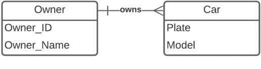

*Figure 3.1: A sample E-R diagram*

诸如 E-R 图之类的视觉模型是一个有用的起点，但不足以传达构建或正确使用数据平台所需的所有信息，许多数据团队都理解它应该由更多信息补充。

### 为什么我们需要数据建模

数据建模的全部意义在于传达信息，以便那些使用建模数据的用户能更好地理解数据和彼此。


数据建模通常用于两种主要场景：

-   描述应用程序或项目应当生成或收集哪些数据。在这种情况下，我们在拥有数据之前就构建数据模型。
-   描述已经存在的数据。在这种情况下，我们根据现有数据逆向推导数据模型。

这一区别至关重要，因为在第一种情况下，你可以根据用例的需求自由地将模型设计成你需要的模样；而在第二种情况下，数据是给定的，也就是说数据已经存在，因此数据模型只能反映数据的实际状况，在建模上没有真正的自由。

在数据仓库中，我们总是从第二种情况入手，因为我们从源系统获得的是“原样”数据；如果源系统没有现成的数据模型，我们就会尽己所知逆向推导出一个描述这些数据的模型。

通常情况下，我们会有多个源系统，它们的数据模型往往大相径庭，即使包含相似的数据，我们仍要设法整合这些数据。典型情况是：对分析师而言，任何一个源系统的模型都不易理解，也都不理想地满足业务需求。

因此，我们最终会转换源数据，构建一个新的目标数据模型，使其更易于理解、尽可能满足业务需求，并能够整合来自不同源系统的所需数据。

一个好的实践是在编写转换代码之前，明确设计这个新的数据模型，至少绘制一个模型，代表作为整合目标的业务概念，这些概念将成为我们转换后的精炼目标。这个模型可以是高度抽象的，只描述业务和主要实体；也可以更加详细，已经体现技术设计。

这与第一种情况不同，因为构建新的目标数据模型是一项受约束的工作；建模者必须始终牢记起始模型，因为新数据模型离源系统越远，就越需要额外信息（如映射表和主数据），也越需要投入工作来转换数据，同时丢失或改变原始数据并引入错误的风险也越高。

拥有显式的目标模型可以简化协作，并为项目提供清晰的目标。它也是分析我们是否遗漏了某些信息、是否需要映射表或业务规则来从源系统数据集过渡到期望目标模型的一个良好起点。

这个目标模型也可以被理解为：支撑所需数据集市中的报表所需的全部业务概念及其关系。事实上，识别目标数据模型中应包含哪些概念的最佳方法，是从期望的报表反向推导出业务概念。

> **注意**
> 我们会经常提到数据集市和报表，因为这是数据集市最常见的用途；但请记住，数据集市只是提供一组精心设计的表来满足某一用例的一种方式，无论该用例是报表、AI/ML 模型、数据导出，还是其他场景。

下一步是识别从这些概念到源系统数据之间所需的连接，查明我们何时缺少某些连接或需要更改键，以及何时需要映射表、业务规则或主数据。

## 补充可视化数据模型

我们已经看到，数据模型是一种沟通工具，而可视化数据模型的简洁特性使其成为传达某些技术信息的绝佳手段；但数据工程项目的其他重要方面，例如语义或业务规则，仅使用可视化数据模型的标准组件是表达不清楚的。

因此，我们建议用其他类型的文档来补充可视化数据模型，以更好地传达这些信息。

描述性文档（如 Wiki 或术语表）是解释数据模型中出现的实体和属性语义、就你在模型中使用的术语含义达成共识，以及解释除了技术实现细节之外必须被理解的重要业务规则的绝佳方式。

另一个重要方面是恰当描述我们如何从数据源推导出新目标数据模型中的数据。这被称为数据血缘。

当你使用 dbt 时，很容易让这些信息与代码保持接近，而且有些信息（例如数据血缘）可以直接从代码本身自动生成。

现在我们已经知道了数据模型是什么、它们的目的以及为什么有用，是时候深入更多细节了。在本章的下一节中，我们将介绍不同类型的数据模型；在后续小节中，我们将研究表达它们的表示法，并看一些示例和问题。最后，我们将介绍不同的建模风格和架构，它们为数据模型的使用提供了框架。

## 概念、逻辑和物理数据模型

数据模型可以用略有不同的表示法来设计，但无论你怎么设计，一个描述数据项目中所有内容的模型都会像你的数据库一样复杂，并且会过于庞大，无法作为沟通工具使用。

此外，在数据工程项目中，你会与不同的人进行讨论，这些讨论聚焦于项目的数据、业务和技术方面不同层次的细节。

我们通常提到以下三种类型的数据模型，它们的详细程度各不相同：

-   **概念数据模型**：这是最抽象的模型，定义*项目领域中将包含什么*，并提供总体范围。
-   **逻辑数据模型**：该模型提供更多细节，定义*数据将是什么样子*。
-   **物理数据模型**：这是最详细的模型，精确描述*数据将如何存储在数据库中*。

在接下来的小节中，我们将描述这三种类型的模型。

### 概念数据模型

概念数据模型是技术性最低的模型，因为它用于*在业务层面捕捉最重要的实体和关系*。

该模型识别核心主数据实体及其关系，定义项目领域中将包含什么，并提供总体范围和命名。

绘制它的一个良好起点是识别所需报表中需要的所有实体，澄清这些实体的语义，以便让项目的所有参与者都能清楚理解。

该模型必须使用与现实业务相关的真实业务实体和关系，通常不包含属性或其他技术细节，例如系统特定的名称或属性。

它由数据架构师和业务利益相关者共同创建，并应以最重要的业务规则和约束集合作为补充。

由于概念数据模型描述的是现实中的真实业务，使用现实实体，因此它在涉及同一领域的不同项目中都应当保持有效。

### 概念模型示例

下面的概念数据模型使用 UML 表示法，提供了一个简单、业务级别的订单和退货数据模型：

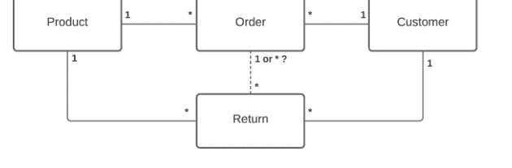

图 3.2：订单和退货的概念数据模型

尽管该模型很简单，它已经能开启与业务的讨论，并捕捉一些有趣的信息，例如退货与订单之间是否存在数据关联，或者一个退货是只能关联一个订单，还是可以关联多个订单。

诚然，我们或许可以通过分析源数据来弄清这些信息；但从数据中挖掘一切既缓慢又容易出错，而且诸如此类的业务规则会随时间变化。

同时拥有数据和来自业务的预期规则，让我们能够在不一致到达报表和用户之前发现它们。

### 逻辑数据模型

逻辑数据模型是一种技术模型，它定义数据将如何组织，但尚未确定特定的技术实现。

该模型开始识别实体的关键属性，例如**自然键（NKs）**和**业务键（BKs）**，这些属性将用于标识实体实例，或连接到其他实体或参考表。它还识别对数据使用至关重要的关键度量和分类。

该模型还根据需要包含操作型和事务型实体、辅助表、映射表和参考表，具体取决于所关注的领域部分。

它通常由数据架构师和业务分析师共同开发，提供一张关于需要开发什么以及如何运作的详细蓝图。它必须以所有不容忽视的业务规则和数据结构规范作为补充。

当存在良好的概念模型时，随着项目逐步深入领域的不同区域，该模型可以被增量构建并细化。

### 逻辑模型示例

下面的逻辑数据模型使用乌鸦脚（crow’s foot）表示法绘制，这是 E-R 图最简单、最常用的表示法。该模型仅表示概念数据模型示例中的订单部分：


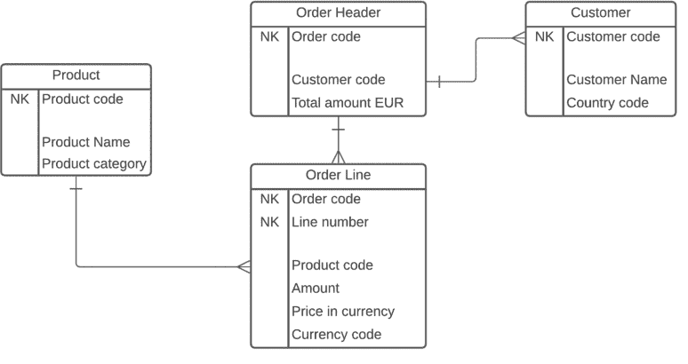

图3.3：订单的逻辑数据模型

你可以清晰地看到，这个逻辑模型比概念模型详细得多，提供了实体的自然键，以及业务或开发人员关注的一些关键属性。它还将订单概念实体拆分成了实现层面的表头（header）和明细（detail）表。

如果我们还有退货（return）部分，就有机会描述订单与退货之间的关系。这种关系可能只存在于表头层级，也可能一条退货明细行引用了特定的订单明细行。

> **提示**
> 
> 请记住，更改关系的基数（cardinality）可能引发重大变更或需要大量返工，因此*如有疑问，请选择你认为可能需要容纳数据的最宽松约束*（例如一对多而不是一对一，或多对多而不是一对多），如果你预期应使用更严格的约束，则添加一个测试来检查它是否/何时被违反。将这一点推向极致，**Data Vault（DV）**方法论始终使用多对多关系，这样你随时准备应对任何意外情况，而且一切都能以相同的方式运作。

## 关于模型详细程度的总体考虑

概念数据模型和逻辑数据模型的详细程度并不是固定的，因此你可以有非常基础、仅标识实体键且非常接近概念模型的逻辑模型。你也可以有非常详细的逻辑模型，将实体拆分为所有现有类型，并展示中间表和支持表。在这个例子中，我们可能有两种类型的订单、一个订单主数据表以及两个将它们映射到主数据的映射表，外加一个用于将本地货币转换为所需通用货币的汇率转换表。

很常见的情况是，先从一个简单、基础的数据模型版本开始，然后为那些被认为困难或不清晰的部分制作详细的图表。另一种常见情况是，只为首先开发的部分绘制详细图表，而如果其他部分可以按照类似的模式开发，则可能不需要这些详细图表。

模型是一种沟通工具，特别用于澄清复杂情况，因此如果在我们的例子中，退货的货币转换与订单类似，并且所有利益相关者已经清楚情况，那么可能就不需要详细图表。

## 物理数据模型

物理数据模型描述了数据模型在特定数据库中的实际实现。“物理”这个名字意味着它极其详细，实际上与数据库定义一一对应，并且通常可以用来生成实例化数据库的命令，或者通过数据库反向工程来创建。

该模型包括主键（Primary Keys，PKs）、索引以及实例化数据库所需的一切，包括将多对多关系转换为关联表。

在过去，这种详细的模型要重要得多，因为当时数据项目的一个关键部分是从非常昂贵的机器中榨取尽可能多的性能，这些机器需要精确地规划尺寸、购买，然后使用数年。

如今，随着具有近乎无限扩展能力且只需按使用量付费的 SaaS 云数据仓库的出现，焦点已转向快速交付，性能主要通过最佳实践来保证，只有在运行时间或成本超出期望范围时才引起关注。

我们不打算提供物理模型的示例，因为它们由于一些因素而在数据仓库中变得不那么重要了，例如半结构化数据数量的增加，以及现代云数据库在不需要或无法定义诸如索引、关系或唯一性约束等物理数据模型核心内容的情况下也能良好运行。

> **重要提示**
> 
> 在使用 dbt 时，数据库中的物理表或视图将由 dbt 在运行时根据我们的代码和项目中的元数据为我们创建。我们不需要编写或维护脚本来完成这项工作。

因此，花大量精力手动创建并维护一个物理模型是没有意义的，因为每次我们的 dbt 模型发生变化时，它就会变得过时，我们甚至不会用它来生成表/视图创建脚本。更好的做法是拥有一个稳定的逻辑或概念模型，以及最新的文档，其中包含所生成视图/表的详细信息。

## 绘制数据模型的工具

有许多工具可以帮助你绘制这些模型。

在基础层面，有许多通用绘图工具能够绘制 UML 和/或 E-R 图。它们通常购买起来容易且便宜，但仅限于图的视觉方面。

还有一些现代的基于 Web 的工具，例如 Ellie (https://ellie.ai/)，旨在帮助你在与业务利益相关者讨论概念模型和逻辑模型时实时绘制它们。它们帮助你收集的远不止视觉上的 E-R 部分，你还可以收集描述、关键字段和元数据，并且它可以让你生成非常有用的业务术语表。

还有一些工具可以帮助你绘制物理数据模型或从数据库反向工程它，例如 SqlDBM (https://sqldbm.com/)。正如我们所看到的，物理模型对于你将使用 dbt 生成的部分用处不大，但收集源系统的模型可能是有用的。

既然我们知道了可以在不同层级上表达数据模型，以及如何绘制它们，在下一节中，我们将介绍几种表示数据模型的符号。

在接下来的几节中，你会看到一些有助于加深理解的示例，我们还将描述处理数据模型时面临的一些问题。我们将仔细研究不同的建模风格和架构，它们构成了数据模型的使用框架。

## 实体-关系建模

在前面的章节中，我们简要定义了 E-R 模型的三个组成部分：实体、属性和关系。我们还看到了一些使用不同符号（如 UML 或 crow’s foot）绘制的 E-R 图。

在本节中，我们将更详细地定义 E-R 模型，并展示如何使用这两种常见符号（UML 和 crow’s foot）来表示不同情况。

### 主要符号

我们已经介绍了 E-R 模型的三个组成部分。在本节中，我们解释它们在 E-R 模型中的可视化表示：

- **实体：** 用包含实体名称的方框表示。
  如果显示属性，实体名称位于顶部，通常使用粗体或更大的字体，并在视觉上与其属性分开。
- **属性：** 在它所属实体的方框内，用属性名称表示，每行一个名称。
- **关系：** 用连接关系中涉及的实体的线条表示，关系名称可选地靠近线条。

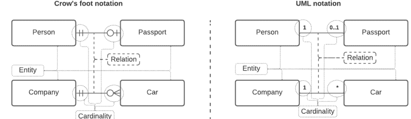

图3.4：E-R 符号基础

在上图中，我们以通常用于描述概念模型的详细程度，说明了最常用的两种符号。事实上，在这个例子中，我们没有显示键和属性，但你已经在本章上一节描述逻辑模型的示例中看到了带属性和键的示例。

这个例子还说明了基数，这是 E-R 模型的另一个核心方面，我们将在下一节中描述。

### 基数

关系的**基数**表示关系一侧实体的多少个实例与另一侧实体的多少个实例参与该关系。

让我们使用 crow’s foot 符号来看可能的情况：

- **一对一基数：** 这是一种相当罕见的情况，即每个实体在每一侧只有一个实例参与。

  一个例子是 **Person has Passport**（人拥有护照）关系：一个特定的人拥有零个或一个（有效的）护照，而一本护照恰好属于一个人。请注意，如果 **Passport** 实体的语义不是仅记录当前有效的护照，那么我们就会有一对多关系，因为一个人一生中可能拥有多本护照。此外，一些国家允许一个人同时拥有多本有效护照，因此正确理解并描述领域中每个实体的语义非常重要。


图 3.5：一对一基数的 E-R 示例模型

- **一对多基数**：这是最常见的关系类型，即一侧的一个实体与另一侧的多个实体参与关联。

  例如，**公司** 生产 **汽车** 的关系：一家公司生产多辆汽车，而一辆汽车恰好由一家公司生产。后面展示的 **人** 拥有 **汽车** 关系也许是一对多的一个很好的例子，具体取决于 **人** 和 *拥有* 的语义。


图 3.6：一对多基数的 E-R 示例模型

- **多对多基数**：这是一种相对少见的情况，即一侧的多个实体与另一侧的多个实体参与关联。

  例如，**学生** 选修 **课程** 的关系：一个学生选修一门或多门课程，否则将失去学籍；而一门课程可以被零个或多个学生选修。


图 3.7：多对多基数的 E-R 示例模型

下图展示了乌鸦脚记法和 UML 记法中基数的表示方式，包括两种记法中的同一个 **人** 拥有 **汽车** 关系。

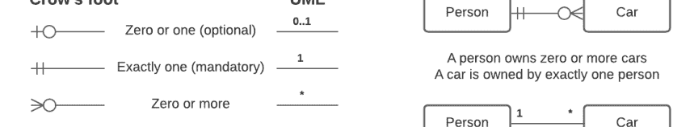

图 3.8：两种不同 E-R 图记法中基数的可视化表示

## 找出基数

要理解基数或在你的模型中找到基数，应该遵循怎样的推理过程？

答案很简单：你考虑关系一侧的一个泛化实体，以及在你的领域中，它与关系另一侧多少个实体相关联。

例如，一个人只用一本护照通关，所以你会说在该领域中基数为 1；但一个人可以同时持有不同国家的多本有效护照，而且大多数人在一生中会持有不止一本护照，只是在任一时刻只有一本有效。改变领域或时间视角可能会改变关系的基数。

在同一个关系的另一侧，一本护照总是对应于一个人。

现在我们已经了解了记法的组成部分，是时候来看第三个维度了：时间视角。它会极大地影响我们将绘制的模型的结果。

## 主键、外键和其他类型的键

在使用数据模型时，一个关键方面是如何标识实体的一个实例，例如某一辆特定的汽车、一家特定的公司或某个人。

能够唯一标识某个实体实例的一个字段或一组字段称为该实体的键。例如，对于汽车，可以是车牌号加所在州，或者车辆识别码（VIN）；对于人，可以是社会安全号（SSN），也可以是个人数据的唯一组合，例如姓名、姓氏、出生日期和出生地。

键有以下几种名称：

- **主键（PK）**：这是能够唯一标识某个实体实例的字段或一组字段。Primary 表示它是用于确保该实体上唯一性约束的键。在存储数据时，它是用于确定两行是否指向同一实例的主要键。

- **自然键（NK）**：这是一种具有业务意义的键，能够在给定上下文中唯一标识实体的实例。NK 也存在于数据库世界之外。它是在表单上打印的内容，或者一个人在现实世界中用来标识实体实例的内容。例如，某个州内一辆汽车的车牌号，或某个系统内一个用户的电子邮件地址。

- **代理键（SK）**：这是一种没有业务意义的键，仅在生成它的系统内部用作键。生成 SK 的一种旧方式是使用序列。更现代的方式是使用哈希函数。SK 通常用于简化标识，尤其在不存在良好的 NK 或 NK/PK 由多个字段组成时使用。

- **外键（FK）**：这是一个实体中与另一个实体的键相匹配的字段或一组字段。字段名不必相同，只要内容匹配即可。

让我们看看各种特定基数的一些细节：

- **一对一基数：** 在这种情况下，两个实体都可以引用（即外键）对方，但这通常不是一个好主意，因为你将陷入先有鸡还是先有蛋的问题，并且还有出现不一致的风险。最好的解决方案通常是只在两个实体之一中放置外键，通常是可选的实体。如果两侧都是必填的，那么你可以考虑将它们合并成一个实体或表。

  在 **人-护照** 示例中，即使没有护照，人依然存在，但反过来则不然。因此，将 **人** 的外键放在 **护照** 实体中是一个好方案。

  注意，这两个一对一实体可能具有相同的主键或自然键，但并非必须如此。

- **一对多基数：** 这是最常见的基数，也是最简单的情况，因为“多”方将有指向“一”方的外键。在我们的 **公司-汽车** 示例中，每辆汽车都将引用生产它的公司。

  作为说明，可以考虑将数据模型不规范化，把“一”方与“多”方存储在一起，并在每次需要时重复其数据，例如为每辆生产的汽车重复公司信息。在业务系统中几乎不会这样做，因为更新“一”方的信息会非常不方便——你需要修改许多副本，而且数据量会大幅增加。这种做法在报表场景中更常见，并且在某些环境（例如 BigQuery 上的营销报表和使用 Google Data Studio 时）中相当普遍。

- **多对多基数：** 在这种情况下，模型与现实无法对齐。任一侧实例中的外键只能包含一个指向另一侧的引用，因此无法正确包含多对多关系所需的多个引用。

  为了表示这类关系，除了两个实体的表之外，我们还需要一张额外的表。这张额外的表称为连接表（join table）；它的主键是两个实体主键的组合，并且它是与两个原始实体构成的一对多关系的“多”方。

  这第三张表通常被创建为一个新实体，用来表示多对多关系，同时记录每个关系实例的属性。一个例子是在 **客户** 和 **产品** 之间创建 **订单** 实体，或者在具有多对多关系的 **学生** 和 **课程** 之间创建 **选课** 实体。


图 3.9：多对多关系的替代表示

虽然关系的基数是数据模型及其实现的主要驱动因素，但时间视角（我们将在下一节讨论）是决定上下文中的实体语义的主要驱动因素之一，因此也会影响模型中所采用的实体。

现在我们已经了解了 E-R 建模的基础，是时候来看一个会极大地影响我们将绘制的模型结果的维度了：时间视角。

## 时间视角

我们尚未讨论的另一个重要方面是：时间视角是否以及如何影响 E-R 模型。简短的回答是：会的。而且这常常是一个隐式假设，很少被充分解释。

E-R 模型是对现实一部分的抽象，并表达了试图捕获该现实的系统应遵守的约束或业务规则。系统的角色，尤其是其时间视角，会深刻影响实体的语义、哪些规则生效，以及在该上下文中描述实体和关系的模型。

考虑一个管理出租车车队的应用。对于该应用，如果你要描述 **司机** 和 **出租车** 之间的直接关系，你会说它是一对一的，因为一辆出租车需要一名司机，而一名司机同一时间只能驾驶一辆出租车。这几乎是每个使用 E-R 模型来描述实时对象如何协作以及它们在某一时间点能做什么的应用的观点。


图 3.10：实时应用中 **司机** 与 **出租车** 之间的关系

在这种情况下，很明显司机在同一时间开一辆出租车，而一辆出租车在同一时间由一名司机驾驶，因此上限是 1，但下限呢？嗯， **司机** 和 **出租车** 在没有对方的情况下也都有意义：司机可以休息一天或作为备用待命，即使出租车没有被驾驶，它也仍然存在。

对于每个仅为了满足业务运行需求而设计、不考虑报表需求的操作型应用，类似的推理同样适用。

在某些情况下，即使在操作型应用中，时间视角也会被嵌入组织已有的中间实体中，例如班次、合同、绩效等。这些实体就是为了随时间跟踪某个关系的各个实例而创建的。


我们通过一个约束将两种视角结合起来，以正确表示现实：这些基于时间的实体，相对于那些一次只能出现一次的实体，不应重叠。


图 3.11：驾驶员与出租车之间通过工作时段建立的关系

当我们在数据工程项目中工作时，我们通常采用生命周期视角，也就是说，我们关注的是相关实体在整个生命周期中的关系。

在这种数据仓库视角下，我们可能会认为，在我们数据覆盖的时间段内，一位驾驶员会驾驶多辆出租车，而一辆出租车也会被不同的驾驶员驾驶。

因此，**驾驶员**和**出租车**之间的关系将被视为多对多关系。即使我们的数据平台从操作表中捕获变更，而该操作表实现了我们本节前面看到的可选的一对一关系，情况也仍然如此。


图 3.12：驾驶员与出租车之间的多对多关系

这种关系与所有多对多关系一样，无法直接在数据库中实现，最终需要通过中间关联表来实现，该表将存储驾驶员驾驶出租车的时段。这将类似于我们之前看到的**工作时段**，但由于它是通过我们捕获操作表上发生的变更而生成的，因此所包含的信息有限，充其量也只能与我们对那张表的变更捕获能力一样精确。事实上，如果我们的复制不完整，我们就有可能丢失一些变更，例如定期导出数据表的情况就是如此。

数据仓库项目的最佳情形是源系统中存在一个时间感知实体，例如**工作时段**，因为我们不会面临漏掉时段的风险，而且很可能收集到更好、更完整的数据。

## 不同详细程度下的E-R模型示例

数据模型只是表示真实情况的众多可能方式之一，而且正如我们所看到的，模型合适的详细程度取决于模型的预期用途。

在下面的示例中，我们将展示，学生注册**课程**实例这一相同的情况可以根据模型的抽象程度以多种方式表示。

对于概念模型，一个高层模型可能就足够了，它只说明**学生**可以注册多个**课程**实例，而**课程**可以有多名**学生**注册，如*图 3.13*左侧所示。两侧都是可选的，因为学生可能尚未注册任何课程，或者课程可能还没有学生。

如果我们正在构建数据仓库，我们想要更深入一些，如果这种关系对业务很重要，我们希望尽可能记录关于**学生-课程**关系的更多信息。因此，我们在两个原始实体之间引入一个**选课**实体，以记录学生注册课程的所需信息。

在这种情况下，**学生**和**课程**在与**选课**的关系中都是强制性的，因为如果没有这两个原始实体中的任何一个，后者就没有意义。

初始概念模型中简单的多对多关系已被转换为一种间接关系，分解为两个一对多关系。


图 3.13：同一现实，两种不同的详细程度

在下一节中，我们将探讨实体之间另一种常见的关系类型：泛化与特化。

## 泛化与特化

在下图中，我们探讨从不同抽象层次表示模型所引发的另一个主题，以引入表达泛化和特化的表示法。这种表示法使用得不是很广泛，可能是因为缺乏通用知识和标准化，但它非常有用：

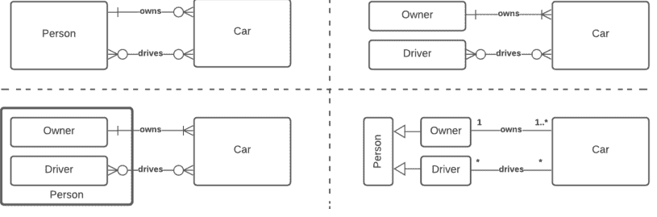

在这个模型中，我们要表达的是：一个人可能拥有一辆汽车而成为车主，而无论他们是否拥有汽车，他们最终都可以驾驶多辆汽车。这两件事是独立的。一辆汽车总是需要有人拥有它（成为车主），并且它可以被多人驾驶，或者只是停在那里从未被驾驶过。

在左上方的模型中，我们看到了最通用的模型，它可以是一个概念模型。它不区分**人**在与**汽车**关系中的不同角色。

在右上方的模型中，我们突出了一个人可以扮演的两种角色，但省略了**人**实体。这可以作为逻辑模型的起点。

在左下方的模型中，我们介绍了一种表示泛化关系的方式，即泛化实体包含其子类型。这种表示法大多配合鸦爪记号使用。

在右下方的模型中，我们使用了UML表示法，即UML为泛化-特化关系提供的显式表示法。

请注意，涉及超类型和子类型的关系可以以最有利于表示现实的方式来绘制。在同一张图中，一些关系可以指向泛化实体，而另一些关系可以指向特化实体。

在我们的例子中，**驾驶**和**拥有**关系对子类型是有意义的，但如果我们还想绘制一个**人**“乘坐”**汽车**的关系，那么把它指向**人**超类型会更合理，让其他关系继续留在子类型上。

现在你已经了解了数据模型类型以及如何表示一个基本的数据模型，在下一节中，你将看到一些示例以加深理解。稍后，我们还将描述在使用数据模型时遇到的一些问题，并深入了解不同的建模风格和架构，这些风格和架构为数据模型的使用提供了框架。

## 建模用例与模式

本章介绍如何使用E-R图来表示数据工程项目中的概念模型和逻辑模型，但我们已经看到，同样的建模概念也用于为应用程序设计数据模型，以及用于任何我们希望描述不同数据之间关系的地方。

在接下来的几个小节中，我们将介绍一些常见的数据结构用例及其模型、一些已知的问题案例，最后，我们会提及数据模型库这一完整的领域。

### 头-明细用例

处理数据时最普遍的情况之一是头-明细数据结构。它非常常见，我敢肯定你在某个地方已经见过它。

例如，它用于发票和订单，以及几乎所有内含一个文档和多行明细的地方。文档的公共信息放在表头**实体**中，明细行由一个或多个依赖于表头的**弱实体**表示。弱实体是指没有表头实体就没有任何意义的实体，例如没有订单表头的订单行。

下面的模型以不同的详细程度说明了**订单-订单行**的情况，包括**订单**与周边**客户**和**产品**实体的关系：

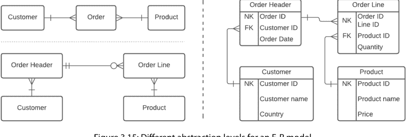

*图 3.15：E-R模型的不同抽象层次*

在该图的左上角，我们有一个非常高层次的概念模型，其中**订单**只是一个单独的实体。在左下角，我们有一个更详细的概念模型，其中**订单表头**已与**订单行**分离，并且与**客户**和**产品**的连接被放置到各自所属的位置。

在右侧，我们有一个逻辑模型，其详细程度与左下角的概念模型相同，但增加了不同实体自然键（NK）的详细信息，以及一些重要属性。


看到逻辑模型时，很容易想当然地认为，在**订单**主键上再加一个行号，就可以为**订单行**提供主键。这也许可行，但重要的是为其定义清晰的语义。我们处理弱实体时总会遇到一个问题：它们的键没有真实的业务含义，而且分配的键可能不是稳定键。也就是说，弱实体的某个实例不一定始终拥有相同的键，或者同一个键在不同时间可能表示不同的实例。

下面用一个示例来说明这个问题。假设第一天，我们有一个订单和五个订单行，每个订单行使用订单 ID 加上行号作为键。第二天，我们收到同一订单的更新，现在它只有前三个订单行且未发生变化；这可能还不是问题，因为我们得到的三行与前一天具有相同的主键和内容，只需将第四行和第五行标记为已删除即可。第三天，我们又收到一次更新，现在订单有四个订单行：前三个未变，第四个是一个全新产品。如果我们仅用行号生成主键，这个新行就会得到与第一天第四行相同的主键。

我们是否应认为第一天的第四行又回来了、未被删除且发生了变化，还是应将其视为一个新行？

最好的解决方案是为弱实体提供合适的主键，例如使用稳定的行号；如果第三天出现的新行行号为 6，就属于这种情况，因为编号 4 和 5 已经留给了最初使用它们的、现已删除的行。

弱实体很少拥有合适且稳定的键，因为运营系统架构师通常意识不到或不在意这类影响下游系统的后果，而这些下游系统会使用他们生成的数据。

对于来自 JSON 结构的弱实体，情况几乎总是如此。REST API 的典型情况是，嵌入到 JSON 对象中的元素通常没有标识符，更不用说合适且稳定的键了。

遗憾的是，如果我们无法控制数据的生成方式，就没有通用的方法来缓解这一问题；但至少我们可以努力仔细理解所接收数据的语义，并确保自己掌控数据的建模和存储方式。

## 实现说明

原则上，我们可以将**订单**实现为单张表，每个订单行占一行，并在每一行中重复订单头中存储的信息。

这种单表形式也称为反规范化形式，会有不少缺点：例如将相同信息重复多次；更糟的是，难以维护一致性，因为订单头信息的更改需要应用到该订单的所有行。此外，统计某个客户下了多少订单这类查询也会变得复杂。

头-明细（header-detail）方案有一些好处，例如保证一致性、简化维护；而且大多数查询更简单，因为你可以直接查询包含所需信息的表，如果还需要两张表的数据，也可以在那里进行连接。

话虽如此，反规范化形式有时仍被用作生成报表的最终形态，因为它具有无需任何连接的性能优势；对于不擅长数据建模、不会创建连接的人来说，它也非常简单易用。

## 层级关系

层级关系非常常见，通常是一对多关系的一种特殊情况。它们表示的是看起来像树的数据结构。

常见模式是：一个实例依赖于同一实体的另一个更高级/更大的实例，除非它自身处于最高/最大层级。

它们特殊的原因有两个：通常只构建在一个实体之上，该实体既是关系的起点也是终点；同时它们是递归的，意味着嵌套层级可以无限制，因为你可以不限次数地遍历这种关系。

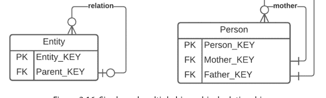

图 3.16：单一和多个层级关系

虽然最常见的表示层级关系的方式是单张表，但也可以只用一张表保存现有实体及其属性，再用第二张表单独表示递归关系。这与我们稍后展示的多对多递归关系类似，只是 Entity_KEY 字段之间是一对一关系。

这种关系总是由较小的单元（有时称为子级）指向较大的单元（称为父级）来实现。子级是多的一端，因此包含一个指向父级主键的字段，这与所有一对多关系相同。

请注意，在上图中，我们将 **Mother_KEY** 和 **Father_KEY** 字段保留为必填，但这可能只在理论上是准确的。虽然确实每个人都有生物学意义上的父亲和母亲，但现实中有些人的父母可能未知，而且我们显然无法一直追溯到最早的人类。给出的模型在理论上是正确的，但更务实的做法是让这两个关系变为可选，就像我们在通用 **Entity-Parent** 场景中所做的那样，其中 **Parent_KEY** 的多重性为零或一。

层级关系的一些常见示例如下：

- **员工-经理**：每个员工都有一个其依赖的其他员工，即其直线经理，除非该员工是 CEO 或其他不依赖任何人的人；此外，一个员工可能有零个或多个人向其汇报。

- **公司中的组织单元或集团中的公司**：公司通常由若干较小的部分组成，而这些部分又进一步拆分成更小的部分。这些通常被称为组织单元，它们至少构成一个层级结构，即使拥有多个层级也很常见。集团也是如此：集团由公司组成，公司再拆分为组织单元。虽然严格的法律所有权关系可能不是线性的或一对多的，但通常为实现集团管理会建立一个简单的层级结构。因此，请一如既往地注意你所建模内容的语义。

- **类别/子类别**：这是一种非常常见的情况，通常是自上而下的一对多层级结构，因为这样便于通过求和将总计从较低层级汇总到较高层级。在这些情况下，要注意被分类对象之间的关系，并将数字归集到类别上。

    如果你没有简单的自上而下关系，例如一个产品属于多个类别，那么你就不能简单地对数字求和，因为类别与数字之间是多对多关系。这是扇出陷阱（fan trap）的一种情况，我们将在本章后面介绍。

- **物料清单（BOM）**：这在生产组织中很常见。

    BOM 表示构建成品所需的最低层级零部件；例如，想想制造一辆汽车或一件家具所需的一切。

    这些零部件本身就是产品，而且往往组成需要组装或采购的中间产品，从而形成多级层级结构。

- **工作分解结构（WBS）**：WBS 表示完成一个项目所需的全部任务。它通常由逐级缩小的子项目来表示，这些子项目本身也是任务，由此构建出多级的任务层级结构。

在下图中，我们展示了这里讨论的部分案例，其余案例遵循相同的模式：

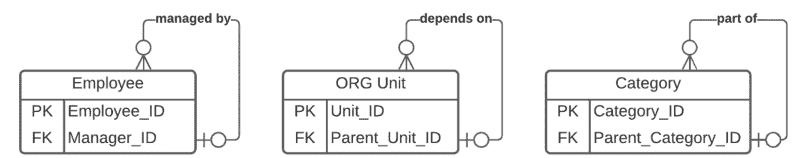

图 3.17：层级关系示例

当一个实体看似可能有多个父级时，通常意味着存在多个层级关系，它们可以拆分为各自独立的单一依赖关系。

例如 Parent-Child（亲子）关系中，每个孩子总是有两位父母，即父亲和母亲；你可以独立表示这两个关系，并回到同一个 Person 实体上，让它自身拥有两个层级关系：父亲和母亲。另一个类似示例是组织单元：你可能会有不同的汇报线，例如法定所有权或销售组织。

在所有可能面临多个父级的情况中，我建议你仔细寻找多个平行关系。如果确实可以有多个父级，那么这就是多对多关系，因此你需要一张辅助表来保存实体键及其父级，这在多对多关系中是常见做法。下图说明了这一点：

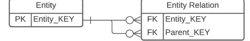

图 3.18：多对多层级关系

## 层级结构遍历

在关系型数据库世界中，层级结构一个可能令人困惑的地方在于，这种关系是从下向上表示的——每个实体都指向其最终父级；而对它的遍历通常却是从上向下进行的，从没有父级的顶层实体开始，每一步向下增加一层，并把每个被访问实体的子级挂接到该实体下。

层级结构的遍历通常使用递归代码完成，层级中每向下走一步就是一个递归步骤。下面的伪代码说明了这一过程：

```
1. Get the initial entities, the ones with no parent;
   process and store them
```


- 2. 获取那些以已存储实体之一为父实体的实体；处理并存储新实体
- 3. 重复步骤 2，直到不再发现新实体为止；

我们来看一个示例，演示如何为递归实体创建表并对其进行查询以生成层次结构。

以下 SQL 代码将创建一张包含八行数据的表，这些数据代表一家虚拟公司中的员工及其管理关系：

```
CREATE OR REPLACE TABLE DATA_ENG_DBT.PUBLIC.Entity as
SELECT * FROM ( VALUES
    (1, null::Number, 'President'),
    (2,1,'VP Sales'),
    (3,1,'VP Tech'),
    (4,2,'Sales Dir'),
    (5,3,'Lead Architect'),
    (6,3,'Software Dev Manager'),
    (7,6,'Proj Mgr'),
    (8,6,'Software Eng')
) as v (Entity_KEY, Parent_KEY, Entity_Name);
```

以下 SQL 代码使用递归公共表表达式（CTE）遍历层次结构，并在遍历过程中计算一些有用的信息：

```
WITH recursive
ENTITY_HIERARCHY as (
    SELECT
        Entity_KEY
    , Parent_KEY
    , Entity_Name
    , 1 as level
    , '-' as parent_name
    , Entity_KEY::string as key_path
    , Entity_Name::string as name_path
    FROM DATA_ENG_DBT.PUBLIC.Entity
    WHERE Parent_KEY is null
    UNION ALL
    SELECT
        ENT.Entity_KEY
    , ENT.Parent_KEY
    , ENT.Entity_Name
    , HIER.level + 1 as level
    , HIER.Entity_Name as parent_name
    , HIER.key_path || '-' || ENT.Entity_KEY::string as key_path
    , HIER.name_path || '-' || ENT.Entity_Name::string as name_path
    FROM DATA_ENG_DBT.PUBLIC.Entity as ENT
    JOIN ENTITY_HIERARCHY as HIER ON HIER.Entity_KEY = ENT.Parent_KEY
)
SELECT * FROM ENTITY_HIERARCHY;
```

下表显示了查询结果：

| E_KEY | P_KEY | 实体名称 | 层级 | 父实体名称 | 键路径 | 名称路径 |
|---|---|---|---|---|---|---|
| 1 |  | 总裁 | 1 | - | 1 | 总裁 |
| 2 | 1 | 销售副总裁 | 2 | 总裁 | 1-2 | 总裁-销售副总裁 |
| 3 | 1 | 技术副总裁 | 2 | 总裁 | 1-3 | 总裁-技术副总裁 |
| 4 | 2 | 销售总监 | 3 | 销售副总裁 | 1-2-4 | 总裁-销售副总裁-销售总监 |
| 5 | 3 | 首席架构师 | 3 | 技术副总裁 | 1-3-5 | 总裁-技术副总裁-首席架构师 |
| 6 | 3 | 软件开发经理 | 3 | 技术副总裁 | 1-3-6 | 总裁-技术副总裁-软件开发经理 |
| 7 | 6 | 项目经理 | 4 | 软件开发经理 | 1-3-6-7 | 总裁-技术副总裁-软件开发经理-项目经理 |
| 8 | 6 | 软件工程师 | 4 | 软件开发经理 | 1-3-6-8 | 总裁-技术副总裁-软件开发经理-软件工程师 |

表 3.1：递归查询结果表

通过分析递归查询的代码，你可以看到 CTE 由两部分组成：UNION ALL 之前的锚点部分和其后的递归部分。

锚点部分使用查询获取初始行集，并设置计算字段的初始值。

递归查询使用基表与上一次递归迭代内容之间的连接（通过 CTE 的名称访问）来检索下一层实体并更新计算字段。

查看结果，你可以看到，借助这种数据结构与查询，你可以基于层次结构中遍历的完整路径来计算字段。

有关 CTE 的更多信息，请参阅第 1 章。

## 预测值与实际值

企业中，预算和预测流程非常普遍，这些流程试图预测未来的一些数据，然后希望在预测变为已知后，通过将不同时期所做的各种预测与实际值进行匹配来分析这些数据。

在这种情况下，模型的一个特殊之处在于，源数据模型和报表数据模型之间通常会创建两个截然不同的数据模型，即使涉及的实体并未改变。

通常，每个时期和每个单位有一个实际值，而对于同一时期和单位，会随着时间的推移产生多个预测值。因此，实际值与预测值之间存在一对多关系。

当我们要将实际值和预测值放在一起进行报表分析时，我们希望在实际值可用后，能够将其与每个预测值相关联。因此，我们可以将它们视为 Figures 实体的两个子类或特化版本，而 Figures 实体是它们的共同泛化。

在下图中，我们使用 UML 表示法来可视化源数据模型和报表数据模型，后者使用了泛化-特化表示法。需要特别注意的是，泛化并不是 E-R 意义上的关系，而是表示派生：

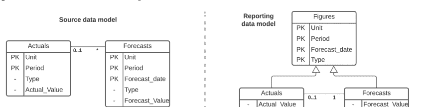

图 3.19：实际值与预测值的数据模型

特化实体由从泛化实体继承的属性加上该特化实体特有的属性组成。

虽然可以通过多种方式实现报表模型，但最常见的方式是将所有特化实体放在一张表中，为所有特化实体的每个不同属性设置一列。在我们的示例中，兼容的属性（如 Actuals_Value 和 Forecast_Value）存储在同一字段中，以便更简单地进行使用/比较。

从源数据模型转换到报表数据模型时，我们需要获取现有的实际值，并为同一时期和单位的每个预测值复制一份。这只需通过 **实际值** 表与 **预测值** 表进行连接即可完成。如果预测的数量和日期已知且可靠，就可以使用业务逻辑生成所需的实际值副本，这种逻辑可以非常简单，例如为已知前几个月的每个预测日期制作一份副本。

## 标准数据模型库

由于数据模型的使用非常频繁，有些人专门从事这一领域，也有多本书籍详细描述了适用于企业普遍或特定行业常见情况的数据模型集合。

这些集合有时被称为数据模型库，其理念是，就像从代码库中挑选函数一样，从这些库中为你的用例挑选合适的模型。

这些模型非常详细，应用也非常通用，由于其规模庞大，并非一目了然，但可以让人放心，它们能够以正确的方式捕获公司数据。这些模型很少被“原样”使用，尤其是在数据工程项目中，但它们总能提供关于不同实体之间如何相互交互的有趣见解。

约翰·吉莱斯（John Gilles）在他的著作*《冰箱里的大象》*中介绍了一系列共 12 个通用数据模型，覆盖了公司的大部分需求。

如果你想了解更多关于数据模型的知识，我建议你从这些模型开始。此外，你可能会有兴趣阅读约翰的书，它也会为你提供关于如何收集信息来构建数据模型的良好解释。你还将学习另一种名为 DV 的数据工程方法论的基础知识，我们将在本章下一节中简要介绍它，因为它在很多工作方式上与这里介绍的方法论有重叠。

在*延伸阅读*部分，你还会看到对伦恩·西尔弗斯顿（Len Silverston）所著的更宏大、更详细的著作*《数据模型资源手册》*的引用，该书提供了一个完整的通用数据模型库。

现在你已经了解了数据模型的类型以及如何表示数据模型。

在下一节中，我们将描述在使用数据模型时面临的一些问题。然后，在本章结尾，我们将介绍不同的建模风格和架构，它们构成了数据模型使用的框架。

## 数据模型中的常见问题

创建正确的数据模型仅仅是提供良好数据平台的开始，因为这些数据模型的用户还必须意识到，由于关系模型操作的性质，可能会出现各种问题。

在接下来的部分中，我们将介绍你会遇到的最常见问题。


## Fan trap

**fan trap** 是一种非常常见的问题，每当你在“一对多”关系中进行连接时都可能发生。它不是关系本身的问题，而是你如何使用它的问题。

*fan trap 问题会导致对从一对多关系一侧连接的度量进行的计算出现错误。*

只有当你使用一对多关系一侧的度量，并且在多侧实体的粒度上进行分组/工作时，这才是一个问题。这是因为连接会将度量重复以匹配多侧的基数。

让我们基于以下数据模型来看一个简单的例子。在模型中，我们有公司站点，一些单位驻扎在这些站点。站点有 **Site_surface** 度量，单位有 **Unit_Budget** 度量：

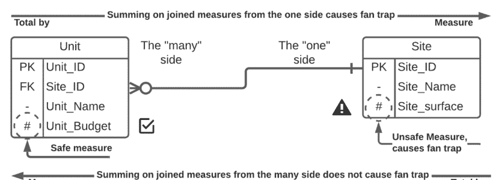

图 3.20：存在 fan trap 风险的数据模型

要理解 fan trap，你必须回忆起，当连接具有一对多关系的两个表时，一侧的出现次数会为与连接中其键匹配的每个多侧实例重复。

连接结束时，你会得到一个表，其行数与多侧相同，一侧的列通过基于匹配键的重复填充。

让我们展示连接以下两个 **Unit** 和 **Site** 表的示例：

| Unit_Name | Site_ID | Budget |
|-----------|---------|--------|
| Unit_1    | Site_1  | 100    |
| Unit_2    | Site_1  | 130    |

表 3.2：Unit 表，多侧

| Site_ID | Site_Name | Surface |
|---------|-----------|---------|
| Site_1  | HQ        | 2500    |

表 3.3：Site 表，一侧

连接 **Site** 和 **Unit** 表在 **Site_ID** 键上的结果如下表所示：

| Unit_Name | Site_ID | Budget | Site_ID | Site_Name | Surface |
|---|---|---:|---|---|---:|
| Unit_1 | Site_1 | 100 | Site_1 | HQ | 2500 |
| Unit_2 | Site_1 | 130 | Site_1 | HQ | 2500 |

表 3.4：通过 Site_ID 连接的 Unit 和 Site 表

正如从连接后的表中可以看到，我们现在有两个度量，来自 **Unit** 表的 **Budget** 未被重复，以及来自 **Site** 表的 **Surface** 已为与站点键匹配的每个单位重复。

因此，我们对这些指标进行的计算可能有两种情况：

1. **对一侧度量的总计：** 如果我们尝试对 **Surface** 度量计算总计，就会遇到问题。这是因为我们会为连接创建的每个副本求和相同的值：

    i. 如果我们按一侧分组，使用 **Site_ID**，每个总计的值都是错误的，当然总总计也会不正确。

    ii. 如果我们按多侧分组，使用 **Unit_Name** 或 ID，我们实际上没有求和，因为每个 ID 只有一行，我们无法确定每个单位的总面积值是否真的有意义，但我们确信总总计会是错误的，因为它会将面积值乘以与站点匹配的单位数量。思考结果的有意义性，我们能说 **Unit_1** 和 **Unit_2** 都使用 2,500 的面积吗？我猜不能。

2. **对多侧度量的总计：** 这是最安全的做法。事实上，如果我们尝试对 **Budget** 度量计算总计，就不会有问题。这是因为 **Budget** 度量没有被连接重复。因此，我们可以按一侧或多侧分组，总计和总总计都将是正确的。

## How can we deal with the fan trap?

简单、有限的特定用例解决方案是在连接它们之前先对多侧按一侧进行分组。这会产生不期望的效果，即删除粒度低于我们开始的一侧的所有维度，但它允许我们在一侧的度量上得到正确的结果。

从我们的示例模型中可以举一个例子，即按 **Site** 对 **Unit** 表进行分组，按站点计算总预算，然后将分组后的表与 **Site** 连接。这将是一个安全操作，因为现在 **Site** 与分组后的表之间是一对一关系。

处理 fan trap 问题的一个更好的理解和更通用的解决方案是使用 **Unified Star Schema (USS)**，如 Francesco Puppini 所著的书籍 *The Unified Star Schema* 中所述。

## Chasm trap

**chasm trap** 是我们在报表中面临的另一个非常常见的问题。

本质上，chasm trap 是一种未管理的、通常是无意的 多对多 关系。

由于它未被管理，它就变成了一个意外的部分笛卡尔积。

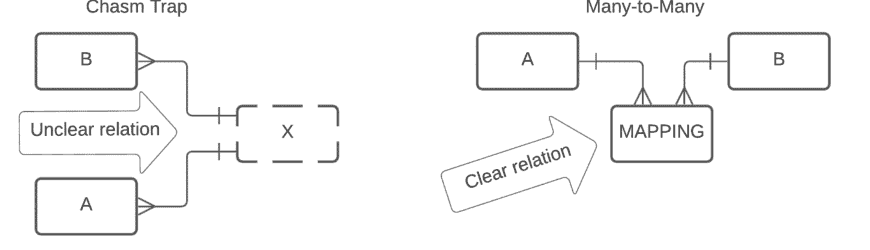

图 3.21：Chasm trap 和正确的多对多关系模型

上图说明了 *chasm trap 的场景：有两个表具有一个共同键，而该键在两个表中都不是唯一的。* 表 A 和表 B 都对表 X 有外键，因此该键在每个表上都出现多次。请注意，表 X 对于 chasm trap 问题的存在并不是必需的。它在这里是为了显示表 A 和表 B 具有共同的键，也是因为“共享维度”是我们立即看到 chasm trap 的最常见情况。

在 chasm trap 场景中，与完整的笛卡尔积不同，你会得到一个键约束的笛卡尔积：一侧的行将与另一侧具有相同键的出现次数进行交叉连接，事实上按键进行笛卡尔积。

chasm trap 与真实多对多关系的区别在于，后者你有映射表来将笛卡尔积限制为只有有意义的出现。在多对多情况下，你以一个键进入映射，有指定的 M 行给出实际映射，然后移动到另一个表，在那里你只有一行，最终你拥有的行数与映射表中的行数一样多。这是有意义的，因为映射表是为表示特定关系而构建的。

在 chasm trap 情况下，你以匹配一个表中键的 M 行进入映射表，并在另一个表中找到具有相同键的 N 行，最终在该键上产生 MxN 行的连接，但两个表的行之间没有实际关系，因为共同的外键是为了表达这两个表与具有该键作为主键的表之间的关系，而不是表达这两个表之间的关系。

chasm trap 的经典案例是具有共同维度 X 的两个事实 A 和 B，如上图所示。维度不是必需的，但它通常是使无意的、未管理的间接关系在商业智能 BI 工具中被使用的原因。

下图提供了多个无意关系使用导致 OrderDetail 和 ReturnDetail 事实表之间出现 chasm trap 的潜在用法的示例。在一个或多个共同外键上连接这两个表不会产生有意义的结果，因为没有信息说明一侧的实例与另一侧的实例相关：

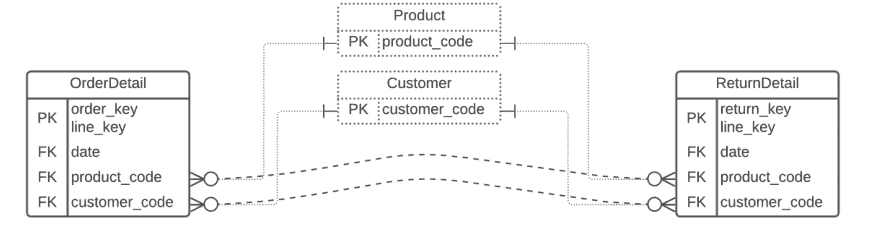

图 3.22：共享维度事实之间 chasm trap 的示例

例如，考虑并非产品的每次退货都与该产品的全部订单相关，反之亦然，这就是你在产品代码上进行连接时得到的结果。

结果是 chasm trap 导致行数爆炸。爆炸的程度不如完整的笛卡尔积大，因为乘法是按键的计数而不是总计的计数，但它通常非常显著并产生以下问题：

- **性能缓慢：** 将已经很大的表乘以一个非平凡的因子，有可能使计算变得非常缓慢。乘法的近似因子是每个侧键平均出现次数的乘积。如果你在一侧的键平均出现 10 次，另一侧平均出现 20 次，你可以预期连接会比起始表大 200 倍。
- **数字错误：** 由于一侧的度量会为另一侧的每个相同键出现而重复，求和在大多数情况下会完全错误。来自 X 表的任何度量也是如此，因为它们也会被乘以。
- **缺少结果：** 如果两个关系之一指向主键是可选的，那么你会丢失一些行，因为在连接中，你只会找到同时存在于两个表中的键。

以订单和退货为例；如果你在不考虑后果的情况下按 Customer 连接它们，你将找不到每个从未退货的客户的任何订单，而对于有退货的客户，你将拥有每个订单乘以该客户的退货次数。


## 为什么看起来不错的数据模型会产生这些问题？

简而言之，两个表拥有共同的外键（例如客户键或产品键），很可能在某种程度上是相关的，但仅凭共同键并不足以表达两个表之间可能存在的多重且复杂的关系。在缺乏足够数据的情况下试图提取信息，通常不会产生有意义的结果。

我们来看一个例子：以订单和交付为例，但如果你还考虑相关表（如退货或付款），同样的情况也适用。

它们都有对 Customer、Product 或两者的引用，但按客户将订单和交付关联起来有什么意义呢？将某个客户的每一笔订单与该客户的每一次交付配对，并没有太大意义。

将按客户分组的订单与同一客户的分组交付进行匹配是有意义的，这样你就可以比较该客户的汇总数据，并使用汇总度量进行任何所需计算。汇总表之间的一对一匹配将产生完全良好的结果，而不会产生任何重复。

将单个订单与为交付该特定订单而进行的交付进行匹配也是有意义的，但要实现这一点，你需要比仅用客户键和/或产品键更多的数据。如果交付带有订单键，那么一切就都齐备了，因为你已经有了所需的关联。

如果没有那个键，你或许够幸运，可以利用某些逻辑尝试进行订单与交付之间的精确或近似匹配，但你必须使用比仅用客户和/或产品更多的信息，最终目标是尽量为每笔订单和每次交付进行对应，以免出现重复。数据提供的真实关联是一回事；基于某些启发式方法得到的近似关联又是另一回事。

一如既往，你手中数据的语义以及你希望实现的目标，应当是你最好的指南。不要仅仅因为两个表拥有共同外键就把它们关联起来。

现在你已经了解了数据模型类型、如何表示数据模型以及它可能存在的问题，我们将通过考察不同的建模风格和架构来结束本章，这些风格和架构框定了数据模型的使用方式。

## 建模风格与架构

在本章中，我们介绍了数据建模，并了解了它如何用于描述我们已有或我们希望成为的数据。

数据建模是描述数据的基本工具，但构建数据平台不仅仅是描述平台中托管的数据以及各实体之间的关系。例如，如何将新数据加载到表中，以及如何更新所有中间表以保持数据集市的最新状态，这些关键点都不是数据模型所能捕捉的。

在下一章中，我们将更详细地探讨整体数据生命周期，但在本节中，我们想介绍几种与如何为数据平台开发数据模型密切相关的设计风格。

好消息是，借助 dbt，不存在偏好或限制，你可以采用这些不同范式中的任何一种，并实现最适合的一种。

我们将从金博尔方法开始，它引入了星型模式，而在大多数情况下，这将是供 BI 工具访问数据的数据集市所使用的模型风格。

在开始之前有一点提醒：以下每个主题都已有多本书籍进行详细阐述，所以我们不会试图深入讲授它们。以下各节的目标是让你对可能遇到的某些最常见范式有个初步了解，并讨论它们的一些特性和问题。

在本章末尾，如果你想更详细了解这些主题，会有一个书单。

如果有些主题你不理解或无法完全跟上，不必担心。在本书其余部分，我们还会回到其中的许多主题，因为我们会尝试从这些方法中选取最佳实践。

### 金博尔方法或维度建模或星型模式

在数据仓库领域，最普遍的设计风格大概要算**拉尔夫·金博尔**提出的**维度模型**，它实际上是 BI 领域的事实标准。

维度建模设计的标志性特征是生成一种称为**星型模式**的数据模型结构，它是 BI 工具访问数据的接口。

在星型模式中，包含感兴趣度量的事件或记录所在的**事实表**被若干个维度表包围。**维度表**是一种反规范化的表，包含你要访问的最低细节级别的描述性数据，并且（在金博尔的原始定义中）不应包含度量，以避免扇出陷阱问题。**度量**是你希望用于计算的一个数字。

下图展示了一个围绕 **Order** 事实组织的典型星型模式：

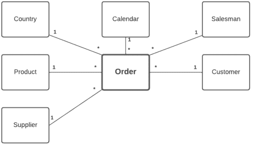

图 3.23：星型模式示例

星型模式的主要优点是它的简单性，这使得它非常易于查询，甚至非技术人员也能轻松理解。

其使用的简单模式是：事实表中的每一行都包含指向维度的外键，例如 **Product_ID** 或 **Country_Code**，以及度量，例如 **Amount_ordered**、**Price** 和 **Discount**。

使用相应的外键连接到所需维度，以检索特定报表中所需的描述性数据，例如产品名称、客户姓名或地址，或增值税代码。

鉴于其简单的结构以及从事实到维度只使用多对一关系，它的查询性能也非常高，因此非常适合为交互式报表提供数据。

维度建模设计风格的目标是从源数据出发构建这些事实和维度。原则上，每个事实都可以与自己的一组具有不同键和列维度相连接，但你可以看到，为每个不同事实设置不同的客户和产品，将会产生大量相似但不同的维度表。

**一致性维度**的概念用于避免维度表的大量增殖，并整合来自不同系统的数据。一致性维度只是一个维度，但它的设计目标是供所有或至少大多数对此类描述性数据感兴趣的事实表使用。因此，它必须处于所需的最小粒度，并且必须包含所有使用该维度的事实所构建的全部报表中感兴趣的所有列。

金博尔数据仓库方法论使用一个以行为事实、列为维度的矩阵，来确定添加一致性维度和事实的优先级。该矩阵描述了围绕每个事实的星型模式内容。

金博尔数据仓库中的数据处理基于对传入源数据进行转换，以构建所需的一致性维度。转换尽可能直接地从数据源转换到事实和维度，而事实和维度就是存储数据的结构。这种事实与维度连接而成的网络，就是金博尔仓库中数据平台的中心数据模型。

> **提示**
> *数据集市*是数据的一个集合，通常只是所有可用数据中的一小部分，它是为了满足特定业务领域（如某个部门或用例）的 BI 需求而被挑选出来的。
>
> 其理念是提供数量有限的表，而且这些表中的属性数量通常也较少，这样分析师更容易找到所需的数据并生成正确的报表。
>
> 数据集市通常以少量事实和相关维度的形式出现，以提供一个或多个星型模式，用于在选定主题的上下文中分析这些事实。
>
> 可用数据集市的集合是大多数用户访问数据平台的唯一外部接口，因此其中可用表（如事实、维度和属性）的名称和语义都必须清晰明确，这一点极其重要。

我们已经了解了金博尔仓库的主要概念，现在也来看看它的一些缺点：

-   按照原始定义，维度中不应有度量，因为如果维度中有度量并用于涉及事实的计算，你就会总是遇到扇出陷阱。不在产品维度中保留或不使用价格等重要指标是非常受限的，所以实际上我们会在维度中保留度量，此时你应当注意何时会触发扇出陷阱。
-   根据金博尔规则的另一个限制是，事实只能连接到维度，不能连接到其他事实。但一些最有趣的分析是基于多个事实（如订单与交付或退货）的数据构建的。金博尔星型模式在这里无能为力，因此你可以考虑其他方法论，例如 USS，或者自行编写 SQL 来生成一个新的可分析事实表。
-   金博尔方法面向的是业务过程的报表，而非构建企业的数据视图，因此事实和一致性维度可能无法处理除星型模式设计目标之外的其他报表需求。
-   从数据源加载和存储数据的过程与业务规则的实现深度交织，因为一致性维度和事实既是业务转换的目标，也是所有数据的主要存储。


这导致代码具有高度的复杂性和许多变更原因，因为数据源或业务规则的任何更改都可能导致数据源与最终维度之间的所有转换需要重做，包括修复现有数据。这也很容易蔓延到相关联的事实和维度，导致与业务需求相比代码变更率非常高。随着项目规模变大，这个问题变得更加严重，因为连接到一个维度的更多事实会使该维度发生变更的可能性更大。

- 将主要数据存储在经过多次技术和业务转换后产生的事实和维度中，实际上无法知道原始数据的样子，而且存在风险，因为可能无法撤销错误或变更的业务规则的应用来修正它，或者将新的业务规则应用于旧数据。
- 当维度还需要与业务规则集成时，存储维度的变更历史并不容易，因此通常维度只存储当前值。

Kimball 方法论的最大贡献是星型模式，它是大多数现代数据平台中交付层的事实标准，因为大多数 BI 工具期望这样的模型，即事实和维度组织在数据集市中。

使用 Kimball 方法论构建平台的核心已有些过时，不再普遍采用，也不是我们建议的方式。

## 统一星型模式

USS 是 Kimball 星型模式的扩展，它解决了星型模式的一些局限，例如扇出陷阱（fan trap），以及一次查询多个事实时可能面临断层陷阱（chasm trap）的风险。

USS 生成一个单一的星型模式，以 Puppini Bridge 为中心，就像一个超级事实，所有维度围绕在它周围。这使得它对各类用户都极其易用，因为数据模型是固定的且非常简单，同时强大到足以回答比整套数据集市更多的 BI 问题。

使 USS 能够创新并提供比普通星型模式更强的回答能力的技术解决方案是：超级事实（以其发明者命名的 Puppini Bridge）使用 UNION ALL 运算符生成一个单一表，该表将所有事实和维度编码在其中，每一行都拥有并可能使用指向所有维度的外键（FK）。

真正的奇妙之处在于，Puppini Bridge 中的每一行都编码了用于构建 USS 的所有表之间的完整关系路径。无论它们是事实还是维度，它们之间的关系及其复杂程度都已得到正确处理，其度量值以正确的粒度存储在 Bridge 中，因此不会出现扇出陷阱或断层陷阱。

我们可以查看 Snowflake 示例数据库中提供的 TPC-H 数据库示例。下图展示了 USS 方法中的定向数据模型（ODM），它总是将一对多关系表示为指向查找方向的箭头，即从左（多端）到右（一端），箭头指向关系的一端：

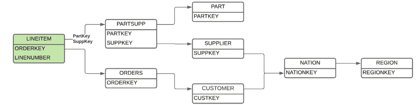

图 3.24：TPC-H 数据库的 ODM

下图展示了 TPC-H 数据库的最终星型模式，其中 USS TPC-H 超级事实位于中心，所有现有维度围绕在它周围：

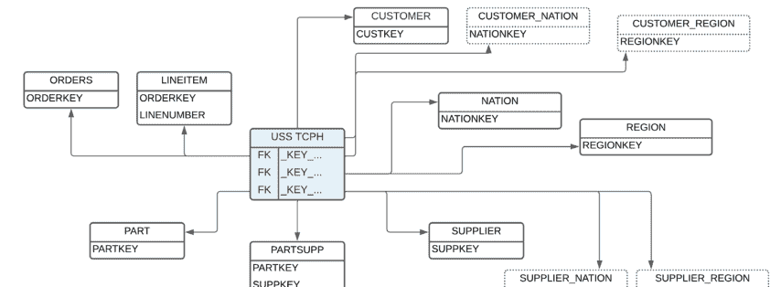

图 3.25：TPC-H 数据库的 USS TPC-H 超级事实星型模式

USS TPC-H 超级事实将为任意事实表和维度表中的每一行生成一行，包含所有表中的所有键，以及来自事实和维度的度量。现在你可以理解，每一行都能够编码任意表之间的关系。

当然，单一的 USS 无法编码公司感兴趣的所有表之间的所有可能关系，例如 Nation 和 Region 在 TPC-H 数据库中就有两条可能的路径，但决定并编码一个完整的“首选”关系路径（如 LineItem => Orders => Customer => Nation => Region）的能力，使得特定 USS 具有稳定且清晰的语义，并产生正确且一致的结果。

在图中，你可以看到一些虚线维度。这些是别名的例子，USS 可以采用这种技术来增加可表示的关系数量，同时消除歧义（**Country** 是客户国家还是供应商国家？）。

我们提供了下图，让你了解在这个简单数据库中，经典的 Kimball 星型模式可能是什么样子。

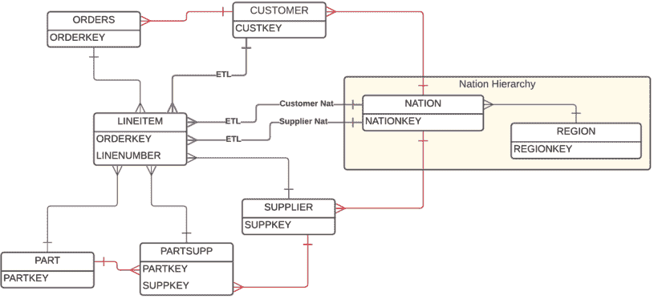

图 3.26：TPC-H 数据库的经典星型模式

你可以看到，许多现有关系无法在星型模式中直接使用或表示，例如 **Customer-Orders**，而是需要通过 ETL 过程将该关系转换为 **Lineitem** 和 **Customer** 之间的关系。

类似地，如果你不想丢失 **Nation** 和 **Region** 之间的关系，就必须构建一个包含 **Nation Hierarchy** 的新维度。由于许多维度并未直接连接到事实，我们需要一个 ETL 过程来遵循正确的关系路径并将结果存储在事实中。

最后一点，我想说明，USS 可以取代任何普通星型模式，因为它在各方面都是一个完全合规的 Kimball 星型模式，只是它还藏有几手妙招。

因此，USS 非常适合作为交付星型模式，适用于所有希望让用户能够安全地查询普通星型模式无法实现的广泛事实和维度的情况。这通常被称为**自助式 BI**。

如果你想了解更多关于 USS 的内容，我建议你阅读介绍它的书：比尔·因蒙（Bill Inmon）和弗朗切斯科·普皮尼（Francesco Puppini）合著的《统一星型模式》（*The Unified Star Schema*），本章末尾列出了该书。

## Inmon 设计风格

比尔·因蒙（Bill Inmon）被认为是数据仓库之父，他与 Kimball 一起塑造了数据仓库构建的大部分方式。

Inmon 设计风格的标志性概念是创建企业级、集成且可互操作的数据存储库。Kimball 致力于满足报表需求，而 Inmon 则试图构建一个描述组织及其业务流程的数据存储库，提供全公司范围内的单一事实来源。

因此，目标是识别描述公司及其运作方式的业务概念（即实体），并将输入源数据转换为正确概念下的同质数据。为了避免冗余并最大化表达能力，数据以**第三范式（3NF）**进行规范化，并且可以在所需概念之间捕获所有有意义的关系。

通过数据集市来交付满足报表需求的数据，这些数据集市是为了满足特定业务领域的信息需求而构建的。数据仓库中存储的业务概念最终与事实和维度非常接近，或者用于生成我们在 Kimball 星型模式和数据集市中看到的事实和维度。你可以按照 Inmon 设计构建和组织数据仓库，然后按照我们在 Kimball 风格中看到的方式生成事实和维度。

在这种情况下，主要区别在于数据仓库层存储的概念和关系比支持所需事实和维度所需的最小集合更丰富。

可以想象，企业级数据集成的目标需要全企业的努力，以及高层管理人员在较长时期内的承诺。

Inmon 模型的一个重要优势是，基于企业级业务概念构建的数据仓库对业务变化以及技术源系统的变化具有极强的适应性。

由于 Inmon 数据仓库表达了公司的业务流程，它拥有回答大多数报表问题的数据，即使是那些最初未确定的问题。

主要缺点是过程规模大且复杂，需要高技能的数据建模人员和数据仓库专家来编写 ETL、维护平台，并在出现新的报表需求时创建/更新数据集市。

另一个缺点是，在经历了大量转换和业务规则的应用之后，数据的主要存储形式是业务概念，这使得很难回溯到原始数据。这使得数据仓库面临返工的需要，并且无法审计原始数据。虽然这与我们在 Kimball 设计风格中看到的问题类似，但我们必须说，Inmon 业务概念比 Kimball 风格的简单事实和维度保留了更多的信息。


## Data Vault

DV 是一种由 Dan Linstedt 发明的数据平台构建方法论。

当前版本 **Data Vault 2.0 (DV2)** 于 2013 年发布，并随着技术、数据平台和用例的演进而不断发展。

DV2 方法论涵盖了架构、模型、工作方式方法论和实施，但最著名且最具代表性的元素是 DV 模型。

DV 中最核心的理念是 *所有信息都围绕已识别的业务概念进行聚合*，并且数据通过 BK 进行集成。概念定义和身份管理是 DV2 的两个重要基石。

标志性的 DV 模型基于以下三个核心元素：

- **Hub:** 包含该 hub 概念的 BK 的所有唯一实例
- **Link:** 包含 hub 之间关系的唯一实例，作为 BK 的元组，提供非常灵活的多对多关系
- **Satellite:** 包含与 hub 或 link 相连的描述性信息随时间的变化

DV 方法论为在特定情况下使用提供了这些核心元素的多种专用版本，外加一些其他元素，例如时点表和桥接表。

下图展示了一个简单的 DV 模型的示例：

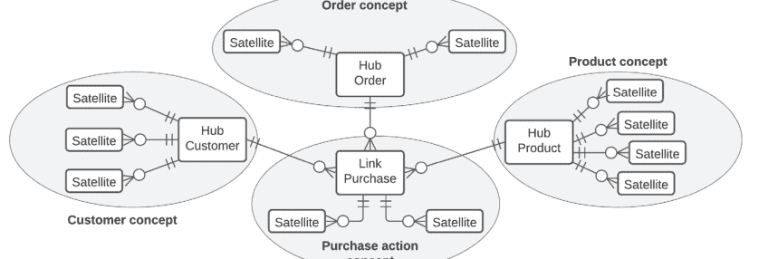

图 3.27：DV 模型示例

正如你从图中可以看到，所有关系都是“一对多”，并且 hub 一侧的基数始终为一，因为一个关键原则是，某个业务概念的所有键都存储在该概念的 hub 中。

Link 仅记录连接的 hub 之间存在的一种关系，使用它们的 BK，并允许记录 hub 之间的多对多关系。这使我们能够对所有类型的关系使用相同的结构，即使存储来自不同来源且基数不同的数据，或允许关系从一对多演变为多对多，而无需对模型或代码进行任何更改。

业务域中业务概念的身份存储在专用于该概念的 hub 中，关系使用 link 编码，每个关系一个，描述性数据存储在所需的多个卫星表中。

正如你在图中看到的，卫星是描述性数据容器，可以在我们需要存储新信息时附加到概念上。它们仅依赖于它们所属概念的 BK。

构建和理解 DV 模型需要对数据建模和 DV 的具体细节进行更高级别的培训，以避免任何可能的陷阱，例如创建以源为中心的 DV 而非以业务为中心的 DV。

区别于我们之前看到的先前建模风格的另一个关键元素是 DV 架构，如下图所示：

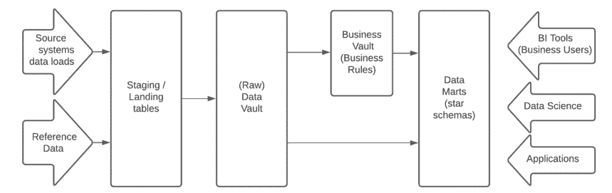

图 3.28：DV 架构

来自源系统的外部数据、参考数据和主数据被加载到暂存表中，暂存表不 supposed to 改变传入数据，保持好坏丑全有。我们只应用硬性的业务规则来对齐数据类型、添加元数据并最终应用规范化。其理念是我们必须能够审计从源数据传入的内容。

以下是为什么我不喜欢 DV 的原因列表：

- 创建 DV 平台需要具备 DV2 培训和经验的熟练数据专业人员，这在许多情况下是一个难以满足的硬性要求。
- DV 模型需要大量的连接才能将所有数据碎片重新组合成正确形式。这通常超出了大多数开发人员的舒适区，对于分析师和业务用户来说更是难以企及。
- 创建一个合适的 DV 需要对开发中域的业务概念进行彻底分析。这需要足够高层级的赞助、一定的时间、业务方面的专家可用性，以及有人能够将所有这些整合起来。

DV 方法论能够采纳先前设计风格中的优点，同时增加值得注意的改进：像 Inmon 一样，它将业务概念置于 DV 组织的核心，但保留了原始数据；它使用事实上的标准 Kimball 星型模式为 BI 工具的用户提供易于使用的数据集市；它通过将源数据的摄取和存储与业务规则的应用分离来创新，从而解耦构建和维护数据平台的两个最具挑战性的方面。

鉴于对业务概念的共同关注，Bill Inmon 的以下引言不会令人惊讶：

> “数据仓库是 DV 2.0 框架中建模企业数据仓库的最佳选择。”

总之，我们可以很容易地说，DV 方法论在开发规模和需求复杂性足以证明所需高技能人员、高度赞助和可见性的可用性时，在所有情况下都极具吸引力。

好消息是 dbt 非常适合支持使用 DV 方法论的开发。为了让你快速入门，使你能够快速应用正确的加载模式，有一个名为 dbtvault 的开源 dbt 库可通过 dbt hub 在 https://hub.getdbt.com/datavault-uk/dbtvault/latest/ 下载。

## Data mesh

目前数据世界最热门的流行语是 **data mesh**，让我们来看看它。

数据网格方法诞生于一些最具技术实力的公司中，以规避影响大多数数据工程行业的一个非常常见的问题：数据所有权。

痛苦是真实且普遍存在的：负责构建企业级统一数据平台的人对源数据和业务一无所知；他们最多只能得到运行业务应用的同事的薄弱支持，并且几乎没有机会或能力与真正理解业务以及数据在业务侧如何使用和解释的关键人员互动。

实际上，企业中没有人对应用程序生成的数据或与特定业务概念或域相关的数据拥有端到端的责任。没有共同的定义，同一概念的语义可能因所处的域而略有不同。如果你问公司不同部门“客户的定义是什么？”，你会得到相同的答案吗？

难怪这种数据平台产生的内容很少能吸引数据平台本应服务于的业务用户。这不幸是一个经常遇到的问题，尽管 Inmon 自 80 年代以来就告诉我们你需要根据业务概念组织你的数据，而 DV 完全围绕业务概念和 BK 的理念构建。

如果根本问题是不同的技术团队管理源系统和数据平台，并且业务部门与 IT 部门的目标不一致，有办法解决这个问题吗？

发明数据网格的那些技术密集型公司的解决方案是使用在应用软件交付中行之有效的方法。他们将微服务架构和 DevOps 工作方式应用于数据领域，创建了数据网格。数据网格可以简单地被认为是一种微服务架构，其中微服务是一个数据仓库。

与其试图构建统一的、集中的数据平台，数据网格是由业务单元规模的数据平台构建的，这些平台可以通过已知且定义良好的接口进行交互，具有清晰的语义，每个平台由不同的团队维护。

不同部分的交互通过创建数据产品来管理。

关键点是，提供由单元平台提供的数据产品的团队是运行该业务单元所有其他技术系统的同一团队。

简而言之，数据产品可以是以下之一：

- 一个应用程序，允许使用你没有但提供产品的系统中底层数据做某事。

  一个例子可能是验证客户是否活跃或是否有权下达一定金额的订单。另一个例子可能是面向客户的应用程序，用于估算其房屋价值或为汽车保险报价。

- 一个允许以清晰语义检索数据的接口。

  一个例子可能是市场部门提供最近的客户行为或触点，一个生产站点提供装配线的状态，或物流部门提供其卡车或其交付相关的距离、燃料消耗或二氧化碳排放数据。

数据集市是你已经熟悉的数据产品。


这样做的效果是，这些技术人员能够端到端地掌控数据，并且非常清楚所处理数据的语义。同时，由于提供并维持约定的业务产品持续运行是整个业务单元的责任，团队之间也能形成良好的对齐，从而交付高质量的数据。

这一切听起来很美好，但请记住：分布式系统比集中式系统复杂得多，并且会带来许多单体系统中根本不存在的新问题。

此外，管理敏捷项目、提供可靠的 API、持续运行众多分布式数据管道所需的技能，在大多数传统行业未必能轻易获得，即使是技术密集型公司或大型电商企业也不例外。

虽然现有能力和数据管理成熟度未必达到实施数据网格所需的水平，但我们可以借鉴其中的一些理念，例如从数据产品的角度思考，以及将业务单元的数据所有权扩展到数据仓库领域。

dbt 的灵活性还允许通过清晰的 API 让多个 dbt 项目彼此交互，这些 API 既是一个项目的数据源，也是另一个项目的暴露对象。

dbt 还让你能轻松地让全公司不同部门的人员参与数据项目，并提供强大的文档来阐明所提供数据的血缘关系、数据模型和语义。

## 我们的方法：务实数据平台（PDP）

在对主要的数据建模风格和数据架构进行概述之后，你可能会好奇 dbt 最适合什么，以及我们在本书余下部分将要解释什么。

就工具的适用性而言，你可以放心，dbt 是一个完全不偏不倚的开发工具。尽管其创造者也好，我们也罢，都有自己的个人偏好，但工具本身在生成我们在本章中介绍的任何一种风格时，表现同样出色。

关于本书的方法，我们采取务实的取向，汲取所有现有风格和架构中我们认为最优秀的元素，目标是在充分发挥工具全部能力的同时，尽量降低专业知识门槛。

DV 的主张有很多值得喜欢之处，但它所需要的高层支持、全公司范围的协作、为待开发领域构建概念模型的时间，以及专业知识要求都非常高，往往不易具备，甚至可能根本无法实现。

因此，我们的目标是打造一个采纳一流解决方案的现代数据平台，同时跳过那些在大多数情况下只会抬高门槛却不能带来显著收益的部分。

例如，我们采用的架构与 DV 架构非常接近，因为我们相信将摄取与业务规则的应用分离开来是一个关键优势。

我们还采用基于模式的、只插入的全历史摄取方式，这带来了许多好处，而我们在了解 DV2 之前就已经在使用这种方法了。我们还采纳了 DV 与 Inmon 共同的理念：数据应根据领域的业务概念来组织。同时，我们专注于清晰的业务键定义，并将身份管理视为数据平台的重要组成部分。

我们不去使用 DV 建模，不是因为它没有价值，而是因为它较为复杂，数据社区内外的多数人都不熟悉。我们知道，跳过 DV 建模会使精细化层在面对某些变化时韧性稍差，但这对我们来说是一个可以接受的折中。

在大多数用例中，我们还选择通过包含若干星型模式的数据集市来交付数据；但在某些情况下，比如使用 Google Data Studio 或面向 ML/AI 的用例，我们可能更倾向于交付宽表、反规范化的表。

我们还采用了在*Data Vault*一节中介绍的许多技术，例如哈希，尽管这些技术并非 DV 专属。

总而言之，我们力求务实，因此将我们的方法命名为**务实数据平台（PDP）**。

## 小结

恭喜！现在你已经能够绘制并理解简单的数据模型了！

在本章中，你学习了在不同层面上使用 E-R 模型进行数据建模的基本功，以及如何表达关于数据的关键观点。

现在你已经知道如何看待一些最常见的数据模型模式，不会再被扇出陷阱和深渊陷阱所迷惑。

你已经逐一了解了当前业界使用的各种架构和建模风格，认识了它们的优缺点，并对我们将在本书中使用的方法有了更清晰的认识。

在下一章《分析工程：数据工程的新核心》中，你将获得数据工程的完整图景，然后深入我们使用 dbt 工作的核心——分析工程。

## 延伸阅读

在本章中，我们介绍了许多建模风格和架构。

以下书籍是深入了解这些主题的良好起点。

### 数据建模：

- 一套提供通用数据模型库的丛书：Len Silverston，*《数据模型资源手册》*。John Wiley & Sons Inc，2001 年，ISBN 978-0471380238

### Kimball 数据模型：

- 作者自称的权威指南，出自其创造者之手：Ralph Kimball 与 Margy Ross，*《数据仓库工具箱》*。Wiley，2013 年，ISBN 978-1118530801

### Inmon 设计风格：

- 数据仓库之父的开创性著作：W. H. Inmon，*《构建数据仓库》*。Wiley，2005 年，ISBN 978-0764599446

### 统一星型模式（USS）：

- 这本书首次提出 USS，也是了解扇出陷阱和深渊陷阱等建模问题的优秀资料。其第一部分由 Bill Inmon 本人对 Inmon 风格进行了更新：Bill Inmon 与 Francesco Puppini，*《统一星型模式：数据仓库与分析设计的敏捷弹性方法》*。Technics Publications，2020 年，ISBN 978-1634628877

### Data Vault：

- 关于建模和 DV 的极佳入门书：John Giles，*《冰箱里的大象：通过构建以业务为中心的模型迈向 Data Vault 成功的指南》*。Technics Publications，2019 年，ISBN 978-1634624893
- 一本简洁实用的 DV 入门读物，非常适合快速了解：Kent Graziano，*《使用 Data Vault 2.0 进行敏捷数据工程入门》*，ISBN 978-1796584936
- DV2 的圣经，出自其发明者 Dan Linstedt 之手，尽管内容略旧，并未反映该标准中某些最新且重要的变化：Daniel Linstedt 与 Michael Olschimke，*《使用 Data Vault 2.0 构建可扩展数据仓库》*。Morgan Kaufmann，2015 年，ISBN 978-0128025109
