## The dbt Core workflow for ingesting and transforming data

在本章中，我们将构建我们的第一个完整的 dbt 项目，从源系统获取数据并使其可用于报告，但让我们先从大局着手，通过描述现代数据平台的参考架构来开始。

在第 4 章中，我们概述了数据生命周期。在下面的图像中，我们将开始可视化现代数据平台的层级，并开始将它们与我们使用 dbt 构建它们的方式联系起来：

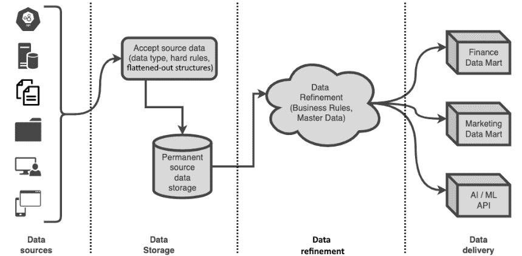

Figure 5.1: Layers of a modern data platform

层级如下：

1. **Data sources:** 我们将使用底层数据平台的全部能力来加载来自我们数据源的数据。在 Snowflake 的情况下，这意味着能够从主要云提供商存储的文件中加载数据，当然还有驻留在其他 Snowflake 数据库（DB）中的数据，无论是我们自己的还是与我们共享的，例如合作伙伴、客户或其他部门。
2. **Data storage:** 我们将从数据源读取数据，将其放入我们在数据平台上永久存储所需使用的格式，并跟踪源数据的变更。我们希望尽可能接近源数据存储数据，仅应用一些不改变数据的技术步骤，例如将其转换为正确的数据类型（作为文本接收的数字或日期），对数据应用硬性规则（删除填充零或空格，转换为所需时区，或管理大小写），并最终将作为对象接收的数据（来自 JSON、AVRO ...）展平为 SQL 或符合关系的数据结构（例如，将作为单个对象接收的发票头和发票行分离）。
3. **Data refinement**: 这里是真正的数据转换发生的地方：将原始数据转变为有用的信息。此转换的两个主要部分是应用 **Master Data (MD)** 将源系统特定数据转换为企业范围内可使用的数据，然后应用 **Business Rules (BR)** 将数据转换为可用信息。
   
   虽然 MD 部分可以遵循一些指导和模式，但 BR 部分是经验丰富的分析师和数据专业人员真正发挥作用的地方，他们通过保持秩序并创建可重用的数据模型，而不是一团糟的临时转换而没有组织，来做出差异。
4. **Data delivery**: 在数据交付层，我们将拥有传统的报告数据仓库，它们使用维度模型将数据交付给报告工具，其他数据仓库提供数据作为宽表，以及其他具有更多技术用途的“仓库”，提供一种简单的方式来构建和管理外部工具的 API，例如 AI 或 ML 工作负载，或被带回操作系统的精炼信息，例如更新的客户档案或用于营销工具的完整细分。

我们提出的架构的标志性特征是将源数据摄取与业务逻辑的应用和业务概念的创建分离。

这种核心关注点的分离是我们现代数据平台思想的基础，因为它允许在实现细节上拥有很大的自由度，并带来以下实质性优势：

- 解耦两个最重要的活动，即摄取和构建业务概念，简化了整体开发，允许为问题的每个部分使用最佳解决方案。
- 广泛使用模式允许更快地开发，保持复杂性低，使人员培训变得容易，并提供可靠的结果和可预测的交付时间。
- 源数据的保留使适当的审计成为可能，允许高级源系统分析和改进，并保证我们始终能够使用我们的数据，因为原始数据不会因 BR 的应用而改变，这些 BR 在未来可能不再有效，并且源数据不会以无法还原的方式改变。
- 一个组织良好的精炼层，具有简单的 MD 管理手册、易于导航的有向依赖关系，以及具有明确角色的几种常见模型类型，使我们能够构建即使是最复杂的业务概念，而不会创建很快变得过于复杂而难以管理和维护的巨大意大利面条代码球。
- 从存储的历史源数据不断重新创建精炼层和交付层的做法使你能够轻松更改 MD 和 BR 并立即将其部署到你的所有数据中，消除任何需要维护的状态。
- 从精炼层和交付层中移除任何累积状态的能力使系统简单且快速更改，并且像无状态应用程序一样易于维护，重新获得开发人员和利益相关者的信心，并节省大量此前花费在数据修复或修复任务上的人力。这与传统数据仓库形成直接对比，在传统数据仓库中，变更是


constantly hindered by the need to preserve, backfill, and maintain the complex state caused by incremental loads and the incremental summarization of data.

- 灵活的交付层在始终与 MD 和通用 BR 保持同步的、分离良好的精炼层之上提供简单的数据集市个性化，让你能够根据最新的数据集市发展，为每个部门、客户或外部接口提供所有数据。
- 外部依赖关系可通过用户、角色、模式和视图等简单的数据库结构轻松管理，并且访问权限本质上仅限于最小的可能范围，这得益于能够快速提供数据集市，在你的精炼数据之上提供任何所需的 API。

下图可视化了使用本节所述工作流程的现代仓库项目与传统项目（传统项目专注于数据集市交付而没有任何关注点分离）相比，对实施工作量和成本的主要影响：

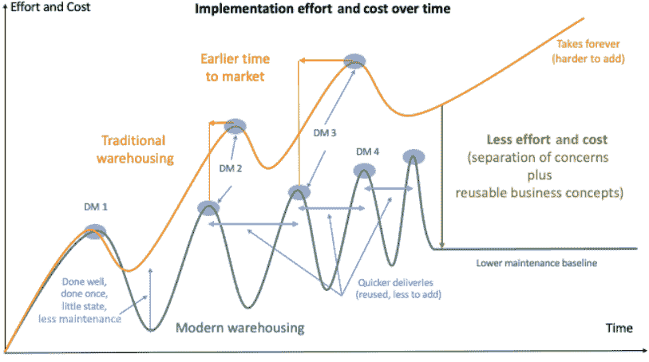

图 5.2：仓库项目中随时间推移的实施工作量和成本

现在我们已经有了构建数据平台的工作流程，是时候开始学习如何使用 dbt 和 Snowflake 的功能来解决实际用例了。

通过本章及后续章节，我们将引导你构建一个完整的数据平台，从源数据到可用于提供报告的数据集市。

我们将使用的两个主要工具是一个库存跟踪数据平台，以及作为数据共享提供给每个 Snowflake 账户的 Snowflake 示例数据。

我们将从构建一个非常简单的库存跟踪数据平台开始，并逐步对其进行转换以加入更多功能，以说明 dbt 功能以及现代敏捷开发流程的强大之处。

这个示例数据平台将提供核心经验教训，你可以按照步骤使用行数较少的示例进行跟进，这些示例易于分析和理解。Snowflake 示例数据将在我们想要专门针对大行数用例时使用。

## 介绍我们的库存跟踪项目

我们选择构建一个简单的库存跟踪平台来说明 dbt 功能，因为它最初可以简化为一组简单概念和关系，同时在后续迭代中提供多种增加复杂性和有趣需求的方式。

使用许多人会产生共鸣的示例项目，我们希望提供更易于理解和参与，并也许通过能够启动一个项目来跟踪你的股票，从而提供实际价值。

事实上，这是一个相当常见的情况，即一个人或一个家庭最终拥有多个账户，并且这些账户中存在可交易的证券。因此，一个常见的需求是希望对所有账户有一个全局视图。

随着金融科技解决方案的进步，如果你的账户不在同一个国家，在现代投资组合应用中这变得更简单，但如果你在不同司法辖区拥有账户，那么祝你好运，或者你可以和我们一起卷起袖子，打造一个符合需求的解决方案。

其他可能使该用例有效的常见原因包括使你的数据独立于你的经纪商，以便你的历史记录始终伴随你，或在你当前提供商提供的范围之外个性化你的报告和分析。

举例来说，我发现诸如行业甚至国家等类别的归属对于许多中小型股票，尤其是美国市场以外的股票，往往缺失或与实际情况不一致。你会为一家在墨西哥或俄罗斯拥有矿山的加拿大公司使用哪个国家？该运营属于发达国家还是发展中国家？它暴露于加元、墨西哥比索还是俄罗斯卢布？

## 初始数据模型和术语表

本示例项目旨在能够跟踪分散在多个投资组合中的投资价值，并按我们偏好的方式进行分析。我们将从简单开始，只跟踪投资组合的当前价值，并在接下来的章节中添加更多功能。

起始用例是投资者拥有投资组合，可能在不同的经纪商处，在这些投资组合中持有证券头寸。他们可以买卖证券，因此可以开仓、平仓并改变持有的头寸。

他们希望使用从经纪商处接收的数据来跟踪其整体情况的日价值，并根据证券的多个属性分析其持仓。

以下概念数据模型说明了主要实体及其关系，正如你从用例的初始解释中可以得出的那样。

请注意，在数据模型中，我们并没有列出我们提到的所有实体，因为我们更感兴趣的是展示核心“结构关系”，而不是完全反规范化数据模型，展示所有现有实体及其所有关系。例如，我们没有显示投资者实体，因为目前我们可以在投资组合实体内部先使用 owner 或 owner_id 列：

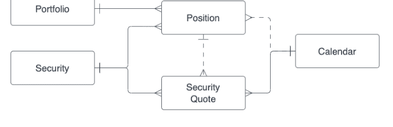

图 5.3：投资组合跟踪项目的初始数据模型

为了提供共同的理解，提供一个包含数据模型概念描述的术语表是良好的实践，例如以下内容：

- **Position:** 头寸跟踪投资组合中持有的特定证券的数量，并附带除持有的股票数量之外的一些度量，例如头寸中持有的证券成本。
- **Portfolio:** 投资组合是头寸的容器，通常与经纪商的交易或托管账户相关联。
- **Security:** 证券是可以买卖的投资工具，可在特定市场买卖。证券存在多种类型，包括债券、股票、期权等。
- **Quote:** 证券报价是一组值，例如买价和卖价，用于描述股票在某一时刻的市场报价，或一组值用于描述股票在一段时间内的市场报价：
  - **Daily quote:** 日报价是一组值，例如开盘价、收盘价、最高价和最低价，用于描述股票在交易日内的市场报价。
- **Calendar:** 日历代表所需分辨率的时间维度，通常为一天，为日历中的所有项目提供有用的预先计算属性。

在本章及后续章节中，我们将首先从非常简单的需求和功能开始，并在途中增加复杂性和功能以介绍更多 dbt 或 Snowflake 功能，有时也只是展示替代方案或说明初始解决方案可能存在的局限性。

想法是像处理真实项目一样进行：你从某些需求开始，等到你完成了人们脑海中想到的约一半内容时，新的想法就会出现，你会发现自己将项目引向新的、更有前景的目标。你明白了：变化是唯一不变的。

因此，如果在某些情况下我们可能会突然改变想法或引入可能不完全合乎逻辑的新需求，请耐心配合，但这都是为了利用 dbt 功能或引入有趣的模式。在这里，这可能作为技能进阶，但我们会尽量使其不要与实际项目相差太远。

## 在 dbt、Snowflake 和 GitHub 中设置项目

现在我们已经大致描述了项目，是时候卷起袖子开始构建它了。

为了开始并在 dbt 中准备好项目，我们需要在 GitHub 中设置一个存储库来托管代码，并在 Snowflake 中设置一个数据库来保存数据并部署代码。

我们还需要做出一些基本的设计选择来组织项目。我们将在下一个 *Portfolio tracking project design* 部分简要讨论它们。

在以下各节中，我们将快速描述你需要执行的操作步骤来设置项目。如果你还不确定如何操作，可以参考我们在 *Chapter 1* 中为 Snowflake 和 *Chapter 2* 中为 GitHub 和 dbt 提供的逐步说明。

## 投资组合跟踪项目设计

这是一个示例项目，因此我们将尽可能保持设置简单，但这是讨论大型项目替代方案的好机会：

- **Database and environments:** 对于本项目，我们将使用 dbt 在同一数据库中通过使用前缀提供多个并行且独立的环境的能力。我们还将只使用两个环境：用于编码的开发环境和用于稳定发布的生产环境。这对于单人项目可能已经过剩，但我们希望做得好，而且在金钱或时间上几乎不花费。
  
  在实际应用中，你可能希望将所有开发人员环境放在一个 DEV 数据库中，然后在自己的 QA 数据库中有一个 **Quality Assurance (QA)** 或 **Continuous Integration (CI)** 环境来集成所有开发，最后在 PROD 数据库中有一个生产环境来保存良好数据并在稳定版本上运行。
- **Git branches:** 由于我们将只拥有 DEV 和 PROD 环境，我们将在 DEV 环境中使用你为每个功能想出的名称的功能分支，而 *main*（或在旧设置中为 *master*）将是对应于 PROD 环境的分支。


如果你同时拥有 QA 和 PROD 环境，那么让默认合并开发内容的主分支与 QA 关联，并创建一个长期存在的 PROD 分支与 PROD 环境关联，这种做法是合理的。如果你想在 QA 和 PROD 之间设置更多部署环境（例如发布候选环境），也可以采用同样的模式。我们只是建议你保持简单和敏捷。

- **用户和角色：** 我们将为 DEV 和 PROD 使用同一个角色 `DBT_EXECUTOR_ROLE`。我们将在 DEV 环境中使用我们的用户，并为 PROD 环境创建一个用户。它们都将使用执行器角色来运行 dbt 项目。

    在真实场景中，你可能希望为每个数据库或环境设置一个写入角色，以及一个或多个读取角色，为开发者的用户分配 DEV 写入角色，并为其他环境分配读取角色，因为你只希望 dbt 在收到开发者的手动命令时才在那里进行受控更改。你可能还希望创建仅限于某个数据集市的读取角色，以更好地控制和管理数据交付，并根据用户的访问需求将这些读取角色分配给用户。

- **输入数据的位置和格式：** 我们希望让你全面了解 dbt 与 Snowflake 结合的能力，因此我们将使用 CSV 文件格式的数据作为包含在 dbt 源代码仓库中的源文件（这并不总是最佳选择）。

    在真实项目中，将 CSV 文件存储在项目仓库中的做法虽然有用，但仅适用于少数情况；加载文件也不是手动的，而是由数据移动代码自动完成，这些代码将文件放入文件容器（通常位于 Snowflake 外部），再由 dbt 宏进行加载。

## 为投资组合项目设置仓库

我们需要一个仓库来存放数据，所以让我们在 GitHub 上创建一个新的空仓库：

1. 登录你的 GitHub 个人账户，或你选择的 Git 提供商账户。
2. 创建一个你喜欢的名称的新仓库。我们使用了 `portfolio-tracking-dbt`，但你可以选择你喜欢的名称，并让它完全为空，即不包含 README、`.gitignore`、`license` 或任何其他文件。

就这样——我们现在有了一个可以与 dbt 一起使用的空仓库。

我们将使用 dbt 与 GitHub 的集成来从 dbt 端建立连接，所以这里不需要再做其他工作了。

## 为投资组合项目设置数据库

我们需要在 Snowflake 中创建一个数据库和一个用于运行生产环境的用户，那么让我们开始吧。

首先，让我们回顾一下第 1 章中的设置，在那里我们为所有需要在 dbt 中运行代码的用户创建了一个 DBT_EXECUTOR_ROLE 角色。

我们已经授予现有仓库运行查询和创建新数据库的权限。然后，我们将该角色分配给了我们的用户，以便我们可以在 dbt DEV 环境中使用它，也分配给了我们将配置为运行 PROD 环境的 DBT_EXECUTOR 服务用户。

因此，我们只需要创建数据库，因为现有的两个用户已经满足需求。

使用执行器角色创建新数据库。我们将其命名为 PORTFOLIO_TRACKING。如果你更改了名称，请记住相应地更改所有将使用此名称的命令和脚本：

```sql
USE ROLE DBT_EXECUTOR_ROLE;
CREATE DATABASE PORTFOLIO_TRACKING
    COMMENT = 'DB for the portfolio tracking project';
```

既然我们已经拥有所需的一切，现在可以创建一个新的 dbt 项目。

> **注意**
> 
> 我们决定使用执行器角色创建数据库，但另一种选择可能是使用不同的角色来创建数据库，并赋予执行器角色在该数据库中创建 schema 的能力。
> 
> 主要区别在于执行器角色是否能够（或不能）通过单条命令删除整个数据库。

## 为投资组合项目创建新的 dbt 项目

我们已经准备好了所需的内容，因此我们将能够按照第二章中展示的相同步骤来创建新项目，下面回顾一下这些步骤：

1. 从 dbt 主菜单（左上角的汉堡图标）中点击**账户设置**，在左侧菜单中点击**项目**，然后点击右上角的**新建项目**按钮。

    点击右上角的**开始**按钮，即可启动引导式设置。

2. 输入项目名称——我们使用的是 `Portfolio tracking`。

    完成后，点击**继续**按钮。

3. 点击 Snowflake 的徽标或名称，选择 **Snowflake** 数据库。你将进入页面设置连接。

4. 在**连接设置**页面，输入**Snowflake 设置**信息，即适用于所有用户的通用连接参数，以及你的**开发凭据**信息，这些信息与你的用户和开发环境相关。

    请注意，你刚刚使用你想要的角色创建了你想使用的数据库，所以对于 Snowflake 设置，你只需要你的 Snowflake 账户（你的 Snowflake 地址中介于 `https://` 和 `.snowflakecomputing.com` 之间的部分）和执行仓库名称（默认为 `COMPUTE_WH`，我们没有更改它）。

    然后，输入你的 Snowflake 用户详细信息，将 schema 设置为你的姓名首字母，将 target name 设置为 dev，并在 DEV 环境凭据中使用 8 或 12 个线程。

    测试你的连接，如果一切正常，点击继续按钮。

5. 在“设置仓库”页面上，点击 GitHub 按钮（或你使用的 Git 提供商的相应按钮），然后选择你要使用的仓库（即我们刚刚创建的那个）。导入成功后，点击继续按钮，设置就完成了。

恭喜——你现在已经在你的 dbt 账户中设置好了一个新的空项目！

> 注意
> 如果你有一个较新的 dbt 账户，无法免费创建第二个项目，请使用前面的步骤更改我们已经设置的第一个项目，并使用后续步骤对其进行测试并从默认项目中清空它。

在 dbt 概览页面中，选择“开始开发”按钮进入集成开发环境（IDE）或代码编辑器。你也可以通过点击主菜单中的“开发”项来做同样的事情。

进入代码编辑器后，点击“初始化你的项目”按钮，dbt 将为你生成默认的 dbt 项目。点击“提交…”按钮将其保存到 Git 仓库：

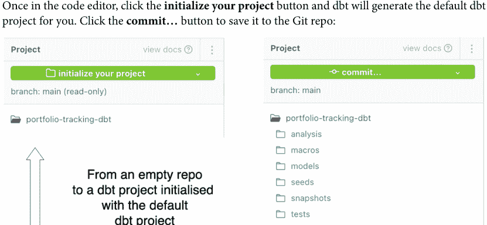

图 5.4：dbt Cloud 界面与项目内容

现在，通过两个非常简单的检查来确认你的项目设置正确：

1. 在空白的临时面板中输入以下 SQL 命令，然后点击“预览”按钮：

    ```
    select 1
    ```

    如果预览执行无误，并且你在查询结果面板中看到“返回了 1 行”的结果，以及结果中的值 1，那么这意味着你可以连接到数据库并在其上运行查询。

2. 在代码编辑器底部的命令行中输入 `dbt run` 命令来运行 dbt 默认项目。如果运行成功完成，则意味着你可以在数据库中创建 schema、表和视图。如果你转到 Snowflake 界面，你会发现 schema（使用你在项目设置中输入的姓名首字母）以及数据库中的两个模型（一个表和一个视图）已创建。

    这就是我们为确保能够使用 dbt 和 Snowflake 构建项目而需要做的全部工作。

3. 你可以删除 models 文件夹中的示例文件夹来清理 dbt 默认项目。如果这样做，你还可以通过删除这两个模型或整个 schema（如果其中不包含其他任何内容）来清理数据库。

太棒了！我们已经确认项目设置正确，并准备好开始我们的投资组合项目。

## 定义数据源并提供参考数据

从理论上讲，每个数据仓库项目都可以归结为找到正确的数据源及其转换，以实现你想要的输出。

在理想情况下，你总能找到所需的数据并产出你想要的结果，但现实通常更为复杂，因为你可能无法拥有你想要的所有数据源或信息。实际上，你常常需要调整你的目标，看看从已有数据出发能实现什么。

无论如何，定义数据源都是至关重要的，因为数据源就是提供给你的内容；除非你处于少数能够更改源系统收集内容或设计数据源的位置，否则通过编写适当的转换，你可以成为其中信息的最佳管理者。

### 在 dbt 中定义数据源

在 dbt 中，你有两种合适的方式来指定和使用外部数据，即并非由 dbt 创建或转换的数据：

- 源（Sources）：在 dbt 中使用外部数据的通用机制是，将你希望开始转换的初始数据定义为一个源，该源由指向一个数据库和 schema 的源系统定义，以及一个或多个从其中选择表或视图的表定义组成


- **数据库和 schema：** 定义源系统并使用 `source` 引用，是明确说明你认为是外部产生或由当前 dbt 项目外部管理的数据的使用方式的好方法，无论它是一个真正的外部系统，还是由另一个 dbt 项目管理但实际上是本地的数据。
- **种子（Seeds）：** 在 dbt 中，你可以将 CSV 文件放入指定的文件夹，然后通过 `dbt seed` 命令让 dbt 将它们加载到表中。请注意，这并非设计上通用的 CSV 数据加载机制。
- **创建的数据：** 听起来很奇怪，但在数据仓库（DW）项目中，有些数据是可以凭空创建的。一个常见的例子是日历维度，但任何可以由某种逻辑和少量初始数据生成的数据都是如此。这些数据被视为普通模型，与其他任何逻辑部分相对于输入数据占绝对优势的模型一样，即使它们除了变量或硬编码值之外没有输入。
- **直接硬编码引用：** 当你开始在 dbt 中编写代码时，你可能会像在普通 SQL 查询中那样，直接引用实际数据库表，而不是使用 `source` 和 `ref` 引用。请务必抵制这种做法。虽然从技术上讲，这是一种引用外部数据的潜在方式，但它也会彻底阻碍你的 dbt 项目，并在诸多层面削弱 dbt 的优势。我们只提几个避免直接引用的原因：使 dbt 无法以正确的顺序运行项目，无法追踪和可视化依赖关系（血缘），无法让你的代码在 dbt 管理的不同环境中工作，降低代码的灵活性，并使 dbt 无法生成正确的文档。你应当明白，在 SQL 中直接指定表名而不是使用正确的 `ref` 或 `source` 语法并不是一个好主意。

构建 dbt 项目的正确方式是，将输入定义为 `sources` 和 `seeds`，并在它们之上构建第一层 dbt 模型，然后继续转换管道，使用 `ref` 函数引用之前的模型，如 *第 2 章* 中 *介绍 source 和 ref dbt 函数* 一节所述。

## 理解并声明 dbt 源引用

在你的代码中使用 `source` 引用，可以定义 dbt 项目的边界，并正确可视化和管理其依赖关系。

例如，你可以为源系统或特定源表声明数据新鲜度的 SLA，编写测试来定义对传入数据的预期，或者能够以非常灵活的方式管理外部数据位置。

源是以 YAML 文件中的元数据形式声明的，并且可以为任何你可以使用普通 `SELECT ... FROM db.schema.source` 语法查询的数据库对象定义，因此它包括外部表和类似的数据库扩展，你可以直接以这种形式查询它们，或者将它们封装在视图等标准数据库对象中。

提供和访问外部数据的典型模式是，来自特定系统（真实的或逻辑的）的所有数据都在你的 dbt 代码可以读取的数据库的 schema 中可用，这样你将**源系统**识别为数据库和 schema，将**源表**识别为该系统中（数据库和 schema）内的数据库对象（表、视图或其他）。

以下代码让你了解源系统和源表的定义方式：

```
sources:
  - name: <source system name>

    database: <db name>
    schema: <schema name>
    description: <some description of the system>

    freshness: # system level freshness SLA
      warn_after: {count: 12, period: hour}
      error_after: {count: 24, period: hour}
    loaded_at_field: <default timestamp field>
    tables:
      - name: <name we want to use for the source table/view>
        identifier: <name in the target database>
        description: source table description
```

让我们来描述上述源系统及其内部表的定义：

- 初始的 `name` 字段定义了我们正在定义的源系统的名称，在 SQL 代码中使用 `source` 函数时，它将用于访问该系统。
- `database` 和 `schema` 字段定义了读取的位置，如同在完全限定数据库名称中使用的那样。它们是可选的，默认使用项目连接中声明的数据库和 schema，但我们建议显式声明，除非它们严格遵循 dbt 项目的位置。
- `description` 字段允许我们在文档中输入人类可读的描述。
- `freshness` 和 `loaded_at_field` 字段允许我们定义系统级或表级的数据新鲜度 SLA，该 SLA 定义了源系统表中最新数据在触发警告或错误之前允许的最大时效，以及用于查询表中数据时效的时间戳字段。系统级 SLA 或字段适用于其下定义的所有表，并且与 dbt 中一贯的做法一样，可以在更低层级（即表级）被覆盖。
- `tables` 键引入对已定义系统内各个源表的声明。
- `tables` 下的 `name` 字段定义了我们想要访问的源表的名称，在 SQL 代码中使用 `source` 函数时，它将是用于访问的第二个元素。除非你包含一个 `identifier` 字段来提供目标数据库中的实际对象名称，否则将使用 `name` 字段，并且它必须与源系统位置中找到的对象相匹配。

在此源表定义下，你可以声明所有可用的表属性和配置，此处以 `description` 字段为例，我们稍后将在所有模型中看到更多细节。例如，这包括测试和标签。

一般来说，这可以视为一个普通的 dbt YAML 文件，你可以使用现有的适用于源的通用 dbt 属性和配置。

虽然你可以定义多个不同名称的源系统，并让它们指向同一个数据库和 schema，但这通常不是一个好主意，因为同一事物有两个名称会造成混淆。我认为这种方法的一个很好的用例是，当来自多个系统的数据被提供到同一个数据库和 schema 中时。通过定义多个源系统并选择正确的表，你可以有效地将哪个表来自哪个系统区分开来。

## 涉及源的特殊情况

一般来说，源是针对提供给我们的数据定义的，我们与 dbt 的第一次接触是从源定义开始读取该数据。

虽然在逻辑和语义层面仍然如此，但在某些加载模式中，我们让 dbt 对系统接收的原始数据执行某些操作，然后在这些操作的结果上定义源，这将是我们 dbt 转换的起点。

最常见的例子是我们使用 dbt 将文件中的数据摄取到落地表（landing table）中。

在这种模式中，将原始数据从文件加载到落地表的步骤由 dbt `run-operation` 完成，该操作会调用一个宏来执行数据库命令，例如 `COPY INTO`。`run-operation` 在实际 dbt 运行开始之前执行，并且落地表被定义为源表，这样当 dbt 代码运行时，它就会通过 `source` 引用正确地引用此外部源，我们的转换从落地表开始，而不是从文件开始。

其他常见情况包括：使用由 dbt `run-operation`（或一次性设置查询）创建的外部表，或者声明一个封装特殊数据库构造的视图，例如 **BigQuery（BQ）** 中的联邦查询，以提供对非原生 SQL 数据的访问。

> **重要提示**
> 通常，使用 dbt 通过 `run-operation` 或设置时查询来管理资源创建，然后在这些设置或加载任务的结果上定义源，是非常有用的。其逻辑是将数据库对象定义为一个源，你可以从中开始编写构成 dbt 模型的 SQL 转换。


## 理解种子

dbt 中的种子加载机制并不是一种通用的大批量 CSV 数据加载方式——它只是作为一种实用工具，用于加载与当前项目紧密相关的小批量数据（最多几百行或几千行），这些数据在其他地方或用其他工具维护或加载没有太大意义。

适合作为种子加载的数据具有以下属性：不经常变化、通常手动维护、适合甚至需要在你的 Git 仓库中进行版本控制以跟踪变化。

好的种子示例包括手动维护的列表，如测试用户或示例产品；特殊映射，如将用户代码映射到内部员工代码；或参考数据，如将国家代码连接至国家名称和统计数据，或将货币代码连接至名称。

不适合种子加载的情况包括：大文件，因为加载缓慢且每个副本将永远留在那里，使你的 Git 仓库杂乱无章；频繁变化的数据；以及包含个人或敏感信息的数据，因为它们将永远以明文记录并暴露在你的仓库中。

要从 CSV 文件加载数据，只需将文件直接或放在子文件夹中放入项目配置文件中指定的文件夹，然后运行`dbt seed`命令。当然，你还可以带开关运行`dbt seed`命令，以更好地控制要加载或重新加载哪些种子。

下面的代码行显示了项目配置文件中的种子配置行，你可以在其中指定要搜索种子的文件夹：

```
seed-paths: ["seeds"]
```

如果不做其他操作，数据将加载到一个与 CSV 文件同名的表中，数据类型由 dbt 和目标数据库推断。

由种子加载生成的表可以使用`ref`函数像普通 dbt 模型一样访问。

对于种子，dbt 提供标准的元数据驱动方法，在 YAML 文件内以分层方式定义属性和配置。

种子可以在主配置文件的`seed`键下配置，如下面的代码片段所示，其中展示了种子特有的配置：

```
seeds:
  <resource-path>:
    quote_columns: true | false
    column_types:
      column_name: datatype
```

通过该配置，你可以决定表生成在哪个数据库和模式中，定义 CSV 文件中的哪些列名需要加引号，最重要的是，声明每一列的数据类型，以便你可以自主选择，而不是依赖目标数据库的类型推断（有时推断会出错）。

要在你的种子上编写文档和定义测试，可以使用常规的 YAML 文件机制，就像对任何其他 dbt 模型一样定义它们。

在接下来的章节中，我们将使用我们的投资组合跟踪项目来示例这个过程。

## 为投资组合项目加载第一批数据

既然我们已经对 dbt 的功能有了基本了解，下面让我们通过加载我们希望跟踪的第一个投资组合的数据，看看这些功能如何在实际场景中发挥作用。

让我们从加载假设在虚构 ABC 银行中拥有的投资组合数据开始。然后，我们将尝试补充该信息。

### 加载你的第一个投资组合数据导出

每个券商都提供一种方式来下载我们持有投资的数据，我们称之为投资组合，每项投资称为一个持仓。

下表代表大多数银行在导出与其投资相关数据时提供的最少信息集。许多银行会提供更多数据。

在此示例中，我们在三个不同市场（交易所）交易股票中持有三项投资（持仓），其中两项在美国，一项在加拿大：

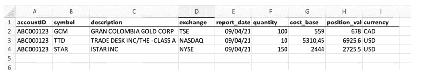

图 5.5：我们在 ABC 银行的虚构投资组合数据导出

为了快速启动项目，我们可以将此数据保存为 CSV 文件——我们可以使用 dbt 的种子功能加载它。然而，我们在前一节中解释过，此功能并非用于加载经常变化的数据，而且每天更新投资组合就在 Git 仓库中保留一个 CSV 文件并不合理，因此这将是对该功能的滥用。

为了保持配置简单并避免使用外部文件存储系统（如 AWS S3、Google File Storage 或 Azure Storage）或安装 SnowSQL 从本地文件系统加载文件，我们将指导你使用 Snowflake 用户界面（UI）将 CSV 数据加载到表中。本质上，我们将手动执行通常自动完成的摄取基于文件的数据的过程。我们将在本书最后一部分详细分析基于文件的加载模式。

因此，计划如下：

1. 创建用于保存外部数据的落地表。
2. 手动将 CSV 文件中的外部数据加载到落地表。
3. 将落地表定义为我们源表。
4. 从源表读取数据以开始我们的 ELT。

将数据加载到落地表并随后在其上定义源表，目的是为使用我们的数据提供一种弹性方式，这样如果在某个时刻我们开始以自动化方式或从不同的文件存储系统加载此数据，我们的 ELT 也不必更改。

那么，让我们开始吧！

1. 在本章前面，我们创建了将要使用的`PORTFOLIO_TRACKING`数据库，所以让我们先使用执行者角色创建一个`SOURCE_DATA`模式来保存我们从外部源加载的数据：

```sql
USE ROLE DBT_EXECUTOR_ROLE;
CREATE SCHEMA PORTFOLIO_TRACKING.SOURCE_DATA;
```

2. 既然我们有了模式，就可以创建`ABC_BANK_POSITION`表，我们要将 ABC 银行投资组合的数据加载到其中：

```sql
CREATE OR REPLACE TABLE
    PORTFOLIO_TRACKING.SOURCE_DATA.ABC_BANK_POSITION (
        accountID        TEXT,
        symbol           TEXT,
        description      TEXT,
        exchange         TEXT,
        report_date      DATE,
        quantity         NUMBER(38,0),
        cost_base        NUMBER(38,5),
        position_value   NUMBER(38,5),
        currency         TEXT
);
```

前面的语句创建了一个与我们的 CSV 文件具有相同列、数据类型和相同顺序的表，这样我们可以轻松加载它。

现在我们已经有了保存数据的表，可以使用 Snowflake 界面加载它：

1. 首先，按照前面图中的格式创建一个包含你投资的文件，并将数据导出为 CSV 格式（遵循美国标准或调整格式），或者从我们的仓库下载图片中的 CSV：`https://github.com/PacktPublishing/Data-engineering-with-dbt/blob/main/Chapter_05/ABC_Bank_PORTFOLIO__2021-04-09.csv`。

2. 为了无问题地读取 CSV，我们必须向 Snowflake 提供有关我们如何导出 CSV 文件的设置。我们可以通过定义文件格式（File Format）轻松做到这一点，之后每次使用相同格式的文件时都可以复用该格式。

以下代码创建了一个适用于读取通过使用美国区域设置（美国标准设置）从 Excel 导出数据而创建的 CSV 文件的文件格式：

```sql
CREATE FILE FORMAT
    PORTFOLIO_TRACKING.SOURCE_DATA.ABC_BANK_CSV_FILE_FORMAT
        TYPE = 'CSV'
        COMPRESSION = 'AUTO'
        FIELD_DELIMITER = ','
        RECORD_DELIMITER = '\\n'
        SKIP_HEADER = 1
        FIELD_OPTIONALLY_ENCLOSED_BY = '\\042'
        TRIM_SPACE = FALSE
        ERROR_ON_COLUMN_COUNT_MISMATCH = TRUE
        ESCAPE = 'NONE'
        ESCAPE_UNENCLOSED_FIELD = '\\134'
        DATE_FORMAT = 'AUTO'
        TIMESTAMP_FORMAT = 'AUTO'
        NULL_IF = ('\\N')
;
```

3. 现在你已准备好 CSV 和读取它的文件格式，请在浏览器中转到你的 Snowflake 账户，并确保选择你的 DBT_EXECUTOR_ROLE 作为你扮演的角色（在 Snowflake 界面右上角）。

请注意，大多数属性是可选的，因为它们有正确的默认值，但如果你选择关键值，我们提供的文件格式与**加载数据**向导提供的相同。重要的是要注意`SKIP_HEADER = 1`的值，因为这允许你将第一行定义为标题（在加载数据时跳过）。`FIELD_DELIMITER`和`RECORD_DELIMITER`属性很重要，因为它们定义了一行中列的分隔方式以及行的结束方式（`'\n'`是换行符）。

`FIELD_OPTIONALLY_ENCLOSED_BY = '\\042'`属性指定字符串类型的列可以选择性地用双引号括起来。如果它们包含具有特殊含义的字符（例如分隔符），则需要这样做。


要将 CSV 中的数据加载到我们创建的表中，请点击左上角的**数据库**图标，然后在出现的列表中点击 **PORTFOLIO_TRACKING** 数据库。接着，选中该行，或点击 **ABC_BANK_POSITION** 表的名称，并点击**加载表**以启动**加载数据**向导：

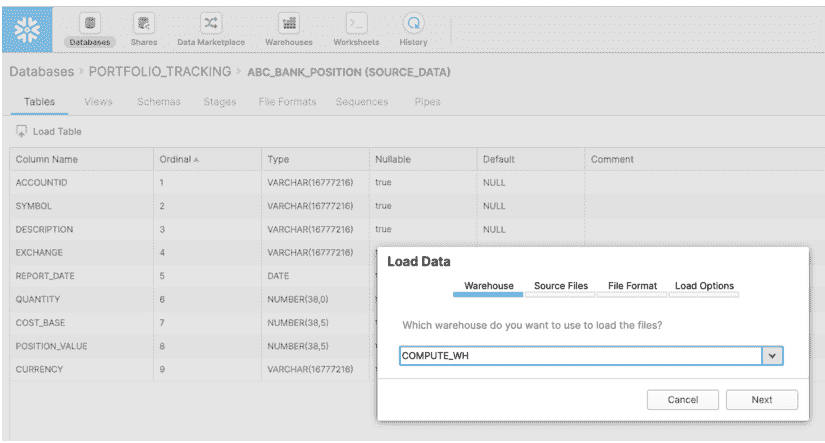

图 5.6：Snowflake 中的加载数据向导

在**加载数据**向导中，选择你要用于加载数据的仓库，然后在**仓库**页面上点击**下一步**。点击**选择文件**，选择你已保存的 CSV 文件，然后在**源文件**页面上点击**下一步**。选择我们创建的文件格式，并在**文件格式**页面上点击**加载**。如果你想浏览向导的下一页，可以点击**下一步**，然后点击**加载**。

点击**加载**按钮后，Snowflake 会将 CSV 文件加载到一个暂存区（stage），然后使用我们指定的文件格式在内存中解析它，最后通过 `COPY INTO` 命令将数据插入到指定的表中，这是加载大量数据最有效的方式。

为了确认一切正常，请回到 Snowflake 界面中的**工作表**，然后在左侧导航面板中选择我们加载数据时所用的数据库、模式和表。你应该会看到该表包含的行数与 CSV 中的行数一致。你可以点击**预览数据**查看数据的前几行。

## 定义源数据

在真实项目中，你通常已经获得了源数据，或者你的团队已经构建了加载数据的管道。在本书的最后一部分，我们将对此进行详细说明。

现在，让我们为已加载的数据定义 dbt 源，然后从 dbt 中访问它。

兼顾项目条理、编辑便捷并避免大量合并冲突的一个最佳实践是：为我们获取数据的每个源系统分别定义一个 YAML 文件。

在 dbt 编辑器的 models 文件夹下创建一个名为 `source_abc_bank.yml` 的新文件，内容如下：

```yaml
version: 2
sources:
  - name: abc_bank
    database: PORTFOLIO_TRACKING
    schema: SOURCE_DATA
    tables:
      - name: ABC_BANK_POSITION
```

你可以在我们的仓库中找到该源文件，它位于 dbt 文件夹中*第 5 章*材料里的 `05_03_v1__source_abc_bank.yml` 文件中。

我们来分析一下上面的文件：

- 以 `version: 2` 开头的那一行是必须的，它告诉 dbt，这个 YAML 文件使用的是第二版 dbt YAML 文件规范。第一版已被弃用。
- 下一行的 `sources:` 声明我们将在该声明下描述一些源系统。
- 带有 name 属性的那一行引入了第一个系统及其名称。
- 系统名称下面是一些用于更好地配置源的属性。其中 database 和 schema 属性告诉 dbt 到哪里查找该源系统的表。
- `tables:` 属性引入了我们将从该源系统中使用的源表的声明。我们可以根据需要添加任意数量的表。
- `- name: ABC_BANK_POSITION` 这一行使用 name 属性引入了第一个系统表，正如我们对源系统所做的那样。

目前，我们已尽量让它保持简单，但很快我们就会看到，我们将利用这个声明来添加更多功能，例如描述列和引入测试。

通过这个初始 YAML 文件，我们完成了第一个源的最小配置，从而能够简单而灵活地访问数据。

我们可以编写下面这个查询来测试我们的源，这是测试源的最简单方式：

```sql
SELECT *
FROM {{ source('abc_bank', 'ABC_BANK_POSITION') }}
```

请注意，dbt 中的名称区分大小写，因此请使用与 YAML 文件中相同的大小写。这要求你的项目内部就表和源名称达成一致的命名约定。

在 dbt IDE 中点击**预览**按钮，即可让 dbt 编译并在你的数据库上运行该查询，然后带你进入**查询结果**选项卡，在那里你可以看到查询结果：

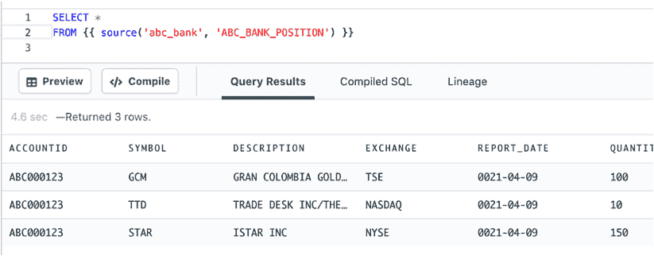

图 5.7：在 dbt 的“预览”选项卡中对源执行查询的结果

进入**已编译 SQL**选项卡，你可以看到在数据库上执行的 SQL，如下图所示。请注意，点击 `</>` **编译**按钮只会编译代码并将你带到**已编译 SQL**选项卡，而不会执行它：

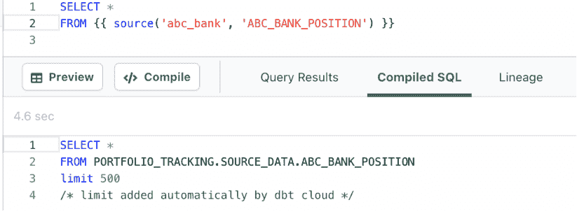

图 5.8：上述查询在 dbt 的“编译 SQL”选项卡中的编译代码

我们来讨论一下：

- 在 SELECT 命令中使用 `*`（星号）可以获取所读取源中的所有字段，从而为将来的更改留有空间。
- 我们计算 UNREALIZED_PROFIT，即当前价值与持仓成本基础之间的差额。

关于文件名的说明：我们将 CSV 文件命名为 ABC_BANK_POSITION，将 dbt 模型命名为 POSITION_ABC_BANK。这些名字好吗？我们会有混淆的风险吗？

先考虑来源、再考虑内容，这种思考传入数据的方式是常见且合乎逻辑的，因此我们的 CSV 名称正体现了这种“来源优先”的思路，这种思路适用于源层和存储层。当我们转向精炼层中承载信息的 dbt 模型时，我们开始优先考虑内容（或概念）；如果数据不具有通用性，或其适用范围有限，我们可能还需要或希望回忆其来源。我们模型的名称表明，我们讨论的是 POSITION 这一概念，且其内容仅限于 ABC Bank 系统。

到目前为止一切顺利，但如果运行查询，看起来代码为 TTD 的“TRADE DESC INC/THE”头寸具有很大的绝对盈利，而其他头寸则只有很小的盈利。让我们添加一个 UNREALIZED_PROFIT_PCT 字段，以体现初始投资的规模。

让我们将 POSITION_ABC_BANK.sql 文件修改如下：

```sql
SELECT
    *
    , POSITION_VALUE - COST_BASE as UNREALIZED_PROFIT
    , UNREALIZED_PROFIT / COST_BASE as UNREALIZED_PROFIT_PCT
FROM {{ source('abc_bank', 'ABC_BANK_POSITION') }}
```

现在，我们也得到了相对于持仓成本基础的盈利百分比。

一切看起来都不错，但也许我们不喜欢除法运算产生的那一串长长的小数。

让我们使用 Snowflake 的标准 ROUND 函数来解决这个问题。

将该行修改如下：

```sql
, ROUND(UNREALIZED_PROFIT / COST_BASE, 5)
    as UNREALIZED_PROFIT_PCT
```

现在，我们将结果四舍五入到了小数点后第五位。

你可以在 Git 仓库中、dbt 文件夹里第 5 章素材中的 05_04_v1__POSITION_ABC_BANK.sql 文件中找到该源文件的最终版本。

## 实时血缘与项目导航

我们已经根据所声明的唯一源创建了我们的第一个 dbt 模型，因此现在在项目中很难迷失方向；但如果你有数据平台的使用经验，你就会知道理解哪些转换相互关联是多么复杂。

别灰心，在 POSITION_ABC_BANK 模型中点击 dbt IDE 的 Lineage（血缘）选项卡即可。

看看吧……你现在有了一张漂亮且易于阅读的血缘图，它展示了该模型与所有其他相关模型之间的关系：


图 5.9：投资组合项目的初始血缘图

虽然目前可看的内容不多，因为我们只声明了一个源表（如左侧带箭头的数据库图标所示）和一个模型（如右侧的立方体图标所示），但当你的项目变得更大、更复杂时，这张图将成为你轻松遍历模型、记住自己构建内容的无价指南。

血缘图是实时绘制的，并且始终与你的项目保持同步。

你还可以使用它在项目中快速移动：双击即可跳转到某个模型或某个源的定义。该图也是动态的，你可以拖拽各个方框，按照对自己更有意义的方式排列，甚至可以复制或打印出来，以便更好地与同事或利益相关者沟通。

## 部署第一个 dbt 模型

到目前为止，我们只是创建了文件，在每次修改后保存了几次，并使用 dbt Cloud 上的“预览”按钮功能运行了它——但数据库中还不存在任何表，仓库中也未保存任何代码。让我们来解决这个问题。

要在我们的 DEV 环境中部署代码，我们必须使用 IDE 底部的命令行手动执行所需的 dbt 命令。

执行以下命令以运行所有模型（尽管目前我们只有一个！）并将它们部署到 Snowflake：

```bash
dbt run
```

几秒钟后，命令成功执行完毕，你的模型就在数据库中创建好了——但它在哪里？


它将被创建在你创建此项目时配置 Snowflake 时在向导中命名的 schema 中。我使用了 RZ，我们建议使用你的姓名首字母。

当我们使用 `dbt run` 测试一切配置是否正确时，初始默认项目也是在同一个 schema 中创建的。

要在 DEV 环境中部署代码，你需要手动运行命令，因为通常的做法是一次添加一个模型，并在满意之前修改几次或很多次，而不想在每次更改时都运行所有内容。通过手动运行，你可以随时运行和测试你认为正确的部分。

我们将看到，要在部署环境中部署，你将使用一个作业（job）——即一系列 dbt 命令。你只需定义一次，每次想要部署和运行该环境时运行它即可。

好处在于，你可以为每个环境定义多个作业，这样你可以有一个运行所有内容的作业，还有一个只加载每小时变化的数据并只刷新依赖该数据的任何内容的作业。

## 提交第一个 dbt 模型

通过运行所需的 dbt 命令，我们现在已经在数据库中生成了模型，但模型的代码只存在于 dbt Cloud 服务器上，并不在我们的 Git 仓库中。

要将当前版本的代码添加到 Git 仓库，我们必须提交更改。

在 dbt Cloud 中你可以非常轻松地完成此操作，因为它有一个引导式 Git 工作流，允许你轻松创建 Git 分支，然后在开发过程中提交更改，最后打开一个**拉取请求（PR）**，将该开发内容合并到 `main` 或 `master` 分支。

要提交项目、模型和配置的当前代码，请单击 dbt IDE 左上角的绿色 **commit...** 按钮，然后在打开的弹出窗口中输入提交消息。单击 **commit** 按钮会将代码作为新提交发送到 Git。

请记住，在完成提交之前保存所有打开的模型和配置文件，因为只有已保存的内容才会被提交。无论如何，请放心，如果有未保存的文件，dbt IDE 会发出警告。

既然你已经提交了它们，你的更改也会保存到 Git 仓库中，最重要的是，现在所有可以访问该仓库的人都可以使用这些更改。

每次提交后，只要 IDE 上的代码自上次提交以来没有更改，你就可以打开一个 PR 与同事共享代码，并开始收集反馈或请求最终批准将其合并回 `main` 分支。我们将在后面的章节中再讨论协作。

## 配置我们的项目以及数据存储位置

你在开发凭据中定义的 schema 就是你的开发环境将存在的 schema，如果我们不做任何操作，我们创建的所有内容都将生成在该 schema 中。

请注意，用于 DEV 环境或部署环境的 schema 在 dbt 文档中通常被称为目标 schema（target schema），在代码中可以通过 {{ target.schema }} 使用。

随着时间的推移，将所有内容生成在同一个单一 schema 中会变得混乱，而我们主要目标之一是创建和维护一个让开发人员更轻松的环境，所以让我们修复这个问题，并通过配置 dbt 项目的不同部分在我们的环境中创建到不同的 schema 来开始建立更多秩序。

问题在于，我们的环境被定义为一个 schema，而在数据库中，不能在一个 schema 中嵌套另一个 schema，因此我们无法在 DEV 环境的目标 schema 内创建多个 schema。

为了克服这个问题，dbt 会在多个 schema 中生成表和视图，这些 schema 的名称由目标 schema 的名称加上我们为特定内容定义的自定义 schema 名称组成，最终的 schema 名称布局如下：<target_schema>_<custom_schema>。

例如，如果我的目标 schema 是 RZ，并且内容被配置为进入名为 REFINED 的自定义 schema，那么内容在我的环境中部署时实际的 schema 名称将是 RZ_REFINED。相同的内容部署到目标 schema 为 PROD 的环境中时，将创建在 PROD_REFINED schema 中。

回顾一下，请记住，你在定义环境时定义目标 schema，通常连同连接详细信息一起定义，而你在主 dbt 配置文件中配置自定义 schema，或者像任何其他配置一样在项目中覆盖它。

## 主配置文件

我们用于定义和配置 dbt 项目（包括资源创建位置）的主要元素是主配置文件 dbt_project.yml。

dbt 将包含 dbt_project.yml 文件的文件夹定义为 dbt 项目文件夹，此文件包含项目的必要和通用配置，这些配置最终可以在更具体的级别被覆盖。

打开它，并按照我们的描述和更改进行操作。

在前几行（通常是第 5 到 7 行），你会看到以下内容：

```
name: 'my_new_project'
version: '1.0.0'
config-version: 2
```

将名称改为有意义的名字是一个好习惯，因此我们将其命名为 `portfolio_tracking`。

你可以将版本改为 `0.1.0`，并在进行次要版本发布时更新它，或者保持原样，只在主要版本发布时更新。我们将保持它不变。

不要更改 `config-version`，因为它指定了要使用的配置定义的版本，而版本 2 是当前使用的版本。

继续向下，你会在大约第 10 行找到要使用的 profile 名称，如下所示：

```
profile: 'default'
```

这在 dbt Cloud 中不会使用，但在 dbt Core 中，它用于从连接配置文件中可定义的众多连接 profile 中选择要使用的连接 profile。

在此之后，是路径的定义，dbt 在这些路径中查找不同类型的对象、放置生成的代码，以及如果你运行 `dbt clean` 命令时要清理的内容。

这通常在第 15 到 25 行，如下所示：

```
model-paths: ["models"]
analysis-paths: ["analyses"]
test-paths: ["tests"]
seed-paths: ["seeds"]
macro-paths: ["macros"]
snapshot-paths: ["snapshots"]
target-path: "target"  # directory for compiled SQL files
clean-targets:         # directories to be removed by `dbt clean`
  - <target>
  - <dbt_packages>
```

不要更改这些，因为它们没有问题，除非你有非常特殊的需求。

默认配置文件的最后一部分是关于配置模型和其他 dbt 对象的，我们稍后会看到。随着时间的推移，我们可能会为其他元素添加配置，例如 seeds、snapshots、variables、sources、tests 以及我们想要为项目全局配置的任何其他功能。

模型配置仍然反映旧名称和示例项目，所以让我们将其更改以适应当前需求，如下例所示：

```
models:
  portfolio_tracking:
    +materialized: view
    refined:    # Applies to all files under models/refined/
      +materialized: table
      +schema: REFINED
```

你可以在我们仓库中 `dbt` 文件夹内 *第 5 章* 的材料中的 `05_05_v1__dbt_project.yml` 文件中找到此源文件的初始版本。

让我们回顾一下我们配置的内容：

- 在通用的 `models:` 下（一个适用于所有项目中所有模型的标签），我们嵌套了项目名称 `portfolio_tracking:`，以仅配置此项目的模型。
- 在我们的项目下，我们添加了模型特定的 `materialized` 配置，值为 `view`，因为我们希望模型默认以视图形式创建。
- 在我们的项目下，我们接着命名了 `refined` 文件夹，该文件夹尚不存在，但我们已经可以为其及其子文件夹声明配置。
- 在 `refined` 文件夹下，我们再次声明了模型特定的 `materialized` 配置，值为 `table`，因为我们希望放置在其下的模型以表的形式物化。
- 在 `refined` 文件夹下，我们还声明了 `schema` 配置，值为 `REFINED`，因为我们希望其下的模型在自定义 schema 部分为 `REFINED` 的 schema 中创建。

我们在配置关键字（如 `schema`）前面添加了一个 + 符号，以便更容易地将它们与用于分层应用配置的文件夹名称区分开来。请注意，+ 是可选的，仅用于提高可读性。

概括来说，如果我们没有为模型定义任何自定义 schema，它们将创建在目标 schema 中，即我们在连接配置中定义的那个 schema。如果我们定义了自定义 schema，模型将创建在一个 schema 中，其名称由目标 schema 和所定义的自定义 schema 组成；这确保每个开发人员或环境都能在具有不同且唯一名称的 schema 中创建其数据库对象。

## 将我们的环境重新部署到目标 schema

在第一次部署之后，我们添加了配置，以便能够将*细化模型*生成到自定义的 `refined` schema 中。

如果我们现在再次运行 `dbt run` 命令……什么也不会改变。

为什么？因为我们将 `refined` 文件夹中的模型配置为进入 `refined` schema，而我们的 `POSITION_ABC_BANK` 模型位于 `model` 文件夹中，而不是 `model/refined` 文件夹中。


让我们创建文件夹、移动模型并重新运行项目：

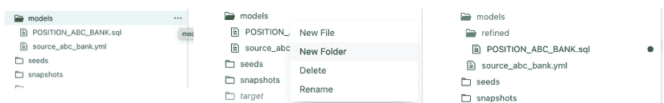

图 5.10：创建文件夹的菜单以及移动文件后的结果

如果将鼠标悬停在 dbt IDE 中的 models 文件夹上，它会被高亮显示，并且在最右端会出现一个由三个点指示的菜单。单击这三个点，然后选择 New Folder 菜单项。

在文件夹名称中输入小写的 refined，就像在配置文件中所做的那样。请记住，在 dbt 中，文件和文件夹名称区分大小写。

要移动 POSITION_ABC_BANK 模型，请将鼠标悬停在其名称上，单击三个点打开菜单，然后选择 Rename 项。

在文件名前添加 refined/，使完整路径变为 models/refined/POSITION_ABC_BANK.sql，然后单击 Save 按钮。

你会看到该文件现在出现在 refined 文件夹下。

我们现在可以再次运行项目，在我们配置的位置创建模型。

在 dbt IDE 的命令行中执行常用命令：

```
dbt run
```

现在你可以前往 Snowflake 数据库，检查 POSITION_ABC_BANK 表是否已在 RZ_REFINED schema 下创建（将 RZ 替换为目标 schema）。另请注意，该 schema 也已为你自动创建，无需你执行任何额外操作。

很好，我们已经轻松清理了开发环境，这是在开发过程中保持环境干净的方法，同时你可以频繁更改模型名称（频繁）和位置（初始模型后很少更改）的想法。

这是管理公共 QA 或测试环境或生产环境的好方法吗？不，手动管理环境只建议用于你自己的开发环境，并且只针对尚未发布到其他环境的模型。由于这些模型只存在于你的环境中，我们建议保持轻量级管理，并直接在数据库上使用手动命令进行管理。

对于已发布到其他环境的模型，我们需要在每个环境中一致且适时地应用更改，因此不能手动完成——必须自动化。

对数据库的自动化更改通常称为**数据库迁移**，因为它们将数据库从一种状态迁移到另一种状态，并且可以通过 Flyway 或 Liquibase 等专门软件应用。

在接下来的章节中，我们将看到，通过使用极其简单的 dbt 宏来保存 SQL 代码，并使用 run-operation 命令来执行它们，可以在 dbt 中使用相同的方法。

回顾一下这个概念：在发布模型之前，它对你来说是私有的，你可以手动管理；但一旦发布到外部，就需要一种一致的方法，我们将使用数据库迁移的概念在所有需要的环境中应用这些更改。

## 为我们的架构配置各层

既然我们已经讨论了希望模型生成的位置，现在是时候思考我们讨论过的整体架构，并开始落实配置来实现它了。

让我们看看如何组织我们定义的三个层：

- **数据存储层：** 我们将教你以两种方式实现这一层——使用 *dbt 快照* 和 *仅插入式摄入历史表*。在这两种情况下，我们都会将快照或模型配置到它们自己的 schema 中；主要区别在于，快照是全局的，意味着每个环境都使用相同的快照，并将存储在 snapshots 文件夹中，而历史表则使用存储在 staging 文件夹中的普通模型实现，因此每个环境都是独立的，从而提供更多的自由度和可扩展性。
- **精细化数据层：** 我们已经配置了 refined 文件夹，使其下的模型将在 refined schema 中生成。
- **数据交付层：** 数据交付层由一个或多个数据集市实现。每个数据集市的模型在 marts 文件夹下各自的文件夹中创建，每个数据集市在数据库中的独立 schema 中创建。

让我们准备配置，以便设置好所有层。

模型和快照配置都可以存储在主配置文件 `dbt_project.yml` 中，因此请打开并更新它，如下所示：

```yaml
models:
  portfolio_tracking:
    +materialized: view
    staging:      # Data storage layer
      +materialized: view
      +schema: STAGING
    refined:      # Refined data layer
      +materialized: view
      +schema: REFINED
    marts:        # Data delivery layer
      portfolio:   # one specific data mart
        +materialized: table
        +schema: MART_PORTFOLIO
snapshots:
  portfolio_tracking:
    +target_schema: SNAPSHOTS
```

你可以在我们仓库的 dbt 文件夹中 *第 5 章* 的资料中找到此源文件的更新版本，即 `05_05_v2__dbt_project.yml` 文件。

让我们回顾一下配置：

- `staging` 文件夹的内容现在默认在 STAGING schema 中创建为视图。此配置将用于使用暂存视图的仅增量摄入（在文件夹级别配置），以及将增量加载并单独配置的历史表。
- `refined` 文件夹的内容现在默认在 REFINED schema 中创建为视图。
- 嵌套在 marts 文件夹下的 `portfolio` 文件夹的内容将默认在 MART_PORTFOLIO schema 中创建为表。
- 此项目的快照组织在 snapshots 文件夹下，将在 SNAPSHOTS schema 中创建。它们总是生成为表，并增量加载。

为不同层生成视图或表主要是一种性能选择，因为它们在功能上是等价的。表创建较慢且占用存储空间，但查询速度快得多。

因此，将 ELT 期间被多次查询的模型物化为表是有意义的，这样计算只执行一次；对于最终用户在交互模式下查询的模型也是如此，以便查询在尽可能短的时间内执行。

在上一节中，我们将 refined 层配置为生成表；当我们还没有数据集市层，且 refined 层同时也是交付层时，这是一个明智的选择。

交付层通常物化为表，但如果你使用的 BI 工具在内部存储来自数据集市层的数据（例如 Power BI），那么将该层生成为视图是一个明智的选择，因为每个视图将被查询一次以在工具中加载数据。

## 通过测试确保数据质量

到目前为止，我们已经将 CSV 中的数据加载到落地表中，并创建了一个模型来读取其中的数据，但我们如何确保数据的可靠性呢？

我们如何提供真正的数据质量？

最好的方法是让数据质量成为现实，而不仅仅是希望。它明确定义了我们对输入和输出的期望，然后检查数据是否符合这些要求。这就是能够在数据上定义可运行测试的本质。

在 dbt 中，我们可以定义两种类型的测试：

- **通用测试**，曾被称为 schema 测试，本质上是通用的，因此被编码在参数化查询中，可以通过在 YAML 配置文件中命名它们来应用于任何模型或任何模型中的任何列。

  dbt 默认定义的通用测试示例包括：列不为 `null` 或具有唯一值的测试，但我们也可以定义自己的测试，例如测试哈希列是否不会产生哈希冲突。

- **单一测试**是最通用的测试形式，因为你可以测试任何能用 SQL 表达的内容。你只需编写一个 SQL 查询，返回未通过测试的行，无论你想测试什么，是单个计算、全表匹配，还是多表中列的子集。

通用测试在 YAML 配置文件中配置，只需定义需求，即可轻松测试大量表和列中的常见需求——无需其他额外工作。

dbt 自带四种已实现的通用测试类型：

- `not_null`：测试表中的列永远不会为 null。
- `unique`：测试列中的值是唯一的。
- `relationships`：测试两个表之间的参照完整性，即表中的每个外键值都存在于指定表的指定列中。换句话说，你测试被测试表中没有*孤儿记录*。
- `accepted_values`：测试列中的值是指定值之一。


我们随后声明了第一个测试，`not_null`，要求表中每一行的 ACCOUNTID 列不包含 `null` 值。请注意，这与数据库列是否被声明为可空无关。

`not_null` 测试在很大程度上是最常用的测试，因为我们经常希望确保我们获取或产生的数据在被测试的列中始终具有非空数据。

> **实用提示**
>
> 在我们转向为此数据源想要介绍的其他测试之前，这里有一些关于处理 YAML 文件的实用建议。
>
> 请注意在 YAML 文件中，对齐对于定义结构至关重要，因此请尽量精确地进行，否则您会遇到编译错误，因为 YAML 解释器将无法正确解析您的配置文件。
>
> 在添加新的配置片段后，请检查 dbt IDE 右下角是否显示**就绪**的绿色字样，以确保项目编译正确。为了确保您不会引入编译错误，您可以在保存更多更改时瞥一眼。
>
> 当这种情况发生，即使在阅读错误消息后您也无从知晓时，我们建议删除您更改的块，以便编译再次正确，然后一次添加回一点，以了解阻止编译的问题所在。

让我们继续添加并对表中其他列所需的测试进行评论：

```yaml
- name: SYMBOL
  description: The symbol of the security at ABC Bank.
  tests:
    - unique
    - not_null
```

接下来，我们正在配置 SYMBOL 列的描述和测试，我们假设它是一个银行头寸的良好自然键。

因此，我们同时声明了 `not_null` 和 `unique` 测试，这是唯一性约束的标志，例如键，无论是自然键还是代理键。

```yaml
- name: DESCRIPTION
  description: The name of the security at ABC Bank.
  tests:
    - not_null
```

在前面的配置片段中，我们正在配置 DESCRIPTION 列的描述和测试，我们希望它为 not_null，因为它具有证券的名称。

```yaml
- name: EXCHANGE
  description: >
    The short name or code of the exchange
    where the security is traded.
  tests:
    - not_null
```

在前面的配置片段中，我们正在配置 EXCHANGE 列的描述和测试，我们希望它为 not_null，因为它具有证券被购买的交易所的名称或代码。我们将在参考 STG 模型时更深入地讨论命名。

我们也可以考虑使用 accepted_values 测试来表达交易所值应限制为已知值列表，但由于我们没有理由限制值，此类测试只会在失败时产生误报，促使我们维护列表以添加新值。

请注意，如果我们需要因任何法规而被提醒使用新交易所，或确保其他数据或授权已到位，这可能是一个明智的策略。

然后我们会将授权或配置的交易所添加到测试接受的列表中，如果使用我们未命名为已接受的其他交易所，我们将收到错误。

```yaml
- name: REPORT_DATE
  description: >
    The date the report was extracted by ABC Bank.
    We consider this position to be effective
    from this date forward, until a change is seen.
  tests:
    - not_null
```

对于 REPORT_DATE 列，我们希望它为 not_null，因为我们需要能够知道位置中的信息所指的日期。时间在现实中非常重要，在数据仓库方面，这可能是整本书的主题。我们将经常谈论它。

```yaml
- name: QUANTITY
  description: >
    The number of securities we hold in the
    portfolio at ABC Bank at the Report Date.
  tests:
    - not_null
```

对于 QUANTITY 列，我们希望它为 not_null，因为我们需要知道我们有多少证券。仅知道“投资组合中有一些该证券”而不知道实际持有的股票或头寸数量根本没有帮助。

```yaml
- name: COST_BASE
  description: >
    The cost we paid for the securities that
```

您可以在我们的存储库中找到此源文件的更新版本，在 dbt 文件夹中第 5 章的材料中，05_03_v2__source_abc_bank.yml 文件内。

## 重要说明

测试在整个数据生命周期中非常有用。

在这里，我们在创建源和第一个模型之后才介绍它们，以避免用太多新主题使您不堪重负。在项目的现实中，在编写源和模型时编写测试是有用的。

当开始使用我们不完全了解的数据时，测试尤其有用，因为它们允许数据工程师轻松快速地表达和验证他的假设。

知道预期的唯一性约束和字段的可空性，特别是外键和关系完整性约束是否得到满足，对于设计数据上的 ELT 转换非常重要。

测试使我们能够最初分析，然后完全描述，最后不断监控传入数据的质量，使我们的 ELT 更加可靠，结果值得信赖。

## 运行测试

现在我们已经添加了第一个测试，我们如何使用它们？

在 dbt 中，您使用 `dbt test` 命令执行测试，与我们之前看到的运行 dbt 模型的方式非常相似。

转到 dbt Cloud 命令行并运行以下命令：

```
dbt test
```

前面的命令将执行 dbt 项目中的所有测试，您会看到命令行区域打开以首先显示执行，然后显示测试结果：

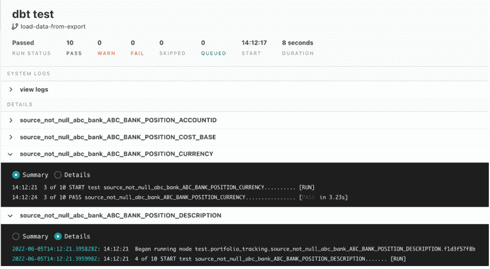

您会看到您的测试正在运行，并且完成后，如果通过，右侧会有绿色勾号，如果产生警告，则为橙色感叹号，如果失败，则为红色“x”符号。

您可以打开每个测试的行以访问摘要结果，详细说明测试结果及其持续时间，以及详细信息，您还可以看到在 Snowflake 数据库上运行的确切查询。

现在，我们只为单个源表定义了测试，因此运行所有测试完全没问题，但展望未来，能够仅运行您想要的源或模型的测试非常重要。

以下命令为您提供了更好地控制运行测试的替代方案：

- 运行所有源的测试：

  ```
  dbt test -s source:*
  ```

- 运行 abc_bank 源中所有表的测试：

  ```
  dbt test -s source:abc_bank.*
  ```

- 运行 abc_bank 源中 ABC_BANK_POSITION 表的测试：

  ```
  dbt test -s source:abc_bank.ABC_BANK_POSITION
  ```

在接下来的章节中，我们将更深入地了解 dbt 提供的模型选择语法，以便您可以构建运行或测试您想要的确切模型的命令。

## 测试我们交付的信息是否可靠

现在我们确信传入的数据符合我们的期望，是时候确保我们交付的内容也符合期望了。

编写验证我们想要交付内容的测试将在许多方面为我们提供帮助：

- 确保我们第一次编写代码时做对了。
- 它提供了一个清晰且非常有价值的文档片段，它将随着我们的代码保持最新，或在代码或数据停止遵守它时失败并引起我们的注意。

  在这方面，重要的是要注意，测试为记录项目提供了如此宝贵的信息，以至于 dbt 使用它们来丰富项目文档。
- 它将继续监控我们或他人对代码所做的每一次未来更改是否仍将满足我们的期望以及我们的客户所使用的合同。

我们已在 `refined` 文件夹中创建了模型，因此让我们在 `refined` 文件夹中创建一个名为 `refined.yml` 的 YAML 文件来托管我们的测试以及我们在 `refined` 文件夹中实现的转换的描述。

与往常一样，在我们的 YAML 文件中，让我们从版本和我们将在文件中描述的实体类型开始。用这两行开始文件：

```yaml
version: 2
models:
```

版本始终为 2，因为这是当前使用的 YAML 文件的定义 - 然后，我们使用 `models` 关键字声明我们将描述一些模型。

与源一样，首先，我们使用 name 条目标识我们想要描述和测试的模型，然后我们可以输入描述，除了帮助我们作为开发人员外，还将用于文档中：

```yaml
- name: POSITION_ABC_BANK
  description: The positions we have in the ABC Bank portfolio.
```

嵌套在模型内部，`columns` 允许我们命名我们想要描述和测试的列：

```yaml
  columns:
    - name: UNREALIZED_PROFIT
      description: The unrealized profit on the position.
      tests:
        - not_null
```


在前面的代码中，我们识别了 `POSITION_ABC_BANK` 模型中的 `UNREALIZED_PROFIT_PCT` 列，并声明了 `not_null` 测试，因为我们期望该列始终有数据。

```yaml
- name: UNREALIZED_PROFIT_PCT
  description: >
    The unrealized profit percentage on the position.
  tests:
    - not_null
```

另外，对于 `UNREALIZED_PROFIT_PCT` 列，我们通过使用 `not_null` 测试声明了它应包含数据。

当我们对模型或项目中的所有模型运行测试时，这两个测试都将被执行。

要运行所有测试，请前往 dbt Cloud 命令行并运行以下命令：

```bash
dbt test
```

上述命令将执行 dbt 项目中的所有测试，你会看到命令行区域先显示执行过程，然后显示测试结果。

如果只想对 `POSITION_ABC_BANK` 模型运行测试，请运行以下命令：

```bash
dbt test -s POSITION_ABC_BANK
```

我们现在已经创建了测试，用于验证我们获得正确的输入数据，并且在我们仍然简单的转换结束时能够交付正确的数据。

### 生成文档

接下来需要熟悉的重点是 dbt 根据我们的代码自动生成的文档。

要生成文档，请运行以下命令：

```bash
dbt docs generate
```

你会注意到，生成完成后，几秒钟内，你的开发环境左上角会弹出一个小窗口，提示你的文档已准备好查看，如下面的截图所示：

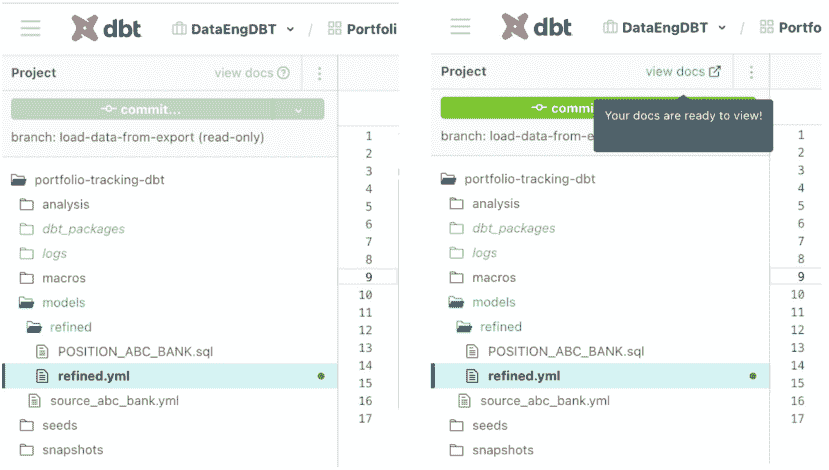

图 5.13：文档生成期间及结束时的开发环境

点击 **查看文档** 链接，新的浏览器标签页将打开，显示 dbt 生成的文档。它看起来像下面的截图：

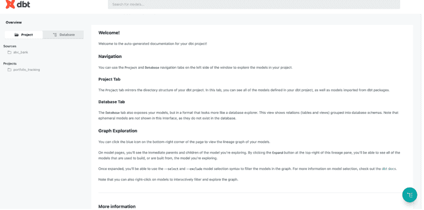

图 5.14：dbt 文档首页

你可以四处浏览，尽管目前内容还不多。

点击页面右下角的蓝色圆形按钮以打开血缘图：

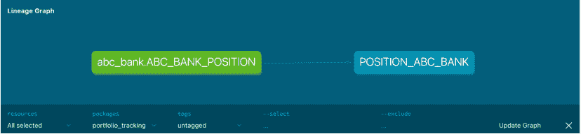

图 5.15：我们第一个模型的 dbt 血缘图

目前血缘图非常简单，因为它只需要展示来自 `abc_bank` 源系统的 `ABC_BANK_POSITION` 源表（在血缘图中以绿色显示），该表被 `POSITION_ABC_BANK` dbt 模型使用（即数据流向该模型，在血缘图中以浅蓝色显示）。

### 小结

恭喜——你的第一个数据应用正在运行！

在本章中，我们开始在 dbt 中开发示例应用，并遵循所有步骤创建、部署、测试和记录一个数据应用，尽管这个应用仍然非常简单。

在下一章中，我们将为该数据应用引入更多真实需求，并且必须调整我们的代码来考虑这些需求，因此我们将开始学习如何重构我们的模型并编写可维护的代码。
