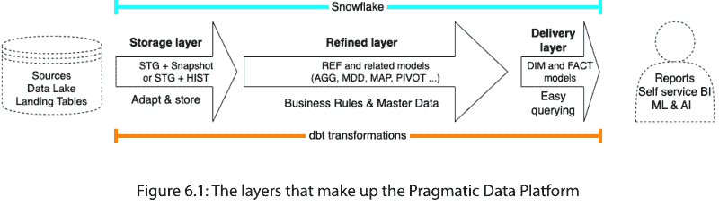
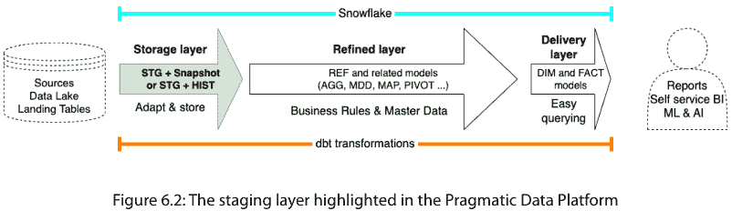
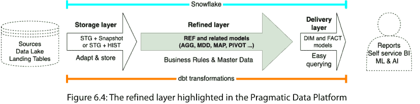
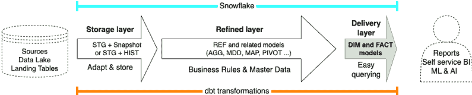
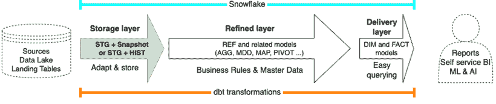

## 编写可维护代码

在本章中，我们将继续上一章开始的示例，并指导你配置 dbt，编写一些基础但功能完整的代码，以构建我们参考架构的三个层——暂存/存储、精细化数据以及通过数据市集交付。

我们将首先向你介绍一些核心原则，以实现构建易于理解和维护的数据平台的目标，然后我们将开始将这些原则付诸实践，以构建和配置我们参考架构的各层。

在每一步中，我们都会分析我们编写的模型的关键要素，这些模型将原始源数据转换为数据市集中包含事实和维度的可用信息。事实告诉我们发生了什么，而维度则提供与事实相关实体的额外描述性信息。首先，我们将为事实表构建管道，然后在下一章中，我们将为维度构建管道，并讨论它们之间的区别。

我们还将介绍 dbt 的 Snapshot 功能，它允许你轻松保存实体的变化，并将其存储在称为**类型二的缓慢变化维度**的形式中。这使我们的平台能够捕获源数据及其变化，从而变得自给自足。

到本章和下一章结束时，你将能够仅使用 dbt 的基本功能构建一个可工作的数据平台，该平台具有合理的架构和清晰的组织结构。

本章将探讨以下主题：

- 为人类编写代码
- 创建架构层
- 为什么保存历史记录至关重要

### 技术要求

本章建立并继续我们在第 5 章开始的示例，因此你需要熟悉该示例才能继续，并且要拥有其中的代码以继续进行动手示例。

本章的所有代码示例可在 GitHub 上获取：https://github.com/PacktPublishing/Data-engineering-with-dbt/tree/main/Chapter_06。

### 为人类编写代码

在上一章中，我们加载了第一批数据，并构建了第一个模型来对其进行转换。

由于我们项目中开发的代码还很少，因此不存在混淆或对同一事物使用不同名称的风险，但这些在任何真实项目中都是真实存在的问题，而且它们的重要性远超大多数人的想象。

大多数人认为，编码时你只是在编写新代码，但现实是，为了编写一行新代码，你经常必须返回去检查在其他几个地方做了什么，这意味着要一遍又一遍地阅读现有代码中的几十行代码。

项目越老，参与项目的人越多，这一点就越真实、越明显。

我们在前面的章节中已经看到，有一些模式可以最大限度地减少并控制这个问题，但请记住，规模只是复杂性的一个维度，我们能做的管理是有限的。

删除重复或复制粘贴的代码是首要任务，因为它限制了项目的规模，并使得演进成为可能，维护也更加容易。

我们可以做的其他控制复杂性的最重要事项如下：

- *减少重新阅读的需求*，应用**最小惊讶原则（LSP）**。
    为此，使用有意义的模型名称、前缀和后缀是有益的；使用良好的分层架构，并以一致的方式应用模式（尽可能少），使模型的行为和字段的含义符合你对其名称的预期。
- *让你编写的代码易于重新阅读/理解。*
    为实现这一点，使用良好的**公用表表达式（CTE）** 名称和列名是有益的，并将所有非常规的内容放在文件顶部，这样每个“偏离预期”的地方都尽可能容易发现。
- *保持我们编写的模型聚焦且规模有限。*
    一个模型应只做一件事，做好它，并用其名称清楚地传达它。这就是**单一职责原则（SRP）**，它利用中间步骤构建更简单的概念，以便在更复杂的概念中使用，同时避免创建一个大而全的模型。
    在这里，低模型复杂度和低项目规模是相互矛盾的，因此宁可保持模型简单和聚焦，也要让它们做有意义的工作。
- *保持依赖关系有序，并且只朝一个方向流动，从架构中的一个层到下一个层。*
    预期的数据流和依赖方向如下：`源系统 => 暂存 => 精细化 => 展示（市集）`。
    绝对要避免跨越多个层，甚至更糟的是，创建方向错误的依赖关系。幸运的是，dbt 很可能会报错，因为你会创建循环依赖；无论如何，这对项目的可理解性来说都是一个大问题。
- *当你看到改进机会时，重构你的模型以使其保持最新。*
    一致性是保持大型项目和多人良好协作的关键因素。
    如果你有正确的测试和正确的架构，即使在数据仓库环境中，你也能够以很小的代价应用重构。这将使你的项目几乎永远保持可运行状态，而不是每隔几年就必须重建——这听起来是不是很熟悉？你是否做过演进、革命和再演进项目？

### 重构我们的初始模型使其对人类可读

如果你打开我们之前完成的初始模型代码，你眼前的是该模型生成的十一个列中仅两个列的定义。这可能完全不是问题，因为你有血缘图，可以双击其上游模型去查看那些列是什么以及它们是如何定义的。

问题是，上游模型是一个源，仅由一个 YAML 文件中的元数据定义组成。

幸运的是，如果我们一直是项目的好公民，我们可以从 YAML 文件中获得我们已经记录的列的人类可读、有意义的描述。你应该至少列出并描述重要的列——业务键、外键、重要指标和类别，尤其是你期望存在于业务规则中的那些列（然后测试它们确实存在）。

此外，我们无法控制源列名；它们来自我们无法控制的源系统。


这可能会带来两个重要问题：

- 源名称对我们项目的稳定性构成威胁。如果源发生变化，我们将需要更改所有使用此模型的代码，以及任何使用已更改名称的测试。
- 一般来说，源中的名称并不是我们项目中的最佳名称，因为它们通常对我们来说不够清晰、来自不同的领域，或者在我们的项目中我们使用不同的术语甚至完全不同的语言，而我们希望无论在哪里出现，都用同一个名称来称呼同一事物。这是让项目中的每个人都清楚地认定它是同一件事的唯一方法；如果名称不同，那就不是同一件事。

> **提示**
> 我们知道，在一个大型项目中，要在每个地方以相同方式命名同一事物达到 100% 是非常困难的，但如果我们接近这个目标，收益就已经值得了。
> 越接近越好，因为这会降低以错误方式使用数据的风险。

让我们尝试结合多种策略来解决第一个模型中的所有这些难题：

- 我们将把模型拆分为一个“哑”适配模型，并把它放在暂存层（staging layer）中。在这里，我们将选择希望保留的列、它们的名称和数据类型。
- 我们将把“智能”从当前模型转移到精细化层（refined layer）。这种智能通常也被称为业务规则，它属于精细化层，应用于来自暂存/存储层的安全存储数据之上。

请注意，在本章中，我们将重点为你解释关键概念，并提供一系列实用步骤，帮助你构建整体架构并实现从原始数据到可用信息的转换。

最终得到的代码并不是我们旅程的终点，因为我们仍然缺少一些关键特性和改进，例如适当的测试、哈希键的哈希处理，或将代码重构为宏，这要么是因为篇幅限制，要么是因为我们尚未引入相关特性。

在接下来的章节中，我们将重构代码，以使用我们引入的新特性。

## 创建架构层

在本节中，我们将完成 **务实数据平台（PDP）** 架构的各层——暂存/存储层、精细化层以及用于交付的数据集市层。



### 创建暂存层

在*第 4 章*中，我们通过在主配置文件`dbt_project.yml`中添加相关配置来创建精细化层。现在，让我们对暂存层做同样的事情。

在主配置文件的末尾添加暂存层的配置，如下例所示：

```yaml
staging:    #Applies to all files under models/staging/
  +materialized: view
  +schema: STAGING
```

你可以根据自己的喜好将其添加到精细化层配置的上方或下方，只要缩进正确，并且与精细化配置处于同一层级即可。

你可以在我们的代码仓库中找到本章主配置文件的版本，文件名为`06_01_v2__dbt_project.yml`，它位于 dbt 文件夹中*第 6 章*的材料内。

请注意，它已经包含其他新增内容，我们将在后面进行解释。

让我们回顾一下我们已经配置的内容：

- 在我们的项目下，我们命名了一个尚不存在的`staging`文件夹，但我们已经可以为其及其子文件夹声明配置
- 在`staging`文件夹下，我们声明了`materialized`配置，值为`view`，因为我们希望该文件夹下的模型以视图（view）形式物化
- 在`staging`文件夹下，我们声明了`schema`配置，值为`STAGING`，因为我们希望暂存文件夹下的模型创建在自定义 schema 部分为 STAGING 的 schema 中，从而生成如`RZ_STAGING`这样的完整名称

请注意，与精细化层相反，我们希望暂存层默认以视图形式生成。此外，我们希望模型位于带有 STAGING 后缀的 schema 中。

为完成暂存层的创建，请在模型文件夹下创建一个名为`staging`的文件夹。完成后，你就有了一个可以创建暂存模型的地方。

从你的 dbt Cloud 命令行运行该模型，以便下游可以使用它：

```
dbt run -s STG_ABC_BANK_POSITION
```

然后你可以在 Snowflake 中确认暂存层的新 schema 已经存在，并且其中包含该模型的视图。

在编写模型时，你可以运行预览来查看结果，但请记得在模型定稿后执行 dbt run，以便在数据库中生成视图，供其他模型使用。

### 生成暂存模型

当我们介绍这个 STG 模型的代码时，我们曾向你透露，你不需要手写它，而是能够生成 STG 模型中的大部分代码。

每个现代数据库都带有一个信息模式（information schema）——即一个生成的模式，你可以用它来查询数据库自身的相关信息。这太棒了。

在 Snowflake 以及其他一些数据库中，这个模式被恰当地命名为 INFORMATION_SCHEMA，因此你会在 PORTFOLIO_TRACKING 数据库中找到完全限定名为 PORTFOLIO_TRACKING.INFORMATION_SCHEMA 的模式。

因此，我们可以利用数据库已有的关于源表的信息，来生成 STG 模型所需的大部分代码。听起来很厉害吧！

基本思想是，STG 模型的核心操作就是选择所需的列（通常全部列），重命名其中一些列，并最终处理类型或时区转换。

此外，大多数新名称与旧名称不会有太大差异，除非我们讨论的是非常古老的名称（仅限于八个字符）、不同语言的名称，或奇怪的命名策略，例如某些专有或专用系统中出现的那种。

因此，对于 SELECT 子句中的列定义部分，以下 SQL 查询生成的结果将与我们在 STG 模型中想要的 SQL 非常接近：

```
-- Generate STG query
SELECT
  ',' || COLUMN_NAME || ' as ' || COLUMN_NAME
    || ' -- ' || DATA_TYPE as SQL_TEXT
FROM PORTFOLIO_TRACKING.INFORMATION_SCHEMA.COLUMNS
WHERE TABLE_SCHEMA = 'SOURCE_DATA'
  and TABLE_NAME = 'ABC_BANK_POSITION'
ORDER BY ORDINAL_POSITION
```

运行该查询后，结果的前三行如下所示：

```
, ACCOUNTID as ACCOUNTID -- TEXT
, SYMBOL as SYMBOL -- TEXT
, DESCRIPTION as DESCRIPTION -- TEXT
```

让我们分析一下这段代码和结果：

- FROM 子句表明我们正在查询信息模式中的 COLUMNS 视图，因此我们可以使用一个或多个表的列信息。数据库中每个表的每一列都在 COLUMNS 视图中由一行描述。WHERE 子句将我们的查询限制为单个目标表。
- SELECT 子句为源中的每一列生成一行，产生类似“ , col_name as col_name -- data_type_name”的文本，这正是我们要创建的 STG 模型中 SELECT 子句的典型行。列名重复了两次，因为我们需要第一个列名保持原样以便从源中读取（源使用该原始列名），而第二个列名则是我们编辑的基础；如果保持原样，也能直接使用。
- WHERE 子句使用 schema 和表名来选择我们想要读取信息的表。将其指向你要为其创建 STG 模型的源表。
- ORDER BY 子句用于以可预测的方式生成结果，尊重源表中字段的顺序。没有人阻止你在 STG 模型中更改顺序。实际上，重新排序列的顺序是一种非常常见的做法，将自然键和代理键列放在开头，并让在源表中可能不相邻的相关列保持在一起。
- 请注意，所有行都以逗号开头，但我们需要从 STG 模型中 SELECT 子句后保留为第一行的那个行中删除逗号。

然后，我们可以应用下面这个非常简单的模式来生成 STG 模型的初始部分，更完整的模式将在下一节中介绍：

```
SELECT
  <generated column block>
FROM {{ source('source_system', 'SOURCE_TABLE') }}
```

通过这个模式，你可以很容易地看到以下几点：

- 我们几乎可以避免意外。当你看到一个 STG 模型时，你会知道它是什么样的，因为所有 STG 模型都具有简单一致的格式。
- 我们运行一个查询来生成模型主体，并在模型中输入一次源表信息，在查询中输入一次，以生成 SQL 代码。


- 我们将编辑减少到最低限度所需，并且修改一段良好且可用的代码比从头编写更容易更快。从生成的代码开始，您还可以避免忘记某些列的风险。

以这种方式管理 STG 层的好处在于，它让我们在将传入数据适配到我们需求时拥有巨大的灵活性，同时只需要我们付出最少的努力。这真的不是火箭科学，只是一些商定命名规范的审慎应用。

## 暂存模型的目标和内容

STG 模型的目标是将外部数据适配为我们在项目中希望看到和使用的方式。这包括为变更跟踪做准备，并以对我们未来需求最易用的方式进行存储。

为实现这一点，我们可以在 STG 模型中执行以下几个操作：

- 选择所需的列，通常是全部
- 重命名列以遵循我们的规范并使用项目指定的名称
- 管理数据类型，进行转换为所需数据类型
- 应用“硬规则”进行非破坏性转换，例如时区转换
- 添加默认记录但仅限于维度；事实/事件不需要
- 根据输入具体情况添加所需/可用的元数据
- 通过添加基于哈希的键和 diff 字段使键和变更跟踪显式化

列表很长，为了应用之前的原则，我们需要将这些步骤中的大多数应用在其自己的代码片段中，包含在 CTE 中，使 STG 模型的模式成为一个定义良好的 CTE 序列，依次构建在前一个之上。



暂存/存储层是我们构建的接口，用于使外部数据对我们尽可能可用，而不改变其含义。

## 您暂存模型的通用模式

以下是按顺序排列所有前述步骤的简单骨架代码：

```
WITH
src_data as ( ... ),
default_record as ( ... ),
with_default_record as(
    SELECT * FROM src_data
    UNION ALL
    SELECT * FROM default_record
),
hashed as ( ... )
SELECT * FROM hashed
```

使用上述模式，操作将以这种方式划分：

- `src_data` CTE 将处理所有直接作用于传入数据的操作，例如选择列及其名称、管理数据类型、应用硬规则，以及提取可在源系统中找到的元数据（例如导出时间戳）
- `default_record` CTE 将按其名称所暗示的那样做——为维度定义一行默认记录的值，最终在交付层中使用
- `with_default_record` CTE 只会将前两个 CTE 组合起来以获得完整数据
- `hashed` CTE 将添加带有 Key 和 Diff 定义的哈希值，以及您想要添加但不来自源数据的最终元数据，例如数据的加载时间

您可以决定将代码分为更多步骤，但请记住编程几乎总是关于在相互冲突的约束之间保持平衡——在这种情况下，是 SRP 和简洁性。

在下一节中，让我们逐一介绍列为 STG 模型目标的各个要点。

## 在 STG 模型中选择列

通常，我们保留源表的所有列，但有时，出于有效原因需要排除某些列：

- 安全或合规需求或其他法律或业务要求。

  有时，我们不希望某些类型的数据，例如个人信息、健康数据或其他敏感数据存在于系统中。这可能是法规强制要求的，也可能只是为了简化一个系统的合规需求而做出的决定。
- *当*，在也询问业务之后，我们*无法理解某些数据*。

  如果没有人知道也不关心某些数据，忽略它是可以的。考虑询问业务的成本 VS 直接添加数据 VS 现在排除数据、稍后添加（重新计算哈希值、后续适配……）。

在许多情况下，我们也会添加新列，如元数据或计算字段。建议是，当您添加计算数据时，除非数据量使之不切实际，否则也保留原始数据。

## 命名列

名称在某种程度上是任意的，因此很难有强规则。最好的建议是与项目团队就一些命名指南达成一致，然后选择大多数需要使用它的人都能接受的名称。

话虽如此，重要的是您能快速分配人们会理解和识别的名称，因此建立良好的指南至关重要。

举例来说，当您有一个客户标识符时，可以使用许多可能的名称，例如 `CUSTOMER_CODE`、`CUSTOMER_ID`、`CUSTOMER_NUM(BER)` 和 `CUSTOMER_KEY`。最好的做法是决定始终为具有相同角色的所有列使用相同的后缀，例如 `_CODE` 或 `_ID`。

为实现这一切，有用的是制作自己的列表并附上自己的定义，如下所示：

- `_CODE`：业务使用/已知标识符，也称为业务键，通常表示为字符串，即使它只是由数字组成。这不需要是表的唯一键，因为它可以是诸如 `MARKET_CODE` 或 `COUNTRY_CODE` 之类的东西。
- `_ID`：通常，这是一个作为唯一标识符的单个字段，通常作为内部数字开始，具有技术功能。然而，它可能已迁移到业务使用中（`CUSTOMER_ID` 被广泛使用），现在可能不再是数字。
- `_KEY`：这通常是一个技术字段，不用于业务或向业务展示。对通用使用而言，略微偏好 `string` 类型。
- `_NUMBER`：这感觉在某个时间点上曾是数字，但我们见过太多“number”字段包含文本，因此最好避免此类后缀。

一旦您完成了列表，最有用的事情是决定使用哪些以及始终避免哪些，因为它们通常会重叠。记住目标是让您所有的人（开发人员和业务人员）在使用名称时轻松。

在编写代码时，您每天至少要几十次甚至上百次思考，名称是 `CUSTOMER_ID` 还是 `CUSTOMER_CODE` 或其他什么。因此，您选择哪一个远不如决定始终对所有代码类事物使用 `_CODE`（或 `_ID`），并且始终将它们设为字符串重要。

在可能的情况下，我们应尽量仅对会暴露给业务的“代码类”字段使用 `_CODE`，对“仅限开发人员”的字段，如哈希生成的键，使用 `_KEY`。

## 管理数据类型

相当频繁地，您会收到未以正确数据类型表示的数据，例如当您收到日期或时间戳以字符串或整数表示时。

其他常见情况是时间戳被拆分为时间和日期，或您收到仅代表日期一部分的字符串，通常只是月份和年份。

其他较少见的情况涉及货币金额以错误的十进制位数表示（太多或太少），甚至被转换为分。

现代数据库和报表工具完全可以正常工作，并且善于处理日期、时间戳和定点数，因此您应将传入数据转换为最合适的数据类型，这将使一切更简单更快。

这里的建议是，只要可能，最好同时保留原始值，该值将仅存储在历史表中，以及转换后的值，该值将在整个模型中使用。

这既是为了审计要求，也是为了防止错误，以及可能存在数量足够小而您在模型第一版中不会注意到或修复的奇怪数据。

## 应用硬规则

应用硬规则有助于提高数据的互操作性，在某些情况下与数据类型管理非常接近。

硬规则是始终应用于数据以使其在我们想要使用的格式中可接受的规则，因此数据类型转换是一种特殊且简单的硬规则类型。

硬规则并非旨在改变数据的含义，只是其格式或表示方式。

其他类型的硬规则的几个例子如下：

- 修剪字符串以删除无用的空格或剪掉冗余部分
- 将数字填充为所需长度的字符串，反之亦然——将字符串解填充为数字或不带无用填充零的字符串
- 修复大小写，处理不支持字符集中的字符，或需要特殊处理的其他情况
- 从分层源（如 AVRO、Parquet 或 JSON 源）中提取数据到单个字段中


前面的代码应在你实现了 `src_data` CTE 之后在 STG 模型上运行，以便为模型生成相当稳定的列名、数据类型和字段顺序。

以下截图显示了在 ABC 银行持仓实体的 STG 模型上运行此查询的结果：

| 行号 | SQL_TEXT |
| --- | --- |
| 1 | , '-1' as ACCOUNT_CODE |
| 2 | , '-1' as SECURITY_CODE |
| 3 | , 'Missing' as SECURITY_NAME |
| 4 | , '-1' as EXCHANGE_CODE |
| 5 | , '2000-01-01' as REPORT_DATE |
| 6 | , -1 as QUANTITY |
| 7 | , -1 as COST_BASE |
| 8 | , -1 as POSITION_VALUE |
| 9 | , '-1' as CURRENCY_CODE |

图 6.3：为默认记录生成的代码

另外，在这种情况下，你可以获取生成的代码，在第一行之前加上 `SELECT`，去掉多余的前导逗号，然后就能得到一份可用的默认记录定义，你可以原样保留或手动改进。

## 添加元数据

另一个常见任务是记录来自源系统的元数据，并添加我们可以生成的其它元数据。

某些“元数据”字段将来自源系统的普通字段，而另一些将由加载管道添加。通过定义元数据字段，我们将相关信息复制到元数据名称下，同时保留原始字段（如果它本身也有用的话）。由于相同的元数据在不同源系统中可能有多种叫法，因此始终将元数据放入具有相同名称的字段中是很有用的。

以下是一些可能添加的元数据形式：

- `LOAD_TS`：这是数据加载到我们数据平台的时间。这是必需的，且不依赖于源系统。我们通常将其作为最后一个字段添加。
- `RECORD_SOURCE`：这是数据的来源。这可能来自数据移动管道（例如，我们正在读取的 CSV 的文件名），也可能不可用，因此你可以为其编造一个描述，例如视图/源表名称。这也是必需的，因为它允许你审计/理解数据的来源。
- `EXTRACTION_TIME`：这是从源系统提取数据的时间。通常，我们并不直接读取源，因此它可能与 `LOAD_TS` 有很大不同。
- `CREATION_TIME`：这是信息首次创建的时间。许多系统会记录此信息，如果它通常可用，那么创建这样的元数据字段是很有用的。
- `EFFECTIVE_FROM`：这是信息在业务上生效的时间。这纯粹是一个业务字段，允许你处理多时态性——即多条时间线。在所有情况下，区分你何时收到某些信息以及何时需要考虑该信息投入使用都非常重要。

当然，你可以根据需要定义自己的元数据，以描述源系统和数据平台流程的任何方面。

## 身份与变更检测字段

我们在 STG 模型中添加的最后一项是三个有助于存储实体的字段：

- `HASH_KEY`：这是一个单一字段，包含构成实体主键的所有列，并将它们链接在一起。结果通常会被哈希处理，故名 `HASH_KEY`。其主要用途是提供单一字段的主键，以标准化并简化历史记录的加载。通过在代码中定义 `HASH_KEY`，你给出了实体主键的清晰、明确的定义。
- `HASH_DIFF`：这是一个单一字段，包含我们想要测试变更的所有字段，并将它们链接在一起。结果通常会被哈希处理，故名 `HASH_DIFF`。此字段用于简化和标准化历史记录的加载，并提供被视为变更的明确定义。它通常包含除元数据字段之外的所有字段。
- `LOAD_TS`：这是一个时间戳，提供实体变更的时间线，按数据平台接收和存储的顺序排列。这是我们在加载过程中添加的元数据。

利用 `HASH_KEY` 字段，我们能够选取特定实体的所有版本，而利用 `LOAD_TS`，我们能够知道哪个版本是当前版本，或者在某个特定时刻哪个版本是当前版本。

`HASH_DIFF` 字段是一个纯技术字段，可被视为版本标识符，但请注意，实体完全有可能恢复到过去某个时刻所拥有的一组相同值。因此，很可能在历史表中出现两个相同的哈希差异值，而它们之间隔着若干个不同的值。

在某些情况下，我们会添加多个 `HASH_KEY`，因为我们存储的实体可能以多种方式查看（例如，账户可以视为本地账户，也可以视为全球账户）。

有时，我们还会为要存储在历史表中的复合外键添加哈希键。如果你构建使用由多个字段组成的哈希作为键的层级结构或脏维度，这可能是常见情况。不过，更常见的做法是在 REF 层中添加此类计算键。

## 完成 STG 模型

在本章前面，我们为 ABC 银行的持仓创建了 STG 模型的初始版本。现在让我们按照上一节描述的模式，添加各个部分来完成它。

你可以在本书仓库的 Chapter_06 材料下的 dbt 文件夹中找到 `06_02_v2__STG_ABC_BANK_POSITION.sql` 文件中的完整第二版。这里，我们将逐个描述每个部分。

让我们先将当前版本移动到 `src_data` CTE 中，并添加一些元数据：

```sql
WITH
src_data as (
        SELECT
                ACCOUNTID        as ACCOUNT_CODE    -- TEXT
        , SYMBOL               as SECURITY_CODE   -- TEXT
        , DESCRIPTION          as SECURITY_NAME   -- TEXT
        , EXCHANGE             as EXCHANGE_CODE   -- TEXT
        , REPORT_DATE          as REPORT_DATE     -- DATE
        , QUANTITY             as QUANTITY        -- NUMBER
        , COST_BASE            as COST_BASE       -- NUMBER
        , POSITION_VALUE       as POSITION_VALUE  -- NUMBER
        , CURRENCY             as CURRENCY_CODE   -- TEXT

        , 'SOURCE_DATA.ABC_BANK_POSITION' as RECORD_SOURCE

        FROM {{ source('abc_bank', 'ABC_BANK_POSITION') }}
),
```

上述代码中唯一真正的添加是 `RECORD_SOURCE` 元数据。

我们没有真实传入的数据告诉我们数据来自哪里，因此常见解决方案是使用一个包含我们所读取的视图/表名称的字符串。

下一部分将是 `default record` CTE——如果这是一个维度表的话——但既然这是一个事实表——即列出已发生事件或描述系统状态的表，而非关于实体的描述性信息——我们就不需要默认记录。

由于我们没有默认记录，`with_default_record` CTE 也就不需要了。

STG 模型的最后一部分是哈希 CTE，你可以在以下代码块中看到。目前，我们还不会有任何哈希处理，因为我们尚未引入将用于哈希的功能。字段链接的方式目前已经足够好了：

```sql
hashed as (
    SELECT
        concat_ws('|', ACCOUNT_CODE, SECURITY_CODE) as POSITION_HKEY
      , concat_ws('|', ACCOUNT_CODE, SECURITY_CODE,
          SECURITY_NAME, EXCHANGE_CODE, REPORT_DATE,
          QUANTITY, COST_BASE, POSITION_VALUE, CURRENCY_CODE )
        as POSITION_HDIFF
      , *
      , '{{ run_started_at }}' as LOAD_TS_UTC
    FROM src_data
)
SELECT * FROM hashed
```

这部分代码的作用如下：

- 将复合主键 `POSITION_HKEY` 定义为 `ACCOUNT_CODE` 和 `SECURITY_CODE` 字段的拼接（目前没有哈希）。

  这是潜在选择之一；和往常一样，在选择键时，重要的考虑是它们能反映实际情况。理论上，在一个账户中，同一证券可能在不同市场上报价，而证券的报价取决于你所查看的市场。

  我们将从这个定义开始，如果以后需要，最终会更改它。更改键从来都不容易，所以最好仔细考虑，但另一方面，我们也不应因疑虑和潜在利弊而陷入瘫痪。如果你真的有两个不错的选择，就为它们找到两个名称并以一致的方式定义，然后极其明确地说明你用于存储历史记录的是哪一个。

- 类似地，我们将变更控制字段 `POSITION_HDIFF` 定义为持仓实体所有非元数据字段的拼接。

  包括所有字段（包括键字段）是一个标准过程，使得通过一次比较就能检查哪怕包含数十或数百个字段的巨大记录是否与先前版本相比发生了变化。

- 我们使用了星号符号 `*`，将源数据中的所有字段以及我们在前面 CTE 中添加的元数据都向前传递。


- 最后但同样重要，我们添加了最重要的元数据字段 `LOAD_TS_UTC`，它记录了平台接收并存储数据的时间。

  在我们的代码中，我们决定为在同一 ETL 加载运行期间加载的所有实体实例使用相同的加载时间戳。这样，就有可能调查我们加载的历史记录，并了解在同一运行中到达的数据。

虽然在所有 STG 模型中都有很多事情在发生，但需要注意的是，我们设法将它们很好地分离开，最重要的是，每个 CTE 只关注一个主题：

- 在 `src_data` CTE 中，你关注的是传入的数据。

  你希望对其进行适配并提取在加载过程中获得的元数据。

- 在 `default_record` CTE 中，你关注的是提供默认记录。你希望在没有数据时选择最有意义的值来展示。

- 在 `hashed` CTE 中，你关注的是保存历史记录。

  你希望定义实体的身份，定义你想要做出反应的变化，并定义你认为数据被添加到平台的时刻，这也是历史表中版本的默认排序。

现在你已经完成了 STG 模型，你可以通过运行 **Preview** 按钮来尝试它，并且，如果你对我们使用的 dbt 函数好奇，可以通过使用 **Compiled SQL** 选项卡查看生成的代码。

一旦模型运行正确并且你在仓库中提交了代码，不要忘记通过运行 `dbt run` 命令将其部署到你的开发环境中。

在真实场景中继续之前，你必须确保已添加能让你对传入数据和主键选择感到安心的测试。在本章中，我们不会讨论测试，因为我们希望专注于构建模型及其内容。

## 将 REF 模型连接到 STG

我们已向 dbt 项目添加了 STG 模型来适配数据，使其符合我们希望看到的方式，并且它运行良好，以我们选择的名称生成了我们想要的结果。

这很棒；然而，新的名称和字段在 REF 模型中没有显示——为什么呢？

好吧，我们没有更改模型，所以它仍然直接从源表中读取。

跨多个层读取是一种非常糟糕的编码方式，是构建 SQL 代码意大利面球的配方，随着时间的推移，没有人会想再碰它。

让我们通过让精炼层中的模型从 STG 模型读取来修复这个问题。

打开 `POSITION_ABC_BANK.sql` 文件并更改 FROM 子句，使其读取如下所示的代码块：

```sql
SELECT
    *
  , POSITION_VALUE - COST_BASE as UNREALIZED_PROFIT
  , ROUND(UNREALIZED_PROFIT / COST_BASE, 5)
      as UNREALIZED_PROFIT_PCT
FROM {{ ref('STG_ABC_BANK_POSITION') }}
```

你可以运行预览，查看模型现在与之前一样继续生成相同的结果，但列名已更新。

通过运行更改后的模型、单个层或整个项目，将更改部署到数据库：

```bash
dbt run -s refined
```

在你的 dbt Cloud 命令行中执行前面的命令将运行精炼层中的所有模型，目前只有我们的初始模型。

转到 Snowflake 并验证表现在是否具有新的名称。

我们已完成代码的第一次重构，因为我们现在与之前具有相同的功能，但名称和可用性要好得多。现在，你可以查看血缘图，通过点击 STG 模型，可以清楚地了解情况以及与源系统的简单映射。

我们还清楚地划分了两个模型之间的职责——STG 模型只负责接收和适配数据，而不改变其含义，而精炼层中的模型将使用 STG 模型中的名称，并添加所需的业务规则以执行任何必要的计算。

## 精炼层的目标和内容

精炼层目标很明确——以从暂存层提供的“已适配”数据为基础，通过应用业务规则，包括合并多个来源，生成可用于数据集市的“精炼”数据，为平台用户提供有用的信息。



事实是，*“业务规则”* 是一个非常宽泛的术语，它可能意味着像求和或乘积这样简单的操作，也可能涉及使用多个模型和相当复杂的逻辑。

几乎所有改变或组合数据以生成其他数据的操作都是业务规则，因此与暂存层不同，我们无法对精炼层中每个模型内部会看到什么做出太多说明。

我们可以说的是，我们期望从 *原始* 到 *精炼* 数据的转换是逐步进行的。我们将有一些半精炼模型，它们直接建立在来自 STG 层的原始源数据之上，会处理特定于该数据集的业务逻辑，但尚未代表完全精炼的业务概念。这些“半精炼”模型可以被视为中间转换，它们反过来用于生成代表最终、完全精炼业务概念的最终模型。每个最终概念的构建方式可能不同，但通常会借助一些中间模型完成，具体取决于最终概念的复杂性，并且经常会结合其他专业模型的使用。还值得注意的是，并不总是立即清楚如何命名一个精炼模型，因为一个模型本身可能就是一个精炼模型，例如“EMEA 客户”，这对于 EMEA 报告数据集市来说是一个完整的概念，也是更通用概念如“全球客户”的组成部分。正如编程中总是如此，命名并不总是容易，提供一致命名的最好方法是制定一些通用指南并在共识下应用。

## 精炼层中的模型类型

在本节中，我们介绍你在精炼层中会遇到的几种常见模型类型。这不是一个确定的列表，因为你可能有其他需求，你也可能不喜欢这些名称，但如果你能制定一个涵盖你反复使用的模型类型的列表，让项目中的任何人都能清楚地了解其内容，那么你就走在正确的方向上：

- **中间转换 (TR)：** 这是一种通用类型，用于创建中间计算的模型，这些计算不代表适当的业务概念或不能独立存在，意思是你不会期望其他开发人员在不了解具体注意事项的情况下使用此类模型。

  你可以将它们视为“私有”中间模型的近似值，你不期望它们具有通用用途或在其他上下文中易于重用。

- **精炼模型 (REF)：** 这是代表可识别业务概念的模型的类型，处于任何级别，如果不是通用用途，级别应从名称中明确。我们期望任何需要该概念的人在该级别上重用此模型，而不是自行构建。

  其含义是概念的身份和语义必须定义良好，并且键必须是名称中定义的级别和系统的正确键。

- **映射模型 (MAP)：** 这是支持从一个参考系统到另一个参考系统的转换的模型类型，通过提供一个系统中键到另一个系统中等效键的映射。

  这些模型通常源自主数据管理系统，应明确命名以说明它们有助于映射的内容，标明来源和目标系统及概念。

  例如，将物流库存位置映射到组织仓库的模型可以命名为 `MAP_LOG_INVENTORY_TO_ORG_WAREHOUSE`。

- **主数据维度 (MDD) 模型：** 这是实现主数据管理系统提供的维度的模型类型。

  这些模型也可以像 REF 模型一样命名，但当它们可用时，我们更喜欢使用 MDD 模型，以突出数据不是由数据平台计算的，而是尽可能少地更改后直接从 MDM 系统提供的数据，而 MDM 系统通常是生成维度的最权威系统。

- **聚合 (AGG) 模型：** 这是包含聚合或汇总数据的模型类型。

  这些模型通常是最终转换步骤，从完整的 REF 模型中获取数据并通过在可用外键的子集上聚合来生成汇总事实。当可以使用紧凑且因此更快的汇总数据代替 REF 模型时，AGG 模型将被引用在数据集市中，而 REF 模型则保留用于需要完整详细粒度的情况。

- **透视 (PIVOT) 模型：** 这是包含透视数据的模型类型。

  这是一种专门的模型类型，如果你碰巧处理透视数据，可以使用。它在此列出是为了明确你可以根据需要创建新的模型类型。目标始终应该是清晰地传达模型的功能。

我们期望你在 REF 层中的大多数模型将是 TR 和 REF 模型，根据需要会有少量或大量的 MAP 模型，用于在不同键系统之间进行转换。

## 重命名精炼模型

现在我们已为暂存层中的模型提供了适当的名称并加上 STG 前缀，我们也应该为精炼层中的模型选择一个适当的名称，考虑前一节的信息。

虽然暂存层角色简单且名称相当模式化，留下较少的疑问，但精炼层是疑问之地，因为最终名称应反映角色，而角色取决于你构建的内容以及团队对你正在构建的概念的感受。


要为ABC银行的头寸相关模型命名，你必须考虑该模型在你的项目中代表什么：

- 如果你认为这个模型代表了ABC银行的头寸，以便在需要这些头寸时可以随时复用，那么将其视为该概念的精细化模型是合理的，并使用REF前缀命名。
- 反之，如果你认为这是使数据以更可复用的方式可用这一过程中的中间步骤，那么你应该使用TR前缀。

在IT领域常常如此，你可能会找到支持两种方向的充分理由，例如：

- 我们知道每个经纪商的证券代码和交易代码都不同，因此我们需要一个主数据层，才能以通用方式组合和复用数据。
- 目前，这是我们对这类数据的最佳表示，也是我们能够在报表中对外提供和使用的数据。
- 在报表中，我们只想对外提供精细化数据，这些数据可以几乎不带限制条件地使用，并可能与其他数据复用和组合。作为通用模式，我们倾向于让数据集市模型只依赖REF或同等模型（如AGG或MDD），并且只来自精细化层。

两种方向各有优缺点，而且我相信你还能找到更多，但重要的是要做出选择。

我强烈建议你考虑这样一个事实：一个项目，尤其是敏捷项目，总是在变化；用一个足够好的、被普遍接受的名称向前推进，比停滞不前要好。幸运的是，dbt工具和我们的工作方式使得更改名称和代码比过去更简单，尤其是在REF层。

在本例中，该模型是目前我们拥有的“最精细化”的模型，即使我们认为将来会修改它，因此我们选择使用REF前缀。

请前往你的dbt Cloud IDE，将`POSITION_ABC_BANK`模型重命名为`REF_POSITION_ABC_BANK`，然后更新`refined.yml` YAML文件中的模型名称，以确保描述和测试继续按预期工作。

一旦你试用并测试了该模型，就可以提交更改并运行该模型以将其部署到数据库中，使用以下命令：

```bash
dbt run --select REF_POSITION_ABC_BANK
```

现在，你已经在精细化层部署了新模型，该模型与STG模型关联。

> **提示**
>
> 请记住，dbt不会移除你可能用旧名称创建的表或视图。由于我们处于开发环境中，你可以直接用`DROP`命令删除旧对象，以保持项目整洁。

另一种可行的做法是：用一个包含当前代码的TR模型，和一个目前仅从TR模型读取所有内容、但将来会发展为应用所需MD转换的REF模型。这是一种实际、具体地展示未来架构的好方法，但也可能引入额外的复杂性，而这个额外步骤在未来一段时间内可能不会使用，甚至永远都不会使用。

应用**你不需要它（YAGNI）**原则，你不应该在真正需要之前引入任何东西（功能、模型以及其他任何复杂化）。在大型项目中遵循这一原则至关重要，因此我们认为，只有在以下情况下，添加临时或骨架REF模型才是个好主意：你已经有了如何开发它的良好计划，你准备在短时间内完成开发，并且将模型拆分为两个会减轻开发团队的工作量。

## 创建第一个数据集市

在本节中，我们希望完成初始架构的搭建，方法是创建本项目第一个数据集市中的第一个模型。数据集市构成了交付层。



*图6.5：实用数据平台中高亮显示的交付层*

总体计划是为每个将使用平台数据的领域创建一个数据集市，从而为每个领域提供最佳数据集，使用正确的名称、正确的数据深度和粒度，并且只提供该领域关心的概念。

在我们这个简单的示例中，我们不需要多个数据集市，因此我们决定创建一个名为`portfolio`的数据集市，该名称已在主配置文件`dbt_project.yml`中设置好。

实际创建数据集市时，我们必须先创建`marts`和`portfolio`文件夹，然后将所需模型放入数据集市文件夹中。

让我们来做：

1. 在`models`文件夹下创建`marts`文件夹。你可以点击**models**文件夹的三点菜单，然后选择**New Folder**（新建文件夹）来实现。你可以在`models/`后只输入`marts`名称，或者通过一次输入`models/marts/portfolio`两个级别，在单个命令中完成两个步骤。
2. 在`marts`文件夹下创建`portfolio`文件夹。
3. 创建第一个数据集市模型，名称为`FACT_POSITION`。你可以在`portfolio`文件夹的三点菜单中选择**New File**（新建文件），并在路径末尾添加模型名称（带`.sql`扩展名），生成完整名称`models/marts/portfolio/FACT_POSITION.sql`。

我们模型的第一版将只从精细化层模型读取所有数据，如下代码所示：

```sql
SELECT * FROM {{ ref('REF_POSITION_ABC_BANK') }}
```

4. 保存模型后，你可以使用以下命令部署它：

```bash
dbt run --select FACT_POSITION
```

5. 部署模型后，你可以检查你的Snowflake数据库，现在应该有一个名为`XX_MART_PORTFOLIO`的新schema（将XX替换为你个人schema），并且在该schema中有一个名为`FACT_POSITION`的表。

通过这些步骤，我们刚刚在我们的数据集中创建了第一个表，即事实表。

只有一个表的数据集市并不那么有趣，但在这种情况下，我们的事实表只是开始构建一些基础报表所需的最低限度，而对我们来说，走到这一步的过程比当前的最终结果更重要。构建报表不在我们的范围内。

目前，我们的数据平台只是反映了输入的最新内容。

在下一节中，我们将为平台添加随时间存储其输入和变化的能力。

## 保存历史至关重要

一个不存储输入的数据平台是一个非常脆弱的平台，因为它需要所有输入系统在每次运行时都处于可用状态，才能产生结果。

更大的限制是，没有历史记录的平台无法满足现代数据平台今天本应实现的许多需求，例如审计、时间旅行、双时态性，以及支持对运营系统和实践的分析与改进。

对我们来说，无论如何，你应该始终保存实体历史的核心原因是构建一个更简单、更具韧性的数据平台。当你将平台拆分为一个只负责适配并保存历史的部分（存储层），以及另一个使用保存的数据来应用所需业务规则的部分（精细化层）时，你就应用了我们讨论过的原则，并实现了数据平台的极大简化。



*图6.6：实用数据平台中高亮显示的存储层*

你可能想问：“好，这是优点，那缺点呢？”这是个合理的问题，而且出乎意料的是，答案是没有真正的缺点！

我将在这里列出的所有主题最终对数据平台都是净正面的，即使有人可能最初将它们视为缺点，因为它们需要“额外的工作”：

- **你的团队成员（技术和业务人员一起）必须理解他们摄取的数据，并且对他们存储的实体的身份（IDENTITY）非常清楚。**

  被迫决定/发现主键可能感觉很麻烦，但结果是数据在所有数据平台上的使用和互操作性得到了极大改善。

- **你会存储好的、坏的和丑陋的数据。** 虽然你可能只关心好的数据，但拥有全部数据并被迫明确管理坏的和丑陋的数据，会让你的团队，尤其是业务人员，了解到很多关于你运营系统和流程的情况。

- **存储历史会占用更多数据空间。** 这是事实，但在大多数情况下，变更率非常低，因为较大表中只有少数实体有多个版本，所以额外数据的量很小。此外，现代云平台的列式存储大大减少了占用的空间。

无论如何，数据平台简化所带来的价值，以及历史记录所支持的额外功能，远超过额外存储的微小成本。INSERT是云平台上性能最佳的操作，因此在进阶章节中，我们将转向仅插入历史记录，因为快照会使用更新，共享于各环境之间，并且在你想更改它们时会成为部署问题。


- 处理源系统导出并深入了解每个系统如何提供其加载数据，可以让你评估能否捕获数据删除操作，并告诉你能够以何种粒度捕获变更。
- 将源系统身份管理（用于存储历史）与主数据管理（用于生成集成信息）分离，将让你看到缺失的信息，并暴露出主动管理系统间连接的需求。

我们认为，尽早逐个实体地处理这些主题是一个很大的优势，因为它使你免于继续处理那些尚未被清晰理解的模糊实体。

如果没有这种清晰性，你可能会构建出最初能运行的东西——比如一个小项目，只有一个开发人员，且其隐含假设保持一致——但在一个中等至复杂、有几位开发人员的项目中，你极不可能取得任何积极成果，更不用说创建一个易于维护、经久耐用的平台了。

举个例子，在我们的示例项目中，有一个“职位”实体。当我们为它选择键时，我们发现其身份并非一成不变，我们可以选择一个自己觉得合适的主键，但以后可能会更改。事实类数据往往如此。

这里的关键在于，我们处于一个示例项目中，背后没有真实的业务来讨论和评估各种可能性，或者只是为我们提供一些业务背景，因此我们必须依靠直觉和经验，而这些可能并非最优，且对每位开发人员而言都可能不同。

在真实用例中，业务方将能够回答你关于选择某个键或另一个键的影响的问题，从而更好地引导你做出适当的决策。

## 使用 dbt 保存历史

在使用 dbt 时，我们主要有两种途径来捕获并保存实体实例的变更：

- *使用 dbt 快照的标准功能*：这使你可以轻松地将变更捕获为**类型 2 缓慢变化维度（SCD2）**，而无需为此编写任何代码，因为该逻辑由 dbt 本身使用 merge 或 delete/insert 语句实现。如果我们从源获得可靠的全量导出，快照还可以捕获删除操作。

  这对于正常规模的数据集（最多数百万行）非常有效，也是最简单的方法，但它也有自身的缺点，因此我们通常更倾向于使用仅插入历史来存储变更，如下一点所述。

  快照的主要缺点之一是它们是全局对象，因此所有环境只有一个副本和一个活动版本。另一个缺点是，你无法预览或测试为快照提供数据的 SELECT 查询。

  可想而知，如果你有一个像 `SELECT * FROM <source>` 这样的简单查询，这些并不是大问题；但如果你想在存储历史之前应用我们前面讨论过的暂存层最佳实践，这就成了一个限制。

- *使用增量模型保存每次运行的新数据或变更数据*：我们更倾向于使用这种方法，应用基于集合的操作以仅插入模式捕获变更，因为这是管理和存储海量数据的最有效方式，并且可以针对所有情况进行定制，即使单个表有多个来源（例如近实时馈送和定期控制馈送）也能适用。

  这需要编写你自己的宏，或采用我们自己的宏，来实现存储历史的逻辑——即检查暂存模型中某个实例的版本是新实例，还是与该实例最后存储版本相关的变更。

  这在 SQL 中做起来比解释起来更容易，而且我们已经准备好了宏，因此对我们来说，这种方法工作量更少，并且能让我们完全按照自己的需求存储变更。我们将在最后几章中介绍该宏和这种方法，以及更多与数据摄取相关的话题。

在下一节中，我们将向你介绍如何使用快照来存储变更，并最终记录删除操作。

## 使用快照保存历史

dbt 提供了快照功能来保存传入的数据。其最佳用途是尽可能接近源数据地捕获传入的源数据，即尽可能少做更改。

在快照中，完全可以应用我们为暂存模型讨论过的所有转换。在大多数情况下，在快照中这样做效果很好，但正如我们将在下一章中看到的，它比在 STG 模型中操作稍微不那么透明。

### 快照功能

快照是一个由 dbt 管理的表，它将 SELECT 语句的数据以缓慢变化维度的形式存储。

快照由你在 dbt 的 `.sql` 文件中创建的特殊 `snapshot` 块生成。

快照不是普通模型，从某种意义上说，它们不会通过 `dbt run` 命令运行，而是必须通过特定的 `dbt snapshot` 命令或包罗万象的 `dbt build` 命令运行。

快照表通常生成在它们自己的特定 schema 中，因为它们是唯一不能在每次运行时重新创建的表，所以你不希望意外删除它们。因此，它们存储在 snapshots 文件夹中，而不是 models 文件夹中。

**check** 策略适用于你没有良好的高水位标记的情况，此时你必须查看数据，以检查 SELECT 语句呈现的每一行与快照中指定唯一键下存储的最新实例是相同还是不同的实例。使用此策略时，你必须配置要检查的列，以决定两行是否为同一实例，使用 `check_cols` 配置。你不必列出 SELECT 中的所有列，只需列出要比较的列；无论如何，SELECT 中的所有列都会存储在快照中。

一旦你定义了一个或多个快照，就可以使用 `dbt snapshot` 命令运行它们，并且可以在其他模型中使用普通的 `ref` 函数引用快照中的数据，方法是将快照名称作为被引用的模型，例如 `ref('snapshot_name')`。

快照的预期用途是作为 ETL 过程的起点，用于捕获和存储源数据，因此一般 ETL 将遵循以下模式：

1. 运行快照命令以捕获源数据——`dbt snapshot`。
2. 运行模型以从快照中读取数据并计算所需的转换——`dbt run`。
3. 运行测试以验证结果——`dbt test`。

较新版本的 dbt 引入了 `dbt build` 命令，它可以替代上述三个命令，因为它会按正确顺序运行所有命令来构建所有类型的模型，包括 seeds 和快照，以及针对它们定义的测试。

运行快照将导致以下结果：

- 根据 SELECT 语句的结果创建快照表，这发生在你首次运行快照时
- 快照表被更新，更新内容来自 SELECT 语句中与快照表内容相关的变更，这发生在你首次运行之后的任何其他时间

### 在快照中编写 SELECT 查询

在快照中，你可以选择直接读取未更改的源，并在快照之后应用我们在 STG 模型中看到的更改，但这意味着每次读取数据时都必须重新运行所有转换。

我们更倾向于将 STG 模型中的转换放在快照中，这样我们可以只运行一次转换，并将转换后的数据存储为正确的数据类型，包括我们计算出的额外数据（例如从文件名中提取的日期）。


将 STG 模型中的代码放入快照（snapshot）中，会在一定程度上牺牲构建和维护 ELT 的便利性，因为你无法在快照块内预览 SELECT 语句的结果。

无法在预览的情况下构建 SELECT 查询，这与轻松维护模型的目标相悖，尤其是当这些模型实现了我们在 STG 层中讨论过的大部分功能时。

我们可以通过保留 STG 模型并声明其为临时模型（ephemeral model）来缓解这个问题。临时模型不会生成任何持久化对象（不会创建视图或表），只会生成一个命名查询定义。这样，我们就拥有一个可用于预览查询结果的 STG 模型，但无需运行它即可将其提供给快照使用。

## 快照表的布局

使用快照功能时，快照表会为 SELECT 语句随时间产生的每个实例的每个新版本包含一行。每次，当前（仍）处于活动状态的最新版本，就是由唯一键标识的实例的当前值。

快照表除了包含 SELECT 语句产生的字段外，还将包含以下元数据字段：

- dbt_valid_from：行插入快照时的时间戳。它为实例的不同“版本”提供了排序依据。
- dbt_valid_to：行停止处于活动状态以来的时间戳。实例的最新版本如果仍处于活动状态，其 dbt_valid_to 将设为 null；如果已不再活动，则设为该实例的最高时间戳。
- dbt_scd_id：为快照中每一行生成的唯一键。这是 dbt 内部使用的。
- dbt_updated_at：行插入时的时间戳。这是 dbt 内部使用的。

以下是快照的一些最佳实践：

- 在 ETL 中，将源数据进行快照作为第一步，并适当地声明 source，让 ETL 的其余部分只依赖该快照。
- 在快照中包含所有源列，因为你无法回到过去去回填你没有的信息；即使你拥有这些信息，回填数据也是一项复杂且耗时的任务。
- 不要在向快照提供数据的查询中添加任何业务逻辑；只使用不会改变数据的硬规则。如果你应用了软业务规则，而这些规则将来会发生变化，那么你很可能无法回到原始数据并应用新的业务规则；即使可以，也会是一个复杂而缓慢的手动过程。
- 避免在 SELECT 查询中使用 join，因为有时很难判断 join 的结果何时是一个新版本，更不用说将变更合并到两个表中了。请先分别对需要 join 的两张表进行快照，然后在应用业务逻辑的下游模型中进行 join。

## 使用快照的多种方式

我们之前讨论过有几种使用快照的方式；这里快速回顾一下：

- **将快照作为第一步：** 在流程中首先进行快照是 dbt 的建议，但这意味着要么使用简单的 SELECT * FROM {{ source(...) }} 查询来保留源名称，要么编写一个不宜预览/调试的查询。

  如果你使用这种方法，我们建议尽量使用简单的 select-star 查询，然后在快照之后紧接一个完整的 STG 模型，确保所有其他内容都使用良好的名称和数据类型，即使快照本身不会如此。

- **在 STG 模型之后进行快照：** 从 STG 模型中提取快照解决了可维护性问题，但如果你使用普通模型，会有点笨拙，因为你需要先只运行 STG 模型来生成快照，再运行除快照模型之外的所有模型。如果你对 STG 模型使用临时模型（ephemeral model），就不需要提前运行它们，从而消除了这种笨拙感。

  如果使用这种方法，你将能够在每次运行时轻松编写、调试和测试用于向快照提供待存储数据的查询。

现在，我们已经对快照功能有了很好的了解，下面就来使用它吧。

## 在示例项目中引入历史记录

在我们的示例项目中，我们获取虚构的 ABC 银行中的证券持仓数据。

我们已经设计了一个简单的管道，可以按我们偏好的方式展示数据，并从获取的输入数据中计算一些新信息。

让我们使用快照功能来存储获取的数据，使整个流程更具弹性，并允许我们利用随时间积累的数据做更多事情。

引入快照功能最简单直接的方法，是将 STG 模型中的代码复制粘贴为快照中的 SELECT 查询。这确实可行，但我们已经讨论过，这样做会使此类查询及其生成的快照的开发和未来管理更加复杂，因为你无法单独预览或测试该查询。

为了解决这个问题，我们将把当前的 STG 模型改为使用临时物化（ephemeral materialization），并用它将 STG 视图的内容提供给快照：

1. 首先，让我们将 staging 模型改为使用临时物化——也就是说，不生成数据库对象，只为 STG 查询定义一个模型名称。

   我们只需添加配置，使模型使用 ephemeral：

```sql
{{ config(materialized='ephemeral') }}
```

2. 删除 STG 模型在变为 ephemeral 之前创建的视图：

```sql
DROP VIEW <DB>.<SCHEMA>.STG_ABC_BANK_POSITION;
```

   最好删除旧视图；否则，将来你或项目中的其他人可能会认为它仍与 STG 模型关联，甚至使用它，但该视图已经不再与模型关联，若有变更也不会更新。

3. 创建快照以存储传入的数据及其演变，方法是输入其配置并使用 STG 模型作为数据源。在快照文件夹内，创建一个名为 SNSH_ABC_BANK_POSITION.sql 的文件，并输入以下快照代码：

```sql

{{
    config(
        unique_key= 'POSITION_HKEY',
        strategy='check',
        check_cols=['POSITION_HDIFF'],
        invalidate_hard_deletes=True,
    )
}}
select * from {{ ref('STG_ABC_BANK_POSITION') }}

```

在上述快照代码中，我们有以下内容：

- 定义快照及其名称的快照块：

  ` ... `

- 定义快照行为的配置块。在本例中，我们使用了以下配置：

  - 定义用作主键的字段，以标识我们要跟踪变更的实体实例：

    `unique_key = 'POSITION_HKEY'`

  - 定义用于查找变更的策略——即识别新的实例或已跟踪实例的新版本：

    `strategy='check'`,

  - `check_cols=['POSITION_HDIFF']`,

  - 启用对源端删除进行跟踪的配置：

    `invalidate_hard_deletes=True`,

  - 执行以获取数据来更新快照的查询：

    `select * from {{ ref ('STG_ABC_BANK_POSITION') }}`

我们使用了 check 策略，因为我们认为 REPORT_DATE 列并不能作为 timestamp 策略的良好时间戳。

请注意，为了能够跟踪删除，你需要从源端获得可靠的全量导出，因为任何不在源端中的键都被视为已删除。

正如我们在本节前面所讨论的，为了解决快照中查询无法预览的问题，我们将查询编写在 STG 模型中，并配置为 ephemeral。

现在我们已经创建了第一个快照，使用以下命令运行它：

```
dbt snapshot
```

运行会在几秒内完成，之后你应该会在数据库中找到一个以你的快照名称命名的新表，以及我们在主 dbt 配置文件 dbt_project.yml 中配置的 schema。

重要的是要记住，快照是全局共享资源，因为它们最终会进入共享同一数据库的所有开发者和环境所共用的同一个 schema。

现在我们已经有了包含数据的快照，是时候将 REF 模型与快照连接，以取代 STG 模型了。

## 将 REF 层与快照连接

我们之前编写的 REF_POSITION_ABC_BANK 模型仍然在从我们改为 ephemeral 的 STG 模型中读取数据。它目前仍然可以工作，但现在是时候让它从快照中读取了，这样即使外部源不可用，我们的 ELT 也能继续工作。

如果你只是更改 REF 模型中 ref() 函数内的模型名称，结果将是读取历史中的所有内容——也就是快照历史中遇到的所有版本。这不是我们想要的。


为了报告当前投资组合，我们只想读取当前有效的持仓记录。

为此，我们需要从快照中仅选择尚未关闭的行——即 `DBT_VALID_TO` 字段为 null 的行——因为旧版本在“DBT_VALID_TO”列中带有时间戳。

REF_POSITION_ABC_BANK 模型现在看起来像这样：

```
WITH
current_from_snapshot as (
    SELECT *
    FROM {{ ref('SNSH_ABC_BANK_POSITION') }}
    WHERE DBT_VALID_TO is null
)
SELECT
    *
    , POSITION_VALUE - COST_BASE as UNREALIZED_PROFIT
    , ROUND(UNREALIZED_PROFIT / COST_BASE, 5)*100
        as UNREALIZED_PROFIT_PCT
FROM current_from_snapshot
```

可以看到，在 `current_from_snapshot` CTE 中，我们添加了 WHERE 子句，以便从快照中只读取尚未关闭的行。

现在我们已经更改了 REF 模型，可以使用以下 dbt 命令重建它及其上游模型：

```
dbt build -s +FACT_POSITION
```

此命令将对源数据运行测试、刷新快照，并重建 REF 层和数据集市模型。

我们现在已经重构了代码，使其更具弹性、更易于维护、更容易理解和演进。

我们构建的模型只是用于输出一些报表的最小数据模型，但在这些报表中，我们甚至无法获取账户所有者的姓名。

为了改善这种情况，我们需要开始添加维度数据，这将在下一章中进行。

## 小结

干得漂亮！

在本章中，你仅使用 dbt 的基本功能就构建了一个可用的数据平台，其架构合理、组织清晰。

你现在已经理解了架构的所有层次，能够为每一层构建合适的模型，并使用 dbt 快照将更改保存到数据中。

在下一章中，我们将学习如何将维度数据整合到架构中，并巩固本章学到的所有内容。

## 重要提示

请注意，在本章中，我们一直专注于向你介绍每个架构层中合适的架构和模型组织的基础知识。为了控制篇幅并保持重点，我们有意忽略了一些重要的活动，例如添加测试来验证输入源数据和我们在数据集中市中发布的数据。请不要认为这些活动不重要。

我们还使用了一些基本功能，因为尚未介绍用于实现更高级解决方案的特性。我们将在接下来的章节中介绍它们，并重构我们的解决方案来使用这些特性。
