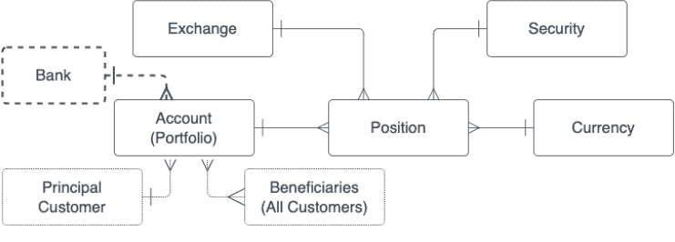
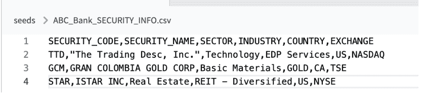
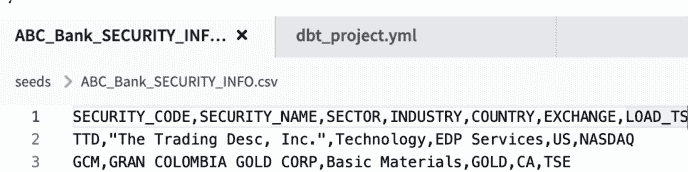
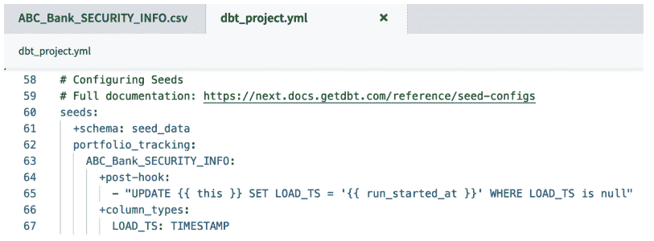
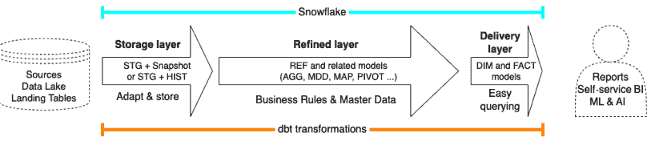
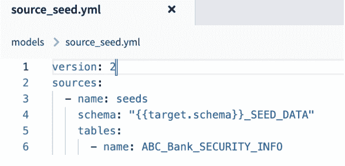
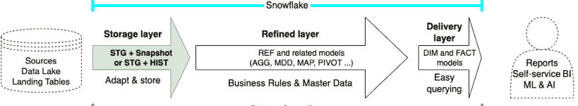
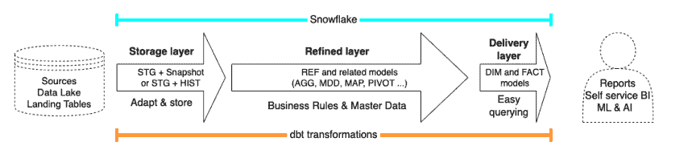

## 使用维度数据

在上一章中，我们从零开始探索了构建数据平台背后的核心原则，并在参考架构中实现了这些原则。

在本章中，我们将学习如何将维度数据整合到数据模型中，并利用它来扩展描述业务事实的事实表。维度数据使事实信息对业务用户来说更加有用且易于使用。

**维度数据**一词指的是为实体提供可读信息的描述性数据，例如客户或账户的名称或国家。

我们将探索如何创建数据模型来规划工作，并为 *Pragmatic Data Platform* 架构的所有层构建 dbt 模型，以在数据集中市中交付维度数据。

最后，我们还将借助一个练习来回顾上一章和本章所学的内容。

本章涵盖以下主题：

- 添加维度数据
- 加载第一个维度的数据
- 为第一个维度构建 STG 模型
- 保存维度数据的历史记录
- 使用维度数据构建 REF 层
- 将维度数据添加到数据集市
- 练习——添加更多手动维护的维度

### 添加维度数据

一般来说，维度数据用于通过事实表中存储的维度实体代码，去连接维度表以获取描述性信息，从而为事实提供描述性信息。

我们在上一节加载的持仓事实有四个显式外键，我们恰当地用 `_CODE` 后缀命名：账户代码、证券代码、交易所代码和货币代码。

这四个代码是引用，或者说外键，指向我们可以直接连接到该事实的四个维度。

还有一个额外的隐式维度——银行维度，它隐含在模型的名称中。

### 为精炼层和数据集市层创建清晰的数据模型

为了能够最终确定维度和事实表设计，我们需要对报表（数据集市层）中使用的数据模型有一个清晰的了解，这通常是星型模式，或者很少情况下是一张宽表。

这反过来又与我们所拥有且能够在精炼层完整表示的数据模型紧密相连并受其影响。

让我们先快速看一下简化后的概念数据模型，它涉及我们已命名并希望围绕持仓事实进行报表展示的实体：



图 7.1：示例项目的概念数据模型

在此数据模型中，我们看到了前面提到的四个维度，以及我们讨论过的隐含银行维度。

### 加载第一个维度的数据

在本节中，我们将了解如何创建（如果你没有来自某个外部源系统的数据）并加载证券维度的维度数据，该维度描述了账户持仓中包含的证券。

在本节结束时，我们将邀请你将其他维度作为练习添加进来。

### 创建 CSV 文件并作为 seed 加载

在真实的银行数据平台中，证券维度很容易达到几十列，其中一些列是不经常变化的信息值，而大多数列则是根据交易活动计算出来的值。

在本节中，我们将创建一个简单的 CSV 文件，其中包含几个基本列：`Security_Code`、`Security_Name`、`Sector`、`Industry`、`Country` 和 `Exchange`。

| SECURITY_CODE | SECURITY_NAME | SECTOR | INDUSTRY | COUNTRY | EXCHANGE |
|---|---|---|---|---|---|
| TTD | The Trade Desk, Inc. | Technology | EDP Services | US | NASDAQ |
| GCM | GRAN COLOMBIA GOLD CORP | Basic Materials | GOLD | CA | TSE |
| STAR | ISTAR INC | Real Estate | REIT - Diversified | US | NYSE |

*图 7.3：表示 ABC_BANK_SECURITY_INFO.CSV 文件内容的 Excel 表格*

CSV 文件的内容如下所示：

```
SECURITY_CODE,SECURITY_NAME,SECTOR,INDUSTRY,COUNTRY,EXCHANGE
TTD,"The Trade Desk, Inc.",Technology,EDP Services,US,NASDAQ
GCM,GRAN COLOMBIA GOLD CORP,Basic Materials,GOLD,CA,TSE
STAR,ISTAR INC,Real Estate,REIT - Diversified,US,NYSE
```

你可以在 Excel 等电子表格中创建自己的 CSV 文件，如前面的截图所示，然后将其导出为 CSV；也可以直接在 dbt 中创建 CSV 文件，然后键入或复制粘贴内容（注意换行）。

如果你不想手动输入内容，可以从我们的 GitHub 仓库的 *Chapter 6* 文件夹中下载，文件名为 `06_05_v1__ABC_Bank_SECURITY_INFO.csv`。

让我们创建 CSV 文件：

- 1. 打开 dbt Cloud 文件**资源管理器**中的 seeds 文件夹。
- 2. 打开右侧的菜单（三个点），点击**创建文件**。
- 3. 在弹出的窗口中输入文件名 `ABC_Bank_SECURITY_INFO.csv`。
- 4. 打开新文件并编辑其内容，使其与本部分所示内容（前面的代码和下面的截图）一致：



### 配置 seed 并加载它们

在 seeds 文件夹中创建好 CSV 文件后，就该配置希望 seed 数据加载的位置，然后执行加载。

让我们来操作：

- 1. 打开主配置文件 `dbt_project.yml`，并在文件末尾添加以下代码：

```
### Configuring Seeds
seeds:
  +schema: seed_data
```

此配置指示 dbt 将所有 seed 加载到名为 seed_data 的 schema 中。

- 2. 配置好希望 dbt 创建包含 CSV 数据表的位置后，就可以运行命令加载数据了。在 dbt 命令行中执行以下命令：

```
dbt seed
```

运行 `dbt seed` 命令后，你会发现 dbt 在配置的 schema 中创建了一个与 CSV 文件同名的表，并带有您开发环境常用的前缀。

### 为 seed 添加数据类型和加载时间戳

在 seed 加载过程中，我们很幸运，所有数据都是字符串类型，并且没有 null 值，因此即使在未指定列数据类型的情况下，一切也都顺利进行了。

加载表之后，我们还注意到，我们无法知道数据是什么时候加载的。


让我们添加一个 timestamp 类型的 LOAD_TS 列，并使用 post_hook 填充它：

1. 打开 CSV 文件，在第一行末尾通过添加一个逗号和新的列名来加上 `,LOAD_TS`，不要有空格，如下面的截图所示。保存文件。

这会将 LOAD_TS 列添加到文件中，其他行没有任何数据，这些数据将由 null 值填充。



图 7.5：添加了 LOAD_TS 列的 CSV 文件

2. 在主 dbt 配置文件中添加配置，以声明 timestamp 数据类型的 LOAD_TS 列。

要配置数据类型，你需要在要配置的 seed 下添加 `column_types` 配置，并在其中将你想映射的列对应到你想要指定的数据类型，如下面的代码所示：

```yaml
portfolio_tracking:
  ABC_BANK_SECURITY_INFO:
    +column_types:
      LOAD_TS: TIMESTAMP
```

请注意，我们首先列出了项目名称，然后在它下面列出了 seed 名称。

你不需要指定所有列。你没有指定的列将由 Snowflake 根据 CSV 文件中列的内容进行推断。

3. 在主 dbt 配置文件中添加配置，以便在创建用于保存 CSV 文件的表之后运行 SQL 查询。

要实现这一点，请在 CSV 名称下添加 `post-hook` 配置来定义查询，然后添加要执行的查询行：

```yaml
ABC_BANK_SECURITY_INFO:
  +post-hook:
    - "UPDATE {{ this }} SET LOAD_TS = '{{ run_started_at }}' WHERE LOAD_TS is null"
```

Pre-hooks 和 post-hooks 是 dbt 的功能，允许你在模型（包括 seed 表）创建之前或之后执行一个或多个 SQL 查询。

请注意，我们将完整的 SQL 查询放在双引号内，这样我们就可以在查询中使用单引号。还要注意，查询中使用了 dbt 脚本，特别是 `this` 和 `run_started_at` 变量。

前者将被替换为正在构建的模型的完全限定名称，而后者将被替换为以 UTC 时区表示的 dbt 执行开始时间的时间戳。

以下截图提供了 CSV seed 的最终配置：



图 7.6：dbt 主配置文件中的 CSV 数据类型和 post-hook 配置

请注意，在 `seed:` 声明下第 61 行定义目标 schema，意味着该配置将应用于所有 seed，包括由其他库导入的 seed。如果你希望它仅应用于我们项目中的 seed，请将其移动到项目名称下，并进行相应的缩进。

既然我们已经添加了列并完成了配置，让我们从头重新创建 seed 表，以便能够创建新列。运行以下命令：

```bash
dbt seed --full-refresh
```

我们添加了 `--full-refresh` 选项，因为我们要删除并重新创建 seed 表。

现在，你可以前往 Snowflake，检查 seed 表是否具有 LOAD_TS 列，并且该列包含你运行命令时的时间戳。



图 7.7：Pragmatic Data Platform 的层次结构

最终的 YAML 文件将如下所示：



图 7.8：用于读取我们的 seed 文件的源系统定义

现在，我们还可以使用 `source()` 函数引用 seed 表。

## 为安全维度创建 STG 模型

现在，我们已经从创建的 CSV 中加载了数据，因此希望名称和数据类型都没有问题。但在实际环境中，我们可能会从无法控制的来源获得这些数据，因此 STG 模型将有助于像往常一样调整传入的数据。

此外，从 STG 模型的通用模式中（你可以在我们仓库 Chapter_06 的 patterns 文件夹中找到 `06_06_v1__STG_Model.sql` 文件），你会记得，对于维度，我们还需要有一个默认记录。

让我们开始构建 STG 模型的骨架：

1. 在 `models/stg` 文件夹中创建一个名为 `STG_ABC_BANK_SECURITY_INFO.sql` 的新文件。
2. 为 config 和 `src_data` CTE 添加以下代码：

```sql
{{ config(materialized='ephemeral') }}
WITH
src_data as (
    SELECT
        SECURITY_CODE      as SECURITY_CODE      -- TEXT
      , SECURITY_NAME      as SECURITY_NAME      -- TEXT
      , SECTOR             as SECTOR_NAME        -- TEXT
      , INDUSTRY           as INDUSTRY_NAME      -- TEXT
      , COUNTRY            as COUNTRY_CODE      -- TEXT
      , EXCHANGE           as EXCHANGE_CODE      -- TEXT
      , LOAD_TS            as LOAD_TS            -- TIMESTAMP_NTZ
      , 'SEED.ABC_Bank_SECURITY_INFO' as RECORD_SOURCE

    FROM {{ source('seeds', 'ABC_Bank_SECURITY_INFO') }}
),
```

你可以看到，我们已将模型配置为以 ephemeral 方式物化。我们添加了 RECORD_SOURCE 字段，并且对其他字段的名称做了很少的更改。最后，我们使用 source() 函数引用 seed 表。

3. 为 hashed CTE 添加以下代码：

```sql
hashed as (
    SELECT
        concat_ws('|', SECURITY_CODE) as SECURITY_HKEY
    , concat_ws('|', SECURITY_CODE,
                SECURITY_NAME, SECTOR_NAME,
                INDUSTRY_NAME, COUNTRY_CODE,
                EXCHANGE_CODE )
                as SECURITY_HDIFF

    , * EXCLUDE LOAD_TS
    , LOAD_TS as LOAD_TS_UTC
    FROM src_data
)
SELECT * FROM hashed
```

我们将 HKEY 定义为安全代码，并将除 LOAD_TS 和 RECORD_SOURCE 元数据列之外的所有列添加到 HDIFF 中。

关于 LOAD_TS_UTC 列的定义，有一点需要注意。

通常，我们将其定义为 `'{{ run_started_at }}' as LOAD_TS_UTC`，它提供 dbt 运行开始的时间戳，但在本例中，我们决定使用 seed 数据加载的时间作为该时间戳，这主要是为了向你介绍新的 Snowflake 语法：`SELECT * EXCLUDE <columns>`。

这种 Snowflake 语法在你想要从输出中排除某些列，或重新定义所查询的某个表中某一列的值时非常方便，无需像在标准 SQL 中那样列出所有其他列。对于列很多的表来说，这非常方便。

更保守的做法是将 LOAD_TS 字段重命名为 INGESTION_TS，并保留 LOAD_TS_UTC 列的常见定义。

我们已经创建了 STG 模型的核心。在下一节中，让我们看看如何向该模型添加默认记录。

## 向 STG 添加默认记录

我们要添加的下一部分是默认记录 CTE，如下所示：

```sql
default_record as (
    SELECT
        '-1'          as SECURITY_CODE
        , 'Missing' as SECURITY_NAME
        , 'Missing' as SECTOR_NAME
        , 'Missing' as INDUSTRY_NAME
        , '-1'        as COUNTRY_CODE
        , '-1'        as EXCHANGE_CODE
        , '2020-01-01'          as LOAD_TS_UTC
        , 'System.DefaultKey'   as RECORD_SOURCE
)
```

在上述代码中，你可以看到以下内容：

- 所有 CODE 字段都以字符串 -1 作为默认值。这是数据仓库中非常常见的值，用于表示与代码列相关的维度中缺少值所对应的条目。
- 我们还在默认记录中添加了 RECORD_SOURCE 字段，其值为 System.DefaultKey，这一点很重要，因为它可以区分出这是由我们的系统作为默认值添加的数据，而不是来自原始系统。
  这也是在 src_data CTE 和此处都添加该字段的一个很好的理由，这样我们就可以区分默认记录与其他数据的来源。
- 其他字段根据其类型具有标准的默认值：字符串字段以 Missing 作为默认值，数字字段以 -1 作为默认值，但你可以根据该特定实体中每个字段的具体情况选择任何有意义的值。

with_default_record CTE 与模式相比没有变化。

## 保存维度数据的历史记录

在上一章中，我们保存了第一张表的历史记录，该表是关于持仓的。那是一张事实表（FACT 表），因为它记录的是已经发生的事实或系统在某个时间点的状态。

事实可能会发生变化。如果会变化，我们就需要业务键来识别事实的不同实例，就像我们对持仓所做的那样。另外，事实也可能是不可变的，此时我们不需要业务键，例如 Web 浏览量的情况。

现在，我们将保存第一个维度（DIMENSION）的历史记录。


维度存储描述性信息，使我们能够全面理解一个事实，例如关于客户的信息，或者在此案例中，关于证券的信息。

维度所描述的实体生命周期较长，经常在不同时间被多个事实引用，并且在其生命周期中通常可以发生变化。因此，正确定义实体的身份（最好带有业务键）至关重要。这也是捕获实体实例历史的关键。

## 使用快照保存历史

在本章中，我们将使用 dbt 快照捕获维度的历史，而在第 13 章中，我们将看到如何使用简单的 SQL 以更高效的方式大规模保存历史。

让我们构建快照：

1. 在快照文件夹中创建一个名为 `SNSH_ABC_BANK_SECURITY_INFO.sql` 的文件，就像我们之前创建的其他快照一样。
2. 在文件中输入以下代码：

```sql

{{
    config(
        unique_key='SECURITY_HKEY',
        strategy='check',
        check_cols=['SECURITY_HDIFF'],
    )
}}
select * from {{ ref('STG_ABC_BANK_SECURITY_INFO') }}

```

您可能已经注意到，这段代码与之前的快照非常相似，唯一的区别是查询中引用的 STG 模型以及 HKEY 和 HDIFF 字段。

另一个区别是我们移除了 invalidate_hard_deletes 参数，因为通常对于维度而言，保留旧条目比捕获删除更重要，因为这些旧条目会被旧事实引用。最终，我们可能会想知道某个条目是否仍然有效。在这种情况下，我们会启用该参数来跟踪硬删除，但随后在从快照派生的 REF 模型中同时保留活动行和已删除行。

一个重要的注意事项是我们如何定义 HDIFF 列：我们从 seed 中省略了 LOAD_TS 列，因为它会在每次重新加载 seed 时发生变化，而如果实际数据没有变化，我们并不关心存储新版本。

请始终非常谨慎地考虑您要将什么视为需要跟踪的变更，并据此构建 HDIFF 列。

现在我们已经创建了第二个快照，让我们使用以下命令部署它：

```bash
dbt snapshot
```

这将运行并刷新我们定义的两个快照，因此您将在 Snowflake 数据库中找到它们。



图 7.9：实用数据平台中突出显示的存储层

现在我们已经添加了存储层，可以开始处理精炼层了。

## 使用维度数据构建 REF 层

让我们继续通过构建 REF 模型来构建证券信息维度。

让我们开始：

1. 在 `models/refined` 文件夹中创建一个名为 `REF_ABC_BANK_SECURITY_INFO.sql` 的新文件。
2. 在文件中输入以下代码：

```sql
WITH
    current_from_snapshot as (
        SELECT *
        FROM {{ ref('SNSH_ABC_BANK_SECURITY_INFO') }}
        WHERE DBT_VALID_TO is null
    )
SELECT *
FROM current_from_snapshot
```

您可以看到，此文件的内容与我们之前为持仓事实创建的 REF 模型几乎相同。

我们已经创建了 REF 模型，因此使用以下代码构建它：

```bash
dbt build -s REF_ABC_BANK_SECURITY_INFO
```

查看模型中的列，我们可以看到有 DBT_SCD_ID、DBT_UPDATED_AT、DBT_VALID_FROM 和 DBT_VALID_TO 这些技术列，它们在快照之外不太有用。

我们可以使用 Snowflake 的 SELECT * EXCLUDE 语法轻松地将它们从结果中移除。将 current_from_snapshot CTE 改为如下所示：

```sql
current_from_snapshot as (
    SELECT * EXCLUDE (DBT_SCD_ID, DBT_UPDATED_AT,
                        DBT_VALID_FROM, DBT_VALID_TO)
    FROM {{ ref('SNSH_ABC_BANK_SECURITY_INFO') }}
    WHERE DBT_VALID_TO is null
)
```

保存并再次运行构建命令，即可看到这些字段不再出现在输出中。

非常好，这样看起来好多了！

将这一改进同样应用到其他使用类似代码实现的 REF 模型上是合理的。您可能会想打开它，复制并粘贴代码，就像您在构建此模型时可能做的那样。

注意！复制和粘贴应当让您的软件工程第六感拉响红色警报！

复制和粘贴代码是快速陷入维护地狱的最可靠方式之一。它浪费时间且容易出错，维护工作很快就会失控，因为每次更改都需要手动应用到所有复制粘贴过代码的地方，但要想找到所有这些地方，祝你好运！

在这种情况下，您很容易理解，大多数从快照数据派生的模型都会使用与之前相同的代码从快照中读取当前数据。如果您有 100 张表，复制和粘贴会让您面临必须在 100 个地方应用相同更改的风险。

dbt 最重要的特性之一——宏——就是解决这个问题的方法。在下一章中，我们将介绍宏并解决这个问题，所以目前我们可以保持原样。

## 将维度数据添加到数据集市

现在我们已经有了维度的精炼模型，可以将其发布到数据集市。

让我们构建证券维度：

1. 在 `models/marts/portfolio` 文件夹中创建 `DIM_SECURITY.sql` 文件。
2. 在文件中输入以下代码：

```sql
SELECT * FROM {{ ref('REF_ABC_BANK_SECURITY_INFO') }}
```

与持仓事实的情况一样，我们现在没有特殊要求，因此我们只是将 REF 模型中的所有内容原样发布。

像往常一样，要部署模型，请运行以下命令：

```bash
dbt build -s DIM_SECURITY
```

如果您想确保所有内容都以最新形式部署，请运行以下命令：

```bash
dbt build
```

运行上述任一命令后，您将在数据集市中拥有两个表：FACT_POSITION 和 DIM_SECURITY。现在您就可以开始进行分析了。

## 练习——添加几个手动维护的维度

在本章中，我们向您展示了如何从源数据出发（包括在数据在其他地方不可用时创建 CSV），通过存储层和精炼层，生成可用来支持分析的数据集市。



图 7.10：实用数据平台的各层

在这里，我们建议您向项目添加几个维度，以提供关于已加载事实的更多有用信息。

对于每个维度，您都需要为数据平台的所有层创建 dbt 模型，并且您将开始看到如何反复应用相同的模式。

每个维度的潜在候选及列如下：

- **交易所**：描述证券交易场所的维度，包含代码、名称、国家、城市、交易时间和时区
- **账户**：描述持有持仓的账户的维度，包含代码、昵称、主要受益人姓名、所有受益人姓名、记账货币、经纪商名称或经纪商代码
- **货币**：将货币名称与其字母代码联系起来的维度，还可以包含其他信息，如符号、要使用的小数位数以及发行国家/实体
- **国家**：包含两位字母和三位字母国家代码、国家名称、地区、次区域等信息的维度

这只是一个示例列表；根据您的兴趣，您可能会找到更多。

我们建议您选择一个或多个并自行实现所有步骤，以便在数据集市中使用它们：

1. 将 CSV 作为 seed 加载，包括生成 LOAD_TS。
2. 将 CSV 的源定义为另一个 seed 数据表。
3. 创建 STG 模型以适应传入的数据。
4. 创建快照以存储维度数据中的变更。
5. 创建精炼模型，从快照中读取当前数据。
6. 在数据集市中创建 DIM 模型。

在本书的 Git 仓库中，本章的文件夹下，您会找到一个 csv 文件夹，其中包含三个 CSV 文件，分别包含货币、国家和交易所的数据。

## 总结

在本章中，我们学习了维度数据以及它如何增强数据平台和数据集市的可用性。我们学习了如何使用 dbt 的基本功能将维度数据纳入我们的数据平台。

我们加深了对前几章学习的实用数据平台各层的理解，并应用这些原则来处理维度数据。

在下一章中，我们将开始探索更高级的特性，这些特性将使我们能够替换一些基础代码，以构建一个更具弹性、更易于编写且更易于维护的数据平台。


