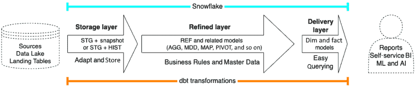
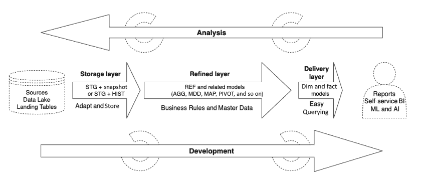
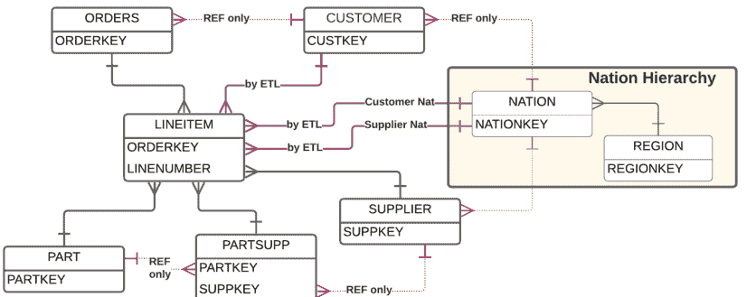
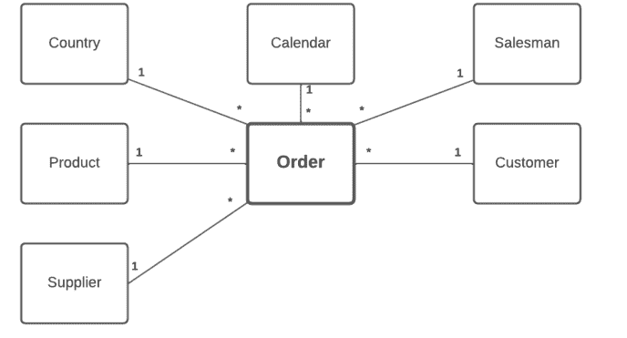
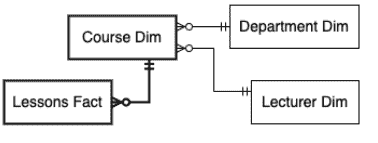
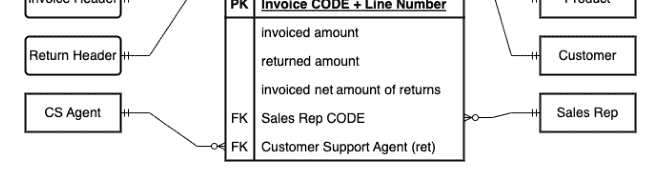
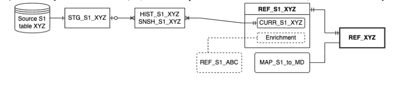
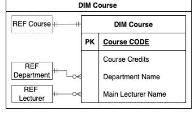
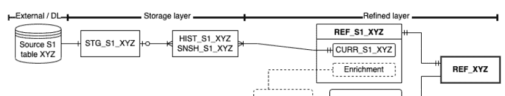

## 敏捷开发

在上一章中，我们完成了使用 dbt 编码的基础知识，解释了如何编写宏和测试，并完成了目标架构的 MVP。

在本章中，你将学习通过结合哲学与实践提示来进行敏捷开发，了解如何在项目各阶段保持待办事项敏捷，并深入探讨构建数据集市。

在本章中，你将了解以下主题：

- 敏捷开发与协作
- 将敏捷应用于数据工程
- 以敏捷方式构建报表

### 技术要求

只要你知道 dbt 的基础知识，即使不阅读前面的章节，也能阅读并理解本章。

本章没有代码示例。

### 敏捷开发与协作

在本章中，我们将涉及开发周期中可能最重要的部分，即对项目成功和交付时间贡献最大的部分——让你的团队富有生产力，并渴望通过互相帮助作为团队在项目上工作。

凭借二十多年在不同国家、公司、行业和职能领域工作的经验，我可以说开发人员热爱他们的工作，他们讨厌无所事事，甚至更讨厌愚蠢、毫无意义的事情。

你可以放心，只要你的开发人员清楚要构建什么，并有足够小的增量目标去实现，他们就会构建你的项目，因为这正是带给他们满足感的东西。

事情并不是这样运作的。构建软件和创建数据平台在很大程度上是以有组织的方式编写新代码。这是一个创造性过程，不同的能力、经验和观点都很重要。它更接近于在已知行业中发明新产品的过程。

在构建数据平台的过程中，公司和需求可能会发生变化；数据平台基础的数据和流程会随世界不断变化，并非一成不变。在写下第一行代码之后，甚至在首次发布之前，为跟上不断变化的需求而进行演进就是开发的一部分。

我建议你还阅读敏捷宣言背后的12条原则，可在 https://agilemanifesto.org/principles.html 获取。

它们提供了关于敏捷工作的宝贵且常青的洞见，这些原则中的大多数已成为敏捷团队的基石，例如其中一条说：“可工作的软件是衡量进度的首要标准”。可工作的软件正是你想要的；其他一切只有在多大程度上让你更接近拥有（并保持）可工作的软件时才有用。

### 将敏捷应用于数据工程

审视敏捷宣言的四条声明，关键信息是人员、结果和遵循现实世界的关注比计划和文件更重要。这并不意味着其他要素本身不好，只是它们不是最重要的，它们的重要性在于对其他要素的贡献。

以下是一些适用于数据工程领域的总体考虑：

- 敏捷不是即兴发挥。拥有计划很重要，同时要理解任何计划都不是一成不变的，它会不断变化。计划的意义在于跟踪我们所处的位置、当前期望目标以及我们在领域周边积累的知识。快速失败对于尽早了解此路不通很重要。
- 与了解领域（即业务）的人以及了解技术的人合作选定方向。持续交付并验证中间结果，在每一步只需进行小幅方向调整。你走得越远，方向变化越小，目标越清晰。当遇到失败时，尽快将所学纳入计划，并按需调整方向。
- 前一点的一个重要推论是，在推进过程中不断完善你的目标细节。这是一个迭代过程。你从一个明确的范围和一个总体目标开始，可能对可用数据知之甚少。通过努力并交付初步成果，你最终会明确你想要什么和不想要什么。你也会更好地理解数据中有哪些内容，哪些没有。不断与业务方讨论他们想要什么，并相应调整他们的期望/你的项目。保持信息流通和想法灵活。


- 一个总体目标是让你的计划尽可能灵活，在负责的最后时刻做出决策（尤其是那些难以改变的决策），以便能够尽可能多地利用知识和经验来做出决策。这并不意味着永远拖延；它意味着如果你可以等待，就应该避免过早地固化决策，也不要仅仅因为计划而坚持用一种方式做事。如果你有更好的想法，就采用它。
- 在开始时验证最大的问题，这样随着前进，方向发生重大变化的风险就会降低。例如，检查你是否能够处理一些不可或缺的关键数据，是否能够读取某种格式或访问某个系统，或者处理预期数据量所需的时间是否合理。
- 尝试将工作分解为小块工作增量，通常称为 **故事**，这些增量可以在几乎不会被迫停止的风险下完成。在开始一个故事的工作之前，将其拆分为可以在1天或更短时间内完成的小任务。请注意，在设定时间段内计划完成的一组工作增量，即 **开发迭代**，通常被称为 **产品增量**。
- 不要试图“煮沸大海”（做不可能的事）或迷失在太多不同的事情中。尝试让团队专注于当下最重要的话题，以便他们能够协作解决问题。以协作方式每周完成一个可工作的软件片段，好过一个月完成五六件但各自为政的工作。质量会更好，团队会更开心，知识会分布在许多头脑中，而不仅仅是一个人。
- *先完成，再开始* – 在开始更多工作之前，专注于收尾未完成的工作。太多悬而未决的事情会给人们带来巨大的精神消耗，项目失去动力，变得无法集中注意力，而且如果只有很少的工作完成，就很难了解取得了多少进展。
- 敏捷不仅关乎灵活性，还关乎避免浪费，移除过时、价值不大或价值不确定的东西。这适用于所有方面，从代码到文档再到规划。

如果让我用一句话总结敏捷概念，我会说敏捷就是：让一个最初模糊但不断清晰的全景图保持最新，做一些工作来产生预期的结果，并照亮进一步明确全景图以及你接下来要做什么的道路。

## 以敏捷方式启动项目

我们已经说过，开始时必须充分理解项目的范围以及你想要实现的主要目标，但这只是意味着你从总体上知道你想要什么，而不是知道所有实现细节。

在这个阶段，知道你不要什么和知道你要什么同样重要。你应该首先建立对项目范围的充分理解。

选择正确的范围并组建一个团队，先找到正确的方向，再找到实现目标的途径（业务需求和技术能力），这是本阶段最重要的事情。

让团队形成一个业务和技术都认同的初步高层计划，并确定起点以及你不确定、可能使计划偏离轨道或大幅改变其形态的重大问题。这些就是你要面对的高风险。先厘清它们。

为每个风险创建一个故事，以验证你能否按计划的方式或某种替代方式完成计划的事情。你不需要开发最终交付物，只需具体验证你计划要做的事情是否可行以及如何实现。这有时被称为做 **概念验证（POC）**。

在这个初步构思/定向阶段之后，你会对自己所处的位置和想要实现的目标有更清晰的了解，并且随着主要风险的澄清，你应该能够有足够的信心选择一个好的方向开始实际工作。

这个初始阶段应该很短——对于普通项目，理想情况下只有一个冲刺（sprint），如果你在做全新的事情并且需要制作大量POC，最多也就几个冲刺。

用一个假期来类比：你首先要决定是想去西班牙享受海滩时光、去法国逛城堡、去波兰徒步旅行，还是去芬兰钓鱼。还应该明确谁负责目的地、预算和运营决策。

对你想要进行的活动有所了解也很有用，因为它会影响行装和交通需求。品尝葡萄酒时你不需要渔具。一旦你知道了目的地，你就需要知道如何到达那里以及如何四处走动，尤其是如果你计划进行很多活动。如果你不确定，你可能想查看是否有飞机和火车，核实乘车的价格、时间和费用，或者住宿的可用性和价格，这样如果需要改成露营，你在打包之前就知道了。

在这个初始阶段，你创建了一个初步计划，这个计划的许多细节肯定会改变，但它已经得到相关各方的同意，并且团队也理解，因此当需要或大或小的改变时，他们会知道其中的影响，并能更快更好地行动。

考虑到我们的务实数据平台（Pragmatic Data Platform）方法及其架构，你需要确保已经为项目选择了一个数据平台（我们选择了 Snowflake 和 dbt），有明确的范围，能够访问你期望使用的数据，能够在所选数据平台上使用这些数据，并且没有悬而未决的重大技术问题。



图10.1：务实数据平台架构

如果你以前从未尝试过技术设置或其中某部分，你可能会想对其实施POC。

我用POC验证过的一些技术问题包括：使用内部暂存区（internal stages）每分钟将Avro文件加载到落地表（landing table）的能力；在参考系之间转换地理空间坐标的能力；以及在合理时间内对数十亿行大小的表执行一些可能较慢的操作的能力。

## 以敏捷方式组织工作

既然你有了明确的范围和前进的方向，是时候开始持续产出有价值的结果，让你更接近最终目标了。

敏捷原则建议，频繁交付可工作的软件是更可取的。这是一个关键的敏捷概念，也是一个优秀敏捷团队的标志之一——在每个开发迭代或产品增量结束时，完成并展示已完成的工作。

在广泛使用的Scrum方法中，一个开发迭代被称为一个冲刺（sprint）。

Scrum是一种不错的方法，但“冲刺”这个词并不是一个好选择，因为它让人联想到某人以最快速度奔跑的画面。这种状态只能在短时间内维持，随后就会因精疲力竭而不得不停下来。这不是我们希望开发迭代达到的状态！

敏捷团队的目标是以可持续的方式工作。一个开发迭代，即使被称为冲刺，也必须按照一个好的节奏来规划工作，这个节奏可以无限期地持续下去。这是敏捷团队真正的秘诀——在团队中分配负载，不让个人或团队过度负荷。

首先要诚实面对每个人能投入项目工作的时间，然后选择在迭代期间可能完成的工作量，并让团队感到有承诺去完成，同时要考虑到正在处理的工作项和已经交付的项目部分（即维护工作或缺陷修复）必然会出现的各种问题。

如果你不确定，宁可承诺更少的工作。这是因为达成目标的团队士气要比未达成的团队高得多，而且大多数重大改进都发生在团队有一定回旋余地、可以尝试新的工作方式或清理拖后腿的旧技术债务的时候。

请记住，软件工程师热爱自己的工作，如果得到认可，他们会为尽了全力而感到自豪。

敏捷开发的另一个基石（主要被称为DevOps文化）是，为团队提供执行开发项目所需的所有任务的工具、专业知识、权限和责任，从项目启动和分析到生产环境中的执行。

授权并信任团队，为他们的成功喝彩，并对他们的结果负责。


## 以敏捷方式管理积压工作

那么，**积压工作**中应该包含什么，或者工作待办清单应由什么组成？

积压工作必须包含待办工作的描述，但这并不意味着所有内容都应处于同一详细程度，或待办工作不会发生变化。

黄金法则是，它应以最详细的程度描述下一迭代中要完成的工作，包含足够的信息让开发人员完全理解需要做什么。它也可以以递减的详细程度包含未来要完成的其他工作的描述，因为预计这些工作会在更远的时间完成。未来的工作应以少量且逐渐更概括的故事呈现。

在每次迭代，即每次冲刺中，你会处理掉已开发的许多小故事，并将从积压工作中挑选出来计划在下一次进行工作的更大故事拆分为小而详细的 story 和任务。

> **提示**
> 
> 关于将什么放入积压工作中存在一个常见冲突。对于开发团队而言，最好只保留足以填满略多于当前迭代的故事，任何更多都是负担，而产品负责人则有兴趣跟踪未来要开发的功能以及更长期的计划和想法。

如果浏览积压工作中的所有故事花费太多时间，这表明你的积压工作中故事太多。我们强烈建议将遥远的工作分组为更大、更概括的故事。如果项目的范围很大，有意义的做法是将产品负责人的积压工作与开发团队的积压工作分开，前者更像是一份正在考虑开发的想法和功能的清单，后者应只包含需要在未来几次迭代中开发的功能，因为更远的工作是不确定的，很可能发生变化。

这只是工作环境卫生的基本原则——像保持你的办公桌和办公室一样保持你的积压工作干净。没有人能在堆满灰尘的箱子或堆满久已遗忘的纸堆的桌子上高效工作。为什么你要让你的积压工作处于这种状态？

举例来说，你知道要开发报告 XYZ，你需要加载 10 个表并计算几个中间表等等。这是有价值的信息，但如果你不计划在下一次冲刺左右做这项工作，那么最好将这些信息作为一段文本和项目符号放在单个功能中，而不是拥有许多独立的故事。直到开发即将开始时，管理一个标题为 `develop report xyz` 的单个条目会更容易，然后在你准备开始工作时再将其拆分为独立的故事，并拆分为可在放入冲刺后在不到 1 天内完成任务。这个概括性的故事应在开发即将开始时移至开发团队积压工作，而当它只是未来某个时间可能开发的一个功能时，可以保留在产品负责人积压工作中。

用更实用的方式来说，使用常见的术语来识别不同粒度级别的待办工作，积压工作应包含以下内容：

- 一到两个冲刺量的**故事**，这些故事已准备好开发。这些故事必须以实现细节级别描述，以便团队中的每个人都理解需要做什么。进入开发的故事必须在开始工作前拆分为**任务**。最初，任务可以是故事描述中的待办事项项目符号列表。当你拆分它们时，应确保每个任务可以在一天内完成。
- 若干**功能**，描述已计划且可能准备好执行但仍在详细分析和拆分为独立故事的工作。这些应提供另外几个冲刺左右的工作量，不应更多。
- 最终，几个非常概括的**史诗**，列出尚未计划或计划在少数几个冲刺之后才进行的下一个开发领域。这些是未来工作的少数高层描述，主要是产品负责人的关注点。如果它们包含文本或文档，例如在准备时所理解的预期内容的演示文稿，是完全可以的。在基于旧计划开始工作前，请批判性地审查它们。

这看起来如此简单，但我可以向你保证，在绝大多数项目中，积压工作的卫生状况最多令人不满意，有大量腐烂的故事永远不会完成，留在那里白白消耗每个人的注意力。

筛选数百个故事以找到下一次冲刺要做的少数几个故事或根据你的发现进行更新，比用十几个或二十个故事做同样的事情更复杂、耗时更长，并降低专注度。

“制作报告 X”或“加载表 Y”这样的故事如果没有额外内容有什么价值？没有！它只是使你的积压工作混乱，并在规划工作或使用积压工作时杀死你的生产力。

问问自己，如果故事几个月未被触及，保留它们的价值何在。删除它们并保持你的积压工作简短且专注。你会在需要时记住这些故事，如果你记不住它们，那就意味着它们并不重要。如果旧故事中确实有有价值的信息，你可以将其保存到更高层级的故事中，但如果所有你拥有的只是一个标题，就把它扔掉。

## 我们示例项目的初始积压工作

在本节的其余部分，我们将为你提供一个管理积压工作的实用示例，以及一种经过验证的方法来完成数据工程中最常见的任务之一——构建报告。

我们将按照数据流的方式描述我们的架构，因此我们有源，然后是存储层，其中有 STG 和 SNAPSHOT 或 HIST 模型，然后是精炼层，其中有许多专门的模型，最后是交付层，在那里你为每个域有一个数据 mart，为该域的报告提供支持。



图 10.2：务实的数据平台架构和迭代分析与开发

在构建报告时，如敏捷方法中经常做的那样，我们从流程的末端开始以识别目标，然后逆向工作以识别实现目标所需的最小工作量。

上图直观地显示了分析和开发工作的主要方向，虚线回环提醒我们，在这两种情况下，这些都是迭代过程，每当我们发现阻塞或问题时，我们都可以返回并更改之前步骤的结果。

作为迭代过程，我们的意思是在每次迭代或一组迭代中，我们尝试分析和开发我们范围的一个小水平切片，覆盖所有层，然后再移动到另一个切片。

考虑到我们在前几章中使用的示例项目，我们可以说初始概述产生了以下史诗：

- E1 – 设置平台
- E2 – 构建客户报告
- E3 – 构建积压报告

第一个史诗 E1 将涵盖我们在前几章中设置平台所做的工作。它将被切片为诸如“设置 Snowflake 账户”、“设置 dbt 账户”和“设置 GitHub 账户”之类的功能。

Snowflake 功能可以细分为诸如“创建 Snowflake 账户”、“为 dbt 项目创建数据库”、“为 dbt 项目创建角色”、“为 dbt 执行创建用户”、“为开发人员创建用户”等故事。如果我们认为完成它们需要超过 1 天，每个故事都将被拆分为任务。

如果故事已经足够小，就没有必要拆分它。记住，敏捷也意味着避免无用的工作。

第二个史诗（E2）可能被切片为以下功能：

- F1 – 构建客户当前头寸报告
- F2 – 构建客户历史头寸报告
- F3 – 构建客户交易报告
- F4 – 其他客户报告

我们有意将 F4 功能命名为“其他客户报告”，以表明拥有一个包含潜在长列表所需报告的单个功能，比现在就为每个报告创建功能而产生长列表更有意义，因为现在它们将在很多冲刺之后才会被考虑工作。

### 提示

> 通过将远期工作放在所有层级的“所有其余”项中或单独的产品负责人积压工作中来保持积压工作简短。“遥远”的含义取决于冲刺持续时间和冲刺中完成的工作量。

一个好的经验法则是为一个或两个冲刺准备好故事，并将已识别的功能拆分为故事以提供几个冲刺的工作量。其他所有内容都应放在产品负责人的积压工作中或“所有其余”类型的项目中。

## 以敏捷方式构建报告

在本节中，我们将以非常通用的方式将构建报告的功能分解为故事，你可以将其用于任何报告，以及数据 mart 中的几乎任何其他结果交付物。

“F1 – 构建客户当前头寸报告”功能可以拆分为以下五种类型的故事：

- S1 – 为为 F1 报告提供支持的数据 mart 设计轻量级数据模型。
- S2 – 为为 F1 报告的数据 mart 提供支持的 REF 层设计轻量级数据模型。
- S3.x – 使用 dbt 模型开发数据 mart 中 DIM_x / FACT_x / REF_x 表的管道。这不是一个故事，而是数据 mart 中的每个表以及 REF 层中每个必要的支持表的故事。我们稍后会讨论更多细节。
- S4 – 对数据 mart 中生成的数据进行验收测试。
- S5 – 在 BI 应用中开发和验证报告。


这五类用户故事旨在按照建议的顺序进行开发，因为每一类用户故事都建立在前一类用户故事的结果之上。

显然，相邻的用户故事之间存在一些重叠，后一类用户故事有时可以在前一类完成之前就开始。

用户故事S1和S2重叠度很高，且对定义构建报告的工作至关重要，因此强烈建议由同一位资深人员开发它们，并由负责模型开发的人员负责报告的交付，将后续的用户故事分配给团队，并监督和协调它们的开发。

这一组用户故事可以用来收集需求（S1和S2）并开发（S3.x和S4）任何报告；稍作调整后，也可以用于任何可以作为数据集市中一组表来交付的内容。

在接下来的章节中，我们将深入探讨每个用户故事。

## S1 – 为数据集市设计轻量级数据模型

我们将在这个用户故事中设计数据集市，而我们希望构建的报告、AI模型或API（即该功能的目标）将从这个数据集市读取数据。

设计数据模型是一项需求收集工作，其输出就是数据模型，也就是以简单而正式的方式表达的一组表的设计，用于回答报告（或AI模型或API读取）的查询。

设计这样的数据模型意味着要理解数据集市客户端的需求，以及需要哪些查询来满足这些需求，从而设计出回答这些查询所需的表和列。这通常是数据建模师或高级分析工程师通过与业务方沟通、理解他们想要达成的目标来完成的工作。

构建数据集市数据模型提供了REF层（精炼层）需要满足的可交付成果，使我们能在用户故事S2中开发其需求。

### 保持模型简单

我们之所以称之为轻量级数据模型，是因为构建这个数据模型的目的是为功能开发后我们需要在数据集市中看到的内容提供清晰且明确的蓝图。我们需要一个分析工程师可以遵循的蓝图来构建数据集市；我们不需要一个细致到包含所有列、所有关系，甚至所有表的完整模型。

我们希望尽量让可视化模型保持简单易读。



图10.3：TPC-H的轻量级数据集市数据模型

如果不考虑虚线关系，上述模型是纯粹的星型模式。它已经简单到不能再简单，每个实体只包含主键。没有标签的关系已经存在于源数据中，而标记为ETL的关系则需要按照精炼层中已有的关系添加到事实表中。这些关系仅标记为REF，因为期望星型模式的报表工具无法使用它们，但它们提供了构建星型模式所需的信息。

重要的一点是，我们不需要在数据模型中列出所有表的所有列。我们只需要那些有一定重要性、希望确保存在的列。我们假设维度和事实的其他信息也会存在，但我们对它们没有特别的关注。如果你想排除某些列，就在用户故事中添加一条备注。

例如，经典的客户维度可能有几十列，有时甚至有上百列。为了实现我们的目标，只需要列出主键和那些具有特殊含义或要求的列，例如我们希望在报告中筛选的类别，如 CUSTOMER_CLASSIFICATION_CODE 或 CUSTOMER_SECTOR。

类似地，在事实表中，我们只放重要的内容，例如指向维度的外键（FK），或者需要特别关注的内容，例如我们希望确保存在或必须计算的度量或类别。事实表和维度表都有的显而易见的键，如 CUSTOMER_CODE，如果我们认为没有出错的风险，可以从事实表中省略。

反过来，在数据模型（也就是我们想构建内容的示意图）中列出客户维度80多个或200多个列，又有什么好处呢？

我看不到任何好处，只有缺点——输入列名需要花很长时间，模型会变得庞大、混乱，无法在屏幕上以可读的大小完整显示；维护起来容易出错，而且很难检查现有列是否是我们真正想要的、是否确实存在于数据集市维度中。总而言之，这会把我们需要的少数几列的有用信息淹没在大量无用的列名海洋中，而这些列名只是我们碰巧从数据源中得到的。

如果你想检查一组列是否存在于某个维度中，更简单的做法是列出这些列，然后在维度中添加一个测试来检查它们是否存在：

```
- name: concat(SECURITY_NAME, SECTOR_NAME, INDUSTRY_NAME)
  tests:
    - not_null:
        where: "false"
```

上述测试添加到任何表中，只检查 SECURITY_NAME、SECTOR_NAME 和 INDUSTRY_NAME 列是否存在于表中，因为 WHERE 条件设置为 false 的查询永远不会返回任何一行，所以如果这些列存在，测试将始终通过。

请记住，使用 dbt 时，在 ELT 中让所有列继续向前流动，比从流程中移除某些列更容易，而在列式数据库中这样做的缺点几乎仅仅是廉价存储的成本，所以常见的情况是：一个模型拥有其派生来源模型的所有列。

我们绘制的数据模型是一种沟通工具，模型越简单就越容易理解。在这里，少即是多。只放那些你在与同事交谈时会指出的内容。

另一个保持模型简单的重要方法是，对多个相似的表只使用一个示例。例如，如果在数据集市中需要有10个维度，它们只是事实表中10种不同的数据分组，那么只需要一个维度“Grouping X ×10”——维度中有主键，事实表中有名为 Grouping_X_CODE 的外键。然后，在用户故事中添加一个包含10个分组名称和10个键的列表；如果觉得更容易管理，也可以附上Excel附件。

### 星型模式数据模型

大多数情况下，当我们使用BI工具构建报告时，我们希望采用 Kimball 架构或星型模式，因为这是BI工具所期望且能有效使用的。



图10.4：一个通用星型模式的示例

在这些情况下，数据集市数据模型的布局已经设计好了：一个事实表位于中心，各个维度表以多对一关系连接到事实表。

如果数据模型的布局已经确定，那还有什么需要设计呢？

实际上还有很多。设计中最重要的部分显然是事实表，但维度表，即使是那些已经在事实表中有外键的简单扁平维度，也会促使你在备选方案之间做出决策，需要考虑易用性、开发简便性和方案的健壮性。

关于如何设计星型模式，已经有不少专著。下面只是对你将面临的主要备选方案的简要介绍。这个清单简短而不全面，但能极大帮助你为数据集市设计星型模式：

- **简单维度**：这些维度只是列出一个实体的描述性信息，该实体在事实表中已经有主键，或者很容易有主键。

  如果幸运的话，你的大多数维度都是这样。画出维度及其名称和主键，再加上那些重要的列。

- **层次维度**：这些维度可以分解为一系列不同粒度的嵌套维度。一个例子是地理维度，可以由城市 < 省份 < 地区 < 州 < 国家 < 大洲组成。

  另一个常见的层次结构是日历：日期 < 周 < 月 < 季度 < 年。




图 10.6：部门和课程信息的建模

在这种情况下，将课程-讲师-部门维度称为层次结构会很奇怪。不过，一种解决方案是像对待层次结构那样，通过扩展关系，将部门和负责讲师的描述性列反规范化到课程维度中。如果我们不是单独关注讲师和部门维度，并且只反规范化少量列，这种做法效果很好，也很有意义。


图 10.7：部门和讲师信息的另一种建模

另一种解决方案是创建各个独立的维度，并在构建事实表时，利用事实表、第一个维度以及其他雪花形维度之间的关系，将每个维度的键引入事实表中，从而在 REF 层中丰富事实表。

- **事实表**：事实表是星型模式中心的表，提供描述组织中所发生情况的数字，也就是我们想要分析的内容。这些数字称为**度量**。

一个星型模式中只能有一个事实表，但有趣的答案往往来自将不同的基础事实组合在一起，因此在大多数情况下，我们会在星型模式中心放置复合事实表，为分析型数据集市提供支撑，这一点我们稍后将讨论。

请记住，这里很少有非黑即白的情况，大多数情况下，根据利益相关者的不同，会有深浅不一的灰色地带。重要的是要理解，构建数据集市的数据模型是一项设计工作，其目的是生成能够很好地满足当前需求的东西，而不是试图复制现实，也不是要构建一个在所有情况下都适用的东西。

一个领域中的大多数信息都以某种方式相互关联，并且可以扩展出大量数据——例如，在大多数情况下，你可以认为我们之前示例中的讲师只有姓名、电子邮件，也许还有一个类别，因为这是该领域报告中的必要信息，但当我们进入人力资源领域时，我们肯定会有更多信息，包括开始日期、职位、薪水等等。在某些领域，将讲师信息反规范化到其他维度中是正常的做法，而在其他领域，它则是一个独立的维度。

建立数据集市的确切意义在于为复杂组织中的不同领域提供清晰且易于使用的模型。要拥抱这种选择能力，而不是试图以千篇一律的方式处理所有事情来抗拒它。

我们将在下一个故事 S2 中看到，REF 层是我们在认为有用的范围内尽可能贴近现实、并尝试为每个实体构建唯一真相的地方，这些真相随后可以在数据集市中从不同角度查看。

## 在星型模式中使用多个事实表

设计数据集市时最常见的问题之一是一个约束，即根据 Kimball 架构和大多数 BI 工具的要求，在星型模式中必须只有一个事实表。

当人们意识到复合事实或复杂事实作为星型模式中心的事实表是完全有效的时候，这通常就不是问题了。

人们正确地认为事实表是描述组织生命周期的文档、事件和流程结果，例如销售订单、生产订单、发票、库存增加或减少、每个项目的库存量、退货订单或工资支付。

为了便于后续讨论，我将**基础事实**定义为组织产生的原生信息。这些通常是业务方在提出需求时命名的事实，也是我们通常从组织系统中获得的东西。

现实情况是，组织想要分析的有趣信息几乎总是通过合并多个基础事实的数据获得的。我们几乎可以说，你组合的基础事实越多，信息的价值就越高。

我们如何将星型模式中单一事实表的需求与组合多个事实表为组织提供大量价值的现实情况结合起来？

引入**复合事实**。复合事实是通过利用基础事实之间自然存在的关系，将多个基础事实的信息组合在一起而创建的。这些关系不能直接在星型模式中原样使用，但它们会在 REF 层中用于生成星型模式中使用的复合事实。和所有事实表一样，复合事实只是一个简单的表。

举一个简单的例子，如果我们的业务需要扣除退货后的开票金额。第一种选择当然是询问其中一个原生事实中是否已经存在这样的值，但如果没有，而我们只有发票和退货这两个基础事实，那么我们就知道需要使用已有的这两个基础事实中的信息来构建一个复合事实。

接下来的问题就变成了*如何*连接这两个基础事实，以及如何获得正确的粒度和多重性。这项工作是 S2 故事的核心，因为这就是在 REF 层中所要完成的工作。

对于数据集市（即 S1 故事的主题），我们的工作是确定一个事实表，名称类似于“含退货的发票”，其中包含“开票金额”和“退货金额”等列，也许还有计算得出的“扣除退货后的开票金额”。



图 10.8：含退货发票的数据集市

在前面的模型中，我们没有详细列出产品、客户、发票或退货头信息的键或字段，因为我们认为它们显而易见，并且期望它们已经在事实表中。相反，我们指出了想要计算的列，以及到销售代表和客户支持代理的外键（FK），这些列和键预计不在事实表中，需要在 REF 层中进行扩充。

当我们组合不同的基础事实时，自然会有一个驱动事实——通常是粒度较粗的那个，与其连接的其他事实提供所需的附加度量。所有度量都成为复合事实的一部分，并聚合成正确的粒度。

我们还需要决定如何处理合并到复合事实中的各事实的描述性数据。正如我们已经看到的，选择要么是将列反规范化到事实表中，要么是“从（基础）事实中创建维度”。这种选择通常由多重性决定。

例如，在“含退货的发票”案例中，如果我们想在产品级别分析数据，就需要将事实表置于发票行粒度，并与退货行组合。在这两种情况下，我们都有发票头信息和退货头信息，它们不仅是事实表，还包含大量有趣的描述性信息，例如日期、地址，以及谁接单或授权退货。

如果你想按城市或邮政编码（这些信息通常位于头信息中）分析发票或退货，你可以将这些信息反规范化到复合事实表中。这在列式数据库中效果很好，但你需要编写 ELT 代码将其引入事实表，而且通常只为少数几列这样做。

更通用的做法是识别事实表与头信息之间的多对一多重性，并从中创建一个维度。通过采用这种方法，你可能会决定将销售人员的姓名（这比头信息中的代码更具可读性）以及授权退货的人员姓名，或退货头信息中所述的问题类别描述，引入“发票头信息维度”。


## S2 – 为 REF 层设计轻量级数据模型

有人可能会争辩说，设计数据仓库的数据模型和有效驱动数据仓库的 REF 层的数据模型是同一个过程。这在很大程度上是正确的，因为两者密不可分，这也是我们建议由同一个人来完成的原因。

我们决定将这两个部分分开，并为每个数据模型设立一个单独的故事，因为这两个模型本身就提供价值，通常在不同背景下由与不同人员交谈创建，并且可能在不同时间因不同原因而发生变化。

我们重申，建议由同一位资深人员来推动这两个故事（S1 和 S2），并对报告端到端创建的整体责任负责。

模型师负责端到端的主要原因是，建立对需求、对数据仓库以及将在 REF 层中合并的来源的正确理解是一个缓慢而复杂的过程，需要与许多人讨论，而且在构建过程中将所有必要的细微差别传达给他人是相当困难的。

开发完成后，尤其是使用 dbt 时，我们拥有 SQL、血缘图和数据模型，这些提供了非常好的材料来描述需求，而与此同时，团队也已经熟悉了这些需求。

团队中多个人协作开发是最好的方式，让他们内化报告的大部分知识，同时也为提高解决方案质量做出贡献。模型师的角色是指导同事，并确保即使是难以传达的细微差别也能得到满足。

这个 S2 故事的开发通常是模型师与了解将为报告提供数据的来源系统的相关人员之间进行的对话，如在分析数据仓库的故事（S1）期间初步确定的。

在 S1 中，业务人员通常使用操作系统处理的基事实或其他概念来表达自己，这些概念是在他们之前或本地版本的报告中构建的。

在 S1 和 S2 之间，模型师在连续的步骤中设计并完善事实和维度及其丰富化，以满足需求，同时处理可用的来源。

本故事需要执行的工作如下：

- 学习如何将精炼层中构建的基事实和维度的数据组合起来，以生成复合事实和故事 S1 已识别的丰富维度。
- 识别精炼层中需要的表——基事实和维度，加上代表额外关系或用于在系统之间转换所需的支持表。
- 识别从哪些来源系统最简单或最容易收集前述表的数据，以及如何将其加载和存储到数据平台中。

这个 S2 故事的一般进展，通常与 S1 故事的最后部分重叠，是一种递归过程，用于寻找所需信息的位置以及如何连接它，当该信息尚未可用时，以生成所需的精炼模型。

一旦所需信息得到说明，就该检查数据是否按预期提供信息，并开始思考可能与简单/通用情况不同的特殊情况。这部分通常是与来源系统专家和业务的严格协作，以验证或根据数据的实际情况调整需求。

以下是您将反复处理的典型情况的快速描述。

### 从来源定义 REF 模型

下图描述了来自来源 S1 的表 XYZ 如何被摄取、存储、丰富化，然后映射到主数据系统，以提供完全精炼的 REF_XYZ 模型，该模型可以与其他 REF 模型相关联，因为它们都以主数据代码表示。



图 10.9：最终主数据 REF 模型的一个示例数据模型

如我们在使用 dbt 的务实数据平台方法时在前几章中解释的那样，我们大量使用前述加载模式：

1. 我们将来自来源系统表 XYZ 的数据带入暂存模型 STG_S1_XYZ，用于在不添加任何业务规则（BRs）的情况下调整数据。名称中的 S1 明确表示所有代码和约定仍然是 S1 系统的。
2. 我们使用 dbt 快照或我们的仅插入历史宏存储 STG 模型的输出到唯一的增量模型中，该模型存储实体单个实例所显示的所有版本。对于 STG 中的一个 PK，存储表中可能有多个行。
3. 当是时候在 REF 层中使用 XYZ 数据时，我们使用我们的 current 宏取出每个实例的当前版本，形成 CURR_S1_XYZ CTE 或表。
4. 当前实例最终会与其他来自同一 S1 系统的表连接，以丰富实体并生成“本地精炼”版本 REF_S1_XYZ，仍限于 S1 系统。在此步骤中，我们使用同一系统中的数据丰富实体，以便将其向前传递。

丰富化操作可能在模型之间以一个步骤完成，这些模型基本上只是围绕 CURR CTE 的外壳，也可能是对所有贡献于最终 REF 模型实体的多次转换的结果。这取决于要应用的 BRs。

5. 构建可普遍重复使用的精炼模型以用于 **XYZ** 实体的最后一步是应用主数据映射，将代码和约定从系统 S1 转换为所选主数据系统的约定。

直接从来源系统表派生但已转换为主数据系统的各种 **REF_XYZ** 模型，是构建更复杂 REF 模型的基础，后者结合多个系统信息。

来自多个系统的数据组合可以提供丰富化（例如从 HR 系统引入销售人员的姓名）、扩展范围（例如使多个国家/地区的发票可用），或生成在单个系统中不存在的新、更高级别的概念。

这种模式重复出现且命名一致，以至于在大多数情况下，绘制全部内容是多余的，因为这不会增加价值，只会使 REF 层数据模型变得杂乱。

因此，通常只需在 REF 层数据模型中识别最终的 REF 模型即可。如果您认为识别对 REF 模型进行重要丰富化步骤有贡献的其他实体很重要，可以从 CURR 模型开始。

请注意，在极少数需要处理所有版本的情况下（通常称为 *缓慢变化维度类型二*），逻辑类似但更复杂，因为它需要考虑所有实体的版本时间线以执行操作。

### 维度丰富化

这是最常见的情况之一，在 S1 故事中您选择将雪花维度或参考表的数据非规范化到与事实连接的目标维度中。

要建模此情况，您需要识别目标维度与您想要从中带入值的相关 REF 模型（维度）之间的连接条件，检查基数，以确保您可以为目标维度的每一行带入雪花维度的单个值，而不会产生重复。



图 10.10：一个丰富维度的示例

数据模型还显示，在细线中带有“by ETL”描述，通过向事实添加部门和主讲师维度的 FK 而创建的两个关系：

```
SELECT
  f.*,
  c.Department_CODE,
  c.Main_Lecturer_CODE
FROM FACT_XYZ as f
LEFT OUTER JOIN REF_Course as c ON f.Course_Code = c.Course_Code
```

前述代码将是 FACT_XYZ 模型的一部分，展示了如何通过遵循从事实到课程的连接并从 REF_Course 表中选取这两个表的 FK 来完成此类丰富化。

### 主数据的应用

在 REF 层中您需要考虑的另一个常见任务是主数据映射，需要将数据从原始来源的编码和约定转换为主数据系统中使用的约定，如果存在的话，或者至少转换为用于指定数据仓库的通用系统。

这很常见，以至于我们在本故事描述开始时构建 REF 模型的正常转换链数据模型图中已经添加了此步骤。

### 复合事实的定义

在大多数情况下，您报告的星型模式中心的事实是一个复合事实，需要从基事实和支持表（包括映射和多对多关系表）创建。

在故事 S1 和 S2 期间，重要的是您很好地覆盖如何构建复合事实，其中 S1 更侧重于所需内容是什么，S2 更侧重于如何构建它并应用正确的 BRs 以提供正确的值。

我们无法涵盖您将面临的所有可能情况，但我们想指出，您应仔细考虑需要组合的事实和中间表的关系的性质，因为存在多对多关系的情况非常难以处理。

此类情况的解决方案可以是特定的 BRs，减少关系的复杂性，和/或将不同部分聚合到关系变得更容易处理的程度。

## S3.x – 使用 dbt 模型开发 XYZ 表的管道

一旦 S1 和 S2 故事已完成或至少处于完成的高级阶段，您将拥有需要在精炼层和交付层中构建的表列表。


你将为每个表创建一个 S3 故事，通常包括以下内容：

- 精炼表（本地或主数据精炼），直接用于数据集市或构建更复杂的模型：这些包括支持表，例如主数据映射和多对多关系表，需要从源系统加载并在 ref 层中提供。



图 10.12：构建 REF 模型的管道的一般布局

对于此类中的每个表，上图给出了一般发生的情况的计划。由你来在故事中明确定义数据的来源（源）以及所需的内容，特别是超过 CURR 模型之后。

- 在精炼表之上构建的复杂模型：每个故事都应说明模型应如何构建以及涉及的 BR。

- 数据集市中使用的最终事实和维度：如果维度直接基于 REF 模型构建而没有任何特定规则（基本上使用 SELECT * 查询），你可以将维度的创建添加到创建 REF 表的故事中，因为工作量很小。

对于这些存储区，每个都需要了解的重要点如下：

- 源是否提供完整导出（所有实例）或仅提供部分导出。

- 源是否只提供一个版本或提供多个版本。

- 如果源中存在删除以及如何处理它们。

- 该实体的自然键和源表的 primary key 是什么？

- 决定要在存储中存储什么。一般来说，你只想在收到时存储不同的更改，但在某些情况下，为以后的使用更容易，可以为每天（或其他时间间隔）存储一个快照。

- 在 REF 层指定最终的 BR 用于丰富和主数据映射。

不要对其中许多故事只是千篇一律的“从源 SX 将表 XYZ 导入 REF 层”类型感到惊讶，没有任何特殊的 BR，甚至可能没有 MD 映射，因为最终的 REF 模型可能只是用于丰富另一个模型。

这些是优秀的故事，可以由经验较少的同事并行构建，他们可以在经验丰富的同事的初步帮助下开始学习正确摄取数据的复杂性。

其中只有少数故事与复合事实的构建以及包含复杂 BR 的维度或必须克服数据中大量问题相关。这些更适合最有经验的同事，或应与建模者直接协作完成，以避免因数据中意外的 issues 和 BR 中的 corner cases 而陷入困境。

正如始终记住的那样，以敏捷方式工作意味着我们不想花费大量时间收集所有详细需求（瀑布式），但我们需要与业务和专家保持快速且持续的联系，以便能够克服出现的问题。

这些故事的集合在到达 REF 层之前是相当独立的，因此可以并行交付，但随后你需要开始完成前面的故事以开始复杂模型和数据仓库表的故事。

## S4 – 对数据仓库中产生的数据的验收测试

一旦你开始拥有要在数据仓库中使用的最终表，就该验证你提供的数据是否可靠了。

主要有两种方法：

- **自动化验收/集成测试**：在某些情况下，可以对你必须生成的所有或至少部分数据具有预期输出。这是当存在（或曾经存在）我们将要替换的先前系统在运行的情况，但也有可能是业务已为有限的数据集生成了期望的输出。

在这些情况下，只需在 dbt 中设置单一测试来验证输出是否符合预期即可。

- **手动验收测试**：这仍然是最常见的情况，你要求业务或另一团队的同事验证你生成的数据是否正确。

在这些情况下，我们建议准备临时报告来支持同事的工作。我们还建议在测试期间保持沟通渠道畅通，并在发现问题时快速修复，而不是批量更改。

这个故事的要点和细节因地而异，有些地方需要详细和正式的验证和验收，而其他地方则对几次手动检查感到满意。

当数据被认为足够好以投入生产时，故事就完成了。

## S5 – 在 BI 应用中开发和验证报告

这是最终的故事，你将使用 S4 中验证的数据仓库来使用 BI 应用构建报告。

起点是 S1 故事中为数据仓库设计的数据模型，该模型是考虑到 BI 工具需求而开发的，因此将为你的 BI 工具提供正确的模型，无论是星型模式还是宽表。

我们不会进一步详细介绍这个故事，因为这项工作是在 dbt 和你的数据平台之外完成的，很大程度上取决于手头的 BI 工具。

> **敏捷提示**
> 
> 我们刚刚讨论了通常的步骤，编纂成故事，用于构建由数据平台支持的报告。
> 
> 应用的过程是通用的（知道你想要什么，找到如何构建它，构建它，验证数据，并将可视化交付给你的受众），但重要的是要记住在敏捷团队中，你不能以瀑布式的心态解释这些步骤，在完成（并签署）一个步骤后再进入下一步。正确的方法是让它们重叠，并在接近实现时澄清更多细节，如果数据讲述的故事与你所想的不同，则回溯并重新思考。
> 
> 记住目标——向客户交付，而不是构建文档。

在本节中，我们讨论了如何以敏捷方式工作，并深入探讨了构建星型模式数据仓库以驱动你的报告，这是 dbt 和数据仓库的常见用途之一。

## 总结

在本章中，你学习了一些敏捷哲学和实用提示，从项目的开始，管理积压工作，最后深入探讨如何组织工作以构建报告数据仓库。干得好！

在下一章中，你将学习关于协作以及在 dbt Cloud 旁边使用 Git 进行协作的知识。
