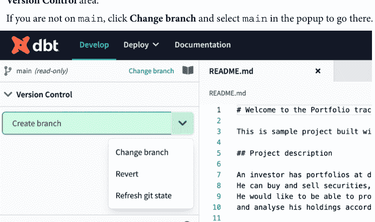
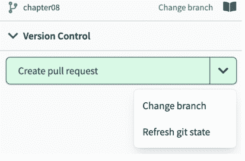
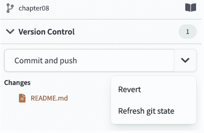
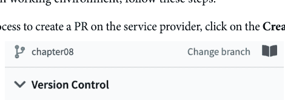
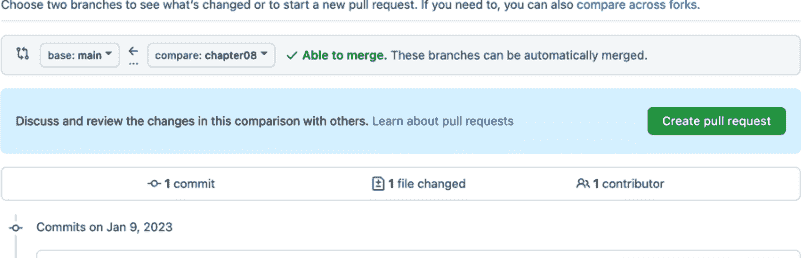
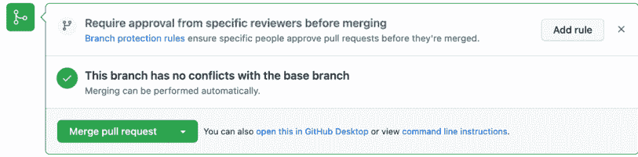
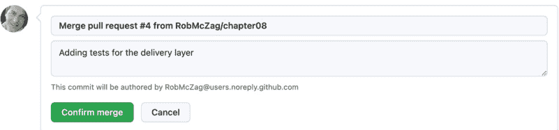
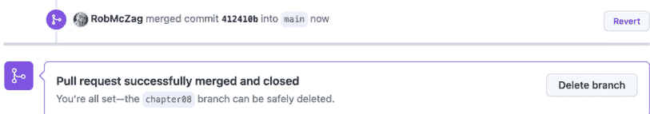
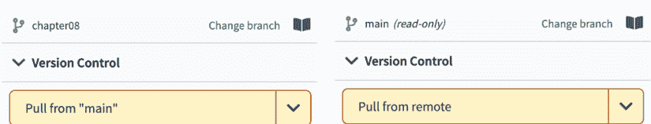

## 11

## 团队协作

在上一章关于敏捷开发中，我们讨论了开发流程，通常提到它如何影响团队合作。

在本章中，我们将介绍一些有助于开发人员作为团队工作的实践，以及 dbt 为此提供的支持。

本章涵盖以下主题：

- 启用协作
- 使用分支和拉取请求
- 在 dbt Cloud 中使用 Git
- 进行你的第一个拉取请求

## 启用协作

团队能够一起工作的最重要方面是**一致性**，我简单地将其定义为团队成员有能力和意愿朝同一方向前进的能力。重要的是要反思这两个维度——能力和意愿。

团队成员必须能够朝同一方向工作；他们必须知道并清楚地理解预期的共同方向（必须与管理层相同），并且不应有冲突的优先事项或分配。这对于团队中并非所有人都依赖于同一组织/经理的情况尤其重要。

团队成员必须愿意朝同一方向工作；他们必须拥有知识和能力，使其能够在团队中有效工作，并且他们必须积极参与团队方向的制定，以便对团队的工作有真正的认同。

敏捷的核心是“自组织”团队，因为这是确保方向为所有团队成员所知并达成一致的最佳方式，并且团队中的每个人在主题上的发言权与其能力成比例。敏捷宣言的第 11 条原则说：“最好的架构、需求和设计来自自组织团队。”

## 核心协作实践

要实现协作，你需要共享的目标，通过共同编写和选择开发功能与故事来实现，还需要工作方式，以便所有任务，甚至那些通常与个人工作相关的任务（如编写代码或设计数据模型），都能从团队视角审视，并以团队友好/可用的方式执行。

这意味着必须有共同的实践和工具。

以下是帮助团队协作的重要实践列表：

- 1. **共同代码所有权**：开发必须开放透明，代码归团队所有，而非编写它的个人。必须鼓励每个人都能修改代码库的任何部分，目标是提升质量，而不仅仅是按照代码开发者的偏好来改动代码。

这可能是许多团队最重要的一步——打破“我的代码”与“你的代码”之间的心理隔离墙，接受“我们的代码”。

一旦我们同意我们编写的代码属于整个团队，协作就成为可能。

- 2. **整洁代码与技术卓越**：为了让团队成长和协作，代码必须是团队能写出的最好代码，并且要像散文一样易于阅读。

敏捷宣言的第 9 条原则指出：“*持续关注技术卓越和良好设计能增强敏捷性。*” *最小惊讶原则* 对协作非常重要，因为它让代码更容易理解，避免出现意外的代码行为。

这里的关键问题是，“*你为谁而写？*”答案是，“*为你自己，也为你的同事*”，因为你写的代码会被阅读几十次甚至上百次。尽量减少理解代码所需的时间，以及被误解的可能性，是关键。

优秀的专业人士希望为自己的工作感到自豪，而这只有当他们所处理的代码清晰且运行良好时才有可能。必须鼓励团队每天提高代码的平均质量，而不是降低它，这也可以通过辅导同事来实现。

- 3. **信任，但也要质疑**：自由只有伴随责任才可能实现。集体所有权和高品质代码（以及流程）是一个持续的过程，不仅在积极编写代码时如此，在评估或审查任何部分代码时也是如此。

团队中的每个人都可以质疑、请求或提议改进每一段代码。这样做必须是为了提供真正的价值，并以建设性的方式沟通，而不是出于羞辱、控制或微观管理的目的。

通常，这种情况发生在开发期间——记住“童子军规则”——以及新代码的审查期间，但如果能增加足够的价值，任何时候都可以。

4. **开放政策**：不仅要鼓励代码方面的透明和贡献，还要鼓励所有可交付成果和活动（包括会议）中的透明和贡献。

在每项活动中，如果团队成员能做出贡献，就应感到受欢迎；但如果无法贡献，也应感到自由且有必要离开。

自由和责任是关键。

上述实践为团队协作的蓬勃发展奠定了良好基础，但仅仅口头承诺是不够的。所有团队成员都必须理解这些实践，并感到可以放心地按照它们工作，因此管理层有责任辅导团队吸收这些实践。

这些共同实践和工具应覆盖所有工作，从目标与工作管理（编写和选择故事）到开发（数据库访问和编码）再到协作（沟通、版本控制和代码审查）。

## 与 dbt Cloud 的协作

在通用工具类别中，使用 dbt Cloud 带来了许多好处：

- 一个基于 Web、与系统无关的**集成开发环境（IDE）**，为团队所有成员提供相同的访问、工具和工作流程。

敏捷团队鼓励个人选择工作工具，因为这能提升个人福祉和生产力，但一个易用、人人平等的环境对于实现共同工作方式非常重要。

这对于那些并非编程背景出身、而是具有 BI 或分析师经验的数据团队成员尤其重要，他们可能不习惯版本控制、测试或发布到多个环境等编码实践。

- 简单透明地访问数据库和代码，无需管理手动连接或访问 Git 仓库。

- 一种有主见、简单且高效的基于 Git 的流程，用于处理版本控制、开发分支和拉取请求，使对 Git 了解甚少的人也能遵循 Git 分支最佳实践来开发代码。

使用版本控制，尤其是开发分支，是促成代码审查和**拉取请求（PR）**形式协作的关键推动因素。

我们将在本节后面探讨与 Git、分支和 PR 相关的协作。

- 一种简单的方式来管理团队成员的个人开发环境，以及团队部署环境（如 QA 和 PROD），以及在这些环境上部署和运行代码的作业。

dbt Cloud 的这一部分——我们将在本章最后一节讨论——自动化了大部分工作，减轻了团队的负担，使更多成员能够处理部署，并且比典型的自建工具在流程中提供更高的透明度。

## 团队协作

当你把共同目标、工作方式和工具整合在一起时，就提供了一个有利于良好团队协作的环境。文化是让良好团队协作真正落地的秘诀。

在使用 dbt 时，以下实践是协作编写代码、建立共同编码方式以及辅导或分享知识的绝佳方法：

- **结对编程**：在同一个代码片段上一起工作。这是辅导同事、建立共同工作方式以及传播领域知识最有效的方式。

无论你采用传统方式——两个人（甚至更多人）共用一台电脑和一个键盘——还是在线方式，结对编程总是非常有效。结对编程产生的代码始终比独自编写的代码更好，如果同事对该代码满意，就可以合并到 `master` 分支。此外，知识现在存在于两个人的头脑中。

- **代码走查**：某段代码的开发者带领团队走查他们的代码。团队提出澄清性问题，并可以以协作的方式对开发者采用的解决方案提出质疑。

积极、诚实和友好的态度是这一实践的核心，因为问题的目标必须是更好地理解代码、理解选择背后的原因，并为质量提供切实的改进。

这种技术对于让一大群人快速了解某段代码非常有用，无论它是应用程序的重要部分，还是领域中反复出现的通用模式或库的使用。

仅使用这种技术的缺点是，走查将在代码至少处于非常高级状态（甚至几乎完成）时进行。此时获得关键的反馈意味着许多工作必须重做，因此，团队能做的更改/改进的门槛被提高了。

- **拉取请求（PR）和代码审查**：PR 是将代码从一个开发分支合并到另一个分支（通常是包含当前集成版本的主分支）的请求。这个分支通常称为 `master` 或 `main`。

代码审查是同事审查开发分支提出的更改并提出问题/建议的过程。我们将在下一节中详细讨论。

文化是使团队能够协作并最终有效工作的最强因素。当开发人员和管理者把团队的福祉和成果放在个人之前，同时当然兼顾个人需求和兴趣时，你就拥有了良好的团队文化。

工具和实践能够促成并支持协作，是团队文化的一部分，但最终决定团队文化成败的是心态。

> 毕竟，敏捷宣言的第 5 条原则指出：“*围绕有动力的个体构建项目。给他们所需的环境和支持，并信任他们能够完成工作。*”

例如，按四分位数组织的奖金，前四分之一的同事获得更多，后四分之一获得更少，这更多是促进竞争而非协作。基于团队成果的奖金更可能激励协作和指导。

软件开发中的有效协作通常依赖于对版本控制的高效使用，其中分支和PR是管理代码变更和团队协调的强大工具，这也是我们下一节的主题。

## 使用分支和PR

软件开发中最重要且最具干扰性的时刻是将新代码集成到现有代码库中。此时，你必须确保新代码实现了开发者的预期功能，并且与现有代码良好融合，尤其是与刚刚由其他开发者开发的其他近期更改相兼容。

经验表明，与包含大量代码的所谓“大爆炸”发布相比，小增量集成的执行速度更快、更容易。

事实上，要确切了解一小段代码的功能要容易得多，而且由于开发小幅改动所需时间较短，因此在开发开始后已交付的改动以及新代码必须与之良好集成的改动都很少。

现代软件工程已将使用**版本控制系统（VCSs）**作为代码管理的标准，因为它允许软件演化过程中采取可控且可预测的步骤。

分支的使用是在技术上实现上述快速开发和频繁将新代码集成到现有代码库的方式。

创建分支就像对代码制作一个命名副本，之后可以独立于原始代码进行修改和开发。这允许开发者在特定功能上工作，并与在其他分支中由其他开发者并行创建的更改隔离开来。

当分支内完成的开发准备集成时，该分支中的代码会被合并到主分支（master branch），或另一个代表产品当前版本的长期分支中。

合并过程将来自被合并分支的更改应用到目标分支中当前版本的代码之上。应用更改的过程通常由VCS自动处理。只有在极少数情况下，当两个并行更改试图修改同一文件时，才需要人工干预，称为**冲突解决**。

冲突可能出现在：当提议的更改会触及文件的同一部分，而该部分在提议更改的分支从原始分支创建之后已被修改，并且冲突的更改已通过此前来自另一分支的合并操作被合并到目标分支中。

开发者会在自己的分支中进行更改，直到一切按预期运行，然后将代码合并回主分支。这样做的好处是，主分支只会接收经过充分测试的可运行代码，并从一个有意义的功能集演进到另一个。

在 dbt Cloud IDE 中处理代码时，你可以在主分支（首次提交后被视为只读）上，也可以在一个不同名称的分支上，该分支被视为功能开发分支，可以部署到你自己的开发环境。

在第2章中，我们看到了如何从空仓库初始化项目，在之前的章节中，我们经常使用与Git相关的命令，但让我们结合与Git相关的命令，描述功能开发的完整流程：

- 1. 从主分支开始。注意，它被标记为只读。这是一种最佳实践，防止意外且不受监督的更改在未遵循适当流程的情况下进入主分支。

从下面的截图可以看到，与Git相关的dbt Cloud功能集中在窗口左上角区域，第一行显示你当前所在的分支名称，版本控制区域显示命令和已更改的文件（下图中没有）。

图11.1：主分支上可用的Git操作

你可以随时点击刷新Git状态来检查是否有任何更改。

- 2. 点击 **创建分支** 按钮，并在出现的弹出窗口中为分支命名，以创建新的功能分支来处理代码。

- 3. 几秒钟后，你将发现自己位于新分支中（下图中命名为 **chapter08**），该分支不再是只读的。

图11.2：干净状态开发分支上可用的Git操作

当分支没有尚未提交的更改时，它处于干净状态，因为工作目录与Git仓库同步，此时你可以选择创建新的PR。

- 4. 你现在可以根据需要编辑和开发该功能。

图11.3：脏状态分支上可用的Git操作

一旦你编辑了一个文件，你的分支将处于脏状态，因为工作目录与Git仓库不同步。已更改的文件会列在**版本控制**区域，你可以点击其中的文件名，查看与之前版本相比发生了什么更改。

如果你想放弃自上次提交以来的所有更改，并回到分支上次提交时的状态，可以点击**还原**并确认。

即使你没有积极地在分支之间切换，而是在自己的分支中开发，然后回到主分支，再开始另一个分支，你也必然会导入一些并非在你的分支中所做的对现有表的更改。

当你切换或在分支间推进时，代码会反映你当前所在的分支，而开发环境的数据库则会根据你运行的内容累积更改。

一般来说，为了确保开发环境的数据库反映你正在处理的代码，你可以使用 `--full-refresh` 开关运行 dbt 项目。这会重新创建所有表，包括增量加载的表，因此虽然你会丢失一些历史数据（在开发环境中这无关紧要），但可以确保拥有最新的表定义。

一个简单的替代方案是直接删除开发环境中的一个或多个schema或单独的表，以便在下一次 dbt 运行时重新创建它们。

关于分支切换还有一件事需要注意——切换分支完全没有问题，因为它可以用于检查和运行PR的代码，或在远程环境中进行辅导或结对编程，但未经事先同意，切勿在他人的分支中做更改。

如果你想向现有的功能分支提出更改，应使用你的Git提供程序，从要修改的功能分支创建另一个分支，然后在dbt Cloud中处理新分支，最后打开一个PR，将目标选择为功能分支。

dbt Cloud 托管工作流只允许你从主分支创建分支，因为这是通常的做法，并防止对Git理解不足的人使自己陷入复杂情况。但你可以从非主分支创建分支，并且你的Git提供程序允许的一切操作都可以进行；一旦创建了分支，你就可以在dbt Cloud中正常处理它。

## 推荐的Git分支命名

在我们展示的工作流中，我们仅考虑了主分支或 master 分支以及功能分支的存在，其中隐含的理解是：主分支是长期分支，提供产品的当前版本；而功能分支是一次性、短期的分支。

对于开发分支来说，这完全没问题，但实际情况要复杂得多，而且通常你不仅仅拥有开发环境和生产环境。

在下一章关于自动化中，你将看到在 dbt Cloud 中，你可以创建环境并将它们与一个分支（通常是长期分支）关联。

一种非常常见的情况是拥有三个环境：供开发者使用的开发环境、中间的集成环境和最终的生产环境。

让我们看看如何将分支与环境匹配，以及如何进行发布：

- 1. 在开发环境中，每个开发人员都会按需在功能分支之间切换，并保持其数据库同步，正如我们在上一节中所见。

- 2. 因此，将主分支用作集成分支会很方便，我们通常将其命名为 CI（持续集成）或 QA（质量保证）。名称因组织文化而异，但功能是相同的——来自各功能的所有变更都会合并到这个分支中，它用于确保单独运行良好的功能能够继续协同工作。

   如果每个 PR 的代码都经过适当测试并执行了所有测试，这种情况本不应发生，但实际经验表明，出于种种原因，少量错误还是可能在 PR 审查阶段漏过。

   你可以把集成分支视为矿井中维护成本低的金丝雀，它可以帮助你捕获大多数在 PR 流程中漏过的错误。

   始终与最终生产环境保持非常接近或略微超前，有助于在细节仍在打磨时及早开始报表或外部集成的开发。

- 3. 最后，你可以创建另一个我们通常命名为 PROD 的分支，用于容纳从集成环境提升到生产环境的代码。

   从集成到生产的代码提升是通过使用你的 Git 提供商将选定的代码合并到 PROD 分支来完成的。

在大多数情况下，这种三分支设置是有效的，因为它让你既能高效地控制到生产的发布流程，又只需维护一个中间环境。

这在典型的内部项目中效果很好，因为组织通常希望在每个功能可用时就将其投入生产。

在流程非常规范的组织中，或者在生产变更需要严格监控和沟通的情况下（例如正式版本控制或仅包含约定功能的定期发布），你可能需要根据情况添加额外的环境。例如，可以用“发布候选”来累积准备在某个版本中发布的变更，用“热修复”来测试应用于生产环境的快速修复。

在少数没有真正集成需求/风险的情况下，可以避免中间环境，而将 main 用于生产。例如，当只有一个开发人员，或者所有开发工作都是独立的（比如原样摄取和发布数据）时，就可能出现这种情况。直接进入生产环境时，你还需要能接受生产环境中偶尔出现的小问题。

## 采用频繁发布

《敏捷宣言》的第三条原则说：“经常交付可工作的软件，周期从几周到几个月，倾向于更短的时间尺度。”

我想说，鉴于《敏捷宣言》发布 20 多年来生产力的提升，以及 dbt Cloud 带来的发布简化，即使保持迭代周期为数周，我们也能将更短的发布周期缩短到一周以内。

在使用 dbt 工作时，团队中大约每天完成一个 PR 并在集成环境中获得新功能，这是很常见的。这很正常，因为当开发人员完成了一个打开的 PR 的工作后，完成并将其合并到 main 分支是标准做法。

有时，我们发现生产环境发布并没有保持同样的节奏，因此我们利用本节来倡导尽可能频繁地发布到生产环境。

使用上一节讨论的三个环境来发布项目的常规模式是，从 main 分支向 PROD 分支发起一个 PR，这意味着将集成环境中的所有代码提升到生产环境。

理由有三点——首先也是最重要的，我们尽量保持集成环境与生产环境一致，这样发布规模小且风险低。其次，只有把我们在集成环境中一起测试过的内容发布到生产环境，才能假定所发布的功能能够协同工作。第三，将 main 提升到生产环境是把新功能发布到生产环境的更简单、更安全的方式。

由于使用 dbt 工作的特性，多个功能通常可以独立发布，并在就绪时投入生产，即使它们只是一个更大功能的一部分，而这个更大功能只有在完整时才会在生产环境中使用。

一个典型的例子是为新报表构建数据集市组件，其中涉及的各个功能是：将基础实体带到 REF 层的管道，然后实现主数据转换和业务规则，最后发布到数据集市的视图。

鉴于上述考虑，我们建议一种工作方式：已批准的 PR 最晚在合并到 main 后的第二天发布到生产环境。

一个良好的时间安排是：在完整的加载和测试周期（通常至少每天一次）完成后、合并任何新 PR 之前，将 main 提升到 PROD。

这可以确保前一天合并的所有 PR 在完整加载时与代码库的其余部分一起正常工作。

为了能够以这种方式进行，重要的是识别出那些需要在特定时机发布的 PR，并只在需要将其投入生产时完成它们。长时间保持一个 PR 打开，或将以后要发布的 PR 累积在“发布候选”分支中，会使团队面临这样的风险：这些代码可能因其他 PR 合并到 main 而需要更新。但重要的是，要防止将那些会阻塞 main 提升到 PROD 的 PR 合并到 main。

将 main 提升到 PROD 的替代方案是将各个开发分支合并或将提交拣选（cherry-pick）到生产环境，但这种方式是手动的、复杂且容易出错的，并且会失去集成环境带来的好处。

当有紧急事项（如修复）必须发布，但其他原因阻碍了 main 的提升时，可以使用这种手动选择过程。最终，你应该把修复发布到 main，并力求在可能的情况下，基于 main 的提升恢复正常发布流程。

既然我们已经讨论了 PR，是时候创建一个了。

## 创建你的第一个 PR

为了完成本章，让我们看看在以 GitHub 作为 Git 提供商的配置下，如何创建一个 PR。

请记住，只有当工作环境干净时才能打开 PR——也就是说，在最后一次提交后没有待处理的更改。因此，要创建 PR，请提交或还原所有更改。

当你拥有干净的工作环境后，请按以下步骤操作：

- 1. 要在服务提供商上开始创建 PR 的流程，请点击创建拉取请求按钮。

   

   图 11.6：创建 PR 的选项

- 2. 你将被引导到 Git 提供商的网站，进入开始创建 PR 并确认起始分支和目标分支的页面。分支将根据你在 dbt 中打开的分支预先设置为 **main** 或 **master**。每个 Git 提供商的过程略有不同，但你始终需要确认起始分支和目标分支。

   比较更改

   选择两个分支来查看更改内容或开始新的拉取请求。如果需要，你还可以跨 fork 进行比较。

   

   由于我们要将开发分支合并到 **main**，请点击**创建拉取请求**按钮。

- 3. 下一步是为 PR 提供标题，并编写关于 PR 内容的良好描述。打开 PR 时还可以做的另一件事是指定一个或多个审查者，他们将收到新 PR 的通知，并被邀请对其发表评论。

## 图 11.8：PR 窗口

填写好标题和描述并邀请审阅者后，您可以点击 **Create pull request**（创建拉取请求）按钮，此时 PR 即创建完成。

5. 当您准备好完成 PR 并合并其代码时，请点击 Merge pull request（合并拉取请求）按钮。

图 11.10：合并 PR

6. 上一个表单将被新表单替换，您可以在其中编辑提交信息及其描述，但我们建议保持提交信息不变。

图 11.11：确认合并

如果您没有改变主意，请点击 Confirm merge（确认合并）按钮。

7. 确认合并后，表单将替换为一条消息，确认代码已合并且 PR 已关闭。

图 11.12：合并 PR 后的最终状态

8. PR 合并后，更改已在 main 分支中生效，因此您可以刷新当前所在分支并点击 Pull from “main” 以拉取更改，或者您可以回到 main 分支并点击 Pull from remote 将更改拉取到 main 分支的本地工作目录中。

图 11.13：检查分支的版本控制

请注意，将更改拉取到刚刚合并的分支中，仅在您计划继续在该分支上工作以进一步开发该功能时才有用。通常，我们建议创建新分支。

现在您已经打开、完成并合并了第一个 PR，您可以看到该过程本身只是少量操作，需要几次点击即可将更改提交审阅、完成审阅，然后将其合并到主分支。除了在特定时间记录已提议并合并的更改之外，该过程本身价值不大。

PR 过程的价值在于团队的协作。如果您创建了 PR，但团队没有任何评论和参与，那么您并没有在协作，PR 过程也近乎毫无意义。

## 小结

协作是软件开发中至关重要的一部分，而像 Git 这样的版本控制工具使得协作编写代码和在团队中传播知识变得更加容易。

本章介绍了如何使用 Git 和 dbt Cloud 简化协作工作流，重点讲解了分支和 PR。您还通过分步指南学习了如何创建第一个 PR。

在下一章中，我们将学习如何利用环境和作业来自动化数据平台操作。

## 延伸阅读

使用 dbt 时，您不需要成为 Git 专家，但如果您想了解更多关于这一事实标准的信息，可以阅读 Scott Chacon 和 Ben Straub 编写、Apress 出版的《Pro Git》一书，该书可在 https://git-scm.com/book/en/v2 免费在线阅读。

如果您想探索 GitHub 的所有可用功能，可以查阅 https://docs.github.com/en 上的 GitHub 文档。

关于敏捷开发，有大量书籍和网络资源，但我更喜欢 Henrik Kniberg 在他的“来自一线”系列书中关于 Scrum、XP 和精益开发的实用风格。
