## 12

## 部署、执行和文档自动化

在本章中，您将学习如何通过设置环境和作业来自动化数据平台的操作，这些环境和作业会根据您的部署设计自动发布和执行代码。

您将了解通知系统，当作业被取消或失败（无论是由于错误还是测试未通过并产生错误）时，该系统会提醒相关人员。

您还将了解文档、血缘图和源数据新鲜度仪表板，这些内容会根据项目 YAML 文件中提供的元数据自动生成。

在本章中，您将学习以下主题：

- 设计您的部署自动化
- 高级自动化——钩子与运行操作
- 文档

## 技术要求

本章使用我们在本书第二部分构建的示例项目作为创建环境和作业的设置。

本章的所有代码示例可在 GitHub 上的 https://github.com/PacktPublishing/Data-engineering-with-dbt/tree/main/Chapter_12 获取。

## 设计您的部署自动化

在上一章中，我们讨论了如何在 dbt 中使用 Git。

dbt 用户界面所倡导的流程平衡了交付速度、质量控制以及在团队中传播代码知识和指导经验较少同事的能力。

基本流程使用 main 分支来接收所有来自短期功能分支的更改，这些分支用于开发更改。

开发人员在个人开发环境中的功能分支上工作，在该环境中他们可以从任何分支部署和运行代码。

最基本的设置仅适用于最简单的用例，只包含两个环境：一个公共生产环境（通过从 main 分支部署代码创建）和各个开发人员的独立开发环境。

## 使用 dbt 环境

要设计您的部署策略，您可以使用 dbt Cloud 中可用的两种环境类型：

- 1. **开发环境**，其中连接和部署 schema 委托给开发人员的凭据，为每个开发人员生成一个环境，dbt 命令由开发人员在 IDE 中亲自执行。执行的代码是 IDE 中所选分支的代码。
- 2. **部署环境**，其中连接、部署 schema 和要使用的代码分支在环境定义中配置，生成一个单一环境，dbt 命令由作业使用配置分支中的代码执行。

我们通常只配置一个开发环境（默认定义），因为它已经为每个开发人员生成了一个开发环境。我们根据设计部署策略的需要使用尽可能多的部署环境。

### 开发环境

开发环境的定义在项目创建时自动生成，并使用开发人员的凭据为每个开发人员实例化一个物理环境。

开发人员凭据中的连接详情（数据库、角色以及 Snowflake 的计算仓库）默认与项目的连接相同。我们建议在项目创建期间，将其设置为适合开发环境的方式。

这样，开发人员只需提供他们的访问凭据并选择一个个人 schema 名称，即可拥有一个完全可用的开发环境。

## 部署环境

我们使用部署环境来创建通过作业和自动化维护的公共环境。

在非常简单的情况下，您可以只定义一个指向 `main` 分支代码的部署环境。如果您未指定自定义分支，则将使用 main 分支。

这非常简单，但仅适用于只有一两个开发人员、更改较少且没有重叠工作、并且数据平台偶尔停机也可以接受的情况，因为您只能依赖各个开发人员开发环境中的测试，而没有任何集成测试。

在这种简单设置中，一旦您合并 PR，代码就会立即部署，您的用户将在下次项目运行后看到更改。

通常，您会希望创建更多环境，我们的常见设置是上一章中介绍的那种——一个连接到 `main` 分支的 QA 环境和一个连接到 PROD 分支的生产环境。

在更结构化的设置中，如果使用许多长期存在的分支，例如具有发布分支的完整 Git Flow，那么创建更多环境将是自然而然的。

在 dbt 中，您可以创建任意数量的环境——没有限制。不过，通常环境是与组织中具有特定语义的长期分支相关联而创建的，例如我们的示例项目中代表生产环境的 PROD 分支。

您可以将多个环境与同一代码分支关联。这可以服务于特殊情况：您希望在某个时间点冻结一个分支而不阻塞在同一分支上定义的其他环境，或者您希望在不同位置部署相同的代码。例如，这可以用于审计或压力测试，因为您不希望报告/结果在过程中途发生变化，但您也不想停止开发。

## 创建我们的 QA 和 PROD 环境

在本节中，我们将使用示例项目创建两个部署环境。QA 环境将与 `main` 分支关联，而我们的生产环境将命名为 PROD，并将与我们将通过 GitHub 创建的 PROD 分支关联。


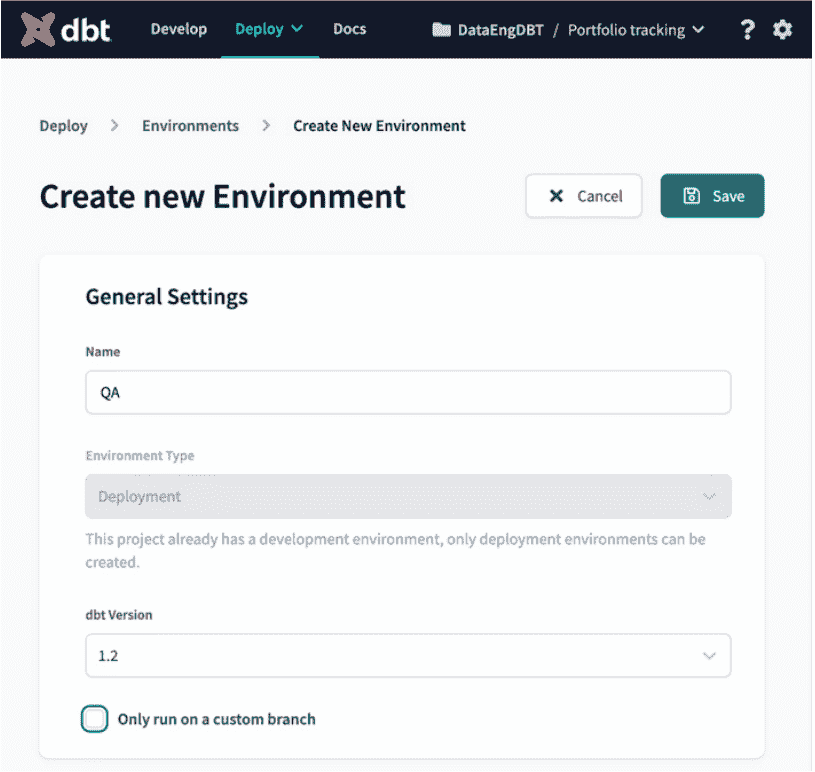

图 12.2：“创建新环境”页面的“常规设置”部分

在**常规设置**部分，你必须选择名称、要使用的 dbt Core 版本；如果你不想使用 `main`/`master` 分支，还可以选择代码分支。

- **3.** 向下滚动，你会看到“部署连接”部分：

  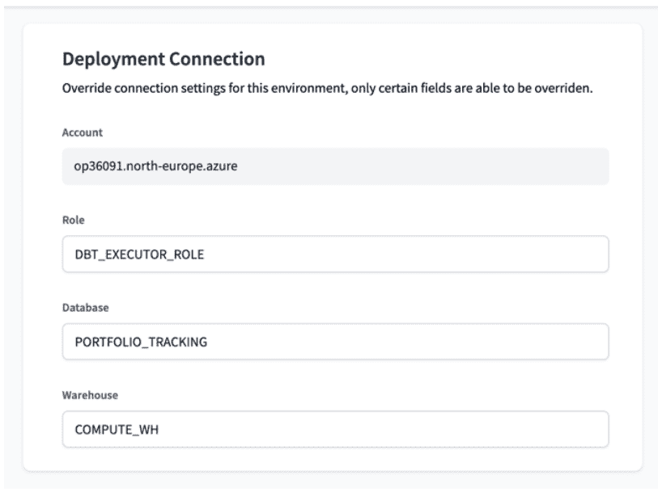

  图 12.3：“创建新环境”页面的“部署连接”部分

  在这里，你可以覆盖项目连接中配置的参数。

  配置你要部署此环境的目标数据库名称，并选择在该数据库中为 dbt 提供适当访问权限的数据库角色。

  你还可以选择使用哪个 Snowflake 计算仓库来运行此环境。这使你可以最终在不同计算仓库之间分配不同环境的负载。我们的建议是首先用一个计算仓库处理所有环境；如果需要更好的性能，再将最敏感的环境（通常是生产环境）迁移出去。

- **4.** 继续向下滚动，你会看到“部署凭据”部分：

  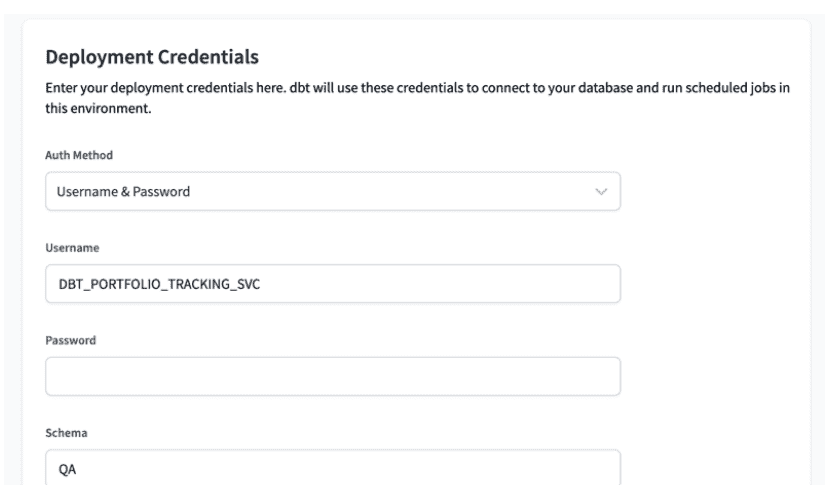

  图 12.4：“创建新环境”页面的“部署凭据”部分

  在这里，你必须配置 dbt 用于部署和执行环境时的服务用户及其密码。或者，你也可以提供用户名和密钥对。

  你必须输入该环境的目标 schema。当代码配置中未指定自定义 schema 时，它就是 schema 的名称；当为某个 dbt 对象指定了自定义 schema 时，它又是实际 schema 名称的前缀。

- **5.** 完成新环境的配置后，点击页面顶部的“保存”按钮。

至此，我们创建了 QA 环境，它将在所选数据库（由于我们没有更改数据库，所以与 DEV 环境相同）上部署来自主分支的代码；当没有自定义 schema 时使用 QA schema 名称，有自定义 schema 时则使用 QA 前缀。

即使这对我们的示例场景来说有点小题大做，我们还是来创建一个名为 PROD 的生产环境，它将从 PROD 分支部署代码：

- **1.** 同样，在 dbt Cloud 页面顶部主菜单的“部署”菜单中选择“环境”条目，进入“环境”页面：

  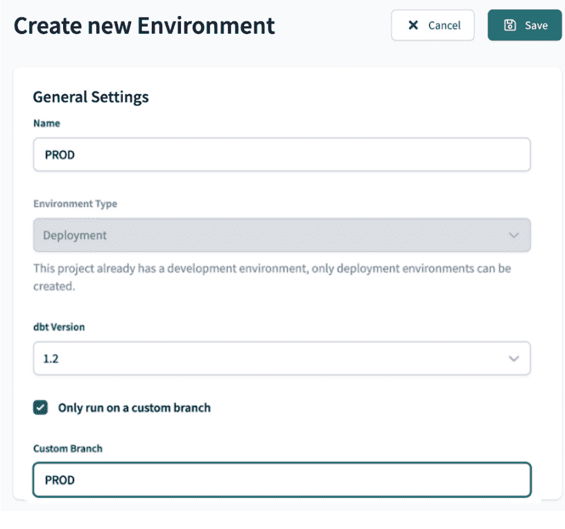

  输入 PROD 作为环境名称，选择要运行的 dbt 版本，勾选**仅在自定义分支上运行**复选框，然后输入 PROD 作为自定义分支名称。

- **2.** 滚动到页面的**部署连接**部分，按你的需要做出更改。

  对于这个示例项目，我们认为将所有环境部署到同一个数据库，并使用相同的角色和计算仓库是没有问题的，所以我们不做任何更改，保留项目连接中配置的值。

- **3.** 继续向下滚动到页面的**部署凭据**部分，输入 dbt 使用的服务用户的用户名和密码，或输入密钥对。

dbt 允许你将任何环境部署到你选择的数据库和目标 schema，让你可以自由地安排环境。

主要的决策是：为每个环境准备一个独立的数据库，还是将部分或全部环境放在同一个数据库中，并通过目标 schema 来区分它们。

在 Snowflake 的情况下，两者差别很小，因为你可以轻松地跨数据库查询，同一角色也可以拥有跨多个数据库的权限。但在其他情况下，差别可能大得多。

如果你决定将 QA 和 PROD 环境放在两个不同的数据库中，我们建议两个环境使用相同的目标 schema，这样两个环境中的 schema 和表名将保持一致。

这将使切换客户端（如 BI 应用程序）变得非常简单，只需更改连接字符串即可让它们使用 QA 或 PROD。例如，这使你可以轻松地在 QA 中测试报表，然后通过更改指向的数据库将其切换到 PROD。

在使用 dbt Cloud IDE 时，要运行哪些代码是很直接的：你要么为环境指定一个特定的自定义分支，要么环境将使用主分支。

另外请注意，你可以使用 dbt Cloud API 在任何部署环境上启动作业。在这种情况下，你可以在 REST 调用中提供可选值来覆盖大部分环境设置。

## 创建作业

既然我们已经创建了环境，现在是时候看看如何有效地部署代码了。这是通过创建运行 dbt 命令的 dbt 作业来实现的。

本质上，dbt 作业就是一组你想在环境中运行的命令。

你可以选择要运行的命令，并使用 dbt 节点选择语法（所有细节请参阅 https://docs.getdbt.com/reference/node-selection/syntax）来决定每条命令应用于项目的哪一部分，从而用作业来组织数据平台的运行。

作业可以定时调度，由 dbt Cloud 内部调度器触发，也可以通过 API 调用来触发。如果你使用的是 dbt 与某个 Git 提供程序的集成（目前为 GitHub、GitLab 或 Azure DevOps），那么当创建或更新拉取请求（PR）时，还可以通过 webhook 触发作业。

## 设计你的平台执行

作业是设计数据平台如何执行的基础组件。

你通过环境来决定部署到哪里；在一个环境内部，你通过作业来设计部署什么以及如何编排。

dbt 中的编排包含两个方面：在作业内的命令里使用 dbt 选择语法来选择要运行的节点，以及通过定时器或 REST 调用来调度作业。

dbt 选择语法利用 dbt 资源的依赖关系图（在 dbt 中显示为**血缘关系图**）以及其他模型元数据，来选择要运行的节点。然后，dbt 会在遵循这些依赖关系的前提下运行它们。

请记住，dbt 在执行命令时，始终会恰当地编排该命令所选节点的执行——范围从项目中的所有节点到一条单独的依赖链。

> **提示**
>
> 当我们讨论 dbt 命令和依赖关系图时，应当使用“节点”或“（dbt）资源”这一术语来指代所有类型的 dbt 资源，例如源（sources）、种子（seeds）、快照（snapshots）、模型（models）、测试（tests）、分析（analyses）和展示（exposures）。
>
> 有时，我们使用*模型*这一术语，因为它们构成了节点中的大多数，而且开发人员对这个术语很熟悉。但请理解，大多数命令和配置适用于大多数节点类型，因此我们在这里使用的是通用含义。

因此，设计平台的编排是一种高层资源选择行为。它涉及使用高层选择语法挑选要执行的节点，然后让 dbt 按依赖关系运行节点，完成实际的底层编排。

在实践中，你编写命令、选择命令所适用的节点，然后将它们按正确顺序放入作业中，以便按照你的设计运行作业，并让 dbt 在每条命令的执行过程中完成底层编排。

为了保持较高的韧性，我们的建议是采用最简单且适合你的编排方式，通常是让 dbt 根据依赖关系运行所有内容。设置一个默认执行（几乎）所有内容的作业是一个很好的起点。

在下一节关于高级自动化的内容中，我们将看到 dbt run-operation 命令可以以 dbt 宏的形式，把数据平台上的任何操作添加到我们的作业中。通过在 run-operation 调用的宏中添加相关 SQL，我们可以执行任何任务，甚至超出常规 dbt 资源执行的范畴。

这类任务是数据平台正常运营的一部分，例如数据库维护、数据摄取或抽取，以及其他例程操作。


如果您拥有非常昂贵的节点，每天构建成本很高，而它们只在每周或每月才发生变化，那么将它们排除在“正常日”运行之外是有意义的，并为在需要时执行此类资源设置一个特定的作业。

同样，如果您拥有需要更频繁运行或在特定事件发生时运行的资源，您可以为它们创建一个作业，并按需安排它们，或在事件发生时通过 REST API 调用启动它们。

在此基础作业中，我们希望执行所有资源。因此，如果我们使用旧式的低级 dbt 命令，列表可能如下所示：

```
dbt seed
dbt source freshness
dbt test -select source:*
dbt snapshot
dbt run
dbt test -exclude source:*
dbt docs generate
```

在上述代码中，我们加载种子。然后，我们测试源数据，以确保输入数据是新鲜的（根据我们定义过的 SLA）并符合我们的预期。

一旦我们知道源是正常的，我们就运行快照和模型，并通过对除源之外的一切进行测试来完成运行。

我们通过为项目生成文档来结束。在这些命令之前和之后，我们可能会运行操作命令来运行其他基于 SQL 的操作。

让我们使用现代的 dbt build 命令为我们的项目创建基线作业：

- 1. 从顶部的主菜单打开 Deploy 菜单并点击 Jobs 条目：

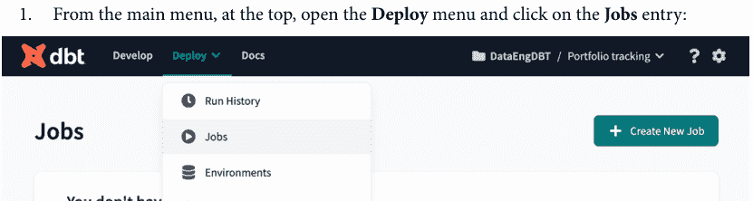

图 12.7：Jobs 页面和 Deploy 菜单

进入 Jobs 页面后，点击右上角的 Create New Job 按钮。

- 2. 通过输入其名称开始创建新作业：

## 图 12.8：Create New Job 页面

我们建议以项目的名称或缩写、环境缩写开头，然后是作业的描述。这样，当您拥有多个 dbt 项目时，一旦收到通知，就能立即清楚哪个作业失败了。

4. 在下一节中，您可以控制一些执行设置。

您可以在 dbt Cloud 取消作业后输入最大执行时间，但对于日常运行，我们通常将其保留为 0。

我们不会将执行推迟到另一个作业，因为我们希望在每次运行中都编译和构建所有内容：

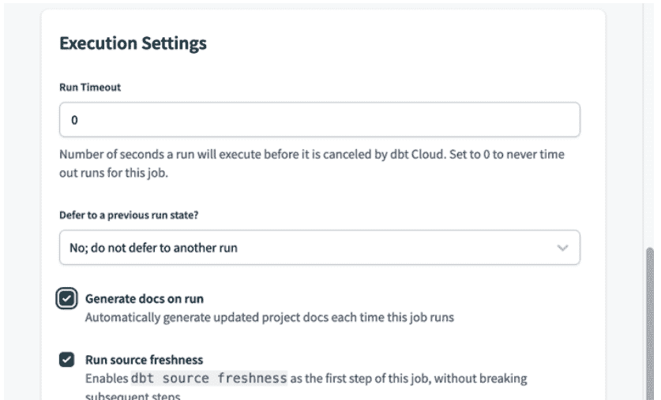

图 12.10：Create New Job 页面的 Execution Settings 部分

最后，我们激活复选框以在运行作业时生成文档并收集源新鲜度数据。在下一节中，我们将学习如何告诉 dbt 使用哪个作业来发布文档和新鲜度。

5. 下一节是任何作业的核心，因为它就是您按 dbt 执行顺序列出 dbt 命令的地方：

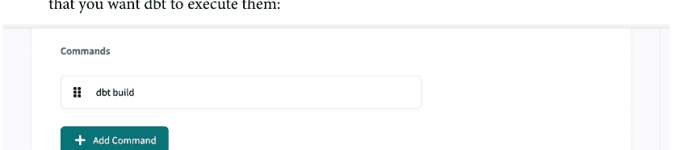

图 12.11：Create New Job 页面的 Commands 部分

作为替代方案，您可以使用 **Enter custom cron schedule (UTC)** dbt UI 设置计划，这允许您输入 **cron** 配置字符串：

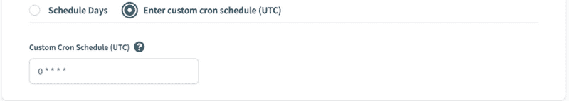

图 12.13：Create New Job 页面上有关 cron 调度的详细信息

为了帮助自己，设置一个 cron 字符串来精确执行您想要的操作。您可以在 https://crontab.guru/ 上尝试并调整它。

完成设置后，点击右上角的 **Save** 按钮。

这样，我们就创建了一个新作业，它将根据我们的计划构建所有 dbt 资源，但当然，您也可以随时通过点击作业特定页面上的 **Run now** 按钮手动运行任何作业，您可以通过在 **Jobs** 页面上点击作业名称到达该页面。您可以通过主菜单中的 **Deploy** 下的 **Jobs** 条目到达它：

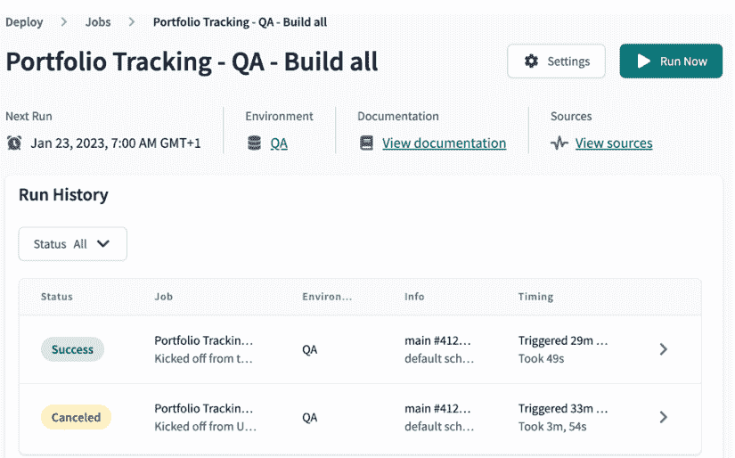

图 12.14：特定作业的页面

作业页面提供了 **Settings** 按钮以便您编辑作业，以及 **Run Now** 按钮以便您立即排队执行一次作业。它还列出了有关作业的一些信息，例如下次运行的时间戳、使用的部署环境以及指向源新鲜度报告的链接。页面下方，您可以找到该作业的完整运行历史记录。

点击 **Run Now** 按钮启动作业的新实例。点击 **Run History** 区域中出现的新行以进入 **Run Overview** 页面：

图 12.15：作业的 Run Overview 页面

现在我们的作业已成功运行并完成，在此过程中收集了源新鲜度并生成了自动文档，让我们看看如何使用它们。

## 设置构建文档和新鲜度报告的作业

在 dbt Cloud 中，您可以浏览由项目结构、数据平台的内容以及 YAML 文件中开发者的输入自动生成的文档。

本章后面我们将更详细地研究为项目生成良好文档的方法。

同样，dbt 可以生成一份关于项目源数据新鲜度的非常有用的报告。

在这里，我们将集中讨论如何配置从哪个作业中选取生成的文档和源新鲜度数据。

这些是项目范围的配置，因此您必须通过右上角的齿轮菜单选择 Account Settings 来进入 Project Details 页面：⚙

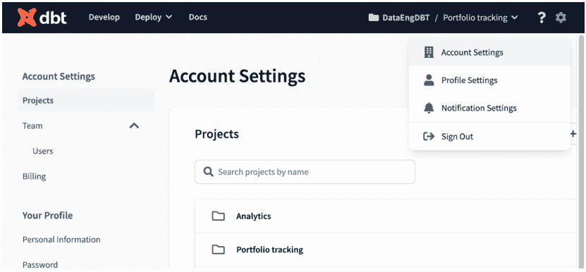

然后，在左侧菜单中选择 Projects 条目，并在 Account Settings 页面的 Projects 部分点击您的项目。

进入 Project Details 页面后，向下滚动到页面底部以找到 Artifacts 部分。

打开 Documentation 下的下拉菜单以选择用于文档工件的作业：

图 12.17：Project Details 页面 Artifacts 部分中的 Documentation 下拉菜单

打开 Source Freshness 下的下拉菜单以选择用于源新鲜度工件的作业：

图 12.18：Project Details 页面 Artifacts 部分中的 Source Freshness 下拉菜单

作为示例，+MODEL 将应用于 MODEL 及其父级，MODEL+ 将应用于 MODEL 及其子级，而 +MODEL+ 将应用于 MODEL 父级和子级。

`dbt cmd +mod_A mod_B+` 命令将应用于具有其父级的 mod_A，以及具有其子级的 mod_B，按正确的依赖顺序且不重复。

让我们创建一个执行依赖于 ABC_BANK_POSITION 源的作业：

- 1. 从主菜单选择 **Deploy | Jobs** 进入 **Jobs** 页面。然后，点击 **Create New Job** 按钮开始作业创建向导，就像我们在上一节为基线作业所做的那样。
- 2. 在 **Create New Job** 页面中，在 **General Settings** 部分将作业的名称输入为 `Portfolio Tracking - QA - Load new position data`。
  
  在 **Environment** 部分选择 QA 作为环境，qa 作为目标名称，以及 12 作为线程数。
- 3. 移动到 **Execution Settings** 部分并按如下方式更改命令：
  
  ```
  dbt build -s source:abc_bank.ABC_BANK_POSITION+
  ```
  
  前述命令将构建命令应用于依赖于 ABC_BANK_POSITION 源的所有模型：
- 4. 如果您愿意，可以为此特定作业添加计划，然后点击 **Save** 按钮。
- 5. 如果您愿意，可以在作业页面上点击 **Run Now** 按钮以确认一切按预期工作。

```
dbt build -s source:abc_bank.ABC_BANK_POSITION+
```

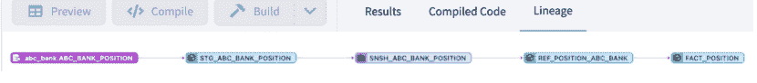

图 12.20：依赖于 ABC_BANK_POSITION 源的节点的血缘图

您可以通过打开资源并查看 IDE 中的血缘图，或通过查看资源生成的文档中的图来可视化每个 dbt 资源的图。前面的屏幕截图显示了 IDE 中的血缘图。

您现在已为项目添加了第二个作业，以执行刷新数据的专门任务，取决于一个源。

同样，您可以创建一个刷新完整数据集市的作业，通过构建所有前驱，使用类似 `dbt build -s +marts.portfolio` 的语法。

使用 dbt 设计您的数据平台编排意味着规划在正确频率下或在 REST 调用后执行哪些资源集合。


建议一如既往地保持尽可能简单，将具有相同频率的资源分组，使用选择语法编写弹性命令，将源系统（或特定源）和数据集市作为要运行内容的高级逻辑规范（不依赖特定模型名称），并使用图运算符来包含所需内容。

这通常归结为构建数据集市所需的一切，或构建依赖于某个数据源或一组特定源表的一切。效果可能因人而异，而且有充分的理由制定其他类型的选择。

最后但同样重要的是，请记住，你可以将选择语法应用于任何 dbt 命令，因此你可以创建仅测试特定模型、源或数据集市的作业，并使用它们来通知相关人员最终可能出现的问题。

## 特殊作业 – 完全刷新和临时命令

我们要介绍另一种类型的作业，你可以将其视为 IDE 命令行的等价物：一个在特定环境上执行特定一次性命令的作业。

拥有这样一个作业的一些原因如下：

- 为了保持不同环境之间的一致性，我们不希望允许开发人员在其开发环境之外的任何环境上执行手动的、未经审计的 SQL 命令。经验表明，手动命令会导致环境不一致，进而违背了拥有这些环境的目的。如果没有完全一致的环境，在一个环境中运行良好的东西并不能保证在另一个环境中也能正常工作。
- 我们需要一种执行维护操作的方法。通常，我们可以使用 `run-operation` 来执行维护操作，下一节将介绍这一点，但在某些情况下，直接运行 dbt 命令更简单、更安全。
- 如果你使用变量或环境变量来驱动流程，你会在 YAML 文件或运行流程的定期作业中设置默认值。有时，你可能希望在不必编辑主定期作业的情况下，使用不同的参数进行一次有限的、特殊的运行。例如，可以考虑只重新运行图的一个子集，读取最近一个月摄入的数据，而不是像通常作业那样只读取最近几天。
- 当你想要清除旧数据或对模式应用更改（同时清除旧数据）时，可以进行特殊运行来重置某些增量表（使用 `-full-refresh` 选项）。另一种方法是编写迁移，这是一组用于修改表或其内容的 SQL 命令，我们将在下一节中看到。

使用一个作业来执行所有这些特殊的、一次性的运行，可以让你很容易地回顾并找到这些特殊运行的详细信息，并且让你放心，执行及其日志都被存储并记录在案，而不是像另一种选择那样临时更改某些定期作业。

在我们的示例项目中，由于传入数据的变化是使用 dbt 快照功能处理的，因此我们还没有增量表。但是，在下一章中，我们将向你展示如何使用仅插入增量模型在云平台上提供更大的灵活性和更好的性能，使你能够处理大量频繁变化的数据。

让我们为这些特殊运行再创建一个作业：

- 1. 从主菜单中选择 **Deploy | Jobs** 进入 **Jobs** 页面。然后，单击 **Create New Job** 按钮启动作业创建向导，就像我们在上一节中为基线作业所做的那样。
- 2. 在 **Create New Job** 页面的 **General Settings** 部分，输入 `Portfolio Tracking - QA - manual runs` 作为作业名称。
- 在 **Environment** 部分，选择 QA 作为环境，qa 作为目标名称，12 作为线程数。
- 3. 转到 **Execution Settings** 部分，并按如下方式更改命令：
- 4. 不要为此作业添加计划，因为它总是在编辑命令后手动运行一次。单击 **Save** 按钮保存作业。现在运行它没有意义。

```
dbt build -s REF_POSITION_ABC_BANK --full-refresh
```

上述命令将对 REF_POSITION_ABC_BANK 模型应用带有 full-refresh 标志的 build 命令，该标志会重新创建增量表。由于这不是一个增量模型，full-refresh 选项不会有特殊效果，但在这里引入它是为了说明如何使用它。

我们已经创建了这个作业，因此如果你需要在 QA 环境上运行一次性命令，现在有了一种方便的方法。另外，请记住，目标是保持环境一致，如果我们只运行 dbt 命令，这要容易得多。我们建议为每个环境创建类似的作业。

## 设计数据平台的架构

到目前为止，你已经了解了主要的 dbt 元素，这些元素通过决定部署什么、在哪里部署以及如何编排所有内容来描绘平台的架构。

让我们回顾一下影响架构的主要元素：

- **环境**用于选择平台部署的主要部分，通过选择要使用的数据库、目标模式（环境中所有模式的前缀）、用于连接数据库的用户和角色，以及用于运行 dbt 命令的仓库来实现。
- **作业**用于选择运行什么以及何时运行。使用作业，你可以编排数据平台的执行。
- **主配置文件** `dbt_project.yml` 与用于组织模型的文件结构一起使用，用于向环境提供的目标模式添加自定义模式，从而允许你将环境的表和视图划分为多个模式。
- 对于非常大型的数据平台或你更倾向于使用松散耦合的域（而不是单体平台）来组合最终架构的方法（例如在**数据网格**中），你可以在自己的 dbt 项目中开发每个域，并使用源来清晰地声明依赖关系。

现在，你应该能够使用上述元素来设计项目的架构，并根据你的意愿部署 dbt 生成的对象。

无论如何，请考虑这些元素提供的大多数设置可以通过使用 `config()` 宏或 YAML 文件中嵌入的配置来覆盖，因此保持一定的纪律有助于避免意外和让同事感到困惑。

## 通知

有效的警报使你的数据团队能够主动掌握必然会发生的问题，并领先于你的（内部）客户，使你能够专业地做出反应并为他们提供服务，而不是在被当场抓住时忙于救火。

dbt 允许你通过电子邮件或 Slack 频道发送通知。

在本节中，我们将向你展示如何设置适用于所有人且可根据每个 dbt 用户、项目和作业进行定制的电子邮件通知。我们将略过 Slack 通知，因为它们需要 Slack 订阅，并且是在账户级别设置的，会在所需的 Slack 频道中发送通知。

让我们为示例项目设置通知：

- 1. 要设置通知，请从 dbt Cloud 右上角的齿轮菜单中选择 **Notifications Settings**：

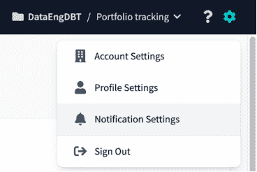

图 12.21：打开的设置菜单
- 2. 选择用户，以及要为其设置警报的环境，然后单击 **Edit** 按钮。
- 3. 在 **Email Notifications** 页面上，你现在可以使用复选框选择所选环境的哪些作业将在三种可用事件下向用户发送通知：作业成功、作业失败或作业被取消：

## 电子邮件通知

根据你的选择，dbt Cloud 将向指定用户发送通知。

为以下对象配置通知...

Roberto Zagni - rz70rz70@gmail.com

环境 QA

| 作业名称 | 成功 | 失败 | 已取消 |
|---|---|---|---|
| Portfolio Tracking - QA - Build all |  | ☑ | ☑ |
| Portfolio Tracking - QA - Load new positio... |  | ☑ |  |

图 12.22：电子邮件通知页面的详细信息
- 4. 做出选择后，你可以单击 **Save** 按钮。

这就是为你或添加到你的 dbt 账户中的任何同事设置电子邮件警报所需做的全部工作。

如果你的通知太多，可以使用一个按钮重置所有通知，如下面的截图所示：

不想收到任何这些电子邮件？你可以通过单击下面的按钮取消订阅所有电子邮件通知。

取消订阅所有电子邮件通知

图 12.23：电子邮件通知取消订阅按钮

在下一节中，我们将介绍一些高级自动化功能。


## 高级自动化 – hooks 和 run-operations

有了环境、作业和配置，你可以使用一个或多个 dbt 项目来设计你的架构并部署和运行你的数据平台，但除了数据转换之外，还需要其他活动来保持数据平台的正常运行。

在本章中，我们将介绍两个高级功能：hook 和 run-operation 命令，以及后者用于处理 dbt 未处理的数据库迁移的使用。

这两个功能都允许你执行任意的 SQL 来补充 dbt 转换。它可以是从创建用户函数到管理权限，或执行数据库特定的操作，如克隆、真空、创建共享或运行除创建表/视图和转换数据之外的任何其他命令。

这两个功能的主要区别在于 SQL 必须激活的时间：连接到某个模型生命周期还是独立于它。

### Hooks

hook 功能允许你将任意 SQL 的执行附加到模型和项目运行生命周期的特定时刻。

你可以直接将一段 SQL 放入 hook 中，也可以调用一个宏，该宏将返回要执行的 SQL，dbt 将在正确的时间执行该 SQL。

可用的 hooks 如下：

- **pre-hook**：SQL 将在构建其所附加的 dbt 节点之前运行
- **post-hook**：SQL 将在构建其所附加的 dbt 节点之后运行
- **on-run-start**：SQL 将在 dbt 命令开始时运行
- **on-run-end**：SQL 将在 dbt 命令结束时运行

Hooks 允许你运行任意 SQL，但最常见的用途是为模型构建时应用权限。这仍然是一种实现你希望的对权限控制程度的方法，即使自 dbt 1.2 起可用的新 dbt grant 功能现在允许你以声明方式配置权限。

经过一点创造性，我们在主项目的配置文件中配置了一个 post-hook 来将运行时时间戳设置为我们 seed 中的 `LOAD_TS` 列：

```yaml
ABC_BANK_SECURITY_INFO:
  +post-hook:
    - "UPDATE {{ this }} SET LOAD_TS =
      '{{ run_started_at }}' WHERE LOAD_TS is null"
  +column_types:
    LOAD_TS: TIMESTAMP
```

前面的片段在 seed 加载后更新 seed 表，用运行时间戳替换 `LOAD_TS` 列中的空值。所有行都是空值，因为我们在 seed 文件中没有提供任何时间戳。请注意，我们需要将列配置为正确类型；否则，Snowflake 会将其推断为 Number 类型，这是当所有值都为空时的默认值。

要使用宏为 hook 生成 SQL，请使用以下语法：

```yaml
some_model:
  +post-hook: "{{ my_macro(this, 'a string') }}"
```

前面的片段调用 `my_macro` 宏，同时传递两个参数：`this` 变量，表示当前模型，以及 `'a string'` 字符串。宏将生成一个 SQL 命令，该命令将在 `some_model` 节点构建后执行。

请注意，虽然你可以将 pre 和 post-hooks 附加到单个模型，但你也可以将它们附加到 `dbt_project.yml` 配置文件中的整个文件夹；hooks 将为该文件夹中的每个模型（及其子文件夹）执行。

我们见过 pre-hooks 用于删除正在由模型重写的增量表中的当前期间记录。虽然这在使用事务性数据库进行数据仓库时是众所周知的实践，但它与 dbt 以及现代列式云数据库的工作方式相冲突。我们鼓励你找到不同的模式，避免删除和更新，因为在云平台中它们比插入要昂贵得多。

虽然所有 hooks 都可以访问模型中可用的上下文，但请考虑 on-run-end hook 有一些额外的上下文变量：

- `schemas` 变量包含 dbt 在当前运行中构建的模型所在的架构列表
- `database_schemas` 变量与 `schemas` 变量类似，但包含 `(database, schema)` 元组而不是架构名称
- `results` 变量包含 dbt 在当前运行中构建的每个节点的 result 对象的列表。这对应于将填充结果 JSON 工件的数据。

你可以利用 hook 可用的上下文来编写直接的 SQL 命令或使用此信息生成 SQL 的宏，或只是保存上下文信息。

### Run-operations

run-operation 命令允许你从命令行或作为作业的一部分激活宏，从而通过执行平台中可用的任意 SQL 命令并结合业务逻辑来扩展 dbt 功能。

常见操作的示例如下：

- **数据摄取：** 使用宏配置外部表，或从数据湖中驻留的文件摄取数据。我们将在 *第 15 章* 更深入地探讨此主题，在那里我们将讨论摄取模式。
- **迁移：** 对 dbt 未处理的数据库对象执行演进性更改，例如删除未使用的表或管理单个字段。以下部分介绍迁移概念以及如何使用它们。
- **运行后操作：** 一旦转换完成，你可能还想做一些额外的事情，例如管理权限、写入审计信息、分析表、生成额外文档等。

你可以使用 hook 运行宏，但然后你需要将其附加到正在运行的节点。run-operation 命令允许你独立于模型运行宏。你可能有一个作业只使用 run-operation 命令来运行宏，而没有模型。

使用 run-operation 调用宏的语法如下：

```text
dbt run-operation {macro} --args {args}
```

至少，你必须传递宏名称而不带任何参数。这使得使用 `dbt run-operation macro_name` 命令运行任何不需要参数的宏变得非常容易。

如果需要传递或覆盖任何参数的默认值，你可以通过传递一个字典来完成，提供参数名称和参数值作为 YAML 字符串 – 例如，`--args '{arg_name: arg_value, arg_name2: arg_value2}'`。

请注意大括号周围的引号，因为这必须是一个 YAML 字符串。

hook 和 run-operation 命令之间的一个重要区别是，使用 hook，你必须传递 SQL，而使用 run-operation，你的宏会被执行，并且它必须明确执行所有所需的操作。因此，如果你想运行任何 SQL，你必须使用语句块或 `run_query` 宏来执行。

后者使用起来容易得多，因为你将 SQL 作为字符串传递并获得结果，常见的使用模式如下：

```jinja

  -- write some SQL or generate it with logic

  -- if you do not need the results
  -- if you need them
```

在前面的片段中，你使用 `set` Jinja 块来编写或生成你想要执行的 SQL 文本，然后调用 `run_sql` 宏并传递 `sql` 字符串。如果你不需要查询结果，可以使用 `do` 操作符；如果你想获取结果对象，可以使用 `set` 操作符。

### 表迁移

dbt 管理创建和维护数据平台中架构、表和视图所需的大多数 DDL 和 DML 命令，但在某些情况下，你可能想要做 dbt 未为你做的事情。

最常见需要你自行管理的事情如下：

- **删除不再使用的表和视图。**

  例如，当你在运行后重命名模型时，具有旧名称的对象不会被 dbt 删除，因为它无法知道是否可以安全删除它。表可能包含有用的数据或仍可被其他系统使用。

- **演进增量表。**

  虽然普通表和视图在每次运行中都会重新创建，因此任何更改都可以轻松应用，但增量表是跨执行保留数据的表。无论你想重命名它们还是对其列进行操作，通常你不能简单地删除并重新创建它们；相反，你必须手动演进它们。

- **对数据执行批量操作。**

  虽然在数据仓库中编辑/篡改数据不应经常发生，但在某些情况下你会想要编辑/修复或删除数据。一个例子可能是将表中的结束时间日期从 2100-12-31 改为 9999-9-9。

所有这些操作都可以通过编写简单的 SQL 语句来完成，例如 `drop table` 或 `alter table`，开发人员应该被允许在开发环境中运行这些语句，但不应在共享环境如 QA 和 PROD 中运行。

一旦资源在共享环境中发布，它就成为数据平台公共 API 的一部分，因此你必须明确管理其演进和最终删除，保证更改在环境之间保持一致，并在与每个环境的代码同步时发布。

通过使用一些约定和在 run-operation 激活的宏中进行一些脚本编写，你可以创建一个简单的设置，允许你快速编写所需的迁移。


## 组织迁移

每当我们需要运行迁移时，我们可以为它编写一个新的宏，并向作业中添加一个临时的 run-operation 命令来调用它，但这样做每次都需要大量手动工作，而且容易出错。

我们提出了一种更好的设置：有一个名为 `run_migrations` 的宏，总是在主作业开始时被调用，以便与代码运行保持同步，并且它会根据需要调用各个迁移宏。

我们还建议通过创建一个 `migrations` 文件夹来组织迁移宏，该文件夹位于 `macros` 文件夹下，用于存放正在使用的迁移；并在其中创建一个 `ARCHIVE` 文件夹，用于存放过去使用过的迁移，如下面的截图所示：

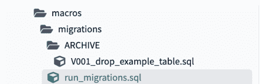

图 12.24：迁移宏的示例组织

`run_migrations` 宏将如下所示：

```



{# do log("No migrations to run.", info=True) #}
-- Remove # to uncomment if no migration to run

```

让我们来看看上面的 `run_migrations` 宏：

- 它有 `database` 和 `schema_prefix` 参数，并且带有我们想要的默认值，因此除非出于某种原因需要覆盖它们，否则我们无需传递这些值。
- 对于每个要运行的迁移，都有一个 `log` 语句和一个 `run` 语句。`log` 用于在日志中显示正在运行的迁移以及所使用的数据库和 schema。
- 有一个被注释掉的 `log` 语句，用于在没有迁移需要运行时使用。

我们还创建了一个示例迁移，名为 `V001_drop_example_table`，以展示命名约定，以及编写额外迁移并将它们添加到 `run_migrations` 宏中是多么简单：

```

DROP TABLE IF EXISTS
{{database}}.{{schema_prefix}}_STAGING.TABLE_XXX ;

```

上面的示例迁移具有与 `run_migrations` 宏相同的参数，并示例了如何根据当前环境使用参数在正确的数据库和 schema 中运行 SQL 命令。

通过使用这种简单的设置，所有开发人员都可以添加迁移，使表的演进与使用新表名和新列名的代码发布保持同步，从而让发布过程非常顺畅。

一旦迁移在所有需要的环境中完成了其编写目的，就可以将其从 `run_migrations` 宏中移除，并将文件移动到 `ARCHIVED` 文件夹。

## 文档

使用 dbt 的一大优势是，文档可以自动生成，或者开发人员只需极少精力即可生成。

在本节中，我们将讨论以下与文档相关的特性：

- **血缘图**：这是 dbt 在 IDE 和生成的文档中向我们展示的项目中模型之间的依赖关系图。
- **生成的文档**：这是一个自动生成的网站，使用人工提供和生成的元数据描述所有模型。
- **源数据新鲜度报告**：这是一个网页，检查源中的数据有多新鲜，并根据 YAML 文件中设置的 SLA 进行验证。
- **Exposures（暴露）**：此功能允许我们描述仪表板或 ML 模型等外部对象对 dbt 管理模型的依赖关系。
- **Markdown 文档**：这允许我们在所有描述字段中使用 Markdown，以生成格式整齐的文档。

通过使用并组合这些功能，我们可以为开发人员、业务人员和高级用户提供一种简单的方式来浏览和理解我们的项目以及我们创建的模型。

### 血缘图

我们在*第2章*结尾查看 IDE、默认 dbt 项目以及引入 `ref` 和 `source` 函数时，简要介绍了血缘图。

血缘图以易于使用的方式展示了项目的**有向无环图（DAG）**。你的模型必须组织在不能有环的有向图中，这是 dbt 的一个关键特性。这促进了良好的开发实践，并允许 dbt 简单且可预测地管理执行。

在文档方面，我们认为必须指出，编码时实时可用的血缘图可以节省大量脑力劳动，因为你可以使用它快速双击跳转到其他模型，无需搜索；同时，它还能让你直观地看到转换结构，而无需记住或创建和维护此类文档：

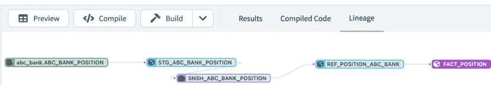

在上面的截图中，你可以看到 seeds 和 snapshots 的图标与 models 不同，并且我们拖动了节点表示以显示分层组织，例如 STG 和 SNSH 构成了暂存（staging）或存储层。

血缘图也出现在生成的文档中，区别在于：在 IDE 中，你始终看到的是与当前打开的模型相连的模型血缘；而在文档中，你可以浏览项目的完整血缘图，也可以聚焦于单个节点，查看与 IDE 中相同的视图。

如果你使用 dbt Core，在编辑时不会有实时血缘图，这严重限制了你的工作便利性，但你仍然可以在生成的文档中访问相同的血缘：

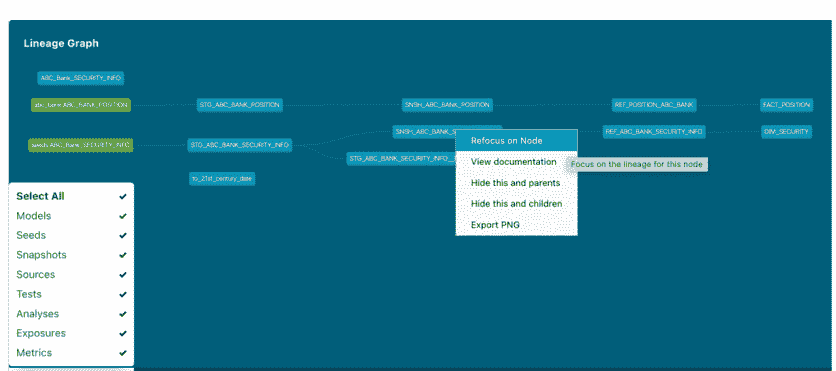

图 12.26：生成的文档中项目的完整血缘

文档中血缘图的一个有用特性是右键单击上下文菜单，它允许你快速重新聚焦于一个节点，或跳转到某个节点的文档并隐藏部分图。

另一个有用的特性是能够启用和禁用组成 dbt 血缘图的不同类型的节点。启用和禁用后，发生变化的节点会以灰色显示。

最后但同样重要的是，在 tags、--select 和 --exclude 输入框中，你可以尝试选择语法表达式，并直观地看到哪些节点被选中。这是尝试并查看你计划在命令中使用的复杂选择效果的便捷方式。

### dbt 生成的文档

dbt 与任何其他数据转换工具的标志性区别之一在于，它能够轻松地以极少的精力生成有用的文档，从而让你的数据平台更有价值，因为它可以被更广泛的用户更好地理解和使用。

基于 Web 的文档自动生成并不新鲜，Java 在九十年代就已经有了。

dbt 的优点是让创建有用、最新且易读的文档变得简单，它从你的代码、测试、数据库中收集元数据和信息，自然也来自面向文档的特性，如 exposures 和描述属性：

- YAML 文件中的 *源声明*。
  你可以使用测试和描述来说明声明为源（sources）的输入数据，使输入要求/期望变得明确。
- 通过查询 *数据库* 收集的信息。
  这提供了关于你的表的定量信息。
- YAML 文件中定义的 *exposures*。
  它们允许你描述模型在 dbt 之外的使用方式，并为这些外部报表/工具/ML 模型的用户提供丰富的数据集描述。

在文档站点上，你可以通过点击右下角的圆形图标访问整体或特定模型的血缘图，如上一节所示。你可以将血缘图作为导航文档的第三种方式。

### 源数据新鲜度报告

如果你的平台运行良好，所有测试都通过，但数据却是几天、几周或几个月前的，你的用户会满意吗？

你是否每天都在检查所有输入数据的新鲜度？或者你是否可能收到一封不太友好的邮件，询问为什么某个报告中上周没有数据？你能快速找到哪些数据进入了这样的报告，以及哪个源数据已过期吗？

dbt 让你不再需要被动地解决这类问题，而是可以主动采取行动。

使用血缘图，你可以快速查看任何数据集市（data mart）使用了哪些源，或者哪些源是任何模型的祖先；而借助我们接下来要介绍的 exposure 功能，你将能够定义哪些表为仪表板或 ML 模型提供支持。

源数据新鲜度报告允许你定义**服务级别协议（SLA）**，以判断表内容是否足够新鲜，并在 SLA 未被满足时发出警告或错误：


## 数据来源

图 12.29：按系统划分的数据源新鲜度报告

数据源新鲜度报告提供了一种快速简便的方式来检查传入数据是否存在问题，并且结合 dbt 在作业失败时发送警报的能力，当表的 SLA 未满足时发送警报，将错误通知给负责的人员/团队。操作非常简单，只需创建一个仅执行新鲜度检查并配置失败时需要通知的人员的作业即可：

图 12.30：按系统划分的新鲜度报告

我们示例项目的报告显示，我们定义了两个系统，每个系统都定义了一个表。**abc_bank** 系统存在一些陈旧数据，而对于 **seeds** 系统，所有数据都是新鲜的。

您可以在 YAML 文件中声明源系统时设置 SLA，通过设置阈值级别并命名时间戳列：

```yaml
sources:
  - name: seeds
    freshness:
      warn_after: {count: 3, period: day}
      error_after: {count: 5, period: day}
    loaded_at_field: LOAD_TS
```

如前面的代码所示，您可以提供警告级别和错误级别，并且必须命名要与当前时间进行检查的时间戳列。

与大多数 dbt 配置一样，您可以在系统级别设置通用 SLA，并为每个源表覆盖阈值和时间戳列。

如果您设置了系统范围的 SLA，您可以通过将新鲜度设置为 **null** 来禁用不需要检查的表的新鲜度检查（例如很少更改的参考表），正如我们在以下片段中对 t2 表所做的那样：

```yaml
tables:
  - name: t1
  - name: t2
    freshness: null   # no freshness for this table
```

数据源新鲜度报告可通过 **Deploy** 菜单的最后一个条目访问。

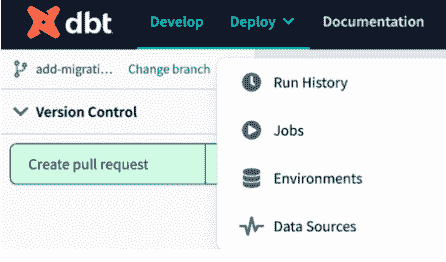

图 12.31：包含 Data Sources 条目的 Deploy 菜单

新鲜度报告也对使用读者许可证访问 dbt 的非开发人员用户可用，使其可供业务用户使用，同时提供生成的文档。

## 暴露

Exposure 在依赖关系图中添加了一个终端节点，用于描述对某些特定 dbt 模型的外部依赖。

在 exposure 的核心，是一个 dbt 模型的列表，暴露的依赖项依赖于这些模型。

exposures 的主要好处如下：

- 为外部功能所依赖的列出模型提供一个清晰的名称，以便简单且一致地应用 dbt 命令
- 能够为报告添加手动维护的文档到文档站点，并直接访问 exposure 所依赖的模型

以下代码为我们由唯一的事实表和唯一的维度表组成的简单报告创建了一个 exposure：

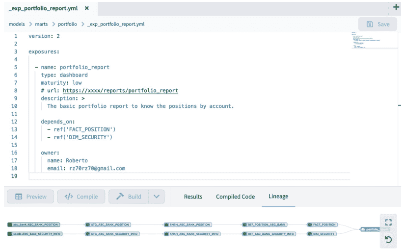

图 12.32：为我们的示例项目定义 exposure 的代码

让我们分析一下：

- 您通过提供名称来创建 exposure，因此名称是强制性的。

  名称必须采用驼峰命名法，因为它可以用作任何 dbt 节点名称。

- 您还需要提供外部依赖的类型。

  外部依赖可以是任何东西，但可用的类型有 `analysis`、`application`、`dashboard`、`ml` 和 `notebook`。

  类型用于在文档站点中组织 exposures，它们按类型分组。

- 最后一个强制字段是报告所有者的 `email` 字段，而所有者的姓名是可选的。

- 最重要的是提供 `depends_on` 列表。

  虽然是可选的，但它是创建 exposure 的主要原因，除非您只是想要一个可以在文档中手动编辑的页面。

  您可以使用 `ref` 和 `source` 函数来构建列表，但您很少需要 `source` 函数。

  在列表中，您只需列出外部功能所依赖的最终模型；构建它们所需的其他模型 dbt 会通过节点的 DAG 得知。在前面的屏幕截图中，我们列出了数据 mart 层的两个模型，dbt 显示了完整的血缘图。

- exposure 的另一个关键组件可以是描述。

  虽然您可以只输入一些简单文本，但当与 Markdown 文档块一起使用时，它成为提供易于使用且视觉上引人注目的文档的非常强大的方式。

- exposure 节点现在将出现在所有血缘图中，无论是在 IDE 中还是在文档站点中的生成文档中。

前一个 exposure 定义的结果显示在以下屏幕截图中，该截图通过使用 Markdown 文档块增强了报告内容的描述：

图 12.33：exposure 的生成文档

在为 exposure 生成的文档页面中，您可以看到指向所有者的详细信息、通过使用 Markdown 文档块增强外观的描述，以及模型列表，只需点击一下即可访问。

血缘图也只需点击一下即可访问，其布局与 IDE 屏幕截图中看到的相同。

exposures 在左侧导航中有专用的菜单，按类型分组。

## Markdown 文档

在讨论 exposures 时，我们展示了使用 Markdown 文档块的结果。我们在谈论什么？

在 dbt 中，您可以在 YAML 文件中描述的大多数元素中声明 description 字段。每当您可以输入描述时，您也可以使用文档块定义全部或部分内容。

文档块是具有唯一名称的 docs Jinja 对象的定义，其中包含在文档站点中可视化时被解释为 Markdown 的文本：

```

## Portfolio report
The Portfolio report features are:
* list all positions by account
* provide up to date valorization of positions.
  The value is available
  * in the position currency, depending on the exchange
  * in the account base currency, as set by the owner

```

我们在 exposure 示例中使用的前一个文档块必须位于以 .md 结尾的文件中。它可以与您的模型位于同一文件夹中，名称由您决定。同一文件可以包含多个文档块。

要使用文档块，您可以使用 doc 函数以及块的名称：

```
description: |
  The basic portfolio report. Positions by account.
  {{ doc('exp_portfolio_report') }}
```

前面的描述混合了普通文本和 doc 函数，使用 | YAML 块表示法，表示对多行 YAML 字符串的“逐字”解释。

这很重要，因为 Markdown 中空行很重要，如果您改用 > YAML 折叠样式，新行将被空格替换，从而改变您的 Markdown，因此渲染输出也会改变。

您也可以直接在表的描述字段、列或任何可能的位置中使用 doc 函数，但在此情况下，您可能需要引用 doc 函数：

```
description: "{{ doc('exp_portfolio_report') }}"
```

每当您引用一个 Jinja 块时，请使用与用于文档块名称字符串的引号相反类型的引号。

请注意，您可以直接在描述中使用 Markdown，而无需创建文档块。当您想要包含链接时，这很有用，如以下示例所示：

```
description: "See [the docs](http://www.docs.com)"
```

提供易于使用且令人愉悦的文档可以提高您的高级用户充分利用您准备的数据集的能力。dbt 允许您按您认为合适的方式提供文档。

## 总结

恭喜，您已完成本书的第二部分，现在了解了所有核心 dbt 功能以及如何使用它们！

在本章中，您学习了如何部署和运行您的项目，以及如何使用高级自动化功能来扩展 dbt 以执行您所需的所有任务。

您现在熟悉 dbt 功能及其广泛的文档功能，并且可以使用它们来提高项目的价值。

在下一章 *Moving Beyond Basics* 中，我们将开始介绍更高级的数据工程主题，例如身份和主数据管理或保存实体的更改，以及我们用于处理它们的 dbt 功能。


