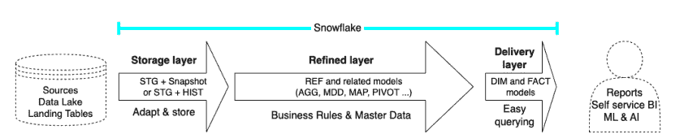
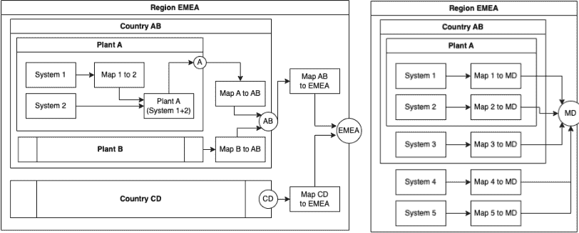
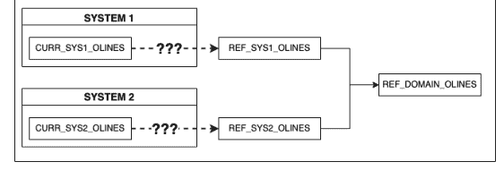
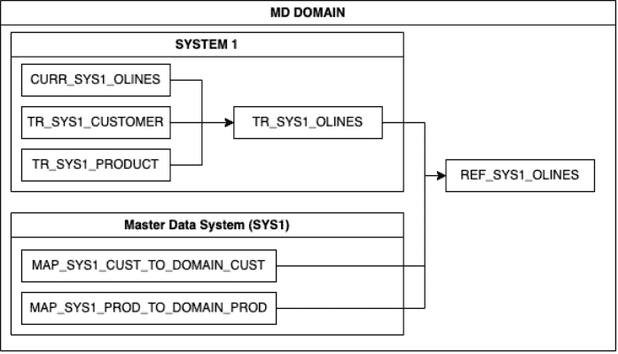
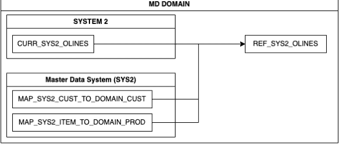
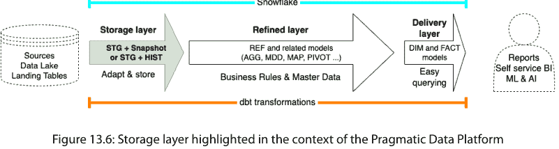

## 13 超越基础

在前几章中，我们讨论了数据工程的基本原则，我们对实用数据平台（PDP）的观点化方法，并使用 dbt 的基本和高级功能以其基本形式实现它。

在本章中，你将回顾在管道中应用模块化的最佳实践，以简化其演进和维护。

接下来你将学习如何管理实体的身份，因为它对于存储其变更并应用主数据管理以合并来自不同系统的数据至关重要。

我们还将使用宏，即 dbt 最强大的功能，来实现存储和检索我们数据中变更的第一个模式，这与我们对身份管理的讨论一致。这使得所有开发人员都能使用资深同事开发的最佳实践。

在本章中，你将学习以下主题：

- 构建模块化
- 管理身份
- 主数据管理
- 大规模保存历史

### 技术要求

本章基于前几章的概念，包括基本的 dbt 函数，我们的目标架构的描述，以及示例项目。

本章的所有代码示例均可在 GitHub 上获取，地址为 `https://github.com/PacktPublishing/Data-engineering-with-dbt/tree/main/Chapter_13`。

### 构建模块化

到目前为止，你应该已经熟悉我们实用数据平台（PDP）的各层以及每一层的核心原则：



*Figure 13.1: The layers of the Pragmatic Data Platform*

让我们快速回顾一下它们：

- **Storage layer:** 在这里，我们将传入的数据适配为我们想要使用的方式，而不改变其语义，并存储所有数据：好的、坏的和丑陋的。
  
  核心原则是在这里隔离平台状态——即依赖于之前运行的模型，如快照或增量模型——以便下一层可以在存储层之上从头重建。
  
  视角是源为中心，每个源表对应一条加载管道。

- **Refined layer:** 在这里，我们应用主数据并实现业务规则。
  
  这里的核心原则是在构建更抽象和通用概念时应用模块化，这些概念建立在存储层中更简单、源为中心的之上。
  
  无状态、模式和清晰的名称避免了意外，使我们保持敏捷，并允许我们以最小的努力添加和演进业务规则。
  
  视角是业务为中心，或者更好的是，最终目标是拥有以业务术语表达的业务概念——最终还有中间概念，即使它们是由存储层中的源特定输入构建的。

- **Delivery layer:** 在这里，我们组织数据以便易于使用，具体取决于用户。
  
  这里的核心原则是为受众提供量身定制的数据集。
  
  仅提供有用且经过测试的内容——以业务名称公开，并在期望的格式和交付架构中，如星型模式或宽表——允许客户端用户或应用程序简单采用。
  
  在精炼层之上轻量构建使我们能够轻松地为不同受众，如营销或运营，提供相同数据的不同切片。
  
  视角是业务为中心，重点在于内容、命名和架构，以满足特定受众或业务领域。

回顾各层及其内容，我们可以说模块化是通过提供组件来实现的，你可以用这些组件在模块化系统中构建管道。

这些组件可以以简单模式的形式提供，这些模式提供清晰的语义和一致的名称，以便清楚地了解模型的作用并确定其在管道中的角色，而不会产生疑问。

模式通常可以作为宏实现，但在某些情况下，出于可读性的考虑，最好只是使用经过验证的布局并避免调用宏的间接性。

通过组合指导核心需求实现的简单组件，你可以构建管道并创建完整的架构。

在以下部分中，我们将回顾一些我们已经看到的组件，并介绍一些我们稍后会看到的组件。

#### Modularity in the storage layer

存储层受益于极大的可预测性，我们有一系列组件，允许我们遵循清晰的模式来构建管道的这一部分，自动化大部分代码创建，并通过交换可互换的组件（如 HIST 模型与快照）以多种不同方式实现该层。

让我们回顾一下可用的组件：

- **Seed:** Seed 的作用是轻松加载小型参考或手工维护的数据，这些数据不是来自特定系统，并且存储在小型 CSV 文件中。
  
  如果你计划直接使用 `ref()` 函数使用它们，我们建议将它们命名为 `SEED_xxx`，以便其功能非常清晰。如果你计划通过 `source()` 函数间接访问它们，CSV 名称就不那么重要了。

- **Source definition:** 源定义的作用是以易于灵活管理的方式引用外部数据，通过命名输入组添加语义，并通过间接层提供灵活性。
  
  你可以通过按系统或逻辑子系统命名源来组织外部数据——即不由 dbt 模型管理的数据——同时保持表名不变以便于审计/测试。

- **Snapshot:** 快照的作用是存储输入实体中的变更，当你从源定期接收快照时。它是 dbt 的核心组件。
  
  一个关键限制是它是一个由所有环境共享的资源；另一个限制是需要完整导出以跟踪删除。

- **STG model:** 我们在整合多个组件和模式时介绍 STG 模型，每个模式都分为其 CTE，但你可以选择使用哪些组件，甚至将组件作为单独的模型链接：
  - **Adaptation:** 此组件通过适配数据类型、重命名列、提取嵌套对象并应用硬数据修复，使传入数据尽可能可用。
  - **Default record:** 默认记录为维度提供一条记录，其中所有字段包括主键和描述列都具有默认值，用于在事实具有孤立外键时使用。如果它出现在变更存储组件之前，默认值中的变更也会被捕获。
  - **Hashed:** 此组件定义并计算 HKEY 和 HDIFF 列，并在需要时生成 LOAD_TS 元数据列。
    
    HKEY 和 HDIFF 列提供了存储所用键的清晰定义以及实体版本变更的定义。由于这个原因，它们在多个模式中发挥着关键作用。
    
    为了简单起见，我们将 STG 模型呈现为单个模型，该模型通过读取源来实现我们所需的所有组件（因为我们的参考实现使用 HIST 组件代替快照），以获得性能、可扩展性，最重要的是，在环境之间获得更大的演进自由。

- **HIST model:** HIST 模型的作用是存储实体的变更。它使用仅插入策略构建缓慢变化维度类型 2 表，为实体的每个实例的每个版本提供一行。
  
  这是我们存储变更的默认实现，因为它性能高，并且很好地服务于表的当前状态及其所有变更。
  
  通过使用可感知删除的 HIST 变体，你可以有效跟踪删除并产生相同的存储布局，在下游使用时没有任何区别。

- **PII model:** 这种高度专业化模型的作用是将实际的 **Personally Identifiable Information (PII)** 数据与正常转换分开存储，以便在交付层根据需要替换给授权人员，同时仍可用（例如，考虑 **GDPR** 的被遗忘权）。


在存储层，清楚地知道需要做什么，这份组件和模型角色的清单使我们能够以不同的方式实现层目标，以最适合我们情况的方式组织这些逻辑组件。

在之前的章节中，我们将打算使用的所有组件都安排在一个 STG 模型中，因为在使用仅插入的 HIST 模型时这是最佳设置，而这正是我们目标架构所使用的。它提供了极大的灵活性、易于开发，并且与默认的 dbt 快照相比性能更好。

如果你计划使用快照模型来存储变更，那么保持存储的内容与输入相同是有意义的，以最大程度地降低快照代码发生变化的可能性。这是因为快照是在所有环境中共享的组件。

在这种情况下，你可能在快照之前计算哈希值，甚至添加默认记录。然而，如果你担心适配组件的变更率更高，你可以将它移至快照之后，即使这样做可能会因在每次读取时应用复杂或缓慢的转换而带来一定的性能损失。

## 精炼层的模块化

精炼层并不像存储层那样具有可预测性，但总体思路还是相当清晰的，并经历以下阶段：

1. **精炼单个系统：** 初始过程是对来自每个独立源系统的数据进行组合和转换，包括使用本地特定的业务规则，直到达到与其他系统可比的抽象级别。在此过程中，它在可能的情况下用业务键替换本地代理键。

2. **主数据映射：** 此过程涉及应用主数据转换，将来自一个系统的代码转换为使其能够与更广泛的系统互操作。

3. **主数据精炼层：** 这是我们正在寻找的“圣杯”。最终过程是对主数据映射的结果进行组合和转换，以生成一组业务概念，使用主数据代码表达，使我们能够计算全公司范围的业务指标并应用公司业务规则。

需要注意的是，如果你有大量遗留系统或由多次集成产生的系统，*步骤 1 和 2* 可以重复几次，逐步构建同质主数据代码域，其规模不断增大（*图 13.2* 的左侧）。这通常是为组织实体（如工厂、国家或地区）建立一定程度的通用报告而进行的渐进且通常部分努力的结果：



当进行过全公司范围的主数据计划以将所有/大部分数据带到某种互操作性水平时，结果可能更接近 *图 13.2* 的右侧，从每个源系统直接转换为约定的主数据代码。

在两种情况下，通常存在多个嵌套域和需要在每个域内应用的业务规则，以使数据通过表示相同概念而实现互操作。例如，考虑在不同国家/地区对不同税项或成本结构进行核算，以构建“人工成本”概念。

在前面的图中，我们突出了产生数据的源系统以及用于从一个“主数据”范围转换到下一个范围的映射表。然而，大多数转换通常与业务规则相关，正如我们之前讨论的那样。

REF 层的转换可变性最大，因为它是在此应用主数据转换和不同级别的业务规则的地方。尽管如此，我们仍可以识别出具有明确角色的以下组件：

- **REF 模型：** REF 模型的作用是表示特定上下文中的精炼实体，你期望它在该上下文中通常可重用，因为它代表了在该上下文中有用且相当完整的概念。

  在构建公司级 REF 实体之前，通常会先构建较低域的 REF 实体；然后，利用业务规则和映射表，这些概念被用来组合更高级别的 REF 模型。

  例如，通常会构建多个 `REF_<country>_CUSTOMER` 模型，然后再用来构建最终的全公司范围的 `REF_CUSTOMER`。国家级实体在构建更广泛实体之外也有用。

- **AGG 模型：** AGG 模型的作用是表示聚合的精炼模型。

  不同的系统经常以不同的详细程度提供相同的概念，为了能够组合它们，需要通过在公共维度上聚合将其带到相同的粒度。

  AGG 模型的另一个驱动因素是希望减少输入到报表工具的行数，通过将事实表聚合到所需的粒度。

- **MDD 模型：** MDD 模型的作用是表示直接来自主数据的维度，因此是一种“权威”的实体列表。

- **MAP 模型：** MAP 模型的作用是表示映射表，允许在系统/上下文之间进行代码转换。

  这可以来自主数据工具，也可以计算得出，甚至手动创建。想法是它支持某种转换/翻译。

  这些模型的一个关键方面是在名称中明确表达它们执行的映射，使用诸如 `MAP_US_ITEM_TO_MD_PRODUCT` 之类的名称来同时表达上下文和被映射的实体。

- **TR 模型：** TR 模型的作用是表示中间转换。

  与 REF 模型的主要区别在于，TR 模型被视为一个本身没有真正意义的中间步骤，很难被重用，因为它不代表某个通常有用的概念。

  TR 模型最接近私有模型。在重用 TR 模型时应谨慎，因为可能存在从名称或起始选择中无法明显看出限制。

- **PIVOT 模型：** PIVOT 模型的作用是通过对其他模型进行透视来获得模型。

  这是一个非常专业的角色，像 AGG 一样，它提供与其它模型相同的数据，但通过透视对其进行重新组织。

虽然我们很难预测 REF 层将需要什么转换，但我们可以轻松识别我们将创建的大多数模型的作用。

这个列表可能并不完整，因为命名是团队需要达成一致并决定强调哪个方面。例如，你将拥有关联或连接表，用于表示多对多关系。

你可能会将关联客户和已购产品的表命名为 `JOIN_PRODUCT_PURCHASED_BY_CUSTOMER`（嘿，这种关系通常称为发票或订单）或甚至 `REF_JOIN_xxx`，但在许多情况下，这些关系有业务名称，自然会将其称为 `REF_ORDER` 或 `REF_INVOICE`。

- **DIM 模型：** DIM 模型的作用是表示 Kimball 风格的维度或层级。

  对于维度，或压缩在维度中的层级，其粒度为层级中最低元素的粒度，最重要的方面是拥有正确的代码以匹配数据集市中的事实。

  维度的另一个关键特征是所有条目都由数据集市中事实的代码引用，以便事实不会出现孤立代码。

- **REPORT 模型：** REPORT 模型的作用是表示可为报表提供支持的表。

  此类模型用于提供可为报表或 AI/ML 用例提供支持的宽表。名称也可能变化很大，因为事实和维度没有通用的命名方式。

  通常它不用于 Kimball 风格的数据集市，但可以存在于并行的数据集市中，用于其他工具或只是为了用磁盘空间换取性能。宽表是一个预先连接的数据集市，其中事实已经与所有维度连接。这在存储方面效率较低，但在查询方面效率要高得多，因此当你一次写入多次查询时可能值得。

- **FILTER 模型：** 这是一个专门的模型，其作用是使一个或多个事实如何基于仅存在于过滤模型所在特定数据集市中的需求而被过滤变得极其清晰。

  如果过滤具有通用用途，则应将过滤器移至 REF 层并在那里应用于事实，以构建一个恰当地命名的新事实模型，同时考虑已应用的过滤。

  使用此类模型主要有两个目的。第一个是使代码模块化并提高过滤的可见性，提供可在报表工具中使用的独立 DB 对象。

  第二个目的是使维护过滤逻辑变得简单且明确。当过滤应用于数据集市中不止一个事实时，这一点尤为重要。

在本节中，我们看到了认识我们编写某段 SQL 的原因有多重要，以及以逻辑流程构建模型并使用使我们所写 SQL 相对于该流程的角色清晰的名称。

缺乏这种组织和模块化是数据仓库项目在变得庞大时变得难以管理的关键原因之一。

我们提供我们的模型类型和角色集合作为坚实起点，给予你更改它们并采用自己的名称和角色，甚至开发新角色的许可。只要在你的组织内部对它们非常清晰即可。


避免混淆和错误唯一的方法是在命名实体及其键时非常明确，甚至可能到了吹毛求疵的地步。

以目录为例，我们或许应该将实体/表命名为 `CAR_MODEL`，其键命名为 `CAR_MODEL_CODE` 或 `CAR_MODEL_KEY`；而在交通场景中，我们可以将实体命名为 `CAR`，其键命名为 `CAR_CODE` 或 `CAR_KEY`。

是的，`CAR_INSTANCE` 即使对我们来说也显得有点过于吹毛求疵了。

## 时间序列语义

另一种容易因语义不清而被误导的情况是：当我们想要追踪随时间变化的事物时。

在这种情况下，我们需要极其清楚地明确我们到底要追踪什么：是实体实例发生的变化（与变化发生的时间无关），还是要在特定时间点获取值（即使没有发生任何变化）。

第一种情况是使用实体的键来追踪实体变化的常规过程；而第二种情况下，我们构建的是值的时间序列。此时，键将由实体键加上时间键共同组成，具体取决于所需的周期。

一个常见的例子是商品库存追踪。

在某些情况下，你想知道某种产品有多少（以及其他许多指标），并且只在其发生变化时进行记录。这种情况下，你会使用实体键来追踪变化。

在另一些情况下，你可能希望按给定的周期（日、周、月）追踪产品的指标值，无论指标是否发生变化。这种情况下，你需要通过组合实体键和周期键来构建复合键，从而追踪变化。

这两种方式相互关联，可以从一种表示转换到另一种；但如果你已经明确了自己的用例，最好根据所需的语义来命名表，并使用正确的键。

## 不同类型的键

在本节中，我们将补充并扩展第3章在讨论实体-关系图时所提供的关于键的描述。

在讨论键的字段名时，会用到 `CODE` 和 `KEY` 之类的术语，也会用到 `ID`（identifier 的缩写）和 `NUMBER`。

与人类缺乏一致性相符（但人类也有应对这种不一致的能力），这些术语常常被混用且含义相同，因此你可能会看到名为 `CUSTOMER_CODE`、`CUSTOMER_KEY`、`CUSTOMER_ID` 或 `CUSTOMER_NUMBER` 的列。

第一个也是最重要的区别在于键的可见性：

- **代理键（SK）：** 这是仅出于技术需要而存在的键，通常仅限于系统内部使用。`Hash_Key` 就是代理键的一个例子。
- **自然键（NK）或业务键（BK）：** 这种键既履行其技术角色，也在公开场合使用。它印在文档上，并在业务对话和文档中被引用。`Invoice_code` 就是自然键的一个例子。

在我们的讨论和我们使用的命名中，我们倾向于用 `CODE` 来表示自然键，而用 `SK`（`SURROGATE_KEY` 的缩写）或通用的 `KEY` 来表示代理键。

在许多情况下，我们看到的键名中带有 `ID` 或 `NUMBER` 作为名称的一部分。虽然这些命名本身并无不妥，但通常 `XXX_NUMBER` 字段已经不再是数字，而最初作为内部标识符的 `XXX_ID` 后缀已变成了众所周知的业务键。因此，我们建议只使用一个名称来标识其可见性。如前所述，在这种情况下，我们倾向于使用 `CODE` 和 `KEY` 作为通用术语。

有趣的是，`NUMBER` 后缀让人联想到过去的技术要求：当时使用序列或自增生成的数字来生成代码是一种常见方式，而且这些代码对数据库处理也很高效。如今情况已不再如此，但这些字段名却在多次系统迁移中保留了下来。

第二个非常重要的区别基于键在表中的作用：

- **主键（PK）：** 该键负责唯一标识实体的一个实例。表中具有相同主键的多行描述的是同一个实例。

大多数数据建模都是为操作型系统而做的，在这些系统中，你会不断更新某个实例的值，以便表中始终保存该实例的最新值。在这种情况下，主键在表中必须是唯一的，以保证只有一行描述实体实例的当前值。

反之，当表存储的是一个实例的多个版本时（就像我们在快照表和 HIST 表中所做的那样），仅靠主键本身就不再唯一了。唯一的是：主键加每个版本的时间戳的组合。

请注意你使用主键时的语义：这里我们描述的是“实体的主键”的含义——即标识实体的某个特定实例，这对信息管理至关重要。人们有时会说主键，但用的是“表的主键”的含义，这指的是表上的一个唯一约束。

如果我们有一个 `CUSTOMER` 实体，其 `CUSTOMER_CODE` 是该实体的主键，那么它也将是操作型系统中 `CUSTOMER` 表的主键，同时也是数据平台中只包含当前客户的所有表的主键。但是，`HIST_CUSTOMER` 或 `CUSTOMER_SNSH` 表的主键将是 `CUSTOMER_CODE` 和 `LOAD_TS` 的组合。

- **外键（FK）：** 这是与另一实体的主键相匹配的键。

外键是连接信息的基本方式，用于表达两个或多个实体之间存在某种关系。如果关系是可选的，外键可以为空；但如果关系是强制的，外键则不能为空。

例如，当我们创建一条发票行时，它会为我们要连接的每个实体包含一个外键，例如 `CUSTOMER_CODE` 和 `PRODUCT_CODE`，此外还有 `PROMOTION_CODE` 等等。

其中客户和产品是强制的，它们的代码不能为空；而促销是可选的，因此其代码可以为空。

到目前为止，我们讨论了键。我们使用的示例中键都是单一字段，但由多个列组成的键完全没问题。在这种情况下，我们常常通过将多个字段进行哈希处理来创建单列代理键，以简化我们的工作。

处理复合键最常见的情况是事实表。这些事实表是文档（如订单或发票）或业务事件，它们通常带有业务键或至少一个代理键。许多其他事实表没有主键，但通常可以通过使用事实表中的所有外键以及某些时间信息来构建一个主键，这些时间信息使我们能够区分同一外键的多个实例。

在某些情况下，例如追踪用户的页面浏览行为时，可能很难甚至无法区分在很短时间内发生的两次相同操作，因为我们无法构建一个稳定的键来标识“页面浏览”动作的每个实例。

如果我们无法为一个实体构建良好的、稳定的主键，我们就无法追踪该实体的变化，必须接受只能将所有接收到的实例作为独立的、不可变的实例存储起来。

另一种遇到复合键的情况是：当我们需要处理那些并非为我们当前使用领域而设计的维度时，且我们没有主数据来进行适当的转换。在这种情况下，原始键可能不足以确保正确的识别，因此我们必须添加第二列来指示领域。

例如，如果我们有两个 `PRODUCT` 维度，分别由两个工厂或两个国家独立开发，并且没有主数据映射将代码转换为通用的 MD 代码，我们可以将两者合并来创建一个通用的 `PRODUCT` 维度。然而，由于仅凭 `PRODUCT_CODE` 可能发生冲突，我们需要在键中添加一个表示来源的第二列。这*并非*一个好的解决方案，因为同一个产品可能会以两个不同的代码（每个来源一个）出现两次，但在某些情况下，这是我们唯一能做的事情，我们必须接受这种技术债务。


## 键的主要用途

在上一节中，我们看到实体的 PK 用于标识实体的实例，而 FK 则用于将实体的实例关联起来。

键在以下最常见的操作中处于核心地位：

- **跟踪和应用变更**：PK 用于标识传入数据所属的实例，以便我们可以比较与已存储的内容相比是否发生了变化。

- **提取当前或历史版本**：PK 用于收集存储的所有版本并提取最新版本或在某个时间点处于活动状态的版本。

- **连接数据**：通过将一个表中的 FK 与另一个表的 PK 相等来连接表，是我们在 REF 层中将所需数据跨现有关系组合起来的主要操作。

通过将另一个表的 PK 作为表中 FK 来在表之间创建关系，是关系型数据库存在的最强大的功能。它是理解和设计数据模型的最重要能力。

你应该只在遵循直接的 FK-PK 关系或用于实现多对多关系的关联表的情况下连接表。在后一种情况下，对于起始表的每一行，你应该预期连接可能返回多行。

要警惕盲目地在两个表上通过共同的外键进行连接，因为这会直接导致我们在第 3 章中描述的深渊陷阱数据问题。

- **引用完整性**：当我们在一个表中有 FK 时，我们应该确保 FK 引用的实例存在于托管 PK 的父表中。如果没有 PK 与 FK 匹配，我们就缺少某些信息。在这种情况下，我们说该 FK 是孤立的，因为父表中没有对应的条目。

确保适当的引用完整性对于保证我们能够查询表并检索所有预期信息非常重要。

这是事实表存储多个 FK 的常见情况，每个 FK 都指向一个父表，即维度。

现在我们已经了解了键是什么以及它们用于什么，让我们深入探讨如何使用主数据管理来扩展我们识别实体超出其初始域的能力。

## 主数据管理

当我们谈论主数据时，我们指的是组织核心的描述性数据，以及确保我们能够理解不同单元何时指的是同一概念实例的过程。

在很大程度上，主数据在数据平台领域与描述组织概念的维度重叠，例如客户、产品、员工等。

我们很少有主数据维度时，它增加了包含“黄金记录”的语义，这些记录被选用来代表维度所代表的业务概念（即实体）的实例。

例如，产品 MD 维度（我们在 REF 层中称为 MDD_PRODUCT）包含产品的黄金记录，从用作实体 PK 的代码开始，并继续列出列的值。

相当频繁地，我们只有一份 MD 代码列表，最终可能带有名称，以及映射表，允许我们将本地维度转换为 MD 代码，并利用数据从本地维度生成 MD 编码的维度，这要归功于业务规则。

当我们谈论主数据管理时，我们谈论的是在不同域之间管理主数据实体的流程和数据（MDD 和 MAP 表）。

## 主数据管理的数据

在主数据管理中，我们依赖两种类型的数据：

- **主数据维度（MDDs）**：这是包含业务概念“黄金记录”的维度。通常，没有完整的维度，而只有一份主数据代码列表，可能附带名称或描述供人工使用。

  其有效性可能仅限于特定域，例如仅美国产品。

- **映射表（MAPs）**：这是一个表，允许我们将一个域中的代码转换为另一个域中的代码——例如，将意大利产品代码转换为 EMEA 代码。

  这些映射表是每个 MD 计划的核心，因为它们是使数据互操作性的工具。

  它们可用于转换维度的代码，但其强大之处在于还可以将代码转换为事实，从而实现事实在不同域中的使用。

  映射表通常以业务键而不是代理键表示，因为它们没有业务含义。

  对于每个映射表需要注意的一个关键要素是映射的*方向性*。概念在不同域中的基数不同是很常见的，因此映射不能是一对一且双向的。

  如果在本地域中，多个代码被用于在一段时间内标识主数据维度中的单个代码，那么所有这些代码都将映射到相同的 MD 代码，并且映射将是从本地域到 MD 域的多对一且单向的。

  如果一个国家对“通用箱 30x30x5 cm”产品使用多个代码，因为它们来自不同的供应商或在不同的工厂生产，但 MDD 只有这样一种产品，就会是这种情况。

  这也表明映射表可能使用多个列来跨域映射一个代码。以箱子为例，我们需要 MD 代码和生产工厂代码才能将 MD 代码映射到本地域。

  这可能会让你感到惊讶，但映射表是需要的，而拥有所有或大多数概念的主数据维度并不常见。这很受欢迎，但不是必须的。

  即使我们只有映射表，我们也隐式地拥有一个最小的 MDD，它由映射表中出现的所有 MD 代码组成。在这种情况下，数据仓库中使用的维度是从本地维度派生的，并结合一些业务规则来决定从每个本地维度收集哪些数据，以及当数据可以由多个维度替代提供时最终的优先级。

## 使用 DBT 的轻量级 MDM 方法

当我们在本章前面讨论模块化时，我们介绍了在跨域使数据互操作时我们会遇到的两种可能的极端情况。

一种可能性是逐步将数据从一个域转换为下一个域，而另一个极端是直接将所有内容转换为更高级别的域，这通常被认为是目标主数据参考系统。

现实很少是黑白分明的，你会发现自己处于这样一种情况：对于某些数据，你必须经过几次转换步骤，而对于其他数据，你只需要一步。这种混合方法通常是这种情况，因为某些实体没有相同的语义。除此之外，对于主数据代码转换，需要一些规则来具有相同的定义并构建更广泛适用的概念版本。

让我们做一个简单的图形示例，以便更好地阐明 MD 转换过程的一个步骤。在我们的示例中，我们有两个系统，它们具有订单行数据，需要转换为某个主数据域以使其互操作：



图 13.3：主数据转换的期望结果——来自 SYS1 和 SYS2 的可互操作订单行

在这里，我们从使用 SYS1 和 SYS2 键（业务键或代理键，将在后面讨论）编码的数据开始转换，使它们不可互操作。我们的目标是生成一个以期望 MD 域编码的模型，然后能够将它们组合以提供域级模型。

当我们开始查看系统 1 的订单行时，我们可以看到它们没有业务键，只有代理键（SK）。

问题是 SK 仅在特定环境内有效，因此同一实例的 SK 在 DEV、QA 和 PROD 中不同，如果重新创建环境或维度，它也会发生变化：



图 13.4：当源数据使用代理键时应用 MD 需要进行的转换

由于其性质，SK 对任何人都没有任何意义，并且可能随时更改，因此它们不会在主数据系统中使用。

主数据系统使用实体的 BK，因为它们对人们有意义并且在一段时间内稳定，以标识实体的实例。

要检索实体的 BK，我们可以使用提供的 SK 连接其维度。

因此，我们的第一个操作是用相应的业务键替换源中拥有的代理键。

在前面的图中，我们将源数据 CURR_SYS1_OLINES 与系统一的维度（TR_SYS1_CUSTOMER 和 TR_SYS1_PRODUCT）连接起来，以生成 TR_SYS1_OLINES 模型，其中 SK 被 SYS1 BK 取代。


下一步是将TR_SYS1_OLINES模型与每个需要从SYS1转换为目标MD域的业务键（BK）的映射表连接起来，生成REF_SYS1_OLINES模型，该模型使用MD域的业务键。

在本例中，我们假设只有客户和产品键需要转换，首先从SK转换为SYS1业务键，再转换为MD域业务键。很可能你需要转换的SK数量与此不同。例如，假设你有一个国家键。首先，你需要从SK转换为SYS1业务键，但如果SYS1已经使用国际国家代码，那么你可能已经在使用目标业务键，这意味着你无需再对国家键进行MD转换。

我们还希望你注意到，模型命名的主观性有多强，并且在很大程度上取决于我们对模型的预期用途。

我们对维度使用了TR_前缀，因为它们以SK表示，因此在SYS1之外不具通用性。然后，我们将Order Lines模型命名为TR_。这是我们放置SYS1业务键的地方，因为我们只打算使用域代码来构建报表，所以不认为它是可复用的。出于同样的原因，我们将下一个包含SYS1数据和DOMAIN业务键的模型命名为REF_。

从某种意义上说，我们总是使用MD域业务键来制作报表的假设，使我们仅将使用这种代码引用系统的模型称为REF_，所以我们不需要明确说明它是在什么域中的REF模型。

如果我们计划生成使用SYS1业务键的报表数据集市，那么我们应该将TR_SYS1_OLINES模型命名为REF_SYS1_OLINES，并将下一个包含相同数据但使用DOMAIN业务键的模型命名为REF_DOMxxx_SYS1_OLINES，以明确每个模型中使用了哪些业务键以及数据来自哪里。

最后这种命名约定有点冗长，但整体上更清晰。在决定如何命名模型时，请注意你的假设并将其公开。

现在我们已经完成了系统一的转换，接下来看看系统二需要做什么：



图13.5：当源数据使用业务键时应用MD的转换

在我们的示例中，我们假设系统二已经在使用自己的业务键，因此我们不需要先用系统业务键替换内部SK。

在这种情况下，我们只需应用转换的MD部分，将SYS2业务键转换为MD域业务键。

我们将其中一个映射表命名为`MAP_SYS2_ITEM_TO_DOMAIN_PROD`，以便在两个域中的概念不一致时使用。

在我们的示例中，我们假设在SYS2中有`ITEM`的概念，它必须转换为MD域中的`PRODUCT`。这种转换所需的差异和业务规则可以是任意的，因此我们没有做任何特殊假设。然而，在这种情况下，仅靠映射表的查找可能不够，你需要实现更复杂的业务规则，并最终使用中间模型来简化计算，并让其他开发者清楚地了解正在执行哪些转换以及为什么要执行这些转换。

一旦你完成了两个源系统数据的转换，从而能够使用所需的MD域业务键，你就可以通过选择公共字段并应用最终的业务规则来生成并非所有输入中都立即可用的列，从而将它们合并在一起。在某些情况下，你可以添加中间步骤来执行这种适配。

一个简单的例子是，某些输入可能已经同时具有本币和所需记账货币的金额，而其他输入可能需要额外的一次转换，才能根据本币金额计算出记账货币金额。在这里，我们又回到了常规业务规则，而不是特定于MD转换的内容。

在本节中，我们讨论了如何应用主数据（MD）转换，使来自不同系统的数据能够互操作。在构建以多个数据源为输入的数据平台时，实现跨源数据互操作是迄今为止最重要的目标，因为这些数据源对某些数据使用不同的业务键。

在下一节中，我们将介绍一种高级的数据存储方式，用于存储我们在所有基于Snowflake或BigQuery等云数据库运行的项目中使用的输入数据。

## 大规模保存历史数据

在*第6章*中，我们看到存储我们所处理的数据带来了许多好处，其中最大的好处是能够构建一个简单的平台，在该平台中，状态仅限于数据存储层，而精炼层和交付层是无状态的。

当时，我们介绍了dbt的快照（snapshots）功能，并向你展示了另一种基于增量模型存储变更历史的方式，它简单、快速，并且没有跨环境共享的架构限制：



在本节中，我们将结合Pragmatic Data Platform的三层架构，讨论我们首选的数据存储方式：HIST模型，它利用Snowflake最高效的特性来存储数据的所有版本。

我们将创建HIST模型，因为它们简单、高效、灵活且富有弹性。无论你是希望存储变更、需要能够审计摄取的数据，还是只想要当前数据，它们都是最佳解决方案。

在本节后面，我们将向你介绍一个宏，它实现了保存输入数据的模式，以及如何使用它来创建HIST模型。

现在，让我们首先讨论这种存储模式的主要优势：

- HIST模型使用仅插入（insert-only）操作保存版本变更，并提供最简单、可扩展的方式来保存数据，同时保留数据经历过的所有版本。一举两得！
- 插入是现代云数据库上最高效的操作，而Snapshot使用的更新或删除性能较差。
- 列式格式在压缩数据方面表现出色，尤其是对于低可变性的列，因此你的版本将被高效存储。
- HIST表实现幂等加载，允许你重复运行dbt项目。这为你的团队提供了弹性和工作的便利。
- HIST表以缓慢变化维度（slowly changing dimensions）这种通用且灵活的方式存储变更，允许你从仅使用当前版本开始，并在需要时转而使用所有变更。如果你想使用已存储的变更，无需重新加载数据或更改数据加载/存储方式。
- 即使是最简单的`save_history`宏实现，如果你每次加载每个业务键只收到一个变更，它也能提供完整的变更审计能力。你还可以使用其他版本来摄取每个业务键的多个变更并跟踪硬删除（hard deletions）。
- 它们都以相同的方式存储数据，因此你可以轻松使用它们。
- 历史数据保存在普通的增量模型中，所有逻辑都委托给`save_history`宏。这使得使用它们就像使用其他模型一样简单，并且你可以像预览任何模型一样预览它们。
- `save_history`宏中加载模式的实现，使其能够被各级开发人员以最有效的方式使用。
- `save_history`宏提供了多个参数，可在特殊情况下大幅提高加载性能，例如当你有一个适合作为高水位标记（high watermark）的列时。

我们建议你用HIST模型替换项目中的快照（snapshots）。这会让你的项目更灵活，并且能够扩展到巨型表。

## 理解`save_history`宏

为了理解我们如何使用`save_history`宏（它实现了我们的通用加载模式）来存储历史，让我们先看看它在代码中的一般用法，然后分析宏中的代码。

## 创建HIST模型

该宏的常规用途是创建HIST模型，从我们的STG模型中读取数据并保存。

以下是`HIST_ABC_BANK_POSITION`模型的完整代码：

```jinja
{{ save_history(
    input_rel = ref('STG_ABC_BANK_POSITION'),
    key_column = 'POSITION_HKEY',
    diff_column = 'POSITION_HDIFF',
) }}
```

是的，你没有理解错——这四行代码就是保存来自源数据的完整历史所需的全部内容。

你可能想使用宏中提供的其他一些参数，但绝大多数HIST模型仅使用这种基本设置就完全没问题。

所有其他参数都可用于在不同情况下提高宏的性能，但只有对足够大的表才开始使用它们才是合理的。通常，这指的是表有数百万行、占用数GB存储空间的情况。


然后，我们有一行配置使模型增量：

```jinja
{{ config(materialized='incremental') }}
```

请注意，通过不为 config 提供 unique_key 参数，我们指示 dbt 将我们 SQL 代码返回的所有行追加到增量模型中。

该宏的设计基于 dbt 的 is_incremental() 宏，以便根据我们是否已有底层表或正在创建它来运行正确的代码。

宏在增量表已存在且模型运行为增量模型的正常运行时返回 true；当目标表尚不存在时或运行为全量刷新运行时返回 false。这可以通过传递 --full-refresh 参数来实现，以从头重新创建表。

```sql
WITH

```

如果我们已有目标表，对于每个 key，我们只需要将 HIST 表中存储的最新版本与传入数据进行比较，以查看哪些未发生变化且无需保存，哪些是新数据或已更改且需要保存。

```sql
current_from_history as (
  -- get the current HDIFF for each HKEY
),
```

通过确保 HDIFF 列包含源负载，包括实体的业务键，并仅排除元数据（以及我们不想跟踪更改的任何其他字段），它就充当唯一的 content identifier。

因此，我们可以在仅 HDIFF 列上进行等值连接，以在列式数据库中实现最有效的比较。

```sql
load_from_input as (
  -- join the input with the HIST on the HDIFF columns
  -- and keep the rows where there is no match
)
```

当输入和 HIST 的 HDIFF 相同时，意味着我们已将该版本的数据作为最新版本存储。然后，我们需要仅从输入中加载 HDIFF 在输入和 HIST 表之间不匹配的行。这些是输入与当前或新数据不同的行。

此加载模式的一个关键步骤是确保在输入和 current_from_history 中，对于每个 key 只有一行。如果有多行，一个 HDIFF 永远无法匹配两个不同的 HDIFF，因此加载结果将不正确。current_from_history 宏通过设计满足此要求，因此你需要确保输入按 HKEY 唯一。

除非你需要完美的可审计性，否则你可以轻松地过滤传入数据，仅保留每个 key 的最新版本在输入中，使此要求在实际案例中几乎不是限制。

如果你需要在同一时间存储多个输入版本，也有一种模式版本可以处理这种情况，它稍微复杂一些，并且在大表上的性能较差，因为它需要在所有输入上运行窗口函数。我们将在第 15 章中看到它，以及其他允许我们检测删除的变体。

```
  -- not an incremental run
```

如果我们没有 HIST 表或想从头重新创建它，我们使用以下代码：

```
load_from_input as (
-- load all from the input
)
```

在这种情况下，我们只需加载从输入到达的所有数据。

```

```

无论是增量运行还是非增量运行，我们都已准备好要保存到 load_from_input CTE 中的数据，因此最后一步只需从中读取所有内容：

```
SELECT * FROM load_from_input
-- ORDER BY option to optimize writes

```

我们介绍的最后一个选项是在从 load_from_input CTE 读取时添加 ORDER BY 子句，以便数据按所需顺序输出并写入磁盘，从而利用 Snowflake micro-partitions。

现在我们已经了解了宏的总体流程，让我们深入详细地分析每个部分以分析实际代码。

## 分析 save_history 宏的参数

以下是宏的完整声明，包括可选参数：

```jinja

```

让我们逐一分析它们：

- `input_rel` 参数是 `Relation` 类型的对象，如 `ref()` 或 `source()` 函数返回的那样，提供要保存的输入数据。

    在我们的 PDP 架构中，这通常是一个 STG 模型，它反过来从源读取，但任何有效的 relation 都可以使用。

- `key_column` 参数是一个字符串，其中包含要用作 key 的列名，以确定实例的最新版本。

    此参数对于从 HIST 表读取数据至关重要，因为它允许我们识别表中存储的实体实例，从而选择最新版本，即“当前”版本。

- `diff_column` 参数是一个字符串，指定保存 HASH DIFF 列的列名。可以用它来比较表中存储的实体的不同版本。它必须包含实体 key。

- `load_ts_column` 参数是一个可选字符串，至少包含用于排序数据以了解当前内容的列名。

    默认值为 `LOAD_TS_UTC`，指向数据添加到数据平台时的时间字段。它可以是任何在添加新、更近版本时递增的列。

- `input_filter_expr` 参数是一个可选字符串，其中包含用于过滤输入数据的 SQL 表达式。

    默认值为 TRUE，表示不对输入进行过滤。此过滤器在增量和非增量运行中均适用。

    为了高效操作，过滤应用于输入模型，但该参数也允许我们使用来自 HIST 表本身的数据进行过滤。

    另一个用例是当多个模型依赖于同一个输入模型时，这意味着过滤无法推回到输入模型，如实时 Lambda 架构的情况。

- `history_filter_expr` 参数是一个可选字符串，其中包含用于过滤 HIST 数据的 SQL 表达式。

    默认值为 TRUE，表示不对 HIST 表进行过滤。此过滤器仅在增量运行中应用，因为它适用于 HIST 表。

    此参数很少使用，因为通常你希望将输入数据与 HIST 表中所有内容的当前版本进行比较，即使它非常旧。

    如果你知道更改不会追溯太远，例如在某些会计设置中，或仅影响数据的少数类别，你可以限制当前行，使其仅在 HIST 表的相关子集中。

    在摄取事实表时，通常更改仅针对最近的日期出现，而远过去的更改极其罕见。在这种情况下，我们可以通过不从过去加载当前行来换取每日巨大的收益，以换取可能再次添加与非常旧版本匹配的行。无论如何，我们从 HIST 表读取的数据都是完全正确的。

    此过滤器以相同方式用于输入，为我们提供了一个优雅的解决方案，当我们不能接受追溯太远的更改时，例如在旧的、已关闭的期间内我们不希望再看到任何更改。这可行，但使 HIST 与源对旧数据的可审计性失效。

- `high_watermark_column` 参数是一个可选字符串，指定用于根据 HIST 表中该列的最大值过滤输入的列名。它不限制来自 HIST 表的当前值。

    默认值为 none，表示不对输入进行过滤。此过滤器仅在增量运行中应用。

    该列通常是指向表负载中 `LAST_UPDATED` 类型的列或来自传输和摄取管道的 `EXPORTED_AT` 或 `INGESTED_TS` 类型的列的时间戳列。

    任何随时间递增且我们不会有延迟到达风险的列都是一个不错的候选，与数据类型无关。

- `high_watermark_test` 参数是一个可选字符串，指定与 `high_watermark_column` 参数一起使用的比较运算符。

    默认值为 `>=`，表示具有与 HIST 中最大值相同的值的数据会保留在输入中并与 HDIFF 进行比较。

    这是一个保守的假设，当高水位线是日期或周数或值比较粗糙的列时是有意义的，因为你可能有在上次摄取后到达的新数据具有相同的值。

    当使用时间戳列或某种批摄取 ID 作为高水位线时，建议你使用 `>` 进行测试，如果没有新数据具有与上次平台运行相同的值的风险。

- `order_by_expr` 参数是一个可选字符串，可以保存用于对流入 HIST 表的数据进行排序的 SQL 表达式。

    默认值为 none，表示不对数据进行排序。

    此参数对于组织保存到 HIST 表中的数据很有用，以便在从表中读取数据时利用 Snowflake micro-partitions。


```sql
(select max({{high_watermark_column}}) from {{ this }})

)
```

让我们详细分析这个 CTE 的代码：

- 这个 CTE 的前三个子句（`SELECT`、`FROM` 和 `JOIN`）从输入模型中选择所有列，并将其与 HIST 表中的 HDIFF 列进行连接。

  这里需要注意的主要是，只返回输入模型中的数据，并且 `JOIN` 是一个 `LEFT OUTER JOIN`，可能会保留输入中的所有行。

- CTE 的其余部分都与 `WHERE` 子句有关。

第一个过滤器是最重要的，也是唯一需要的：

```sql
WHERE h.{{diff_column}} is null
```

当 HIST 侧的 JOIN 列不为 null 时，这意味着输入的 HDIFF 与 HIST 的 HDIFF 之间存在匹配。这意味着这两个行代表同一版本，并且 HIST 已经有了它。

当 HIST 侧的 JOIN 列为 null 时，这意味着该行要么是新键，要么是旧键的不同版本，我们需要将其存储。

WHERE 子句的第一部分只是保留我们想要存储的行。

- 第二个过滤器允许我们无条件地过滤传入的数据：

  ```sql
  and {{input_filter_expr}}
  ```

  此过滤器允许我们移除我们不想保存到历史记录中的数据，但无法直接在输入模型中过滤掉。

- 第三个过滤器用于应用高水位标记逻辑：

  ```sql
  
    and {{high_watermark_column}} {{high_watermark_test}}
      (select max({{high_watermark_column}})
       from {{ this }})
  
  ```

  if 条件确保在传递高水位标记列名时添加过滤器，因为没有它代码就没有意义。

  实际的 SQL 代码会生成一个简单的表达式，根据在 HIST 表中找到的 MAX() 值过滤所需列，如以下示例所示：

  ```sql
  and LAST_UPDATED >=
      (select MAX(LAST_UPDATED) from HIST_TABLE)
  ```

在前面的示例中，我使用 LAST_UPDATED 作为 high_watermark_column 参数的值，并使用 >= 作为 high_watermark_test 参数的值。

回顾一下，这个 CTE 的工作非常专注：连接输入与 HDIFF，只保留需要添加到 HIST 表的行。

它还提供了两个额外的选项，通过过滤输入表来提高 JOIN 性能，这意味着需要比较的行更少。

## 分析 load_from_input CTE – 非增量运行

如果我们处于非增量加载中，这意味着我们要么还没有 HIST 表，要么我们想从头开始重新创建它。

在这两种情况下，输入模型中的所有行都需要插入到 HIST 表中，因此我们的代码非常简单：

```sql
load_from_input as (
  SELECT *
  FROM {{input_rel}}
  WHERE {{input_filter_expr}}
)
```

我们唯一的选择是过滤传入的数据，以移除我们不想保存到历史记录中的数据，但无法直接在输入模型中过滤掉。

在本节中，我们讨论了 save_history 宏。在下一节中，我们将讨论 current_from_history 宏，它是从 HIST 表获取当前数据的接口。它也用于下游的 REF 模型以及保存宏本身。

## 理解 current_from_history 宏

在上一节中，我们分析了用于存储实体变更历史的基本宏的内部工作原理。current_from_history 宏用于从此类历史表中读取当前数据。

在所有情况下，当我们提到 HIST 表时，我们指的是存储多个版本（由 HDIFF 区分）的表，按 BK（在 HKEY 中哈希），跟踪版本添加到表中的顺序（LOAD_TS）。

下表提供了 HIST 表的两个主要视图——按加载时间存储和按键逻辑——使用控制表内容的字段：

**按 LOAD_TS 存储数据：**

| HKEY | HDIFF | LOAD_TS |
|---|---|---|
| key01 | ghi | 2023-02-23 17:25 |
| key01 | def | 2023-02-22 16:15 |
| key02 | bbb | 2023-02-22 16:15 |
| key01 | abc | 2023-02-21 15:11 |
| key02 | aaa | 2023-02-21 15:11 |

**当前数据 / 按 KEY 的逻辑视图：**

| HKEY | HDIFF | LOAD_TS |
|---|---|---|
| key01 | ghi | 2023-02-23 17:25 |
| key01 | def | 2023-02-22 16:15 |
| key01 | abc | 2023-02-21 15:11 |
| key02 | bbb | 2023-02-22 16:15 |
| key02 | aaa | 2023-02-21 15:11 |

图 13.8：HIST 表中数据的存储视图和逻辑视图

`current_from_history` 宏非常简单——它所做的只是按键和加载时间对数据排序，并为每个键获取顶部值。

例如，要从上一节中创建的 `HIST_ABC_BANK_POSITION` 模型中读取当前行，你只需要四行：

```sql
{{ current_from_history(
    history_rel = ref('HIST_ABC_BANK_POSITION'),
    key_column = 'POSITION_HKEY',
) }}
```

让我们分析 `current_from_history` 宏的代码：

```sql

SELECT {{selection_expr}}
FROM {{history_rel}}
WHERE {{history_filter_expr}}
QUALIFY {{qualify_function}}()
    OVER ( PARTITION BY {{key_column}}
           ORDER BY {{load_ts_column}} desc ) = 1

```

从前面的代码可以看出，繁重的工作由 QUALIFY 子句完成，我们按所需键分区数据，并按所需列降序排序，以便我们保留的第一行是最新的。

查看宏声明，我们可以看到唯一强制参数是 HIST 模型的关联和 HKEY 列的名称。

其他参数通过替换默认值提供灵活性。让我们讨论它们：

- `history_rel` 参数是 `Relation` 类型的对象，如 `ref()` 或 `source()` 函数返回的，指向 HIST 表。

- `key_column` 参数是用于将数据分区并获取当前值的键列名的字符串。

  此参数提供了获取最新版本的粒度。它几乎总是与存储历史时使用的相同键，但任何比存储数据时使用的粒度更粗的键都可以使用。

- `selection_expr` 参数是可选字符串，列出从 HIST 表中检索的列。

  默认值是 `*`，这意味着检索所有列。

- `load_ts_column` 参数是可选字符串，提供用于对分区数据排序的列名。

  默认值是 `LOAD_TS_UTC`，这是我们在项目中的默认名称。

  当 HIST 表还具有生效日期时，此参数可用于根据生效日期和加载时间获取当前版本。

  `load_ts_column='EFFECTIVITY desc, LOAD_TS '` 的值将对两个列进行分区排序。

- `history_filter_expr` 参数是可选字符串，提供用于过滤数据并告诉它在 HIST 表中查找当前版本位置的表达式。

  默认值是 `true`，这意味着检索所有数据。

- `qualify_function` 参数是可选字符串，指定用于过滤 HIST 表的窗口函数。

  默认值是 `row_number`，这意味着基于用于分区和排序的键返回最新行。

  当我们使用比 HIST 表中存储的数据粒度更粗的键时，我们可以使用其他函数来控制检索的数据。

  例如，通过使用 `rank()` 函数以及 `MONTH(LOAD_TS_UTC)` 排序列，你可以按每个键检索在数据最新月份中进行的所有更改。

遵循我们在 PDP 中通常的工作方式，`current_from_history` 宏使从 HIST 表中读取数据成为一项非常简单的任务，你可以用 4 行代码完成，但它也提供了适应更高级需求的灵活性。


通过串联 STG 模型、HIST 模型以及 current_from_history 宏，你现在已经拥有了所有拼图碎片，可以构建一个简单且高度 resilient 的加载管道，该管道能够以高效且高度可扩展的方式调整、存储和提供全范围的入站数据以供业务使用。

在上一章中，我们将研究用于摄取数据并在具有更高级需求的情况下存储历史的模式，例如跟踪删除以及每次加载运行中的多次更改。

但在此之前，在下一章中，我们将利用新获得的知识重构我们的示例项目，并使用 save_history 宏创建 HIST 模型，添加更多数据并实现一些业务规则。

## Summary

在本章中，你学习了如何基于经过深思熟虑的键构建模块化管道，这些键反映了实体的期望语义。

你学习了如何组合来自不同系统的实体，以及如何根据其语义以简单有效的方式存储其更改。

凭借本章获得的知识，你现在能够构建现代、可维护且可扩展的数据平台，其中包含数百个实体，以及主表中数亿甚至数十亿行数据。

在下一章中，我们将完成示例项目并用它来讨论在交付真实项目时派上用场的几个更多主题。

## 14
