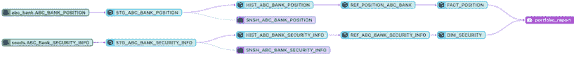
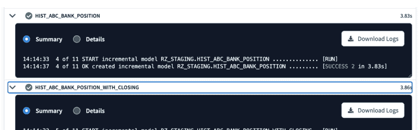

## Enhancing Software Quality

在本章中，你将发现并应用更高级的模式，以在真实项目中提供高质量的结果，并将尝试如何通过重构自信地演进代码。

通过围绕我们示例项目的一些小型用例的选择，你将学习如何以非常高效的方式保存实体更改的历史，如何从源中检测已删除的行，以及如何使用窗口函数利用存储在 HIST 表中的数据来随时间分析数据演变。

在本章的最后一部分，你将创建并应用一个宏，以使用自完成功能的维度正确处理事实中的孤儿键，从而为你的数据集市生成质量更好的事实和维度。

在本章中，你将学习以下主题：
- Refactoring and evolving models
- Implementing real-world code and business rules
- Publishing dependable datasets

## Technical requirements

本章基于前几章讨论的概念、示例项目和宏。

本章的代码示例可在 GitHub 上获取，地址为 https://github.com/PacktPublishing/Data-engineering-with-dbt/tree/main/Chapter_14。

## Refactoring and evolving models

我们务实数据平台的核心思想之一是根据最小惊讶原则生产干净的代码和干净的结构，这反过来促进更快的发展、高度可维护性并降低开发人员压力。

为什么？因为数据库是任何公司中最长寿的应用程序，它们需要长期管理。因此，我们的管道需要随着业务变化、源系统变化，有时也为了合规或其他法律原因而变化和适应。

也许违反直觉的是，我们的数据产品越成功，我们收到的添加更多功能的要求就越多。所有更改的时间和成本直接受制于必须应用更改的代码的质量。

在这一漫长旅程中，我们将有两项活动来保持项目相关性：
- **Evolution:** 这涉及添加新功能并保持现有功能按预期工作。不要把这句话的后半部分视为理所当然。

  演进应利用模块化，在已有内容之上构建新概念，并始终为每个概念提供唯一的真相。
- **Refactoring:** 重构“*是一种有纪律的技术，用于重构现有代码体，在不改变其外部行为的情况下改变其内部结构*”，正如 Refactoring.com 主页上 Martin Fowler 所说，他是我崇拜的编码英雄之一。

  重构的核心是进行多次小的更改，保持项目正常运行，在每次小更改后进行测试，最终用保持按预期工作的更好代码替换初始代码。

在本章中，我们将首先重构现有代码，用我们最初使用快照的实现替换为在上一章中介绍的并作为长期解决方案更偏好的 HIST 表实现。

本章后面，我们将添加一些更多功能，这些功能都经过了第一个可工作但粗糙的版本，然后重构为更好的解决方案。

你现在已经知道我们需要使用以开始将示例项目转变为简单、微小、不完整但逼真的项目所需的所有核心概念。它永远无法接近真实的东西，但我们希望我们拥有的东西是做得很好的。

## Dealing with technical debt

在演进代码时，第一个目标和正常程序是创建一个可行的解决方案，并且包含检查我们交付内容的核心测试。

在正常情况下，最佳解决方案是在正常开发工作中不断清除少量技术债务，保持正常态度，使我们碰巧工作的代码保持良好状态。这通常被称为“童子军规则”，它规定如果你能做到，就应该让停留的地方比你找到时更好。

在本节中，我们了解到重构是交付项目的重要组成部分。那么，你的重构目标应该是什么？我们认为易读的代码、干净的架构和性能足够好的查询是重要的。

## Tools for refactoring in dbt projects

让我们看看我们在项目中重构的基本工具：
- **Code readability and organization:** 我们通过为列、CTE 和模型提供良好的名称使代码更易于维护，并通过引入一次只执行一个步骤的 CTE 以及将大型模型拆分为一次实现一个目标的较小模型来改善其组织。
- **Tests:** 通用测试提供了第一道防线，以保证我们接收和生成的数据质量良好并符合预期。

  单个测试可以提供业务规则正确性的定点验证，检查转换结果是否为预期结果。

  初始解决方案上通过的测试必须在每次重构后继续通过。
- **Data auditing:** 一旦我们使初始解决方案正常工作，我们可以保存已验证的结果，然后在开发环境中保持输入冻结的同时，将其与每次重构步骤的结果进行比较。

  审计更改的过程可通过 `audit helper` 包大大简化：https://hub.getdbt.com/dbt-labs/audit_helper/latest/。

我们已经看到，为了保持项目健康，你必须不断演进它以提供新功能，同时不断重构它以保持代码整洁。

在下一节中，我们将对示例项目中的代码进行一些增强，包括重构，我们将从一个可以改进的解决方案开始。

## Implementing real-world code and business rules

在本节中，我们将提供许多真实代码示例，用真实项目代码替换初始示例代码并实现一些业务逻辑，即业务规则，并添加一些额外数据，展示更改是如何存储的。

第二，我们将用 `REF_ABC_BANK_SECURITY_INFO` 模型中的 `HIST_ABC_BANK_SECURITY_INFO` 表替换 `SNSH_ABC_BANK_SECURITY_INFO` 快照：
1. 在暂存文件夹中创建一个名为 `HIST_ABC_BANK_SECURITY_INFO` 的新文件并添加以下代码：

```
{{ save_history(
    input_rel = ref('STG_ABC_BANK_SECURITY_INFO'),
    key_column = 'SECURITY_HKEY',
    diff_column = 'SECURITY_HDIFF',
) }}
```

输入代码并点击 **Save** 按钮。然后，点击 **Build** 按钮或运行 `dbt build -s HIST_ABC_BANK_SECURITY_INFO` 命令。
2. 编辑 `REF_ABC_BANK_SECURITY_INFO` 模型，使其使用 HIST 表作为输入代替快照。

以下是 `current_from_snapshot` CTE：

```
current_from_snapshot as (
    {{ current_from_snapshot(
        snsh_ref = ref('SNSH_ABC_BANK_SECURITY_INFO'),
    ) }}
)
```

将其替换为 `current_from_history` CTE，如下所示：

```
current_from_history as (
    {{ current_from_history(
        history_rel = ref('HIST_ABC_BANK_SECURITY_INFO'),
        key_column = 'SECURITY_HKEY',
    ) }}
)
```

完成后，保存并构建模型。

你可以在本书关联的存储库中的 *Chapter 14* 材料中找到使用 HIST 模型的完整 REF 文件代码。

我们现在已经创建并部署了两个 HIST 模型，并重构了 REF 模型以使用来自 HIST 模型的数据。现在，血缘图如下所示：



Figure 14.1: Lineage graph after the last refactoring


我们现在可以删除或禁用不再使用的快照。

要禁用快照，请在快照声明内部添加 `{{ config(enabled=false) }}` 行。你也可以将 enabled=false 参数添加到现有的 config 定义中，但我们认为将其单独放在一个 config 中更清晰。

你现在可以从数据库中移除快照表。

请注意，正如你所写的那样，你不需要任何额外权限即可删除快照的唯一现有副本，该副本由所有环境共享，并且可能抹除重要的生产数据，破坏生产环境。

让不同的环境由不同的角色拥有并可写是一种常见策略，以确保 QA 和 PROD 保持安全并以受控的方式更改，使用 dbt 命令或迁移。这是拥有每个环境一个 HIST 表的更好解决方案的另一个原因。没有任何开发用户可以抹除 QA 和 PROD 的 HIST 表，它们将不受干扰地继续工作。

## 向 HIST 表添加测试

当我们使用 HIST 表时，有三个测试是我们想要实施的：

- 1. HIST 表主键的唯一性，该主键由存储在 HIST 表中的实体的 HKEY 属性和 LOAD_TS_UTC 组成。
  
      除非我们使用高级 HIST 宏在一<|message|>次摄取运行中摄取同一键的多个版本，否则我们希望每个键每个加载时间戳只有一个版本。
  
- 2. 检查 HKEY 是否不会产生哈希冲突。
  
- 3. 检查 HDIFF 是否不会产生哈希冲突。

让我们看看 `HIST_ABC_BANK_POSITION` 模型的测试：

```
```yaml
- name: HIST_ABC_BANK_POSITION
  tests:
    - dbt_utils.unique_combination_of_columns:
        combination_of_columns:
          - POSITION_HKEY
          - LOAD_TS_UTC
  columns:
    - name: POSITION_HKEY
      tests:
        - no_hash_collisions:
            hashed_fields: ACCOUNT_CODE, SECURITY_CODE
    - name: POSITION_HDIFF
      tests:
        - no_hash_collisions:
            hashed_fields: "{{ as_sql_list(
```

```
['ACCOUNT_CODE', 'SECURITY_CODE',
 'SECURITY_NAME', 'EXCHANGE_CODE', 'REPORT_DATE',
 'QUANTITY', 'COST_BASE', 'POSITION_VALUE', 'CURRENCY_CODE'
]    } }"
```

你可以在本书关联的仓库的 *第 14 章* 材料中找到完整的 `staging.yml` 文件，以及两个 HIST 模型的测试。

一个重要的考虑是，为了使这次重构成为一次良好的重构，我们项目的行为不应改变，因此我们更改为从新的 HIST 模型读取的 REF 模型上的测试应像以前一样继续通过，以及下游模型的测试。

## 重命名 `REF_ABC_BANK_SECURITY_INFO` 模型

查看 REF 层中两个模型的名字，我们可以看到 `REF_POSITION_ABC_BANK` 模型的名字更偏向业务，因为它把概念放在前面，然后才是源/主数据代码宇宙的名字。

另一方面，`REF_ABC_BANK_SECURITY_INFO` 模型仍然更偏向源/MD 宇宙中心，因为它把名字放在前面。

这两种命名方式都有意义，在某些情况下，你可能会同时使用两者，因为你可能需要从一个源中心的 REF 模型开始，然后应用 MD 和一些规则将其转换为更偏向业务的 REF 模型。

在我们的示例案例中，我们只处理一个银行/源系统，我们的两个 REF 模型都没有代理键，只有业务键。我们没有 MD 键集，所以我们决定采用概念优先的命名。

因此，让我们重命名 `REF_ABC_BANK_SECURITY_INFO` 模型并通过创建迁移来清理旧表：

- 1. 将 `REF_ABC_BANK_SECURITY_INFO` 模型重命名为 `REF_SECURITY_INFO_ABC_BANK`，在 IDE 中选择 **Rename**。
  
- 2. 重命名 YAML 文件中的表，其中包含测试和描述。
  
- 3. 在 `DIM_SECURITY` 模型中更改对重命名表的引用。
  
      你可以使用 lineage 图来查看依赖关系。
  
- 4. 点击 **Build** 按钮以运行并部署具有新名称的表。
  
      所有模型和测试都应正确执行，确认我们的重构已完成并且运行良好。
  
- 5. 在 `macros/migrations` 文件夹中创建一个名为 `V003_drop_table_with_old_name` 的文件，以保存删除旧名称表的迁移代码。

将以下代码添加到迁移文件中：

```
```jinja

DROP TABLE IF EXISTS {{database}}.{{schema_prefix
    }}_REFINED.REF_ABC_BANK_SECURITY_INFO;

```
```

此宏将生成删除表的代码。

- 6. 通过向其中添加以下代码，将迁移添加到 `run_migrations` 宏中：

```
```jinja


```
```

此宏将在数据库上运行所有活动迁移的 SQL 代码。

你现在可以通过执行 `dbt run-operation run_migration` 在你的开发环境中运行活动迁移。

为了确保它也在 QA 和 PROD 中运行，请验证主作业（“Build all”）是否包含 `dbt run-operation run_migrations` 作为第一个命令。

## 重构 `run_migrations` 宏

查看 `run_migrations` 宏，我们可以看到当我们想要添加一个新迁移来运行时，我们需要添加两行：一行用于日志，另一行用于实际调用将运行我们迁移宏生成的 SQL 代码的 `run_query()` 宏。

这两行的驱动因素是迁移宏的名称和其他参数，因此有意义将所有这些代码重构到一个宏内部，该宏只需接收参数，生成如下调用：

```
```text
run_migration("V003_drop_table", database, schema_prefix)
```
```

主要问题是迁移宏的名称被使用了两次，首先作为日志中的字符串，其次用于调用宏：

- 第一次使用很容易重构，因为我们可以用宏名称获取字符串，并且很容易将其传递并在日志中使用。
  
- 第二次使用名称是宏调用。幸运的是在 Jinja 中，我们可以像在 Python 中对函数那样分配、传递和调用宏对象。

它将排除事实中在维度中没有匹配的行。

因此，我们在 `refined.yml` 文件中有 `REF_POSITION_ABC_BANK` 事实和 `REF_SECURITY_INFO_ABC_BANK` 维度之间的关系测试。在测试通过之前，我们是安全的，但我们的安全取决于输入。

另一个重要原因是 `null` 值会使我们的指标不可靠/不可预测。例如，包含 `DISTINCT` 的 SQL 查询，这些查询经常由 BI 工具创建，会有意外的行为。

看下面两个查询：

```
SELECT DISTINCT c1, c2 FROM t1
-- 选择所有具有不同元组的行
-- null 的存在会使元组不同
SELECT COUNT(DISTINCT c1, c2) FROM t1
-- 选择值组合的计数
-- null 不是值，包含 null 的元组不被计数
```

如果 c1 或 c2 中有 null 值，则第一个查询返回的行数将与第二个查询返回的计数不同。这与大多数 SQL 开发人员的常见预期相反。

例如，如果你想分析订单中使用的促销代码，如果未使用促销时促销代码为 null，就很容易发生这种情况。

你可能会使用第一个查询并正确获取客户代码和促销代码的所有组合，或所有订单中使用的所有促销代码，包括 null，但如果你或你的 BI 工具在计算中使用类似第二个查询的东西（例如计算占总数的百分比），你将只计算使用促销的情况，从而使计算错误。

在下一节中，我们将回顾事实和维度不匹配的原因，然后介绍两种确保我们始终安全的方法。

## 理解事实和维度不匹配的情况

在大多数情况下，我们期望 FK 会匹配相关维度中的 PK，但也有不匹配的情况。

让我们看看可能的情况：

- 1. **错误 1 – 未找到/维度中数据缺失。**
  
      这是典型的事实中存在孤儿的情况——即事实有一个正确的 FK，但在维度中找不到。
  
      本节后面我们将介绍两种处理这种情况的方法。


+   2. **错误 2 – 缺失/事实中数据缺失。**

      当你在一个强制关系中有一个外键或复合外键的一部分为 `null` 时，就会发生这种情况。事实中缺少了强制数据。

      在我们的管道中，这应该由源上的测试或至少在 STG 模型上进行测试来检查，如果我们需要修复某些 `null` 值的话。在这种情况下，最好引入一个特定的默认记录来突出显示事实中缺失的数据，并在 STG 模型中将 `null` 替换为默认记录键。如果缺失数据将来得到修复，较新版本的事实将成为 HIST 表中的当前版本。

+   3. **暂缺 – 暂时缺失/尚不可用。**

      在某些情况下，事实会随时间变化，事实中的某些数据尚不可用，例如仍在准备发货的订单的运输公司或发货日期。

      当事实处于某个已知状态而外键为 `null` 时，就会发生这种情况。这是原本属于错误 2 的一种特殊情况，但该情况仅在事实生命周期的部分阶段有效。为了与错误 2 区分，您可以创建一个单独的默认记录。

+   4. **不适用 – 可选，未提供数据/不适用。**

      当我们在可选关系中没有数据时，就会发生这种情况。这通常表现为可选关系中外键等于 `null`。

      您可以在 STG 模型的加载过程中处理此问题，方法是将 `null` 值替换为“不适用”默认记录的键。

前面的讨论提出了令人信服的理由，说明为什么一个维度中可以有多个**默认记录**。

维度中不同默认记录的数量取决于您希望多精确地记录事实与维度之间不匹配的原因。

简单的解决方案是使用一个默认记录，通常主键为 -1，用于所有情况，但在希望更精确的组织中，至少在某些情况下会这样做（为某些表添加一些额外代码）。

## 用默认记录替换孤立记录

前面列表中的情况 2、3 和 4 通常直接在 STG 模型中处理，或者在 REF 层早期处理，只要所有用于区分情况 2 和 3 的业务规则所需的数据可用即可。

处理前面列表中情况 1（即事实中的孤立记录）的经典方法是将孤立外键替换为指向正确默认记录的外键。这确保了事实中的所有外键都指向维度中的条目。

> **重要说明**
> 
> 将事实中找到的原始外键永久替换为某个默认记录的主键，尽管非常常见，但问题很大，因为这相当于丢失信息。主要维度的缺失键看起来不好。
> 
> 我们可以在 REF 模型中这样做，因为它们是无状态的，每次运行都会重新创建。原始外键安全地存储在 HIST 表中，每次运行时，仅当原始外键不存在于当前维度中时才会被替换。
> 
> 这仍然看起来不好，并且在修复维度之前，您无法使用丢失的键。

与大多数在所有层都基于增量加载的传统数据平台不同，我们可以对所有非增量加载的事实使用这种简单解决方案，而不会永久丢失数据，并且我们可以确信始终使用来自事实和维度的最新数据。无论如何，我们将在数据集中市中提供较少可用的数据。

这种加载的另一个问题是性能。它通过强制在事实之前构建所有维度的 REF 模型来限制流程的并行性，而事实将与之连接。这浪费了现代架构中能够执行大规模并行计算的某些性能。

考虑到尽管 Snowflake 在连接方面表现出色，但数据大小本身也有其特点，而事实往往是最大的表。如果我们进行增量加载，则不能使用这种加载模式，因为会丢失数据；如果我们进行正常的全量加载，连接非常大的表将花费时间。

那么，我们的解决方案是什么？

简单但较差的解决方案是将这种外键替换保留在 REF 层，并接受在增量加载的事实上最终一致性，方法是按可接受的时间间隔对这些事实表执行 `full-refresh` 运行。希望全量刷新运行能够通过将完整事实表与维度中的最新数据连接时找到迟到的维度条目来解决问题，而我们的数据丢失只是暂时的。

更优越的解决方案称为**自完成维度**，即将正确的数据保留在事实中，独立于每个维度加载它们，而是将事实中的孤立外键添加到维度中，为事实中的每个孤立外键复制一个默认记录来补全它们。

这第二种加载模式更好地保持了并行性，因为它可以应用于事实和维度的 REF 模型之上，即使它们是增量加载的，并且可以利用 Snowflake（和其他列式数据库）从一列中提取不同值列表而无需扫描所有数据的卓越能力。

在数据集中市中构建维度时（通常比事实小得多，可以每天重建），我们可以从连接到维度的事实中获取不同外键的列表，并为维度中（尚）不存在的外键创建新条目。添加的外键将具有与所需默认记录相同的值。

鉴于以上讨论，我们认为识别已删除的位置并实施硬业务规则来为已关闭位置设置所需的值是有意义的。

因此，在本节中，我们将展示并讨论用于识别和评估已关闭位置的代码。

另一种方法是使用带删除的历史记录的通用加载模式（我们将在下一章中介绍），以泛化我们在此讨论的代码，然后设置已关闭位置的值。

这最后一个操作可以通过创建一个依赖于带删除的 HIST 表的 ref 模型，或使用 post-hook 来为新进入的已关闭位置设置所需的值来完成，我们知道该位置的状态和 LOAD_TS，即当前 dbt 运行开始的时间。

## 实现已关闭位置的识别

让我们创建并讨论跟踪已关闭位置的新的 HIST 模型：

+   1. 在 `staging` 文件夹中，创建一个名为 `HIST_ABC_BANK_POSITION_WITH_CLOSING.sql` 的新模型文件
+   
+   2. 首先配置增量物化：

```
```sql
{{ config(materialized='incremental') }}
```
```

+   3. 然后，重新定义 HIST 表的形状，以便我们知道要在代码中处理的列的位置：

```
```sql
WITH
stg_input as (
    SELECT
        i.* EXCLUDE (REPORT_DATE, QUANTITY, COST_BASE,
                    POSITION_VALUE, LOAD_TS_UTC)
        , REPORT_DATE
        , QUANTITY
        , COST_BASE
        , POSITION_VALUE
        , LOAD_TS_UTC
        , false as CLOSED
    FROM {{ ref('STG_ABC_BANK_POSITION') }} as i
```
```

注意，我们首先排除我们希望手动定位的列，然后按照我们喜欢的方式排列它们。

+   4. 当处于增量运行时，启动分支：

```
```sql
— in an incremental run …
```
```

## 提升软件质量

+   5. 使用常用的宏从 HIST 表读取当前值：

```
```sql
, current_from_history as (
    {{ current_from_history(
        history_rel = this,
        key_column = 'POSITION_HKEY',
    ) }}
),
```
```

+   6. 像往常一样，从输入中选择要加载到 HIST 中的数据：

```
```sql
load_from_input as (
    SELECT i.*
    FROM stg_input as i
    LEFT OUTER JOIN current_from_history curr
    ON (not curr.closed
        and i.POSITION_HDIFF = curr.POSITION_HDIFF)
    WHERE curr.POSITION_HDIFF is null
),
```
```

+   7. 选择已删除的数据——即 HIST 表中不在输入中的活动行——并设置值以表示已关闭位置：

```
```sql
closed_from_hist as (
    SELECT
        curr.* EXCLUDE (REPORT_DATE, QUANTITY, COST_BASE,
                       POSITION_VALUE, LOAD_TS_UTC, CLOSED)
        , (SELECT MAX(REPORT_DATE) FROM stg_input)
                  as REPORT_DATE
        , 0 as QUANTITY
        , 0 as COST_BASE
        , 0 as POSITION_VALUE
        , '{{ run_started_at }}' as LOAD_TS_UTC
        , true as CLOSED
    FROM current_from_history curr
    LEFT OUTER JOIN stg_input as i
        ON (i.POSITION_HKEY = curr.POSITION_HKEY)
    WHERE not curr.closed
        and i.POSITION_HKEY is null
),
```
```

请注意，对于已关闭的位置，我们保留大部分列，其值与关闭前最后一个版本中的值相同。这是您需要根据定义来决定并采取行动的事情。


- 8. 通过将来自输入的新数据与识别出的已平仓头寸合并，构建增量运行中要存储的变更：

```sql
changes_to_store as (
    SELECT * FROM load_from_input
    UNION ALL
    SELECT * FROM closed_from_hist
)
```

这是增量分支的最后一个CTE。

- 9. 如果不是增量运行——也就是说，我们需要从头开始建表——我们获取重塑后的输入中的所有数据，并且没有需要删除的记录：

```sql
-- not an incremental run ...
, changes_to_store as (
    SELECT *
    FROM stg_input
)
```

- 10. 最后但同样重要的是，让我们选择要存储的变更：

```sql

SELECT * FROM changes_to_store
```

如果你将这个加载模式与`save_history`宏中的模式进行比较，你会发现两处变化：首先，我们重塑输入数据，以便将需要处理的列留到最后；其次，在增量运行期间，我们检测已删除的行并将其添加到HIST表中。

现在，如果你运行新的模型，它只会像普通的旧HIST模型一样存储来自输入的数据，因为我们没有任何删除操作。

在下一节中，我们将修改模拟外部来源的表的内容，以便了解当新增或平仓头寸时，新模型将存储什么内容。

## 向头寸事实表添加新数据

到目前为止，我们在ABC_BANK_POSITION表中始终使用相同的数据作为源，这些数据最初是从Excel电子表格导出的CSV文件直接加载到Snowflake中的。

现在，我们想对该表进行更改，以模拟不同输入在我们管道起点到达的情况。

我们想要在投资组合中模拟的变更如下：

- 1. 在'SAFE'股票中创建一个新头寸。该股票不会出现在股票信息维度中。
- 2. 更改'STAR'股票的头寸。
- 3. 平掉'GCM'股票的头寸。

要更改源表的内容，我们可以从新的CSV重新加载它。如果我们要从真实投资组合中导出数据，这很合理；但为了让示例快速且易于复现，我们将通过一些SQL语句来更改表的内容，并将这些语句存储在一个分析文件中，方便我们执行SQL。

要应用这三个更改，你可以运行以下SQL代码：

```sql
DELETE FROM PORTFOLIO_TRACKING.SOURCE_DATA.ABC_BANK_POSITION
WHERE ACCOUNTID='ABC000123'
  and SYMBOL IN ('GCM', 'SAFE', 'STAR');
```

上面的代码删除了'GCM'、'SAFE'和'STAR'的旧头寸，而下面的代码则插入了'SAFE'和'STAR'的新头寸：

```sql
INSERT INTO PORTFOLIO_TRACKING.SOURCE_DATA.ABC_BANK_POSITION
    (ACCOUNTID, SYMBOL, DESCRIPTION, EXCHANGE, REPORT_DATE, QUANTITY,
     COST_BASE, POSITION_VALUE, CURRENCY)
VALUES
    ('ABC000123', 'SAFE', 'SAFEHOLD INC', 'NYSE', '2022-04-23', 100,
     4015.00000, 4389.50000, 'USD'),
    ('ABC000123', 'STAR', 'ISTAR INC', 'NYSE', '2022-04-23', 200,
     3125.00000, 2950.50000, 'USD');
```

运行该代码后，你的源表应包含以下数据：

| 行号 | ACCOUNTID | SYMBOL | DESCRIPTION | EXCHANGE | REPORT_DATE | QUANTITY | COST_BASE | POSITION_VALUE | CURRENCY |
| --- | --- | --- | --- | --- | --- | ---: | ---: | ---: | --- |
| 1 | ABC000123 | TTD | TRADE DES... | NASDAQ | 2021-04-09 | 10 | 5310.45000 | 6925.60000 | USD |
| 2 | ABC000123 | SAFE | SAFEHOLD I... | NYSE | 2022-04-23 | 100 | 4015.00000 | 4389.50000 | USD |
| 3 | ABC000123 | STAR | ISTAR INC | NYSE | 2022-04-23 | 200 | 3125.00000 | 2950.50000 | USD |

*图 14.2：源头寸表的示例内容*

你可以在随附仓库本章资料下的`analysis`文件夹中找到*上述*SQL代码。

## 理解已平仓头寸的存储方式

让我们运行管道，看看HIST表中会有什么内容。

一旦源表反映了新的投资组合状态，我们就可以通过以下命令运行管道：

```bash
dbt build -s staging
```

这将运行并测试staging文件夹中的所有模型，包括旧的和新的HIST表：



*图 14.3：以新投资组合为输入的运行结果*

查看运行结果，你可以看到有两行被插入到普通的HIST表中。它们分别是'SAFE'的新头寸行，以及'STAR'变更后的头寸行：

| 行号 | ACCOUNT_CODE | SECURITY_CODE | REPORT_DATE | QUANTITY | COST_BASE | POSITION_VALUE | LOAD_TS_UTC |
| --- | --- | --- | --- | --- | --- | --- | --- |
| 1 | ABC000123 | GCM | 2021-04-09 | 100 | 559.00000 | 678.00000 | 2023-03-08 14:12:32... |
| 2 | ABC000123 | SAFE | 2022-04-23 | 100 | 4015.00000 | 4389.50000 | 2023-03-08 14:14:29... |
| 3 | ABC000123 | STAR | 2021-04-09 | 150 | 2444.00000 | 2725.50000 | 2023-03-08 14:12:32... |
| 4 | ABC000123 | STAR | 2022-04-23 | 200 | 3125.00000 | 2950.50000 | 2023-03-08 14:14:29... |
| 5 | ABC000123 | TTD | 2021-04-09 | 10 | 5310.45000 | 6925.60000 | 2023-03-08 14:12:32... |

*图 14.4：普通HIST表的选定内容*

请注意，'GCM'的头寸仍然是开放的，运行于14:14更新了投资组合新内容后，只有两行被更新。

另一方面，带有已平仓头寸的新HIST表有三个新条目。其中两个与旧HIST表相同，第三个是'GCM'的已平仓头寸：

| 行号 | ACCOUNT_CODE | SECURITY_CODE | REPORT_DATE | QUANTITY | COST_BASE | POSITION_VALUE | LOAD_TS_UTC | CLOSED |
| --- | --- | --- | --- | --- | --- | --- | --- | --- |
| 1 | ABC000123 | GCM | 2021-04-09 | 100 | 559.00000 | 678.00000 | 2023-03-08 14:12:32... | FALSE |
| 2 | ABC000123 | GCM | 2022-04-23 | 0 | 0.00000 | 0.00000 | 2023-03-08 14:14:29... | TRUE |
| 3 | ABC000123 | SAFE | 2022-04-23 | 100 | 4015.00000 | 4389.50000 | 2023-03-08 14:14:29... | FALSE |
| 4 | ABC000123 | STAR | 2021-04-09 | 150 | 2444.00000 | 2725.50000 | 2023-03-08 14:12:32... | FALSE |
| 5 | ABC000123 | STAR | 2022-04-23 | 200 | 3125.00000 | 2950.50000 | 2023-03-08 14:14:29... | FALSE |
| 6 | ABC000123 | TTD | 2021-04-09 | 10 | 5310.45000 | 6925.60000 | 2023-03-08 14:12:32... | FALSE |

*图 14.5：带有已平仓头寸的HIST表的选定内容*

请注意，现在运行于**14:14**更新了三行，对应投资组合的新内容。插入的第三行是`quantity = 0`的那一行，用于平掉'GCM'股票的头寸。

## 选择正确的加载模式来加载历史数据

既然你有两个HIST表，对于相同的输入却有不同的数据，你可能想知道哪一个是正确的。

两个表都是正确的，因为它们都正确地记录了各自想要记录的内容。

你真正的问题不应该是对错，而是如何选择合适的模式。选择正确加载模式的人是我们分析工程师，我们必须根据要加载的数据以及数据从源系统导出的方式来选择正确的加载模式。

一般来说，你可以使用基本历史加载模式加载所有维度，这些维度的条目即使被删除后也必须保持使用状态；也可以加载那些不会被删除、但最终会被禁用或停用的事实。当源系统启用了变更跟踪或变更数据捕获时，我们也可以使用这种模式，从源获取数据，并附带告诉我们表中条目何时被删除的列。

在所有情况下，如果事实表中的行会被删除，但我们无法从源数据中获取删除信息，就必须使用能够识别并存储删除操作的加载模式，即使它的性能不如另一种模式。

## 将已平仓头寸纳入流程

现在我们已经创建了能够检测已平仓头寸的新HIST表，让我们用这些更好的数据替换旧的HIST表。

打开`REF_POSITION_ABC_BANK`模型，并替换`current_from_history`宏中对旧HIST表的引用：

```
history_rel = ref('HIST_ABC_BANK_POSITION'),
```

改为引用新的HIST表：

```
history_rel = ref('HIST_ABC_BANK_POSITION_WITH_CLOSING'),
```

现在，如果你尝试运行REF模型，会收到一个错误。这是因为在已平仓头寸对应的行中，成本基础现在为零，导致了除零错误。

要消除该错误，并在成本基础值为零时输出零值，我们必须用`DIV0`函数替换普通除法：

```sql
, ROUND(DIV0(UNREALIZED_PROFIT, COST_BASE), 5)*100
  as UNREALIZED_PROFIT_PCT
```


考虑另一种可能的替代方案是将 `UNREALIZED_PROFIT_PCT` 列设为 null。虽然从 SQL 和理论角度来看这可能很有意义，但它可能会让你在 BI 工具中的展示效果不那么理想。

一种折中方案是在 REF 模型中将其设为 null，然后在数据 Mart 中将其改为 0。请注意，过多的这些美化规则会让你的数据 Mart 代码变得难以阅读。

现在，运行 REF 模型将为你提供投资组合的真实表示，关闭的头寸会显示为已关闭：

| Row | ACCOUNT_CODE | SECURITY_CODE | QUANTITY | COST_BASE | POSITION_VALUE | LOAD_TS_UTC | CLOSED | UNREALIZED_PROFIT | UNREALIZED_PROFIT_PCT |
|---|---|---|---|---|---|---|---|---|---|
| 1 | ABC000123 | -1 | 100 | 4015.00000 | 4389.50000 | 2023-03-08 ... | FALSE | 374.50000 | 9.32800 |
| 2 | ABC000123 | GCM | 0 | 0.00000 | 0.00000 | 2023-03-08 ... | TRUE | 0.00000 | 0.00000 |
| 3 | ABC000123 | STAR | 200 | 3125.00000 | 2950.50000 | 2023-03-08 ... | FALSE | -174.50000 | -5.58400 |
| 4 | ABC000123 | TTD | 10 | 5310.45000 | 6925.60000 | 2023-03-08 ... | FALSE | 1615.15000 | 30.41500 |

Figure 14.6: REF model for the positions with the closed positions

请注意第一行中 `SECURITY_CODE = -1` 的情况，以及它看起来有多糟糕。我们之所以有它，是因为我们（目前）还没有 Security Info 维度中 SAFE 证券的行，而我们用于移除孤儿键的代码用默认值 (-1) 替换了它。

在下一节中，我们将学习如何发布可靠的数据集以及如何使用自完成功能维度来避免此问题。

现在，让我们思考一下 `FACT_POSITION`，我们在数据 Mart 中发布它。

我们希望它也显示已关闭的头寸，所有自有始以来的已关闭头寸吗？
还是我们更喜欢只保留未平仓头寸？

在第一种情况下，你无需做任何事，因为所有已关闭的头寸都是你在 REF 模型中现在得到的内容。我们认为这是 REF 模型适当的表现，因为在所有不希望包含它们的情况下，很容易过滤掉已关闭的头寸。

例如，如果你希望你的 `FACT_POSITION` 不显示已关闭的头寸，你只需添加一个简单的 WHERE 子句，使其如下所示：

```sql
SELECT * FROM {{ ref('REF_POSITION_ABC_BANK') }}
WHERE NOT CLOSED
```

通过为我们的列选择适当的命名约定，我们编写的 SQL 变得非常容易理解。

以这种方式，每一行都包含前一个头寸的值在 PREV_xxx 列中，如果没有前一个头寸则为 null。

然后，我们必须从头寸中获取一些数据，从头寸键和头寸变化报告日期创建键：

```sql
, tx_calculation as (
    SELECT
        {{ dbt_utils.surrogate_key(['ACCOUNT_CODE',
            'SECURITY_CODE', 'REPORT_DATE']) }}
            as TX_HKEY
        , ACCOUNT_CODE
        , SECURITY_CODE
        , REPORT_DATE
```

我们创建 HKEY 主要用于标识预期的业务键，并使测试和连接更容易。

接下来，我们必须从头寸中获取更多列来描述交易：

```sql
, SECURITY_NAME
, EXCHANGE_CODE
, CURRENCY_CODE
, RECORD_SOURCE
, LOAD_TS_UTC
```

然后，我们必须计算交易的新的指标：

```sql
, COALESCE(QUANTITY - PREV_QUANTITY, QUANTITY)
      as QUANTITY_PURCHASED
, CASE
    WHEN QUANTITY_PURCHASED > 0 THEN 'BUY'
    WHEN QUANTITY_PURCHASED < 0 THEN 'SELL'
    ELSE 'UNCHANGED'
  END as TX_TYPE
, CASE
    WHEN QUANTITY_PURCHASED > 0
      THEN -1 * COALESCE(COST_BASE - PREV_COST_BASE,
                         COST_BASE)
    WHEN QUANTITY_PURCHASED < 0
      THEN IFF(QUANTITY = 0, PREV_POSITION_VALUE,
               POSITION_VALUE / QUANTITY * QUANTITY_PURCHASED)
    ELSE 0
  END as ESTIMATED_TX_PROCEEDS
```

QUANTITY_PURCHASED 指标是当前数量与之前数量之间的差值，除非之前为 `null`，因为我们正在开立头寸。在这种情况下，变化就是数量本身。

该值应该是正确的，或者至少正确地表示我们在两次观察到的不同头寸之间发生的所有交易。

TX_TYPE 指标提供了关于交易方向的易于理解的语义。

*ESTIMATED_TX_PROCEEDS* 指标，如其名称所示，是与交易相关的货币流量的估计值（买入为负，卖出为正）。如前所述，买入的成本应该是准确的，而卖出的收益仅是估计值（基于在卖出前头寸的最后一次变化）。

我们将用描述交易后头寸的指标来关闭此 CTE：

```sql
    , QUANTITY             as FINAL_QUANTITY
    , COST_BASE            as FINAL_COST_BASE
    , POSITION_VALUE       as FINAL_POSITION_VALUE
FROM position_with_lead as p
)
```

最后，我们将通过按交易键对数据排序并返回来自前一个 CTE 的列来关闭模型：

```sql
SELECT * FROM tx_calculation
ORDER BY ACCOUNT_CODE, SECURITY_CODE, REPORT_DATE
```

如果我们想在数据 Mart 中使用这个新的事实，并与证券信息维度一起使用，我们可能会添加一个 CTE 将其与维度连接以移除孤儿，但我们更喜欢不移除缺失键并使用自完成功能维度模式。在这种情况下，为头寸事实完成维度也会完成交易，因为所涉及的证券列表是相同的。

## Publishing dependable datasets

交付层的角色是使我们在 REF 层构建的数据可供我们的用户访问，他们将以各种方式使用它们。

我们可以确定的一件事是，我们在交付层中更改数据的布局越频繁，我们的客户就越不满意，因为他们必须对我们所有的更改做出反应。

意外的更改是激怒客户的另一种好方法。

我们应该从中吸取什么教训？

### Managing data marts like APIs

你在数据 Mart 中发布的表和视图是数据平台的公共 API，因此你应该像对待它们一样处理它们。

以下是让客户生活更美好的基本起点：

- 提供列和表的清晰且一致的命名。

    例如，不要在某处称同一事物为 `PRODUCT_ID`，在另一处称其为 `PRODUCT_CODE`。始终对同一概念使用相同的术语，不要混用同义词（PRODUCT、ITEM、MERCHANDISE 等）。

- 使用一致的命名约定。

    例如，以类似的方式命名所有 PK——例如 `<ENTITY>_CODE`。

- 使用正确且可预测的数据类型。

    你会做 PK 和 FK 的数学运算吗？不会，所以你最好将它们作为文本而不是数字，即使它们看起来像数字。

- 决定你想要使用的默认记录集并一致地应用它们。

- 合理调整你的数据 Mart 的大小。小型数据 Mart 比包含数百个表的庞大数据 Mart 更容易理解和使用，但如果你有太多数据 Mart，很难以良好的描述性方式命名它们，并且用户很难找到正确的数据 Mart。

- 一旦发布事实或维度，请避免重命名它、重命名其中的列或更改数据类型。

- 当你想要/需要更改 API 时，请以受控且沟通的方式进行。提供更改的时间框架，如果更改会破坏客户端，请考虑至少在过渡期内保留旧版本可用，并以新名称提供新版本。

为了便于你保持外部 API 不变，你可以尝试将数据 Mart 作为最终表上数据的视图交付，以便如果出于某种原因你必须更改底层表，你可以保持外部接口不变，尝试在发布数据的视图中吸收更改。

### What shape should you use for your data mart?

不同的数据用途需要不同的数据集交付方式以实现最佳可用性。

例如，对于大多数 AI/ML 工作负载，提供一个包含所有有趣数据已清理并预先连接至所需粒度度的宽表是可取的，而大多数 BI 工具期望以 Kimball 风格提供数据模型——即星型模式的形状。


不要认为所有场景都应使用同一数据集市；相反，应该针对每个用例思考什么才是最佳解决方案。

例如，如果你需要为 REST API 提供数据支持，最好提供按 API 所服务的数据进行切分的表。你应该尝试使用 *Snowflake Unistore* 新功能中的 *Hybrid Tables*（混合表）。

当你研究运营活动并希望分析错误情况，或当流程未按预期完成、中途停滞时，构建一些使用全外连接（full outer joins）的复合事实表可能会很有用。这样，除了常规（内）连接所能匹配到的数据之外，你还可以观察到两侧不匹配的数据。

如果你还记得我们在 *第3章* 中讨论的 *统一星型模式（Unified Star Schema）*，你可以利用 UNION ALL 运算符构建宽表，其中包含许多外键（FK），这些外键通过遵循数据中的关系来生成，从而可以基于那些看似不相关、但在其关系链中拥有某个共同外键的对象进行报表分析。

在大多数情况下，你至少会准备一些用于 BI 工具进行强力报表分析的数据集市，并提供 Kimball 星型模式。

在 *第10章* 中，我们讨论了如何以敏捷方式构建星型模式，但这里先回顾一下关键要点：

- 你的数据集市会包含许多事实表，因为它们要为使用相同维度的多个相关报表提供数据支持。
- 你应该提供所需的复合事实表，使用现有关系连接 REF 层中多个单独的基事实表，以便每个报表都能基于单一事实表构建。
- 提供维度和层级结构，使你的事实表没有孤立记录。接下来我们将通过自补全维度（self-completing dimensions）来实现这一点。
- 尽量避免将度量值放入维度中，因为这会因扇出陷阱（fan traps）而可能导致严重错误的数字。
- 确定哪些字段（这些字段也可能在维度中可用）需要作为事实的一部分提供历史值。例如，交付时的地址，因为普通维度（SCD 类型一）只会包含当前值，该值可能与历史值不同。
- 决定哪些维度（也）应包含所有变更历史，并在需要使用这些 *类型二缓慢变化维度（SCDs of type two）* 的事实中放入正确的版本外键（HDIFF 来自维度中的版本，是一个非常不错的选择）。

有关此内容的更多细节，请返回 *第10章* 查看，此外关于这方面所有细枝末节的细节，也有大量已出版的书籍可供参考。

在下一节中，我们将学习如何构建自补全维度。

最终的 CTE 通过将维度的内容与新添加的缺失条目行正确组合，构建出最终维度：

```sql
dim as (
    SELECT * FROM dim_base
    UNION ALL
    SELECT * FROM dim_missing_entries
)
SELECT * FROM dim

```

最后一行返回补全后的维度内容。至此，该宏就可以使用了。

## 创建自补全社会维度

现在，让我们使用这个宏来创建安全维度的自补全版本。

你可以在数据集市中创建一个新文件，也可以用以下内容修改现有的 `DIM_SECURITY` 模型：

```jinja
{{ self_completing_dimension(
    dim_rel = ref('REF_SECURITY_INFO_ABC_BANK'),
    dim_key_column = 'SECURITY_CODE',
    dim_default_key_value = '-1',
    rel_columns_to_exclude =
        ['SECURITY_HKEY','SECURITY_HDIFF'],
    fact_defs = [{ 'model': 'REF_POSITION_ABC_BANK',
                   'key': 'SECURITY_CODE'}]
) }}
```

如宏的代码旁所解释的那样，我们只需传入包含维度数据的模型关系、主键列的名称，以及我们为补全维度而创建的默认记录的主键值。

`rel_columns_to_exclude` 参数是一个实用工具，可以方便地从发布的维度中移除那些在数据集中不需要的列。

需要注意的是，你可以将每个可能引入孤立记录的事实定义传递给 `fact_defs` 参数。一个事实定义由事实模型名称和指向该维度的外键字段名组成。

在我们的案例中，由于交易是根据持仓计算得出的，涉及的安全品种集合是相同的，因此并不需要同时传入两个事实，但这样做也无妨。

以下截图显示了在投资组合中引入 SAFE 持仓后，自补全社会维度的内容：

| 行号 | SECURITY_CODE | SECURITY_NAME | SECTOR_NAME | INDUSTRY_NAME | COUNTRY_CODE | EXCHANGE_CODE | RECORD_SOURCE | LOAD_TS_UTC |
|---:|---|---|---|---|---|---|---|---|
| 1 | TTD | The Trading De... | Technology | EDP Services | US | NASDAQ | SEED.ABC_Ban... | 2023-01-21 17:... |
| 2 | STAR | ISTAR INC | Real Estate | REIT - Diversifi... | US | NYSE | SEED.ABC_Ban... | 2023-01-21 17:... |
| 3 | GCM | GRAN COLOM... | Basic Materials | GOLD | CA | TSE | SEED.ABC_Ban... | 2023-01-21 17:... |
| 4 | -1 | Missing | Missing | Missing | -1 | -1 | System.Default... | 2020-01-01 00:... |
| 5 | SAFE | Missing | Missing | Missing | -1 | -1 | System.Default... | 2020-01-01 00:... |

图14.7：自补全社会维度的内容

如你所见，该维度现在有了一个主键为 SAFE 的条目，该行的内容与默认记录相同。

这一点，加上我们之前关于多个默认记录的讨论，使你能够为报表选择合适的列值。

## 恢复持仓事实以保持其数据不变

如果你预览了自补全维度但看不到带有 SAFE 主键的行，很可能是你忘记了将持仓事实恢复为完整状态。

要修复此问题，请打开 `REF_POSITION_ABC_BANK` 模型，并将最终查询改回其原始形式，如下所示：

```sql
SELECT
    p.*
  , POSITION_VALUE - COST_BASE as UNREALIZED_PROFIT
  , ROUND(DIV0(UNREALIZED_PROFIT, COST_BASE), 5)*100
      as UNREALIZED_PROFIT_PCT
FROM position as p
```

通过移除对安全维度的连接，并使用事实自身的外键，我们消除了对 REF 层的依赖，使 SAFE 外键重新出现在事实中，进而该外键也会出现在自补全维度中。

## 将测试转移到持仓事实的孤立外键上

最后但同样重要的是，我们必须将持仓事实与安全模型之间关系的测试移到交付层，该测试目前位于 REF 层。

通过移除 REF 模型中的连接，该测试可能会失败，但我们关心的是该关系在交付层是否有效且没有孤立记录，因为我们的 BI 工具将在交付层进行等值连接。

要将测试移到交付层，请先将其从 `refined.yml` 文件的 `REF_POSITION_ABC_BANK` 表部分移除。

然后，将其添加到 `_portfolio.yml` 文件中，如下所示：

```yaml
- name: FACT_POSITION
  columns:
    - name: SECURITY_CODE
      description: 'The code of the security'
      tests:
        - relationships:
            to: ref('DIM_SECURITY')
            field: SECURITY_CODE
```

上述代码将测试持仓事实与安全维度之间的关系是否存在孤立记录。

现在，我们的持仓事实完整无缺，安全维度也已补全，所有测试都应该完美通过。

## 报表中的历史——即类型二缓慢变化维度

大多数报表基于维度的当前值，因为企业希望看到公司当前名称、当前联系人、当前电话/电子邮件、当前产品名称——而不是下订单或签合同时（3个月或3年前）的名称。

到目前为止，我们所做的——从 REF 层的历史表中提取当前数据——都是为了满足这类报表需求。但是，我们存储所有变更历史的方法也使我们能够服务于那些需要查看数据在历史时刻样子的场景。

在我们的历史表中，我们已经拥有所见数据的所有版本，并且通过在 STG 层创建 HDIFF 列，我们也为这些版本创建了唯一键。

我们的历史表高效地存储了构建更正式称为 **类型二缓慢变化维度** 所需的数据。

通过从 HIST 表提取数据，并且对每个 HDIFF 只取一份副本（请记住，相同内容可能会多次出现并被存储），你可以构建一个包含实体所有版本的 SCD2 维度。

要使用这样的维度，你必须根据事实日期以及特定 HKEY 的不同 HDIFF 的有效期，将正确的 HDIFF 填充到你希望连接该维度的事实中。

你可以使用 LAG 函数计算每个 HDIFF 的有效期，类似于我们根据持仓计算交易的方式。

要填充 HDIFF，你可以从提供维度外键和某个相关日期的事实开始，然后基于主键和有效期范围在 SCD2 维度和该日期中查找对应的 HDIFF。


## 常见使用场景的模式

在最后一章中，我们想为你提供一个小型模式库，这些模式常用于从外部文件摄取数据，并将摄取的数据存储到我们所说的历史表中。

我们将从数据摄取自动化这一关键任务开始本章。我们将讨论各种替代方案及其优缺点，并为你提供我们基于经验的见解和用于在 Snowflake 中摄取数据的代码。

接下来，我们将扩展前面章节中介绍的用于存储实体变更历史的基本模式。我们将为你提供一组常见的存储传入数据的用例，以及处理所有这些不同需求所需的代码和条件。

在本章中，你将了解以下主题：

- 摄取模式
- 历史模式

### 技术要求

本章比前几章更具技术性，因此需要良好的 SQL 理解以及 dbt 和 Snowflake 的工作原理知识，才能充分理解所有主题。然而，对于将要涵盖的许多主题，了解 SQL 可能就足以掌握基础知识。

本章的所有代码示例均可在 GitHub 上获取，网址为 https://github.com/PacktPublishing/Data-engineering-with-dbt/tree/main/Chapter_15。

### 摄取模式

将数据摄取到平台中仍然是构建任何数据平台的关键方面之一——没有数据，就没有数据平台。

这是一个涉及面很广的主题，因为数据摄取取决于数据平台、存储服务、文件格式以及许多大大小小的细节。

在本章中，我们将重点讨论 Snowflake，它可以通过多种方式加载数据。然而，摄取合理数据量最有效的方式是通过文件。我们为 Snowflake 描述的概念经过一些调整后，也适用于其他平台。

例如，可以使用 SQL insert 语句，但其吞吐量比基于文件的摄取或从外部表读取数据（在底层是从文件读取）要低几个数量级，但这种方法也有其缺点，我们稍后会看到。

在本节中，我们将介绍使用 dbt 将数据摄取到 Snowflake 的一些最常见用例，以及一种可行的解决方法，使用经过验证的最佳实践代码，并且应该简单易用。

让我们看看将数据加载到 Snowflake 的不同方式：

- **SQL INSERT**：这是你在事务数据库中熟悉的标准 SQL INSERT 命令。它适用于插入少量行，但无法扩展。

    dbt 使用 SQL INSERT 命令将你放在 seed/data 文件夹中的 CSV 文件中的行加载到 Snowflake 中。这限制了你可以加载的数据量。祝你好运，加载 10K 或 100K 行……

    这不是摄取任何合理数据量的可行方式。

- **外部表**：在 Snowflake 中，可以定义指向外部存储服务上容器中文件夹的外部表，该表将根据提供的文件格式和字段表达式解析文件。

    这是一种非常灵活的访问外部数据（结构化或半结构化）的方式。Snowflake 可以利用半结构化文件中存储的架构信息，使创建变得非常简单。

    使用外部表的主要缺点是，每次查询该表且未命中缓存时，必须加载、解析并最终过滤所有支持该表的文件，以回答你的查询。

    可以通过基于文件/路径名称添加分区来获得一些改进，但只有在查询时对分区列进行过滤才有帮助。在基于 Delta Lake 表的特殊情况下，Snowflake 可以利用 Delta Lake 日志文件中的元数据，仅解析构成表当前状态的文件。然而，每次查询（未命中缓存时）仍然必须解析这些文件。

- **COPY INTO**：COPY INTO 命令是 Snowflake 中加载数据最重要的命令，因为所有高性能摄取方法都以某种方式依赖通过此命令摄取文件。

    你可以主动直接发出 `COPY INTO` 命令（手动或通过脚本，就像我们即将做的那样），也可以间接通过 Snowpipe 发出该命令。即使通过 Snowflake Kafka 连接器摄取数据，最终也会写入临时文件，然后通过 `COPY INTO` 命令摄取这些文件。

    使用 `COPY INTO` 的主要优点是文件只解析一次。这是因为 Snowflake 会跟踪已加载到目标表（通常称为“落地表”）中的文件，因此每次执行 `COPY INTO` 查询时，Snowflake 只会将新的或已修改的文件加载到落地表中。

    另一个优点是，在 `COPY INTO` 命令结束时，数据会位于普通的 Snowflake 表中，你对它发出的每个查询都可以利用微分区及相关元数据来减少查询的数据量。

    另一个优点是，你可以在加载数据的同时转换数据，使用几乎所有正常的 SQL 表达式和函数，尽管我们不会这样做。

    最后一点，考虑到使用 `COPY INTO`，你可以将 Snowflake 表中的数据写入兼容格式的文件中，从而允许你将数据回馈到数据湖中。

    创建一个 SQL 表达式来生成外部表的列所需的工作量，与编写一个 SELECT 语句作为 `COPY INTO` 命令的一部分将数据加载到落地表相比，是差不多的。

    考虑到工作量相似，我们通常更倾向于使用落地表方法，这样数据只解析一次，然后立即可以以最佳性能进行查询。这对于小表来说差别不大，但当表中有数百万行或文件中有数 GB 数据时，差别就很明显了。

现在我们已经讨论了摄取数据的可能方式，让我们看看我们将介绍哪些技术来加载不同类型的数据：

- 1. 摄取**结构化数据**，通常通过加载 CSV 文件完成。

    我们将在脚本中使用 `COPY INTO` 命令摄取数据，该命令将利用文件中每列的位置。列名和数据类型将由落地表的 `CREATE TABLE` 语句指定。

    在从 Delta Lake 读取的特殊情况下，对于中小型表，我们会考虑外部表方法，因为性能损失会明显减少，因为 Snowflake 只会解析构成当前表的 Parquet 文件。

- 2. 摄取 Snowflake 支持的文件格式中的**半结构化数据**，例如 JSON、Parquet、AVRO 和 ORC。

    在这种情况下，我们将使用落地表方法，但我们将展示 Snowflake 如何利用某些文件格式中嵌入的架构信息来简化我们的工作，几乎不用输入任何内容。

你可以猜到，文件格式封装了读取阶段中文件所需的所有信息，并且是可选的。如果我们将其与阶段一起提供，那么当我们从阶段读取数据时，就不需要提供文件格式，阶段中设置的格式就足够了。

**目录表**功能最近被添加到 Snowflake 阶段中，使我们能够像列出目录一样查询暂存文件的元数据。

要将目录服务添加到阶段，请将以下内容添加到阶段定义中：

```
DIRECTORY = ( ENABLE = TRUE
             REFRESH_ON_CREATE = TRUE )
```

一旦你将目录表添加到阶段，你可以使用以下语法在阶段名称上使用 DIRECTORY 函数来查询它：

```
SELECT * FROM DIRECTORY(@mystage)
WHERE SIZE > 100000;
```

前面的代码使得查询文件的元数据字段成为可能，例如 FILE_URL、LAST_MODIFIED 或 RELATIVE_PATH。

当你使用目录表功能时，你必须刷新文件列表，要么通过向 Snowflake 提供底层云提供商的集成，要么在查询之前手动发出请求。

在规划文件容器时，请考虑当你在一个阶段中有许多文件时，数量达到数十万或数百万，文件访问操作（包括过滤要摄取的文件和刷新目录）会变得更慢。

在我们的摄取自动化中，我们不需要使用目录表，因为我们依赖于 Snowflake 跟踪已被 COPY INTO 命令处理并加载到落地表中的文件的能力。

### 授权访问你的文件

既然你明白了阶段描述了文件的位置，我们还需要提供访问这些文件的授权信息。

在 Snowflake 中，可以通过多种方式实现这一点，具体取决于文件所在的云提供商，包括在创建阶段或加载/卸载数据时提供凭据。

我们更倾向于使用**存储集成**，这是一个 Snowflake 对象，存储了外部云提供商授予的身份和授权信息，以及一些元数据，可用于创建多个阶段或加载/卸载操作，而无需了解凭据。这既提供了额外的安全性，又易于使用。


除非你有特殊安全需求，我们建议为每个存储桶/存储账户创建一个存储集成，按源系统用顶级文件夹/容器进行划分，然后将阶段与能访问某一特定系统表的文件的顶级文件夹/容器配对。在系统级文件夹下，为该系统中的每个表、主题或消息类型创建一个文件夹，是一个良好的初始组织结构。

如果某些表需要特殊安全保护，我们建议将其数据托管在不同的存储桶/账户中，并为每一组可以访问这些数据的人员创建单独的集成和阶段。这样你就可以为其角色提供集成（如果他们必须管理阶段）或阶段的使用权限来读取文件。

创建存储集成的过程因云提供商而异，因此我们建议你在 Snowflake 文档中的 CREATE STORAGE INTEGRATION 命令页面上查找适用于你的云提供商的流程，网址为 https://docs.snowflake.com/en。

## 如何解析你的文件

一旦我们知道文件在哪里并被授权读取，我们仍需告诉 Snowflake 如何读取它们。

对于许多半结构化格式，如 Parquet、AVRO 和 ORC，由于这些格式既有内容的模式描述，又有明确的读写内容方式，所以选项很少。

对于 CSV 以及较小程度上的 JSON 格式，我们的可变性稍多一些，在创建格式时，提供所需选项以便 Snowflake 能正确读取并表示数据非常重要。

对于 Snowflake 支持的每种文件类型，都有一个由 CREATE FILE FORMAT 命令的默认值隐式定义的默认文件格式。因此，要定义一种格式，你只需为那些与默认值不一致的选项提供值。

通常需要指定的选项包括要跳过的标题行数、字段分隔符、文件编码、转义字符以及日期和时间格式。

以下是一个文件格式定义示例，其中定义了一些基本选项：

```sql
CREATE FILE FORMAT IF NOT EXISTS file_format_name
  TYPE = 'csv'
  FIELD_DELIMITER = '|'                -- default ','
  SKIP_HEADER = 1                      -- default 0
  ENCODING = 'ISO-8859-1'              -- default 'UTF8'
  FIELD_OPTIONALLY_ENCLOSED_BY = '"'  -- default NONE
;
```

我们认为，始终至少指定这些常见选项是一种良好实践，即使它们的值与默认值一致。

明确定义这些选项可以让所有相关方更容易了解实际值，即使他们不记得 Snowflake 的默认值，也更容易更改它们，或为需要不同格式的文件创建不同的文件格式。

## 从文件加载数据

一旦你能访问文件并解析它们，最后但最重要的一步是理解文件中的数据组织方式，以便你能读取数据，以及如果你想将数据加载到落地表中，还需要理解你想如何组织数据。

文件或表中的字段组织方式称为文件/表的**模式**，它包括列的名称、类型以及可能的组织方式（嵌套）。 “schema”一词在数据领域被过度使用，但这是最常用的含义。

让我们根据数据类型快速概述一下模式问题：

- **CSV 文件中的结构化数据**：在这种情况下，模式在设计上是扁平化的，字段在每一行中以相同顺序出现，因此我们必须为每个字段提供名称和数据类型。

- **半结构化数据**：半结构化数据的两个主要区别在于，数据可以嵌套到对象或数组中，并且实体不具有相同的固定模式。

    在 Snowflake 中，你有三种替代方式来摄取半结构化数据：将所有数据加载到一个 VARIANT 列中（由 Snowflake 解析和推断结构），在加载时显式转换数据以提供所需组织，以及能够自动推断某些格式（Parquet、AVRO 和 ORC）的列定义。后者在撰写本文时处于预览阶段。

- **非结构化数据**：这些数据无法受益于基于列的模式，例如图像、视频、社交媒体提要或需要在数据库之外进行基于应用程序的处理才能传递其信息的格式。

    Snowflake 可以通过阶段访问内部或外部存储中的文件，然后存储并提供指向文件的 URL 和元数据以提供共享访问。讨论非结构化数据超出了我们的范围。

将数据（无论是结构化还是半结构化）加载到表中的过程可以分为两步：

1. 创建落地表以保存加载的数据：

    ```sql
    CREATE TABLE my_table (the_only_column VARIANT);
    ```

    这样做非常简单，但我们将模式决策委托给了 Snowflake，并且在读取数据时将不得不处理这些问题。

    相反，我们更喜欢创建一张模式与我们希望的数据组织方式匹配的表，包括加载过程中的元数据。这样，当我们要读取数据时，就没有未解决的问题需要处理。

2. 使用 COPY 命令将数据加载到表中：

    ```sql
    COPY INTO my_table ...
        FROM @my_stage      -- stage can include format
        PATTERN = '.*xxx.*.json'
    ```

    通过这条基本命令，我们指示 Snowflake 将阶段中所有名称匹配该模式的新文件加载到表中。

当加载 CSV 时，字段必须按正确顺序排列，但对于半结构化格式，如果文件和表具有相同的模式，你可以使用 COPY 命令的 MATCH_BY_COLUMN_NAME 选项。

然而，通常情况下，我们将 FROM @my_stage 子句替换为 FROM (SELECT ... FROM @my_stage) 子句，以便在从文件加载数据时转换数据并添加可用元数据。

在 Snowflake 中加载结构化和半结构化数据的工作方式类似，但不同之处在于如何构建 SELECT 语句以在加载时转换数据。

让我们看看如何处理 CSV 和半结构化数据的模式需求。

### 提供模式以加载 CSV 数据

对于 CSV 文件，不需要提供太多信息。由于模式是扁平的，我们只需提供列的名称和数据类型，并考虑顺序。

这可以通过一条 CREATE TABLE 语句一次完成，该语句按与要加载到表中的 CSV 文件相同的顺序列出列。

一旦我们有了一张与文件中列顺序匹配的落地表，我们就可以用一种非常简单的方式摄取数据，如下所示：

```sql
COPY INTO {{ full_table_name }}
FROM (
    SELECT
        $1, $2, ... $n,      -- one for each column in file
        METADATA$FILENAME as FROM_FILE,
        METADATA$FILE_ROW_NUMBER as FILE_ROW_NUMBER,
        '{{ run_started_at }}' as INGESTION_TS_UTC
    FROM @{{ full_stage_name }}/
)
PATTERN = '{{file_pattern}}'
```

前面的代码来自用于加载 CSV 文件的宏，我们将在后面讨论。

请注意，我们需要从文件中读取的唯一信息是列数，因为我们可以通过列号引用它们。数据类型在落地表中设置，该表通过 CREATE TABLE 命令创建一次，并以正确的顺序引用文件列。

### 推断半结构化数据的模式

如果你认为计算 CSV 文件中有多少字段很简单，那么你仍然需要了解 Snowflake 提供的最新函数来管理半结构化数据。

INFER_SCHEMA 和 GENERATE_COLUMN_DESCRIPTION 函数共同允许你将 Snowflake 指向一个文件（Parquet、Avro 或 ORC 格式），并为你完成生成落地表和 SELECT 命令的大部分或全部工作。

从阶段中受支持文件读取元数据的命令如下所示：

```sql
INFER_SCHEMA(
    LOCATION => '@mystage/path/folder/'
  , FILE_FORMAT => 'my_parquet_format'
  , FILES => '<file_name.parquet>'[, …]
)
```

FILE_FORMAT 参数是必需的，我们建议使用 FILES 参数将采样限制为一个或几个已知包含良好有效负载数据的文件。请特别注意支持文件，例如 Delta Lake 的检查点文件，它们可能包含用于元数据或工具的其他列。

LOCATION 和 FILES 中的名称必须共同生成文件的完整路径，因此将 LOCATION 设置为文件所在的文件夹是一个好做法。

你可以使用 LIST 命令查看阶段中文件夹内文件的路径：

```sql
list '@mystage/path/folder/'
    PATTERN = '.*[.]parquet';
```

通过将 INFER_SCHEMA 函数指向一组文件，你将获得源文件中出现的每个列的以下信息：COLUMN_NAME、TYPE、NULLABLE、EXPRESSION、FILENAMES 和 ORDER_ID。

你可以通过将 INFER_SCHEMA 函数包装在 table() 函数中并从中选择来查询其输出，如以下示例所示：

```sql
SELECT *
FROM table( INFER_SCHEMA(…) )
```


这会生成如下所示的输出（第一行为列标题）：

| 列名 | 类型 | 可空 | 表达式 | 文件名 | ORDER_ID |
|---|---|---|---|---|---|
| continent | TEXT | True | $1:continent::TEXT | xxx.parquet | 0 |
| country | VARIANT | True | $1:country::VARIANT | xxx.parquet | 1 |

请注意，EXPRESSION 列提供了从解析后的 Parquet 文件中选择列所用的代码，这对于定义外部表以及在 COPY INTO 命令中使用的 SELECT 查询都很有用。

您可以分别传入 table、external_table 或 view 字符串值，使用 GENERATE_COLUMN_DESCRIPTION 函数来为三种使用场景生成有用的输出：创建表、创建外部表和创建视图。

以下代码展示了如何使用 GENERATE_COLUMN_DESCRIPTION 函数，输出创建表所需的列和数据类型列表：

```
SELECT GENERATE_COLUMN_DESCRIPTION
       ( ARRAY_AGG(OBJECT_CONSTRUCT(*)), 'table')
FROM table( INFER_SCHEMA(...) )
```

结果类似于下面这样：

```
"country" VARIANT,
"continent" TEXT
```

为了从推理出的模式中生成所需的代码，我们更倾向于使用我们可以控制的普通 SQL。

下面的 SELECT 查询会为创建表生成类似的列定义：

```
SELECT
    COLUMN_NAME || ' ' || type || ',' as sql_create_table
FROM table( INFER_SCHEMA(...) )
```

另一方面，下面的查询会为读取数据的 SELECT 查询生成列：

```
SELECT EXPRESSION as sql_select
FROM table( INFER_SCHEMA(...) )
```

结果如下：

```
$1:country::VARIANT,
$1:continent::TEXT
```

下面的 SELECT 查询会为外部表生成列定义：

```
SELECT
    COLUMN_NAME || ' ' || TYPE
           || ' as (' || EXPRESSION || ')' as sql_ext_table
FROM table( INFER_SCHEMA(...) )
```

结果如下所示：

```
country VARIANT AS ($1:country::VARIANT),
continent TEXT AS ($1:continent::TEXT)
```

在本节中，我们看到了让 Snowflake 以现代半结构化格式对数据文件进行采样，并根据文件中存储的定义生成数据的 schema 定义是多么容易。

在接下来的几个部分中，我们将学习如何使用这些代码片段来创建外部表，或将数据摄入到着陆表中。

## 外部表

我们之前已经暗示过，使用外部表并不是我们最喜欢的选项，但它是一种将数据摄入 Snowflake 的可能方式。那么，为什么不直接从存储中查询数据来加载呢？

简短的答案是性能、成本，以及需要处理重复数据。

主要原因是，读取外部表时，除非你主动按文件名/路径过滤文件，否则每次查询未命中缓存时都需要解析每个文件。这既慢又昂贵（你需要为耗时付费）。

第二个原因是，当你读取一个文件夹中的所有文件时（该文件夹中已经积累了数天甚至数年的全量或增量导出），每次加载你都会得到大量旧版本，这些旧版本在主键上是重复的 —— 同样，除非你主动按文件名/路径过滤。

第三个原因是，正如我们将看到的，创建外部表的复杂程度与将数据摄入到着陆表相当，但却没有那些好处。

最后一个原因是，除非你配置底层文件系统以通知 Snowflake 每个文件的变化，否则你必须在查询外部表之前刷新它，以便它检查表定义下现在有哪些文件可用。在 dbt 中，在查询前执行这个操作非常容易，所以这不是一个大问题，但这确实是我们需要多做的另一件事。

刷新外部表底层文件的代码如下：

```
ALTER EXTERNAL TABLE my_ext_table REFRESH;
```

简而言之，对于只加载几百万行的小表来说，这些问题都不是问题。但对于任何有规模、有速度的表来说，除非你采用增量加载和严格过滤，否则这将是一个缓慢的死刑判决。

唯一的例外是你的数据以 Delta Lake 格式存储。在这种情况下，Snowflake 可以读取并利用该格式，只解析构成表当前状态的 Parquet 文件，从而让你查询源表的最新快照。

每次查询表时，你仍然需要等待并为解析所需的 Parquet 文件付费，但至少你无需过滤和管理增量加载。

要创建外部表，你需要先创建 stage 和文件格式。然后，你可以使用类似下面的代码创建外部表：

```
CREATE EXTERNAL TABLE my_ext_table
(
  file_part as (<expression on metadata$filename>)
  col1 varchar AS (value:col1::varchar)
  ...
)
PARTITION BY (file_part)
LOCATION=@mystage/daily/        -- @stage/path
FILE_FORMAT = my_file_format
AUTO_REFRESH = FALSE;
```

在前面的伪代码中，你定义外部表中的虚拟列（VIRTUAL columns）的方式与普通表略有不同。

在虚拟列的名称和类型之后，我们需要提供一个表达式来从底层文件中提取该列。该表达式必须基于 VALUE 列（VARIANT 类型），即当你让 Snowflake 解析半结构化数据时获得的列。

要设置 stage 和文件格式，你可以使用 setup_xxx 文件，如下一节关于着陆表的描述，因为它们的设置方式相同。

在上一节中，我们提供了一个 SQL 表达式，用于从 INFER_SCHEMA 生成虚拟列的定义。下面的代码片段使用来自 INFER_SCHEMA 函数的相同信息创建了一个外部表：

```
CREATE EXTERNAL TABLE my_ext_table
  USING TEMPLATE (
    SELECT ARRAY_AGG(OBJECT_CONSTRUCT(*))
      FROM TABLE(
        INFER_SCHEMA(
          LOCATION=> '@mystage',
          FILE_FORMAT=>'my_file_format'
        )
      )
  )
```

虽然这对于临时的数据读取或探索工作来说是一个非常方便的表创建方式，但这不是创建长期外部表以作为 ETL 基础的最稳定方式，因为列将取决于 stage 中当前的文件。

因此，我们更倾向于运行上一节中的 SQL，并存储生成的 CREATE TABLE 语句，以便在需要时随时重现。

外部表的一个合理使用场景是底层数据托管在 DELTA LAKE 格式中。

为了指示 Snowflake 使用 Delta 格式，请在创建外部表的命令中添加 TABLE_FORMAT = DELTA，如下所示：

```
CREATE EXTERNAL TABLE my_ext_table
    ...
    TABLE_FORMAT = DELTA;
```

对于这种表，Snowflake 将查找并使用日志文件来确定需要解析哪些 Parquet 文件来服务查询。

## 着陆表

最后，我们来到了着陆表，这是我们将数据加载到 Snowflake 的首选方式，因为它们以最少的努力提供了最大的好处。

这种方法适用于大表和高吞吐量数据，并且可以很好地扩展。

在前面几节中，我们看到了加载数据需要遵循三个步骤：

- 设置数据库对象，例如 stage、文件格式和 schema。
- 创建着陆表以保存加载的数据。
- 编写 COPY INTO 命令，将数据加载到着陆表中。

在本节中，我们将利用前面几节的描述，向你呈现一套观点鲜明的宏集合，用于自动化创建和加载你的着陆表，这套宏易于理解、健壮且维护成本低。

我们将展示的用于自动化摄入的代码由宏组成，因此包含必要代码的文件必须放在 macros 文件夹下。

通常，我们会创建一个 ingestion_lib 文件夹来存放实现通用模式和支持函数的宏，以及第二个 ingestion_code 文件夹，其中包含每个源系统的一个子文件夹，用于设置特定系统对象和摄入该系统各个表的代码。

在深入代码之前，先说明一下加载频率：在 Snowflake 中加载数据本质上是一个批量过程，使用 Snowpipe 也不例外。

好在这是一个快速过程，可以在几秒内摄入大量数据，因此可以通过微批次实现近实时的加载。这是因为你可以以短间隔（低至分钟级）在着陆表上运行 COPY INTO 命令。

### 为着陆表和外部表设置对象

首先，我们希望设置一个名为 _setup_XXX.sql 的文件，它封装了从一个源系统摄入时所需通用对象的命名和创建。

我们会为每个需要摄入的源系统创建一个设置文件，因为这通常是一个需要不同文件格式/stage 的领域，或者我们希望将其分开放在不同的 schema 中。当然，具体情况可能有所不同。

_setup_XXX.sql 文件的高级布局如下：

- 工具宏，用于生成并最终运行设置所需的所有 SQL
- 获取宏，用于定义并提供对象的名称
- 创建宏，用于生成每个所需对象的 SQL

让我们更详细地描述文件中包含的宏。

我们以一个辅助宏开始该文件，该宏允许我们生成运行所有设置所需的全部 SQL：

```

  {{ create_XXX_ingestion_schema_sql() }}
  {{ create_XXX_ingestion__ff_sql() }}
  {{ create_XXX_ingestion__stage_sql() }}

```

请注意，我们为所有这些宏命名时都以 _sql 结尾，因为它们只是生成所需的 SQL 而不运行它。setup_XXX 宏调用了三个单独的宏，它们为我们所需的每个设置元素生成 SQL。

要运行 SQL，我们必须将 _sql 宏的结果传递给 run_query 宏：

```

  {{ log('**  Setting up the LANDING / EXTERNAL tables,
        schema, FF and STAGE for XXX system **', true) }}
```


```jinja



```

你可以添加一个类似这样的辅助宏，以便在不加载表中的数据的情况下运行设置。要运行它，请使用 `dbt run-operation run_setup_XXX`。这也是 `load_XXX_...` 宏中的第一次调用，该宏运行所有摄取操作。

接下来，我们有定义我们为摄取和落地表创建的对象名称和位置（数据库和模式）的宏。

第一个宏，如图所示，定义了对象的数据库和落地表：

```jinja
/* DEFINE Names */

  

```

通常，我们返回 `target.database` 以使用运行代码的环境相同的数据库，但也可以返回一个固定名称，以便我们始终使用该数据库。在这种情况下，你的所有环境都将依赖于相同的表（这对增量演进是不利的），并且你需要向在所有环境中使用的角色提供对该数据库的访问权限。

第二个宏，如图所示，定义了对象和落地表的模式名称：

```jinja

  

```

我们通常返回一个固定字符串，主要是为了简单起见，但你可以使用变量，以便在此处和我们将用于从落地表读取的源定义中使用相同的定义。

以下宏生成文件格式的完全限定名称：

```jinja

  

```

在大多数情况下，对于一个源，一个文件格式就足够了，因为来自一个源的数据通常以一种方式导出，但如果需要，你可以创建更多名称。

最后一个命名宏生成阶段的完全限定名称：

```jinja

  

```

通常，对于一个源系统，一个阶段和一个名称就足够了。

文件的最后一部分包含创建要执行的 SQL 的宏。

一个重要点是，这些宏必须生成幂等的 SQL 代码，可以每天运行，而对象存在或不存在都不会产生错误，并且如果对象存在则不会更改现有定义。

第一个宏创建用于保存对象和落地表的模式：

```jinja

CREATE SCHEMA IF NOT EXISTS
    {{ get_XXX_db_name() }}.{{ get_XXX_schema_name() }}
COMMENT = 'The Landing Schema for XXX data.';

```

它只是使用宏返回的数据库和模式名称创建模式。

第二个宏创建文件格式：

```jinja

CREATE FILE FORMAT IF NOT EXISTS {{ get_XXX_ff_name() }}
    TYPE = 'CSV'
    FIELD_DELIMITER = ','
    SKIP_HEADER = 1
    FIELD_OPTIONALLY_ENCLOSED_BY = '"'
    ESCAPE = '\\'
    -- ENCODING = 'ISO-8859-1' -- For nordic languages
;

```

此宏为 CSV 文件创建文件格式，因为需要提供更多参数，但对于其他格式，创建方式类似，只是更短。

在此示例中，我们选择了一些最常见的选项，通常需要指定。特别提到的是 UTF-8 编码是默认值。如果你使用的文件编码与 UTF8 不同，则需要指定编码。

使用 Parquet、Avro 或 ORC 等格式可以消除大多数这些格式问题。

我们需要的第三个宏创建用于访问文件的阶段：

```jinja

CREATE STAGE IF NOT EXISTS {{ get_XXX_stage_name() }}
STORAGE_INTEGRATION = <STORAGE_INTEGRATION_NAME>
URL = 'azure://strg_account.blob.core.windows.net/XYZ-container/XXXpath/'
FILE_FORMAT = {{ get_XXX_ff_name() }};

```

此宏使用存储集成创建阶段，该集成封装了 Snowflake 与包含文件的平台之间的授权。

在此示例中，我们提供了一个基于 Azure 的 URL，指向 strg_account 存储账户中名为 XYZ-container 的容器中的 XXXpath 路径。

我们还提供了一个文件格式，以便在大多数情况下（外部表除外）从阶段读取数据时默认使用。

此第一个设置文件可以被认为对于基于外部表和落地表的摄取创建很有用，因为模式、文件格式和阶段可以共享。
