## 第 2 部分：
## 使用 AWS 工具进行数据整理

在本节中，我们将探讨三种强大的 AWS 工具，旨在简化数据整理和准备工作。首先，我们将深入研究 AWS Glue DataBrew，学习如何清洗、转换和丰富数据，以确保高质量且可用的数据集。随后，我们将揭示 AWS SDK for pandas 的多功能性，全面了解在 AWS 平台上进行高效数据操作和准备的方法。最后，我们将探索 Amazon SageMaker Data Wrangler，赋予您技能，以便无缝地对数据进行预处理和准备，用于具有影响力的机器学习项目。

本部分包含以下章节：
- *第 2 章，AWS Glue DataBrew 简介*
- *第 3 章，介绍 AWS SDK for pandas*
- *第 4 章，SageMaker Data Wrangler 简介*

## AWS Glue
## DataBrew 简介

前一章讨论了组织如何向现代数据架构转型。现代数据架构的一个关键方面是让组织中的每个个体都能访问数据。这促进了数据驱动的决策制定，从而增强了用户能力，提高了生产力，并最终带来更高的利润以及更大的客户和员工满意度。

本章专注于 Amazon Web Services (AWS) Glue DataBrew 及其在数据整理中的应用。将涵盖以下主题：
- 使用 AWS Glue DataBrew 的优势
- 开始使用 AWS Glue DataBrew
- 使用 AWS Glue DataBrew 进行操作

### 为什么选择 AWS Glue DataBrew？

拥有正确的工具是实现组织数据驱动的关键因素，而 AWS Glue DataBrew 就是这样的工具之一。它是 AWS Glue 系列的一部分，该系列在 re:Invent 2020 上推出。

起初，当 AWS Glue 在 2017 年 8 月发布时，其目标用户是编写 Apache Spark 代码的开发者和数据工程师。目标是为他们提供一个平台，提供运行 Spark 代码所需的计算和存储资源。这使他们能够利用 Apache Spark 的速度和易用性——其在大规模数据处理方面比 Hadoop 快 100 倍——同时也利用云的优势，如弹性、性能和经济性。

随着公有云采用率的增加并日益成为主流，AWS Glue 不断进化以满足企业不断变化的需求。最初，它主要被用作 ETL 工具，但随后扩展为一个更全面的数据治理工具。这一扩展包括添加诸如 Python 引擎、Glue 数据目录、Glue 爬虫和 AWS Glue Studio 等功能。此外，用户角色已从不仅仅是开发者，演变为现在包括数据分析师、业务分析师、产品经理和数据科学家等业务人员。

尽管增加了新功能，包括用于创建 Glue ETL 作业的 UI 体验以及 2021 年引入的 Glue Studio，但对易用性的更高要求一直是一个共同的需求。虽然这些功能主要服务于使用 Apache Spark 执行 ETL，但它们仍需一定程度的编码或脚本知识。

业务用户需要一种工具，能够消除数据生产者与数据消费者、开发者与业务用户之间的延迟。他们寻求一种易于使用的工具，如 Microsoft Excel，无需学习 Scala、PySpark、Python 或 SQL 等编程语言或脚本语言。通常，在企业中，业务用户严重依赖 BI 开发者基于不同的 KPI 构建仪表板，以便他们做出关键业务决策并识别任何异常。然而，对 KPI、数据源甚至数据进行微小更改可能需要一周或更长时间。

除了易用性之外，客户还需要一个可扩展的解决方案。虽然 Microsoft Excel 是其中最好的数据整理工具之一，但它缺乏可扩展性。虽然它非常适合处理拥有数千条记录的小型数据集，但当数据增长到数万或数百万条记录时，它表现不佳。

根据与各种规模组织的互动，从寻求建立数据驱动文化或启用数据即服务（DaaS）的初创公司到大型企业，最大的挑战是如何提供安全且高质量的数据访问。客户希望有一种工具，使他们能够进行数据整理而无需将数据下载到本地机器，这会给数据安全带来重大风险并可能导致数据质量问题，特别是在生命科学或政府和金融机构等垂直领域。虽然 AWS Glue 允许构建 ETL 管道，但进行数据分析需要将从数据湖（Amazon S3）或数据仓库（如 Amazon Redshift 或 Snowflake）中的数据下载到本地桌面，从而带来数据安全和质量风险，或者使用第三方工具，这也会带来数据安全风险，因为数据必须通过互联网从 AWS 云移动到第三方工具，从而增加了成本。

例如，许多数据隐私法律，如欧盟《通用数据保护条例》(GDPR)、《加州消费者隐私法》(CCPA) 和 1996 年的《健康保险流通与责任法案》(HIPAA)，现在限制了公司对客户数据的使用、存储位置以及可以使用哪些工具。例如，携带包含不应超越国界数据的笔记本电脑或使用不符合 HIPAA 标准的工具可能会给组织带来法律和财务挑战。

处理大数据的挑战之一是保持数据质量。例如，像 Excel 这样的工具可能无法提供与 Spark 相同级别的精度，尤其是在云中处理大型数据集时。此外，市场上很少有基于 Apache Spark 等开源技术构建的易用型 UI 工具。

这就是 AWS Glue DataBrew 发挥作用的地方。它是 AWS 提供的一款无代码/低代码、无服务器视觉数据准备工具，使数据专业人员（如数据分析师、业务分析师、BI 开发人员和数据科学家）无需编写任何代码即可进行数据整理。它提供 300 多种即用型转换来自动化数据整理过程，包括数据发现、结构化、质量检查、清洗、验证、异常检测和 personally identifiable information (PII) 识别。这将用于分析和机器学习的准备数据的时间最多缩短 80%。

AWS Glue DataBrew 的一个关键特性是其无服务器性质，通过消除资源供应、扩展、高可用性和服务器维护等基础设施管理任务，提供敏捷性。AWS Glue DataBrew 构建在开源 Apache Spark 之上，提供 Spark 的规模和速度，且无许可费用。它特别适用于数据存储在 Amazon S3 等数据湖中的大数据项目。

除了无服务器之外，AWS Glue DataBrew 还提供高级数据配置文件、视觉数据血缘、与数据管道的集成能力，以及为高级机器学习用例准备数据的能力。

下图从高层次展示了 DataBrew 的工作原理。

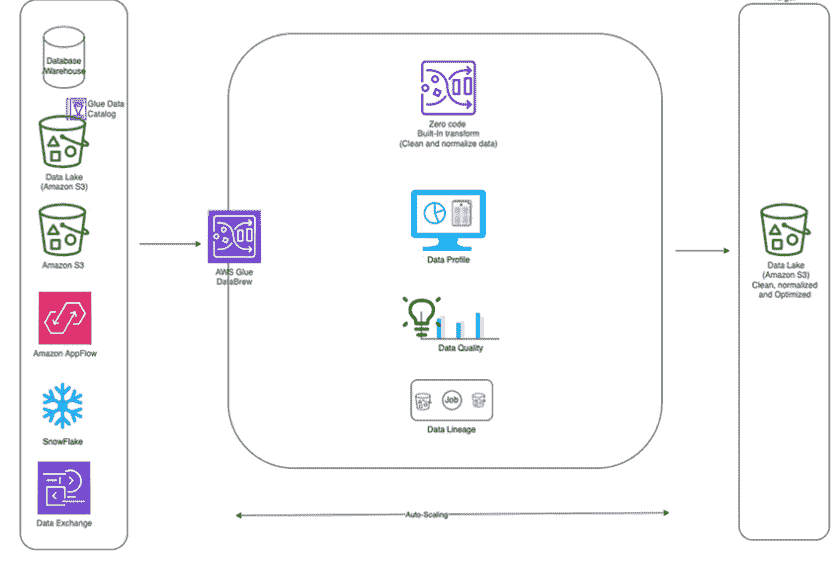

图 2.1：DataBrew 工作原理的高层视图

为了为在 AWS Glue DataBrew 上构建数据整理解决方案奠定基础，让我们首先深入研究其基本构建块。

### AWS Glue DataBrew 的基本构建块

以下是 DataBrew 的核心构建块：
- **项目：** 在 DataBrew 中，项目包含了您视觉探索、理解、合并、清洗和标准化数据所需的所有组件。创建一个项目会建立一个工作区，存储关于您的数据、应用于它的转换以及转换它的计划作业的信息。

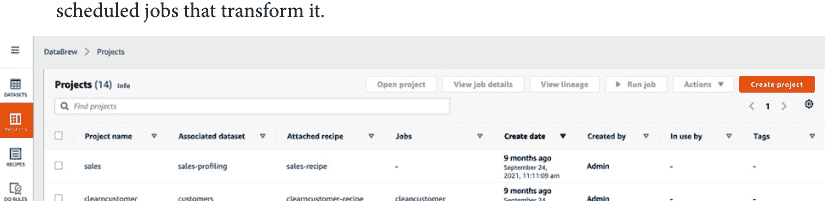

图 2.2：AWS Glue DataBrew 控制台中的项目列表
- **DataBrew 数据集：** 使用 DataBrew 数据集，您可以从各种数据源创建新数据集。这些源包括从本地机器上传的文件、存储在 Amazon S3 数据湖中的数据、AWS Glue 爬虫爬取的 AWS Glue 数据目录中可用的元数据，以及通过 Amazon AppFlow 从不同的 SaaS 数据源（如 Datadog、Salesforce 和 Marketo）获取的数据。此外，AWS Data Exchange 提供了广泛的第三方数据产品的访问权限，并使其可用于 DataBrew。

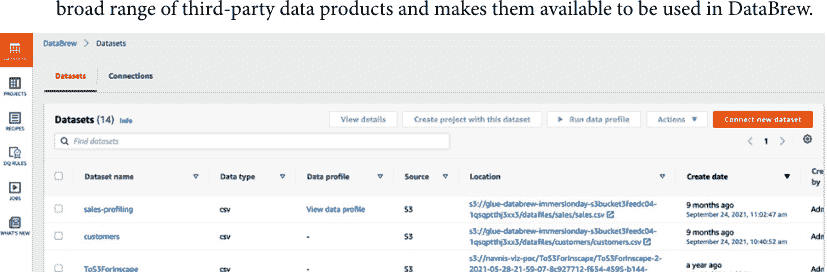

图 2.3：AWS Glue DataBrew 控制台中的数据集列表


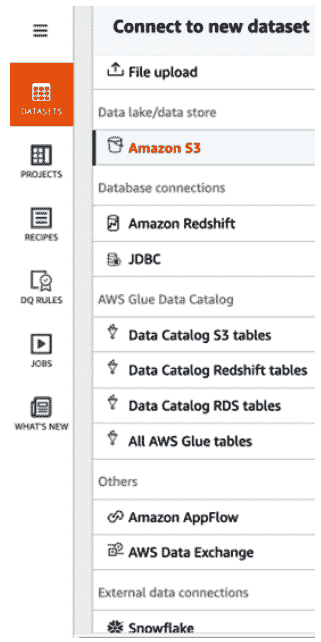

图 2.4：AWS Glue DataBrew 控制台中的数据源列表

-   **配方：** 在 AWS Glue DataBrew 中，配方是您在处理项目时创建或修改的一组转换步骤。您可以将配方发布为独立实体。已发布的配方仅包含转换步骤，不引用原始数据。您可以通过下载为 YAML 或 JSON 格式来共享已发布的配方。配方可以有多个已发布的版本，您可以从项目中发布这些版本。随着您逐步处理多个草稿，您也可以拥有同一个配方的多个工作副本。

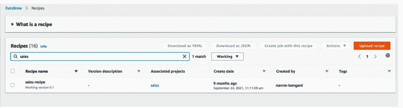

图 2.5：AWS Glue DataBrew 控制台中的配方列表

-   **作业：** 在 AWS Glue DataBrew 中，作业是一组可对数据集或项目执行的指令。有两种类型的作业可用：
    -   **配方作业：** 配方作业对数据集或项目运行配方中的所有转换，并生成不同文件格式的输出，该输出可保存到相同或外部 AWS 账户中的 Amazon S3 存储桶。
    -   **配置文件作业：** 配置文件作业检查数据集，以提供相关性、值分布、列统计等信息。

对于配方作业，您可以定义作业输出设置，例如文件类型和输出对象的 Amazon S3 路径。您还可以压缩输出。此外，您可以将计划与作业关联，并选择作业的运行频率和时间。AWS Glue DataBrew 提供多种调度选项，包括 `cron` 设置。

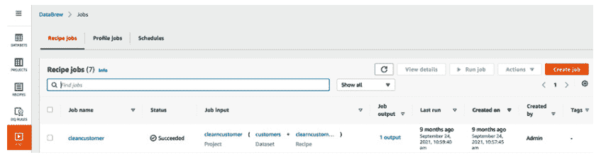

图 2.6：AWS Glue DataBrew 控制台中的作业列表

-   **DataBrew 数据血缘：** 数据血缘允许您轻松跟踪和可视化数据集的来源、事件和目标，清晰地了解数据所经历的路径。

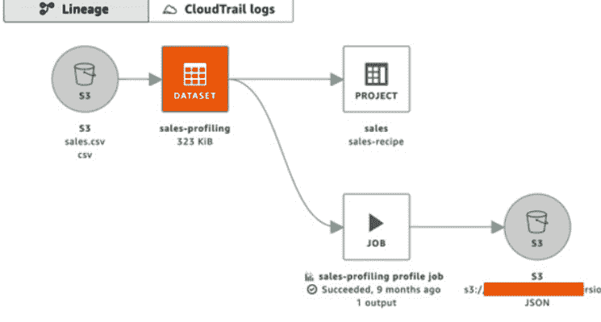

图 2.7：AWS Glue DataBrew 控制台中的数据血缘可视化

-   **数据剖析：** 数据剖析是 Glue DataBrew 提供的最重要功能之一。其核心是，AWS Glue DataBrew 使用户能够轻松地为其数据集创建全面的数据配置文件。通过运行 AWS Glue DataBrew 数据配置文件作业，用户可以获得有关当前数据形态的宝贵信息。这包括对内容上下文、数据的底层结构以及各种数据元素之间复杂关系的深入理解。

通过先进的算法和智能分析，AWS Glue DataBrew 配置文件会细致地检查每个数据点，提供描述性统计、数据分布洞察和数据质量评估。它们帮助数据专业人员识别潜在的异常、缺失值和不一致之处，使他们能够做出明智的决策并采取必要措施提高数据质量。

AWS Glue DataBrew 配置文件还提供可视化和直观的仪表板，以易于理解的格式呈现数据配置文件。这使用户能够更有效地掌握复杂模式、发现趋势并从数据集中提取有意义的见解。

凭借其用户友好的界面和强大的功能，AWS Glue DataBrew 配置文件使数据专业人员能够释放数据集的隐藏潜力。通过利用从数据配置文件中获得的见解，他们可以做出明智的决策，提高数据质量，并为组织带来有影响力的成果。

根据《哈佛商业评论》的一份报告，只有 3% 的公司数据符合基本质量标准，平均而言，47% 的新创建数据记录至少有一个严重错误（即影响其工作的错误）。

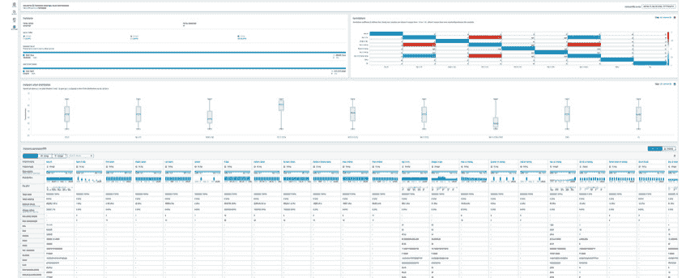

既然我们已经了解了 AWS Glue DataBrew 的基础知识，接下来让我们开始使用它来完成各种任务。

# AWS Glue DataBrew 入门

了解任何服务或工具最有效的方法之一是通过动手实践或从示例中学习。我们将采用同样的方法。在本指南及后续教程中，我们将使用 AWS 控制台来学习 AWS Glue DataBrew 作为数据整理工具。使用 AWS Glue DataBrew 的首要条件是数据。我们之前讨论过数据是新石油，但当数据处于原始形态时，几乎没有价值。在继续之前，了解任何服务的定价模式至关重要。

# 了解 AWS Glue DataBrew 的定价

值得注意的是，AWS 服务的定价因区域而异，并可能发生变化。在本节中，我们将讨论 us-east-1 区域的定价。AWS Glue DataBrew 有各种组件，例如项目、数据集、作业和配方。

让我们从数据集开始。当您从不同的数据存储（包括 S3、AWS Glue Data Catalog、Redshift、Snowflake、Amazon AppFlow 和 AWS Data Exchange）引入数据时，就会创建数据集。客户使用 AWS Glue DataBrew 连接器（如 JDBC 驱动程序）无需付费（JDBC 驱动程序是一种软件组件，允许 Java 应用程序连接并与特定类型的数据库交互）。但是，客户需要承担 Glue Data Catalog 的费用，该费用非常低。例如，您可以免费存储多达一百万个对象。如果您存储超过一百万个对象，则每月为超出的一百万个对象每 100,000 个支付 $1.00。AWS Glue Data Catalog 中的对象是表、表版本、分区或数据库。

每月对 AWS Glue Data Catalog 的前一百万次访问请求免费。如果您在一个月内超过一百万次请求，则超出第一个百万的每百万次请求将收取 $1.00。常见请求包括 *CreateTable*、*CreatePartition*、*GetTable* 和 *GetPartitions*。

接下来是项目，这里开始变得有趣。Glue DataBrew 的费用主要来自 DataBrew 交互式会话。当 DataBrew 项目中的数据加载后，就会启动一个 DataBrew 交互式会话。客户按使用的会话总数计费，以 30 分钟为增量计算。

当您与 Glue DataBrew 项目交互时，例如通过 UI 或 DataBrew API/CLI/SDK 添加配方或过滤数据，您将启动一个会话。即使您不做任何操作，会话也会保持活动状态，但它会在当前 30 分钟周期结束时自动关闭。如果您要休息或不处理它，关闭会话很重要。会话费用为 $1.00。

例如，假设您在上午 09:00 启动一个交互式会话并工作到上午 09:20，然后休息，并在上午 09:30 启动另一个会话，接下来一个小时努力工作，完成所有工作，然后再次休息。第二天查看 AWS 账单时，您会看到账单上增加了 $3.00，尽管第一个会话只有 20 分钟。

在另一种情况下，假设您打开一个项目 2 分钟并关闭它，然后在 5 分钟后再次打开同一个项目并工作 10 分钟，关闭它，并在 30 分钟内重复相同活动五次；这只会花费您 $1。这是因为每次打开会话时，AWS Glue DataBrew 都会分配资源以提供更快的访问，并减少为每个项目分配资源的延迟。

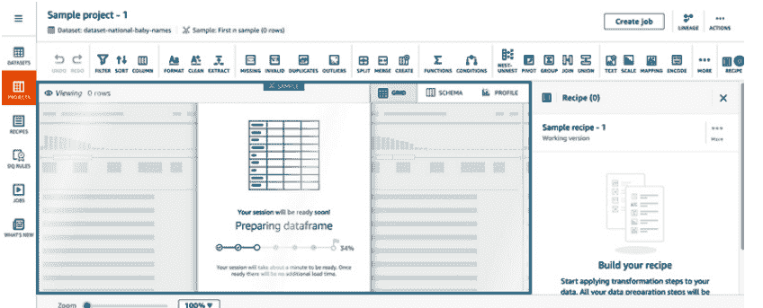

图 2.9：Glue DataBrew 交互式会话正在启动

AWS Glue DataBrew 作业也在决定定价方面发挥作用。当您创建数据集时，您还没有可供查看的数据配置文件概览。要生成数据配置文件概览，您需要运行一个数据配置文件，这会为您创建一个 AWS Glue DataBrew 作业。在接下来的章节中，我们将了解在运行作业之前可用于配置作业的各种选项。但出于定价目的，需要注意的一个重要配置选项是您为作业分配了多少节点。此选项可以在**高级作业设置 - 可选**下找到。请注意，此选项之所以称为*可选*，是因为 AWS Glue DataBrew 默认配置为五个节点。

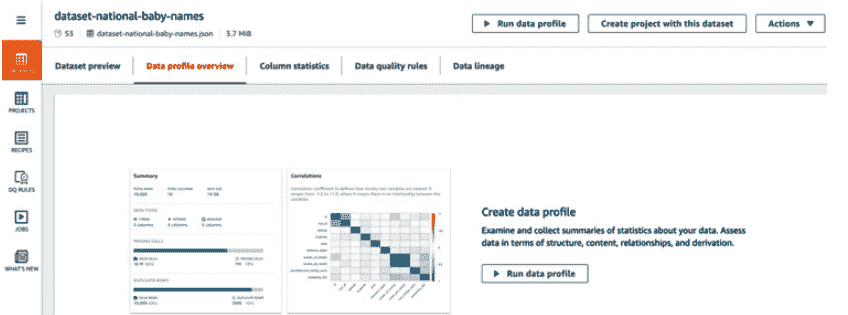

图 2.10：创建数据集时的数据配置文件概览部分


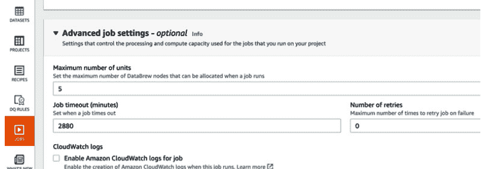

图2.11：具有默认配置的高级作业设置

要确定AWS Glue DataBrew作业的成本，用于运行作业的节点数量是一个关键因素。每个节点包含四个vCPU和16 GB内存，按每个节点每小时0.48美元计费。但是，AWS Glue DataBrew作业按最少一分钟计费。为了说明，让我们考虑一个示例：一个作业运行20分钟，使用10个节点。成本计算方法如下：

```
1 node/hour = $0.48
```

```
10 nodes/hour = $0.48 x 10 = $4.80/hour
```

由于AWS Glue DataBrew作业按最少1分钟计费，我们可以将20分钟转换为1/3小时。因此，最终成本将是$4.80 x 1/3 = $1.60。当你针对样本数据集为项目构建好配方，并准备将同一配方应用于整个数据集时，可以使用该配方创建作业。现在我们已经介绍了AWS Glue DataBrew的定价方面，接下来让我们使用Glue DataBrew执行一些数据整理任务。

## 使用AWS Glue DataBrew进行数据整理

在本节中，我们将探讨如何将AWS Glue DataBrew用于各种数据整理任务，包括以下内容：

- 数据发现
- 数据结构化
- 数据清洗
- 数据增强
- 数据验证
- 数据发布

在开始之前，第一步是确定数据源，获取数据集，并使其可用于数据整理。

### 识别数据集

为了演示数据整理的步骤和任务，我们将使用通过互联网上提供的Random HR Data Generator Excel宏生成的人力资源数据。我们将使用500万条记录的样本量，属性如下：

```
Emp ID,Name Prefix,First Name,Middle Initial,Last Name,Gender,E Mail,Father's Name,Mother's Name,Mother's Maiden Name,Date of Birth,Time of Birth,Age in Yrs.,Weight in Kgs.,Date of Joining,Quarter of Joining,Half of Joining,Year of Joining,Month of Joining,Month Name of Joining,Short Month,Day of Joining,DOW of Joining,Short DOW,Age in Company (Years),Salary,Last % Hike,SSN,Phone No.,Place Name,County,City,State,Zip,Region,User Name,Password.
```

识别数据集后，下一步是从互联网下载。

目前，AWS Glue DataBrew支持CSV、TSV、JSON、JSONL、ORC、Parquet和XLSX格式。

### 下载示例数据集

我们将使用互联网上提供的Syntactic Human Resource数据集，可从https://eforexcel.com/wp/downloads-16-sample-csv-files-data-sets-for-testing/下载。

然而，在实际生产环境中，数据通常从各种来源提取，例如网络、SFTP、数据库和物联网传感器，并使用诸如AWS Glue（我们将在后续章节中介绍）之类的服务，将其摄取到数据湖（S3）或其他数据存储中，例如文件共享、数据库和数据仓库。

例如，以下架构演示了如何使用带有Python引擎的AWS Glue从FTP位置获取数据并将其存储在Amazon S3中。

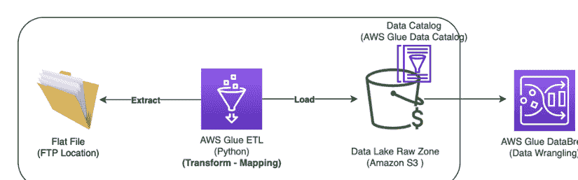

图2.12：从FTP位置获取数据的数据管道

下载数据后，下一步是将数据集上传到Amazon S3。为此，请按照以下步骤操作：

- 1. 前往AWS控制台。
- 2. 如果已有S3存储桶，请在存储桶列表中搜索它。否则，创建一个新存储桶。
- 3. 单击“Upload”按钮。
- 4. 单击“Add Files”，或直接从本地计算机拖放文件。
- 5. 单击“Upload”。

你可能已经注意到，我的Amazon S3存储桶名称带有raw-前缀。此前缀用于区分数据湖中不同阶段的数据处理。在raw层，数据以其原始形式原样存储。这使我们能够拥有单一事实来源，并将数据用于未来的用例。我将在后续章节中介绍有关数据湖及其最佳实践的更多细节。

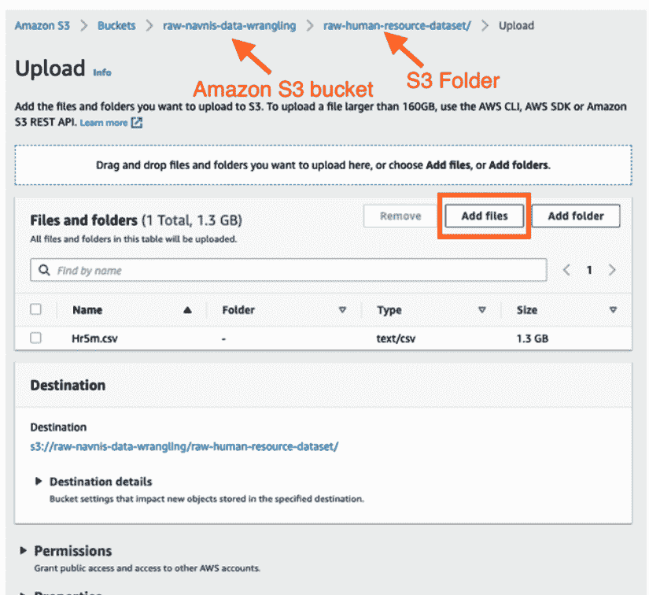

图2.13：Amazon S3数据湖文件夹结构

将数据放置到Amazon S3存储桶的原始层后，下一步是创建AWS Glue数据集。在DataBrew中，数据集由关于数据所收集的元数据构成。数据可以直接连接，也可以导出到文件并从Amazon S3或本地驱动器加载：

要创建DataBrew数据集，请按照以下步骤操作：

- 1. 前往AWS Glue DataBrew。
- 2. 在左侧，单击“Datasets”，然后单击“Connect new dataset”。

3. 提供数据集名称（例如，raw-human-resource）并选择上传人力资源数据集的S3存储桶，如下图所示：

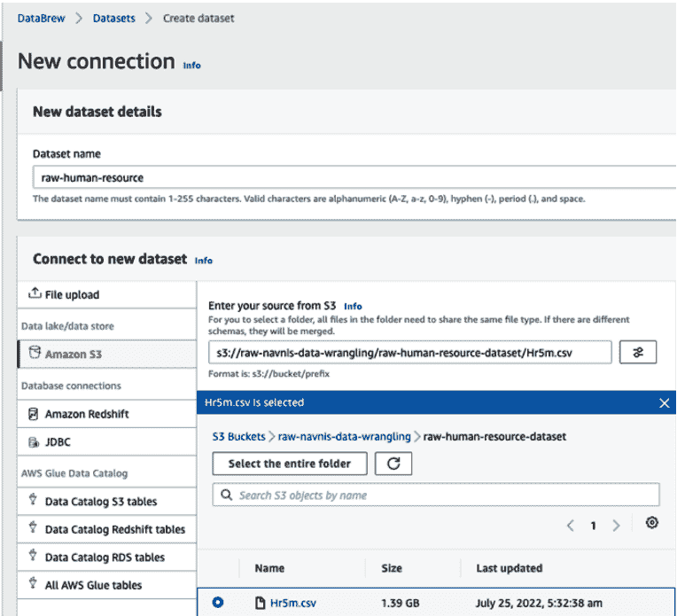

图2.14：在AWS Glue DataBrew控制台中将Amazon S3作为数据源

- 在**其他配置**下，选择**CSV**作为文件格式，选择**逗号 (,)**作为分隔符（因为这是CSV文件的默认值），并在**列标题值**下保持勾选**将首行视为标题**。

DataBrew有一个有趣的功能，可以在创建数据集之前预览数据，这有助于数据发现。单击**预览数据**以执行一些数据发现。

### 图2.15：AWS Glue DataBrew控制台中的预览数据选项

“预览数据”部分允许用户查看数据及数据结构的样子。

### 图2.16：AWS Glue DataBrew控制台中的数据集预览

审阅数据集后，单击**创建数据集**。

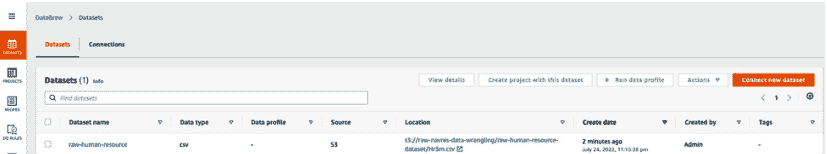

图2.17：AWS Glue DataBrew控制台中的数据集

数据集现在已就绪，可以进行数据发现了。

### 数据发现 – 为数据集创建AWS Glue DataBrew配置文件

要为数据集创建AWS Glue DataBrew数据配置文件，请按照以下步骤操作：

- 1. 选择一个作业名称，例如 `raw-human-resource-profile-job`。
- 2. 为作业运行样本选择**完整数据集**。
- 3. 选择要将配置文件输出以JSON格式存储的S3位置，该输出可用于自动化任务，例如数据质量检查和PII识别。
- 4. 其余选项保留默认值。
- 5. 在**权限**下，选择**创建新的IAM角色**，并为角色提供名称，例如 `human-resource`。
- 6. 单击**创建并运行作业**。
- 7. 等待生成数据配置文件。

创建数据配置文件后，您可以在摘要部分查看它，其中提供有关数据集的有用信息，包括以下内容：

- 数据集的大小，作为良好的数据质量检查，确保摄取期间未发生数据丢失
- 数据集的数据类型，包括整数、双精度和字符串列的数量
- 任何重复行或缺失单元格，这有助于识别数据质量问题

在所提供的示例中，数据集有500万行，没有缺失单元格或重复行，表明数据质量很高。查看数据配置文件可以为比较源系统中的数据与目标系统中的数据提供参考基准。


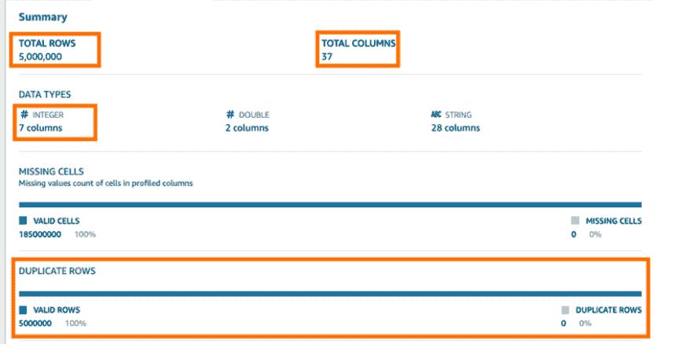

图2.18：AWS Glue控制台中的数据配置文件概览

### 相关性

相关系数(r)衡量两个变量之间的关联程度，取值范围为-1.0到+1.0，其中0表示变量之间不存在关系。可以根据r的值进行如下解释：

- 恰好为-1：完美的负（下降）线性关系
- -0.70：强负（下降）线性关系
- -0.50：中等负（下坡）关系
- -0.30：弱负（下坡）线性关系
- 0：无线性关系


+0.30: 弱正相关（向上倾斜）线性关系

+0.50: 中等正相关（向上倾斜）线性关系

+0.70: 强正相关（向上倾斜）线性关系

恰好 +1：完美正相关（向上倾斜）线性关系

在给定的相关系数图中，**_入职年份_** 和 **_公司年限_** 变量之间存在强关系，但方向相反。这意味着如果一个变量增加（例如，**_入职年份_** 相对于 2022 年从 2018 年变为 2016 年），另一个变量就会减少（即 **_公司年限_** 也减少两年）。

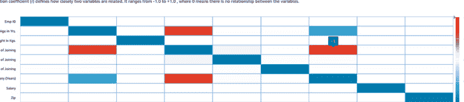

图 2.19：相关系数

**_公司年限_**（以年为单位）与 **_年龄（岁）_** 之间的相关系数为 **+65**，表明这两个变量之间存在正相关。这意味着如果某人的年龄较大，他们很可能在公司工作的时间更长，因此是任职时间更长的员工。然而，需要注意的是，这种相关系数并不总是适用于所有情况，其他因素也可能影响员工的任期。

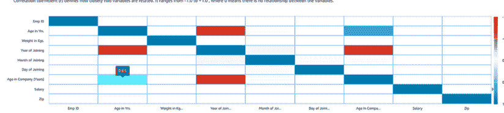

图 2.20：相关系数

## 值分布

数据集的值分布表明数据分布的程度如何，并且是衡量数据偏斜的良好指标。例如，如果我们考虑 Salary 列，它似乎分布均匀，这是一个数据集分布良好的积极指标。

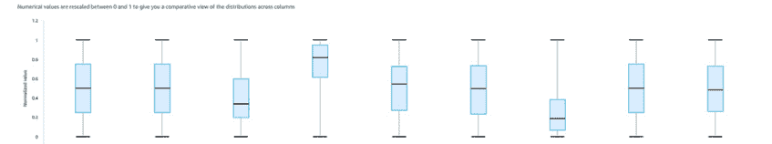

图 2.21：值分布

## 列摘要

配置文件中列的摘要部分提供了有关其特征的宝贵信息，包括其分布、缺失值、唯一值、不同值、中位数、最小值、众数、异常值和偏度。了解这些数据值可以帮助进行特征工程。例如，偏度是一种查看数据是否倾斜的方法。它告诉我们数据与完全平衡的差异有多大。如果偏度为正，则意味着右侧数据更多，使该侧的尾部更长或更胖。如果偏度为负，则意味着左侧数据更多，使该侧的尾部更长或更胖。如果偏度为 0，则意味着数据完全平衡。

例如，检查 Ages in Yrs. 列的摘要可以让你很好地了解公司员工的年龄。员工的最低年龄约为 21 岁，最高年龄为 60 岁，平均年龄为 40.50 岁。

图 2.22：AWS Glue DataBrew 控制台中的数据概览

## 数据清洗和丰富 – AWS Glue DataBrew 转换

要创建 DataBrew 项目，即数据探索、清洗和规范化信息的集合，请按照以下步骤操作：

- 1. 转到 DataBrew 控制台并选择 **Projects**。
- 2. 单击 **Create project**。
- 3. 为项目输入名称，例如 `basic-transform-human-resource-project`。
- 4. 保留默认的配方名称。
- 5. 选择 **My datasets** 并选择上一节中创建的 `raw-human-resource` 数据集。
- 6. 保留默认的采样大小 **500**。
- 7. 在 **Permissions** 下，选择在数据配置文件部分下创建的 IAM 角色作为角色名称。
- 8. 单击 **Create project**。

要为项目构建配方，请在 AWS Glue DataBrew 交互式会话中打开项目并按照说明创建一组数据整理步骤或操作。

常见的数据整理任务之一是将多个列合并为一列，例如合并姓名或日期列。要在 AWS Glue DataBrew 中执行此任务，请使用 **MERGE** 转换，它允许您合并多个列并创建单个列。

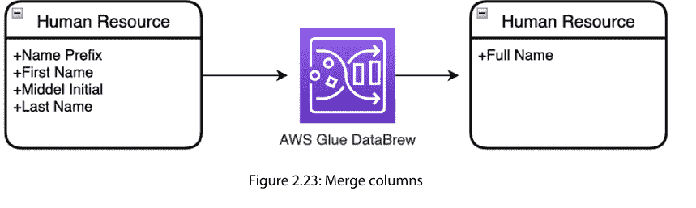

要执行此任务，请按照以下步骤操作：

- 1. 打开上一步中创建的 `basic-transform-human-resource-project` 项目。
- 2. 在顶部菜单中单击 **MERGE**。

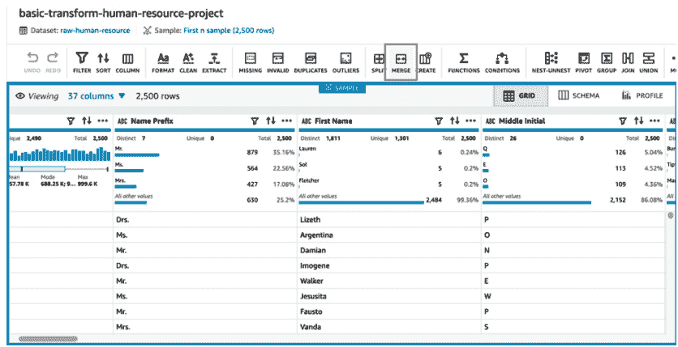

图 2.24：MERGE 选项

- 3. 选择 Name Prefix、First Name、Middle Initial 和 Last Name 作为源列。
- 4. 添加空格作为分隔符。
- 5. 提供新的列名，例如 Employee_Full_Name。

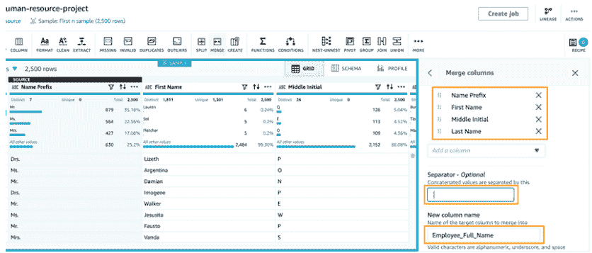

图 2.25：合并列列表

- 6. 单击 Apply。

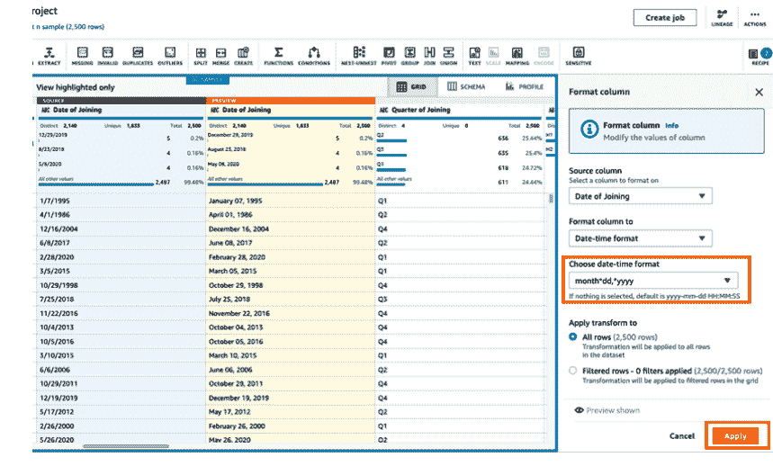

9. 重命名列。

在数据集分析期间，发现某些列名，例如 **Phone No.**，以点结尾。为了解决此问题，应重命名该列。要更改列名，请选择该列并单击三个点，然后选择 **Rename** 选项。

要更新列名，请选择一个新名称。例如，**Phone No.** 可以更改为 **Phone**。选择新名称后，单击 **Apply**。

图 2.29：AWS Glue DataBrew 控制台中重命名列

图 2.30：AWS Glue DataBrew 控制台中重命名列选项

10. 隐藏敏感列。

AWS Glue DataBrew 提供了一个非常有用的功能，即隐藏敏感列。当构建 Daas 等解决方案、实现自助服务或在内部或外部共享数据时，此功能特别有帮助。在所有此类情况下，隐藏敏感数据都是关键要求：

- I. 要隐藏敏感列，首先查看数据集并识别包含敏感信息的列，例如社会安全号码、电话号码、用户名和密码。识别后，您可以使用 AWS Glue DataBrew 中的 SENSITIVE 图标来选择并隐藏这些列中的值。
- II. 要执行数据隐藏，请选择 SENSITIVE 图标并选择 **Redact values** 选项。然后，选择源列并将其他选项保持为默认值（即使用隐藏符号，#），然后单击 **Apply**。

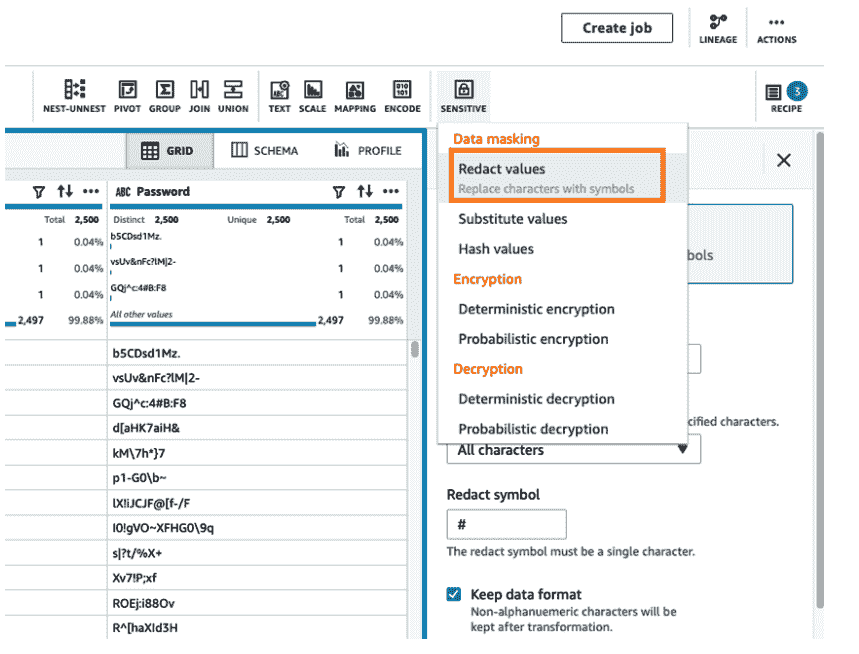

**图 2.31**：AWS Glue DataBrew 控制台中敏感列 Redact values 选项

图 2.32：AWS Glue DataBrew 控制台中敏感列 Redact values 选项

应用配方后，您将能够看到哈希列。

图 2.33：AWS Glue DataBrew 中敏感列的隐藏

11. 执行确定性加密。

要执行确定性加密，请按照以下步骤操作：

- I. 单击 **SENSITIVE** 图标并导航到 **Encryption** 部分。
- II. 选择 **Deterministic encryption**。

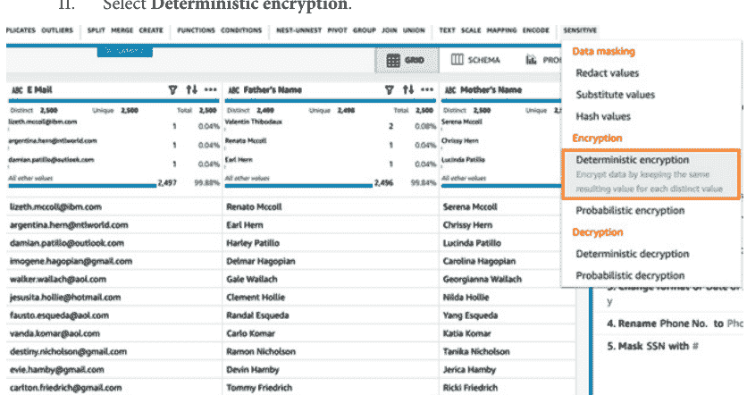

图 2.34：AWS Glue DataBrew 控制台中敏感列 Deterministic encryption 选项

- III. 选择要加密的列，例如 Employee_Full_Name、E Mail 和 Date of Birth。
- IV. 选择 secret 选项并选择默认的 DataBrew 密钥。
- V. 单击 Apply，您将能够看到加密后的数据。

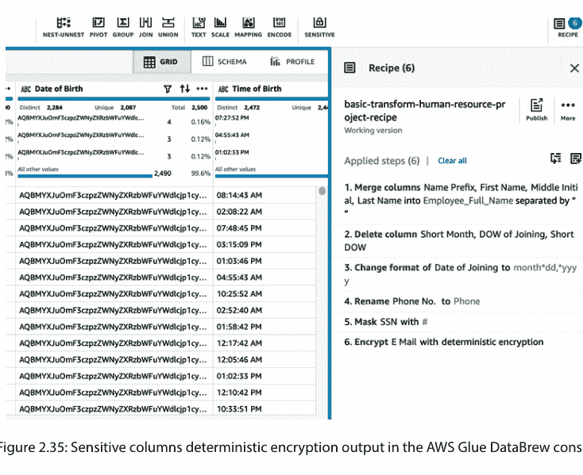

12. 按性别分组。
首先，按性别对数据进行分组。然后，我们可以分析工资在男性与女性之间的分布情况。

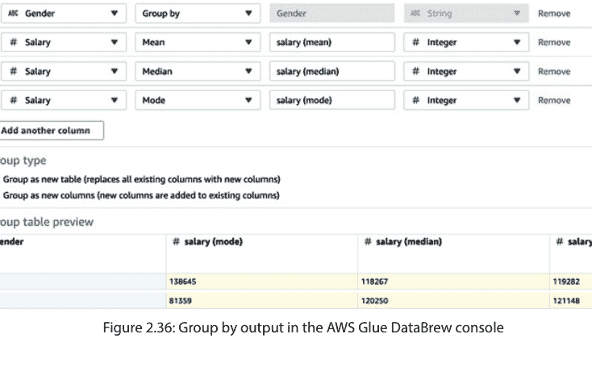

## 13. 连接数据集。

连接数据集涉及基于公共键组合两个或多个表。它是数据整理过程中的关键步骤，可实现数据丰富。

AWS Glue DataBrew 支持多种类型的连接，包括以下类型：

- • 内连接：这是 Glue DataBrew 中的默认连接类型。它返回基于连接键在两个表中具有匹配值的记录。


- • 左连接：它返回左表中所有记录以及基于连接键从右表中匹配的记录。


- • 右连接：它返回右表中所有记录以及基于连接键从左表中匹配的记录。

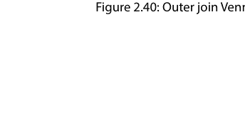

- • 外连接：它返回表 A 和表 B 的所有行，而不管连接条件如何。


- **左排除连接**：这会返回表 A 的所有行，排除满足连接条件的行。


- **右排除连接**：这会返回表 B 的所有行，排除满足连接条件的行。


- **外排除连接**：这会返回表 A 和表 B 的所有行，排除满足连接条件的行。


每种连接类型对结果数据集都有不同的影响。了解这些差异对于选择适合您数据分析需求的连接非常重要。

要在 AWS Glue DataBrew 中执行连接，请按照以下步骤操作：

1. 打开您的项目并单击 JOIN 图标以访问连接选项。

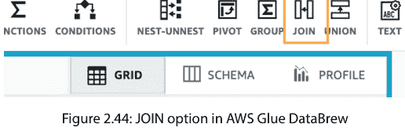

2. 选择您想要连接的数据集。如果您只有一个数据集，您可以通过将数据集与其自身连接来执行自连接（或自内连接）。

3. 选择要连接的连接类型和列，然后单击 **Finish**。您的项目现在将拥有一个已连接的数据集。

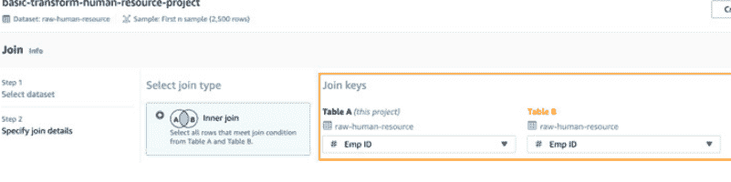

**Figure 2.45: Join option in AWS Glue DataBrew**

现在您已经了解如何使用 AWS Glue DataBrew 执行数据转换，您可以自行尝试其他转换。下一步是学习如何使用 AWS Glue DataBrew 执行数据质量检查。

## 数据验证 – 使用 AWS Glue DataBrew 执行数据质量检查

本节将重点介绍如何使用 AWS Glue DataBrew 通过实际示例执行数据验证和质量检查。

在本第一个示例中，我们将学习如何使用 AWS Glue DataBrew 识别和纠正数据质量问题。但首先，让我们简要讨论数据质量问题以及为什么必须解决它们。正如我们在上一章中所讨论的，组织正在努力成为数据驱动的，对于此类组织而言，解决它们面临的任何数据质量挑战或拥有处理数据质量问题的必要工具和流程至关重要。

根据 KPMG 的一份报告，77% 的首席执行官担心其组织是否跟上新技术，并且数据和分析将在未来三年成为投资的重点领域。此外，84% 的首席执行官担心他们基于其关键业务决策的数据质量。数据质量差不仅仅是一个技术问题，因为它会对企业产生重大影响。根据 Gartner 在 2018 年的研究论文，组织认为数据质量差平均每年造成 1500 万美元的损失。

流行的消费者工具 Zestimate，由人工智能驱动来估算房屋价值，由 Zillow 提供，是数据质量问题的典型例子。Zillow 采用了独特的算法，每周多次定期更新其房产价值数据库。这些算法考虑了来自公开可用数据和用户提交的数据得出的信息。Zillow 声称其 Zestimate，即为在售和未在售房屋提供的估算房产价值，对于全国在售房屋的中位误差率为 1.9%，而未在售房屋的中位误差率为 6.9%。然而，需要注意的是，Zestimate 的准确性在很大程度上依赖于基础数据的准确性。如果 Zillow 上房屋的关键细节，如卧室或浴室数量、平方英尺或地块大小记录不准确，将导致提供的 Zestimate 出现显著偏差。这一问题最终导致 Zillow 以远高于售价的价格购买了许多房屋，因为 Zestimate 失败。因此，Zillow 决定关闭其房屋购买业务，导致数千人失业和数百万美元的损失。

在另一个例子中，数据质量问题导致一家知名信用历史提供商的实时电子商务网站崩溃。经调查，他们发现网站在评论字段中期望字母字符，而不幸的是其中包含一个无法读取的 TAB 字符，导致连锁系统故障。

正如我们在上一章中简要讨论的，计算机科学概念 **垃圾进，垃圾出 (GIGO)** 决定了数据的质量。数据的输出质量由其输入质量决定。用外行的话说，如果我们提供糟糕的数据作为输入，我们将得到糟糕的数据作为输出。数据质量问题涉及完整性、一致性、有效性、准确性、唯一性、完整性和及时性。

现在我们了解了数据质量对技术和业务的影响，让我们继续使用 AWS Glue DataBrew 构建数据质量规则以识别和修复问题的示例。

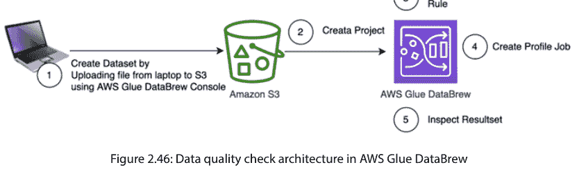

如果您想跟随操作，我将提供创建数据质量规则的分步说明。要创建数据质量规则，请按照此处提到的步骤操作：

1. 单击 **DQ Rules** 选项。
2. 为您的数据质量规则集提供名称。例如，您可以将其命名为 `data-quality-human-resource`。
3. 在 **Choose dataset** 部分，选择您在 *step 2* 中创建的数据集。选择数据集后，系统将为您提供数据质量规则的建议。

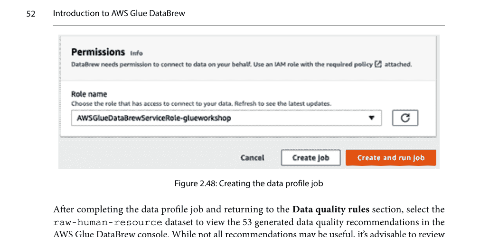

**Figure 2.48: Creating the data profile job**

完成数据配置文件作业并返回到数据质量规则部分后，选择 raw-human-resource 数据集以查看 AWS Glue DataBrew 控制台中生成的 53 条数据质量建议。虽然并非所有建议都可能有用，但建议您查看所有建议并将相关建议添加到规则集中。

1. 检查数据集中是否存在重复行。
2. 确保所有列都没有缺失值（0% 缺失值）。
3. 验证 Age in Yrs. 列中的值是否在 21 到 60 之间。
4. 确保 Quarter of Joining 列仅包含来自列表 ["Q3", "Q2", "Q1", "Q4"] 的值。
5. 验证 SSN 列的长度为 11 个字符。
6. 确保 Phone No. 列的长度为 12 个字符。

这些建议是作为数据质量规则建议的一部分提供的。要使用 Glue DataBrew 控制台创建自定义数据质量规则，请继续阅读。

为了使用 Glue DataBrew 控制台创建自定义数据质量规则，我们必须首先定义我们想要构建的规则是什么。以下是我们想要创建的一些规则：

1. **验证行数：** 我们已下载了 500 万条记录的数据集。让我们验证计数是否匹配。
2. **员工 ID、电子邮件地址和 SSN 应该是唯一的：** 这些值应始终唯一。
3. **员工 ID 和电子邮件地址不应为空：** 通常我们不希望这些值为空。
4. **员工 ID 和员工年龄（年）不应有负值：** 我们希望验证这些列中的值为正。
5. **SSN 数据格式应为 (xxx-xx-xxxx) 格式。**

让我们开始构建数据质量规则：

1. **验证行数。**

要检查总行数，让我们执行以下步骤：

   1. 创建一个新规则。
   2. 为规则命名（例如，`Row count == 5 million`）。
   3. 将数据质量检查范围选择为 **Individual check for each column**。
   4. 将规则成功标准选择为 **All data quality checks are met (AND)**。
   5. 将数据质量检查选择为 **Number of rows**。
   6. 将条件选择为 **Is equals**。
   7. 输入 `5000000` 作为值。


# 规则 1

行计数 == 500 万

数据质量检查范围：对每一列进行单独检查

规则成功标准：所有数据质量检查均满足（逻辑与）

# 数据质量检查

- 数据质量检查：行数
- 检查数据集的总行数。
- 条件：等于
- 值：5000000


2. 要验证指定的列仅包含唯一值，请按照以下步骤操作：

- 第一步。点击“添加规则”。
- 第二步。输入规则名称，例如“检查列中的唯一值”。
- 第三步。选择“对选定列进行常见检查”作为数据质量检查范围。
- 第四步。对于“规则成功标准”，选择“所有数据质量检查均满足（逻辑与）”。
- 第五步。在“选定列”下，选择 Emp ID（员工ID）、E Mail（电子邮件）和 SSN（社保号）列。
- 第六步。在“检查 1”下，在“数据质量检查”中选择“唯一值”。
- 第七步。在“条件”中选择“等于”。

第八步。输入 100 作为“值”，并从下拉菜单中选择“%(百分比) 行”。

# 检查列的唯一值

数据质量检查范围：对选定列进行常见检查...

规则成功标准：所有数据质量检查均满足（逻辑与）

选定列：Emp ID, E Mail, SSN

数据质量检查：唯一值 - 检查该列的唯一值计数。

条件：等于

值：100 %(百分比) 行

如果 Emp ID、E Mail、SSN 的唯一值 == 100%，则该规则将通过。

> 图 2.50：数据验证

3. 为确保员工 ID 和电子邮件地址不为空，请按照以下步骤操作：

- 第一步。选择 **添加另一项规则**。
- 第二步。输入规则名称，例如 **检查空的员工 ID 和电子邮件**。
- 第三步。为 **数据质量检查** 范围选择 **对选定列进行常见检查**。
- 第四步。为 **规则成功标准** 选择 **所有数据质量检查均满足（逻辑与）**。
- 第五步。在 **选定列** 下选择 **Emp ID** 和 **Email**。
- 第六步。对于 **数据质量检查**，选择 **值未缺失**。
- 第七步。为 **条件** 选择 **大于或等于**。
- 第八步。输入 **100** 作为阈值，并从下拉菜单中选择 **%(百分比)** 行。

4. 为确保员工 ID 和年龄列仅包含正值，请按照以下步骤操作：

- 第一步。点击 **添加另一项规则**。
- 第二步。输入规则名称，例如 **检查员工 ID 和年龄的正值**。
- 第三步。选择 **对每一列进行单独检查** 作为数据质量检查范围。
- 第四步。选择 **所有数据质量检查均满足（逻辑与）** 作为规则成功标准。
- 第五步。对于第一个检查，选择 **数值** 作为数据质量检查。
- 第六步。从下拉菜单中选择 **Emp ID**。
- 第七步。为条件选择 **大于或等于**。
- 第八步。为值选择 **自定义值** 并输入 **0**。
- 第九步。点击 **添加另一项质量检查**，并对 **Age in Yrs.**（年龄）列重复步骤 5 至 8。

5. 验证 SSN 数据格式。
请按照以下步骤检查 SSN 数据格式：

- 第一步。点击 **添加另一项规则**。
- 第二步。输入规则名称，例如 **验证 SSN 格式**。
- 第三步。为数据质量检查范围选择 **对每一列进行单独检查**。
- 第四步。选择 **所有数据质量检查均满足（逻辑与）** 作为规则成功标准。
- 第五步。在 **检查 1** 下，为 **数据质量检查** 选择 **字符串值**。
- 第六步。从下拉菜单中选择 **SSN**。
- 第七步。为 **条件** 选择 **匹配（正则表达式模式）**。

第八步。输入正则表达式值 ^\d{3}-\d{2}-\d{4}$ 以验证 SSN 格式。

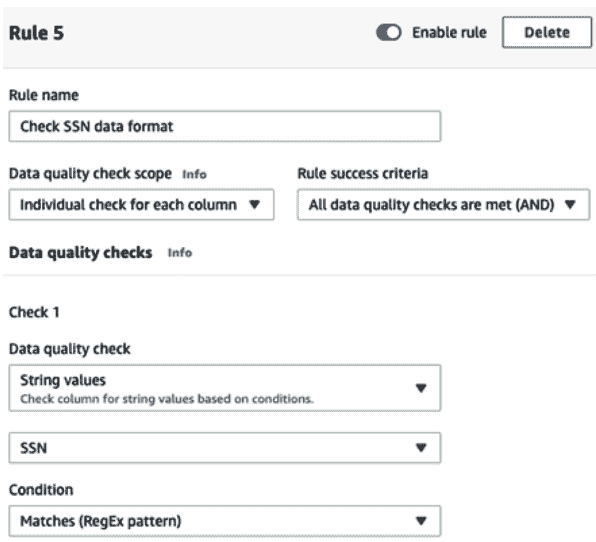

图 2.51：验证 SSN 格式

下一步涉及通过应用规则集到之前创建的个人资料作业来执行数据质量检查。若要使用默认选项运行作业，请确保选择了在上一节数据个人资料生成过程中创建的角色名称。

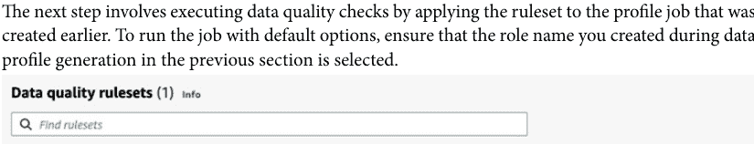

图 2.52：检查角色名称

点击“运行作业”后，将弹出一个新窗口。根据用例决定是针对完整数据集还是客户样本运行作业非常重要。如果是关键任务应用程序，建议选择完整数据集。

图 2.53：运行个人资料作业

运行作业后，请等待其完成。请注意，保持默认选项是至关重要的。

图 2.54：检查数据质量规则验证结果

在等待作业完成（通常耗时约 17 分钟，但可能会有所不同）之后，下一步是检查数据质量规则验证的结果。

图 2.55：作业执行摘要

为此，请按照以下步骤操作：

- 1. 前往 DataBrew 控制台上的“作业”页面，并选择“个人资料作业”标签页。
- 2. 等待个人资料作业状态变为“成功”。
- 3. 作业完成后，选择“查看数据个人资料”。

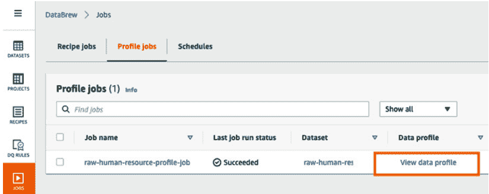

图 2.56：查看数据个人资料

- 4. 点击“数据质量规则”标签页以查看所有数据质量检查的状态。

在此平台上，您可以查看所有数据质量检查的状态。幸运的是，在这种情况下，只有一条数据质量规则失败，其余均成功。

根据数据质量检查，我们发现 Emp ID、E Mail 和 SSN 中存在重复值。为了确认这一点，请导航至“列统计信息”标签页并选择 Emp ID 列。

向下滚动到“顶级不同值”部分。通过查看此表格，我们已经发现 Emp ID 存在大量重复值。类似地，您也将能够识别 E Mail 和 SSN 中的重复值。

为此，请按照以下步骤操作：

- 1. 选择 `Emp` `ID` 列。
- 2. 点击 **更多选项** 图标（三个点）以查看该列的所有可用转换。
- 3. 选择 **移除重复值**。

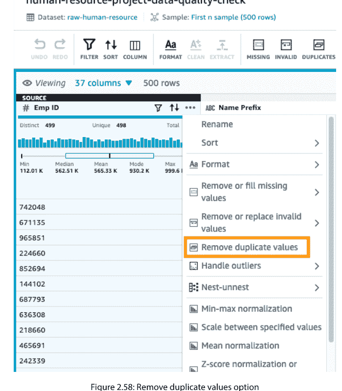

- 4. 对 SSN 和 E `Mail` 列执行类似的步骤。

您可能注意到，系统为我们创建了三个新的配方（recipes）。但是，当在 Glue DataBrew 交互会话中应用配方时，它仅应用于数据样本。

图 2.59：Glue DataBrew 会话样本

下一步是创建一个作业，将这些配方可用于整个数据集。为此，我们需要创建一个新作业。

# 数据发布 – 修复数据质量问题

下一步是创建一个 DataBrew 作业，以对整个数据集运行这些转换：

- 1. 在项目详情页面，选择“创建作业”。
- 2. 在“作业名称”下输入作业名称（例如 human-resource-after-dataquality-fix）。
- 3. 在“作业输出设置”下，为最终存储格式选择 CSV 作为文件类型。
- 4. 在“S3 位置”下输入输出的 S3 桶位置（例如 s3://navnis-data-warngling-curated/human-resource/）。
- 5. 选择“无”作为压缩类型。

等待作业完成：

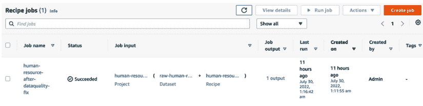

图 2.60：AWS Glue DataBrew 控制台中的作业列表

# 使用更正后的数据集验证数据质量检查

现在，我们需要使用更正后的数据集验证数据质量检查。以下是需要遵循的步骤：

- 1. 第一步是创建来自更正后数据集的数据集（您可以按照之前概述的步骤操作）。

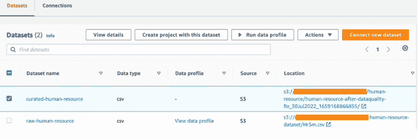

图 2.61：AWS Glue DataBrew 控制台中的数据集列表

- 2. 接下来，我们需要针对数据质量检查运行数据质量规则。请按照以下步骤操作：

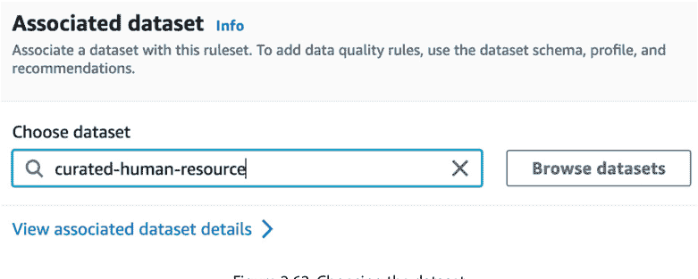

图 2.62：选择数据集

- 3. 选择 **DQ 规则** 并选择之前创建的规则集。
- 4. 在 **操作** 菜单中选择 **复制**。
- 5. 在关联数据集中浏览新创建的数据集。
- 6. 最后点击 **创建规则集**。

- 7. 选择新创建的数据质量规则集，然后点击 **使用规则集运行个人资料作业**。
- 8. 按照之前描述的步骤创建新的个人资料作业。

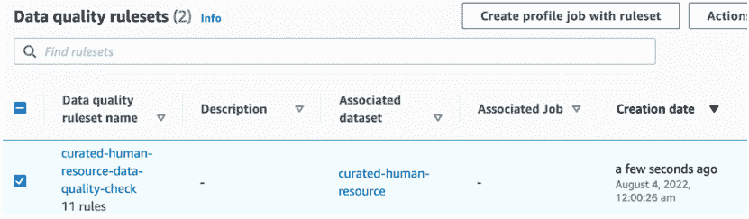

图 2.63：AWS Glue DataBrew 控制台中的数据质量规则集列表

完成后，您将能够验证数据质量。您会看到除了 **检查总记录数** 之外，所有规则均已通过，因为您已移除了重复值。

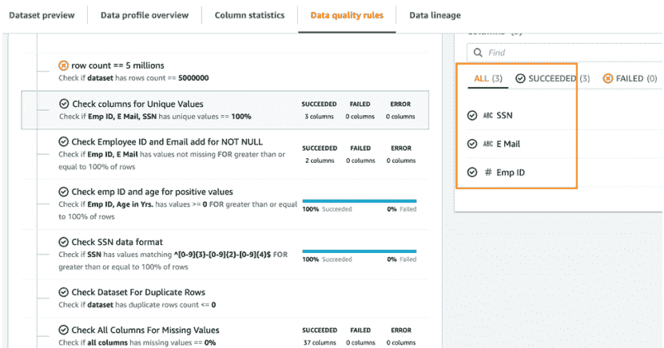

图 2.64：在数据集上应用配方


在**列统计信息**页面，在**Emp ID**（员工ID）列的**唯一值 Top distinct values**部分，您可以查看这些唯一值。同样，您还可以查看 SSN（社会安全号码）和 Email（电子邮件）列的唯一值。

图 2.65：各列的唯一值

最后，您可以在 AWS Glue DataBrew 控制台中查看修复问题后的数据质量检查信息。

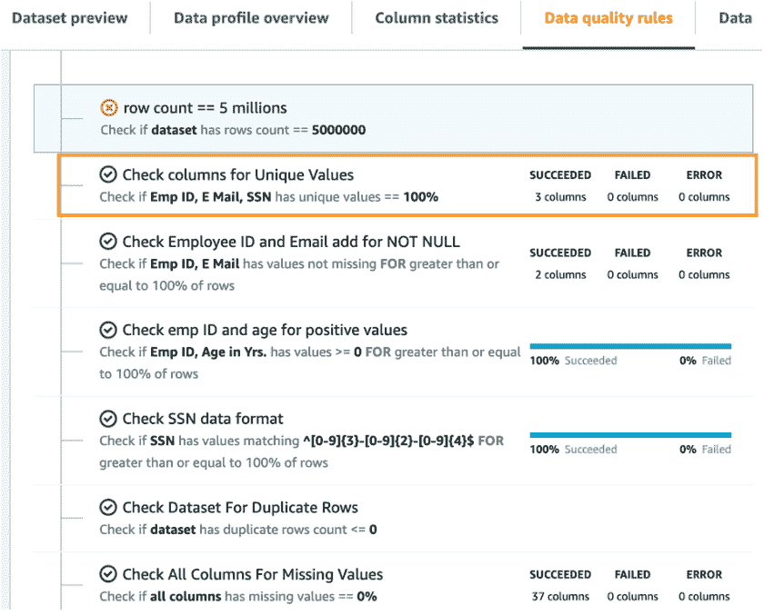

图 2.66：修复问题后的数据质量检查信息

在整个本节中，我们已经了解了 Glue DataBrew 如何帮助识别和解决数据质量问题。虽然前面介绍的技术是手动执行的，但请注意，在实际操作中，实施基于事件驱动的数据质量检查是更优的选择。这种方法会在数据质量问题（例如缺少有效的社会安全号码或员工 ID）发生时自动识别这些问题，并采取相应措施，例如向业务方或应用程序所有者发送警报，以便他们验证数据并实施必要的修复。

## 使用 Glue DataBrew 进行基于事件的数据质量检查

在此架构中，每当文件上传到 Amazon S3 时，EventBridge 规则都会触发 Step Functions 状态机。

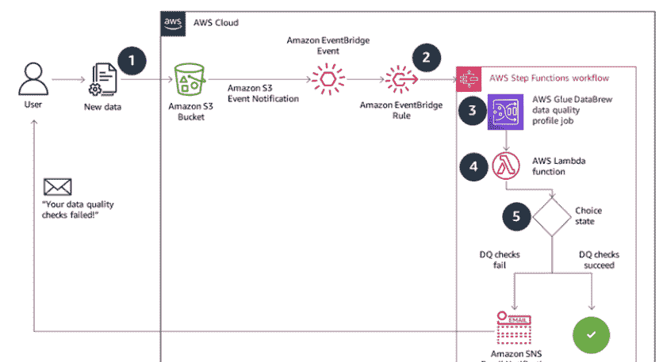

图 2.67：基于事件的数据质量检查

状态机启动一个 DataBrew 配置文件作业，该作业已配置了一组数据质量规则，其结果输出存储在 Amazon S3 中。使用 Lambda 函数从 Amazon S3 读取数据质量结果，并向状态机返回布尔响应。如果规则集中的一个或多个规则失败，该函数返回 false；如果所有规则成功，则返回 true。如果布尔响应为 false，状态机向 Amazon SNS 发送电子邮件通知，并以失败状态结束。相反，如果布尔响应为 true，状态机以成功状态结束。该流程的下一步是学习如何使用 AWS Glue DataBrew 识别 PII（个人身份信息）数据。

## 使用 AWS Glue DataBrew 保护数据

组织面临的数据挑战不仅限于数据质量，还包括识别和保护个人信息。数据泄露的新闻屡见不鲜，例如 2021 年 LinkedIn 数据泄露事件中，与 7 亿用户相关的数据被发布在 Dark Web（暗网）上出售，影响了 LinkedIn 92% 的用户基础。同样，Yahoo! 在 2017 年报告称，3200 万个账户通过基于 Cookie 的攻击被访问。监管和合规要求（如 FedRAMP、FINMA、HIPAA 和 PCI）也需要安全的数据处理和存储。AWS Glue DataBrew 提供了功能，帮助您保护数据并符合这些要求。

### 静态加密

静态加密（Encryption at rest）是一种安全措施，涉及在数据存储在本地存储设备（如硬盘）时对其进行加密，以防止在设备被攻击者访问时未经授权访问机密信息。AWS Glue DataBrew 支持 DataBrew 项目和作业的静态数据加密。借助 AWS **密钥管理服务（KMS）**，作业可以读写加密数据。

要在作业中启用静态加密，请遵循以下步骤：

1. 前往**作业输出设置**。
2. 选择**附加配置 – 可选**。
3. 勾选**为作业输出文件启用加密**。
4. 选择使用 SSE-S3（Amazon S3 管理的加密密钥）或 AWS KMS。

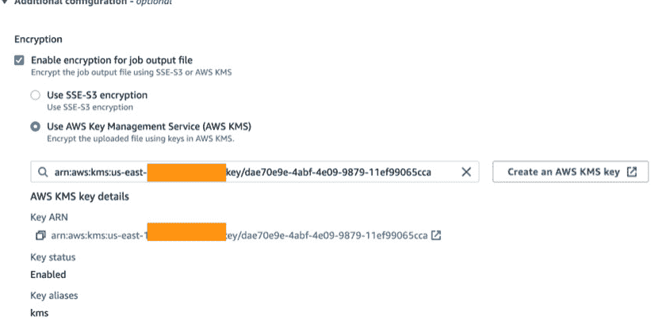

图 2.68：AWS Glue DataBrew 作业中的 AWS KMS 加密

### 传输中加密

传输中加密（Encryption in transit）是在数据通过互联网在服务之间传输时对其进行加密以确保安全的过程，例如使用 JDBC 连接数据库时。

为了启用传输中加密，AWS 提供了**安全套接字层（SSL）**加密。AWS Glue DataBrew 利用 SSL 进行 JDBC 操作，这是 AWS Glue 的内置功能，因为它使用由 AWS Glue 提供的 JDBC 连接器。

## 识别和处理 PII

数据安全的至关重要的一部分是识别、编辑、替换、加密和解密 PII 数据，例如名字、姓氏、电子邮件地址、社会安全号码（SSN）和电话号码。当我们谈论大规模识别和保护敏感数据时，情况变得更加复杂。即使识别出敏感数据后，围绕大规模敏感数据的编辑、掩码或加密实施解决方案也并不容易。

您可以在数据准备步骤中使用 AWS Glue DataBrew 对 PII 数据进行混淆。根据您的要求，有多种可用的 PII 数据编辑机制。您可以选择混淆 PII 数据，使用户无法恢复原始数据；或者，您可以使混淆可逆。

可以采用以下技术来掩码数据：

- **替换（Substitution）**：这涉及用其他看似真实的值（如假名、虚拟地址或随机生成的标识符）替换 PII 数据值（如姓名、地址和社会安全号码）
- **洗牌（Shuffling）**：该技术将同一列中不同行的值进行随机重新排列
- **确定性加密（Deterministic encryption）**：这涉及对列值应用确定性加密算法，对于给定值始终产生相同的密文
- **概率加密（Probabilistic encryption）**：在此技术中，对列值应用概率加密算法，每次使用时产生不同的密文
- **解密（Decryption）**：这涉及根据加密密钥解密列
- **置空或删除（Nulling out or deletion）**：可以将特定字段替换为 null 值，或者删除整个列
- **掩码（Masking out）**：该技术使用字符乱序或掩码列中的某些部分
- **哈希（Hashing）**：可以将哈希函数应用于列值作为掩码的一种手段

让我们看一个例子来理解这一点。在数据质量部分，我们学习了如何创建数据集并进行配置文件分析。以下是步骤：

1. 参照前一节，创建一个新的名为 `raw-human-resource-pii-dataset` 的数据集。

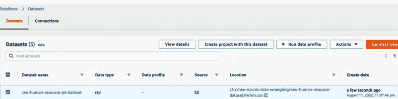

图 2.69：AWS Glue DataBrew 中的数据集

2. 选择新创建的数据集，并点击**运行数据配置文件（Run data profile）**。
3. 在提示时创建配置文件作业。
4. 保持作业名称和作业运行样本为默认值。
5. 在作业输出设置中，指定要存储 JSON 格式数据配置文件信息的 Amazon S3 路径。
6. 在**数据集级别配置**下启用**PII 统计信息**，并在 PII 类别下选择**所有类别**。请注意，在生产环境中，您可能需要根据您的数据选择相关的类别。

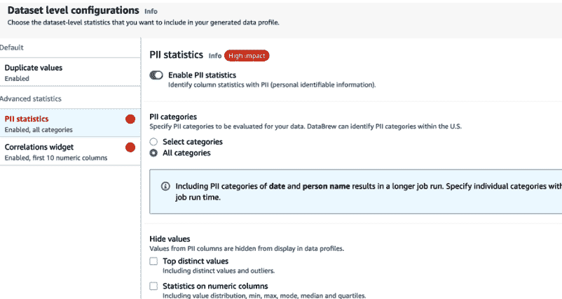

图 2.70：AWS Glue DataBrew 中的 PII 配置

7. 将其他选项保持为默认值。
8. 选择我们在数据质量规则期间创建的角色名称。

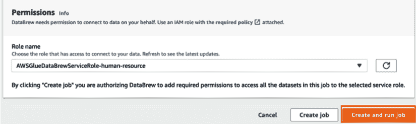

图 2.71：Glue DataBrew 作业中添加的角色

9. 等待配置文件作业完成。

作业完成后，您将能够在**数据集**中的数据配置文件概览部分查看统计信息。对于我们的数据集，它显示有 17 列是 PII。

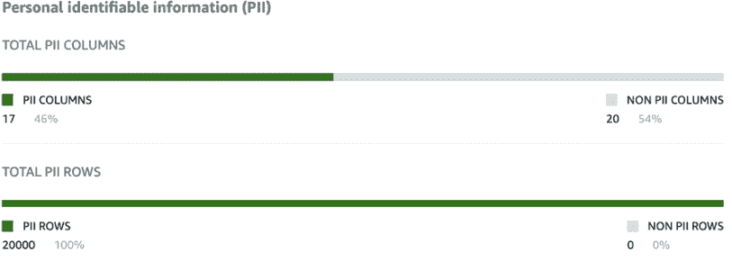

图 2.72：数据集的 PII 摘要

向下滚动时，您会发现 Email（电子邮件）、出生日期、入职日期、SSN（社会安全号码）和 Phone（电话号码）等列具有 100% 的 PII 行。

| 列 | 类型 | PII 行百分比 | 非 PII 行百分比 |
|--------|------|------------|----------------|
| Short DOW | 多种 | 85% | 14% |
| Person name | 人名 | 43% | 56% |
| Date | 人名 | 42% | 57% |
| SSN | 美国 SSN | 100% | 0% |
| Phone | 美国电话号码 | 100% | 0% |
| Place Name | 人名 | 47% | 52% |
| County | 人名 | 65% | 34% |
| City | 人名 | 47% | 52% |

图 2.73：各列的 PII 统计信息

既然我们已经识别了 PII 列，下一步是编辑和加密 PII 列。您可以使用 AWS Glue DataBrew 转换部分中描述的步骤来执行此任务。

在充分了解了 AWS Glue 中可用的各种数据安全选项（如静态数据加密、传输中数据加密、PII 识别和编辑）之后，下一步是了解 AWS Glue DataBrew 的数据血缘功能。

请考虑以下示例：

- 测试和开发环境：在创建测试和开发环境时，通常需要使用模拟真实场景的代表性数据。然而，在这些环境中暴露敏感 PII 数据可能会带来安全风险。通过使用 AWS Glue DataBrew 对 PII 数据进行混淆，您可以在保持测试和开发所需真实性的同时确保数据隐私。
- 数据分析和报告：在需要将数据共享给分析师或第三方供应商以进行数据分析或报告的情况下，混淆 PII 数据对于遵守隐私法规和维护机密性至关重要。AWS Glue DataBrew 可以帮助将敏感信息匿名化或用看似真实的值替换，使分析师能够在保护个人隐私的同时处理数据。


- **数据共享与协作**：协作项目通常涉及跨团队或跨组织共享数据集。在这些场景中，必须确保敏感信息得到保护。通过使用 AWS Glue DataBrew 对 PII（个人身份信息）数据进行混淆处理，您可以在保持数据完整性和有效性的同时，安全地共享数据集以用于协作分析和决策制定。
- **机器学习训练**：机器学习模型通常需要进行大量数据的训练。在处理敏感的 PII 数据时，混淆这些信息对于保护个人隐私至关重要。AWS Glue DataBrew 可以帮助替换或转换 PII 数据，以确保训练数据保持匿名状态，并符合数据保护法规的要求。
- **符合数据隐私法规**：在医疗保健、金融或电子商务等行业运营的组织必须遵守严格的数据隐私法规，例如 GDPR（通用数据保护条例）或 HIPAA（健康保险流通与责任法案）。使用 AWS Glue DataBrew 混淆 PII 数据有助于通过降低未经授权访问敏感信息的风险，确保符合这些法规的要求。

## 数据血缘与数据发布

数据血缘和数据发布是数据管理的关键方面。数据血缘是指跟踪数据从其来源到消费过程的过程，AWS Glue 提供数据血缘功能，尽管该功能仍处于开发初期。与 Talend 和 Collibra 等企业级工具相比，AWS Glue 的数据血缘功能在与外部服务的集成方面有限，并且对于各个阶段的数据集和配方（recipes）提供的信息也有限。尽管存在局限性，AWS Glue DataBrew 中的数据血缘功能仍然是一个有价值的补充，希望未来它能整合更多功能。

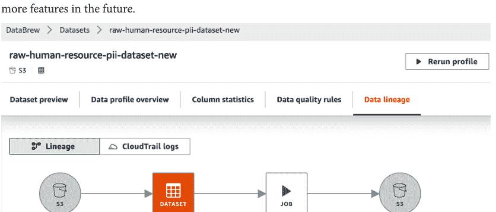

图 2.74：AWS Glue DataBrew 中的数据血缘

## 本章小结

在本章中，我们探讨了 AWS Glue DataBrew 的功能，这是一种由 AWS 提供的无代码数据整理服务。我们学习了如何执行各种数据整理任务，包括数据发现、数据增强、识别和编辑 PII，以及执行数据质量检查。我们还了解了数据剖析及其实用性。在下一章中，我们将深入探讨 AWS Glue Data Wrangler，这是一个基于 Python 的开源数据整理选项。

## 介绍
### AWS SDK for pandas

在本章中，我们将探索 AWS SDK for pandas 包并理解其构建模块。我们将详细介绍针对各种使用场景安装 AWS SDK for pandas 包的不同模式，并展示如何进一步定制该包以适合您的特定项目需求。我们还将学习该包与 AWS 服务的集成，以及它如何帮助高效执行常见的数据整理活动。因此，到本章结束时，您将能够理解 AWS SDK for pandas 及其构建模块、针对不同使用场景的标准和自定义安装选项，以及与 Amazon S3、Amazon RDS、Amazon Redshift 和 Amazon Athena 等 AWS 服务的集成。

本章涵盖以下主题：

- AWS SDK for pandas
- AWS SDK for pandas 的构建模块
- 定制、构建和安装 AWS SDK for pandas
- AWS SDK for pandas 的配置选项
- AWS SDK for pandas 在不同 AWS 服务中的功能

## AWS SDK for pandas

AWS SDK for pandas（原名 AWS Data Wrangler）是一个 Python 库，它通过额外功能增强了 AWS 软件开发工具包（SDK），并提供了一个与 pandas DataFrame 的接口。这是 AWS 专业服务团队发起的一个开源项目，提供与一系列 AWS 服务的轻松集成。除了 AWS SDK 的现有功能外，与 pandas 库的集成为执行数据整理和数据集成活动提供了一组丰富的功能。

AWS SDK for pandas 最初被称为 `awswrangler` 包，由 AWS 专业服务团队于 2019 年 7 月左右创建。AWS SDK for pandas 是一个在 Apache 2.0 许可证下发布的开源项目。该框架经历了一次重新命名过程，自 2022 年 8 月起更名为 AWS SDK for pandas。然而，关于该库的一切保持不变，名称的更改是为了更好地与 AWS 生态系统保持一致。从本书后文开始，我们将使用术语 `awswrangler` 来指代 AWS SDK for pandas 库。

使用 AWS 生态系统的客户可以使用 AWS SDK，通过其选择的编程语言以编程方式访问服务并执行任务。截至 2022 年 10 月，AWS SDK 支持 12 种编程语言，包括 C++、Go、Python、Rust、JavaScript、Kotlin、Java、Node. JS、PHP、Ruby、Swift 和 .NET。每个 SDK 中可用的功能在 AWS 文档（`https://aws.amazon.com/developer/tools/`）中有详细记录。对于使用 Python 编程语言的客户，AWS SDK for Python（也称为 Boto3）提供了一种与 AWS 服务交互的机制。

AWS SDK for pandas 旨在在 Boto3 之上运行，并提供与 pandas DataFrame 和 AWS 服务的集成。代码库由 AWS 内部和外部的一组志愿者积极维护。截至 2022 年 10 月，已有约 95 个版本发布，平均每月发布两次以上，这表明该库不断添加功能以使其更加实用。以下图表显示了过去一年中对该仓库进行的提交，这展示了代码库由团队积极管理的情况。

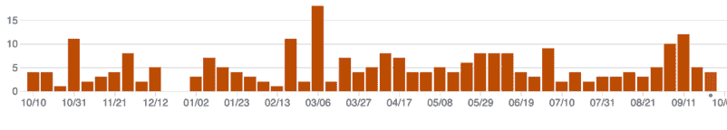

实际上，如果您使用 pandas 进行数据整理或数据集成活动，AWS SDK for pandas 将为您提供功能，可以更简单、更有效地*将数据加载或读取到* AWS 服务（如 S3、RDS、NoSQL 数据库和 Redshift），使用诸如 `pyarrow` 等库。一旦数据在 pandas DataFrame 中可用，用户就可以利用 pandas 库的丰富生态系统对数据集执行数据整理活动。既然我们已经了解了 AWS SDK for pandas 是什么，让我们来看看构成该 SDK 的构建模块。

## AWS SDK for pandas 的构建模块

在本节中，我们将探索 AWS SDK for pandas 库的构建模块，例如 Apache Arrow、pandas 和 Boto3。

## Arrow

Apache Arrow（https://arrow.apache.org/）是一种内存中、面向列的数据格式（类似于 DataFrame 格式），在许多系统和编程语言中用于在现代硬件上高效执行内存中的分析操作。用户可能已经熟悉 Parquet 文件格式，它有助于将数据以列格式存储在磁盘上，但当数据加载到内存中时，不同的运行时（Runtime）会以不同的方式将其映射（例如，Spark 在从磁盘读取 Parquet 文件后将数据加载到 DataFrame 中）。因此，当数据需要在系统之间交换时，需要进行序列化/反序列化以将其从一种格式转换为另一种格式。使用 Arrow 的一个优势是能够在内存中以列格式存储数据，支持分析操作，并高效地在不同的运行时环境之间传输数据，而无需序列化和反序列化数据。许多不同的项目和团队使用 Arrow 库，例如 pandas 和 Spark。这对使用 pandas 和 NumPy 数据的 Python 开发人员非常有益。

例如，在 PySpark 编程中，我们通常在 Python UDF 和 Java 虚拟机（JVM）环境之间对数据进行序列化/反序列化。由于 PySpark 程序是用 Python 编写的，最终将在 JVM 中执行。此过程涉及将数据转换为 pickle 格式以进行序列化和反序列化活动，这是耗时的。通过基于 Arrow 的序列化，数据可以在 JVM 和 Python 进程之间更高效、更快地移动。

> 根据 Wes McKinney 的说法：“Apache Arrow 定义了一种二进制‘序列化’协议，用于组织 Arrow 列式数组的集合（称为‘记录批次’），可用于消息传递和进程间通信。您可以将该协议放在任何地方，包括磁盘上，之后可以内存映射或读取到内存并发送到其他地方。Arrow 协议的设计使得您可以在不进行任何反序列化的情况下‘映射’Arrow 数据块，因此对磁盘上的 Arrow 协议数据执行分析可以使用内存映射，并且实际上支付零成本”（https://stackoverflow.com/questions/56472727/difference-between-apache-parquet-and-arrow）。

## pandas

在其核心，awswrangler 库使 pandas DataFrame 更接近 AWS 生态系统。除此之外，awswrangler 还有方法，使用基于 Boto3 功能的预制模块简化常见活动（如列出在特定时间后创建的 S3 对象）。pandas 是为 Python 编程语言编写的开源库，为大多数数据分析工作负载提供了快速且高性能的数据结构。Python 编程语言拥有各种各样的机器学习库，而 pandas 有助于人们使用 Python 执行数据分析活动。pandas 库（https://pandas.pydata.org/）可以帮助用户根据项目需求将数据转换为不同的格式，并且它与多种工具有更广泛的集成。


## Boto3

面向 Python 的 AWS SDK（Boto3）（[https://boto3.amazonaws.com/v1/documentation/api/latest/index.html](https://boto3.amazonaws.com/v1/documentation/api/latest/index.html)）为用户提供了通过 Python 代码以编程方式访问 AWS 服务并执行各种操作的能力。这有助于自动化常见任务，也有助于在云中部署生产级应用程序。Boto3 使用 AWS 凭据对向 AWS 服务发出的 API 调用进行身份验证，并且访问权限根据通过 **身份和访问管理（IAM）** 服务提供的 AWS 凭据进行限制。

Boto3 同时提供高层级、面向对象的 API（resource）和低层级 API（client），用于访问 AWS 服务：

- 客户端提供的是与 AWS 服务交互的低层级接口，其方法与服务 API 一一对应。所有服务操作都由客户端支持。响应以 Python 字典形式返回。需要由用户自行遍历并处理响应，以获取他们所需的属性。
- 资源提供了比服务客户端发出的原始低层级调用更高层级的抽象。要使用资源，您需要调用会话的 resource 方法，并传入 AWS 服务名称。资源可能不具备服务（如低层级 API）的所有功能，但一旦理解了相关概念，使用起来会更简单、更强大。
- 会话管理特定配置的状态，通常存储用户凭据、AWS 区域以及与用户配置文件相关的其他配置等信息。这使用户可以通过使用不同的凭据连接到不同的 AWS 账户和区域，从而自定义其代码。

> Boto 是葡萄牙语中对一种原产于亚马逊河的淡水海豚的称呼。这个名字由最初的 Boto 库作者 Mitch Garnaat 选定，作为对公司的呼应。

现在我们已经了解了 `awswrangler` 包的构成模块，接下来让我们探索在各种 AWS 服务和环境中自定义和安装 `awswrangler` 的各种选项。

### 针对不同用例自定义、构建和安装 AWS SDK for pandas

AWS SDK for pandas 可以安装在不同的编程环境中，以执行数据整理活动。让我们看下面的示例，这些示例将帮助我们理解 `awswrangler` 在不同环境中的用法：

- 项目 A 的业务用户希望在本地机器上安装 AWS SDK for pandas，并为新项目进行概念验证。该用户还希望在 Amazon EC2 实例上进行同样的操作，以使用 AWS 环境中的数据测试该解决方案。
- 项目 A 的 IT 人员希望在 Lambda 函数上使用 AWS SDK for pandas，对少量数据执行数据整理活动。
- 项目 B 的 IT 人员希望在 Glue Python shell 上使用 AWS SDK for pandas，对从源数据库提取的数据执行数据整理活动。团队预计转换将耗时超过 15 分钟（Lambda 执行时间限制）。该团队还有另一个数据项目，负责消费和转换更大量的数据，他们希望使用 Glue Spark shell 进行数据转换，并使用 Glue 书签进行增量数据处理。
- 项目 B 的数据分析师希望在将数据传递给自定义 ML 模型之前执行数据整理活动。他们希望在 SageMaker 笔记本上使用 AWS SDK for pandas 对数据进行探索性分析。
- 某个战略计划的项目经理希望他的团队实现一个“大数据管道”，并使用 AWS SDK for pandas 进行数据准备活动。该团队希望在 EMR 作业中使用 AWS SDK for pandas 进行数据整理活动。

### 在本地机器或 Amazon EC2 上的标准安装和自定义安装

项目 A 的业务用户可以在其本地机器或 EC2 实例上从 PyPI 或 Conda 安装 AWS SDK for pandas。Python 用户可以从两个流行的打包系统 PIP 和 Conda 安装软件包。大多数 Python 发行版都预装了 `pip`。`pip` 从 Python 2.7 起预装，`pip3` 从 Python 3.4 起默认预装。

使用 PIP 的优点是，它可以在命令行中使用，并且会随软件包一起安装所有必需的依赖项。通过 pip 安装 `awswrangler` 的语法如下：

Python 2.x：

```
pip install awswrangler
```

Python 3.x：

```
pip3 install awswrangler
```

当您执行此命令时，以下附加软件包也会一并安装，这些软件包在 `awswrangler` 内部作为依赖项使用。不过，作为用户，我们只需执行上述命令，其余工作由 pip 软件包安装程序处理：

### AWS SDK for pandas 简介


上面的截图显示了随 AWS SDK for pandas 一起安装的附加软件包。


安装完成后，您可以按如下方式在 Python shell 中打印 `awswrangler` 版本来验证安装是否成功。此时，我们已经成功安装了 `awswrangler`，可以开始在 Python 程序中使用它进行各种数据整理活动：

> 趣味提示
> PIP 是一个递归缩写，代表 PIP Installs Python（PIP 安装 Python）。它最初于 2008 年由 Ian Bicking（virtualenv 包的创建者）以 pyinstall 的名称引入，作为 easy_install 的替代方案。

### 在虚拟环境中安装 `awswrangler`

用户可以创建虚拟环境，在其中安装 `awswrangler` 库，而不会影响该机器上现有的项目。考虑这样一种情况：您已经在另一个项目中使用了 pandas 1.3.6 版本，而项目代码无法在 pandas 1.3.5 版本下运行。现在，如果您使用 pip 命令安装 `awswrangler`，它会安装 pandas 1.3.5 版本，于是您的机器上就有了同一个库的两个冲突版本，这可能会导致程序崩溃。因此，最佳实践是创建 Python 虚拟环境，以便在具有冲突依赖关系的独立项目中工作。从现在开始，我们将使用这个虚拟环境来安装和修改 `awswrangler` 包。

您可以使用 `activate` 和 `deactivate` 命令进入 Python 虚拟环境。这使您可以在不同项目之间切换并开展工作，而不会相互影响。下面的截图显示了新虚拟环境和 `python3` 环境中安装的软件包。在 `deactivate` 命令之后使用 `pip3 list` 命令，将显示来自 `python3` 默认安装的库。

```
$python3 --version
Python 3.9.12
$python3 -m venv awspandas
$s awspandas
$source awspandas/bin/activate
(awspandas) $pip3 list --disable-pip-version-check
Package      Version
-----------  -------
pip          22.0.4
setuptools   58.1.0
(awspandas) $deactivate
$pip3 list
Package       Version
------------  -------
anenum        3.1.11
aiohttp       3.8.1
aiosignal     1.2.0
asn1crypto    1.5.1
async-timeout 4.0.2
attrs         22.1.0
awsccli       1.25.50
```

图 3.4：Python 虚拟环境

### 自定义安装

开源库的一大优势是能够根据项目需要自定义并添加额外的代码段。您可以按照以下步骤对 AWS SDK for pandas 执行自定义安装，添加特定于项目需求的模块。

作为前提条件，请激活虚拟环境，并在您的笔记本电脑/EC2 机器上安装 `python3` 和 `git`：

- 要在 Mac 上安装 `git`，可以使用 `brew` 命令
- 要在 EC2 实例上安装 `git`，可以使用 `sudo yum install git`：

1. 将代码库下载或复制到您的本地机器或 EC2 实例：
    1. 从 `aws-sdk-pandas` 仓库（[https://github.com/aws/aws-sdk-pandas](https://github.com/aws/aws-sdk-pandas)）复制 git 仓库 URL。


## 使用 Lambda 函数的标准与自定义安装

对于大多数用例，例如项目 A 的 IT 人员处理小体量数据的情况，我们希望将数据集成代码部署到无服务器（serverless）环境中并执行。AWS Lambda 是一种无服务器的事件驱动计算服务，让你能够在几乎任何类型的应用程序或后端服务上运行代码，而无需配置或管理服务器。Lambda 预装了各种重要库，但当部署到 Lambda 函数时，用户必须将与代码一起打包那些默认环境中不可用的库。

对于较小的库，用户可以将依赖项与代码一起打包，并将其上传到 Lambda 函数。我们将学习如何创建包含 Lambda 函数依赖库的 ZIP 归档文件 ([创建包含依赖项的软件包](https://docs.aws.amazon.com/Lambda/latest/dg/python-package.html#python-package-create-package-with-dependency))。为此，请创建一个新的 Python 虚拟环境，并在虚拟环境中安装新软件包。这将在你的机器上的 pip 安装路径下安装依赖软件包。然后，你可以将这些软件包移动到 Lambda 函数的部署文件夹中，并将其归档为 ZIP 文件，以便上传到 Lambda 函数。

Lambda 函数还可以拥有层（layers），它们保存为 ZIP 文件，包含额外的代码/库。它也可以包含自定义运行时、数据或配置文件。在 Lambda 函数中使用层可以减小部署包的大小，并且同一个 Lambda 层可以在多个 Lambda 函数之间共享，从而促进可重用代码组件。此外，这有助于在 different 团队之间分离管理代码片段的职责。另外，当你在单个 ZIP 文件中部署代码和依赖项时，Lambda 函数在控制台中是不可编辑的，这增加了代码维护的难度。目前，可以使用 `.zip` 文件归档创建 Lambda 层。

基于上述所有内容，我们在哪里使用 Lambda 层？考虑这样一种情况：存在一个中央数据仓库，不同的项目团队使用 Lambda 函数作为微服务从中访问数据，并将其用于不同目的。需求是只提供组织内特定用户组访问权限，同时在访问数据时执行数据脱敏。数据库管理员还担心过多的并发用户访问数据库以及留下空闲打开的连接可能会使数据库不堪重负。各个项目团队也担心使用和 maintenance 数据库驱动程序以连接到仓库，并且他们没有管理经验数据库连接状态、配置等的经验。理想的解决方案是创建一个符合上述所有要求的用于访问仓库的 Lambda 层，该层将由数据库管理团队维护，而各个团队可以利用该 Lambda 层在 Lambda 函数中开发其代码。这促进了代码重用、职责分离以及更快的开发周期。

在相同的上下文中，用户可以从 Lambda 层使用 AWS SDK for pandas。在 Lambda 代码中使用 AWS SDK for pandas 有两个选项。

### 标准安装 – Lambda 管理的层

在 AWS 控制台中创建一个使用 Python 3.9 运行时的 Python Lambda 函数。向下滚动 Lambda 函数概览屏幕，直到页面底部，在那里你可以找到 **Layers**（层）部分：


然后你可以选择添加一个层；选择 **AWSSDKPandas-Python39** 层，如以下屏幕截图所示。随着 AWS 团队添加新发行版，版本号将来可能会改变。这是 AWS 团队为你精心策划的一个层，它移除并优化了组件，从而减小了软件包的大小。

### 自定义安装

- **II. 使用链接将整个 git 仓库克隆到本地机器/EC2 以进行进一步开发：**

```bash
(awspandas) $ git --version
git version 2.37.3
(awspandas) $ git clone https://github.com/aws/aws-sdk-pandas
Cloning into 'aws-sdk-pandas'...
remote: Enumerating objects: 13000, done.
remote: Counting objects: 100% (565/565), done.
remote: Compressing objects: 100% (264/264), done.
remote: Total 13000 (delta 388), reused 431 (delta 299), pack-reused 12435
Receiving objects: 100% (13000/13000), 8.00 MiB | 7.91 MiB/s, done.
Resolving deltas: 100% (9773/9773), done.
(awspandas) $
```

图 3.5：awswrangler git 副本

- **2. 进入代码库并探索代码。** 你可以修改现有代码并添加额外模块以满足项目需求：
  - **I. 导航到 awswrangler 的安装路径并探索不同的文件夹。** 你应该在名为 `awswrangler` 的文件夹下看到代码，并且为不同服务有单独的文件夹。
  - **II. 为了学习目的，让我们修改 `__init__.py` 文件**，该文件将在我们在 Python 代码中导入 `awswrangler` 时执行。探索为各种 AWS 服务/awswrangler 功能导入的模块。你可以看到一条导入语句，它从 `__metadata__.py` 文件中获取变量。按照此处所示，向导入语句附加一个新变量 `__message__`，并保存文件。

```python
from awswrangler.__metadata__ import __description__, __license__, __title__, __version__, __message__
# noqa
from awswrangler.__config import config # noqa
```

图 3.6：awswrangler init.py 文件

  - **III. 打开 `__metadata__.py` 文件并修改 `__description__` 字段**，如下所示。另外，添加另一个变量 `__message__`，它在上一步骤中被导入到 `__init__.py` 模块中，然后保存文件。

```python
__title__: str = "awswrangler"
__description__: str = "Pandas on AWS. Updated for custom installation."
__version__: str = "2.17.0"
__license__: str = "Apache License 2.0"
__message__: str = "This was changed as a part of Learning exercise."
```

图 3.7：awswrangler metadata.py 文件

- **3. 从你在本地机器或 EC2 实例上修改的自定义代码安装 `awswrangler`：**
  - **I. 导航到顶层文件夹，那里有 `awswrangler` 代码。**
  - **II. 执行 `pip3 install .` 命令**，如下所示。这将在你的机器上安装 `awswrangler`，使用包含你自定义更改的本地代码库。

```bash
(awspanandas)$ cd aws-sdk-pandas
(awspanandas)$ ls
CODE_OF_CONDUCT.md             awswrangler              test_infra
CONTRIBUTING.md                building                 tests
CONTRIBUTING_COMMON_ERRORS.md  docs                       tox.ini
LICENSE.txt                    fix.sh                   tutorials
NOTICE.txt                     poetry.lock              validate.sh
README.md                      pyproject.toml
THIRD_PARTY.txt                test.sh

(awspanandas)$ pip3 install .
Processing /Users/ssmun/Documents/Initiatives/DataWranglerBook/code/aws-sdk-pandas
Installing build dependencies ... done
Getting requirements to build wheel ... done
Preparing metadata (pyproject.toml) ... done
Collecting boto-core<2.0.0,>=1.27.11
  Downloading botocore-1.27.82-py3-none-any.whl (9.2 MB)
                                         9.2/9.2 MB 25.5 MB/s eta 0:00:00
```

图 3.8：在本地机器上安装 awswrangler

- **4. 验证并开始使用 `awswrangler` 自定义安装：**
  - **I. 打开 Python shell 并导入 `awswrangler`。**
  - **II. 打印 `__message__` 和 `__description__` 变量**，以查看我们是否从带有早期步骤中进行的更改的本地机器/EC2 实例安装了 `awswrangler` 软件包。

```python
(awspanandas)$ Python3
Python 3.9.12 (main, Apr  5 2022, 01:53:17)
[Clang 12.0.0 ]:: Anaconda, Inc. on darwin
Type "help", "copyright", "credits" or "license" for more information.
>>> import awswrangler as wr
>>> print(wr.__description__)
Pandas on AWS. Updated for custom installation.
>>> print(wr.__message__)
This was changed as a part of Learning exercise.
>>>
```

图 3.9：验证带有自定义更改的 awswrangler 本地安装

- **5. 作为最后一步，你可以通过退出虚拟环境并使用 `pip3 install awswrangler` 命令安装 `awswrangler` 软件包来验证我们的更改仅限于我们的虚拟环境**（这将安装不含我们自定义代码更改的软件包，来自 PyPI 远程仓库）：

```bash
(aws pandas) $deactivate
$pip3 install awswrangler
Requirement already satisfied: awswrangler in /Users/ssmsun/miniconda3/lib/python 3.9/site-packages (2.16.1)

$python3
Python 3.9.12 (main, Apr 6 2022, 01:53:17)
[Clang 12.0.0 1:: Anconda, Inc. on darwin]
Type "help", "copyright", "credits" or "license" for more information.
>>> import awswrangler as wr
>>> print(wr.__description__)
Pandas on AWS.
>>> print(wr.__message__)
Traceback (most recent call last):
  File "<stdin>", line 1, in <module>
AttributeError: module 'awswrangler' has no attribute '__message__'
>>>
```


我们看到了如何通过简单地使用 pip 命令在本地机器/EC2 实例上安装 awswrangler 软件包。我们还从 awswrangler git 仓库下载了代码，进行了项目所需的更改，并安装了修改后的 awswrangler 版本。我们还学习了如何在虚拟环境中安装软件包，以便为一个项目所做的更改不会与其他项目冲突。

恭喜完成此步骤！你可以花一些时间在此处与该软件包互动以更深入地了解它。一旦你完成探索，让我们进入下一节，在那里我们需要帮助 IT 人员使用 Lambda 函数安装 awswrangler。


如果您想在不做任何自定义修改的情况下使用某个包，从 AWS 管理的层中使用 pandas 的 AWS SDK 是最简单、最容易的选择。另请注意，在新功能在 AWS 管理的层中发布或提供之前，可能存在长达一周或更长时间的延迟。现在，您也可以使用不同的 Python 版本和不同的架构创建 Lambda 函数，同时仍然利用 `aws wrangler`。以下截图显示了在 Python 3.8 和 ARM 架构下创建的 Lambda 函数中可用的 `aws wrangler` 层。


## 自定义安装 – 创建自定义托管层

也有一种情况，您希望使用 AWS SDK for pandas 并添加一些修改和自定义代码以满足您的需求。我们将 `.zip` 归档文件上传到自定义层，然后在 Lambda 函数中使用它。存在 Lambda 服务限制（https://docs.aws.amazon.com/Lambda/latest/dg/gettingstarted-limits.html#function-configuration-deployment-and-execution-整个 Lambda 部署包大小应小于未压缩 250 MB（压缩 50 MB）。

如以下截图所示，如果我们归档 awswrangler 库的内容，压缩后约为 86 MB，不包括实际的 Lambda 代码。这超过了 Lambda 部署包大小的限制：

```
(awspanadas) $ ls
   aws-sdk-pandas    awspanadas
(awspanadas) $cd awspanadas/lib/python3.9/site-packages
(awspanadas) $zip -r ../../..awswrangler.zip .
adding: pandas-1.5.0.dist-info/ (stored 0%)
adding: pandas-1.5.0.dist-info/RECORD (deflated 69%)
```

图 3.14：awswrangler Lambda 安装 – 创建自定义 Lambda 包

```
(awspanadas) $ ls -lh
total 197032
drwxr-xr-x  29 sssmSun staff    928B Sep 28 14:30 aws-sdk-pandas
drwxr-xr-x   8 sssmSun staff    256B Sep 28 14:48 awspanadas
-rw-r--r--   1 sssmSun staff      86M Sep 28 16:23 awswrangler.zip
```

图 3.15：awswrangler Lambda 安装 – 验证创建的 Lambda 包

因此，我们必须以最佳方式构建 Lambda 包以便上传到 Lambda 函数。幸运的是，我们有一个脚本可以帮助我们执行完全相同的活动。请按照以下步骤获取一个小于 50 MB 的 ZIP 文件以上传到 Lambda 函数。

以下是先决条件：

- 我们将利用为本地机器/EC2 实例设置而使用的 awswrangler 本地存储库。还记得我们在 __init__.py 中对 message 和 description 变量所做的更改吗？我们将在 Lambda 函数中打印它们以验证我们的安装。
- 您的机器上需要运行 Docker daemon，我们将用它来构建 Lambda 层。此外，请注意，Docker 应分配足够的内存来构建代码，以避免在过程中出现内存不足错误。请注意，以下截图为 Docker 分配了 8 GB 内存以供使用，因此无论您的物理机器容量如何，Docker 都需要有足够的内存和计算资源才能成功完成构建。


图 3.16：awswrangler 自定义 Lambda 安装 – 容器内存配置

我们现在开始操作，如下所示：

- 1. 进入源代码路径并执行构建可添加到 AWS Lambda 函数的 Lambda 层的命令。现在，执行 `sh build-lambda-layers.sh` 命令以启动 `awswrangler` 自定义构建。

```
(awspandas) $ ls
 build-docs.sh build-wheel.sh publish.sh
build-lambda-layers.sh lambda
(awspandas) $ sh build-lambda-layers.sh
++ python -c 'import awswrangler as wr; print(wr.__version__)'
+ VERSION=2.17.0
```

图 3.17：awswrangler 自定义 Lambda 安装 – 构建 Lambda 层

> **注意**
> 
> 此步骤完成需要很长时间。此代码将为 Python 3.7、Python 3.8 和 Python 3.9 分发构建 Lambda 层。

打开 `build-lambda-layers.sh` 的代码，如果您计划仅在 Python 3.9 环境中部署此库，请在构建过程中注释掉 Python 3.7 和 Python 3.8 行。

```
# # Python 3.7
# docker run \
# --volume "$DIR_NAME":/aws-data-wrangler/ \
# --workdir /aws-data-wrangler/building/lambda \
# --rm \
# awswrangler-build-py37 \
# build-lambda-layer.sh "${VERSION}-py3.7" "ninja-build"
#fi

# Python 3.8
#docker run \
# --volume "$DIR_NAME":/aws-data-wrangler/ \
# --workdir /aws-data-wrangler/building/lambda \
# --rm \
# awswrangler-build-py38 \
# build-lambda-layer.sh "${VERSION}-py3.8${ARCH_SUFFIX}" "ninja-build"

# Python 3.9
docker run \
--volume "$DIR_NAME":/aws-data-wrangler/ \
--workdir /aws-data-wrangler/building/lambda \
--rm \
awswrangler-build-py39 \
build-lambda-layer.sh "${VERSION}-py3.9${ARCH_SUFFIX}" "ninja-build"
```

图 3.18：awswrangler 自定义 Lambda 安装 – Python 3.9

前面的截图显示了针对 Python 3.7 和 Python 3.8 的注释代码段。

- 2. 构建完成后，您应该会看到为三个 Python 版本 3.7、3.8 和 3.9 创建的压缩文件。请记住将构建函数更改为您 Lambda 应用程序使用的特定 Python 版本或版本。可以看到压缩文件现在的大小约为 ~44–46 MB。

```
(awspandas) $ls -lh ../dist
total 279048
-rw-r--r--  1 smsun  staff  246K Sep 28 22:17 awswrangler-2.17.1-py3-none-any.whl
-rw-r--r--  1 smsun  staff   44M Sep 30 11:41 awswrangler-layer-2.17.0-py3.7.zip
-rw-r--r--  1 smsun  staff   46M Sep 30 13:33 awswrangler-layer-2.17.0-py3.8.zip
-rw-r--r--@ 1 smsun  staff   46M Sep 30 16:06 awswrangler-layer-2.17.0-py3.9.zip
```

图 3.19：awswrangler 自定义 Lambda 安装 – 验证创建的 Lambda 层

- 3. 使用 Lambda 版本 3.9 创建一个 Lambda 函数，然后在 Lambda 控制台中创建一个自定义层。

### 层版本配置

- Description - *可选*
- aws-wrangler with Python3.9 version
- ● Upload a .zip file
- ○ Upload a file from Amazon S3


- Compatible architectures - *可选* Info
- 选择层的兼容指令集架构。
- ☑ x86_64
- ☐ arm64

- Compatible runtimes - *可选* Info
- 选择最多 15 个运行时。
- Runtimes ▼
- Python 3.9 ✖

图 3.20：aws-wrangler 自定义 Lambda 安装 – 上传自定义 Lambda 层

4. 使用 Python 3.9 运行时创建一个 Lambda 函数并粘贴以下代码到其中：

```
```python
import json
import awswrangler as wr

def lambda_handler(event, context):
    # TODO implement
    print(wr.__version__)
    print(wr.__description__)
    print(wr.__message__)
    return {
        'statusCode': 200,
        'body': json.dumps('Hello from Lambda!')
    }
```
```

## Python shell 作业的 awswrangler 标准安装

Python shell 作业环境有两种不同的 Python 版本，3.6 和 3.9（默认是 Python 3.6）。我们可以使用 wheel 文件将外部库附加到 Glue Python shell 作业。Wheel 文件是 Python 生态系统的一部分，有助于 Python 包安装过程，使其更快、更稳定：

- AWS Glue Python 3.6 环境未预装 awswrangler。请参阅 Python Glue 作业环境中已安装的库（https://docs.aws.amazon.com/glue/latest/dg/add-job-python.html#python-shell-supported-library），然后再添加其他库。我们必须附加我们希望在 Glue 作业中使用的 awswrangler 版本的 wheel 文件，并将其附加，如以下步骤所述：

- I. 对于 Python 3.6 作业，您可以使用以下语法从公共工件存储桶下载 wheel 文件：s3://aws-data-wrangler-public-artifacts/releases/<version>/ awswrangler-<version>-py3-none-any.whl。

```
(awspandas) $aws s3 cp s3://aws-data-wrangler-public-artifacts/releases/2.14.0/awswrangler-2.14.0-py3-none-any.whl .
download: s3://aws-data-wrangler-public-artifacts/releases/2.14.0/awswrangler-2.14.0-py3-none-any.whl to ./awswrangler-2.14.0-py3-none-any.whl
```

图 3.23：awswrangler glue 安装 – 下载 wheel 文件

> Note
> awswrangler 从 awswrangler 版本 2.15 开始不再支持 Python 3.6，因此如果您使用 Python 3.6 使用更高版本，将会抛出错误。

- II. 将 wheel 文件上传到 S3 存储桶并复制 S3 URL。使用 Python 版本 3.6 创建一个 Glue 作业，并在作业详细信息页面的高级属性下 Python 库路径部分提供 wheel 文件。


图 3.24：awswrangler glue 安装 – 上传 wheel 文件

- III. 将以下代码粘贴到脚本窗口并保存作业：

```
import sys
```


## 4. 在 AWS Glue 中安装 awswrangler

### 4.1 在 Glue Python Shell 作业中安装 awswrangler

**IV. 执行代码并在 CloudWatch 日志中验证输出，检查 awswrangler 是否成功加载到 Glue Python shell 作业中。**

```
Successfully installed asn1crypto-1.5.1 awswrangler-2.14.0 beautifulsoup4-4.11.1 boto3-1.23.10 botocore-1.26.10 certifi-2022.9.24 normalizer-2.0.12 decorator-5.1.1 et-xmlfile-1.1.0 idna-3.4 jmespath-0.10.0 jsonpath-ng-1.5.3 lxml-4.9.1 numpy-1.18.5 openpyxl-3.0 py-1.1.0 packaging-21.3 pandas-1.1.5 pg8000-1.22.1 ply-3.11 progressbar2-3.55.0 pyarrow-6.0.1 pymysql-1.0.2 pypassing-3.0.9 python python-utils-3.3.3 pytz-2022.2.1 redshift-connector-2.0.909 requests-2.27.1 requests-aws4auth-1.1.2 s3transfer-0.5.2 scramp-1.4.1 59.6.0 six-1.16.0 soup sieve-2.3.2.post1 urllib3-1.26.12 xlrd-2.0.1 xlsx-1.3.0
```

2.14.0

**图 3.25：** awswrangler Glue 安装 – 检查 awswrangler 是否已在 Lambda 环境中加载

- **Python 3.9 预装了 awswrangler 版本 2.15.1。** 创建作业时，启用 *加载常用分析库（推荐）* 复选框。如果您想使用不同版本的 awswrangler，则必须像我们在 Python 3.6 环境中那样附加 wheel 文件。但是，如果您想使用预装的 awswrangler 2.15.1 版本，请按照以下步骤操作：

**I. 创建一个 Python 版本为 3.9 的作业，并选中 *加载常用分析库（推荐）* 复选框。**

| 字段 | 描述 |
| :--- | :--- |
| **类型** | ETL 作业的类型。这是根据您选择的数据源类型自动设置的。Python Shell |
| **Python 版本** | Python 3.9 |
| **☑ 加载常用分析库（推荐）** | 包含来自 pypi.org 的常用 Python 库，例如 pandas、numpy 和 s3fs。如果您加载自己的库并希望避免版本冲突，请取消选中。 |

**图 3.26：** awswrangler Glue 安装 – 创建 Python 3.9 shell 作业

**II. 粘贴在 Python 3.6 作业中用于打印 awswrangler 版本的示例代码。** 保存并执行该作业。输出将显示 Python shell 作业中使用的 awswrangler 版本。您可以通过单击 Glue Python shell 作业中的输出日志链接来查看此信息。

**图 3.27：** awswrangler Glue 安装 – 验证 awswrangler 版本

为了使用更新版本的 awswrangler，请遵循类似于 Python 3.6 shell 的步骤以添加新的 wheel 文件。下图显示了将 awswrangler 版本 2.17 上传到 Glue Python shell 的输出，这是与 awswrangler 2.15.1 相比更新的版本。

```
pyparsing-3.0.9 python-dateutil-2.8.2 python-utils-3.3.3 pytz-2022.2.1 redshift-connector-2.0.909 requests-2.28 s3transfer-0.6.0 scramp-1.4.1 setuptools-65.4.0 six-1.16.0 soupsieve-2.3.2.post1 urllib3-1.26.12 yarl-1.8.1

[notice] A new release of pip available: 22.1.2 -> 22.2.2
[notice] To update, run: pip install --upgrade pip

Setup complete. Starting script execution:
----
2.17.0
```

**图 3.28：** awswrangler Glue 安装 – 验证 awswrangler 版本（自定义版本安装）

### 4.2 为 Python shell 作业自定义安装 awswrangler

我们将利用 poetry 库从 awswrangler 仓库创建自定义 wheel 文件，该仓库包含我们的修改。我们将使用我们在本地机器/EC2 实例设置中使用的 awswrangler 本地仓库：

- 1. 您可以使用 `pip3 install poetry` 命令在您的 Python 虚拟环境中安装 Poetry。
- 2. 如上图所示，从本地仓库执行 `build_wheel.sh` 脚本以构建 wheel 文件，该 wheel 文件将使用随 awswrangler 仓库提供的 `poetry.lock` 配置创建。

```
(awspandas) $poetry --version
Poetry (version 1.2.1)
(awspandas) $cd aws-sdk-pandas/building
(awspandas) $sh build-wheel.sh
+ pushd ..
~/Documents/ Initiatives/DataWranglerbook/code/aws-sdk-pandas ~/Documents/ Initiatives/DataWranglerboo k/code/aws-sdk-pandas/building
+ rm -rf 'dist/*.whl'
+ poetry build -f wheel
Creating virtualenv awswrangler-Muv3bMem-py3.9 in /Users/ssmsun/Library/Caches/pypoetry/virtualenvs
Building awswrangler (2.17.0)
(awspandas) $ls ../dist
awswrangler-2.17.0-py3-none-any.whl
(awspandas) $
```

**图 3.29：** awswrangler Glue 自定义安装 – 先决条件

- 3. 将 wheel 文件上传到 S3 存储桶，创建 Glue Python shell 作业（Python 版本 3.9），并提供 wheel 文件的 S3 位置。
- 4. 粘贴以下代码以验证我们是否正在使用自定义版本的 awswrangler：

```
import sys
import awswrangler as wr
print(wr.__version__)
print(wr.__description__)
print(wr.__message__)
```

- 5. 执行该作业并在 CloudWatch 日志中验证输出。

```
pymysql-1.0.2 pyparsing-3.0.9 python-dateutil-2.8.2 python-utils-3.3.3 pytz-2022.2.1 redshift-connector-2.0.909 requests-2.28 aws4auth-1.1.2 s3transfer-0.6.0 scram-1.4.1 setuptools-65.4.0 six-1.16.0 soupsieve-2.3.2.post1 urllib3-1.26.12 yarl-1.8.1

[notice] A new release of pip available: 22.1.2 -> 22.2.2
[notice] To update, run: pip install --upgrade pip

Setup complete. Starting script execution:
----
2.17.0
Pandas on AWS.Updated for custom installation.
This was changed as a part of Learning exercise.
```

**图 3.30：** awswrangler Glue 自定义安装 – 验证 awswrangler 安装

现在您已探索了在 Python shell 中安装 awswrangler 的不同选项，您可以有效地将其用于所有与 Python 相关的活动。

### 4.3 在 Glue Spark 作业中标准安装 awswrangler

可以使用 Glue 0.90 (Spark 2.2)、Glue 1.0 (Spark 2.4)、Glue 2.0 (Spark 2.4) 和 Glue 3.0 (Spark 3.1) 版本创建 Glue spark 作业。awswrangler 仅支持 Glue 2.0 及更早版本，因为它具有编译依赖项（C/C++）。默认是 Glue 3.0，这是最新版本，您应该为所有新作业拥有最新的 Glue 3.0 版本，并尽可能升级到此版本。它提供了来自 Spark 和 AWS Glue 服务的最新功能，为您的作业提供更好、更安全且性能更高的环境。我们将按以下步骤安装 awswrangler：

- 1. 创建一个 Glue 3.0 作业，并如下提供作业参数：

```
- key: --additional-python-modules   values:
pyarrow==2,awswrangler==<<version>
```


**图 3.31：** awswrangler Glue 标准安装 – 作业参数配置

- 2. 在脚本窗口中粘贴以下代码，保存作业并点击运行：

```
import sys
from awsglue.transforms import *
from awsglue.utils import getResolvedOptions
from pyspark.context import SparkContext
from awsglue.context import GlueContext
from awsglue.job import Job
import awswrangler as wr
## @params: [JOB_NAME]
args = getResolvedOptions(sys.argv, ['JOB_NAME'])

sc = SparkContext()
glueContext = GlueContext(sc)
spark = glueContext.spark_session
job = Job(glueContext)
job.init(args['JOB_NAME'], args)
print(wr.__version__)
job.commit()
```

- 3. 作业完成执行后，检查 CloudWatch 日志。您应该能看到那里成功打印了 awswrangler 的版本：

```
2022-09-30 16:06:07,219 main INFO Log4j appears to be running in a Servlet environment, but there's no log4j-web module available. If you support, please add the log4j-web JAR to your web archive or server lib directory.
2.17.0
```


### 4.4 在 Glue Spark 作业中自定义安装 aws-wrangler

对于 aws-wrangler 的自定义安装，用户可以通过以下步骤以类似 Python shell 作业的方式从 wheel 文件安装自定义的 aws-wrangler 构建：

- 1. 步骤与 Python shell 作业中的步骤类似。执行 Python shell 作业自定义安装中的步骤 1–3 以创建 wheel 文件。将您的 wheel 文件上传到 S3 位置。
- 2. 通过提供 wheel 文件位置作为作业参数的一部分，将 wheel 文件附加到 Glue spark 作业，如下所示截图中显示。


- 3. 复制并粘贴之前 Spark 程序中的代码并执行 Spark 作业。验证输出日志以查看自定义库是否已安装在 Glue spark 作业中。

```
2022-10-02 11:59:56,721 main INFO Log4j appears to be running in a Servlet environment, but there's no log4j-web module available. better web container support, please add the log4j-web JAR to your web archive or server lib directory.
2.17.0
Pandas on AWS. Updated for custom instalation.
This was changed as a part of Learning exercise.
```


此外，您可以点击错误日志并验证日志内容，显示从 wheel 文件安装 aws-wrangler。

```
INFO  2022-10-02 11:59:54,819 26668 com.amazonaws.services.glue.PythonModuleInstaller [main] Processing ./aws-wrangler-2.17.1-py3-none-any.whl
Downloading boto3-2.8.0>.24.11 Downloading botocore-2.8.44-py3-none-any.whl (132 kB)
Collecting progressbar2<2.0.0,>4.0.0 Downloading progressbar2-4.0.0-py2.py3-none-any.whl (26 kB)
Collecting backoff<2.0.0,>1.11.1 Downloading backoff-2.1.2-py3-none-any.whl (14 kB)
Requirement already satisfied: PyMySQL<2.0.0,>1.0 in /home/spark/.local/lib/python3.7/site-packages (from aws-wrangler>=2.17.1) (1.0.2)
Collecting requests-aws-auth<2.0.0,>1.1.1 Downloading requests-aws-auth-1.1.2-py3-none-any.whl (24 kB)
Collecting redshift-connector<2.1.0,>2.0.0 Downloading redshift-connector-2.0.909-py3-none-any.whl (112 kB)
Collecting openspark3-jv3.0 Downloading openspark3-jv3.0-py3-none-any.whl (204 kB)
Collecting pandas<2.0.0,>1.2.0 in /home/spark/.local/lib/python3.7/site-packages (from aws-wrangler>=2.17.1) (1.3.2)
Requirement already satisfied: numpy<2.0.0,>1.21 in /home/spark/.local/lib/python3.7/site-packages (from pandas<2.0.0,>1.2.0)
```


# Amazon SageMaker 笔记本上的标准安装和自定义安装

Amazon SageMaker 笔记本可用于交互式开发 Python 和 PySpark 应用的代码。

对于 SageMaker python3 笔记本，`awswrangler` 可通过运行以下命令进行安装，如下所示。用户可以利用 Conda 和 pip 包管理系统在 Notebook 实例中安装外部库（https://docs.aws.amazon.com/SageMaker/latest/dg/nbi-add-external.html）：

```
```sh
!pip install awswrangler==<version>
```
```

```
```python
[3]: import awswrangler as wr
[4]: print(wr.__version__)
2.17.0
[2]: !pip install awswrangler==2.17.0
Looking in indexes: https://pypi.org/simple, https://pip.repos.neuron.amazonaws.com
Collecting awswrangler==2.17.0
  Downloading awswrangler-2.17.0-py3-none-any.whl (251 kB)
     251.6/251.6 KB 2.2 MB/s eta 0:00:00
Requirement already satisfied: pymysql<2.0.0,>=1.0.0 in /home/ec2-user/anaconda3/envs/python3/lib/python3.8/site
```
```

Figure 3.36: awswrangler SageMaker standard installation

另外，请注意安装仅在会话期间保持持久，如果支持 SageMaker 笔记本的 EC2 实例重启，您需要再次运行安装步骤。用户可以利用 SageMaker 生命周期策略在实例启动阶段在 SageMaker 上安装所需的库（https://docs.aws.amazon.com/SageMaker/latest/dg/nbi-lifecycle-config-install.html）。当开发通过 SageMaker 实例进行时，我们可以设置 SageMaker 笔记本生命周期策略以在所有兼容内核上安装 `awswrangler`。我们可以将 `pip install` 语句作为生命周期策略的一部分添加，这样 `awswrangler` 就可以在实例创建时附加到内核，用户无需担心安装所需的包。

## 自定义安装

要使用自定义 `awswrangler` 包，请上传我们为 Lambda 函数生成的 ZIP 文件，并为简单起见将包上传到与脚本相同的目录中。如果自定义库上传到不同路径，我们需要将 `awswrangler` 源代码可用的路径包含到 `sys.path` 中。


Figure 3.37: awswrangler SageMaker custom installation – uploading the custom library

从自定义路径导入 awswrangler，而不是通过 `pip` 命令安装它，您现在可以验证更改是否可在笔记本中使用。

```
```
: from platform import python_version
: print(python_version())

3.8.12

: from python38_custom import awswrangler as wr

: print(wr.__version__)
: print(wr.__description__)
: print(wr.__message__)

2.17.0
Pandas on AWS.Updated for custom installation.
This was changed as a part of Learning exercise
```
```

Figure 3.38: awswrangler SageMaker custom installation – checking the installation status

### 安装用于 EMR 使用的 pandas 的 AWS SDK

我们可以通过配置 bootstrap 脚本来在新的 EMR 集群上安装 awswrangler。创建一个包含以下命令的 bootstrap 脚本并将其上传到 S3 存储桶中：

```
```
#!/usr/bin/env bash
set -ex
sudo pip3 install pyarrow==2 awswrangler==2.17.0
```
```

创建一个具有项目所需软件的 EMR 集群，并启用 JupyterHub 和 Liiv，如果您想使用 Jupyter 笔记本交互式开发脚本。我们将启动与此集群关联的 Jupyter 笔记本。您可以通过打印版本号和描述来验证 awswrangler，如我们之前所做的那样。

```
```python
import awswrangler as wr
print(wr.__version__)
print(wr.__description__)
Last executed at 2022-10-02 21:16:49 in 71ms
```
2.17.0
Pandas on AWS.
```

Figure 3.39: awswrangler EMR installation – checking the installation status

您也可以使用 sc.list_packages() 命令通过 sparkContext 对象列出包来验证 awswrangler 安装。

```
```python
[2]: sc.list_packages()
Last executed at 2022-10-02 21:14:26 in 1.31s
aenum (3.1.11)
aiohttp (3.8.1)
aiosignal (1.2.0)
asn1crypto (1.5.1)
async-timeout (4.0.2)
asynczest (0.13.0)
attrs (22.1.0)
aws-cfn-bootstrap (2.0)
awswrangler (2.17.0)
backoff (2.1.2)
beautifulsoup4 (4.9.3)
```
```

Figure 3.40: awswrangler EMR installation – checking the installed packages

您可以在 EMR 集群上上传自定义 awswrangler 包并在 EMR 集群中安装以供使用。参考 EMR 文档（https://docs.aws.amazon.com/emr/latest/ReleaseGuide/emr-jupyterhub-install-kernels-libs.html）以安装额外的包和内核。

我们花费了大量时间在不同环境中安装 awswrangler，以便组织中的不同角色能够利用 awswrangler 库。此外，我们还展示了如何更改 awswrangler 并将其部署到所有环境中，以更适合组织的需求。AWS SDK for pandas 库已经提供了大量功能，大多数客户可以在其项目中使用官方库，因此我们提供了针对不同角色使用它的方案。如果您的项目需要为您的需求定制 awswrangler 库，我们也展示了实现的方法。现在，我们将探讨如何设置配置选项以使 awswrangler 更符合项目特定需求的定制。

# AWS SDK for pandas 的配置选项

awswrangler 中有配置全局变量的选项，这将帮助我们使 awswrangler 库更符合我们的特定用例。我们将深入了解如何设置配置以定制 awswrangler 的工作方式。

# 设置全局变量

全局配置变量可以通过 awswrangler 中的两种不同机制进行设置：

- **环境变量**：在 awswrangler 包将被执行的 operating system/kernel 环境中创建环境变量。例如，在 Jupyter notebook 中，使用 %env 命令为环境变量设置值。这在 awswrangler 对象实例化时加载。

- **Wrangler 配置变量**：您也可以直接使用 wrangler 对象为环境变量设置值。使用 awswrangler.config.<<variable name>> 语法为该配置分配值。

# 配置如何应用？

Python 有一个有趣的功能称为装饰器，用于为现有代码添加功能。这也称为元编程，因为程序的一部分试图在编译时修改程序的另一部分。装饰器确保在函数被调用之前应用配置，使用 @decorator_func 语法在 awswrangler 源代码中为不同服务。

参考以下截图，其中装饰器函数在 Athena read_sql_query 函数之前应用，这将设置代码中与 Athena 相关的全局变量。apply_configs 函数在 config.py 脚本中定义，如果需要，您可以阅读它以更深入地理解。

```
@apply_configs
def read_sql_query(
    sql: str,
    database: str,
    ctas_approach: bool = True,
    unload_approach: bool = False,
    unload_parameters: Optional[Dict[str, Any]] = None,
    categories: Optional[List[str]] = None,
    chunksize: Optional[Union[int, bool]] = None,
    s3_output: Optional[str] = None,
    workaroud: Optional[str] = None.
```

Figure 3.41: awswrangler – a config.py code snippet

awswrangler 包中可用的变量类别如下。然而，用户可以根据特定项目需求向代码添加配置变量：

- **Endpoint URL**：为 awswrangler 用于连接 AWS 环境的各种服务提供端点 URL。要以编程方式连接到 AWS 服务，您使用端点，它是 AWS Web 服务的入口点。AWS SDK 和 AWS 命令行界面（CLI）会自动为 AWS 区域中的每个服务使用默认端点，但您可以使用此变量为 API 请求指定替代端点。一个示例是连接到特定区域或使用 FIPS 端点以增强 TLS 连接的安全性。
- **botocore 配置变量**：这些是 boto 环境的配置参数。有关可传递给 botocore 配置的参数的更多详细信息，请参考 boto3 文档。boto3 配置中的一些参数示例是区域名称、输出格式、连接超时和重试。参考 botocore 文档（https://botocore.amazonaws.com/v1/documentation/api/latest/reference/config.html）了解可配置变量的更多详细信息。
- **General 配置变量**：这些是用于影响其行为方式的各种服务的通用配置 - 例如，我们可以配置块大小参数以从 S3 读取数据。

# 与 Athena 缓存行为相关的参数

awswrangler 可以在特定时间段内检索已执行的 Athena 查询结果。我们可以使用配置变量来配置此行为，以在 X 秒内或 X 个查询内返回预执行的数据，以便用户可以更快地获得有效数据。以下变量有助于配置 Athena 缓存行为：

- **MAX_CACHE_SECONDS**：awswrangler 可以在 Athena 的历史中检查此查询是否之前已运行。如果是，并且其完成时间距离当前查询小于 max_cache_seconds，则 awswrangler 跳过查询执行并仅返回上次的相同结果。
- **MAX_CACHE_QUERY_INSPECTIONS**：这是将从历史中检查以尝试找到可重用结果的最大查询数。只有在 max_cache_seconds > 0 时才生效。
- **MAX_REMOTE_CACHE_ENTRIES**：这是将从 AWS 检索用于缓存检查的最大查询数。只有在 max_cache_seconds > 0 时才生效，默认值是 50。
- **MAX_LOCAL_CACHE_ENTRIES**：这是将本地缓存元数据的最大查询数。这将降低延迟并能够使超过 max_remote_cache_entries 的查询保持可用。此值不应小于 max_remote_cache_entries。只有在 max_cache_seconds > 0 时才生效，默认值是 100。


## 跨不同服务使用的参数

使用 `awswrangler` 包与 Amazon S3 交互时，以下参数会被使用。它们有助于提高读写操作的性能：

- `CONCURRENT_PARTITIONING`：如果为 True，则在写入分区时将提高并行度（使用线程）。它会减少写入时间并增加内存使用。
- `S3_BLOCK_SIZE`：此配置用于从 S3 读取文件，要么按指定块大小读取，要么如果此变量的值设为 -1 则一次性完全读取。

## 配置的常见用例

我们可以配置 awswrangler 使相同的设置在多个命令中重复使用，这意味着我们无需每次都输入它们。此外，当我们在多个环境中执行程序时，全局配置有助于设置默认值，从而使 awswrangler 执行针对该环境进行定制。

考虑一种情况，我们需要对测试数据库和生产数据库执行 Athena 查询。测试和生产查询之间的区域、账户和缓存因子是不同的。 rather than configuring them individually in each API call, we can customize them using global configurations once.

这里的另一个优势是，您可以自定义配置变量以添加自己的变量，以及进一步自定义 awswrangler 对您项目的行为。

到目前为止，我们已经学习了多种安装和配置 awswrangler 包以满足您特定用例的方法。现在，我们将探讨各种 AWS 服务与 awswrangler 的集成以及如何与这些服务高效使用它。

## AWS SDK for pandas 与不同 AWS 服务的功能

我们现在将探讨 awswrangler 包与 AWS 服务的集成。awswrangler 可与更多 AWS 服务配合使用，我们解释了其与一些常用服务（如 Amazon S3、RDS 数据库、Amazon Redshift 和 Amazon Athena）的集成。

## Amazon S3

Amazon 的 **Simple Storage Service (S3)** 是用于结构化、半结构化和非结构化数据的最大且性能最强的对象存储服务，也是构建数据湖的首选存储服务。Amazon S3 允许您以无限规模迁移、存储、管理和保护所有结构化和非结构化数据。借助 S3 数据湖，您可以打破数据孤岛、分析多样化数据集、在一个集中位置管理数据访问并加速机器学习。Amazon S3 按设计安全、按需可扩展，并且能够抵御整个 AWS 可用区故障。您可以使用 AWS 原生服务并与第三方服务提供商集成，在您的数据湖上运行应用程序。

`awswrangler` 与 Amazon S3 可用的主要功能如下：

- **从 S3 读取/下载数据**：我们有函数可从 S3 路径读取 JSON、CSV、Excel、Parquet 和定宽文件格式的数据到 pandas DataFrame。这些函数有助于将数据从 S3 位置加载到 DataFrames 中以使用 pandas 函数进行处理。它们还提供分区推送、加载在特定时间后修改/加载的对象（用于增量数据加载）、为大文件以可配置的块加载数据以及在数据上提供多种格式化选项（pandas 或 PyArrow 参数）的额外功能。
  要将数据从 S3 位置获取到本地路径/本地服务器，用户可以利用下载函数并在本地机器上对数据进行进一步处理。同样，如果用户想要查询 S3 对象中的数据以调试并了解元数据以进行目录更新，S3 Select 和 `read_parquet_metadata` 函数都会有所帮助。

- **向 S3 写入/上传数据**：数据可以使用 `awswrangler` 库以 JSON、CSV、Parquet 和 Excel 等各种文件格式写入 S3。用户可以选择以各种格式在 S3 中存储数据集。这些函数还提供创建分区并更新 Glue 目录的选项，以便数据可以通过 Athena 和 Redshift Spectrum 查询。数据可以以各种模式保存，例如追加（添加新文件）、覆盖（替换目标路径下的所有文件）和覆盖分区（仅覆盖该分区中的文件）。用户可以配置 S3 函数以支持模式演进（允许缺失或新列）并允许 Athena 进行分区投影。

如果您想从本地/本地位置将数据导出到 S3，可以利用 `upload` 函数。`download` 和 `upload` 函数使用文件系统函数读写数据并使用多线程逻辑提高效率。

## Parquet 文件处理有何不同？

为了读取和写入其他文件格式，`awswrangler` 使用 pandas 函数来读取和写入文件。然而，对于 Parquet 文件的加载/写入，`awswrangler` 将利用 Arrow 库以实现更快的加载并在内存中映射它们。请阅读介绍部分中有关使用 Arrow 库的好处的介绍以获取更多详细信息。

## 使用 awswrangler 的 Amazon S3 实用示例

让我们使用一些实用示例来进一步了解 `awswrangler` 读取/写入 S3 的概念。

1. 在笔记本中安装 `memory_profiler` 库以跟踪内存使用情况，以及加载和卸载数据所需的时间：


2. 我们将加载 ~4 GB 数据到 pandas `DataFrame` 中，顺便说一下，这是一个相当大的数据集来进行我们的数据加载基准测试。


以下屏幕截图显示了来自 parquet 文件（Snappy 压缩）的类似数据量的存储大小，明显更小。这显示了将数据集以 Parquet 格式存储的价值，因为它以高效的方式存储数据集，并且在运行分析查询时也具有高度性能。


3. 验证以 CSV 和 parquet 文件格式加载数据所需的时间。

Parquet 文件加载指标如下所示：

```
%%time
%%memit
#Load compressed parquet file of size 286MB
weather_data_wr.s3.read_parquet("s3://noaa-ghcn-pds/parquet/by-year/YEAR=2022")
peak memory: 26221.25 MiB, increment: 26067.42 MiB
CPU times: user 2min 19s, sys: 28.6 s, total: 2min 48s
Wall time: 2min 26s
```

```
weather_data.info()
<class 'pandas.core.frame.DataFrame'>
RangeIndex: 98619752 entries, 0 to 98619751
Data columns (total 7 columns):
# Column Dtype
--- -------
0 ID string
1 DATE string
2 DATA_VALUE Int64
3 M_FLAG string
4 Q_FLAG string
5 S_FLAG string
6 OBS_TIME string
dtypes: Int64(1), string(6)
memory usage: 5.2 GB
```

## 图 3.45：S3 集成 – Parquet 文件加载指标

前述 Parquet 文件的指标是在 t3.xlarge 实例上获取的。类似的实例无法将 CSV 文件加载到内存中，抛出错误并卡住。由于加载 CSV 文件是内存密集型操作，我们将笔记本实例从 t3.xlarge 更改为 r5.2xlarge。更改后，CSV 文件能够加载得快得多，如以下屏幕截图所示。

```
%%time
%%memit
#Load CSV file with 4.1GB of data
weather_data_wr.s3.read_csv("s3://noaa-ghcn-pds/csv/by-year/2022")
peak memory: 28901.76 MiB, increment: 28747.74 MiB
CPU times: user 1min 15s, sys: 32.1 s, total: 1min 47s
Wall time: 1min 13s
```

```
weather_data.info()
<class 'pandas.core.frame.DataFrame'>
RangeIndex: 98707563 entries, 0 to 98707562
Data columns (total 9 columns):
# Column Dtype
--- -------
0 Unnamed: 0 int64
1 ID object
2 DATE int64
3 ELEMENT object
4 DATA_VALUE int64
5 M_FLAG object
6 Q_FLAG object
7 S_FLAG object
8 OBS_TIME float64
dtypes: float64(1), int64(3), object(5)
memory usage: 6.4 GB
```

## 图 3.46：S3 集成 – CSV 文件加载指标

这本质上证明了为特定用例使用合适的计算容量以获得更好性能的优势。

前述练习还显示了读取不同格式数据的简易性，并突出了将数据以 Parquet 文件格式存储用于分析用例的好处。

## 其他 awswrangler S3 函数

以下是 awswrangler 可以执行的一些附加函数：

- 复制对象：我们使用 boto3 的 S3.copy 函数一次复制一个对象。通常，用户会迭代一个函数来复制多个对象。awswrangler 使从一个 S3 前缀/文件夹轻松复制多个文件到另一个 S3 位置变得简单。复制函数将源文件附加到新位置。合并对象函数可以根据配置参数覆盖目标位置中的文件或将文件附加到目标位置。

- 列出对象：此函数接受后缀和前缀参数来过滤 S3 路径中的文件。它采用通配符字符格式进行文件列表。这是通过文件名匹配库实现的（https://docs.python.org/3/library/fnmatch.html）。它还可以在列出文件后按时间戳过滤文件，这在从路径列出文件以进行增量数据处理时非常有利。

以下屏幕截图显示了从 S3 位置在特定时间戳后创建的文件列表。您可以看到该位置已有一个 CSV 文件，但当我们限制列表仅显示最近一分钟内更改/上传的文件时，列出对象不会列出任何文件。

```
#This filter is done after listing of files from S3 path
path='s3://athenaresults-sankar/awswrangler/data/'
wr.s3.list_objects(path)
```text
: ['s3://athenaresults-sankar/awswrangler/data/9f41c2b19014610a9b972f1635f23a6.csv']
```python
#List files created in the last 1 minute
from datetime import datetime,timezone,timedelta
wr.s3.list_objects(path,last_modified_begin=datetime.now(timezone.utc)- timedelta(minutes = 1))
```text
: []
```


在同一位置创建一个 CSV 文件并列出最近一分钟内创建的对象。现在，您可以看到新文件在 S3 路径中列出，而旧文件不会列出。这可以帮助您识别在特定时间段后创建的新文件。


```python
import pandas as pd
df = pd.DataFrame({
    "id": [1, 2],
    "value": ["ABC", "DEF"]})

wr.s3.to_csv(df=df, path=path, index=False, dataset=True, mode="overwrite")
```

```
{'paths': ['s3://athenaresults-sankar/awswrangler/data/c8d458b1139347f880387223f96b48e4.csv'],
 'partitions_values': {}}
```

```
wr.s3.list_objects(path, last_modified_begin=datetime.now(timezone.utc) - timedelta(minutes = 1))
```

```
['s3://athenaresults-sankar/awswrangler/data/c8d458b1139347f880387223f96b48e4.csv']
```

Figure 3.48: S3 integration – listing only the incremental files (continued)

## Challenge exercise

You can use this function in your custom code to create incremental data processing logic. Every time you execute the read function, only newer files that were created after the last successful run should be processed.

## Hint

You can use DynamoDB to store the timestamp from the ETL job once it is successfully completed as part of the last step of the job. The next execution of the job should retrieve the latest timestamp for every new execution, and it should only list files between the timestamp from the last successfully completed job run and the timestamp of the start of the current job run. Add a lock mechanism as a part of the initialization step of the job (or before reading the files) to avoid two jobs running in parallel reading the data at the same time. The DynamoDB table should store state information with a primary key and a sort key as a combination of a job identifier and an S3 path, and store start timestamp and stop timestamp information for each job and S3 path combination.

- **Describe objects:** Users can execute a boto3 head_object command for a single file or for a prefix (which can be done in parallel threads for improved performance). The advantage of using this function is that it doesn’t download the object; instead, it gets only the metadata of the S3 object.

## Usage

You can use the describe object command with filters (time or job identifier prefix) to identify the list of new files and their sizes. This can help to identify the scope to optimize your output file size once the job is completed.

The following screenshot shows an example of using S3 Select on a CSV file:

```
%time
%memit
weather_data=wr.s3.select_query(
    sql='SELECT * FROM s3object s where s.DATA_VALUE<>\'\\0\'',
    path='s3://noaa-ghcn-pds/csv/by_year/2022.csv',
    input_serialization = 'CSV',
    input_serialization_params={
    'FileHeaderInfo': 'Use'
    },
    use_threads=True,
)
```

```
peak memory: 39506.35 MiB, increment: 19722.42 MiB
CPU times: user 4min 17s, sys: 55.2 s, total: 5min 12s
Wall time: 4min 7s
```

```
weather_data.head(5)
```

|   | ID           | DATE      | ELEMENT | DATA_VALUE | M_FLAG | O_FLAG | S_FLAG | OBS_TIME |
|---:|:------------|:----------|:--------|:-----------|:-------|:-------|:-------|:---------|
| 0  | AEM000041196 | 20220101  | TAVG    | 204        | H      |        | S      |          |
| 1  | AEM000041194 | 20220101  | TAVG    | 211        | H      |        | S      |          |

Figure 3.49: S3 integration – S3 Select queries

It takes four minutes to get the results back from the query, which reads 1 GB of data in the CSV format, as the data is stored in an uncompressed format and it needs to read all the data, but less data will be transferred between systems. The benefits will be more pronounced when transferring high-volume data in a low-bandwidth network. Also, note that this test was done on a high-memory and high-bandwidth machine, which can load the entire file much faster and filter the data quickly in memory. So, if your only need is better performance, you also need to consider the data storage format and compute and memory resources available to your machine before using S3 Select or filtering data after reading the entire table object into your compute layer.

- **Merging datasets on an S3 data lake:** The merge upsert table function will help to perform `upsert` operations on existing files. This function takes a primary key and performs an `upsert` operation. The underlying logic is to drop the records from the existing table, which has the same primary key with the DataFrame that has the new records to be loaded into the table. This will create a final table with the new records inserted, and the existing records will be updated with the most recent value.

> **Note**
> This is not a performant solution for larger tables, as loading an entire table in memory is not an efficient operation. Users should think of using transactional data lake formats such as Hudi, Iceberg, Delta, or Lake Formation governed tables if they deal with huge data volumes and use Apache Spark to process the data.

- 4. If there is no hit in the cache step, the query is submitted for execution by `awswrangler` in either *Create Table as Statement* (CTAS), UNLOAD, or regular mode:
  - **CTAS mode:** This is the default mode, and it involves wrapping a query within a `create table as statement`, with data stored in an S3 location in the Parquet format. This method also creates a table with the output of the query in a CTAS database, which is provided as an input argument. The Parquet file is then loaded into a DataFrame using the `awswrangler` S3 read parquet file API. Also, the temporary tables will be deleted at the end of the query execution to avoid cluttering the tables from each query. Use this for bigger datasets where performance is necessary and it also needs permissions to create and drop temporary CTAS tables.
  - **Unload mode:** This mode involves uploading data from a query into an S3 location as a Parquet file. After that, similar to CTAS, we will load the dataset into a pandas DataFrame using the `awswrangler` S3 read parquet file API. Use this for bigger datasets and data that is exported to S3 in the Parquet format. Note that this method doesn't create Glue tables before loading into a DataFrame.
  - **Regular mode:** This mode uses the Athena output location where the results are saved in the CSV file format. This method is simple and doesn't require any additional configuration to execute queries. Use this for smaller datasets, as they are stored in the CSV file format in S3. The files are stored by default using Athena and, hence, don't require any additional storage or configuration requirements.

The following diagram summarizes the `awswrangler` Athena query execution flow:


## How to utilize query metadata for performance

The pandas DataFrame also has a query_metadata dictionary, which is similar to the output of the GetQueryExecution command from Athena that retrieves each query metadata. In the following screenshot, you can see information such as when the query started and finished, where the results are stored, the format of the file, and so on.

```
result_type = {
  'results.query_metadata': {
    'QueryExecutionId': 'a551b95f-c7e6-4423-b3ef-a2994f0e7f6',
    'Query': 'CREATE TABLE `default`...',
    'StatementType': 'DDL',
    'ResultConfiguration': {'OutputLocation': 's3://...'},
    'Statistics': {'TotalExecutionTime': 1416, 'EngineExecutionTime': 1289, 'QueryQueueTime': 106, 'ServiceProcessingTime': 21, 'DataScannedInBytes': 1495},
    'DataManifestLocation': 's3://...'
  }
}
```


However, we also have a bunch of important attributes under the “Statistics” segment. They provide information on the query wait time, the planning time, the execution time, and also the data scanned. Note that Athena queries are charged based on the data scanned:

> TotalExecutionTime = EngineExecutionTime(includes QueryPlanningTime) + QueryQueueTime + ServiceProcessingTime

Here is an example from the preceding case – 1,416 ms = 1,289 ms + 106 ms + 21 ms.

The EngineExecutionTime was 1,289 ms, out of which QueryPlanningTime was 156 ms. So, the actual execution time for the query in the Athena engine was 1,133 ms.

- **TotalExecutionTime:** The number of ms that Athena took to run a DDL or DML query.
- **EngineExecutionTime:** The number of ms that the Athena engine took to run the query. The more complex the query and the larger the data volume, the longer this phase takes.
- **QueryPlanningTime:** The number of ms that Athena took to plan the query processing flow.


# 介绍 AWS SDK for pandas

- QueryQueueTime：查询在查询队列中等待资源的时间，单位为毫秒。这是一个可变时间，取决于特定区域和时间点的资源可用性。
- ServiceProcessingTime：Athena 在查询引擎完成运行查询后处理查询结果所花费的时间，单位为毫秒。如果查询在此阶段花费太多时间，我们会将大型数据集重写到 S3 并尝试减小结果集的大小。

你可以使用这些指标来查看每个查询花费的时间然后对其进行优化。但是请注意，这些指标不包括任何网络延迟以及 Athena 查询引擎之外的延迟。

## Athena 缓存是如何工作的？

我们可以通过将 MAX_CACHE_SECONDS 变量设置为大于零来启用缓存逻辑。这将有助于减少查询执行时间（如果结果仍然可用，则完全跳过执行并重用过去的结果）。

- 1. 检查 MAX_CACHE_SECONDS 变量是否大于零；如果设置为零或更小，则立即返回，查询每次调用时都会执行。这对于数据更新更频繁且需要最新数据而不是更低查询执行时间的用例是必要的。
- 2. 使用分页从 Athena 历史日志中根据 MAX_REMOTE_CACHE_ENTRIES 检索查询。检查查询详细信息是否在本地缓存中可用；如果没有，则将查询详细信息追加到本地缓存对象。本地缓存存储最近 100 个查询的数据，以便比远程缓存更快地检索数据。在此 aws wrangler Athena 上下文中，缓存可以理解为查询元数据详细信息的存储，例如查询执行 ID 和查询完成时间。
- 3. 根据条件对本地缓存和远程缓存中的查询列表进行排序，即查询完成时间经过的秒数不超过 MAX_CACHE_SECONDS。
- 4. 解析查询以便可以与旧查询成功匹配。目前，查询会被去除空白字符和尾部分号，并删除首尾括号，以便查询可以以合理的置信度进行匹配。
- 5. 如果旧查询是 CTAS（使用 aws wrangler CTAS 模式执行），则在与新查询进行比较之前解析并获取内部查询。比较两个查询，如果匹配，则将缓存匹配作为成功返回。

例如，让我们执行一个简单的查询，从示例表中提取数据，该表在 CloudFront 日志上爬取并存储在 S3 存储桶中。你可以使用任何表来演示此 Athena 缓存功能。

```
: %time
wr.athena.read_sql_query("SELECT date,time,bytes,method,uri,referrer,result_type from cloudfront_logs limit 1")
CPU times: user 298 ms, sys: 12.7 ms, total: 311 ms
Wall time: 3.42 s
:
| date | time | bytes | method | uri | referrer | result_type |
| 2022-02-18 | 16:12:03 | 481 | GET | / | - | Error |

: %time
wr.athena.read_sql_query("SELECT date,time,bytes,method,uri,referrer,result_type from cloudfront_logs limit 1;")
CPU times: user 87.3 ms, sys: 2.99 ms, total: 90.2 ms
Wall time: 353 ms
:
| date | time | bytes | method | uri | referrer | result_type |
| 2022-02-18 | 16:12:03 | 481 | GET | / | - | Error |
```

Figure 3.53: Athena integration – Athena cache functionality

你可以看到，查询的第一次运行花费了 3.42 秒，而第二次查询在 ~300 ms 内运行。这相当于从初始运行中减少了 11 倍的时间。但是，根据初始查询的复杂性，我们可以通过简单地重用现有结果而不再次执行它来节省大量时间。另外，请注意查询在表名之前有一些额外的空格和一个尾部分号，在比较查询之前会被删除。

但是，正如前面提到的，只有在执行类似查询时才会实现好处。请参考以下示例，其中我们仅从查询中选择了部分列。我们发现 `referrer` 列在我们特定的数据集中没有任何数据，我们希望从结果集中删除该列。正如你所见，没有 referrer 列的查询需要 2.63 秒来检索数据。

```
: %time
wr.athena.read_sql_query("SELECT date,time,bytes,method,uri,referrer,result_type from cloudfront_logs limit 1")
CPU times: user 83.9 ms, sys: 0 ms, total: 83.9 ms
Wall time: 298 ms
:
| date | time | bytes | method | uri | referrer | result_type |
| 2022-02-18 | 16:12:03 | 481 | GET | / | - | Error |

: %time
wr.athena.read_sql_query("SELECT date,time,bytes,method,uri,result_type from cloudfront_logs limit 1")
CPU times: user 263 ms, sys: 2.45 ms, total: 265 ms
Wall time: 2.63 s
:
| date | time | bytes | method | uri | result_type |
| 2022-02-18 | 16:12:03 | 481 | GET | / | Error |
```

Figure 3.54: Athena integration – Athena cache functionality limitation when SQL is changed

## Challenge

你可以扩展查询架构以匹配之前具有更宽数据集的查询，然后应用过滤器以获得更小的数据集。扩展以下列表中列出的高级流程。

- 1. 识别旧查询并在比较之前在查询中拆分 where 子句和 from 子句。
- 2. 以类似格式解析新查询并将其与旧查询进行比较。如果新查询比旧查询有更多过滤器和/或更少的列，我们可以使用旧查询的数据并在 pandas DataFrame 中应用过滤器并返回结果，例如以下内容：

```
Query 1: select * from hr. employee where city='NY'
Query 2: select * from hr. employee where city='NY' and join_date>'2020-10-01'
```

在这里，我们可以看到 Query 2 是 Query 1 的子集，我们可以使用已执行的数据并在 pandas DataFrame 的列上应用进一步的过滤器。

此外，改进查询匹配逻辑以提高缓存命中率的空间巨大，你所做的更新可以贡献回 AWS SDK for pandas 仓库。祝编码愉快!!!

另外，它提供了许多有用的模块，其中一些列在这里：

- Repair table：这会运行 MSCK REPAIR 命令，以使用存储层中的最新数据更新表元数据。此函数执行 Hive 的元存储一致性检查 – MSCK REPAIR TABLE <tablename>。该命令恢复分区和与分区相关的数据并更新表定义。这是为了查询在这些分区下可用的数据而需要的。当从不更新 Glue 目录的 ETL 作业创建新分区时，这很有用。
- Wait query：这会每 250 ms 迭代查询状态，直到查询移动到 FAILED、SUCCEEDED 或 CANCELLED 状态（查询执行的最终状态）。如果你想使用更短或更长的轮询机制来验证查询执行状态，你必须自定义你的代码。

aws wrangler 包在内部处理数据类型转换。结果文件夹中的 Parquet 文件使用 S3 读取函数读取（进而使用 pyarrow 读取 S3 对象）。Parquet 文件的数据类型转换 – arrow – athena 在 aws wrangler 包内部处理。以下来自 data_types.py 模块的片段显示了 pyarrow 和 athena 数据类型的转换。

```python
def pyarrow2athena(  # pylint: disable=too-many-branches,too-many-return-statements
        dtype: pa.DataType, ignore_null: bool = False
) -> str:
    """Pyarrow to Athena data types conversion."""
    if pa.types.is_int8(dtype):
        return "tinyint"
    if pa.types.is_int16(dtype) or pa.types.is_uint8(dtype):
        return "smallint"
    if pa.types.is_int32(dtype) or pa.types.is_uint16(dtype):
        return "int"
    if pa.types.is_int64(dtype) or pa.types.is_uint32(dtype):
        return "bigint"
    if pa.types.is_uint64(dtype):
        raise exceptions.UnsupportedType("There is no support for uint64, please consider converting the data type. See the AWS documentation for supported data types.")
    if pa.types.is_float32(dtype):
        return "float"
    if pa.types.is_float64(dtype):
```

Figure 3.55: Athena integration – pyarrow data type conversions

## RDS databases

`awsrangler` 内部有相当多的集成功能可用于连接关系数据库，例如 Postgres、Oracle、SQL Server 和 MySQL。除此之外，`awsrangler` 还支持通过 DataAPI 访问 Redshift 和 Aurora Serverless 数据库。

`awsrangler` 使用额外的库来连接数据库，这些库也需要安装。以下图表显示了连接不同数据库引擎所需的额外库。


## 介绍 AWS SDK for pandas

### 图 3.56：RDS 集成 – 数据库引擎和推荐驱动


我们必须确保在尝试连接这些数据库引擎时已安装额外的 Python 库。要连接 Redshift 和 Aurora Serverless 以及使用 IAM 身份验证，我们可以使用 DataAPI，这也有助于更有效地管理数据库连接。

以下通用模块/功能适用于所有数据库引擎：

- 连接到数据库：这会检查数据库引擎是否可用额外的 Python 库，并在用于建立数据库连接的 Python 库缺失时提供错误。连接模块需要现有的 Glue 连接或密钥标识符来提供数据库登录详细信息。例如，密钥应具有以下字段以建立数据库连接：

```
{
  "host": "hostname.region.rds.amazonaws.com",
  "username": "testuser",
  "password": "testpassword",
  "engine": "mysql",
  "port": 3306
}
```

aws wrangler 将在内部从 secrets manager 或 Glue 连接格式化连接字符串并使用创建连接对象（MySQL 情况下为 pymysql，sqlserver 情况下为 pyodbc 等）并返回给调用代码。此连接对象可从那时起用于读取和写入数据库。

- 从数据库读取：从数据库引擎读取有几个选项 – 从 SQL 读取和从表读取。从表读取将会在表上创建 select 查询并再次调用从 SQL 读取模块。

查询通过作为参数传递给 **从 SQL 读取** 模块的连接对象进行格式化和提交。代码将使用连接对象的游标执行查询。

一旦从执行中检索到数据，就将其加载到 `pyarrow` 数组中以实现从游标执行中的记录对象更快地加载数据。然后我们可以快速将其转换为 pandas DataFrame 并返回给调用函数以进一步处理数据。

以下屏幕截图显示了从 S3 加载 Ookla 速度测试数据（410 万条记录）的快速示例，耗时三分钟，使用笔记本和数据库的最低实例大小。此练习的目的是展示使用 `awswrangler` 可以轻松地加载和查询数据。

```
```python
import awswrangler as wr
import pandas as pd
```
```

```
```python
dbcon= wr.postgresql.connect("Postgres-wrangler")
```
```

```
```python
#Load S3 data
speed_test=wr.s3.read_parquet("s3://ookla-open-data/parquet/performance/type=mobile/year=2021/quarter=4/")
len(speed_test)
4120347
```
```

```
```python
%time
wr.postgresql.to_sql(speed_test, dbcon, schema="public", table="speed_test", mode="overwrite")
CPU times: user 2min 3s, sys: 2.64 s, total: 2min 5s
Wall time: 3min 7s
```
```

```
```python
%time
df_result=wr.postgresql.read_sql_query("SELECT * FROM public.speed_test limit 10", con=dbcon)
CPU times: user 0 ns, sys: 4.43 ms, total: 4.43 ms
Wall time: 5.48 ms
df_result
```
```

|  | quadkey | tile | avg_d_kbps | avg_u_kbps | avg_lat_ms | tests | devices |
|---|---|---|---|---|---|---|---|
| 0 | 0022133222330013 | POLYGON((-160.03324348632812 70.63999478155463, ...) | 85 | 103 | 72 | 1 | 1 |
| 1 | 0022133222330201 | POLYGON((-160.0433334460938 70.6344840663086, ...) | 14947 | 20624 | 70 | 1 | 1 |
| 2 | 00222033303101201 | POLYGON((-166.1517333398438 68.8714387233513, ...) | 13099 | 1281 | 91 | 2 | 1 |

**图 3.57：RDS 集成 – 从 RDS 加载示例数据**

你还可以看到数据类型基于 Arrow 和 pandas DataFrame 发生了变化。

## 介绍 AWS SDK for pandas

Postgresql 实例中的数据类型如下：

- postgres
  - schemas
    - public
      - tables
        - speed_test
          - columns

ABC quadkey (text)
ABC tile (text)
123 avg_d_kbps (int8)
123 avg_u_kbps (int8)
123 avg_lat_ms (int8)
123 tests (int8)
123 devices (int8)

图 3.58 (a)：从 RDS Postgres 加载到 pandas DataFrame 时的数据类型转换

| quadkey | string |
| tile | string |
| avg_d_kbps | Int64 |
| avg_u_kbps | Int64 |
| avg_lat_ms | Int64 |
| tests | Int64 |
| devices | Int64 |
| dtype | object |

图 3.58 (b)：从 RDS Postgres 加载到 pandas DataFrame 时的数据类型转换

- 写入数据库：我们可以使用每个数据库引擎模块中的 to_sql 函数将 pandas DataFrame 写入表。这会验证连接对象，然后在表尚不存在时创建表（如果模式设置为覆盖，则会删除并重新创建表）。基于不同的模式，数据会以不同的方式更新：

* **Upsert**：当与一组匹配列匹配时，这会更新特定的一组列（主要用于识别唯一记录）。这适用于具有 Column1、Column2 和 Column3 作为主键列的现有表的情况。当我们执行 upsert 时，我们会检查新记录是否与现有记录在 Column1、Column2 和 Column3 上匹配，如果匹配，我们将更新其余列（或其余列的子集）。如果与 Column1、Column2 和 Column3 不匹配，则新记录将被插入到表中。

* **Append**：这会将新记录插入到表中。我们可以通过将记录与特定的一组列匹配来检查记录是否与现有记录匹配，然后在匹配时选择忽略它。如果没有匹配，记录可以插入到表中。

我们将使用以下步骤为 Postgres 数据库模拟数据更新 + 插入（upsert）情况：

1. 使用 quad key 值从表中提取几条记录：

```
```
%time
df_update=wr.postgresql.read_sql_query("SELECT * FROM public.speed_test where quadkey in ('0022133222330013'
```
CPU times: user 5.47 ms, sys: 0 ns, total: 5.47 ms
Wall time: 563 ms
```

|  | df_update | quadkey | tile | avg_d_kbps | avg_u_kbps | avg_lat_ms | tests | devices |
|---|---|---|---|---|---|---|---|---|
| 0 | 0022133222330013 | POLYGON((-160.032348632812 70.63999478155463, ... | 85 | 103 | 72 | 1 | 1 |
| 1 | 0022133222330201 | POLYGON((-160.043334960938 70.6344840663086, ... | 14947 | 20624 | 70 | 1 | 1 |

```
```
df_update["avg_d_kbps"]-=df_update["avg_d_kbps"]-50
df_update["avg_u_kbps"]=df_update["avg_u_kbps"]+25
df_update["devices"]=df_update["devices"]+1
```
```

|  | df_update | quadkey | tile | avg_d_kbps | avg_u_kbps | avg_lat_ms | tests | devices |
|---|---|---|---|---|---|---|---|---|
| 0 | 0022133222330013 | POLYGON((-160.032348632812 70.63999478155463, ... | 135 | 128 | 72 | 1 | 2 |
| 1 | 0022133222330201 | POLYGON((-160.043334960938 70.6344840663086, ... | 14997 | 20649 | 70 | 1 | 2 |


2. 更新 DataFrame 以更改这些记录的值。这两条记录用于测试 upsert 中的更新情况。

```
%time
df_update=wr.postgresql.read_sql_query("SELECT * FROM public.speed_test where quadkey in ('0022133222330013'...
```

CPU times: user 5.47 ms, sys: 0 ns, total: 5.47 ms
Wall time: 563 ms

|   | quadkey | tile | avg_d_kbps | avg_u_kbps | avg_lat_ms | tests | devices |
|---|---------|------|------------|------------|------------|-------|---------|
| 0 | 0022133222330013 | POLYGON((-160.032348632812 70.6399478155463, ... | 85 | 103 | 72 | 1 | 1 |
| 1 | 0022133222330201 | POLYGON((-160.043334960938 70.6344840663086, ... | 14947 | 20624 | 70 | 1 | 1 |

```
df_update["avg_d_kbps"]=df_update["avg_d_kbps"]+50
df_update["avg_u_kbps"]=df_update["avg_u_kbps"]+25
df_update["devices"]=df_update["devices"]+1
```

|   | quadkey | tile | avg_d_kbps | avg_u_kbps | avg_lat_ms | tests | devices |
|---|---------|------|------------|------------|------------|-------|---------|
| 0 | 0022133222330013 | POLYGON((-160.032348632812 70.6399478155463, ... | 135 | 128 | 72 | 1 | 2 |
| 1 | 0022133222330201 | POLYGON((-160.043334960938 70.6344840663086, ... | 14997 | 20649 | 70 | 1 | 2 |

图 3.60：RDS 集成 – 模拟 upsert 逻辑以更新提取的记录

3. 向 pandas DataFrame 插入一条新记录以测试它。此记录将用于验证 upsert 中的插入情况。

```
new_record={"quadkey":"0000000000000000","tile":"POLYGON","avg_d_kbps":50,"avg_u_kbps":25,"avg_lat_ms":5,"tests":1,"device"...
df_update.append(new_record, ignore_index=True)
```

|   | quadkey | tile | avg_d_kbps | avg_u_kbps | avg_lat_ms | tests | devices |
|---|---------|------|------------|------------|------------|-------|---------|
| 0 | 0022133222330013 | POLYGON((-160.032348632812 70.6399478155463, ... | 135 | 128 | 72 | 1 | 2 |
| 1 | 0022133222330201 | POLYGON((-160.043334960938 70.6344840663086, ... | 14997 | 20649 | 70 | 1 | 2 |
| 2 | 0000000000000000 | POLYGON | 50 | 25 | 5 | 1 | 1 |

图 3.61：RDS 集成 – 模拟 upsert 逻辑以生成要插入表中的新记录

4. 更改表以创建唯一索引，以便 upsert 情况在 Postgres 中工作：

```
ALTER TABLE postgres.public.speed_test
ADD CONSTRAINT UI_quadkey_index UNIQUE (quadkey);
```


5. 通过执行带 upsert 选项的命令来测试 upsert 情况：

```python
%time
wr.postgresql.to_sql(df_update, dbcon, schema="public", table="speed_test", mode="upsert",
    upsert_conflict_columns=['quadkey'],)
```

CPU times: user 4.25 ms, sys: 191 µs, total: 4.44 ms
Wall time: 7.69 ms

```python
%time
df_update1=wr.postgresql.read_sql_query("SELECT * FROM public.speed_test where quadkey in ('0022133222330013','0022133222330201')", dbcon)
```

CPU times: user 4.94 ms, sys: 17 µs, total: 4.96 ms
Wall time: 4.46 ms

df_update1

| | quadkey | tile | avg_d_kbps | avg_u_kbps | avg_lat_ms | tests | devices |
|---|---------|------|------------|------------|------------|-------|---------|
| 0 | 0000000000000000 | POLYGON | 50 | 25 | 5 | 1 | 1 |
| 1 | 0022133222330013 | POLYGON((...)) | 135 | 128 | 72 | 1 | 2 |
| 2 | 0022133222330201 | POLYGON((...)) | 14997 | 20649 | 70 | 1 | 2 |

Figure 3.62: RDS integration – validating the upsert logic

这将帮助我们以简单有效的方式创建数据管道，用于在现有 Postgres 表中更新和插入数据。你也可以根据项目需求进一步自定义此代码。

在我们之前使用的 SageMaker notebook 环境中，pg8000 库已预安装，因此在安装 awswrangler 包后我们能够成功执行命令：

```python
!pip list | grep pg8000
pg8000    1.29.1
```

Figure 3.63: RDS integration – SageMaker database library availability verification

如果环境中没有 pg8000 或用于数据库引擎的另一个 Python 库，则需要在继续之前安装它。如果是 Lambda 函数，则可通过 Lambda 层添加。

## Redshift

awswrangler 模块具有连接到 Redshift 的额外功能；上述常见函数在 Redshift 中也存在。然而，我们还有一些特定于 Redshift 数据仓库的额外功能，如下所示：

- **连接到数据仓库**：我们可以使用用户名/密码像其他 RDS 数据库一样连接，或使用临时登录凭据连接到数据库用户名，前提是你拥有获取 Redshift 集群凭据的 IAM 权限（https://docs.aws.amazon.com/cli/latest/reference/redshift/get-cluster-credentials.html）。
- **向数据仓库写入/加载数据：**
    - **从 pandas DataFrame 加载：** 有几种选项可以将数据从 DataFrame 加载到 Redshift 表中。`to_sql` 函数，可用于 RDS，此前已使用，可用于此目的。另一个选项是使用 `copy` 方法，它使用 S3 中的 Parquet 文件作为暂存区并利用 Redshift COPY 命令加载数据。此方法在配置上开销更大，但在记录数量较多时更有效，因为 Redshift 并行线程加载数据。
    - **直接从 S3 文件加载：** 如果你想将数据直接从 S3 加载到 Redshift 而不加载到 pandas DataFrame，此方法更高效。此方法使用 COPY 命令将数据移入 Redshift。

以下步骤使用 `copy` 命令将数据写入 Redshift 数据仓库。

复制速度测试数据并将其加载到与 Redshift 集群相同区域的 S3 存储桶中。在以下示例中，我们将数据缩小到 100,000 条记录（仍是合理的数据量）以说明 Redshift 加载过程：

```python
speed_test=wr.s3.read_parquet("s3://oakla-open-data/parquet/performance/type=mobile/year=2021/quarter=4/")
df1=speed_test.head(100000)
wr.s3.to_parquet(df1,"s3://[redacted]/awswrangler/data/redshift_load_speed_test.parquet")
{'paths': ['s3://[redacted]/awswrangler/data/redshift_load_speed_test.parquet'],
 'partitions_values': {}}
```

Figure 3.64: Redshift integration – preparing data to be loaded into Redshift

**用例 1**：在不做任何修改的情况下将数据从 S3 迁移到 Redshift。按如下方式将数据加载到 Redshift 数据仓库：

```python
In [ ]:
%%time
#Method1 - Load S3 files directly into Redshift
wr.redshift.copy_from_files(path="s3://[redacted]/awswrangler/data/",
                           con=con, schema="public", table="speed_test", mode="overwrite"
                           ,iam_role="arn:aws:iam::473373155991:role/RedshiftImmersionRole" 
                           ,path_ignore_suffix=".txt")
CPU times: user 107 ms, sys: 11.1 ms, total: 118 ms
Wall time: 2.86 s
```

Figure 3.65: Redshift integration – loading data into Redshift

从 Redshift 查询数据并验证表是否按预期加载：


Figure 3.66: Redshift integration – querying data from Redshift

**用例 2**：通过 ETL 过程对数据进行一些修改后从 S3 迁移数据。将数据从 S3 文件加载到 pandas DataFrame 并使用 pandas 转换按需对数据执行 ETL 修改。

```python
#Usecase2 – Load S3 files into Pandas, make some changes and load it to Redshift using S3 copy command
speed_test=wr.s3.read_parquet("s3://ookla-open-data/parquet/performance/type=mobile/year=2021/quarter=4/")
```

```python
#Usecase2 – Perform ETL transformations
speed_test_load=speed_test.drop('tile',axis=1)
speed_test_load['newdevices']=speed_test_load['devices']+1
speed_test_load['avg_usedbandwidth']=speed_test_load['avg_d_kbps']+speed_test_load['avg_u_kbps']
```

```python
speed_test_load.head(2)
```

| quadkey | avg_d_kbps | avg_u_kbps | avg_lat_ms | tests | devices | newdevices | avg_usedbandwidth |
|---|---|---|---|---|---|---|---|
| 0 0022133222330013 | 85 | 103 | 72 | 1 | 1 | 2 | 188 |
| 1 0022133222330201 | 14947 | 20624 | 70 | 1 | 1 | 2 | 35571 |

Figure 3.67: Redshift integration – transforming data before loading it into Redshift

转换完成后，将数据加载到 Redshift 表中。记录集有 100,000 条记录，我们将使用 copy 函数并验证加载完成的总体时间。

```python
%time
#Path variable here is the S3 staging path for loading to Redshift
wr.redshift.copy(df=speed_test_load, path="s3://[redacted]/awswrangler/data-staging/",
    con=con,schema="public", table="speed_test_uc2",mode="overwrite",
    iam_role="arn:aws:iam::473373155991:role/RedshiftImmersionRole")
```

CPU times: user 3.31 s, sys: 318 ms, total: 3.63 s
Wall time: 8.48 s

Figure 3.68: Redshift integration – loading data into Redshift from S3 using the COPY command

我们可以验证在上述 `copy` 命令中提供的 S3 路径中是否创建了暂存文件。需要明确的是，我们运行了此语句两次，第一次运行耗时 15 秒，第二次运行耗时 8 秒。因此，加载时间取决于多个因素，包括带宽和当时的可用容量。

用户可以从 Redshift 查询数据并验证新表，以确保所做的更改已加载到其中。

| avg_lat_ms | tests | devices | newdevices | avg_usedbandwidth |
| :--- | :--- | :--- | :--- | :--- |
| 22 | 1 | 1 | 2 | 400783 |
| 29 | 5 | 3 | 4 | 69938 |
| 31 | 2 | 1 | 2 | 5879 |

Figure 3.69: Redshift integration – the query loaded data from Redshift

作为此用例的一部分，我们还将探索 `to_sql` 函数以将数据写入 Redshift，但这将使用 `INSERT` 语句加载数据，并且性能不如 `copy` 命令。然而，此方法不会有将数据存储在 S3 暂存路径中的开销。

```python
%%time
#Use case - Load S3 files into Pandas, make some changes and load it to Redshift using insert command directly
speed_test=wr.redshift.to_sql(df= speed_test_load,con=con,schema="public",table="speed_test_uc3")
```

CPU times: user 1min 28s, sys: 3.19 s, total: 1min 32s
Wall time: 18min 34s

Figure 3.70: Redshift integration – loading data into Redshift using the to_sql function

你可以看到这需要 18 分钟，远高于前两种方法。当然，此时间取决于多个因素，但此用例让你了解当数据较小时，例如引用表加载时发生的情况。

我们可以通过使用 `chunksize` 参数进一步减少加载时间。默认情况下，`chunksize` 配置为 200 条记录，因此记录以 200 条为一批加载。此因素可以根据运行它的机器的容量进行增加。以下屏幕截图显示了将 `chunksize` 参数设置为 2000 时的执行时间。尽管如此，与 `copy` 函数相比，此选项仍需要更长时间。

```python
%%time
#Use case - Load S3 files into Pandas, make some changes and load it to Redshift using insert command directly
speed_test=wr.redshift.to_sql(df=speed_test_load,con=con,schema="public",table="speed_test_uc3",chunksize=2000)
```

CPU times: user 1min 4s, sys: 1.63 s, total: 1min 6s
Wall time: 12min 29s

Figure 3.71: Redshift integration – loading data into Redshift using the to_sql function and the chunksize parameter


从数据仓库读取/导出数据：

- **将数据卸载到 pandas DataFrame：** 将数据从 Redshift 导出有几种选择。unload 方法会将数据从 Redshift 导出到 S3 暂存路径，然后将其加载到 pandas DataFrame 中；这应该是一个高吞吐量选项，需要额外的 IAM 权限来卸载数据，但它可以帮助提升大型数据集的性能。对于较小的数据集，用户可以使用时使用 `read_from_sql` 直接将数据加载到 pandas DataFrame 中。

- **直接卸载文件到 S3：** 如果你想直接从 Redshift 将数据导出到 S3/数据湖，而不将数据加载到 pandas DataFrame，这种方法效率更高。此方法使用 UNLOAD 命令快速将数据从 Redshift 移动到 S3。

我们将研究一些与 Redshift 数据加载场景类似的使用案例，以便更好地理解这一点。

### 使用案例 1
需要从 Redshift 将数据导出到 S3 数据湖，然后与外部用户共享，并使用一周后过期的预签名 URL：

```
    : %time
    #select query helps you remove certain columns or make changes as necessary
    wr.redshift.unload_to_files(sql="select * from public.speed_test",
                          path="s3://***/aws-ranger/data-staging/rsexport/",
                          con=con,
                          iam_role="arn:aws:iam::473373155991:role/RedshiftImmersionRole")
    CPU times: user 11.4 ms, sys: 255 μs, total: 11.7 ms
    Wall time: 4.73 s
```

图 3.72：Redshift 集成 – 使用 unload 函数从 Redshift 导出数据

数据将被加载到配置的 S3 路径中，你可以使用 AWS 控制台中的 S3 Select 功能来验证数据是否如预期填充。此外，由于 UNLOAD 命令以并行方式从 Redshift 导出数据，从而更快地完成导出，因此你可以在 S3 路径中看到多个 Parquet 文件。

```
{
  "queryKey": "0022133223300013",
  "title": "POLYGON((-160.032348632812 70.6399478155463, -160.02685546875 70.6399478155463, -160.02685546875 70.63812673065321, -1
  "avg_d_kbps": 85,
  "avg_u_kbps": 103,
  "avg_lat_ms": 72,
  "tests": 1,
  "devices": 1
}
```

图 3.73：Redshift 集成 – 在 S3 中导出的 Redshift 数据并在 AWS 控制台中使用 S3 Select 进行查询

### 使用案例 2
从 Redshift 导出的数据到 S3，然后在与特定客户团队共享之前进行转换。

我们可以使用 `unload` 命令将文件导出到 S3 暂存位置，并将其加载到 pandas DataFrame 中。你还可以看到 DataFrame 的结果打印如下：

```
```text
%time
#select query helps you remove certain columns or make changes as necessary
wr.redshift.unload(sql="select * from public.speed_test", 
       path="s3://***.redshift.amazonaws.com/us-west-1/yourbucket/data/staging/rsxport_stg/",
con=con,
       iam_role="arn:aws:iam::1234567890:role/MyRedshiftRole")

CPU times: user 13.8 s, sys: 2.01 s, total: 15.8 s
Wall time: 16.3 s
```
```

| | quadkey | tile | avg_d_kbps | avg_u_kbps | avg_lat_ms | tests | devices |
|---|---|---|---|---|---|---|---|
|0| 0022133222330013 | POLYGON((-160.323438632812 70.63994784155403,... | 85 | 103 | 72 | 1 | 1 |
|1| 0022133222330201 | POLYGON((-160.043343690938 70.63484406683086,... | 14947 | 20624 | 70 | 1 | 1 |

图 3.74：Redshift 集成 – 从 pandas DataFrame 和 S3 暂存位置导出数据

我们可以使用 `read_from_sql` 函数直接将数据加载到 pandas DataFrame 中。我们可以看到，在下面的图中，使用直接 SQL 加载函数时数据加载速度要快得多。然而，此测试是在 `t3.2xlarge` 机器上完成的，你的响应时间可能会根据机器容量和其他因素而变化。你可以针对你的特定工作负载运行此测试，并根据需要使用 `unload` 或直接 SQL 导出：

```
```text
%time
#select query helps you remove certain columns or make changes as necessary
wr.redshift.read_sql_query(sql="select * from public.speed_test", con=con)

CPU times: user 1.2 s, sys: 37.9 ms, total: 1.24 s
Wall time: 5.27 s
```
```

| | quadkey | tile | avg_d_kbps | avg_u_kbps | avg_lat_ms | tests | devices |
|---|---|---|---|---|---|---|---|
|0| 021232020112030 | POLYGON((-123.123779296875 44.048157308235,... | 17609 | 5433 | 51 | 8 | 4 |
|1| 021232020112032 | POLYGON((-123.123779296875 44.0441673535722,... | 20644 | 10528 | 47 | 8 | 3 |
|2| 021232020112033 | POLYGON((-123.118286132812 44.0441673535722,... | 89217 | 16508 | 38 | 7 | 4 |
|3| 021232020112100 | POLYGON((-123.117279296875 44.0560116967853,... | 309396 | 28648 | 26 | 14 | 8 |

图 3.75：Redshift 集成 – 直接从 pandas DataFrame 导出数据

这里的要点是，写入 S3 是一个并行操作，但在将数据加载到 pandas DataFrame 之前会增加一个额外的步骤。你应该根据用例、计算/存储容量和导出数据的大小来评估不同的导出选项。

下表将给你一个使用不同函数通过 `redshift-connector` 从 Redshift 加载和卸载数据的高级概念：

|  | 从 pandas DataFrame 加载 | 从 S3 存储加载 | 导出到 pandas DataFrame | 导出到 S3 存储 |
|---|---|---|---|---|
| Redshift 数据 < 1K 条记录 | to_sql 函数 | COPY_from_files | read_from_sql | unload_to_files |
| Redshift 数据 > 1K 条记录 | copy 函数 | COPY_from_files | unload 或 read_from_sql | unload_to_files |

表 3.1：RedShift 的函数

除了使用上述 `redshift-connector` 方法外，我们还可以使用 Redshift DataAPI 通过 `awswrangler` 连接 Redshift 并执行我们的查询。

> **挑战**
> 
> 你可以使用 Redshift Upsert 模式更新现有记录并插入新记录，就像我们在 RDS 中做的那样。这将帮助你使用 `awswrangler` 在你的数据管道中以定期频率将数据加载到 Redshift。

## 摘要

在本章中，我们学习了如何使用 AWS SDK for pandas（也称为 `awswrangler`）。我们探索了 `awswrangler` 库中可用的各种组件，以及它如何将 pandas DataFrame 更靠近 AWS 生态系统。我们学习了如何为不同的用例和开发环境定制和安装该库。我们还查看了 `awswrangler` 与 AWS 服务的集成，例如 Amazon S3、Amazon RDS、Amazon Redshift 和 Amazon Athena，以及 `awswrangler` 中可用的不同功能。

在下一章中，我们将学习 SageMaker Data Wrangler，它帮助我们作为机器学习管道的一部分执行数据整理活动。

## 介绍 SageMaker Data Wrangler

数据处理是机器学习（ML）的重要组成部分。事实上，说 ML 模型的好坏仅取决于用于训练它们的 가데이터，这并不过分。根据 2016 年福布斯的一项调查，80% 花在 ML 工程项目上的时间是用于数据准备。这是一个惊人的高比例的时间。为什么会这样？由于现实世界数据的固有特性，数据准备既繁琐又资源密集。这种现实世界数据通常被称为 ML 中的脏数据、不干净数据、嘈杂数据或原始数据。在几乎所有情况下，这都是你开始 ML 过程时使用的数据类型。即使在罕见的情况下，你认为拥有良好的数据，你仍然需要确保其格式正确，并将其缩放以使其有用。对此原始数据应用 ML 算法不会产生高质量的结果，因为它们无法识别模式、正确检测异常，或者在开发和训练环境之外具有良好的泛化能力。

在当今互联和数字化的世界中，数据生成的速度快于其消费和处理的速度。这种大量生成的数据对于构建先前未探索过或被认为不可能的应用程序的 ML 模型可以成为一个真正的优势。然而，这也带来了一些挑战。让我们接下来看看其中一些。

主要挑战之一是数据量。由于生成的数据量巨大，我们需要能够摄取、处理和相关属性的框架和工具。我们需要健壮且能够自动扩展以满足数据摄取需求的工具。下一个挑战是数据质量。在现实世界中，数据很少是完美的；你必须应对诸如不准确、不一致、缺失数据以及多种数据格式等挑战，等等。在这里，我们需要能够准备和清理这些数据的工具，以便它们可以作为我们 ML 管道的输入。由于大量此数据清洗是可重复且耗时的，这些工具应该原生支持可重用性，以便数据从业者能够有效地以尽可能少的摩擦操作。数据从业者很少在孤立的系统中工作。他们通常是组织内更大团队的一部分，并且通常需要与其他跨职能团队进行协作。重要的是，他们用于数据处理的工具支持这种协作，并与组织现有的工具和存储库集成。


近年来，我们有意努力构建负责任的机器学习模型——公平且无偏见的模型。解决这个问题是困难的。之所以在真实世界数据中难以解决的一个主要原因是此类数据中可能存在固有的偏见。这些偏见可能表现为某一类别的不平衡或代表性不足。偏见也可能由于特定数据源的选择而渗入。此外，某些数据集中可能存在历史偏见，这些偏见会进入你的机器学习数据。检测偏见也很困难，因为它并不总是能通过标准的数据可视化和分析工具显现出来。你通常需要计算额外的指标来挖掘这些隐藏的偏见。这，如果手动完成，又会既繁琐又耗时。即使是脚本化或编程实现，也可能出错。如果这些偏见未被检测到且未得到纠正，它们可以直接转移到在该数据上训练的机器学习模型中，从而导致现实世界的机器学习模型存在偏见。虽然重要的是要理解在数据科学中存在这样一些场景，即偏见确实是我们机器学习模型能够在现实世界中很好地泛化所需要的，但这超出了本书的范围。目前，我们将假设数据中的偏见是我们需要在数据准备过程中检测和纠正的东西。因此，我们用于机器学习的 数据准备和处理工具必须能够原生地检测和修复原始数据中的这些偏见。机器学习的数据准备涉及多个步骤，例如数据转换、特征工程以及数据可视化和验证。机器学习的数据准备涵盖了将数据以可用于训练机器学习模型格式所需的一切。更具体地说，数据准备包括数据预处理和特征工程。虽然独立的数据准备工具的采用率不断增长，但数据准备仍然繁琐、耗时且复杂。这些工具中的大多数通常缺乏集成框架，而集成框架对于构建机器学习管道至关重要。将数据准备与机器学习管道集成的能力确保了这些管道是可重复、可重用和可部署的。这进一步使机器学习工程师能够构建机器学习运维（MLOps）管道。

正如你在前几章中所看到的，亚马逊网络服务（AWS）提供了各种用于数据处理的专用工具，如 Glue 和 Elastic MapReduce（EMR）。虽然迄今为止我们所涵盖的所有工具都可用于机器学习，但在本章中，我们将介绍 SageMaker Data Wrangler，这是一个专为机器学习设计的工具。SageMaker Data Wrangler 是一种数据处理工具，使数据科学家能够导入、转换和分析数据以专门用于机器学习。SageMaker Data Wrangler 拥有超过 300 种内置转换，这些转换通常用于处理机器学习的数据。借助 SageMaker Data Wrangler，数据科学家可以创建自动化的 数据编排工作流并生成数据质量的洞察。使用 Data Wrangler，你可以轻松地将实验代码投入生产。无需手动筛选和翻译数百行的数据准备和摄取代码，你可以直接导出已准备好的数据。你可以从多个数据源导入数据，例如亚马逊简单存储服务（Amazon S3）、Amazon Athena、Amazon Redshift、Snowflake 和 Databricks，并使用超过 300 种内置数据转换和代码片段库处理你的数据，以便在无需编写任何代码的情况下快速规范化、转换和组合特征。你还可以将自定义转换以 PySpark、结构化查询语言（SQL）或 pandas 的形式引入。事实上，你甚至无需导入数据集即可开始探索 Data Wrangler。Data Wrangler 的一项新近发布的功能使你能够更快地开始使用 Data Wrangler 进行实验，通过使用示例数据集并遵循建议的操作，轻松首次导航该产品。一旦你处理完原始数据，你可以直接将其导出到 S3 或直接导出到特征存储，例如 SageMaker Feature Store。

Data Wrangler 支持额外的集成，允许你与其他数据存储集成，例如 Snowflake，从而使数据科学家能够以更少的精力和时间完成数据准备、清理和特征工程任务。除了直接导出处理后的数据外，你还可以一键将所有数据准备工作流直接导出到笔记本中，以便轻松将其投入生产。这种将整个数据处理流程导出为代码的能力在将数据处理与多种工作流自动化和编排工具集成时非常有用，例如 Apache Airflow、SageMaker Pipelines 和 AWS Step Functions 等。换句话说，SageMaker Data Wrangler 可以减少聚合和准备数据用于机器学习所需的时间，并直接使数据科学家能够花费更多时间创建机器学习模型。总体而言，Data Wrangler 不仅为你提供强大的数据可视化和数据转换工具集，还为你提供快速将工作流投入生产的能力。顾名思义，Amazon SageMaker Data Wrangler 是 Amazon SageMaker Studio 中的一个功能。出于清晰起见，曾经存在 SageMaker Studio 之外的开源版本的 Data Wrangler，现已更名为 AWS SDK for pandas。Amazon SageMaker Studio 是机器学习的基于 Web 的集成开发环境（IDE）。SageMaker Studio 为数据科学家构建、训练和部署机器学习模型提供了所需的所有工具。SageMaker Studio 具有多项功能，可进行偏见检测、数据处理、自动化机器学习（AutoML）、机器学习训练、模型部署和 MLOps。因此，要从 SageMaker Studio 使用 SageMaker Data Wrangler，你必须首先确保已设置 Amazon SageMaker Studio。虽然本章不涉及 SageMaker Studio 提供的所有功能的详细概述，但我们在本章末尾包含了一个 SageMaker Studio 设置先决条件部分，以便你能够快速设置并开始使用 SageMaker Data Wrangler。在本书撰写时，SageMaker Data Wrangler 支持表格数据和时间序列数据。简而言之，Amazon SageMaker Data Wrangler 是 Amazon SageMaker 的一个功能，可通过可视化界面使数据科学家和工程师更快地为机器学习应用准备数据。Data Wrangler 将聚合和准备数据用于机器学习所需的时间从数周缩短到数分钟。SageMaker Data Wrangler 的核心功能包括纠正数据问题，例如数据不平衡和缺失数据，以及专门为机器学习转换数据。在下一节中，我们将介绍 SageMaker Data Wrangler 的一些核心功能。

## 数据导入

在使用 SageMaker Data Wrangler 处理数据之前，你首先需要将数据导入 Data Wrangler。使用 Data Wrangler，你可以连接并从各种数据存储导入数据。当你首次启动 Data Wrangler 时，第一个屏幕会询问你是否要导入数据或使用示例数据集：


Amazon S3 是一种基于对象的 数据存储，已迅速成为互联网的事实上的存储。由于其每 GB 的低成本和高可靠性，你可以随时随地从网络上的任何位置存储和检索任意数量的数据，使用 Amazon S3。你可以使用控制台或通过 API 以编程方式上传和访问数据，这也是与 Amazon S3 中数据交互最常见的方式。Amazon S3 实现了存储桶和对象架构。你可以将存储桶视为文件夹，将对象视为逻辑上存储在存储桶内的文件。SageMaker Data Wrangler 支持与 Amazon S3 的原生连接。当你将 Data Wrangler 连接到 Amazon S3 中的数据时，它会使用 S3 Select 在实际导入之前查询和预览你的数据。这使数据科学从业者能够获得数据的概览，包括其特征，以确保一切看起来正常，然后再继续数据处理。S3 Select 也非常快；事实上，它旨在将查询性能提高多达 400%，并将查询成本降低多达 80%。它通过检索对象数据的子集（使用简单的 SQL 表达式）而不是整个对象来实现这一点，而整个对象大小可达 5 TB。当从 Amazon S3 导入数据时，你可以选择导入单个文件或同一存储桶中的多个文件。你还可以选择导入整个文件或作为样本的一部分。然而，在处理多个文件时，你需要确保文件必须位于 S3 存储桶内的同一文件夹中，并且必须共享相同的标题或没有标题。支持的文件格式包括 JavaScript 对象表示法（JSON）、逗号分隔值（CSV）、Parquet 和优化行列式（ORC）。除了 Amazon S3 外，Data Wrangler 还支持与 Amazon Athena 的原生连接以导入数据。Amazon Athena 是一种无服务器交互式查询服务，可轻松使用标准 SQL 直接在 Amazon S3 中分析数据。在 Athena 中，表和数据库是用于定义底层源数据架构的元数据定义的容器。对于每个数据集，Athena 中必须存在一个表。数据库是表的逻辑分组，并且仅保存数据集的元数据和架构信息。使用 Data Wrangler，你可以查询 Athena 数据库并将结果导入 Data Wrangler。与 Amazon S3 类似，从 Athena 导入数据时，你可以导入整个数据集或作为样本导入数据集的一部分。大中型企业通常会设置数据仓库。Data Wrangler 支持与数据仓库服务（如 Amazon Redshift 和 Snowflake）的原生集成。Amazon Redshift 是一种完全托管的 PB 级云数据仓库服务。你可以连接并查询一个


or more Amazon Redshift clusters in Data Wrangler. Additionally, Data Wrangler offers seamless integration with Snowflake, allowing you to effortlessly prepare data stored in Snowflake for ML tasks. With a simple and intuitive interface, you can establish a direct connection to Snowflake without the need for any coding. Moreover, Data Wrangler facilitates data integration by enabling you to combine your Snowflake data with information residing in Amazon S3, as well as data extracted through Amazon Athena and Amazon Redshift. If you prefer to utilize Databricks as your data source, Data Wrangler supports connection to this data processing service as well. By leveraging the **Java Database Connectivity (JDBC)** import functionality, you can import data assets from your Databricks database. Once connected, you can specify a SQL query to extract the required data and seamlessly import it into Data Wrangler for further processing.

## Data orchestration

Data orchestration can be defined as the process of combining data from various sources, including the steps to import, transform, and load it to the destination data source, with the fundamental principle being the ability to automate all the steps involved in the data preparation steps in a repeatable and reusable form, which can then be integrated with the overall ML pipelines. While data orchestration can be used in a wider context that can also include resource provisioning, scaling, and monitoring, the core of data orchestration is creating and automation data workflows, and this is where we will focus for the remainder of the book. The other heavy-lifting tasks of provisioning, scaling, and monitoring are taken care of by AWS.

SageMaker Data Wrangler uses a data flow to connect the datasets and perform transformation and analysis steps. This data flow can be used to define your data pipeline and consists of all the steps that are involved in data preparation. When you create a data flow in Data Wrangler, it automatically provisions the resources needed to run your analysis and transformations that you will define inside your flow. While there is a default option, you also have the flexibility of choosing a supported instance type based on your specific data preparation needs.

Data flow creation in SageMaker Data Wrangler is GUI based. When you first import your data (or use a sample dataset), Data Wrangler automatically infers the data types of the columns in your data source and creates a new data frame. Both the data source and the data frame appear in the data flow UI of Data Wrangler. Data Wrangler allows you to easily add additional steps to your data pipeline using the data flow UI.

Data Wrangler steps can be categorized as transform, analysis, join, and concatenate. A transform step—as the name indicates—consists of applying transformations to your data. A join step includes a join operation with another dataset. A concatenate step, on the other hand, includes a concatenate operation with another dataset. You can use the analysis step to add ad hoc analysis that may be helpful with your data preparation.

Spending time on data preparation early in the ML life cycle can significantly improve the model performance and also significantly reduce training time and cost. In most real-life scenarios, data preparation is iterative and includes multiple passes; as such, you will end up doing multiple transformations on the same dataset, and these will appear stacked in the data flow UI. All the steps in your data flow can be updated or deleted directly from the data flow UI (shown in *Figure 4.2*) or the table UI:


Figure 4.2 – Data Wrangler data flow UI

We will go through the details of a data flow in the next chapter, where we will cover a step-by-step example of creating a data flow. All the steps in your data flow can be saved and exported as a file with the .flow extension. This enables the process to be repeatable, version controlled, and integrated with the overall ML pipeline. Additionally, you can also use AWS services such as Amazon EventBridge and AWS Lambda to schedule automatic runs of these data flows. Finally, since this orchestration is logically separated from compute and storage, you can optimize resource utilization by turning off instances when not in use and still retain all the steps in the flow that can be executed as needed.

## Data transformation

Data processing for ML primarily includes data transformation. At its core, SageMaker Data Wrangler includes over 300 built-in transformations that are commonly used for cleaning, transforming, and featuring your data specifically for data science and ML. Using these built-in transformations, you can transform columns within your dataset without having to write any code. In addition to these built-in transformations, you can add custom transformations using PySpark, Python, pandas, and PySpark SQL.

Some of these transformations operate in place, while others create a new output column in your dataset. Whenever you incorporate a transform into your data flow, it introduces a new step in the process. Each added transform modifies your dataset and generates a fresh data frame as a result. Subsequently, any subsequent transforms you apply will be performed on this updated data frame.

In the real world, datasets are often imbalanced. This imbalance can be in the form of an underrepresented class or sometimes even a complete absence due to sampling errors. Needless to say, this is one of the starting issues that must be tackled in data processing and can also be time-consuming to detect and fix. SageMaker Data Wrangler includes a balance data operation that enables data practitioners to quickly balance imported datasets. The balance operation within Data Wrangler enables standard data balance operations. These include the following:

- **Random oversampling**: This operation randomly duplicates instances from the minority class
- **Random undersampling**: Similar to random oversampling, this operation randomly removes samples from the overrepresented class
- **Synthetic Minority Oversampling Technique (SMOTE)**: SMOTE utilizes samples from the underrepresented category to interpolate new synthetic minority samples

In addition to the built-in one-click transforms, Data Wrangler also supports custom transforms. Custom transforms enable data scientists to work with packages and frameworks that they are already familiar with to write custom transform operations. These include the use of defined functions via Python, PySpark, PySpark (SQL), or pandas. Data Wrangler also allows you to use popular libraries by importing them in the custom code block of the custom transform operation. There are, however, some restrictions using custom transform operations, which we will cover in depth in the next chapter.

You can also implement custom formulas via PySpark SQL to generate new columns or features for your dataset. As we briefly looked at in the *Data orchestration* section, SageMaker Data Wrangler data transformations also support standard join and concatenation operations.

SageMaker Data Wrangler also works with non-numeric data. It includes built-in transforms for one-hot encoding, categorical encoding, and similarity encoding, among others. In addition, depending on the type of data science or ML problem at hand, it might be useful to featurize text. Data Wrangler transforms include capabilities to vectorize text data—that is, create meaningful numeric embeddings from text data in the form of vectors, which can then be used to perform numeric operations.

Another commonly seen data type in ML is time series data. This is data that is indexed to a specific time. SageMaker Data Wrangler transforms include a number of options to work with time series data. This includes commonly used operations such as grouping time series data, handling missing values within time series data, extracting features from time series data, and using rolling windows within time series data.

The following screenshot shows the built-in transformations available in Data Wrangler:


Figure 4.3 – Data Wrangler built-in transformations

## Insights and data quality

Generating insight reports on data and quality is part of data profiling. Data profiling is a broader term that includes all the processes involved in reviewing the data source, understanding the structure and composition of data, generating useful summaries and statistics from the data, and studying any inherent relationships that exist between various features in the dataset. Before you even begin to take steps to process your data, you must first understand the state of your data. As such, data profiling is most often one of the first steps done after the data is imported into Data Wrangler. Data Wrangler provides a built-in feature to generate an insight report on data and quality. This report works either on the entire dataset that you import into Data Wrangler or on the sample if you sampled the data after importing data into Data Wrangler. The report gives you a quick insight into common data issues such as imbalances in the data, target leakage, and so on. You can also find out additional information about your data, such as missing values, outliers, and other descriptive statistics.

In addition to the report being available for viewing online, the generated report can be downloaded for offline viewing and sharing. The summary section of the report provides a concise overview of the data, encompassing various aspects such as missing values, invalid values, feature types, outlier counts, and more. Additionally, it may highlight high-severity warnings that indicate potential issues within the dataset.

While generating the report, you can optionally choose a target column. Once a target column is selected in Data Wrangler, it automatically generates a corresponding target column analysis. Additionally, Data Wrangler arranges the features in descending order based on their predictive strength. When choosing a target column, it is necessary to specify whether you are addressing a regression or a classification problem. Data Wrangler also provides additional insights on your samples, such as if they contain duplicates or anomalous records. While some duplicate data might be valid, it is often a result of errors in data collection or sampling. You can manage duplicate data using the Drop duplicates option.

Anomalous records are identified by Data Wrangler using an isolation forest algorithm. This associates an anomaly score with each record of the dataset. One of the most interesting and often useful features of the insight report is Quick Model. Data Wrangler creates a quick model on a sample of your data, which provides an estimate of the expected predicted quality of a model that you train on your data. For the quick model, Data Wrangler trains an XGBoost model on the sample of your data with the default hyperparameters. It automatically splits the sample into training and test sets before training the quick model. It does minimal automatic data preprocessing, and an early stopping is applied on the training for efficiency.

A summary of the model performance is generated with metrics such as accuracy, F1, R2, Root Mean Squared Error (RMSE), and so on, depending on whether you choose a regression or a classification problem. For example, if you choose a classification problem, a confusion matrix is generated along with the summary, as shown here:


Figure 4.4 – Data insight report

## Data analysis

Closely related to generating insights on data and quality is the ability to quickly analyze the imported data. Data analysis is part of the data profiling phase and lets you get a better understanding of the data before you can move to processing your data for ML. SageMaker Data Wrangler includes built-in analyses that help you generate visualizations and data analyses in a few clicks. In addition, you can also create your own custom analysis using custom code.

Using data visualizations, you can get a quick overview of your entire dataset. It provides an accessible way to see and understand trends, outliers, and patterns in data. Data Wrangler provides out-of-the-box analysis tools, including histograms and scatter plots. You can create these visualizations with a few clicks and customize them with your own code. In addition to the visualizations, under analysis, you can also create table summaries. Table summaries enable data practitioners to quickly summarize their data and can contain important characteristics of the data, such as the number of records, and descriptive statistics such as mean and standard deviation.

Data Wrangler also includes analysis specifically for data science and ML. One of them is for detecting multicollinearity in data. Multicollinearity refers to a situation where there is a correlation between two or more predictor variables. These predictor variables represent the features within your dataset that are utilized to predict a target variable. In the presence of multicollinearity, the predictor variables exhibit not only predictiveness toward the target variable but also toward each other.

Data Wrangler provides several approaches to assess multicollinearity within your data, including the Variance Inflation Factor (VIF), Principal Component Analysis (PCA), and Lasso feature selection. The VIF quantifies how much the variance of the estimated regression coefficients is inflated if your predictors are correlated. A high VIF indicates that the associated predictor has a strong correlation with other predictors, which can compromise the reliability of the regression model. PCA is commonly used for dimensionality reduction in ML, allowing for easier data visualization and noise reduction, thereby resulting in the avoidance of correlated features. Similarly, Lasso feature selection can reduce the coefficient of less important features to zero, effectively eliminating them from the model. This helps in reducing model complexity and preventing overfitting. These measures assist in identifying and quantifying the degree of multicollinearity present in your dataset. We will look at these techniques in more detail in the next chapter.

Detecting anomalies in time series data is another analysis provided by Data Wrangler that is commonly used when working with such data. Time series data can include trends and seasonality. A trend is a long-term change (increase or decrease) in the data. This can be linear or exponential and sometimes can also change in direction. Seasonality, on the other hand, is a repeating cycle in the series with fixed frequencies.

Data Wrangler employs a decomposition technique to analyze time series data, separating it into a predicted term and an error term. The predicted term captures the seasonality and trend of the time series, while the residuals represent the error term. Within the error term, you have the flexibility to define a threshold, indicating the number of standard deviations the residual can deviate from the mean to be identified as an anomaly. Additionally, Data Wrangler offers the capability to decompose the seasonal trend within time series data. By utilizing the Seasonal-Trend decomposition visualization, you can determine the presence of seasonality in your time series data. The decomposition process employed by Data Wrangler leverages the Seasonal-Trend decomposition using LOESS (STL) method to separate the time series into its distinct components—namely, seasonal, trend, and residual. Providing data is suitable for further analysis and processing.

Each transformation that is added to the data flow is represented as a new node, enabling a visual representation of the sequence of operations performed on the dataset. Think of this data flow as a code file that includes all the code and sequences of your data transformations. Data Wrangler supports exporting these transformations to multiple supported destinations and formats that include Amazon S3, SageMaker Pipelines, SageMaker Feature Store, and as standard Python code.

In the case of S3, Data Wrangler allows you to export your processed data to a bucket location in S3. You can specify this S3 location as a destination node or use the Export option to export the processed data or transformation results to S3. In addition to the exported data, the flow itself is saved to the S3 bucket location. When you choose S3 as the destination, you do that by adding a destination node, which is the S3 bucket location. Data Wrangler allows you to add multiple destination nodes. The export happens using a Data Wrangler job, which behind the scenes is a SageMaker processing job. When you create a Data Wrangler export job, you can specify the number of instances and a supported instance type.

Data Wrangler also allows you to export to SageMaker Pipelines, which is a SageMaker feature for building end-to-end ML workflows that take advantage of direct SageMaker integration. You can export your entire flow or some of the steps from your data flow to SageMaker Pipelines. Data Wrangler will create a Jupyter notebook that you can use to define, instantiate, run, and manage a pipeline.

Feature stores have gained prominence in ML. Features are specific columns in your dataset. A feature store contains processed data along with some associated metadata and acts as a central repository for all the processed data or features that can be used by various data science teams within their ML workflows. Data Wrangler enables you to export features you’ve created to Amazon SageMaker Feature Store, which is another SageMaker service to store and discover features. Using Data Wrangler, you can either update existing feature groups or create completely new feature groups in SageMaker Feature Store. You can use either a Jupyter notebook or a destination node to update your feature group with the observations in the dataset or create a feature group in Feature Store.

Finally, you can also export all the transformations in your data flow as Python code that you can integrate with any data processing workflow. Since the exported code will have references to SageMaker and AWS resources, you will need to make sure that the environment or workflow with which you integrate has access to the AWS resources referenced.

## SageMaker Studio setup prerequisites

SageMaker Data Wrangler is available as a service within Amazon SageMaker Studio. While you can still use some of the SageMaker Data Wrangler features via APIs, for the purposes of this book, we will be using Data Wrangler from within SageMaker Studio. In this section, we will cover a brief overview of SageMaker Studio and how to set up a SageMaker Studio domain and users in your AWS account.

## Prerequisites

Before we can start setting up SageMaker Studio, there are a few prerequisites, as follows:

- An AWS account.


一个附带了适当策略和权限的**身份与访问管理（IAM）**角色。Amazon SageMaker Full Access 是 AWS 托管策略，你可以直接使用它，或将其作为创建自定义策略的起点。

### Studio 域

你将首先使用 AWS 控制台创建并引入一个 SageMaker 域。SageMaker 域包括一个**Amazon Elastic File System（Amazon EFS）**卷、一个授权的 Studio 用户列表，以及多种安全、应用、策略和**Amazon Virtual Private Cloud（Amazon VPC）**配置。在创建域时，你可以选择要在该域中引入哪些用户。你有两个选项：使用 AWS IAM Identity Center（**AWS Single Sign-On**或 AWS SSO 的继任者）或 AWS IAM 作为认证方法。如果你要将 SageMaker Studio 与现有的 SSO 集成，或者创建一个新的 SSO 设置，请选择 IAM Identity Center 选项；否则，请选择 IAM 认证选项。请记住，一旦域创建完成，除非删除并重新创建该域，否则无法更改此设置。当你使用 IAM 认证时，你可以选择**快速设置**或**标准设置**选项来引入域。就本书的范围而言，我们将考虑使用**快速设置**的 IAM 认证。

### Studio 引入步骤

让我们看看 Studio 引入的步骤：

1. 登录你的 AWS 账户并导航到 SageMaker 控制台。
2. 从左侧的**控制面板**选项中选择**Studio**，如下图所示：


3. 点击**启动 SageMaker Studio**按钮。如果是第一次使用，你将进入**设置 SageMaker 域**页面，其中包含**快速设置**和**标准设置**选项：


图 4.7 – 域设置选项

默认选中**快速设置**。请保持此状态不变。

4. 接下来，你需要为默认管理员用户提供用户名，并为你的域选择一个默认执行角色，如下图所示。如果你的账户中还没有 SageMaker 执行角色，你可以使用*先决条件*部分中提到的内置策略创建一个：


图 4.8 – SageMaker Studio 执行角色

SageMaker Canvas 不在本书讨论范围内。你可以选择保持该选项启用，或在继续之前在此处禁用它。

5. 点击**提交**后，将开始创建域的过程。在后台，SageMaker 会为你创建一个 Studio 域，配置所需的 AWS 服务（如 EFS），并为该域创建一个默认用户。这需要几分钟时间，域状态在完成后将显示为**处理中**：


图 4.9 – 检查域创建状态

6. 域创建完成后，状态将变为**就绪**，你可以使用默认用户登录 SageMaker Studio。要登录，请在控制台中的**启动应用**按钮处选择**Studio**，如下图所示：


图 4.10 – 启动 SageMaker Studio

7. 首次登录 SageMaker Studio 需要几分钟，因为它需要配置默认应用程序。后续的登录会更快。应用程序创建完成并成功登录后，应打开 SageMaker Studio IDE 着陆页：


就这样——从现在开始，你可以跟随书中所有的 Data Wrangler 示例进行操作了。

### 总结

在本章中，我们介绍了 AWS 上的数据处理入门，特别关注机器学习和数据科学。我们探讨了机器学习数据处理有何独特之处，以及为什么它是整体机器学习工作流程中如此关键且重要组成部分。我们讨论了处理大型分布式数据集和数据源时面临的一些挑战，以及如何以大规模方式处理这些数据。我们讨论了拥有一个可靠且可重复的机器学习数据处理工作流程的重要性。然后，我们介绍了数据处理工具和数据框架所需的一些关键能力，这些包括检测现实数据中存在的偏见的能力，检测和修复数据不平衡的能力，以大规模执行快速且无错误的转换并运行预处理报告和可视化的能力，以及以大规模摄入数据的能力。

当企业从实验和研究转向生产环境时，重点将转向运维。在这里，我们在运维背景下介绍了机器学习数据处理，特别是 MLOps。我们讨论了工具和框架与企业主管道无缝集成的重要性。接下来，我们介绍了 SageMaker Data Wrangler，这是专为机器学习数据处理而构建的一项 SageMaker 服务。我们详细讲解了 SageMaker Data Wrangler 的关键能力，以及它们如何帮助我们解决前面提到的一些具体数据处理挑战。数据处理工具的重要性取决于其支持的数据源，因此我们查看了 Data Wrangler 支持的数据源，以及与其他 AWS 和第三方服务的集成点。数据处理任务和转换完成后，我们讨论了如何导出处理后的数据。我们查看了数据可以导出的各种格式，以及 Data Wrangler 支持的各种导出目标。除了处理后的数据外，我们还需要处理步骤和转换具有一致性和可重复性；在这里，我们查看了如何以数据流的形式导出转换。

SageMaker Data Wrangler 是 SageMaker Studio 的一个组件。使用 Data Wrangler 的先决条件之一是设置 SageMaker Studio。我们通过回顾如何在你的 AWS 账户中设置 SageMaker Studio 域以及如何引入用户和账户来结束本章。数据处理是机器学习中具有挑战性且耗时的领域之一。如果正确执行，它可以为你的机器学习模型带来直接的性能提升。SageMaker Data Wrangler 提供了使数据科学家和机器学习从业者能够以大规模执行数据处理，并与组织的整体机器学习工作流程集成的功能。**快速设置**选项使用默认设置，并允许互联网访问和可共享的笔记本。
