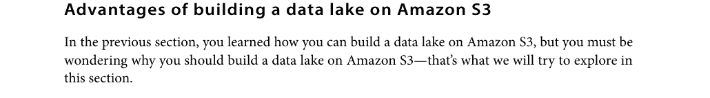
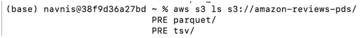
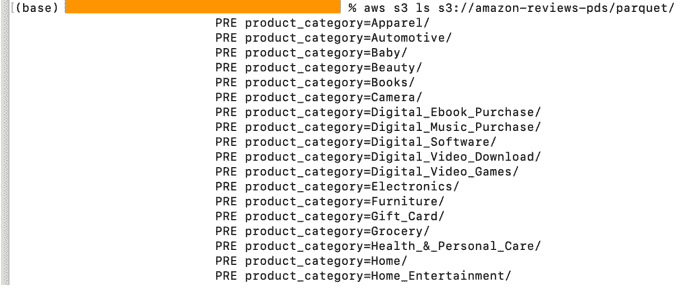
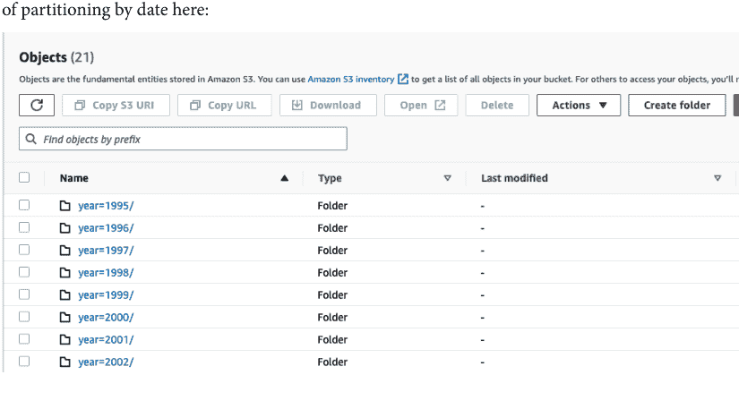
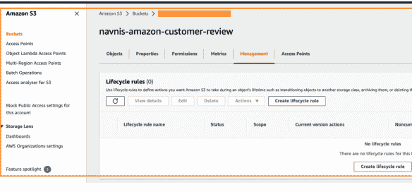
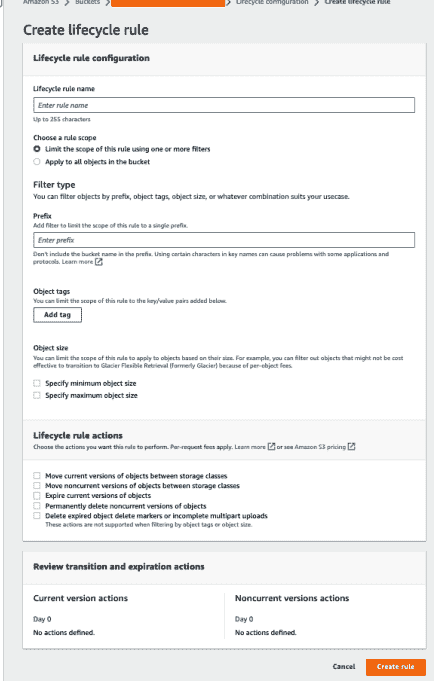
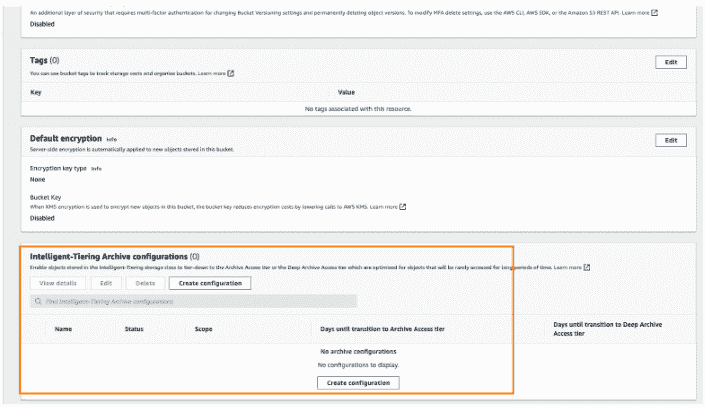

# 5 使用 Amazon S3

在之前的章节中，我们反复讨论了大数据和数据湖的概念，以及组织如何通过各种数据整理过程（如*第 1 章*中所述）利用它们来存储数据并提取有价值的见解，使用的是诸如 AWS Glue DataBrew、AWS SDK for Pandas 和 SageMaker Data Wrangler 等**Amazon Web Services**（AWS）服务。本章将更详细地探讨大数据和数据湖的具体细节。

具体来说，我们将涵盖以下主题：

- 大数据的定义和概念
- 大数据的特征
- 数据湖的概念和定义
- 在**Amazon Simple Storage Service**（Amazon S3）上构建数据湖的最佳实践
- Amazon S3 上的数据布局和组织结构

我们将首先探讨大数据的定义和特征。

## 什么是大数据？

大数据指的是那些过于复杂和多样化，无法使用传统数据管理和分析工具进行处理和分析的极大数据集。大数据通常来自多个来源，如传感器、社交媒体和电子商务平台，并可能包括结构化、半结构化和非结构化数据。

大数据的体积、速度和多样性给数据管理和分析带来了重大挑战。传统的数据存储和处理系统并非设计用于处理如此庞大和复杂的数据集，它们可能无法提供大数据应用程序所需的性能、可扩展性和灵活性。


为了应对这些挑战，各组织已转向大数据技术，例如 Apache Hadoop、Apache Spark 和 Apache Flink。这些技术旨在支持大规模大数据的存储、处理和分析，并提供了一种能够处理海量数据的分布式并行架构。

大数据技术使组织能够从数据中提取有价值的洞察和知识，它们已成为数据驱动决策和创新过程的关键推动力。例如，大数据技术被广泛应用于多种场景，如欺诈检测、推荐系统和预测性维护。

尽管大数据技术带来了诸多优势，但我们也需考虑其面临的挑战和局限性。例如，大数据系统可能复杂且难以管理，并且可能需要专门的技能和专业知识。此外，大数据系统还可能引发隐私和安全问题，需要谨慎管理以确保数据的完整性和质量。

正如我们所了解的，“大数据”一词通常指代海量结构化、半结构化和非结构化数据，这些数据通常非常复杂，需要强大的计算能力进行处理。然而，大数据的定义是相对的，取决于可用的存储和计算选项。

例如，对于使用 Excel 处理数据的人来说，1 GB 的数据可能被视为大数据；但对于在配备 32 GB 内存的笔记本电脑上使用 Apache Spark 框架的人来说，这可能算不上大数据。同样，当数据量增长到 1 TB 时，可能需要使用外部数据库和**提取、转换和加载（ETL）** 工具进行处理。而当数据量扩展到几十 TB 时，可能需要使用本地或云端的分布式处理方案，例如使用 **Hadoop 分布式文件系统（HDFS）** 等存储系统和 Hadoop 等处理框架，或使用 Amazon S3 等对象存储并结合 AWS Glue 等 AWS 服务进行处理。然而，即便有了这些选项，当数据量扩展到数百 TB 时，即使是 AWS Glue 也会将其视为大数据，且处理成本高昂，这会降低其业务价值，并可能需要使用 **Amazon Elastic MapReduce (Amazon EMR)** 等方案。

客户对于何谓大数据的看法也可能各不相同；有些人可能认为几 TB 的数据就是大数据，而另一些人则认为 PB 甚至 EB 级别的数据才算大数据。这种观点相对于像 Amazon、Facebook、Google 和 Apple 这样的大型科技公司存储和处理数据的规模而言也是相对的，它们的数据量可达数 PB 甚至数 EB。

根据 *Statista* 的数据，到 2025 年，全球将创建、捕获、复制和消费 181 泽字节（1 泽字节 = 1,024 艾字节）的数据（`https://www.statista.com/statistics/871513/worldwide-data-created/`）。

总体而言，大数据是现代数据管理和分析的关键组成部分，它为组织带来了机遇，也带来了挑战。通过利用正确的工具和技术，组织可以解锁数据的价值，推动业务增长和创新。

现在我们对大数据有了相当全面的理解，让我们来了解其主要特征。

## 大数据的 5 个 V

大数据的 5 个 V 是定义大数据概念的五个关键特征。这些特征有助于理解大数据的本质以及如何有效地分析和利用它。让我们详细探讨如下：

数据湖旨在支持以原始格式存储大量数据，以便组织内的各个团队在后续阶段进行处理和分析。这种数据存储和管理方法为组织提供了灵活性，使其能够从广泛的数据源中收集和数据存储，而无需对数据进行任何特定方式的预处理或结构化。

使用数据湖的一个关键优势是它允许组织存储和管理来自各种不同来源的数据，包括结构化和非结构化数据。这意味着组织可以收集来自社交媒体信息流、传感器数据和交易系统等来源的数据，然后利用这些数据获取洞察并做出数据驱动的决策。

数据湖的另一个关键优势是为组织提供了灵活处理和分析数据的方式。这是因为数据湖中的数据以原始格式存储，可以供组织内的各个团队（如数据科学家、业务分析师和数据工程师）访问和分析。

让我们详细探讨这些优势，如下所示：

- * **成本效益高的存储：** 与传统数据仓库相比，数据湖可以以更低的成本存储大量数据。这是因为数据湖使用通用硬件和开源技术，通常比专有解决方案更便宜。
- * **灵活性——按需模式（Schema-on-Read）：** 数据湖允许您以原始、初始格式存储数据，无需预先转换或结构化。这使您能够将如何使用数据的决策推迟到需要之时，从而为您的数据管理策略提供更多灵活性。
- * **可扩展性——存储与计算解耦：** 数据湖旨在水平扩展，这意味着您可以轻松地根据需要增加存储和处理能力。这使其非常适合处理大量数据以及数据量的突然激增。
- * **集成性：** 数据湖可以集成各种数据源和分析工具，使您能够汇集来自多个来源的数据并对执行多种分析。
- * **协作性：** 数据湖允许多个用户和团队访问和分析数据，促进协作并支持数据驱动的决策。

总体而言，数据湖为组织提供了一种强大的工具，用于管理和分析来自各种不同来源的大量数据。通过允许组织以原始格式收集、存储和管理数据，数据湖提供了支持广泛数据驱动应用和使用场景所需的灵活性和可扩展性。

## 在 Amazon S3 上构建数据湖

Amazon S3 是一种基于云的存储服务，为数据和媒体提供可扩展、持久且安全的存储。Amazon S3 是存储和管理数据的热门选择，因为它提供高性能、可靠性和灵活性。

## 在 Amazon S3 上工作

在本章中，我们将讨论在 Amazon S3 上构建数据湖的过程。数据湖是一个集中式存储库，允许组织以任何规模存储其所有结构化和非结构化数据。构建数据湖最流行的平台之一是 Amazon S3。Amazon S3 是一种高度持久且可扩展的存储服务，使存储和分析大量数据变得轻而易举。

让我们看看在 Amazon S3 上构建数据湖所涉及的步骤：

- 1. 在 Amazon S3 上构建数据湖的第一步是设计数据架构。这包括确定将存储在数据湖中的数据的数据类型和来源，以及将使用的数据摄取、处理和分析管道。需要考虑数据湖的性能、可扩展性和安全性要求，并选择合适的存储、计算和网络资源。
- 2. 在 Amazon S3 上构建数据湖的下一步是准备和组织数据。这涉及清理、转换和丰富数据，使其适合分析和可视化。确保数据的质量、一致性和完整性很重要，并应用适当的元数据、标记和编目以方便数据发现访问。
- 3. 数据准备好并组织好后，即可加载到 Amazon S3 上的数据湖中。这可以使用各种工具和技术完成，例如批处理、实时流处理和批量导入。为数据选择合适的文件格式和压缩方法很重要，并应用正确的分区和索引策略以支持高效的数据存储和查询。
- 4. 数据加载到 Amazon S3 上的数据湖后，可以使用各种工具和框架进行访问和查询。这可能包括基于 **结构化查询语言（SQL）** 的查询引擎（如 Amazon Redshift 和 Amazon Athena），以及 Apache Spark 和 Apache Flink 等大数据框架。选择能够支持数据湖的性能、可扩展性和灵活性要求的正确工具和技术很重要。
- 5. 最后，Amazon S3 数据湖中的数据可用于各种用途，例如报告、分析、机器学习和数据可视化。这可以使用各种工具和平台完成，例如仪表板和可视化工具、数据科学笔记本以及分析和机器学习平台。选择能够支持数据湖及预期使用场景的正确工具和技术很重要。

总之，在 Amazon S3 上构建数据湖需要仔细的规划、设计和执行。通过利用正确的工具和技术，组织可以创建一个可扩展、安全且具有成本效益的平台，用于存储、处理和分析大型数据集。




## 什么是数据湖？

## 在 Amazon S3 上构建数据湖的优势

在上一节中，您了解了如何在 Amazon S3 上构建数据湖，但您一定想知道为什么要在 Amazon S3 上构建数据湖——这正是我们在本节中要探讨的内容。

以下是在 Amazon S3 上构建数据湖的一些主要优势：

- **可扩展性**：Amazon S3 具有高度可扩展性，能够处理大量数据，是构建数据湖的理想选择。S3 可扩展性的一个示例是：一家公司最初只有少量数据，随着时间的推移，其数据湖中收集和存储的数据量显著增加。借助 Amazon S3，该公司可以轻松扩展其数据存储，以适应数据量的增长，而无需担心存储空间不足。例如，一个组织最初有 50 GB 的数据，随着时间的推移，数据量增加到 100 TB。它可以轻松扩展 Amazon S3 中的数据存储来处理数据量的增加，而无需担心存储空间耗尽或将数据迁移到新的存储系统。

- **成本效益**：Amazon S3 是一种经济高效的数据存储解决方案，您只需为使用的存储付费。例如，一家公司希望在数据湖中存储 1 PB 的数据。如果将其存储在本地，则必须购买和维护昂贵的基础存储设施，这可能成本高昂。使用 Amazon S3，公司可以以更低的成本存储相同数量的数据，因为它只为使用的存储付费，并且不必担心与维护和升级存储基础设施相关的额外成本。此外，Amazon S3 还提供经济高效的数据检索选项，例如 Amazon S3 Select 和 Amazon S3 Glacier，允许您只检索所需的数据，从而降低数据检索成本。

- **数据安全**：Amazon S3 提供强大的安全功能，例如加密、访问控制以及符合各种法规要求。以下是一些示例：
  - **静态加密**：组织使用 Amazon S3 的**服务端加密（SSE）**功能对数据湖中存储的所有患者数据进行加密。这确保了即使数据湖遭到破坏，数据也能受到保护。
  - **访问控制**：组织使用 Amazon S3 的访问控制功能，例如存储桶策略和**访问控制列表（ACL）**，将患者数据的访问权限限制为仅限授权的个人和系统。
  - **合规性**：组织使用 Amazon S3 的合规功能，例如对**《健康保险携带和责任法案》（HIPAA）**和**《支付卡行业数据安全标准》（PCI DSS）**的支持，以确保数据湖满足存储敏感患者数据的监管要求。
  - **审计**：组织使用 AWS CloudTrail 和 AWS Config 来记录和监控对数据湖中患者数据的访问。这使组织能够检测并响应任何对患者数据的未经授权访问。

- **灵活性**：Amazon S3 支持多种数据类型和格式，允许您在同一数据湖中存储结构化、半结构化和非结构化数据。例如，一家公司以**逗号分隔值（CSV）**格式收集结构化数据（如客户交易），以**JavaScript 对象表示法（JSON）**格式收集半结构化数据（如社交媒体评论），并以文本格式收集非结构化数据（如网站日志）。借助 Amazon S3，该公司可以轻松地将所有这些类型的数据存储在同一个数据湖中，而无需担心兼容性问题。

- **与其他 AWS 服务集成**：Amazon S3 可以轻松与其他 AWS 服务（如 Glue、Kinesis 和 Redshift）集成，用于数据处理、分析和可视化。

- **数据管理和治理**：Amazon S3 提供数据目录、元数据管理、数据沿袭和数据治理功能，使管理和组织大量数据变得容易。

- **持久性和可用性**：持久性和可用性是 Amazon S3 中的两个重要概念。持久性是指 Amazon S3 在硬件故障时维持数据不丢失的能力，而可用性是指 Amazon S3 在用户请求时提供所存储数据的能力。持久性以**年故障率（AFR）**来衡量——即在给定年份中预期丢失的对象百分比。Amazon S3 提供 11 个 9 的持久性，这意味着 AFR 为 0.000000001，即十亿分之一。这种高水平的持久性意味着存储在 Amazon S3 中的数据极不可能丢失。

可用性以对象成功可检索的时间百分比来衡量，Amazon S3 提供 4 个 9 的可用性，这意味着对象预计在 99.99% 的时间内可检索。这种高水平的可用性意味着用户可以期望几乎始终能够访问存储在 Amazon S3 中的数据。

- **易于访问和共享**：Amazon S3 允许不同团队和用户轻松访问和共享数据，从而促进协作和自助式分析。

## 在 Amazon S3 上设计数据湖的设计原则

在 Amazon S3 上创建数据湖时，可以遵循以下几个设计原则：

- **使用扁平文件结构**：在数据湖中，通常建议使用扁平文件结构而不是分层结构。这意味着所有数据都存储在文件系统的同一级别，而不是组织到子文件夹或嵌套目录中。扁平文件结构允许更轻松、更灵活的数据访问，因为无需浏览复杂的目录结构即可轻松查询数据。

- **使用分区**：分区是根据日期、位置或产品等属性将数据划分为逻辑部分的过程。这可以通过允许您轻松访问和查询特定数据子集来提高数据湖的性能和效率。

- **使用对象标记**：对象标记允许您以键值对的形式将元数据附加到数据。这些元数据可用于描述数据、对数据分类或提供额外的上下文。对象标记对于组织和管理数据湖中的大量数据非常有用。

- **使用数据治理**：在创建数据湖时，建立适当的数据治理非常重要。这包括定义角色和职责、制定数据政策和标准，以及实施安全和合规控制。

- **使用数据管理工具**：数据管理工具（如 AWS Glue 或 Amazon EMR）可用于组织、清理和转换数据湖中的数据。这些工具还可以帮助自动化数据管道并提高数据处理的效率。

总之，遵循这些设计原则可以帮助您在 Amazon S3 上创建一个组织良好且高效的数据湖。扁平文件结构、分区、对象标记、数据治理以及使用数据管理工具都有助于成功的数据湖设计。

## 数据湖布局

数据湖布局是指数据在数据湖内的组织和结构方式。这包括数据在数据湖中的物理位置，以及数据在不同类别（如结构化和非结构化数据）中的逻辑组织。

一般来说，数据湖布局旨在支持高效存储和管理来自各种不同来源的大量数据。这可以包括按来源、按类型或按与组织数据管理需求相关的某些其他标准来组织数据。


数据湖布局的一些常见要素包括以下内容：

- **物理位置**：数据在数据湖中的物理位置，例如本地存储或基于云的存储
- **逻辑组织**：将数据按不同类别进行逻辑组织，例如结构化和非结构化数据
- **数据血缘**：数据的历史记录，包括数据来源、处理方式以及使用方式
- **元数据**：有关数据的信息，例如其格式、质量以及与组织的相关性
- **安全与访问控制**：用于控制谁能访问数据以及确保数据保密性、完整性和可用性的策略和机制

总体而言，数据湖布局的目标是提供一个灵活且可扩展的框架，用于存储和管理大量数据，以支持组织的数据管理需求。

## 在 Amazon S3 数据湖中组织和构建数据

根据组织的具体需求和条件，数据湖中的数据可以通过多种不同方式进行组织和构建。数据湖中一些常见的数据布局模式包括以下内容：

- **结构化数据与非结构化数据**：数据湖中的数据可以根据是结构化还是非结构化来划分为不同类别。结构化数据是以固定格式组织的数据，例如数据库表中的行和列。而非结构化数据则是没有固定格式的数据，例如文本文档、图像或音频和视频文件。
- **按数据来源**：数据湖中的数据可以按收集来源进行组织，例如社交媒体信息流、传感器数据或事务系统。这可以帮助组织以一致且协调的方式管理和分析来自不同来源的数据。
- **按数据类型**：数据湖中的数据也可以按类型进行组织，例如客户数据、产品数据或销售数据。这可以帮助组织快速轻松地访问与其特定需求和使用场景相关的数据。
- **按时间**：数据湖中的数据也按时间进行组织，例如来自特定时间段的数据，或者在特定时间范围内更新或修改的数据。这可以帮助组织分析随时间的趋势和模式，并执行时间序列分析。

总体而言，数据湖中使用的具体数据布局模式将取决于组织的具体需求和条件。关键是选择一种能够支持组织数据高效、有效存储、管理和分析的数据布局模式。

## 在 Amazon S3 上构建数据湖的过程

现在，让我们了解如何在 Amazon S3 上构建数据湖。

首先，如果你还没有 AWS 账户，则需要创建一个。一旦你拥有 AWS 账户，就可以创建一个 S3 存储桶来存储数据。S3 存储桶是一个逻辑存储单元，用于存储对象，这些对象是构成数据湖的各个数据片段。

创建 S3 存储桶后，你就可以开始向其中上传数据。有几种方法可以做到这一点，包括使用 AWS 管理控制台、AWS 命令行界面（CLI）和编程 API。例如，你可以使用 AWS CLI 通过以下命令将数据上传到 S3 存储桶：

```
aws s3 cp <local_file_path> s3://<your_bucket_name>/<object_key>
```

将数据上传到 S3 存储桶后，你可以通过在存储桶内创建文件夹和子文件夹来组织数据。这将使管理和访问数据变得更加容易。你还可以为数据应用标签，以帮助识别和分类数据。

数据组织并标记好后，就可以使用 Amazon Athena 开始查询数据。Athena 是一种无服务器交互式查询服务，可以轻松使用 SQL 分析 Amazon S3 中的数据。Athena 与 S3 集成，因此你可以使用 SQL 轻松查询 S3 存储桶中的数据。

你还可以使用其他工具和服务来访问和分析 S3 数据湖中的数据。例如，你可以使用 Amazon EMR 通过托管的 Hadoop 框架处理和分析大型数据集。你还可以使用 Amazon Redshift 通过托管数据仓库对数据执行快速、复杂的查询。

总之，在 Amazon S3 上构建数据湖是一种简单且经济高效地存储和分析大量数据的方式。通过使用 S3 存储数据，你可以利用其持久性和可扩展性，并使用 Athena 和 EMR 等工具轻松访问和分析数据。

## 为数据湖选择正确的文件格式

为 Amazon S3 上的数据湖选择正确的文件格式是一个重要决策，可能会影响数据湖的性能和效率。选择文件格式时需要考虑几个因素，包括数据的类型和结构、数据的预期用途以及与其他系统和工具的兼容性。

Amazon S3 数据湖中最流行的文件格式之一是 Apache Parquet 格式。这种列式文件格式针对大数据分析进行了优化，并支持复杂数据类型，例如嵌套数据结构和数组。它还非常高效，因为它支持压缩和高效的数据跳过，这可以改善查询性能。

Amazon S3 数据湖中另一种流行的文件格式是 Apache 优化的行纵列式（ORC）格式。这种格式类似于 Parquet，但提供了额外功能，例如支持复杂数据类型、索引和谓词下推。ORC 文件也非常高效，支持快速数据摄取和查询处理。

除了 Parquet 和 ORC，其他文件格式也可能适用于 Amazon S3 上的数据湖，具体取决于数据的特定需求和使用场景。例如，Apache Avro 格式是数据序列化的热门选择，支持多种数据类型。Apache JSON 格式是在数据湖中存储数据的另一种选择，因为它是人类可读的，并且易于与其他系统集成。

最终，Amazon S3 数据湖的正确文件格式将取决于数据的特定需求和条件以及数据湖的预期用途。仔细评估可用选项并选择能够支持高效数据存储、处理和分析的文件格式非常重要。除了我们之前讨论的列式和行式文件格式外，文件格式的另一个重要特性是其可拆分性。在数据湖中，可拆分文件格式更受青睐，因为它们允许对大型数据集进行高效并行处理。让我们了解可拆分和不可拆分文件格式之间的区别。

可拆分文件格式是一种可以分成较小块并独立处理的文件格式，各个数据块可以重新组合以形成原始文件。可拆分文件格式的示例包括 Hadoop 的 HDFS 和 Apache Cassandra 的**排序字符串表（SSTable）**。

另一方面，不可拆分文件格式是一种不能拆分并独立处理的文件格式。不可拆分文件格式的一个示例是 PDF 文件。由于它是一种二进制文件格式，你可能无法轻松提取内容，因此它不能拆分为数据块进行处理。

需要注意的是，某些文件可以转换为可拆分格式——例如，从 Excel 转换的 CSV，以及从 PDF 转换的 JSON。因此，如果需要，在将文件存储到数据湖之前将其转换为可拆分格式始终是一个好做法。

| 文件格式 | 可拆分 | 不可拆分 |
| :--- | :--- | :--- |
|  | 单行分隔的 CSV | 多行 CSV |
|  | 单行分隔的 JSON | 多行 JSON |
|  | Apache Parquet |  |
|  | Apache ORC |  |
|  | Apache Avro |  |
|  | 带行级 snappy 压缩的 Apache Parquet |  |
|  | 带行级 snappy 压缩的 Apache ORC |  |
|  | 带 gzip 压缩的 Apache Parquet |  |
|  | XML |  |
| 压缩类型 | bzip2 | gzip |
|  | zstd | LZO |
|  |  | snappy |

表 5.1 – 文件格式和压缩类型


现在我们已经对列式/可拆分和行式/不可拆分的文件格式有了充分的了解，下面通过一个示例来巩固这些概念，我们将比较不同文件类型对性能和成本的影响。

在本例中，我们将使用 *Amazon Customer Reviews* 数据集，你可以在这里找到：`https://registry.opendata.aws/amazon-reviews/`。

该数据集包含自1995年以来1.3亿条客户评论记录，提供**制表符分隔值（TSV）**和**Parquet**两种文件格式。

```text
(base) navn...@38f9d36a27bd ~ % aws s3 ls s3://amazon-reviews-pds/
                              PRE parquet/
                              PRE tsv/
```



**TSV**与CSV类似。它是一种用于以表格形式存储数据的简单文件格式——例如，数据库表或电子表格数据——表中的每一行表示为文件中的单独一行，表中的每个单元格由制表符分隔。

**Parquet**是一种面向列的文件格式，用于在文件中存储大量数据。它用于在分布式环境中存储数据，例如Hadoop集群中。Parquet针对高效的数据查询和存储进行了优化，并设计用于Apache Spark和Impala等数据处理框架。

首先，我们创建两张表——表1（`amazon_reviews_tsv`），基于TSV数据集构建；表2（`amazon_reviews_parquet`），基于Parquet数据集构建。`amazon_reviews_parquet`表不仅使用了Parquet文件格式，还按`product_category`进行了分区，如下面的截图所示：

```text
(base) ... % aws s3 ls s3://amazon-reviews-pds/parquet/
       PRE product_category=Apparel/
       PRE product_category=Automotive/
       PRE product_category=Baby/
       PRE product_category=Beauty/
       PRE product_category=Books/
       PRE product_category=Camera/
       PRE product_category=Digital_Ebook_Purchase/
       PRE product_category=Digital_Music_Purchase/
       PRE product_category=Digital_Software/
       PRE product_category=Digital_Video_Download/
       PRE product_category=Digital_Video_Games/
       PRE product_category=Electronics/
       PRE product_category=Furniture/
       PRE product_category=Gift_Card/
       PRE product_category=Grocery/
       PRE product_category=Health_&_Personal_Care/
       PRE product_category=Home/
       PRE product_category=Home_Entertainment/
```



以下SQL代码用于定义amazon_reviews_tsv表：

```sql
CREATE EXTERNAL TABLE amazon_reviews_tsv(
  marketplace string,
  customer_id string,
  review_id string,
  product_id string,
  product_parent string,
  product_title string,
  product_category string,
  star_rating int,
  helpful_votes int,
  total_votes int,
  vine string,
  verified_purchase string,
  review_headline string,
  review_body string,
  review_date date)
ROW FORMAT DELIMITED
  FIELDS TERMINATED BY '\t'
  ESCAPED BY '\\'
  LINES TERMINATED BY '\n'
LOCATION
  's3://amazon-reviews-pds/tsv/'
TBLPROPERTIES ("skip.header.line.count"="1");
```

以下SQL用于定义按product_category分区的amazon_reviews_parquet表：

```sql
CREATE EXTERNAL TABLE `amazon_reviews_parquet`(
  `marketplace` string,
  `customer_id` string,
  `review_id` string,
  `product_id` string,
  `product_parent` string,
  `product_title` string,
  `star_rating` int,
  `helpful_votes` int,
  `total_votes` int,
  `vine` string,
  `verified_purchase` string,
  `review_headline` string,
  `review_body` string,
  `review_date` bigint,
  `year` int)
PARTITIONED BY ( `product_category` string )
STORED AS PARQUET
LOCATION 's3://amazon-reviews-pds/parquet';
```

下表比较了TSV和Parquet表的执行时间、数据扫描量和成本：

| 查询 | TSV (amazon_reviews_tsv) | Parquet (amazon_reviews_parquet) | TSV | Parquet | TSV | Parquet |
|---|---|---|---|---|---|---|
| | | | | | | |
| SELECT count(*) FROM | 1 min 2.54 sec | 704 ms | 32.22 GB | 0 | $0.15 | $0 |
| SELECT count(*) FROM "<table>" WHERE marketplace = 'US' | 1 min 25.66 sec | 1.298 sec | 32.22 GB | 5.28 MB | $0.15 | $0.000025 |
| SELECT * FROM "<table>" WHERE marketplace = 'US' limit 1000; | 1.08 sec | 669 ms | 1.88 MB | 2.69 MB | | |
| select distinct product_category from "<table_name>" | 1 min 16 sec | 1.38 sec | 32.22 GB | 0 | | 0 |

| SQL 查询 | TSV 执行时间 | Parquet 执行时间 | TSV 数据扫描 | Parquet 数据扫描 | TSV 成本 | Parquet 成本 |
|---|---|---|---|---|---|---|
| `SELECT product_id, product_title, count(*) as num_reviews, avg(star_rating) as avg_stars FROM <table_name> where product_category='Toys' GROUP BY 1, 2 ORDER BY 3 DESC limit 100;` | 1 min 17 sec | 2.27 sec | 32.22 GB | 215 MB | $0.15 | $0.00102 |

表5.2 – 比较TSV和Parquet文件执行时间、数据扫描量和成本的表格

如果你查看表中关于执行时间、数据扫描量和成本的统计数据，你就会清楚地了解为什么需要将数据存储为Parquet这样的优化列式文件格式。

例如，当数据以未分区的TSV格式存储时，在大多数查询中，你需要扫描整个数据集（例如，运行`count(*)`或`distinct`）或数据集的一部分。

类似地，当数据以带分区的Parquet格式存储时，在`count(*)`和`distinct`等情况下，它不需要扫描数据集，因为它维护了关于数据的统计信息。如果你需要在TSV中运行诸如WHERE子句之类的过滤语句，它必须扫描整个数据集；而如果数据已分区，它只会扫描特定的分区，最终使查询更快，因为扫描的数据量大大减少。

# 为数据湖选择正确的压缩方法

为Amazon S3中的数据湖选择正确的压缩方法是一个重要决策，它会影响数据湖的性能和效率。压缩有助于减少数据所需的存储空间，同时提高数据传输和查询处理的速度。

Amazon S3数据湖中最流行的压缩方法之一是Snappy压缩算法。该算法专为高速数据压缩和解压缩而设计，能够在压缩比和性能之间取得良好平衡。Snappy受到许多流行的大数据框架支持，例如Apache Spark和Apache Flink，并且可以轻松集成到数据管道和应用程序中。

另一种流行的Amazon S3数据湖压缩方法是gzip压缩算法。该算法广泛用于数据压缩，并提供比Snappy更高的压缩比。然而，gzip可能比Snappy慢，因此可能不适合实时或交互式数据处理应用程序。

除了Snappy和gzip之外，其他压缩算法也可能适用于Amazon S3中的数据湖，具体取决于数据的特定需求和使用场景。例如，LZO算法是数据压缩的热门选择，因为它提供高压缩比和良好性能。LZ4算法是另一个选项，因为它提供高压缩速度和低内存占用。

最终，为Amazon S3中的数据湖选择正确的压缩方法将取决于数据的特定需求和要求以及数据湖的预期用途。仔细评估可用选项并选择一种能够支持高效数据存储、处理和分析的压缩算法非常重要。

# 为数据湖选择正确的分区策略

为数据湖选择正确的分区策略是一个重要决策，它会影响数据湖的性能和效率。分区是将大型数据集划分为更小、更易于管理的部分（称为分区）的过程。每个分区都独立存储和管理，并且可以独立查询和处理。

数据湖最常见的分区策略之一是按时间对数据进行分区。这对于按固定间隔生成的数据（例如传感器数据、日志数据或财务数据）非常有用。基于时间的分区可以高效查询和处理特定时间范围内的数据，还可以支持数据归档和数据保留策略。你可以在这里看到按日期分区的示例：






图 5.6 – Amazon S3 生命周期规则

点击**创建生命周期规则**，为驻留在该 Amazon S3 存储桶中的数据创建数据生命周期。随后您应该看到类似这样的屏幕：



图 5.7 – 配置 Amazon S3 生命周期规则

除了 Amazon S3 生命周期，Amazon S3 还提供 Amazon S3 智能分层（Intelligent-Tiering）。

Amazon S3 智能分层是一种存储类，它根据访问模式的变化自动将数据移动到最具有成本效益的存储层。数据会自动在两个访问层之间转换：一个用于频繁访问的数据，另一个用于不频繁访问的数据。这有助于您在确保频繁访问的数据始终能以低延迟可用的同时优化成本。

总之，S3 智能分层可以根据访问模式将数据从不频繁访问层移动到 S3 频繁层。但生命周期策略只会导致数据向更不频繁的访问层移动（反之则不然）。

您可以通过创建或选择您希望用于智能分层的现有存储桶来配置 Amazon S3 智能分层。从存储桶的属性选项卡中，从存储类列表中选择智能分层。一旦选择了智能分层类，您就可以为存储桶配置多项设置，例如对象锁定、版本控制和事件。您还可以设置生命周期规则，以便根据某些条件自动在频繁和不频繁访问层之间移动对象。图 5.8 和图 5.9 说明了如何配置智能分层：



图 5.8 – 配置 Amazon S3 智能分层


图 5.9 – Amazon S3 智能分层配置

仔细评估数据湖的生命周期规则和策略，并选择支持数据湖性能、可扩展性和成本效益的正确选项至关重要。同样重要的是定期审查和更新生命周期规则和策略，以确保它们仍然相关且有效。

## 优化文件数量和每个文件的大小

优化 Amazon S3 中的文件数量和每个文件的大小，可以帮助提高使用 S3 作为数据存储的应用程序的性能和效率。以下是一些优化 Amazon S3 中文件数量和文件大小的技巧：

- **使用较大的文件尺寸：** 通常，存储和检索较大文件比小文件更高效。这是因为 S3 对数据传输和请求收取费用，而这些费用基于请求数量而非传输的数据量。因此，使用较大的文件尺寸有助于减少请求数量并降低使用 S3 的总体成本。
- **使用一致的文件尺寸：** 使用一致的文件尺寸可以更容易地管理和处理您的数据。它还可以提高应用程序的性能，因为数据可以更轻松地分割并并行处理。
- **使用合理的文件数量：** 虽然使用较大的文件尺寸可能更高效，但文件太少可能导致非常大的文件，难以管理和处理。另一方面，拥有太多小文件也可能效率低下，因为它可能导致大量请求和成本增加。在文件大小和文件数量之间找到平衡有助于优化性能和成本。
- **使用前缀和分区：** 使用前缀和分区有助于在 S3 中组织和管理大量文件。前缀允许您将相关文件分组在一起，而分区允许您根据日期或位置等属性将数据划分为逻辑部分。这使得访问和处理特定数据子集变得更加容易。

优化 Amazon S3 中文件数量和文件大小的方法有几种，如下所示：

- **对大文件使用多部分上传：** 多部分上传允许您将大文件分成较小的块进行上传，这比上传一个大文件更高效。
- **使用较小的文件尺寸：** 尝试将一个大文件拆分成多个小文件，而不是上传一个大文件。这可以减少上传和下载文件所需的时间。
- **使用对象生命周期策略：** 如前文所述，设置对象生命周期策略以自动删除或归档不再需要的旧文件，有助于减少 S3 存储桶中的文件数量并降低存储成本。
- 使用 AWS Glue 或 AWS EMR 对 S3 中的数据运行分析，然后从 S3 存储桶中删除不必要的数据。
- 如前一节所述，使用 AWS S3 智能分层、S3 **标准 - 不频繁访问 (Standard-IA)** 和 S3 **单一区域 - 不频繁访问 (One Zone-IA)** 来存储不频繁访问的文件，可能有助于降低存储这些文件的成本。
- 为 S3 存储桶中的文件启用服务器端压缩，有助于减少所需的存储空间。

总之，优化 Amazon S3 中文件数量和文件大小涉及找到一种平衡，在提高性能和效率的同时最小化成本。使用较大的文件尺寸、一致的文件尺寸、合理的文件数量，以及利用前缀和分区，都有助于优化 S3 在数据存储需求方面的使用。

在本节中，我们学习了如何优化您的数据湖。在下一节中，我们将讨论在构建数据湖时应了解挑战和注意事项。

## 在 Amazon S3 上构建数据湖时的挑战与注意事项

在 Amazon S3 或一般意义上的数据湖上构建数据湖时，以下是一些需要了解挑战和注意事项：

- **数据摄取：** 将数据引入数据湖的过程可能具有挑战性，特别是当数据来自具有不同格式和结构的多个源时。这可能导致确保数据质量和一致性变得困难。此外，处理大量数据可能是一个挑战，特别是随着数据的增长。另一个问题是保持架构变更在所有下游应用中的一致性。

- **数据治理：** 在处理数据湖中的大量数据时，维持数据质量、安全性和合规性可能很困难。实施数据分类、质量和保留的政策和标准，以及管理访问和权限（包括**基于角色的访问控制 (RBAC)** 和数据加密）可能具有挑战性。此外，通过谱系和审计跟踪数据来源和使用情况、管理数据保留和归档，以及保护数据免受泄露和未授权访问也可能很困难。

- **数据管理：** 组织和存储在数据文件和对象存储中的大量数据可能是一个挑战。此外，将数据谱系和治理纳入数据管理流程、管理存储和检索成本，以及将数据湖与其他数据管理和分析工具和服务集成可能具有挑战性。确保数据质量和一致性、为不同用户和团队提供数据访问和自助服务、随着数据量增加管理可扩展性和性能，以及管理数据备份和**灾难恢复 (DR)** 也是数据湖中数据管理的挑战。

- **数据处理：** 数据湖内的数据处理——包括数据转换、清理和分析等任务——可能很困难，可能需要专门的工具和技术，例如 AWS Glue、Kinesis 等。挑战可能包括与其他 AWS 服务集成以用于数据处理和分析、管理数据处理和计算资源的成本、处理实时和批量处理、维持数据质量和一致性、为不同用户和团队提供访问和自助服务、保护敏感数据以及满足性能和可用性要求。


- **数据访问**：为不同用户和组启用对数据湖中数据的轻松高效访问可能是一项复杂的任务，尤其是在多租户环境中工作时。
- **成本**：在 Amazon S3 上存储和处理大量数据的成本可能很高，需要仔细管理。这就是为什么设置 S3 存储桶生命周期很重要。
- **数据安全**：有必要确保敏感数据得到保护并符合合规要求。我们将在安全和监控章节中探讨数据安全挑战。
- **性能**：数据湖性能应得到优化，以确保数据易于用于分析和报告。这就是为什么实施 *在 Amazon S3 数据湖中组织和结构化数据* 部分中描述的最佳实践非常重要。

## 摘要

在本章中，我们讨论了大数据是什么、大数据的特征、数据湖是什么、为什么我们需要数据湖，以及如何在 Amazon S3 上构建数据湖，通过概述数据湖的好处、数据湖的不同层以及在 Amazon S3 上构建数据湖的最佳实践。我们还提供了在 S3 上的数据湖中组织和管理数据的详细信息，包括使用文件格式、分区、S3 生命周期管理、Amazon S3 Intelligent-Tiering 等功能。本章还讨论了在 Amazon S3 上构建数据湖时的一些挑战和注意事项，例如成本和性能。

在下一章中，我们将学习 AWS Glue。AWS Glue 是一种数据集成服务，可让您从不同的数据源获取数据，并允许您使用 Apache Spark 和 Python 等框架在其上执行 ETL。
