## 6

## 使用 AWS Glue

在前一章中，我们讨论了各种数据存储类型，包括数据仓库、数据湖、数据湖仓和数据网格，以及它们的关键区别。

本章将探讨 AWS Glue 的不同组件，提供有关它们如何帮助数据整理任务的见解。

完成本章后，您将能够理解并定义 AWS Glue 如何用于数据整理。您还将能够解释与各种 AWS Glue 功能相关的基本概念，例如 AWS Glue 数据目录、AWS Glue 连接、AWS Glue 爬虫、AWS Glue Schema Registry、AWS Glue 作业、AWS Glue 开发端点、AWS Glue 交互式会话和 AWS Glue 触发器。

本章将涵盖以下主题：

- Spark 基础
- AWS Glue 功能
- 使用 AWS Glue 进行数据发现
- 使用 AWS Glue 进行数据摄取

### 什么是 Apache Spark？

Apache Spark 是一个用于处理大数据的统一分析引擎，于 2009 年在加州大学伯克利分校的 AMPLab 作为开源项目开发。最初，它是作为一个课程项目创建的，旨在解决 Hadoop 框架在机器学习用例中通过 HDFS 在迭代之间交换数据的局限性。目标是设计一个用于快速交互式处理的新框架，包括机器学习和交互式数据分析，同时保留 Hadoop 框架的 MapReduce 和 HDFS 的隐式数据并行性和容错性。它结合了内存缓存，并针对任何规模的分析工作负载进行了优化。

Apache Spark 于 2010 年根据 BSD 许可证开源，并在 2013 年贡献给 Apache 软件基金会。2014 年，Spark 成为顶级 Apache 项目。它已获得超过 1.7 千名贡献者和 GitHub 上超过 30K 星标。

根据 Spark 文档，该引擎在 Java、Scala、Python 和 R 中提供高级 API，并通过优化的引擎支持通用执行图。此外，它还提供了一系列高级工具，使处理不同类型的数据和执行特定任务变得更容易。例如，Spark SQL 允许您处理结构化数据并执行 SQL 查询。如果您更喜欢使用 pandas 进行数据分析，您也可以使用 Spark 上的 pandas API 来利用其功能。对于机器学习任务，有 MLlib，它提供工具和算法来帮助您构建和训练模型。如果您正在处理图数据，GraphX 可用于帮助图处理。最后，如果您需要对数据流执行计算并处理增量更新，您可以使用 Structured Streaming，它使 Spark 能够进行流处理。

### Apache Spark 架构

在高层次上，Apache Spark 在领导者和工作节点架构上运行，其中有一个中央协调器和多个分布式工作节点。它包括驱动程序、多个执行器和集群管理器。驱动程序将用户的代码转换为可在工作节点之间分发的多个任务。执行器在工作节点上运行并执行分配给它的任务。需要集群管理器来在驱动程序和工作节点之间进行调解。

驱动程序和工作节点的协作称为 Spark 集群，驱动程序和工作器的有效组合称为 Spark 应用程序。

Spark 应用程序可以借助集群管理器启动。有许多集群管理器类型：

- **Standalone**：这是一个简单的集群管理器，随 Spark 一起捆绑。它提供了一种简单的方法来设置和管理您的集群。
- **Apache Mesos**：Mesos 是一个多功能集群管理器，可以处理各种工作负载，包括运行 Hadoop MapReduce 和服务应用程序。然而，值得注意的是，Mesos 现在已被弃用，可能不是首选。
- **Hadoop YARN**：YARN 是 Hadoop 2 和 Hadoop 3 中使用的资源管理器。它提供集群管理功能，可与 Spark 配合使用以运行和分配资源。
- **Kubernetes**：Kubernetes 是一个开源系统，旨在自动化部署、扩展和管理容器化应用程序的过程。它也可以用于管理 Spark 集群，提供灵活性和可扩展性：

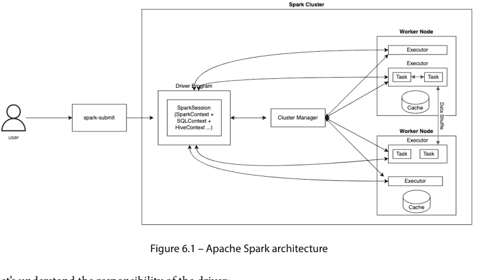

让我们了解驱动程序的职责：

- 驱动程序是一个 Java 进程，负责运行 Scala、Python 和 Java 的 main() 方法
- 它执行用户代码并创建 SparkSession，该会话负责创建 **弹性分布式数据集 (RDD)**
- 它创建血统，即逻辑和物理计划
- 驱动程序负责通过与集群管理器协调来安排任务的执行
- 它跟踪已在执行器内存中缓存的数据的元数据

让我们了解执行器的职责：

- 执行器由核心（slot）、内存和本地存储组成
- Slot 表示可用于 Spark 并行工作的线程
- 它们还包含两种类型的内存：
  - **工作内存**：Spark 工作负载使用此内存
  - **存储内存**：一半内存（存储）用于持久化对象
- 它们还包含磁盘，直接附加并为 shuffle 分区（Spark shuffle 分区是在 shuffle 过程中数据在阶段之间交换以促进数据交换的中间数据划分）提供空间，以供 shuffle 阶段使用

- 它们负责运行单个任务并将其返回给驱动程序：

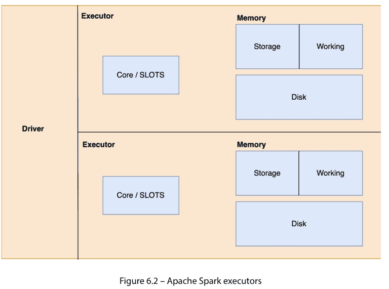

要在 Spark 集群上开始运行应用程序，您可以使用位于 Spark `bin` 目录中的 `spark-submit` 脚本。该脚本充当统一接口，允许您启动应用程序，而无需为 Spark 支持的每个集群管理器单独配置它们。这意味着您可以使用不同的集群管理器，而无需为每个集群管理器单独修改应用程序设置。

现在我们对 Apache Spark 架构有了合理的了解，让我们继续探索 Apache Spark 框架。

### Apache Spark 框架

Apache Spark 框架是一个用于大规模数据处理的统一分析引擎。它由四个主要组件组成：Spark Core、Spark SQL、Spark Streaming 和 GraphX。

Apache Spark Core 是 Spark 平台的基础或基本单元，提供内存计算能力。Spark Core 促进并行和分布式处理、任务调度、分派和基本 I/O 功能。Spark Core 可通过为 Scala、Python、Java 和 R 开发的 **应用程序编程接口 (API)** 访问。Spark API 降低了分布式并行处理引擎的复杂性。Spark 利用一种特殊类型的数据结构


called RDD to handle data. RDD represents a logical collection of data that is spread across multiple machines in the cluster.

Here are some key modules in Spark and what they offer:

- Spark SQL: This module focuses on processing structured data. It introduces a programming abstraction called DataFrames, which provides a convenient way to work with structured data. Additionally, Spark SQL can be used as a distributed SQL query engine, allowing you to query and analyze data using SQL-like syntax.
- Spark Streaming: With Spark Streaming, you can build powerful applications that process both real-time streaming data and historical data. It inherits Spark's user-friendly nature and fault-tolerance capabilities, making it easier to develop interactive and analytical applications that can handle continuous streams of data.
- GraphX: GraphX is an engine built on top of Spark that specializes in graph computation. It empowers users to interactively create, transform, and reason about large-scale graph data. This is particularly useful for applications that involve analyzing and processing data with complex relationships, such as social networks or web graphs:

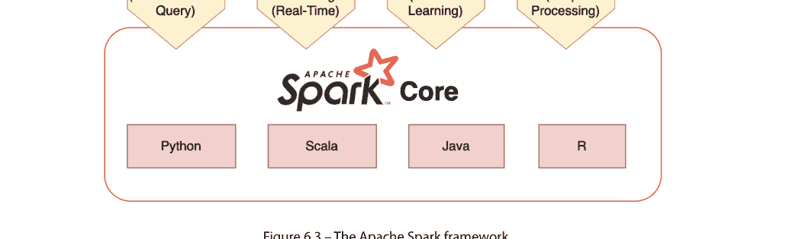

## Resilient Distributed Datasets

Spark introduces the concept of RDD. It is a logical collection of data partitioned across different machines. RDD is the fundamental data structure of Spark. It is an immutable, fault-tolerant, distributed collection of objects of any type that operate in parallel:

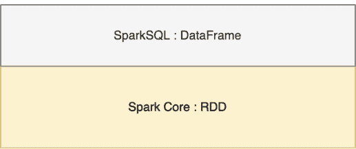

Figure 6.4 – Spark framework

RDDs are immutable but you can modify them with transformations. However, these transformations return a new RDD, while the original RDD remains the same.

RDDs support two types of operations:

- **Transformations** are operations (for example, select, read, filter, groupBy, sort, and so on) that are performed on an RDD and which yield a new RDD containing the result.

The official Spark page provides a comprehensive list of all available transformations (https://spark.apache.org/docs/1.2.1/programming-guide.html#transformations).

- **Actions** are operations (for example, reduce, count, first, and so on) that return a value after running a computation on an RDD.

The official Spark page provides a comprehensive list of all the available actions (https://spark.apache.org/docs/1.2.1/programming-guide.html#actions).

Transformations in Spark are called “lazy evaluation.” Lazy evaluation means the transformation will not be executed until an action is triggered.

Another important concept in Apache Spark is Spark SQL. Spark SQL is a programming module for structured data processing.

## Datasets and DataFrames

According to the Apache Spark documentation, DataFrames are a crucial aspect of any framework. DataFrames consist of named columns and can be thought of as tables in a relational database or a DataFrame in R/Python but with enhanced optimizations. They can be created from a variety of sources, including structured data files, tables in Hive, external databases, or existing RDDs. The DataFrame API is available in Scala, Java, Python, and R, with Scala and Java representing DataFrames as a dataset of rows; in the Java API, Dataset<Row> is used to represent a DataFrame. Now that we understand Apache Spark, we can start learning about AWS Glue and its building blocks.

## AWS Glue building blocks

AWS Glue Crawler allows you to crawl data from various data sources, including S3, and databases such as Redshift, MySQL, MSSQL, Oracle, and MongoDB, among others. Once the crawling process is complete, AWS Glue Crawler automatically creates or updates tables in the AWS Glue Data Catalog. A list of supported data sources can be found at https://docs.aws.amazon.com/glue/latest/dg/crawler-data-stores.html:

- **AWS Glue Data Catalog**: The AWS Glue Data Catalog is a centralized catalog that stores metadata from various data stores. These can be used by other AWS services such as Amazon Athena, Amazon QuickSight, Amazon EMR, and Amazon Redshift.
- **AWS Glue Triggers**: AWS Glue Triggers enable you to create schedules that can manually or automatically start one or more AWS Glue Crawlers or AWS Glue ETL jobs. Triggers can be configured to fire on demand, based on a schedule, or based on a combination of events.
- **AWS Glue Workflows**: AWS Glue Workflows enable you to orchestrate the execution of Glue ETL and Glue Crawler using a Glue Trigger.
- **AWS Glue ETL**: AWS Glue ETL allows users to create **Extract, Transform, and Load** (ETL) pipelines using Python, PySpark, or Scala. With Glue ETL, you can process data from various data sources, perform transformations, and eventually write to different data sources (such as Amazon Redshift, Oracle, OpenSearch, and Amazon S3). You have the option to choose from different processing engines: for distributed processing, you can choose between PySpark and Scala, while for non-distributed processing, you can select Python:

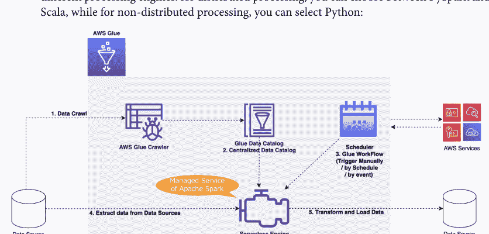

Figure 6.5 – Simple data pipeline using AWS Glue

- AWS Glue interactive sessions: AWS Glue interactive sessions provide a managed Jupyter notebook-based integrated development environment (IDE) for developing and testing AWS Glue ETL scripts.

- AWS Glue Schema Registry: AWS Glue Schema Registry is a tool that allows users to have centralized control over data stream schemas. It seamlessly works with popular data streaming platforms such as Apache Kafka, Amazon Kinesis, and AWS Lambda. With AWS Glue Schema Registry, you can easily manage and govern the schemas used in your data streams, ensuring consistency and compatibility across different components of your data processing pipeline.

- AWS Glue Blueprint: AWS Glue Blueprint allows users to scale similar ETL use cases by parameterizing a single workflow to handle them all -- for example, crawling different S3 buckets. Blueprint examples can be found here: https://github.com/aws-labs/aws-glue-blueprint-libs/tree/master/samples.

- AWS Glue Connections: AWS Glue Connections are catalog objects that provide a convenient way for users to create and store connection information for different data stores. These connections act as a bridge between AWS Glue and various data sources. With AWS Glue Connections, you can easily configure and manage the necessary connection details for your data stores.

In addition to standard data stores, AWS Glue Connections also support Marketplace AWS Glue Connectors. These connectors enable integration with third-party data stores such as Apache Hudi, Google Big Query, and Elasticsearch. This means you can seamlessly connect and interact with these external data sources using AWS Glue, making it easier to access and process data from diverse systems in a unified manner.

We have now gained a fundamental understanding of Apache Spark and AWS Glue’s building blocks. In the following discussion, we will delve into the various components of AWS Glue to comprehend how it can be employed in data wrangling.

## Data discovery with AWS Glue

One of the unique features that sets AWS Glue apart from other ETL tools is its ability to create a centralized data catalog. This catalog is crucial for performing data discovery and relies on two important components of Glue:

- Glue Data Catalog
- Glue Data Crawler

### AWS Glue Data Catalog

A data catalog is a centralized storage of metadata for data stored in different data stores, such as data lakes, data warehouses, relational databases, and non-relational databases. The metadata contains information about columns, data formats, locations, and serialization/deserialization mechanisms. Hive Metastore is one of the most popular metadata products used in the industry. However, it uses

**relational database management systems (RDBMSs)** such as MySQL and PostgreSQL. The problem with using an RDBMS for Hive metadata is managing and maintaining it, especially for production workloads where high availability, scaling, and redundancy must be taken into account. This increases the complexity and cost of the solution. AWS Glue Data Catalog solves this problem with its serverless nature, eliminating the need for additional administrative overhead in managing the infrastructure.

AWS Glue Data Catalog is comprised of the following:

- Databases
- Tables
- Partitions
- Partition indexes

### Databases

In AWS Glue, a database is a grouping of metadata tables. Whenever a table is created in AWS Glue Data Catalog, it must be associated with a specific database. It’s not possible to have the same table present in multiple databases:

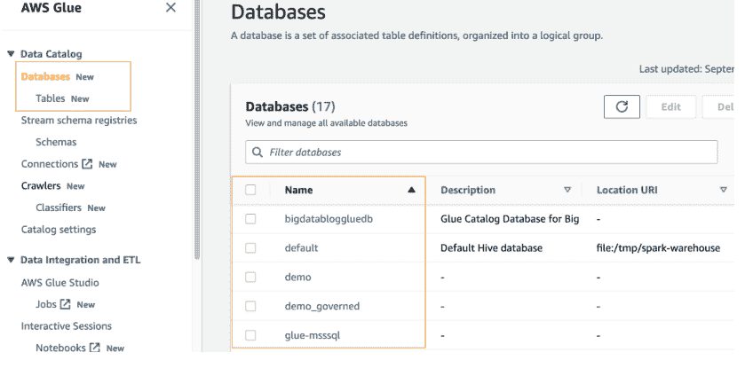

Figure 6.6 – Databases in AWS Glue Data Catalog

### Tables

An AWS Glue Data Catalog table is a metadata representation of your data. It contains various information about your data, such as its name, description, location, input/output format, serialization libraries, schema, partitions, indexes, and more.


AWS Glue Data Catalog 支持表的版本控制，这意味着每当表被更新时，默认会创建该表的一个新版本。这是一个关键功能，用于识别源中的任何 schema 变更，并防止因这些变更而导致下游应用程序故障。请查看这篇博客文章，它解释了如何使用 AWS Glue 检测数据源结构中的任何变化：https://aws.amazon.com/blogs/big-data/identify-source-schema-changes-using-aws-glue/

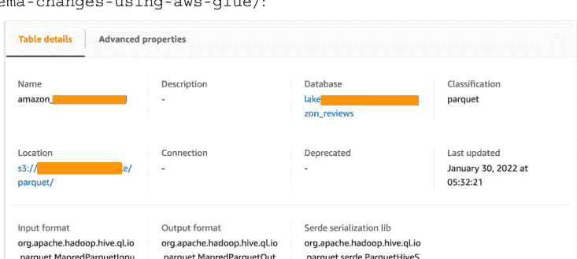

图 6.7 – AWS Glue Data Catalog 中的表属性

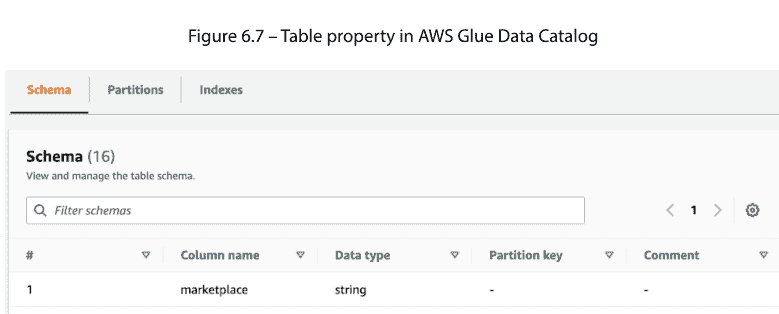

图 6.8 – AWS Glue Data Catalog 中的表属性

## 分区

分区是一种用于优化查询性能的策略，它根据特定列的值来划分表。一个表可以有多个分区键，这些分区键定义了一个特定的分区（也称为分区规范）。该技术通过减少处理特定查询所需的数据量来提升查询性能：

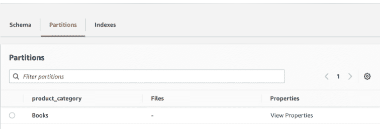

图 6.9 – AWS Glue Data Catalog 表中的分区

## Glue 连接

AWS Glue 提供了 Glue 连接，允许你连接到不同的数据源。Glue 连接存储了建立数据源连接所需的重要信息，例如登录凭证、连接字符串（URI）和 VPC 配置详细信息（VPC 子网和安全组信息）：

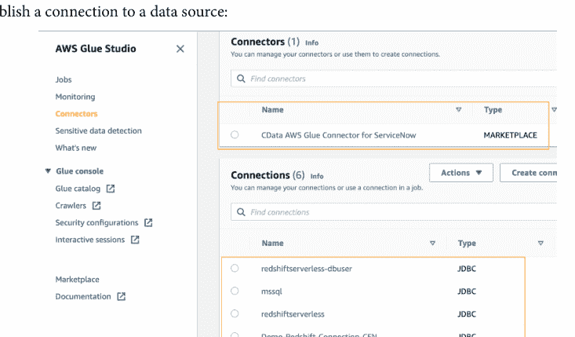

图 6.10 – AWS Glue 连接

在介绍了 AWS Glue Data Catalog 的基础知识之后，我们接下来要讨论的是 AWS Glue 爬网程序和分类器，以及它们在促进数据发现方面的作用。

## AWS Glue 爬网程序

Glue 爬网程序允许你从不同类型的数据存储中抓取数据，推断其 schema，并将抓取的数据集的元数据填充到 AWS Glue Data Catalog 中：

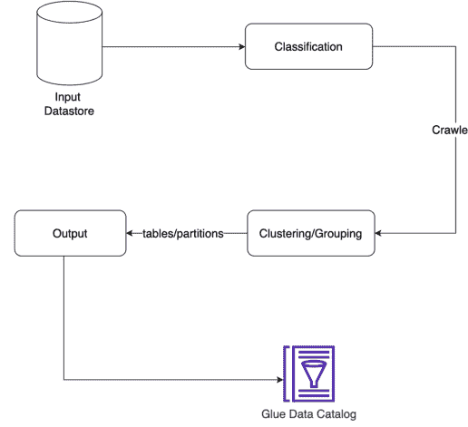

图 6.11 – Glue 爬网程序的工作流程

Glue 爬网程序的工作流程包含几个阶段：

1. **分类：**

   在 AWS Glue 中，分类器负责检查数据存储中的数据并确定其格式。一旦识别出格式，分类器就会为数据生成适当的 schema。

   为了执行此任务，Glue 提供了内置和自定义分类器。当你创建并运行 Glue 爬网程序时，它首先会按照爬网程序配置中定义的顺序应用你指定的自定义分类器。在 schema 识别过程中，这些自定义分类器会被优先考虑。

为了说明这个示例，我们将使用 COVID-19 数据集，该数据集可在 AWS 开放数据（Open Data on AWS）中找到：

1. 转到 **Registry of Open Data on AWS**（https://registry.opendata.aws/）页面。在 **Search datasets** 搜索框中，输入 `COVID-19 Data Lake` 作为搜索条件。你应该会看到一个数据集 **COVID-19 Data Lake** 作为结果。
2. 点击页面上的 **Details**（https://registry.opendata.aws/aws-covid19-lake/）链接；你将看到有关如何访问该数据集的 AWS 资源信息。
3. 你可以使用 AWS CLI（https://aws.amazon.com/cli/）从 Amazon S3 位置访问数据：

   ```
   aws s3 ls --no-sign-request s3://covid19-lake/
   ```

4. 对于我们的示例，我们希望使用 COVID-19 数据集的子集：

   ```
   aws s3 ls s3://covid19-lake/rearc-covid-19-testing-data/
   ```

5. 转到 AWS Glue 控制台（https://console.aws.amazon.com/glue/），点击左侧的 **Databases**。
6. 点击 **Add Database**，然后点击 **Create**，创建一个名为 `chapter6_covid19` 的数据库。

要继续此示例，下一步是创建 Glue Catalog 数据库。

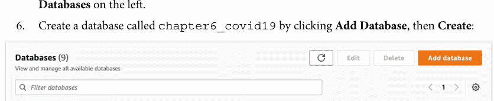

要继续此示例，下一步是创建 Glue 爬网程序。

7. 点击左侧的 **Crawlers**。
8. 点击 **Create Crawler**。
9. 在 **Set crawler properties** 页面上，为新爬网程序提供一个名称，例如 `chapter-gluecrawler`，然后点击 **Next**。
10. 在 **Choose data sources and classifiers** 页面上，在 **Data source configuration** 下选择 **Not Yet**。
11. 点击 **Add a data store**，在 **Location of S3 data** 下选择 **In a different account**，在 **S3 path** 下设置 `s3://covid19-lake/rearc-covid-19-testing-data/`，然后点击 **Add an S3 data source**。接着点击 **Next**，其余选项保持默认。
12. 在 **Configure security settings** 页面上，点击 **Create new IAM role** 并提供 `AWSGlueServiceRole-covid19`。然后点击 **Create**，再点击 **Next**。
13. 在 **Set output and scheduling** 页面上，在 **Output configuration** 部分，从 **Database** 下拉列表中选择 `chapter6_covid19`。输入 `covid19_` 作为添加到表的前缀（可选），并在 **Crawler schedule** 下将频率保持为 **on demand**。
14. 检查所有配置并点击 **Create crawler**。

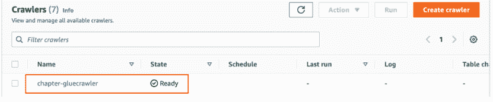

图 6.13 – AWS Glue – 爬网程序

15. 现在我们已经创建了爬网程序，点击它旁边的复选框，然后通过点击页面顶部的 **Run** 按钮来运行该爬网程序。爬网程序需要一两分钟才能完成。

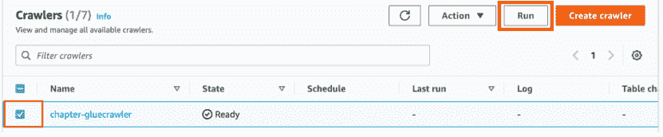

图 6.14 – AWS Glue – 运行

一旦爬网程序成功完成，它将列出四个表。让我们转到数据库并查看表定义：

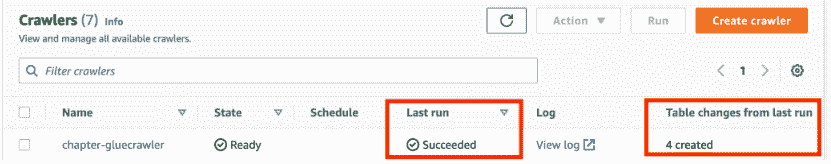

图 6.15 – AWS Glue – 爬网程序状态

观察表的位置和分类，我们可以看到它指向 COVID-19 数据集，并为不同的文件类型提取数据库定义——在本例中是 CSV 和 JSON。正如你所了解的，Glue 爬网程序允许你从不同的 AWS 账户抓取数据，这在构建集中式数据目录（数据存储在不同 AWS 账户中）时非常有用：

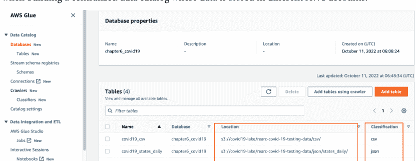

图 6.16 – AWS Glue Data Catalog 表

通过点击表名（本例中为 `covid19_csv`），你可以查看表定义。正如我们之前所学，这提供了有关表的有价值信息，包括统计信息和元数据：

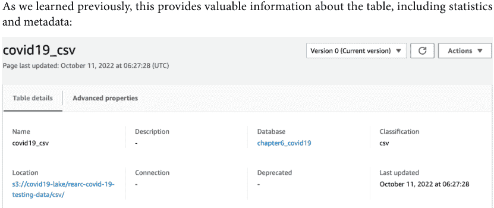

图 6.17 – AWS Glue Catalog 表属性

## 表统计信息

在 AWS Glue 中，表统计信息是指 Glue Data Catalog 中有关表的统计信息。这些统计信息包括每列中总计值和不同值的数量、最小值和最大值，以及值的平均长度。这些信息对于查询优化和性能调优非常重要：

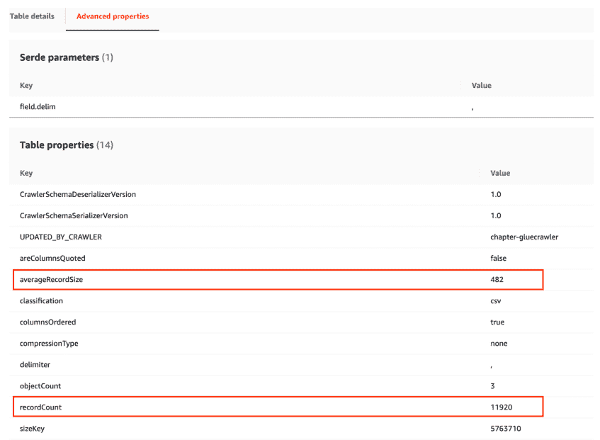

表统计信息可以通过 AWS Glue 控制台或 Glue API 进行查看和更新。它们也可以由 AWS Glue 爬网程序在数据发现过程中自动收集。

Glue Data Catalog 中的表统计信息提供了有关数据目录中存储的表的重要元数据。这些统计信息包括表中的行数、表的大小，以及列统计信息（如最小值、最大值、数据分布和数据类型）。这些统计信息在 AWS Glue 中的查询优化和性能调优中发挥着关键作用。

AWS Glue 和查询引擎（如 Amazon Athena 或 Amazon Redshift Spectrum）会利用这些表统计信息来制定关于查询执行计划的明智决策。以下是表统计信息的重要性以及如何利用它们进行查询优化和性能调优：

- **查询规划：** 查询优化器使用表统计信息来估计查询中所涉及表的基数（行数）和数据分布。这种估计有助于优化器选择最高效的查询执行计划。准确的统计信息使优化器能够做出更好的决策，从而加快查询处理速度并提高效率。
- **连接优化：** 在连接多个表时，查询优化器利用表统计信息来确定最佳连接策略。通过分析列统计信息（如数据分布和值范围），优化器可以决定是执行哈希连接、合并连接还是其他连接算法。这些信息有助于减少数据重排并提高整体连接性能。
- **谓词下推：** 表统计信息也用于谓词下推，即在将数据带入查询引擎之前，将过滤操作下推到数据源。通过了解列的数据分布和值范围，优化器可以确定在数据源处进行过滤是否能够显著减少需要处理的数据量，从而加快查询执行速度。
- **数据倾斜检测：** 表统计信息有助于识别数据倾斜，即数据在分区或列之间的分布不均匀。数据倾斜会对查询性能产生负面影响，导致某些任务花费的时间明显长于其他任务。通过分析表统计信息，你可以检测数据倾斜并采取纠正措施，例如重新分布数据或使用不同的分区策略，以实现更好的负载均衡并改善查询性能。

为了确保表统计信息的准确性，随着数据的变化定期更新它们非常重要。AWS Glue 提供了通过使用爬网程序自动收集表统计信息的功能。此外，你还可以使用 Amazon Athena 等查询引擎中的 `ANALYZE TABLE` 命令手动更新表统计信息：


## Schema (60)

查看和管理表架构。

过滤架构

| # | 列名 | 数据类型 | 分区键 | 注释 |
|---|---|---|---|---|
| 1 | date | bigint | - | - |
| 2 | state | string | - | - |
| 3 | positive | bigint | - | - |
| 4 | probablecases | bigint | - | - |
| 5 | negative | bigint | - | - |
| 6 | pending | bigint | - | - |
| 7 | totaltestresultssource | string | - | - |
| 8 | totaltestresults | bigint | - | - |
| 9 | hospitalizedcurrently | bigint | - | - |
| 10 | hospitalizedcumulative | bigint | - | - |
| 11 | inicucurrently | bigint | - | - |
| 12 | inicucumulative | bigint | - | - |
| 13 | onventilatorcurrently | bigint | - | - |
| 14 | onventilatorcumulative | bigint | - | - |
| 15 | recovered | bigint | - | - |

图 6.19 – AWS Glue Catalog 表架构定义

在探索了表定义之后，我们现在可以使用 Amazon Athena 查看数据。

点击 Table data 将把我们重定向到 Athena 控制台：

## Tables (4)

查看和管理所有可用表。

过滤表

| 名称 | 数据库 | 位置 | 分类 | 已弃用 | 查看数据 |
|---|---|---|---|---|---|
| covid19_csv | chapter6_covid19 | s3://covid19-lake/rearc-co... | csv | - | Table data |
| covid19_states_daily | chapter6_covid19 | s3://covid19-lake/rearc-co... | json | - | Table data |
| covid19_us_daily | chapter6_covid19 | s3://covid19-lake/rearc-co... | json | - | Table data |
| covid19_us_total_latest | chapter6_covid19 | s3://covid19-lake/rearc-co... | json | - | Table data |

图 6.20 – AWS Glue Data Catalog 中的表列表

在这里，我们使用 Amazon Athena 访问了 `covid19_csv` 表的数据。通过点击 **Table data**，我们被重定向到 Athena 控制台，在那里可以看到表的数据。其他表也在 Athena 中列出。在下一章中，我们将更详细地探索 Athena：

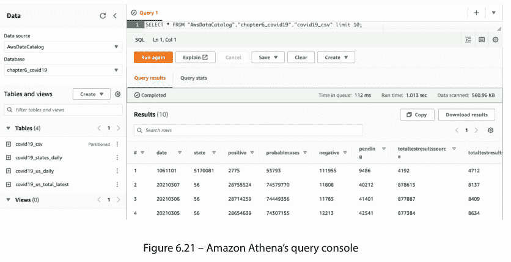

在本示例中，我们演示了如何使用 AWS Glue Catalog 对 Covid-19 数据集进行编目，并使用 Amazon Athena 对其运行 SQL 查询。在下一节中，我们将重点介绍如何使用 AWS Glue ETL 执行数据摄取。

## 使用 AWS Glue ETL 进行数据摄取

在上一节中，我们学习了如何使用 AWS Glue Crawler 和 AWS Glue Data Catalog 的各种功能为数据发现创建集中式数据目录。在本节中，我们将探索使用 AWS Glue ETL 从各种数据源进行数据摄取的选项，例如数据湖（Amazon S3）、数据库、流式处理和 SaaS 数据存储。此外，我们还将学习如何使用作业书签从数据湖（S3）和 JDBC 执行增量数据加载。

Glue 使用户能够使用三种不同类型的 ETL 框架创建 ETL 作业 – Spark ETL、Spark Streaming 和 Python Shell。在 Glue DataBrew 的介绍部分，我们了解到 AWS Glue 已发展，并且现在 AWS Glue Studio 可用于构建 ETL 管道。

AWS Glue 用户界面允许您使用一个有趣的功能构建 ETL 管道，该功能将您的 UI 作业转换为脚本，这有助于在构建类似管道时扩展，或在您需要一些帮助入门然后添加自定义时提供帮助。

除了支持多个 Spark 框架来处理数据外，Glue 在作业创建期间还提供高级功能，例如自动扩展、作业书签、启用连续日志记录、Spark UI、Flex 实例以及传递 Spark 和作业参数。

除了 Spark 框架之外，Glue ETL 还提供 Glue 原生的高级框架/API 和格式，用于复杂的 ETL，例如 GlueContext、DynamicFrame、作业书签、Glue Parquet、Glue 交互式会话、工作流、触发器等。

让我们逐一探索这些功能。

### AWS GlueContext

`GlueContext` 类封装了 Apache 的 `SparkContext`，可使用以下代码片段进行初始化：

```
```python
sc = SparkContext()
glueContext = GlueContext(sc)
```
```

GlueContext 允许您与 Spark 框架通信，并且是许多 Glue ETL 功能的入口点，例如 DynamicFrame、作业书签、作业参数等。

### DynamicFrame

Glue ETL 的 DynamicFrame 是一个重要功能，使 Spark 开发人员能够创建更高效的 Spark 管道，并且是 Glue 原生的。Glue DynamicFrame 是自描述 DynamicRecord 对象的分布式集合，但它不需要它们遵循固定架构。由于 DynamicFrame 中记录的自描述特性，它不需要创建架构即可用于读取/转换具有不一致架构的数据。

您可以根据用例使用不同的 API 创建 Glue DynamicFrame。例如，以下代码片段为 `my_database` 数据库中的 `my_table` 表创建名为 `datasource0` 的 DynamicFrame 对象：

```
```python
datasource0 = glueContext.create_dynamic_frame.from_catalog(database_
name='my_database', table_name='my_table', transformation_
ctx='datasource0')
```
```

在此语句中，我们使用了 GlueContext 对象，该对象使用 Glue SDK 来连接到 Glue Data Catalog 并获取数据源分类和属性以创建对象。用户还可以使用 `additional_options` 参数传递其他选项，例如 `push_down_predicate` 参数。

除了使用 `from_catalog` 方法创建 DynamicFrame 外，您还可以使用以下方法创建 DynamicFrames：

- **`from_options`**: 此方法允许用户通过手动指定连接类型、选项和格式来创建 DynamicFrames。此方法为用户提供了自定义数据存储选项的灵活性。
- **`from_rdd`**: 此方法允许用户使用 Spark RDDS 创建 DynamicFrames。

为了利用 DataFrame 中可用的功能，您可以使用以下语法将 DynamicFrame 转换为 DataFrame：

```
df = datasource0.toDF()
```

同样，您可以使用以下语法将 Spark DataFrame 转换为 Glue DynamicFrame：

```
from awsglue.dynamicframe import DynamicFrame

dyf = DynamicFrame.fromDF(dataframe=df, glue_ctx=glueContext, name="dyf")
```

DynamicFrame 和 DataFrame 都是与 Spark RDDs 交互的高级 API。然而，DynamicFrame 的结构与 DataFrame 不同：

| Spark DataFrames | Glue DynamicFrames |
| ----------------- | ------------------ |
| Spark Core : RDD |  |

图 6.22 – AWS Glue ETL 高级架构

需要注意的是，将 Glue DynamicFrame 转换为 Spark DataFrame 需要 Spark 中的完整 Map 阶段，这可能资源密集并增加作业执行时间。这是因为将 DynamicFrame 转换为 DataFrame 会阻塞 Spark，使用针对 DynamicFrame 所做的所有优化。

### AWS Glue 作业书签

AWS Glue 提供了独特的书签功能，这使其区别于其他基于 Spark 的 ETL 解决方案，例如在 Amazon Elastic MapReduce (EMR) 上运行 Spark。书签通过跟踪已处理和写入的数据来启用增量数据加载。当处理大型数据集或从数据库提取数据时，这尤其有用。

作业书签适用于 JDBC 数据源、Amazon S3 和关系转换。对于 Amazon S3，作业书签适用于 JSON、CSV、Apache Avro、XML、Parquet 和 ORC 文件格式。在使用 JDBC 源时，用户需要指定一列作为书签键；否则，AWS Glue 将使用主键作为书签键，前提是它按顺序递增或递减且没有间隙。如果使用用户定义的书签键，则它们应单调递增或递减；这种情况下允许存在间隙。

对于 Amazon S3，AWS Glue 使用对象的最后修改时间来确定需要重新处理哪些对象。有各种处理选项可用，例如重置作业书签和回退。重置作业书签允许用户使用相同的


job，而回退（rewinding）则使它们能够回到任何先前的任务运行。需要注意的是，将 Glue DynamicFrame 转换为 Spark DataFrame 需要在 Spark 中执行一个完整的 Map 阶段，这可能非常耗费资源，并且由于阻塞了 Spark 针对 DynamicFrame 的优化，会增加任务的执行时间。

## AWS Glue 触发器

AWS Glue 触发器允许你调度你的 Glue 工作流，其中包括 Glue 任务和爬虫（crawlers）。你可以创建按需触发、定时触发或基于事件触发的触发器。触发器可以处于多种状态，例如 CREATED（已创建）、ACTIVATED（已激活）和 DEACTIVATED（已停用）。

有三种类型的触发器可用：

- **定时触发器**：这些触发器基于时间，可以使用 cron 表达式进行配置以定义调度。
- **条件触发器**：这些触发器根据先前任务或爬虫的状态执行。例如，你可以配置一个触发器，仅在爬虫完成时执行任务 1。
- **按需触发器**：顾名思义，这些触发器通过手动激活，并在你运行它们时执行。

## AWS Glue 交互式会话

AWS Glue 提供了一个交互式环境，用于在 AWS 上构建、测试和运行你的 ETL 任务。此环境包含一个开源 Jupyter 内核，可与 PyCharm、IntelliJ 和 VS Code 等流行 IDE 集成，允许你在本地编写和测试代码。要设置交互式会话，你可以参考位于 https://docs.aws.amazon.com/glue/latest/dg/interactive-sessions.html 的官方 Glue 文档。

现在，我们已经对所有 Glue 组件有了相当程度的理解，让我们通过示例学习一些摄取（ingestion）模式：

- 从 Amazon S3（对象存储）摄取数据
- 从 SaaS 应用程序摄取数据
- 从关系型数据库摄取数据

## AWS Glue Studio

Glue Studio 是由 AWS Glue 提供的一个强大的可视化界面，用于构建和管理 ETL 工作流。它提供了多项功能和优势，以增强数据集成和转换过程。然而，也有一些局限性和需要考虑的因素。让我们提供一个概述。

Glue Studio 的功能和优势如下：

- **可视化 ETL 开发**：Glue Studio 提供了一个用户界面，用于可视化设计 ETL 工作流。它允许用户创建、连接和配置预构建的组件（称为“转换”），而无需编写代码，从而简化了构建数据管道的过程。
- **预构建转换库**：Glue Studio 提供了一个丰富的预构建转换库，这些转换是数据处理操作，如过滤、聚合、连接等。这些转换可以轻松集成到工作流中，节省开发复杂数据转换的时间和精力。
- **自动生成的 Spark 代码**：在幕后，Glue Studio 根据可视化工作流自动生成 Apache Spark 代码。这使得用户能够利用 Spark 进行分布式数据处理的优势，同时抽象出 Spark 编程的复杂性。
- **与 Glue 数据目录集成**：Glue Studio 与 Glue 数据目录无缝集成，允许轻松访问元数据、表定义和模式。它简化了在 Amazon S3、RDS、Redshift 等各种 AWS 数据源中存储的数据处理过程。
- **内置数据目录和数据湖**：Glue Studio 利用 Glue 数据目录作为管理和组织元数据的中央仓库。它使用户能够在其数据湖中发现、编目和探索数据资产，促进数据治理和自助数据发现。
- **便捷的部署和调度**：Glue Studio 提供了简单的部署选项，允许用户只需单击几下即可将工作流部署为 AWS Glue ETL 任务。它还提供了调度功能，以自动化工作流的重复执行。

AWS Glue Studio 的局限性和考虑因素之一是**有限的自定义**。虽然 Glue Studio 提供了用于 ETL 开发的可视化界面，但在处理复杂转换或自定义逻辑时可能存在局限性。在这种情况下，你可能需要转向使用 Glue ETL 脚本或其他 AWS 服务的传统编码方法。

## 从对象存储摄取数据

本示例涉及从 AWS 开放数据上的 COVID-19 数据湖（https://registry.opendata.aws/aws-covid19-lake/）复制数据，该数据湖存储在一个名为 `s3://covid19-lake/` 的公共 S3 桶中。为了实现这一点，我们将使用 Amazon S3 Boto3 库，这是一个 Python 包，用于连接到 SFTP、FTP 和其他不同文件存储中的数据。在这种情况下，将使用 Glue Python shell ETL 任务从 Amazon S3 读取 CSV 数据，将其转换为 JSON，然后将其复制到目标 S3 桶。Amazon S3 上的 COVID-19 数据湖包含各种文件夹，在本示例中，将使用 `s3://covid19-lake/rearc-covid-19-testing-data/csv/us_daily/` 文件夹：

```text
(base) ~ % aws s3 ls s3://covid19-lake/rearc-covid-19-testing-data/csv/us_daily/
2021-03-15 15:34:30       82926 us_daily.csv
```

以下是代码片段：

```python
import boto3
import io
import pandas as pd

client = boto3.client('s3')

# covid-19 data lake - https://registry.opendata.aws/aws-covid19-lake/

src_bucket = 'covid19-lake'  # SOURCE_S3_BUCKET_NAME
target_bucket = 'S3_TARGET_BUCKET_NAME'

src_object = client.get_object(
    Bucket=src_bucket,
    Key='rearc-covid-19-testing-data/csv/us_daily/us_daily.csv'
)

# Read CSV and Transform to JSON

df = pd.read_csv(src_object['Body'])

jsonBuffer = io.StringIO()

df.to_json(jsonBuffer, orient='records')

# Write JSON to target location

client.put_object(
    Bucket=target_bucket,
    Key='target_prefix/data.json',
    Body=jsonBuffer.getvalue()
)
```

提供的代码片段利用 get_object() 方法从 Amazon S3 检索数据，随后使用 pandas 库将数据从 CSV 格式转换为 JSON 格式。最后，利用 put_object() 方法将转换后的数据写入目标位置。

## 从数据库摄取数据（JDBC 数据存储）

AWS Glue 常用于将数据从数据库引入数据湖。这通常以批处理方式通过 JDBC 连接完成。要连接到数据库，你可以使用 AWS Glue 连接，它存储数据库的登录凭据、URI 字符串和**虚拟私有云**（VPC）信息。AWS Glue 支持多种类型的连接，包括 JDBC、Amazon RDS、Amazon Redshift、Amazon DocumentDB、Kafka 和 MongoDB。要创建 JDBC 连接，你可以使用以下格式：

```text
jdbc:protocol://host:port/db_name
```

你可以通过阅读 AWS Glue 文档（https://docs.aws.amazon.com/glue/latest/dg/connection-properties.html#connection-properties-required）来了解如何为各种数据库创建连接。

以下是 Microsoft SQL Server 数据库连接的示例：

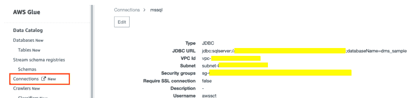

图 6.24 – AWS Glue JDBC 连接

以下是代码片段。这里，我们正在连接 MSSQL 数据库并将数据从 MSSQL 数据库移动到 Amazon S3，格式为 Parquet 文件：

```python
MicrosoftSQLServer = directJDBCSource(
    glueContext,
    connectionName="mssql",
    connectionType="sqlserver",
    database="ec2-00-000-000-00.compute-1.amazonaws.com:1433;databaseName=dms_sample",
    table="dms_sample.sports",
    redshiftTmpDir="",
    transformation_ctx="MicrosoftSQLServer",
)

S3bucket_node3 = glueContext.write_dynamic_frame.from_options(
    frame=MicrosoftSQLServer,
    connection_type="s3",
    format="parquet",
    connection_options={"path": "s3://target_dir"},
    format_options={"compression": "uncompressed"},
    transformation_ctx="S3bucket_node3",
)
```

## 从 SaaS 数据存储摄取数据

到目前为止，我们已经学习了如何使用 AWS Glue 从 Amazon S3 等对象存储以及 Microsoft SQL Server 等关系型数据库中提取数据。现在，我们将学习如何使用 AWS Glue 从 SaaS 数据存储摄取数据。

要连接到 SaaS 数据存储，你需要使用 AWS Glue Marketplace 连接器；这些连接器是在 2020 年 12 月推出的。截至撰写本文时，Marketplace 共有 66 个连接器，包括 AWS 和第三方连接器，如 Snowflake、ServiceNow、Google BigQuery、Elasticsearch、Apache Iceberg、Delta Lake 等：

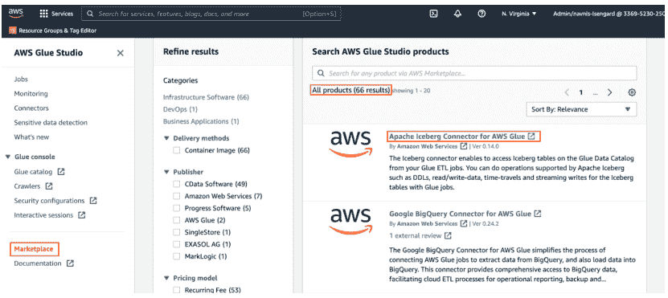

图 6.25 – AWS Glue Marketplace 连接器

要连接 ServiceNow 并将数据引入 Amazon S3 数据湖，请遵循以下步骤：

1. 访问 AWS Marketplace (https://us-east-1.console.aws.amazon.com/gluestudio/home?region=us-east-1#/marketplace) 并订阅 ServiceNow 连接器。在继续之前，请查阅文档、定价和用户指南。
2. 使用已订阅的 ServiceNow 连接器创建一个连接。
3. 使用 AWS Glue Studio 构建 ETL 管道：

```python
import sys
from awsglue.transforms import *
from awsglue.utils import getResolvedOptions
from pyspark.context import SparkContext
from awsglue.context import GlueContext
from awsglue.job import Job

args = getResolvedOptions(sys.argv, ["JOB_NAME"])
```


```python
sc = SparkContext()
glueContext = GlueContext(sc)
spark = glueContext.spark_session
job = Job(glueContext)
job.init(args["JOB_NAME"], args)

# Script generated for node CData AWS Glue Connector for ServiceNow
CDataAWSGlueConnectorforServiceNow_node1 = (
    glueContext.create_dynamic_frame.from_options(
        connection_type="marketplace.jdbc",
        connection_options={
            "tableName": "incident",
            "dbTable": "incident",
            "connectionName": "service-now-glue-connector",
        },
        transformation_ctx="CDataAWSGlueConnectorforServiceNow_node1",
    )
)
```

您可以在 [https://aws.amazon.com/blogs/big-data/extract-servicenow-data-using-aws-glue-studio-in-an-amazon-s3-data-lake-and-analyze-using-amazon-athena/](https://aws.amazon.com/blogs/big-data/extract-servicenow-data-using-aws-glue-studio-in-an-amazon-s3-data-lake-and-analyze-using-amazon-athena/) 找到一篇有用的博文，该博文提供了逐步详细指南，介绍如何构建一个连接 ServiceNow 并在使用 AWS Glue Studio 的情况下将数据引入 Amazon S3 数据湖的管道。这篇博文还包括有关在 AWS 市场上订阅 ServiceNow 连接器、使用连接器创建连接以及使用 AWS Glue Studio 构建 ETL 管道的说明。此外，它还解释了在数据摄入数据湖后，如何使用 Amazon Athena 分析 ServiceNow 数据。

# 摘要

在本章中，我们介绍了 Apache Spark、其与 AWS Glue 的连接以及 AWS Glue 中的各种可用功能，包括用于数据发现的 AWS Glue 数据目录、用于元数据提取的 AWS Glue 爬虫以及用于构建基于 UI 的 ETL 管道的 AWS Glue Studio。我们还探索了如何使用 AWS Glue 市场订阅不同的连接器，以便我们可以从 SaaS 应用程序中提取数据。

在下一章中，我们将讨论另一种在数据整理和发现过程中发挥重要作用的关键服务：Amazon Athena。
