# 使用 Athena 进行处理

在前几章中，您了解了 AWS Glue 和 Amazon S3 服务以及它们如何融入数据整理管道。在本章中，我们将探索 Amazon Athena 服务如何帮助数据整理管道的数据发现、数据结构化、数据丰富和数据质量阶段。我们将处理一些实用示例并对数据进行分析，使其更加有趣。

本章涵盖以下主题：

- 了解 Amazon Athena
- 使用 Athena 进行高级数据发现和数据结构化
- 使用 Athena 丰富来自多个来源的数据
- 使用 Athena 设置无服务器数据质量管道

## 了解 Amazon Athena

Amazon Athena 是一种交互式无服务器分析服务，有助于探索 Amazon S3 中可用的数据而无需加载数据。Athena 通过 SQL 语法或交互式 Spark 应用程序帮助分析数据。它可以帮助客户通过熟悉的 SQL 分析存储在 Amazon S3 上多种数据格式中的数据。由于 Athena 是一种无服务器服务，用户根据查询扫描的数据量收费，无需维护单独的服务器来启用用户查询。这使得业务和分析团队能够针对特定用例快速分析、转换和可视化数据湖中的数据，而无需依赖数据工程团队创建复杂的 ETL 管道。

Amazon Athena 于 re:Invent 2016 发布，并随着时间的推移经历了重大改进。它最初发布为一种使用托管 Presto 服务器（来自 Athena 目录，不同于 Glue 目录）查询 Amazon S3 数据的无服务器机制。现在，它支持从 Glue 目录查询数据、查询联合、CTAS 语句、Lake Formation 集成、支持事务性数据湖格式、Athena for Spark 等等。

自 *re:Invent 2022* 宣布 Athena for Apache Spark 之后，Athena 支持两种数据分析模式，如下所示：

- 用户可以使用 SQL 语法查询数据，这与 Presto/Trino 相似但存在限制。这使得不具备编程语言专长的分析人员可以在没有他人支持的情况下分析 S3 数据湖中的数据。以下博客文章包含了 Amazon Athena 使用最佳实践，用于优化基于 SQL 分析的成本并提高性能：[https://aws.amazon.com/blogs/big-data/top-10-performance-tuning-tips-for-amazon-athena/](https://aws.amazon.com/blogs/big-data/top-10-performance-tuning-tips-for-amazon-athena/)。
- Athena for Spark 发布时支持 Apache Spark 版本 3.2。有关最近支持的 Spark 版本，请参阅 Athena 文档。有关 Athena for Spark 的更多详细信息，请参阅以下博客。

### 何时使用 SQL/Spark 分析选项？

如果希望在不将数据加载到另一个存储层的情况下对数据湖执行分析，请使用 Athena SQL 来编目和查询数据。您还可以使用 CTAS 语句执行轻量级数据转换。如果您希望以交互式和无服务器方式执行 Spark 程序用于某些分析用例，可以使用 Athena for Spark 选项。

## 使用 Athena 进行高级数据发现和数据结构化

在本节中，我们将探索 Amazon Athena 如何帮助执行数据整理管道的高级数据发现和数据结构化阶段。

### 使用 Athena 进行基于 SQL 的数据发现

Amazon Athena 提供基于 SQL 的数据探索，并支持高级数据类型。这里的优势在于，即使没有编程经验的人也可以使用熟悉的 SQL 语法探索多种数据格式和不同存储类型的数据。

在使用 Amazon Athena 查询数据之前，我们需要在 Glue 目录中为表创建元数据。Amazon Athena 帮助您从不同的数据源查询数据，如下所示：

- **AWS Glue 目录** — 访问 AWS Glue 目录中可用的表。我们可以通过多种方式在 AWS Glue 目录中创建表，我们将在本章后面探索这些方式。
- **联合数据源** — 支持从 Apache Hive、AWS 以及第三方数据库和服务查询数据。有关受支持数据源的综合列表，请参阅 [https://docs.aws.amazon.com/athena/latest/ug/connectors-prebuilt.html](https://docs.aws.amazon.com/athena/latest/ug/connectors-prebuilt.html)。

除了预构建的连接程序外，您还可以创建自定义连接程序来查询您选择的数据源。我们将在本章中进一步详细探索联合数据源。

让我们更多地了解 Glue 目录，它将是大多数 Athena 查询的中心元数据存储。Glue 目录是一个持久元数据存储，允许用户存储、注释和共享元数据。每个 AWS 账户在区域内将有唯一的 Glue 目录。您可以使用 **身份和访问管理（IAM）** 策略来定义和控制用户对 Glue 目录和表的访问权限。对于细粒度数据访问（记录和列级别），用户必须探索 AWS Lake Formation 服务。

如果您查看 AWS Glue 控制台，可以看到 **数据目录** 部分下的不同链接，如下所示：

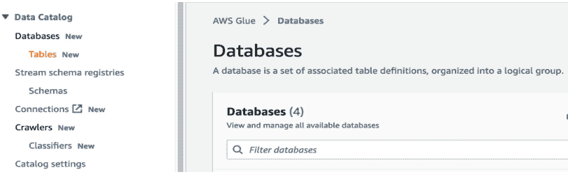

让我们更详细地了解这些部分：

- **数据库：** 数据库是用于存储来自不同数据源的表元数据信息的容器。用户可以将其理解为数据库世界中的架构/数据库概念。
- **表：** 每个表都有源数据的架构定义。我们要强调，这只是存储在某个位置（如 S3 数据湖）的实际数据的元数据定义。当文件具有相同的架构、数据格式和压缩格式时，它还在表中创建分区。

表可以从以下三个来源创建：

- 爬虫运行时创建新表。我们可以通过按计划运行 Glue 爬虫来使用新分区、额外列等保持架构更新。
- 手动添加架构定义。当您想要自定义表/列的名称、仅显示数据集的特定列等时，可以通过这种方法进行操作。
- 使用流式数据源的架构注册表中的现有架构创建表。


Glue 目录表可以有多个版本。每次对表元数据的编辑都会创建该表的新版本。您可以在 AWS Glue 控制台 UI 上比较表的版本，并验证不同版本的表之间所做的更改，如以下截图所示。此外，我们还可以通过使用 delete-table-version API 回滚到以前的版本：

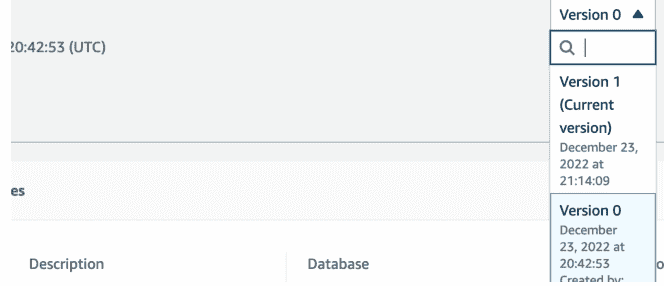

图 7.2：AWS Glue 控制台 – 具有多个版本的表

- **连接**：存储登录凭据、URI 和 VPC 信息，以避免在每次运行爬虫/作业时提供这些信息。我们还可以创建网络连接，通过 VPC 访问 Amazon S3 或其他服务，而不使用公共互联网。

- **爬虫**：Glue 爬虫会自动为用户发现数据并编目元数据（包括半结构化和日志数据）。爬虫使用分类器来推断和识别数据类型，包括 AWS Glue 创建的（CSV、JSON 等）以及使用 grok 模式的自定义分类器。爬虫可以检测架构变更，并根据用户提供的配置自动更新表定义。

为了探索 Athena 的功能，我们将使用来自 [https://docs.opendata.aws/noaa-ghcn-pds/readme.html](https://docs.opendata.aws/noaa-ghcn-pds/readme.html) 的 Amazon 评论示例数据集。我们有 Parquet、CSV 和压缩 CSV 格式，数据在这些格式中可用。

我们将如前所述，通过 AWS Glue 爬虫和手动方法以两种格式创建表。

## 通过 AWS Glue 爬虫创建表并在 Athena 中查询

我们将按如下步骤开始：

- 1. 导航到 AWS Glue 控制台，创建一个新的爬虫，并提供 noaa 数据集的 S3 路径，如爬虫添加数据源屏幕所示：

  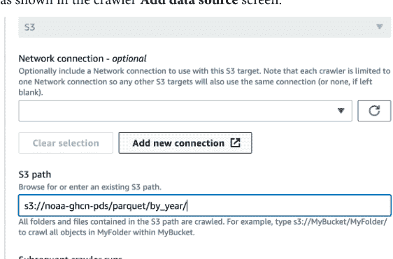

  图 7.3：AWS Glue 控制台 – 配置爬虫

  提供一个具有适当访问权限（包括 S3 读取访问权限）的 IAM 角色和一个数据库名称，以完成爬虫的创建。

- 2. 一旦爬虫创建完成，点击运行它，并等待其完成。当爬虫完成后，您会看到 Glue 目录中新增了一个表，并添加了分区：

  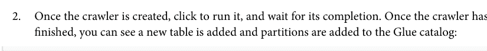

  图 7.4：AWS Glue 控制台 – 爬虫成功运行的结果

- 3. 现在，您可以在 Athena 中查询该表并开始分析数据。在表上运行一个 SELECT 查询，您还可以使用表中可用的分区来筛选数据：

  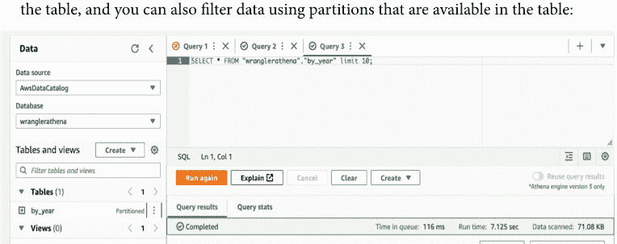

  图 7.5：AWS Athena 控制台 – 查询由 Glue 爬虫创建的表

## 手动在 Athena 中创建表并查询该表

在这里，我们将以手动方式为 CSV 格式创建一个表。我们将遵循此处列出的方法：

- 1. 下载一个样本文件并理解表结构。

在手动创建表之前，我们需要了解源文件中的列和数据类型，以便我们适当地创建表数据定义语言（DDL）语句。在这个例子中，我们将使用 CLI 中的命令仅下载 2022 年的数据（假设机器中已经安装了 AWS CLI），如下所示：

```
aws s3 cp s3://noaa-ghcn-pds/csv/by_year/2022.csv .
```

由于这是一个 CSV 文件，我们可以使用 Excel 应用程序打开它；在某些系统中可能会遇到错误，因为这是一个大于 1 GB 的超大文件，但您可以浏览数据中可用的不同列和数据类型。您可以在这里看到文件在 Excel 中打开的样子：

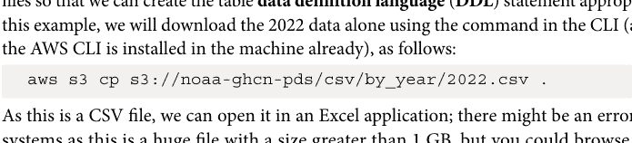

图 7.6：在 Excel 中打开样本数据文件，以理解列结构和数据类型

- 2. 现在，我们将创建一个 DDL 语句并在 Athena 中执行它以创建表：

  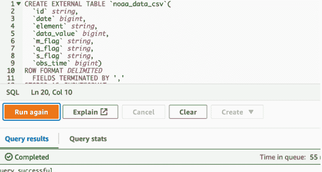

  图 7.7：AWS Athena 控制台 – 使用 DDL 语句手动创建表

> 注意
> 下面显示了所使用的 DML 语句。该 DML 语句取自不同的 Glue 爬虫以节省时间，并在此处根据我们的需求进行了修改。

```
CREATE EXTERNAL TABLE `noaa_data_csv`(
`id` string,
`date` bigint,
`element` string,
`data_value` bigint,
`m_flag` string,
`q_flag` string,
`s_flag` string,
`obs_time` bigint)
ROW FORMAT DELIMITED
FIELDS TERMINATED BY ','
STORED AS INPUTFORMAT
'org.apache.hadoop.mapred.TextInputFormat'
OUTPUTFORMAT
'org.apache.hadoop.hive.ql.io.HiveIgnoreKeyTextOutputFormat'
LOCATION
's3://noaa-ghcn-pds/csv/by_year/'
TBLPROPERTIES (
'areColumnsQuoted'='false',
'classification'='csv',
'columnsOrdered'='true',
'compressionType'='none',
'delimiter'=',',
'skip.header.line.count'='1',
'typeOfData'='file')
```

- 3. 现在，我们可以使用 Amazon Athena 从该表位置开始查询数据，如下所示：

  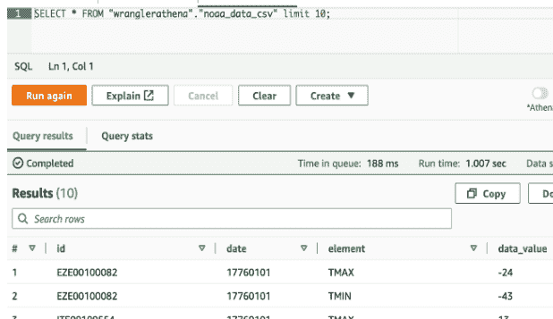

## 使用正则表达式解析器加载固定宽度表

一个更好的例子是加载一个不被 Glue 爬虫支持的表。我们将为 inventory 文件（http://noaa-ghcn-pds.s3.amazonaws.com/ghcnd-inventory.txt）创建一个表。该文件的结构是从数据源文档页面粘贴在这里的：

文件结构在下表中描述。

| 变量 | 列 | 类型 |
| :--- | :--- | :--- |
| ID | 1-11 | CHARACTER |
| LATITUDE | 13-20 | REAL |
| LONGITUDE | 22-30 | REAL |
| ELEMENT | 32-35 | CHARACTER |
| FIRSTYEAR | 37-40 | INTEGER |
| LASTYEAR | 42-45 | INTEGER |

- **ID** = 站点识别码。请参阅 "ghcnd-stations.txt" 以获取站点的完整列表及其元数据。
- **LATITUDE** = 站点的纬度（以十进制度表示）。
- **LONGITUDE** = 站点的经度（以十进制度表示）。
- **ELEMENT** = 要素类型。请参阅第三部分以获取要素的定义。
- **FIRSTYEAR** = 给定要素无标志数据的第一年。
- **LASTYEAR** = 给定要素无标志数据的最后一年。

图 7.9：数据结构

这意味着前 11 个字符是 ID 字段，第 12 个字符可以是空格或任何内容，接下来的 7 位数字是纬度，如 *图 7.9* 中粘贴的那样。我们可以使用 **正则表达式 (regex)** 来解析数据并查询它。我们将执行以下步骤来从固定宽度文件中查询和发现数据：

- 1. 下载并识别文件内的数据结构，如下所示：

```
aws s3 cp s3://noaa-ghcn-pds/ghcnd-inventory.txt .
```

一旦文件已下载到本地磁盘，您可以使用任何您喜欢的编辑器打开文件并分析数据以理解模式结构。我们将理解此处看到的每一列中可用的值，以设计用于解析文件的正则表达式：

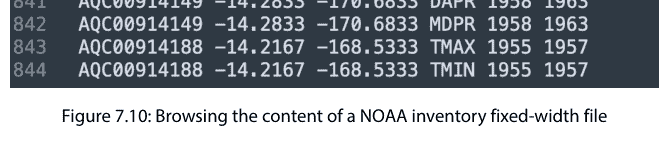

> **注意**
> 
> 如果文件没有特殊字符或复杂结构，我们也可以使用 S3 Select 从文件中查询数据。

- 2. 设计一个正则表达式从文件中读取数据。

在创建 Glue 表之前，您可以基于组织的安全需求使用任何正则表达式验证器来验证正则表达式。在我们的用例中，我们将使用 [https://regex101.com/](https://regex101.com/) 来验证正则表达式。

对于正则表达式的新手，您可以在线阅读更多关于正则表达式的资料和备忘录，然后再开始。我们将复制一些代表数据文件中不同数据格式的样本记录，并开始逐字段创建正则表达式。以下截图显示了捕获第一个字段以匹配 11 个字符单词以及存在于某些记录中的连字符的正则表达式（参见截图中的 *记录 3*）：

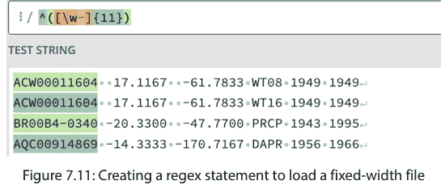

```text
`firstyear` int,
`lastyear` int
)
ROW FORMAT SERDE 'org.apache.hadoop.hive.serde2.RegexSerDe'
WITH SERDEPROPERTIES (
    "input.regex" = "^(\\\\w\\s.+-){1}\\s(\\\\w\\s.+-){8}\\s(\\\\w\\s.+-){9}\\s(\\\\w]{4})\\s(\\\\d]{4})"
LOCATION 's3://<location your file/'
```

- 5. 在 Athena 中查询数据并进行验证。

一旦表创建完成，您可以查询数据并验证数据是否被正确解析，如下所示：

```text
   * CREATE EXTERNAL TABLE ghndinv
   6 w (     
   7  `id` string,
   8  `latitude` string,
   9  `longitude` string,
  10  `element` string,
SQL
Ln 3, Col 1
```

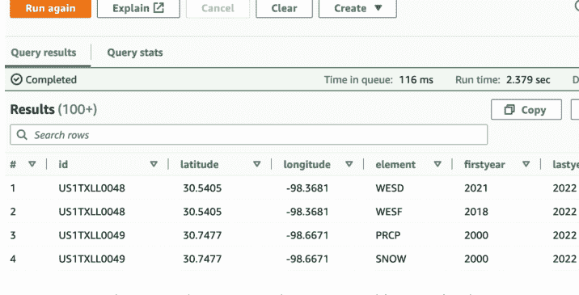

恭喜！您现在已经从一个固定宽度文件创建了一个表，并使用 SQL 语句来探索数据。

您现在已理解在 Amazon Athena 中创建表以进行查询的不同方法，这是我们在 Athena 中进行分析之前的第一步也是重要的一步。您还可以以编程方式或通过诸如 AWS Glue 等服务使用 ETL 管道在 Glue 目录中创建表。


## 使用 CTAS 进行数据结构化

CTAS 语句提供了一种通过 SQL 执行数据结构化的强大方式。你也可以使用此命令转换数据类型、存储格式以及其他较小的轻量级 ETL。

我们将继续上一步的工作，在该步骤中我们使用 `serde` 正则表达式解析了固定宽度文件并从中创建了表。但如果你展开表定义和列类型，你会发现 `latitude` 和 `longitude` 列的数据类型为 `string`。我们可以将这两个字段转换为 `float` 数据类型，并将输出文件存储为 Parquet 格式，如下所示：

```sql
create table ghndinv_parquet
with (
    format = 'Parquet',
    write_compression = 'GZIP',
    external_location = 's3://<<s3 bucket>>/ghndinv_parquet/')
as
select
    id, cast(latitude as real) as latitude, cast(longitude as real) as longitude, element, firstyear, lastyear
from ghndinv
```

你可以查看 S3 位置并验证 Parquet 文件是否已为该表创建，并且它不再是固定宽度文本文件，如下所示：

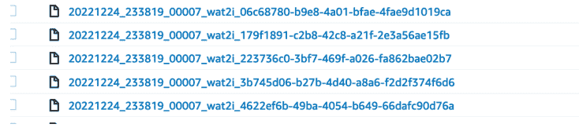

图 7.14：使用 CTAS 命令创建的表的 S3 位置

此外，正如我们在此处看到的，`latitude` 和 `longitude` 列的数据类型已更改为 `float`：

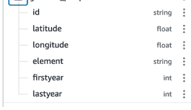

图 7.15：使用 Amazon Athena 的 CTAS 命令创建的表的列和数据类型

我们还将把 CSV 数据转换为 Parquet 格式，同时基于数据访问模式所需的分区架构。我们将根据国家代码对表进行分区，以便以高效的方式访问每个国家/地区的天气数据。

我们已在本书的 earlier 部分手动加载了 CSV 表到 `noaa_data_csv` 表中。我们将使用该表中的数据并从 `id` 列的前两个字符中提取 `countrycode` 值。我们还将把 `date` 字段转换为 `date` 类型，以便在查询中高效运行基于时间的过滤：

```sql
create table noaa_data_parquet
with (
    format = 'Parquet',
    write_compression = 'GZIP',
    partitioned_by = ARRAY['countrycode'],
    external_location = 's3://<bucketname>/noaa_data_parquet/')
as
select
    id, element, data_value, m_flag, q_flag, s_flag, obs_time, cast(date_parse(cast("date" as varchar(8)), '%Y%m%d') as date_field, substr(id, 1, 2) as countrycode
from noaa_data_csv
```

请注意，我们在前面的查询中使用了 `partition` 列，而在库存表 (`ghndinv`) 中我们没有使用它。当执行此查询时，我们会收到错误，如以下屏幕截图所示：

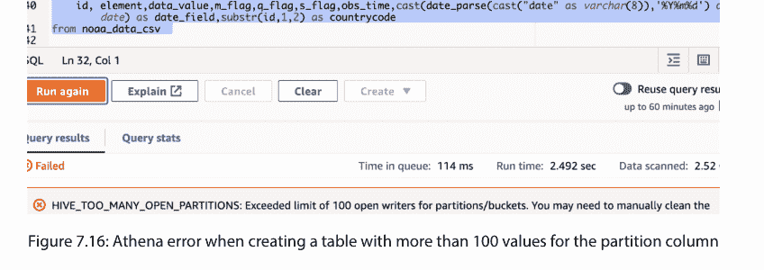

Athena 每次最多只支持插入 100 个分区，而我们的数据中有 218 个唯一国家代码值，如 *图 7.17* 所示：

```sql
Select substr(id, 1, 2) as countrycode
from noaa_data_csv
group by substr(id, 1, 2) order by substr(id, 1, 2)
```

|  |  |
|---|---|
| 217 | WZ |
| 218 | ZA |
| 219 | ZI |

图 7.17：分区列中唯一值的总数

我们必须分三次批次加载数据，每次最多 100 个分区值。由于我们已对 countrycode 值进行了排序，因此我们可以根据 https://docs.aws.amazon.com/athena/latest/ug/ctas-insert-into.html 中的文档所述来构建 INSERT 查询。

我们将使用 CTAS 和 INSERT INTO 语句根据前面的查询使用国家代码过滤器三次插入数据。如果数据仅包含 <100 个分区值，我们可以一次运行此 CTAS 加载查询而无需任何额外步骤。操作如下：

- 1. 创建一个 CTAS 语句来加载前 100 个分区的数据。你可以从图 7.18 中的表中看到，我们已按字母顺序加载了约旦 (JO) 之前国家/地区的数据：

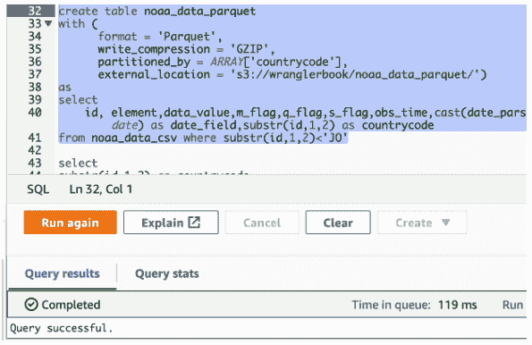

图 7.18：运行限制分区值为 100 的 CTAS 命令

- 2. N（根据需要重复多次）：插入语句将数据填充到目标表中，如下所示：

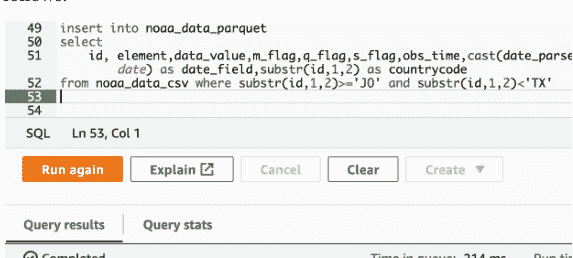

图 7.19：运行限制分区值为 100 的 CTAS 命令（续）

重复此步骤直到你已从源表加载所有数据。完成后，你可以使用计数查询验证是否已从源表加载了所有数据。你也可以浏览 S3 路径以验证国家代码分区中的数据。你可以在此处看到我们已加载了所有国家代码的数据（219 个唯一国家代码值）：

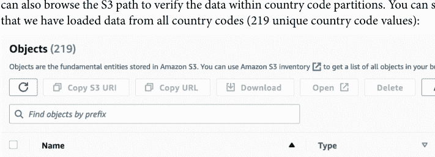

图 7.20：在 S3 路径中验证 CTAS 表输出

现在，你可以根据查询访问模式高效地探索分区数据。或者，如果你想将数据拆分为等大小的桶，你可以使用本章后面提到的分桶命令。你也可以在 https://aws.amazon.com/premiumsupport/knowledge-center/set-file-number-size-ctas-athena/ 的文档中阅读有关分区（我们之前执行的操作）和分桶之间的区别。

我们仅做了一个小的更改来展示 Athena 在重构数据方面的能力以及执行 ETL 操作的能力。你可以进一步尝试并在此练习中创建强大的数据转换。

## 使用 Athena 从多个来源丰富数据

在本节中，我们将探讨如何使用 Athena SQL 以及使用 Athena 联邦设置从其他受支持的数据源丰富数据。

### 使用 Athena SQL 连接丰富数据

在上一节中，我们看到了通过 Amazon Athena 探索数据的各种方式。现在，我们将更专注于通过 Athena 查询丰富数据以添加额外信息的方式。

在此阶段，我们可以通过与其他数据源连接来进一步丰富原始数据。我们将继续使用我们在 earlier 部分中使用过的相同数据源。让我们假设一个场景，我们想要识别本世纪（2000 年之后）美国某个州（康涅狄格州）在特定年份（2022 年）的最高记录温度。我们将从使用上一节中 CTAS 语句创建的 Parquet 表 (`noaa_data_parquet`) 获取读数数据。

我们可以根据分区架构过滤并获取国家代码 = US 的记录。但为了获取康涅狄格州的记录，我们需要将 `noaa_data_parquet` 表与站点数据文件 (http://noaa-ghcn-pds.s3.amazonaws.com/ghcn-d-stations.txt) 连接，该文件包含美国和加拿大所有站点的州信息。

我们将按照以下步骤使用州数据丰富我们的数据集：

- 1. 使用正则表达式格式加载州数据文件。我们将遵循我们在 earlier 部分加载库存表时使用的方法。我们将首先使用正则表达式验证器和示例记录设计用于加载表的正则表达式，如下所示：

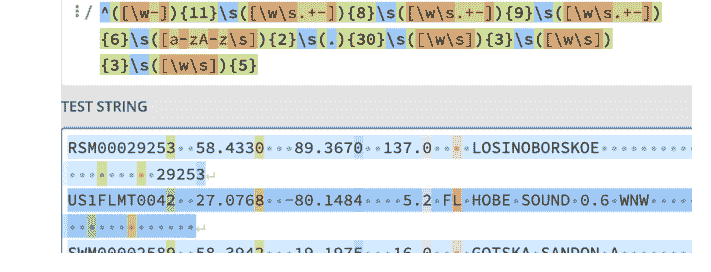

- 2. 创建表并通过 Amazon Athena 加载固定宽度文件，如下所示。验证数据是否成功加载：

| id | latitude | longitude | elevation | state | name |
|---|---|---|---|---|---|
| US1CTR00002 | 41.4230 | -73.5187 | 256.0 | CT | DANBURY 2.8 NNW |
| US1CTR00003 | 41.1486 | -73.4591 | 71.6 | CT | NEW CANAAN 1.9 ENE |
| US1CTR00005 | 41.1028 | -73.4893 | 60.0 | CT | DARIEN 3.6 N |

图 7.22：使用正则表达式语句加载的表在 Amazon Athena 中的查询

- 3. 我们将使用 `id` 列连接表，然后仅对来自 state='CT' 且国家代码='US'（分区列以加快分析）的记录进行过滤和聚合，以识别本世纪（21 世纪）的最高温度，如下所示：

```sql
select max(data_value) from noaa_data_parquet t1 inner join
 ghnd_stations t2 on t1.id=t2.id
where countrycode='US' and state='CT' and element='TMAX' and
 date_field>cast('2000-01-01' as date)
```

我们可以看到从以下屏幕截图中，本世纪记录的最高温度为 54.4°C：

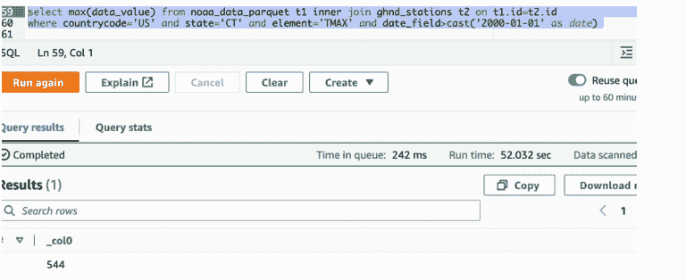

- 4. 通过识别本世纪康涅狄格州记录温度前三名的地点进行进一步分析。我们将使用分区和排名函数来实现此结果，通过执行以下查询：

```sql
select * from ( select t1.id,t1.data_value,t1.obs_time,t2.state,t2.name,
 ROW_NUMBER() OVER (PARTITION BY t1.countrycode,t2.state ORDER BY
 data_value DESC) AS temp_rank
 from noaa_data_parquet t1 inner join ghnd_stations t2 on
 t1.id=t2.id
where countrycode='US' and state='CT' and element='TMAX' and
 date_field>cast('2000-01-01' as date) ) TMP_TABLE
 where temp_rank <=3
```


你可以看到本世纪记录最高气温的三个地点——梅里登（Meriden）、丹伯里（Danbury）和新 Haven（New Haven）。此外，正如你从分析中可以看到的那样，自 2000 年以来，气温从未超过 50°C：

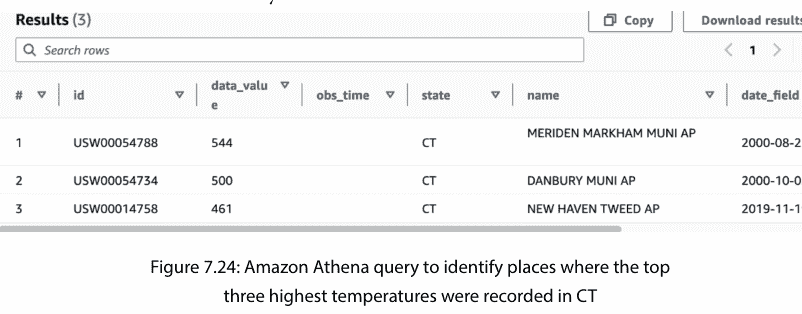

前面的练习展示了使用 Amazon Athena 进行此类分析的威力，而它依赖于数据的质量和准确性以获取正确结果。你需要依靠数据清洗和数据质量规则来创建更干净的数据集，以提供准确的分析结果。

Amazon Athena 支持所有类型的连接，如 INNER JOIN、LEFT JOIN、RIGHT JOIN、OUTER JOIN 和 CROSS JOIN，具体取决于你的使用场景需求。此外，Athena SQL 中还有一组丰富的功能，可用于对数据进行高度复杂的分析和转换。请参阅文档，了解 Athena SQL 功能的完整列表，见 `https://docs.aws.amazon.com/athena/latest/ug/ddl-sql-reference.html`。

> **挑战练习**
> 你可以连接我们在*第 10 章，使用 SageMaker Data Wrangler 进行机器学习的数据处理*中使用的体育博彩使用案例的数据集。你可以使用 Athena 查询重新创建我们在该章的数据富集部分创建的体育队伍赛程。

## 为源数据库设置数据联合

我们现在将更深入地探索从不同数据源连接数据集的方法。由于 NOAA 天气数据集仅存储在 Amazon S3 桶中，我们将向**关系型数据库服务 (RDS)** MySQL 数据库添加一些数据集，并展示如何在不将数据移动到中心位置的情况下查询数据。这有助于业务团队使用 SQL 运行快速分析，而无需依赖数据工程团队将数据从一个数据源移动到另一个位置。这对业务团队来说非常有用，因为他们可以在不依赖其他团队的情况下运行快速分析，但仅应用于即席分析场景，即你需要在短时间内获取结果的情况；而对于重复的数据分析以获取更好的性能，则应设置数据管道。

Athena 查询联合通过创建带有必要代码的 Lambda 函数来连接源数据库，从而起作用。支持的源的源代码可以在此处找到：`https://github.com/awslabs/aws-athena-query-federation`。由于这是开源代码，你可以进一步开发并根据需求进行自定义，按照仓库中提供的说明创建你自己数据库的代码。一旦你在 AWS 账户中部署了无服务器应用程序，它就会创建一个 Lambda 函数，由 Athena 在后端有效执行以连接你的数据库。Athena 使用有效的机制通过多次 Lambda 调用连接源数据库，并且 Amazon Athena 拥有一种机制来绕过 Lambda 的 15 分钟超时限制，执行运行时间超过 15 分钟的查询。

## 前提条件 – 在 RDS MySQL 中创建源表

让我们假设一种场景，我们想要查询南极洲的天气数据，并以类似之前了解本世纪最低温度是如何做到的方式去理解。我们在 `noaa_data_parkue` 表中拥有国家代码值，但我们可能不知道南极洲的正确国家代码。我们将模拟一种场景，即国家查找表数据（包含国家代码和国家名称）来自 MySQL 数据库。为了创建该场景，我们将手动将数据加载到 MySQL 表中。你可以按照此处提供的信息创建 RDS MySQL 实例：`https://aws.amazon.com/getting-started/hands-on/create-mysql-db/`。

你可以使用 MySQL Workbench 连接到公共实例，如果你更喜欢在私有子网中启动 RDS 实例，则我们将使用**弹性计算云 (EC2)** 实例连接到 RDS 数据库。我们还将创建与 RDS MySQL 位于同一 VPC 中的 EC2 实例，并使用此机器连接到 MySQL 数据库。你可以按照此处描述的步骤设置 EC2 跳板主机：`https://aws.amazon.com/premiumsupport/knowledge-center/rds-connect-ec2-bastion-host/`。

在本节中，我们将登录到 EC2 实例并使用 `scp` 命令上传国家文件。在上传文件之前，你可以使用任何你选择的编辑器，将第一次出现的空格替换为逗号，如下所示，然后依次替换逗号并用双引号括起来。这将把数据转换为具有两个字段（国家代码和国家名称）的 CSV 文件：

```
1 AC,Antigua and Barbuda
2 AE,United Arab Emirates
3 AF,Afghanistan
4 AG,Algeria
5 AJ,Azerbaijan
6 AL,Albania
```

图 7.25：浏览国家查找文件中的数据

在进行上述更改后，将文件保存为 CSV 格式，并使用 `scp` 命令将文件上传到 EC2 实例的主目录，如下所示：

```
scp -i "yourpemfile.pem" <path/to/ghcnd-countries.csv> ec2-user@ec2-XXX-XXX-XXX-XXX.region.compute.amazonaws.com:~/
```

我们将使用 `ssh` 命令（从 EC2 控制台的连接屏幕）登录到 EC2 实例，然后使用以下命令连接到 `mysql` 实例：

```
mysql -h <<database endpoint string>> -u <<db username>> -P 3306 -p
```

我们将创建一个新的数据库，如下面的截图所示：

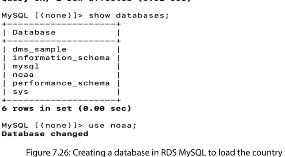

图 7.26：在 RDS MySQL 中创建数据库以加载国家查找文件

我们将创建一个表并将数据加载到该表中，如下所示。此时，我们已完成在 MySQL 中创建源表的前提条件：

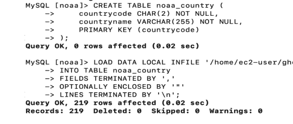

图 7.27：将国家查找文件加载到 RDS MySQL

现在，我们将为此 MySQL 数据库在 Amazon Athena 中设置查询联合。导航到 Amazon Athena 控制台并创建一个数据源。或者，你也可以转到 AWS 无服务器应用程序仓库，创建一个应用程序以部署 Lambda 函数和支持查询联合所需的资源，如下所示：

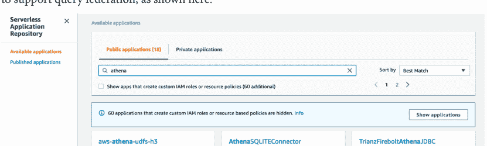

图 7.28：搜索应用程序

在我们的使用案例中，我们将通过 Athena 控制台创建数据源，如下文所述。

## 在你的 AWS 账户中设置数据联合

从 Amazon Athena 创建一个新的数据源，如下所示：

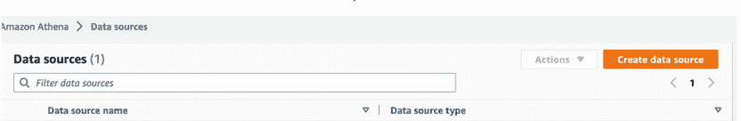

图 7.29：Amazon Athena 数据源屏幕

在这里，我们将选择 mysql 作为数据源并点击 Next。你可以根据不同的使用案例选择相应的源数据库引擎：

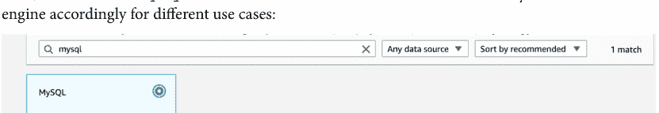

图 7.30：Amazon Athena 针对 MySQL 数据源的数据联合

为应用程序输入一个名称——在我们的使用案例中是 wranglerathena——并点击**创建 Lambda 函数**，这将带你到无服务器应用程序部署屏幕。为了更多地了解连接器，你可以阅读许可证、README 文件和模板部分，以了解将要部署的资源。在**应用程序设置**下，你可以为当前的使用案例输入以下值：

- **应用程序名称：** `AthenaMySQLConnector`（保留默认值）。
- **SecretNamePrefix：** `SecretsManager` 密钥的名称，其中包含源数据库的用户名和密码。对于我们的测试，我们将直接在连接字符串中提供它们。但对于生产部署，强烈建议使用带有密码轮换功能的 secrets manager 以实现高效的安全。因此，在此字段中输入 `dummysecret` 值。
- **Spillbucket：** 提供 Lambda 函数可以存储超出其内存限制的数据的 S3 桶的名称。此功能有效地防止了较大查询结果的 Lambda 内存错误。
- **DefaultConnectionString：** 以以下格式提供连接字符串：
- **DisableSpillEncryption：** `False`（除非你不想加密 S3 中的 spill 数据）。
- **LambdaFunctionName：** 提供与 Athena 数据源连接器相同的名称以便于识别。在我们的情况下，这是 wranglerathena。
- **LambdaMemory** 和 **LambdaTimeout：** 除非你想更改它们，否则保留默认的最大值。
- **PermissionsBoundaryARN：** 在我们的使用案例中留空。
- **SecurityGroupIds：** 提供你希望与 Lambda 函数关联的安全组 ID。安全组需要有访问 MySQL 数据库的规则。
- **SpillPrefix：** 将此保留为默认值 `athena-spill`。
- **SubnetIds：** 提供 Lambda 函数将启动并连接到 RDS MySQL 的子网 ID。提供 RDS MySQL 实例所在的子网 ID，或者一个具有访问数据库权限的子网列表。

```
mysql://jdbc:mysql://<<database endpoint>>:3306/noaa?user=<<username>>&password=<<password>>
##Replace << >> values in the above string with correct values for your use case
```

应用程序创建完成后，选择在上一步中创建的 Lambda 函数，并在 Amazon Athena 中完成数据源的创建。


# 验证联邦数据源的工作状态

方法 1：通过直接按名称引用 Lambda 函数，在 Amazon Athena 中不选择数据源选项执行查询，如下所示。如果一切设置正确，你应该能看到源表中的数据，如下所示：

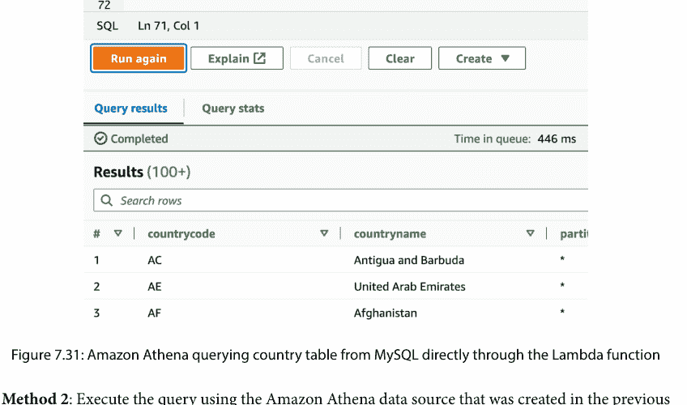

方法 2：使用在上一步中创建的 Amazon Athena 数据源执行查询。在通过此选项进行验证之前，我们需要对由无服务器应用程序创建的 Lambda 函数进行更改，如下所示：

- 导航到 Lambda 控制台，选择配置部分中使用的函数名称——wranglerathena。
- 选择“配置”，然后选择“环境变量”。现在，从默认键名中复制环境变量，并创建一个名为 wranglermysql_connection_string 的新键，如下面的截图所示。该键名应采用 athenadatasource_connection_string 的格式：

图 7.32：更新联邦 Lambda 函数的配置

- 然后，点击“保存”以更新我们在 Lambda 函数中所做的新环境变量更改。

现在，导航到 Amazon Athena 控制台，选择 wranglermysql 作为数据源，你将能够看到新创建的表，如下面的截图所示：

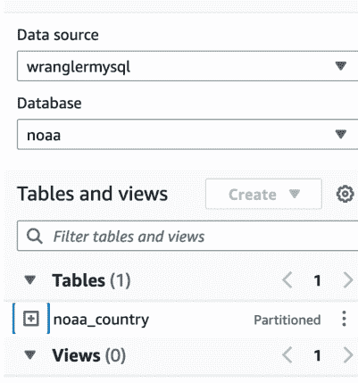

图 7.33：在 Amazon Athena 控制台中从联邦数据源访问表列表

你可以使用 datasource.database.tablename 格式查询该表，并像这样验证连接器的功能：

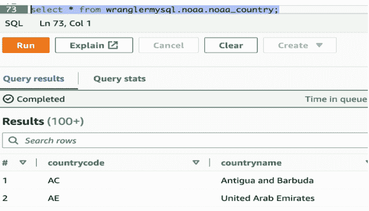

图 7.34：通过 Athena 控制台和注册的数据源查询 RDS MySQL 中的国家表

现在，我们将探讨如何使用 Athena 查询将 MySQL 中的国家数据与 Amazon S3 中可用的 noaa_parquet 表结合。

## 通过数据联邦丰富数据

为了演示 Athena 联邦的好处，让我们考虑一种情况：你的经理（作为公司的数据分析师）要求你尽快找出本世纪南极洲和另外 10 个国家中的最低气温。作为公司的数据分析师，你知道你必须查询 noaa_data_parquet 表，但不确定这些国家的国家代码值。你还知道 MySQL 中有一个表包含此信息，并不想等待数据工程团队将该表迁移到 Amazon S3 并在此基础上创建数据目录以便在 Amazon Athena 中查询。

让我们创建一个联邦查询，该查询连接 Amazon S3 和 RDS MySQL 中的数据，并为我们提供用例所需的输出。我们将执行以下查询，以在无数据源之间进行数据迁移的情况下结合所需的数据集：

```
select min(data_value) as min_temp from AwsDataCatalog.wranglerathena.noaa_data_parquet t1 inner join wranglermysql.noaa.noaa_country t2 on t1.countrycode=t2.countrycode where trim(t2.countryname)='Antarctica' and date_field>cast('1900-01-01' as date)  and element='TMIN'
```

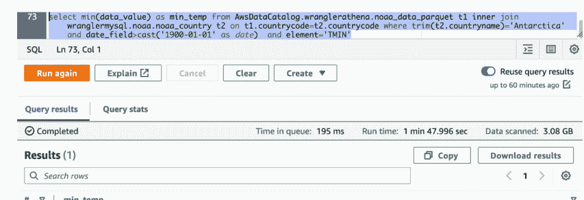

图 7.35：使用联邦连接识别南极洲最低温度的 Amazon Athena 查询

这展示了 Athena 的能力，可以在实际不移动数据的情况下丰富来自多个源的数据。这对许多团队可能会非常有用。

现在我们已经了解了通过 Amazon Athena 丰富数据的各种方式，我们将在下一节中探讨如何使用 Athena 查询设置数据质量管道。

## 使用 Athena 设置无服务器数据质量管道

数据质量验证是数据清理管道中非常重要的一步，确保用于分析和可视化的数据准确性。我们将在本节中探讨如何通过 Amazon Athena 执行数据质量验证。

### 在 Athena 中实现数据质量规则

让我们考虑一下我们想在 NOAA 气象数据集中验证的规则。以下是仅对某些数据质量规则的高层表示，并非气象数据集的全面规则集：

- 1. 当国家代码为 US 时，state 列应有两个字符的值。
- 2. date 字段不应有任何未来日期的值，这些值会是错误的测量结果。
- 3. 验证 element 列仅接受文档中提供的值列表。

我们可以制定更多确保更好数据质量的规则，但上述规则足以让我们演示使用 Amazon Athena 进行数据质量验证。我们首先设计查询，然后在 Athena 中执行以确保语法和语义的正确性。

```
select min(data_value) as min_temp from AwsDataCatalog.wranglerathena.noaa_data_parquet t1 inner join wranglermysql.noaa_noaa_country t2 on t1.countrycode=t2.countrycode where trim(t2.countryname)='Antarctica' and date_field=cast('1900-01-01' as date) and element='TMIN'
```

数据质量规则 1：对于 state 代码列验证，使用这里给出的查询：

```
--Identify incorrect state codes when Country is US
select * from ghnd_stations where substring(ID,1,2)='US'
and length(state)<>2
```

在 Athena 中执行查询，并验证我们没有违反数据质量规则的任何记录，如下面的截图所示。这确保了当前数据没有数据错误，并验证我们的查询按预期正确工作：

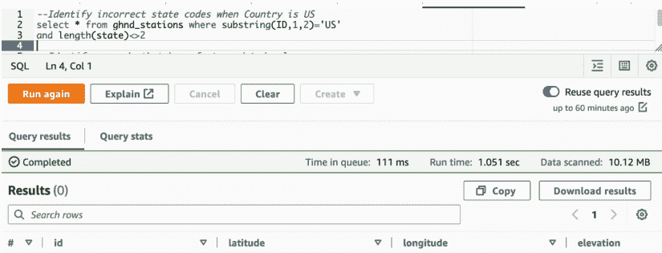

图 7.36：用于识别州代码不等于 2 个字符的记录的 Amazon Athena 数据质量检查

数据质量规则 2：为了验证我们没有来自未来日期的任何气象观测值，我们将使用下面给出的查询。这确保我们没有来自未来日期的错误观测值：

```
--Identify records that have future dated values
select * from noaa_data_parquet where date_field > current_date
```

我们可以以类似的方式执行并验证上一个查询，确保没有存在数据质量问题的记录。

数据质量规则 3：我们将执行下面给出的查询，以验证观测值是否仅针对有效维度。这是通过验证 element 列来实现的。我们通过使用 NOAA 数据集 README 文件（https://docs.opendata.aws/noaa-ghcn-pds/readme.html）中的数据获取了值列表。我们将这些值复制到 Excel 表中，使用 = 分隔符将它们分成两列，然后在以下查询中使用它们：

```
--Identify records with invalid values in element column
select element,s_flag,max(date_field) as latest_date,count(*) as cnt
```

```
from noaa_data_parquet
where countrycode='US' and element not in
('PRCP','SNOW','SNWD','TMAX','TMIN','ACMC','ACMH','ACSC','ACSH',
'AWDR','AWND','DAEV','DAPR','DASF','DATN','DATX','DAWM','DWPR','EVAP',
'FMTM','FRGB','FRGT','FRTH','GAHT','MDEV','MDPR','MDSF','MDTN','MDTX',
'MDWM','MNP N','MXPN','PGTM','PRCP','PSUN','SNOW','SNWD','TAVG','THIC',
'TMAX','TMIN','TOBS','TSUN','WDF1','WDF2','WDF5','WDFG','WDFI',
'WDFM','WDMV','WESD','WESF','WSF1','WSF2','WSF5','WSFG','WSFI','WSFM')
and element not like ('SN%') and element not like ('SX%')
and element not like ('WT%') and element not like ('WV%')
group by element,s_flag
```

在执行查询时，我们发现了一些文档中未提供但基于大量记录的存在似乎像有效值的 element 值，如下所示：

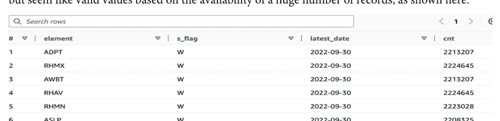

图 7.37：用于识别不在有效值列表中的 element 值的 Amazon Athena 数据质量检查

现在，我们有三个数据质量查询，其中有一个包含我们需要进一步分析以理解的一些记录。下一步是在 DynamoDB 表中设置这些查询，以便可以通过 AWS Step Functions 以无服务器方式在 Amazon Athena 中执行。

## 将 Amazon DynamoDB 用作数据质量管道的元数据存储

我们将使用 DynamoDB 来存储查询，以便可以通过您选择的工具以自动化方式执行。让我们创建一个 DynamoDB 表来存储 SQL 脚本。输入表名，以及分区键和排序键，并将其他设置保留为默认值，如下所示：


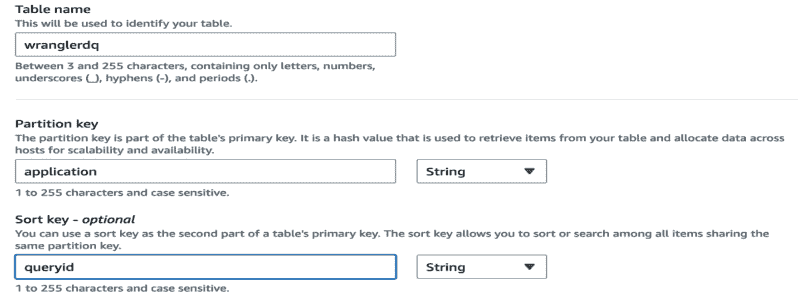

图 7.38：Amazon DynamoDB 表创建流程 – 用于存储数据质量查询

我们使用应用程序名称作为分区键，这样我们就可以使用同一个 DynamoDB 表来存储多个应用程序的数据质量查询。queryid 可以作为一个字段，帮助我们唯一标识每个应用程序内的数据质量查询。

一旦表成功创建，我们将把前一步中设计的查询加载到我们之前创建的 DynamoDB 表中。选择“探索项目” -> 选择表名 -> “创建项目”按钮。您应该会看到以下内容：

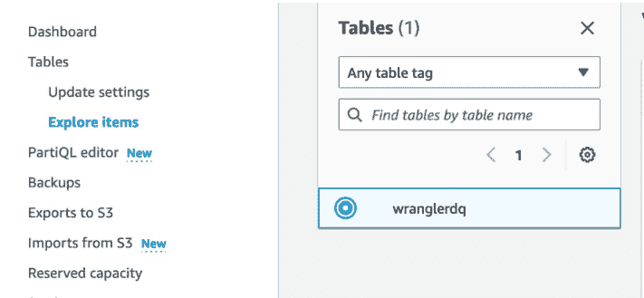

图 7.39：Amazon DynamoDB 表 – 向存储数据质量脚本的表中添加项目

为每个项目输入以下值，并将它们保存回表中：

- application：输入 noaa_weather
- queryid：输入 query<x>
- querystring：从 Athena 控制台复制并粘贴查询字符串

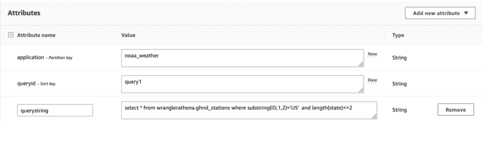

当所有值都存储在表中后，您可以选择一个 DynamoDB 表名，然后选择**探索表项目**，这将带您进入此屏幕，以验证它们是否已正确加载：

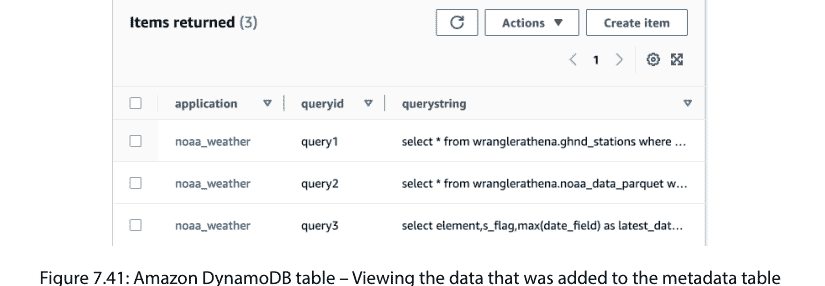

现在，我们的查询已在 DynamoDB 表中准备就绪以便执行，我们将看看如何通过无服务器方式通过状态机工作流来执行它们。

## 无服务器数据质量管道

在 AWS 控制台中导航到 **Step function**（步骤函数），并创建一个状态机。选择**标准**工作流，并选择可视化开发，如下所示：

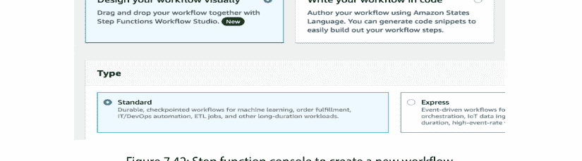

针对我们的用例，应在状态机中设计以下工作流：

1. 对 Amazon DynamoDB 运行查询，并检索我们应用程序的数据质量 SQL 脚本。
2. 以并行方式在 Athena 中执行数据质量 SQL 脚本。
3. 收集结果并在 Lambda 函数中整合它们。
4. 将 Lambda 函数中的整合输出发送到**简单通知服务**（SNS）端点。这将使一组个人能够收到步骤函数结果的通知，以便采取适当的行动。
5. 执行并验证步骤函数工作流的工作情况。
6. 通过 Amazon EventBridge 调度器配置步骤函数以定期执行。

### 步骤 1
在我们状态机的步骤函数控制台中，在搜索框中搜索 `dynamoDB query`，并将 DynamoDB 查询图标拖到可视调色板中。

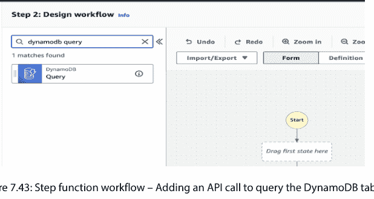

现在，按照以下说明更新参数：

```
{
  "TableName": "wranglerdg",
  "KeyConditionExpression": "application=:v1",
  "ExpressionAttributeValues": {
    ":v1": {
      "S": "noaa_weather"
    }
  }
}
```

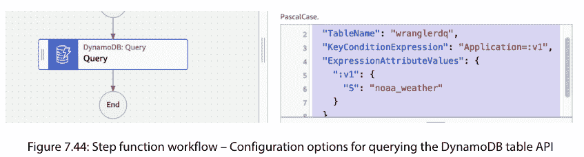

此步骤将针对 wranglerdq 表运行 DynamoDB Query SDK，并根据 `Application = noaa_weather` 属性过滤结果。您可以通过查看 https://docs.aws.amazon.com/amazondynamodb/latest/APIReference/API_Query.html#API_Query_ResponseSyntax 上此 API 调用的文档，了解此 API 调用的输出将是什么。

我们可以看到它有一个 Items 数组字段，该字段将包含字段名称和字段类型。我们需要仅提取 SQL 脚本并将其传递给 Athena 以进行执行，如下所示：

```json
"Items": [
{
"string" : {
"B": blob,
"BOOL": boolean,
"BS": [ blob ],
"L": [
"AttributeValue"
],
"M": {
"string" : "AttributeValue"
},
"N": "string",
"NS": [ "string" ],
"NULL": boolean,
"S": "string",
```


我们将使用 $.Items[*].querystring.S JSON 路径来过滤此步骤的输出。在输出部分，选择“使用 OutputPath 过滤输出”，并提供粘贴在此处的 JSON 路径：

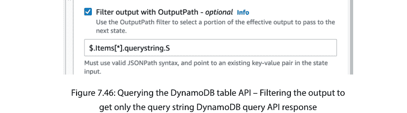

现在，我们将继续开发无服务器数据质量工作流的后续步骤。

### 步骤 2
我们可以使用 map 函数以并行方式执行 Athena 查询。此函数将根据传递给它的数组输入，以不同输入并行执行操作。在我们的用例中，我们将把查询列表作为一个数组传递给 map 函数，该函数将对输入数组中的每个查询并行执行 Athena-Startqueryexecution API。

Map 函数将在**流**选项卡下可用，如下图所示：

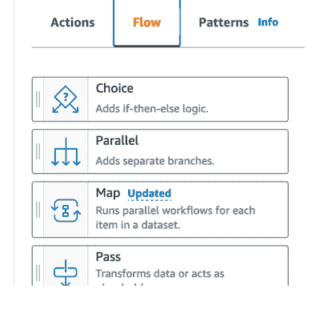

我们将提供 map 函数各种参数的更新值，您可以在您的工作流中更新它们，如下所示：

- **处理模式：** 选择*内联*。
- **提供项目数组的路径：** 输入 "$"。由于我们已经在上一阶段的输出中仅过滤了查询字符串，因此我们将使用顶层 JSON 元素（使用 "$"）获取数据。
- **最大并发数：** 输入 5。您可以为您的用例输入不同的值。我们将通过每批执行五个查询来查看查询性能，然后使用此参数增加/减少并行查询执行数量。

搜索 Athena start，您应该会在结果窗口中看到 Athena StartQueryExecution API 对象。将该对象拖到 map 函数内部，如图所示：

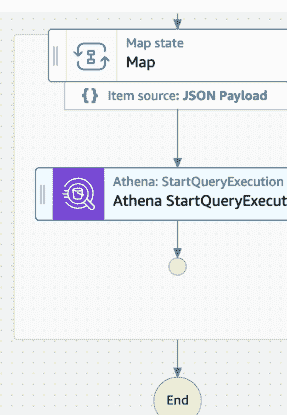

图 7.48：步骤函数工作流 – Map 函数并行执行 Athena 查询

为 Athena StartQueryExecution API 对象输入以下参数：

API 参数：输入以下值。如果您针对特定功能使用不同的工作组，请相应更新输入：

```
{
  "QueryString.$": "$",
  "WorkGroup": "primary",
  "ResultConfiguration": {
    "OutputLocation": "s3://<<path to store athena results>>/"
  }
}
```

等待任务完成：勾选复选框。这样做非常重要，以确保工作流等待查询完成。如果您未勾选此复选框，后续步骤将失败，因为它们试图检索尚未完成的 Athena 查询结果。

### 步骤 3
使用 Lambda 函数整合前一步的结果。

#### 步骤 3a
我们将添加一个**“传递步骤”**，以从 map 函数获取结果并将其传递给 Lambda 函数。搜索**“Pass”步骤**并将其拖到工作流中 map 函数之后。单击**Pass 步骤**，导航到**输入**选项卡，然后勾选**使用参数转换输入**复选框，并输入以下值：

```
{
    "Resultpath.$": "$[*].QueryExecution.ResultConfiguration.OutputLocation",
    "query.$": "$[*].QueryExecution.Query"
}
```

#### 步骤 3b
创建一个 Lambda 函数来整合 Athena 查询执行的结果。在另一个选项卡中打开 Lambda 控制台，将函数名称输入为**Consolidateathenaresults**，运行时为**“Python3.9”**。将其余参数保留为默认值并创建 Lambda 函数。

#### 步骤 3c
在 Lambda 函数中更新以下代码。单击**部署**以保存 Lambda 代码。以下代码从 S3 位置读取数据并整合数据，以便通过电子邮件发送：

```
import json
import boto3
import csv
from urllib.parse import urlparse
s3 = boto3.resource('s3')

def lambda_handler(event, context):
    # TODO implement
    i=0
    output=""
    for file in event["ResultPath"]:
        #Get a S3 URL from which we read the results of Athena query.
        Parsed_path = urlparse(file, allow_fragments=False)

        #Read data from the S3 file and get results and split each line
        s3_object = s3.Object(parsed_path.netloc, parsed_path.path.lstrip('//'))
        data = s3_object.get()['Body'].read().decode('utf-8').splitlines()

        #Create a new section for each query output and print the output from those queries
```


```
            output=output+"------------------------------------------------------\n" +
            event ["query" ] [i] +"\n "
            i=i+1
            lines = csv.reader(data)
            headers = next(lines)
            output=output + "Header "+ ",".join(headers)+"\n"
            for line in lines:
                output=output+",".join(line)+"\n "
            return output
```

**步骤 3d**：更新附加到 Lambda 函数的 IAM 角色，使其拥有 Amazon S3 权限。我们将为 IAM 角色附加 AmazonS3FullAccess 托管策略。在生产环境中，为了进一步限制访问权限，请仅授予对所需 S3 位置的访问权限。

**步骤 3e**：在步骤函数控制台中搜索 Lambda，并将其拖入工作流中的传递步骤之后。输入函数名参数，填入在*步骤 3b*中创建的 Lambda 函数，如图所示：

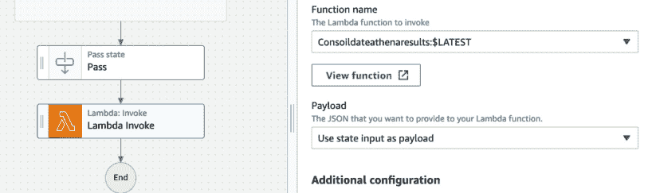

图 7.49：步骤函数工作流 – 用于合并 Athena 查询执行结果的 Lambda 函数

**步骤 3f**：过滤输出路径，以仅获取通过 SNS 主题发送到电子邮件的 Lambda 输出。在“输出”选项卡中，选择“使用 OutputPath 过滤输出”，并输入 `$ . Payload`。

**步骤 4**：通过电子邮件发送合并后的结果。

**步骤 4a**：在新标签页中导航至 SNS 控制台，创建一个**标准**类型的 SNS 主题。主题创建后，点击该主题，并从该主题创建订阅。选择**电子邮件**作为协议，并在**端点**字段中输入您的电子邮件地址（或组）。确保点击确认订阅电子邮件。

**步骤 4b**：返回步骤函数工作流，搜索 SNS `publish`。将 SNS Publish API 图标拖到工作流中 Lambda 函数之后。

至此，我们已完成工作流的创建。点击“下一步”，并验证所有组件和配置是否无错误地提供。它应该看起来像这样：

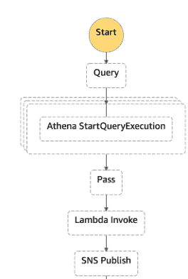

图 7.50：步骤函数工作流 – 无服务器数据质量管道的整体工作流

步骤 5：为步骤函数工作流输入名称，其余参数保持默认值，并创建状态机。我们将验证附加到状态机的 IAM 角色是否拥有所有所需的访问权限。您可以通过点击状态机名称来访问该步骤函数的 IAM 角色，在“详情”部分下方会有一个指向 IAM 角色的链接。

在创建步骤函数时，您可能注意到关于附加到状态机的 IAM 角色未添加 DynamoDB 权限的警告。我们将为 IAM 角色添加 AmazonDynamoDBReadOnlyAccess 托管策略。

现在，使用默认参数执行步骤函数并等待其完成。如果所有配置和 IAM 权限都正确提供，您将看到状态机成功完成，如下所示：

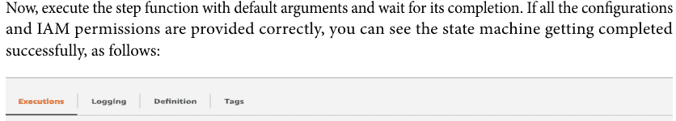

图 7.51：步骤函数工作流 – 数据质量管道的成功执行

您还可以点击当前执行记录，探索每个阶段的输入和输出值，以了解状态机的工作机制：

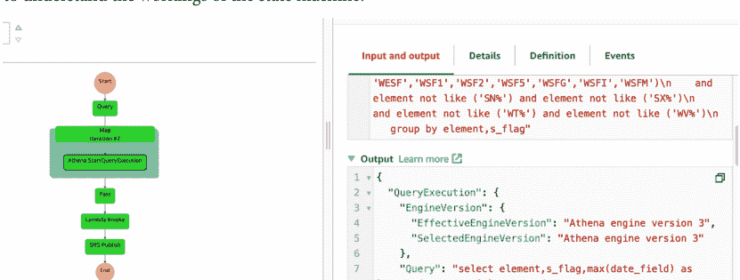

图 7.52：步骤函数工作流 – 验证执行以了解其工作机制

然后，您可以检查电子邮件，验证是否已向您发送包含合并结果的电子邮件。它应该看起来像这样：

# AWS 通知消息

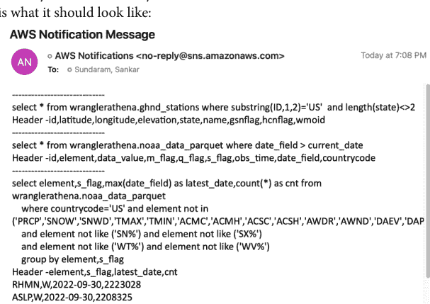

图 7.53：数据质量工作流成功完成后收到的电子邮件片段

现在，我们拥有了一个可定制的无服务器数据质量管道。我们可以修改现有的数据质量查询，添加更多的数据质量查询，并添加拥有自身数据质量查询集的新应用程序。但数据质量管道无需任何更改即可执行它们。

## 挑战练习

你能修改电子邮件输出，使其包含一个摘要表，列出已执行的规则及其通过/失败状态，以及仅来自失败规则的示例记录以供进一步分析吗？

## 提示

设计数据质量查询，使其输出不符合规则记录。因此，如果查询没有记录输出，则数据质量规则应视为通过，反之亦然。您可以在 Lambda 函数中添加此逻辑。在迭代过程中收集每个查询的结果，最后打印摘要仪表板。此外，仅在状态为失败时，才将示例记录附加到电子邮件中的输出数据中。

## 自动化数据质量管道

目前，无服务器管道是以临时方式执行的。我们可以通过 EventBridge Scheduler 使管道按自定义计划执行。

导航至 EventBridge 控制台，并选择计划（Schedules），如图所示：

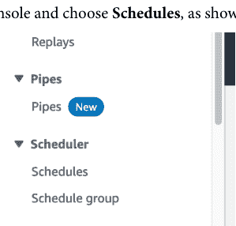

图 7.54：AWS 控制台中的 EventBridge Scheduler

选择**创建计划**，并为计划提供名称。目前，我们将使用循环计划将数据质量管道设置为每小时执行一次，但您也可以使用基于 cron 的方法设置更复杂的计划，如图所示：

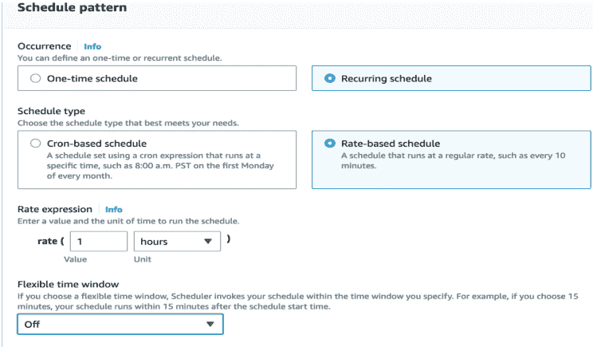

图 7.55：EventBridge Scheduler – 设置每小时运行的计划

在**目标 API**下，选择 **AWS Lambda (Invoke)** 选项，并选择在上一节中创建的步骤函数，如图所示：

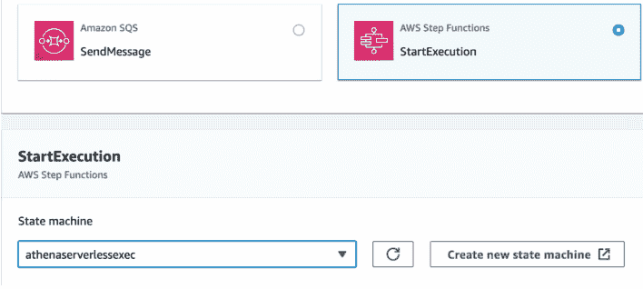

图 7.56：EventBridge Scheduler – 调用步骤函数作为目标

其余参数保持默认值并创建计划。恭喜！我们现在已设置了一个按计划执行的无服务器数据质量管道。

从以下截图中可以看到，工作流每小时都在运行并执行数据质量查询：

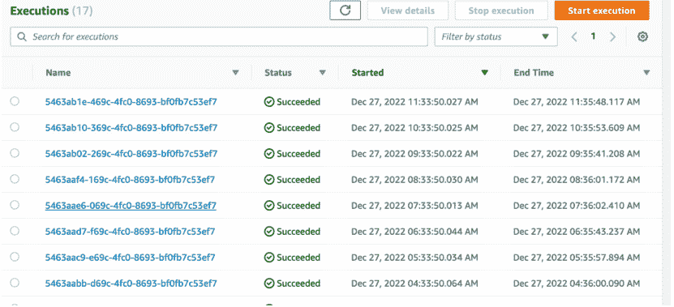

图 7.57：由 EventBridge 每小时执行的步骤函数工作流

在当前的场景中，我们反复对数据执行相同的查询。我们可以修改查询，使其仅针对新数据进行操作，使用标识新数据的时间戳列或分区列即可实现。您可以进一步通过更多参数和 Athena 预定义语句定制管道，以满足您的需求。

## 摘要

在本章中，我们探讨了 Amazon Athena 服务以及它如何帮助数据清洗管道的各个阶段。Amazon Athena 将提供功能，帮助以更好、更高性能的方式执行数据发现、数据转换、数据结构和数据质量，并利用 SQL 语言的高级函数。

在下一章中，我们将学习 Amazon QuickSight，以及它如何帮助数据清洗管道中的数据发现和数据可视化阶段。
